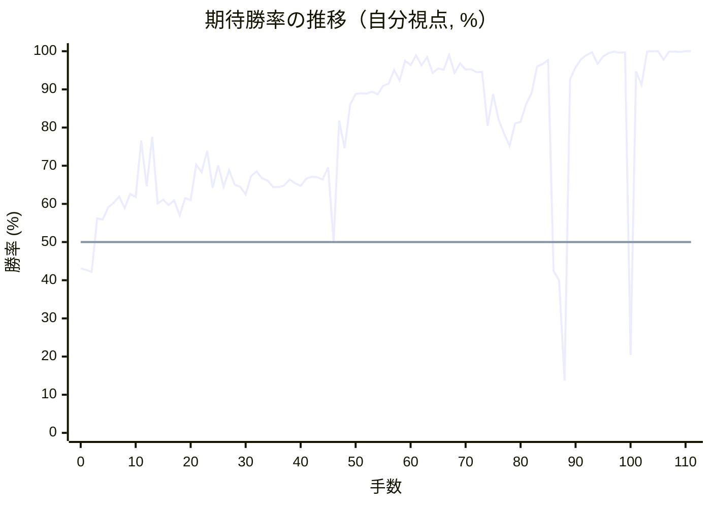

# 解析レポート dsg657x1msx9

[README に戻る](../../../README.md)　/　棋譜: [CSA](../../../data/csa/shogi5/dsg657x1msx9.csa)　/　解析の見方: [docs/mistake_analysis.md](../../../docs/mistake_analysis.md)

## 対局情報

| 項目 | 内容 |
|---|---|
| 日時 | 2026-10-31 09:51:35 |
| 持ち時間 | 5分 |
| 自分 | 後手（△）（1721） |
| 相手 | 相手（1655） |
| 結果 | 負け（時間切れ, 111手） |

## 解析環境

| 項目 | 内容 |
|---|---|
| エンジン | YaneuraOu NNUE 9.00git 64AVX2（V9.00/YANEURAOU_ENGINE_NNUE/AVX2） |
| 評価関数 | **水匠5**（`suisho5`） |
| nn.bin SHA-256 | `768068f0d534a0603a5d38bcd143de6bbca820d5f1c95a14d40863e5b7892d76` |
| 第1パス | movetime=150ms, MultiPV 1 |
| 第2パス | movetime=2000ms, MultiPV 3 |
| Threads / Hash | 8 / 512MB |
| 判定基準 | 疑問手 ≥5pt, 悪手 ≥10pt, 大悪手 ≥20pt（期待勝率 W(E)=1/(1+exp(-E/600))） |
| 解析日時 | 2026-11-03T04:07:51+09:00（解析バージョン 1, 61秒） |

## サマリー

| 自分の手数 | 深掘りした手 | 詰み逃し | 大悪手 | 悪手 | 疑問手 |
|--:|--:|--:|--:|--:|--:|
| 55 | 11 | 1 | 2 | 5 | 2 |

## 期待勝率の推移



<details><summary>1手ごとの数値（第1パス）</summary>

| 手数 | 指し手 | 評価値 | 勝率 | 低下 | 判定 |
|--:|---|--:|--:|--:|---|
| 1 | ▲７六歩(77) | -177 | 42.7% |  |  |
| 2 | △８四歩(83) | -188 | 42.2% | +0.4pt |  |
| 3 | ▲７五歩(76) | +150 | 56.2% |  |  |
| 4 | △８五歩(84) | +142 | 55.9% | +0.3pt |  |
| 5 | ▲７七角(88) | +221 | 59.1% |  |  |
| 6 | △３四歩(33) | +251 | 60.3% | -1.2pt |  |
| 7 | ▲７八銀(79) | +292 | 61.9% |  |  |
| 8 | △６二銀(71) | +216 | 58.9% | +3.0pt |  |
| 9 | ▲６八飛(28) | +308 | 62.6% |  |  |
| 10 | △４二玉(51) | +288 | 61.8% | +0.8pt |  |
| 11 | ▲４八玉(59) | +713 | 76.6% |  |  |
| 12 | △１四歩(13) | +361 | 64.6% | +12.0pt | [悪手](#ply-12) |
| 13 | ▲１六歩(17) | +746 | 77.6% |  |  |
| 14 | △３二玉(42) | +245 | 60.1% | +17.5pt | [悪手](#ply-14) |
| 15 | ▲３八玉(48) | +270 | 61.1% |  |  |
| 16 | △９四歩(93) | +237 | 59.7% | +1.3pt |  |
| 17 | ▲９六歩(97) | +265 | 60.9% |  |  |
| 18 | △４四歩(43) | +170 | 57.0% | +3.8pt |  |
| 19 | ▲４八金(49) | +281 | 61.5% |  |  |
| 20 | △５二金(61) | +268 | 61.0% | +0.5pt |  |
| 21 | ▲５五角(77) | +517 | 70.3% |  |  |
| 22 | △３三角(22) | +461 | 68.3% | +2.0pt |  |
| 23 | ▲７四歩(75) | +626 | 73.9% |  |  |
| 24 | △８四飛(82) | +351 | 64.2% | +9.7pt | [悪手](#ply-24) |
| 25 | ▲７三歩成(74) | +512 | 70.1% |  |  |
| 26 | △同銀(62) | +358 | 64.5% | +5.6pt |  |
| 27 | ▲６六角(55) | +474 | 68.8% |  |  |
| 28 | △８二飛(84) | +372 | 65.0% | +3.8pt |  |
| 29 | ▲７七銀(78) | +358 | 64.5% |  |  |
| 30 | △６四銀(73) | +307 | 62.5% | +2.0pt |  |
| 31 | ▲５六歩(57) | +432 | 67.3% |  |  |
| 32 | △２二玉(32) | +467 | 68.5% | -1.3pt |  |
| 33 | ▲８八飛(68) | +418 | 66.7% |  |  |
| 34 | △３二銀(31) | +401 | 66.1% | +0.6pt |  |
| 35 | ▲８六歩(87) | +355 | 64.4% |  |  |
| 36 | △同歩(85) | +356 | 64.4% | -0.0pt |  |
| 37 | ▲同銀(77) | +366 | 64.8% |  |  |
| 38 | △６五銀(64) | +410 | 66.4% | -1.7pt |  |
| 39 | ▲５五角(66) | +383 | 65.4% |  |  |
| 40 | △７三歩打 | +364 | 64.7% | +0.7pt |  |
| 41 | ▲８三歩打 | +415 | 66.6% |  |  |
| 42 | △同飛(82) | +428 | 67.1% | -0.5pt |  |
| 43 | ▲８五銀(86) | +425 | 67.0% |  |  |
| 44 | △５四歩(53) | +408 | 66.4% | +0.6pt |  |
| 45 | ▲８四銀(85) | +497 | 69.6% |  |  |
| 46 | △８二飛(83) | -3 | 49.9% | +19.7pt | [悪手](#ply-46) |
| 47 | ▲８三歩打 | +902 | 81.8% |  |  |
| 48 | △６二飛(82) | +648 | 74.6% | +7.2pt | [疑問手](#ply-48) |
| 49 | ▲７三角成(55) | +1087 | 86.0% |  |  |
| 50 | △同桂(81) | +1241 | 88.8% | -2.8pt |  |
| 51 | ▲同銀成(84) | +1254 | 89.0% |  |  |
| 52 | △４五歩(44) | +1247 | 88.9% | +0.1pt |  |
| 53 | ▲６二成銀(73) | +1277 | 89.4% |  |  |
| 54 | △同金(52) | +1235 | 88.7% | +0.7pt |  |
| 55 | ▲７八飛(88) | +1384 | 90.9% |  |  |
| 56 | △７六歩打 | +1427 | 91.5% | -0.6pt |  |
| 57 | ▲６六歩(67) | +1781 | 95.1% |  |  |
| 58 | △同角(33) | +1498 | 92.4% | +2.7pt |  |
| 59 | ▲７一飛打 | +2186 | 97.5% |  |  |
| 60 | △９九角成(66) | +1973 | 96.4% | +1.0pt |  |
| 61 | ▲９七桂(89) | +2700 | 98.9% |  |  |
| 62 | △８九馬(99) | +1955 | 96.3% | +2.6pt |  |
| 63 | ▲５八飛(78) | +2503 | 98.5% |  |  |
| 64 | △６六香打 | +1688 | 94.3% | +4.1pt |  |
| 65 | ▲６八歩打 | +1834 | 95.5% |  |  |
| 66 | △５六銀(65) | +1782 | 95.1% | +0.4pt |  |
| 67 | ▲７九金(69) | +2752 | 99.0% |  |  |
| 68 | △同馬(89) | +1682 | 94.3% | +4.7pt |  |
| 69 | ▲５六飛(58) | +2044 | 96.8% |  |  |
| 70 | △５五銀打 | +1790 | 95.2% | +1.6pt |  |
| 71 | ▲同飛(56) | +1810 | 95.3% |  |  |
| 72 | △同歩(54) | +1708 | 94.5% | +0.8pt |  |
| 73 | ▲４三銀打 | +1714 | 94.6% |  |  |
| 74 | △４六歩(45) | +846 | 80.4% | +14.2pt | [疑問手](#ply-74) |
| 75 | ▲４四桂打 | +1241 | 88.8% |  |  |
| 76 | △４七歩成(46) | +913 | 82.1% | +6.7pt |  |
| 77 | ▲同金(48) | +772 | 78.4% |  |  |
| 78 | △４六歩打 | +667 | 75.2% | +3.1pt |  |
| 79 | ▲３二銀成(43) | +872 | 81.1% |  |  |
| 80 | △同金(41) | +888 | 81.5% | -0.4pt |  |
| 81 | ▲同桂成(44) | +1093 | 86.1% |  |  |
| 82 | △同玉(22) | +1255 | 89.0% | -2.9pt |  |
| 83 | ▲３一金打 | +1906 | 96.0% |  |  |
| 84 | △３三玉(32) | +2014 | 96.6% | -0.6pt |  |
| 85 | ▲４六金(47) | +2243 | 97.7% |  |  |
| 86 | △６一金打 | -185 | 42.4% | +55.3pt | [悪手](#ply-86) |
| 87 | ▲７四飛成(71) | -243 | 40.0% |  |  |
| 88 | △６四桂打 | -1104 | 13.7% | +26.3pt | [大悪手](#ply-88) |
| 89 | ▲４五銀打 | +1523 | 92.7% |  |  |
| 90 | △６八馬(79) | +1870 | 95.8% | -3.1pt |  |
| 91 | ▲２一金(31) | +2313 | 97.9% |  |  |
| 92 | △４六馬(68) | +2781 | 99.0% | -1.1pt |  |
| 93 | ▲４四銀打 | +3550 | 99.7% |  |  |
| 94 | △２四玉(33) | +2021 | 96.7% | +3.1pt |  |
| 95 | ▲３六桂打 | +2556 | 98.6% |  |  |
| 96 | △１三玉(24) | +3175 | 99.5% | -0.9pt |  |
| 97 | ▲１五歩(16) | +4054 | 99.9% |  |  |
| 98 | △７八飛打 | +3341 | 99.6% | +0.3pt |  |
| 99 | ▲４八歩打 | +3444 | 99.7% |  |  |
| 100 | △４九銀打 | -817 | 20.4% | +79.3pt | [大悪手](#ply-100) |
| 101 | ▲２八玉(38) | +1735 | 94.7% |  |  |
| 102 | △３八金打 | +1401 | 91.2% | +3.6pt |  |
| 103 | ▲同銀(39) | +4101 | 99.9% |  |  |
| 104 | △同銀成(49) | +5476 | 100.0% | -0.1pt |  |
| 105 | ▲同玉(28) | #+9 | 100.0% |  |  |
| 106 | △４七角打 | +2276 | 97.8% | +2.2pt | [詰み逃し](#ply-106) |
| 107 | ▲２八玉(38) | +3932 | 99.9% |  |  |
| 108 | △４八飛成(78) | +4250 | 99.9% | -0.1pt |  |
| 109 | ▲１七玉(28) | +3732 | 99.8% |  |  |
| 110 | △１五歩(14) | +4568 | 100.0% | -0.1pt |  |
| 111 | ▲１四歩打 | +35281 | 100.0% |  |  |

</details>

## 課題局面

<a id="ply-12"></a>
### 12手目 △１四歩(13) — 悪手

| | 着手前 | 着手後 | 差 |
|---|--:|--:|--:|
| 期待勝率 | 76.6% | 63.2% | -13.3pt |
| 評価値 | +710 | +325 | |

着手前の局面:

```text
後手の持駒：なし
  ９ ８ ７ ６ ５ ４ ３ ２ １
+---------------------------+
|v香v桂 ・v金 ・v金v銀v桂v香|一
| ・v飛 ・v銀 ・v玉 ・v角 ・|二
|v歩 ・v歩v歩v歩v歩 ・v歩v歩|三
| ・ ・ ・ ・ ・ ・v歩 ・ ・|四
| ・v歩 歩 ・ ・ ・ ・ ・ ・|五
| ・ ・ ・ ・ ・ ・ ・ ・ ・|六
| 歩 歩 角 歩 歩 歩 歩 歩 歩|七
| ・ ・ 銀 飛 ・ 玉 ・ ・ ・|八
| 香 桂 ・ 金 ・ 金 銀 桂 香|九
+---------------------------+
先手の持駒：なし
後手番
手数＝11　▲４八玉　まで
```

| | 指し手 | 評価値 | 読み筋 |
|---|---|--:|---|
| 実戦 | △１四歩(13) | +325 | ▲６六歩(67) △１五歩(14) ▲６七銀(78) △３二玉(42) ▲３八銀(39) △５二金(61) |
| AI 1位 | △７七角成(22) | +710 | △７七角成(22) ▲同銀(78) △５四角打 ▲８八飛(68) △２七角成(54) ▲７八金(69) |
| AI 2位 | △１四歩(13) | +267 | △１四歩(13) ▲２二角成(77) △同銀(31) ▲３八玉(48) △５四歩(53) ▲１六歩(17) |
| AI 3位 | △５二金(61) | +227 | △５二金(61) ▲６六歩(67) △１四歩(13) ▲１六歩(17) △５四歩(53) ▲３八銀(39) |

SFEN: `ln1g1gsnl/1r1s1k1b1/p1pppp1pp/6p2/1pP6/9/PPBPPPPPP/2SR1K3/LN1G1GSNL w - 12`

<a id="ply-14"></a>
### 14手目 △３二玉(42) — 悪手

| | 着手前 | 着手後 | 差 |
|---|--:|--:|--:|
| 期待勝率 | 77.1% | 60.3% | -16.8pt |
| 評価値 | +727 | +251 | |

着手前の局面:

```text
後手の持駒：なし
  ９ ８ ７ ６ ５ ４ ３ ２ １
+---------------------------+
|v香v桂 ・v金 ・v金v銀v桂v香|一
| ・v飛 ・v銀 ・v玉 ・v角 ・|二
|v歩 ・v歩v歩v歩v歩 ・v歩 ・|三
| ・ ・ ・ ・ ・ ・v歩 ・v歩|四
| ・v歩 歩 ・ ・ ・ ・ ・ ・|五
| ・ ・ ・ ・ ・ ・ ・ ・ 歩|六
| 歩 歩 角 歩 歩 歩 歩 歩 ・|七
| ・ ・ 銀 飛 ・ 玉 ・ ・ ・|八
| 香 桂 ・ 金 ・ 金 銀 桂 香|九
+---------------------------+
先手の持駒：なし
後手番
手数＝13　▲１六歩　まで
```

| | 指し手 | 評価値 | 読み筋 |
|---|---|--:|---|
| 実戦 | △３二玉(42) | +251 | ▲３八玉(48) △５二金(61) ▲６六歩(67) △８四飛(82) ▲２八玉(38) △７四歩(73) |
| AI 1位 | △７七角成(22) | +727 | △７七角成(22) ▲同銀(78) △５四角打 ▲８八飛(68) △２七角成(54) ▲７八金(69) |
| AI 2位 | △３二玉(42) | +243 | △３二玉(42) ▲３八玉(48) △５二金(61) ▲５八金(69) △５四歩(53) ▲２八玉(38) |
| AI 3位 | △５二金(61) | +218 | △５二金(61) ▲３八銀(39) △３二玉(42) ▲３九玉(48) △２四歩(23) ▲２八玉(39) |

SFEN: `ln1g1gsnl/1r1s1k1b1/p1pppp1p1/6p1p/1pP6/8P/PPBPPPPP1/2SR1K3/LN1G1GSNL w - 14`

<a id="ply-24"></a>
### 24手目 △８四飛(82) — 悪手

| | 着手前 | 着手後 | 差 |
|---|--:|--:|--:|
| 期待勝率 | 74.6% | 61.7% | -12.9pt |
| 評価値 | +647 | +287 | |

着手前の局面:

```text
後手の持駒：なし
  ９ ８ ７ ６ ５ ４ ３ ２ １
+---------------------------+
|v香v桂 ・ ・ ・v金v銀v桂v香|一
| ・v飛 ・v銀v金 ・v玉 ・ ・|二
| ・ ・v歩v歩v歩 ・v角v歩 ・|三
|v歩 ・ 歩 ・ ・v歩v歩 ・v歩|四
| ・v歩 ・ ・ 角 ・ ・ ・ ・|五
| 歩 ・ ・ ・ ・ ・ ・ ・ 歩|六
| ・ 歩 ・ 歩 歩 歩 歩 歩 ・|七
| ・ ・ 銀 飛 ・ 金 玉 ・ ・|八
| 香 桂 ・ 金 ・ ・ 銀 桂 香|九
+---------------------------+
先手の持駒：なし
後手番
手数＝23　▲７四歩　まで
```

| | 指し手 | 評価値 | 読み筋 |
|---|---|--:|---|
| 実戦 | △８四飛(82) | +287 | ▲７七銀(78) △５四歩(53) ▲６六角(55) △８二飛(84) ▲７三歩成(74) △同銀(62) |
| AI 1位 | △５四歩(53) | +647 | △５四歩(53) ▲７三歩成(74) △同銀(62) ▲６六角(55) △６四銀(73) ▲７七銀(78) |
| AI 2位 | △４二銀(31) | +538 | △４二銀(31) ▲７七銀(78) △５四歩(53) ▲７三歩成(74) △同銀(62) ▲６六角(55) |
| AI 3位 | △８六歩(85) | +504 | △８六歩(85) ▲同歩(87) △同飛(82) ▲７三歩成(74) △同銀(62) ▲７二歩打 |

SFEN: `ln3gsnl/1r1sg1k2/2ppp1bp1/p1P2pp1p/1p2B4/P7P/1P1PPPPP1/2SR1GK2/LN1G2SNL w - 24`

<a id="ply-46"></a>
### 46手目 △８二飛(83) — 悪手

| | 着手前 | 着手後 | 差 |
|---|--:|--:|--:|
| 期待勝率 | 70.1% | 53.7% | -16.5pt |
| 評価値 | +512 | +88 | |

着手前の局面:

```text
後手の持駒：歩二
  ９ ８ ７ ６ ５ ４ ３ ２ １
+---------------------------+
|v香v桂 ・ ・ ・v金 ・v桂v香|一
| ・ ・ ・ ・v金 ・v銀v玉 ・|二
| ・v飛v歩v歩 ・ ・v角v歩 ・|三
|v歩 銀 ・ ・v歩v歩v歩 ・v歩|四
| ・ ・ ・v銀 角 ・ ・ ・ ・|五
| 歩 ・ ・ ・ 歩 ・ ・ ・ 歩|六
| ・ ・ ・ 歩 ・ 歩 歩 歩 ・|七
| ・ 飛 ・ ・ ・ 金 玉 ・ ・|八
| 香 桂 ・ 金 ・ ・ 銀 桂 香|九
+---------------------------+
先手の持駒：歩
後手番
手数＝45　▲８四銀　まで
```

| | 指し手 | 評価値 | 読み筋 |
|---|---|--:|---|
| 実戦 | △８二飛(83) | +88 | ▲８三銀成(84) △同飛(82) ▲同飛成(88) △５五歩(54) ▲８一龍(83) △５六歩(55) |
| AI 1位 | △５五歩(54) | +512 | △５五歩(54) ▲８三銀不成(84) △５六歩(55) ▲７二銀不成(83) △８七歩打 ▲同飛(88) |
| AI 2位 | △８六歩打 | +287 | △８六歩打 ▲８三銀成(84) △５五歩(54) ▲６一飛打 △５六歩(55) ▲５八歩打 |
| AI 3位 | △８七歩打 | +141 | △８七歩打 ▲同飛(88) △５五歩(54) ▲８三銀不成(84) △５六歩(55) ▲５八歩打 |

SFEN: `ln3g1nl/4g1sk1/1rpp2bp1/pS2ppp1p/3sB4/P3P3P/3P1PPP1/1R3GK2/LN1G2SNL w P2p 46`

<a id="ply-48"></a>
### 48手目 △６二飛(82) — 疑問手

| | 着手前 | 着手後 | 差 |
|---|--:|--:|--:|
| 期待勝率 | 88.3% | 79.3% | -9.0pt |
| 評価値 | +1214 | +806 | |

着手前の局面:

```text
後手の持駒：歩二
  ９ ８ ７ ６ ５ ４ ３ ２ １
+---------------------------+
|v香v桂 ・ ・ ・v金 ・v桂v香|一
| ・v飛 ・ ・v金 ・v銀v玉 ・|二
| ・ 歩v歩v歩 ・ ・v角v歩 ・|三
|v歩 銀 ・ ・v歩v歩v歩 ・v歩|四
| ・ ・ ・v銀 角 ・ ・ ・ ・|五
| 歩 ・ ・ ・ 歩 ・ ・ ・ 歩|六
| ・ ・ ・ 歩 ・ 歩 歩 歩 ・|七
| ・ 飛 ・ ・ ・ 金 玉 ・ ・|八
| 香 桂 ・ 金 ・ ・ 銀 桂 香|九
+---------------------------+
先手の持駒：なし
後手番
手数＝47　▲８三歩　まで
```

| | 指し手 | 評価値 | 読み筋 |
|---|---|--:|---|
| 実戦 | △６二飛(82) | +806 | ▲７三銀不成(84) △５五歩(54) ▲６二銀成(73) △同金(52) ▲８二歩成(83) △４五歩(44) |
| AI 1位 | △５五歩(54) | +1214 | △５五歩(54) ▲８二歩成(83) △５六歩(55) ▲７五銀(84) △４五歩(44) ▲８三飛打 |
| AI 2位 | △９二飛(82) | +798 | △９二飛(82) ▲８二歩成(83) △５五歩(54) ▲７五銀(84) △９三飛(92) ▲８三と(82) |
| AI 3位 | △６二飛(82) | +767 | △６二飛(82) ▲７三銀不成(84) △５五歩(54) ▲６二銀成(73) △同金(52) ▲８二歩成(83) |

SFEN: `ln3g1nl/1r2g1sk1/1Ppp2bp1/pS2ppp1p/3sB4/P3P3P/3P1PPP1/1R3GK2/LN1G2SNL w 2p 48`

<a id="ply-74"></a>
### 74手目 △４六歩(45) — 疑問手

| | 着手前 | 着手後 | 差 |
|---|--:|--:|--:|
| 期待勝率 | 97.3% | 90.6% | -6.7pt |
| 評価値 | +2157 | +1362 | |

着手前の局面:

```text
後手の持駒：飛　角　金　歩三
  ９ ８ ７ ６ ５ ４ ３ ２ １
+---------------------------+
|v香 ・ 飛 ・ ・v金 ・v桂v香|一
| ・ ・ ・v金 ・ ・v銀v玉 ・|二
| ・ 歩 ・v歩 ・ 銀 ・v歩 ・|三
|v歩 ・ ・ ・ ・ ・v歩 ・v歩|四
| ・ ・ ・ ・v歩v歩 ・ ・ ・|五
| 歩 ・v歩v香 ・ ・ ・ ・ 歩|六
| 桂 ・ ・ ・ ・ 歩 歩 歩 ・|七
| ・ ・ ・ 歩 ・ 金 玉 ・ ・|八
| ・ ・v馬 ・ ・ ・ 銀 桂 香|九
+---------------------------+
先手の持駒：銀　桂
後手番
手数＝73　▲４三銀　まで
```

| | 指し手 | 評価値 | 読み筋 |
|---|---|--:|---|
| 実戦 | △４六歩(45) | +1362 | ▲４四桂打 △３三金打 ▲３一銀打 △同玉(22) ▲３二桂成(44) △同金(33) |
| AI 1位 | △６一金打 | +2157 | △６一金打 ▲３二銀成(43) △同金(41) ▲９一飛成(71) △９七馬(79) ▲４四桂打 |
| AI 2位 | △９七馬(79) | +2034 | △９七馬(79) ▲４四桂打 △３一金打 ▲３二銀成(43) △同金(41) ▲同桂成(44) |
| AI 3位 | △３一金打 | +1994 | △３一金打 ▲３二銀成(43) △同金(41) ▲５一飛成(71) △５三角打 ▲７一銀打 |

SFEN: `l1R2g1nl/3g2sk1/1P1p1S1p1/p5p1p/4pp3/P1pl4P/N4PPP1/3P1GK2/2+b3SNL w SNrbg3p 74`

<a id="ply-86"></a>
### 86手目 △６一金打 — 悪手

| | 着手前 | 着手後 | 差 |
|---|--:|--:|--:|
| 期待勝率 | 99.2% | 80.4% | -18.8pt |
| 評価値 | +2924 | +847 | |

着手前の局面:

```text
後手の持駒：飛　角　金　銀　桂　歩三
  ９ ８ ７ ６ ５ ４ ３ ２ １
+---------------------------+
|v香 ・ 飛 ・ ・ ・ 金v桂v香|一
| ・ ・ ・v金 ・ ・ ・ ・ ・|二
| ・ 歩 ・v歩 ・ ・v玉v歩 ・|三
|v歩 ・ ・ ・ ・ ・v歩 ・v歩|四
| ・ ・ ・ ・v歩 ・ ・ ・ ・|五
| 歩 ・v歩v香 ・ 金 ・ ・ 歩|六
| 桂 ・ ・ ・ ・ ・ 歩 歩 ・|七
| ・ ・ ・ 歩 ・ ・ 玉 ・ ・|八
| ・ ・v馬 ・ ・ ・ 銀 桂 香|九
+---------------------------+
先手の持駒：銀二　歩二
後手番
手数＝85　▲４六金　まで
```

| | 指し手 | 評価値 | 読み筋 |
|---|---|--:|---|
| 実戦 | △６一金打 | +847 | ▲７四飛成(71) △５八飛打 ▲４八歩打 △６四銀打 ▲４七銀打 △５九飛成(58) |
| AI 1位 | △５八飛打 | +2924 | △５八飛打 ▲４八銀打 △５七銀打 ▲４九銀打 △６八飛成(58) ▲４五金(46) |
| AI 2位 | △５九飛打 | +2463 | △５九飛打 ▲２二銀打 △４三玉(33) ▲２八玉(38) △３九飛成(59) ▲同玉(28) |
| AI 3位 | △６九飛打 | +2085 | △６九飛打 ▲７四飛成(71) △２六桂打 ▲同歩(27) △４九角打 ▲４七玉(38) |

SFEN: `l1R3Gnl/3g5/1P1p2kp1/p5p1p/4p4/P1pl1G2P/N5PP1/3P2K2/2+b3SNL w 2S2Prbgsn3p 86`

<a id="ply-88"></a>
### 88手目 △６四桂打 — 大悪手

| | 着手前 | 着手後 | 差 |
|---|--:|--:|--:|
| 期待勝率 | 85.6% | 49.1% | -36.5pt |
| 評価値 | +1070 | -22 | |

着手前の局面:

```text
後手の持駒：飛　角　銀　桂　歩三
  ９ ８ ７ ６ ５ ４ ３ ２ １
+---------------------------+
|v香 ・ ・v金 ・ ・ 金v桂v香|一
| ・ ・ ・v金 ・ ・ ・ ・ ・|二
| ・ 歩 ・v歩 ・ ・v玉v歩 ・|三
|v歩 ・ 龍 ・ ・ ・v歩 ・v歩|四
| ・ ・ ・ ・v歩 ・ ・ ・ ・|五
| 歩 ・v歩v香 ・ 金 ・ ・ 歩|六
| 桂 ・ ・ ・ ・ ・ 歩 歩 ・|七
| ・ ・ ・ 歩 ・ ・ 玉 ・ ・|八
| ・ ・v馬 ・ ・ ・ 銀 桂 香|九
+---------------------------+
先手の持駒：銀二　歩二
後手番
手数＝87　▲７四飛成　まで
```

| | 指し手 | 評価値 | 読み筋 |
|---|---|--:|---|
| 実戦 | △６四桂打 | -22 | ▲２一金(31) △５八飛打 ▲４八銀(39) △５七銀打 ▲２五桂打 △４二玉(33) |
| AI 1位 | △５八飛打 | +1070 | △５八飛打 ▲４八歩打 △６四銀打 ▲４七銀打 △５九飛成(58) ▲２一金(31) |
| AI 2位 | △６四銀打 | +521 | △６四銀打 ▲２一金(31) △５八飛打 ▲４八銀(39) △４七歩打 ▲同金(46) |
| AI 3位 | △５九飛打 | -488 | △５九飛打 ▲２八玉(38) △５七角打 ▲４八銀打 △５八飛成(59) ▲４五金(46) |

SFEN: `l2g2Gnl/3g5/1P1p2kp1/p1+R3p1p/4p4/P1pl1G2P/N5PP1/3P2K2/2+b3SNL w 2S2Prbsn3p 88`

<a id="ply-100"></a>
### 100手目 △４九銀打 — 大悪手

| | 着手前 | 着手後 | 差 |
|---|--:|--:|--:|
| 期待勝率 | 99.9% | 3.4% | -96.6pt |
| 評価値 | +4336 | -2017 | |

着手前の局面:

```text
後手の持駒：角　金　銀　歩四
  ９ ８ ７ ６ ５ ４ ３ ２ １
+---------------------------+
|v香 ・ ・v金 ・ ・ ・ 金v香|一
| ・ ・ ・v金 ・ ・ ・ ・ ・|二
| ・ 歩 ・v歩 ・ ・ ・v歩v玉|三
|v歩 ・ 龍v桂 ・ 銀v歩 ・v歩|四
| ・ ・ ・ ・v歩 銀 ・ ・ 歩|五
| 歩 ・v歩v香 ・v馬 桂 ・ ・|六
| 桂 ・ ・ ・ ・ ・ 歩 歩 ・|七
| ・ ・v飛 ・ ・ 歩 玉 ・ ・|八
| ・ ・ ・ ・ ・ ・ 銀 桂 香|九
+---------------------------+
先手の持駒：歩
後手番
手数＝99　▲４八歩　まで
```

| | 指し手 | 評価値 | 読み筋 |
|---|---|--:|---|
| 実戦 | △４九銀打 | -2017 | ▲同玉(38) △１二玉(13) ▲２二銀打 △２四歩(23) ▲３四銀(45) △６七角打 |
| AI 1位 | △４七銀打 | +4336 | △４七銀打 ▲２八玉(38) △４八銀不成(47) ▲１四歩(15) △１二玉(13) ▲１一金(21) |
| AI 2位 | △４七歩打 | +4108 | △４七歩打 ▲１四歩(15) △１二玉(13) ▲１一金(21) △同玉(12) ▲１三香打 |
| AI 3位 | △１二玉(13) | +2807 | △１二玉(13) ▲１一金(21) △同玉(12) ▲２八玉(38) △４七銀打 ▲１三香打 |

SFEN: `l2g3Gl/3g5/1P1p3pk/p1+Rn1Sp1p/4pS2P/P1pl1+bN2/N5PP1/2r2PK2/6SNL w Pbgs4p 100`

<a id="ply-106"></a>
### 106手目 △４七角打 — 詰み逃し

| | 着手前 | 着手後 | 差 |
|---|--:|--:|--:|
| 期待勝率 | 100.0% | 100.0% | -0.0pt |
| 評価値 | 9手詰め | +6330 | |

着手前の局面:

```text
後手の持駒：角　銀　歩四
  ９ ８ ７ ６ ５ ４ ３ ２ １
+---------------------------+
|v香 ・ ・v金 ・ ・ ・ 金v香|一
| ・ ・ ・v金 ・ ・ ・ ・ ・|二
| ・ 歩 ・v歩 ・ ・ ・v歩v玉|三
|v歩 ・ 龍v桂 ・ 銀v歩 ・v歩|四
| ・ ・ ・ ・v歩 銀 ・ ・ 歩|五
| 歩 ・v歩v香 ・v馬 桂 ・ ・|六
| 桂 ・ ・ ・ ・ ・ 歩 歩 ・|七
| ・ ・v飛 ・ ・ 歩 玉 ・ ・|八
| ・ ・ ・ ・ ・ ・ ・ 桂 香|九
+---------------------------+
先手の持駒：金　銀　歩
後手番
手数＝105　▲３八同玉　まで
```

| | 指し手 | 評価値 | 読み筋 |
|---|---|--:|---|
| 実戦 | △４七角打 | +6330 | ▲２八玉(38) △４八飛成(78) ▲１七玉(28) △１五歩(14) ▲２二金打 △２九角成(47) |
| AI 1位 | △４七銀打 | 9手詰め | △４七銀打 ▲２八玉(38) △３九角打 ▲１八玉(28) △４八飛成(78) ▲３八金打 |
| AI 2位 | △４七角打 | +2898 | △４七角打 ▲２八玉(38) △４八飛成(78) ▲１七玉(28) △１五歩(14) ▲１四歩打 |
| AI 3位 | △５六角打 | -4188 | △５六角打 ▲同銀(45) △同馬(46) ▲４七銀打 △同馬(56) ▲同玉(38) |

SFEN: `l2g3Gl/3g5/1P1p3pk/p1+Rn1Sp1p/4pS2P/P1pl1+bN2/N5PP1/2r2PK2/7NL w GSPbs4p 106`

