# 解析レポート eaao9ztqwfjx

[README に戻る](../../../README.md)　/　棋譜: [CSA](../../../data/csa/shogi5/eaao9ztqwfjx.csa)　/　解析の見方: [docs/mistake_analysis.md](../../../docs/mistake_analysis.md)

## 対局情報

| 項目 | 内容 |
|---|---|
| 日時 | 2026-11-11 04:29:29 |
| 持ち時間 | 5分 |
| 自分 | 後手（△）（1664） |
| 相手 | 相手（1690） |
| 結果 | 負け（詰み, 81手） |

## 解析環境

| 項目 | 内容 |
|---|---|
| エンジン | YaneuraOu NNUE 9.00git 64AVX2（V9.00/YANEURAOU_ENGINE_NNUE/AVX2） |
| 評価関数 | **水匠5**（`suisho5`） |
| nn.bin SHA-256 | `768068f0d534a0603a5d38bcd143de6bbca820d5f1c95a14d40863e5b7892d76` |
| 第1パス | movetime=150ms, MultiPV 1 |
| 第2パス | movetime=2000ms, MultiPV 3 |
| Threads / Hash | 8 / 512MB |
| 判定基準 | 疑問手 ≥5pt, 悪手 ≥10pt, 大悪手 ≥20pt（期待勝率 W(E)=1/(1+exp(-E/600))） |
| 解析日時 | 2026-11-14T10:42:45+09:00（解析バージョン 1, 54秒） |

## サマリー

| 自分の手数 | 深掘りした手 | 詰み逃し | 大悪手 | 悪手 | 疑問手 |
|--:|--:|--:|--:|--:|--:|
| 40 | 11 | 0 | 7 | 3 | 0 |

## 期待勝率の推移

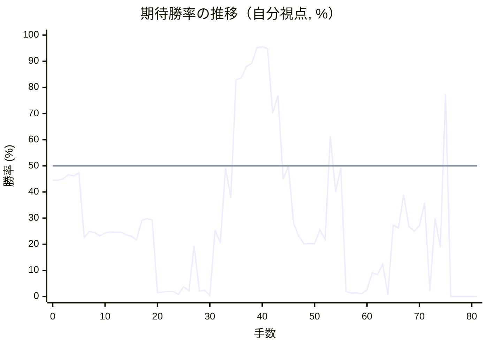

<details><summary>1手ごとの数値（第1パス）</summary>

| 手数 | 指し手 | 評価値 | 勝率 | 低下 | 判定 |
|--:|---|--:|--:|--:|---|
| 1 | ▲２六歩(27) | -133 | 44.5% |  |  |
| 2 | △８四歩(83) | -121 | 45.0% | -0.5pt |  |
| 3 | ▲２五歩(26) | -82 | 46.6% |  |  |
| 4 | △８五歩(84) | -94 | 46.1% | +0.5pt |  |
| 5 | ▲９六歩(97) | -64 | 47.3% |  |  |
| 6 | △６二銀(71) | -737 | 22.6% | +24.7pt | [大悪手](#ply-6) |
| 7 | ▲２四歩(25) | -662 | 24.9% |  |  |
| 8 | △同歩(23) | -674 | 24.5% | +0.4pt |  |
| 9 | ▲同飛(28) | -718 | 23.2% |  |  |
| 10 | △３四歩(33) | -681 | 24.3% | -1.1pt |  |
| 11 | ▲２三飛成(24) | -670 | 24.7% |  |  |
| 12 | △８六歩(85) | -671 | 24.6% | +0.0pt |  |
| 13 | ▲同歩(87) | -671 | 24.6% |  |  |
| 14 | △同飛(82) | -700 | 23.7% | +0.9pt |  |
| 15 | ▲２五龍(23) | -720 | 23.1% |  |  |
| 16 | △３二金(41) | -770 | 21.7% | +1.4pt |  |
| 17 | ▲２四歩打 | -534 | 29.1% |  |  |
| 18 | △３三桂(21) | -514 | 29.8% | -0.7pt |  |
| 19 | ▲３四龍(25) | -528 | 29.3% |  |  |
| 20 | △８八飛成(86) | -2512 | 1.5% | +27.8pt | [大悪手](#ply-20) |
| 21 | ▲同銀(79) | -2450 | 1.7% |  |  |
| 22 | △４五角打 | -2364 | 1.9% | -0.3pt |  |
| 23 | ▲８四龍(34) | -2361 | 1.9% |  |  |
| 24 | △６七角成(45) | -2868 | 0.8% | +1.1pt |  |
| 25 | ▲７九銀(88) | -1938 | 3.8% |  |  |
| 26 | △４五桂(33) | -2274 | 2.2% | +1.6pt |  |
| 27 | ▲７八銀(79) | -856 | 19.4% |  |  |
| 28 | △５七馬(67) | -2294 | 2.1% | +17.2pt | [悪手](#ply-28) |
| 29 | ▲８一龍(84) | -2226 | 2.4% |  |  |
| 30 | △４七馬(57) | -3252 | 0.4% | +1.9pt |  |
| 31 | ▲６一龍(81) | -643 | 25.5% |  |  |
| 32 | △同玉(51) | -814 | 20.5% | +5.0pt |  |
| 33 | ▲８一飛打 | -21 | 49.1% |  |  |
| 34 | △５二玉(61) | -298 | 37.8% | +11.3pt |  |
| 35 | ▲３四桂打 | +944 | 82.8% |  |  |
| 36 | △５四飛打 | +983 | 83.7% | -0.9pt |  |
| 37 | ▲５八歩打 | +1198 | 88.0% |  |  |
| 38 | △３四飛(54) | +1264 | 89.2% | -1.1pt |  |
| 39 | ▲２三歩成(24) | +1793 | 95.2% |  |  |
| 40 | △同金(32) | +1833 | 95.5% | -0.3pt |  |
| 41 | ▲３八銀(39) | +1745 | 94.8% |  |  |
| 42 | △４六馬(47) | +510 | 70.1% | +24.8pt | [悪手](#ply-42) |
| 43 | ▲９一飛成(81) | +722 | 76.9% |  |  |
| 44 | △８八歩打 | -124 | 44.9% | +32.1pt | [大悪手](#ply-44) |
| 45 | ▲４八香打 | -3 | 49.9% |  |  |
| 46 | △５六馬(46) | -573 | 27.8% | +22.1pt | [大悪手](#ply-46) |
| 47 | ▲４六金打 | -721 | 23.1% |  |  |
| 48 | △同馬(56) | -827 | 20.1% | +3.0pt |  |
| 49 | ▲同香(48) | -821 | 20.3% |  |  |
| 50 | △５一金打 | -826 | 20.2% | +0.1pt |  |
| 51 | ▲４五香(46) | -643 | 25.5% |  |  |
| 52 | △８九歩成(88) | -764 | 21.9% | +3.6pt |  |
| 53 | ▲２四歩打 | +277 | 61.3% |  |  |
| 54 | △同飛(34) | -245 | 39.9% | +21.4pt | [悪手](#ply-54) |
| 55 | ▲３五桂打 | -20 | 49.2% |  |  |
| 56 | △４四歩(43) | -2357 | 1.9% | +47.2pt | [大悪手](#ply-56) |
| 57 | ▲２三桂成(35) | -2621 | 1.3% |  |  |
| 58 | △同飛(24) | -2542 | 1.4% | -0.2pt |  |
| 59 | ▲３四角打 | -2705 | 1.1% |  |  |
| 60 | △４三飛(23) | -2196 | 2.5% | -1.4pt |  |
| 61 | ▲同角成(34) | -1378 | 9.1% |  |  |
| 62 | △同玉(52) | -1434 | 8.4% | +0.7pt |  |
| 63 | ▲２三飛打 | -1181 | 12.3% |  |  |
| 64 | △３四玉(43) | -2937 | 0.7% | +11.5pt |  |
| 65 | ▲２六飛成(23) | -588 | 27.3% |  |  |
| 66 | △４五歩(44) | -622 | 26.2% | +1.1pt |  |
| 67 | ▲３六龍(26) | -268 | 39.0% |  |  |
| 68 | △３五歩打 | -603 | 26.8% | +12.2pt |  |
| 69 | ▲２五金打 | -658 | 25.0% |  |  |
| 70 | △４三玉(34) | -596 | 27.0% | -2.0pt |  |
| 71 | ▲３五金(25) | -351 | 35.8% |  |  |
| 72 | △８八と(89) | -2277 | 2.2% | +33.6pt | [大悪手](#ply-72) |
| 73 | ▲４五龍(36) | -511 | 29.9% |  |  |
| 74 | △５二玉(43) | -874 | 18.9% | +11.0pt |  |
| 75 | ▲４四金(35) | +742 | 77.5% |  |  |
| 76 | △７八と(88) | #-5 | 0.0% | +77.5pt | [大悪手](#ply-76) |
| 77 | ▲４三金(44) | #-4 | 0.0% |  |  |
| 78 | △４一玉(52) | #-3 | 0.0% | +0.0pt |  |
| 79 | ▲５一龍(91) | #-4 | 0.0% |  |  |
| 80 | △同玉(41) | #-1 | 0.0% | +0.0pt |  |
| 81 | ▲５二金打 | #- | 0.0% |  |  |

</details>

## 課題局面

<a id="ply-6"></a>
### 6手目 △６二銀(71) — 大悪手

| | 着手前 | 着手後 | 差 |
|---|--:|--:|--:|
| 期待勝率 | 47.6% | 21.9% | -25.7pt |
| 評価値 | -58 | -762 | |

着手前の局面:

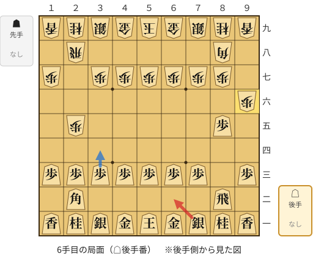

🔴 実戦 △６二銀(71)　🔵 AI推奨 △３四歩(33)　🟨 直前の相手の指し手

<details><summary>テキストの盤面図（BOD・将棋ソフトに貼り付け可）</summary>

```text
後手の持駒：なし
  ９ ８ ７ ６ ５ ４ ３ ２ １
+---------------------------+
|v香v桂v銀v金v玉v金v銀v桂v香|一
| ・v飛 ・ ・ ・ ・ ・v角 ・|二
|v歩 ・v歩v歩v歩v歩v歩v歩v歩|三
| ・ ・ ・ ・ ・ ・ ・ ・ ・|四
| ・v歩 ・ ・ ・ ・ ・ 歩 ・|五
| 歩 ・ ・ ・ ・ ・ ・ ・ ・|六
| ・ 歩 歩 歩 歩 歩 歩 ・ 歩|七
| ・ 角 ・ ・ ・ ・ ・ 飛 ・|八
| 香 桂 銀 金 玉 金 銀 桂 香|九
+---------------------------+
先手の持駒：なし
後手番
手数＝5　▲９六歩　まで
```

</details>

| | 指し手 | 評価値 | 読み筋 |
|---|---|--:|---|
| 実戦 | △６二銀(71) | -762 | ▲２四歩(25) △同歩(23) ▲同飛(28) △１四歩(13) ▲２三飛成(24) △８六歩(85) |
| AI 1位 | △３四歩(33) | -58 | △３四歩(33) ▲２四歩(25) △同歩(23) ▲同飛(28) △３二金(41) ▲３八銀(39) |
| AI 2位 | △３二金(41) | -63 | △３二金(41) ▲３八銀(39) △１四歩(13) ▲７八金(69) △７二銀(71) ▲３六歩(37) |
| AI 3位 | △１四歩(13) | -92 | △１四歩(13) ▲７八金(69) △３二金(41) ▲３八銀(39) △７二銀(71) ▲３六歩(37) |

SFEN: `lnsgkgsnl/1r5b1/p1ppppppp/9/1p5P1/P8/1PPPPPP1P/1B5R1/LNSGKGSNL w - 6`

<a id="ply-20"></a>
### 20手目 △８八飛成(86) — 大悪手

| | 着手前 | 着手後 | 差 |
|---|--:|--:|--:|
| 期待勝率 | 27.8% | 1.0% | -26.8pt |
| 評価値 | -572 | -2737 | |

着手前の局面:

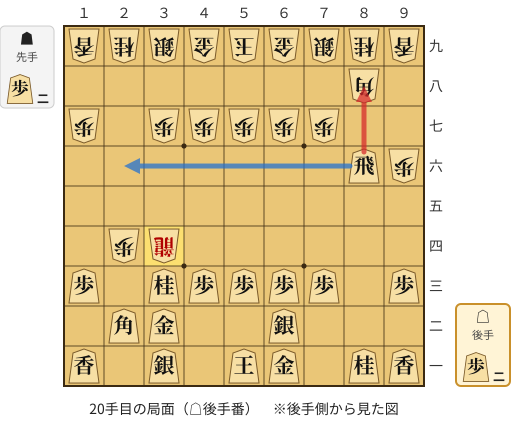

🔴 実戦 △８八飛成(86)　🔵 AI推奨 △２六飛(86)　🟨 直前の相手の指し手

<details><summary>テキストの盤面図（BOD・将棋ソフトに貼り付け可）</summary>

```text
後手の持駒：歩二
  ９ ８ ７ ６ ５ ４ ３ ２ １
+---------------------------+
|v香v桂 ・v金v玉 ・v銀 ・v香|一
| ・ ・ ・v銀 ・ ・v金v角 ・|二
|v歩 ・v歩v歩v歩v歩v桂 ・v歩|三
| ・ ・ ・ ・ ・ ・ 龍 歩 ・|四
| ・ ・ ・ ・ ・ ・ ・ ・ ・|五
| 歩v飛 ・ ・ ・ ・ ・ ・ ・|六
| ・ ・ 歩 歩 歩 歩 歩 ・ 歩|七
| ・ 角 ・ ・ ・ ・ ・ ・ ・|八
| 香 桂 銀 金 玉 金 銀 桂 香|九
+---------------------------+
先手の持駒：歩二
後手番
手数＝19　▲３四龍　まで
```

</details>

| | 指し手 | 評価値 | 読み筋 |
|---|---|--:|---|
| 実戦 | △８八飛成(86) | -2737 | ▲同銀(79) △２五角打 ▲８四龍(34) △８三歩打 ▲同龍(84) △７一金(61) |
| AI 1位 | △２六飛(86) | -572 | △２六飛(86) ▲８二歩打 △８六歩打 ▲７八銀(79) △２九飛成(26) ▲８一歩成(82) |
| AI 2位 | △８七歩打 | -778 | △８七歩打 ▲９七角(88) △２六飛(86) ▲８二歩打 △２九飛成(26) ▲８一歩成(82) |
| AI 3位 | △２八歩打 | -1685 | △２八歩打 ▲同銀(39) △２六飛(86) ▲３八金(49) △７一金(61) ▲２七銀(28) |

SFEN: `ln1gk1s1l/3s2gb1/p1ppppn1p/6+RP1/9/Pr7/2PPPPP1P/1B7/LNSGKGSNL w 2P2p 20`

<a id="ply-28"></a>
### 28手目 △５七馬(67) — 悪手

| | 着手前 | 着手後 | 差 |
|---|--:|--:|--:|
| 期待勝率 | 13.3% | 1.5% | -11.8pt |
| 評価値 | -1123 | -2500 | |

着手前の局面:

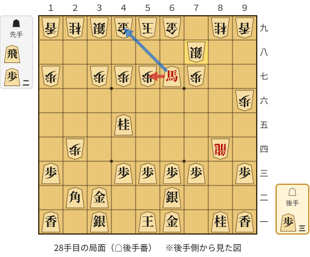

🔴 実戦 △５七馬(67)　🔵 AI推奨 △４九馬(67)　🟨 直前の相手の指し手

<details><summary>テキストの盤面図（BOD・将棋ソフトに貼り付け可）</summary>

```text
後手の持駒：歩三
  ９ ８ ７ ６ ５ ４ ３ ２ １
+---------------------------+
|v香v桂 ・v金v玉 ・v銀 ・v香|一
| ・ ・ ・v銀 ・ ・v金v角 ・|二
|v歩 ・v歩v歩v歩v歩 ・ ・v歩|三
| ・ 龍 ・ ・ ・ ・ ・ 歩 ・|四
| ・ ・ ・ ・ ・v桂 ・ ・ ・|五
| 歩 ・ ・ ・ ・ ・ ・ ・ ・|六
| ・ ・ 歩v馬 歩 歩 歩 ・ 歩|七
| ・ ・ 銀 ・ ・ ・ ・ ・ ・|八
| 香 桂 ・ 金 玉 金 銀 桂 香|九
+---------------------------+
先手の持駒：飛　歩二
後手番
手数＝27　▲７八銀　まで
```

</details>

| | 指し手 | 評価値 | 読み筋 |
|---|---|--:|---|
| 実戦 | △５七馬(67) | -2500 | ▲８一龍(84) △２四馬(57) ▲９一龍(81) △５二玉(51) ▲５八歩打 △８八歩打 |
| AI 1位 | △４九馬(67) | -1123 | △４九馬(67) ▲同玉(59) △５七桂不成(45) ▲３八玉(49) △６九桂成(57) ▲８一龍(84) |
| AI 2位 | △９四馬(67) | -1398 | △９四馬(67) ▲８一龍(84) △５七桂不成(45) ▲５八金(49) △６九桂成(57) ▲同銀(78) |
| AI 3位 | △８三歩打 | -1945 | △８三歩打 ▲３四龍(84) △４九馬(67) ▲同玉(59) △５七桂不成(45) ▲３八玉(49) |

SFEN: `ln1gk1s1l/3s2gb1/p1pppp2p/1+R5P1/5n3/P8/2P+bPPP1P/2S6/LN1GKGSNL w R2P3p 28`

<a id="ply-42"></a>
### 42手目 △４六馬(47) — 悪手

| | 着手前 | 着手後 | 差 |
|---|--:|--:|--:|
| 期待勝率 | 95.3% | 82.1% | -13.2pt |
| 評価値 | +1806 | +915 | |

着手前の局面:

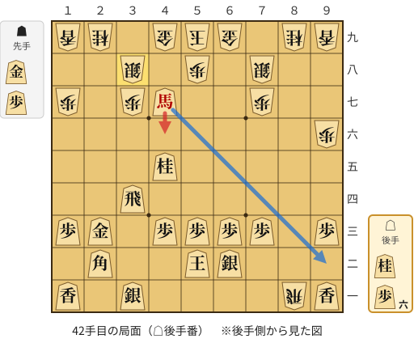

🔴 実戦 △４六馬(47)　🔵 AI推奨 △９二馬(47)　🟨 直前の相手の指し手

<details><summary>テキストの盤面図（BOD・将棋ソフトに貼り付け可）</summary>

```text
後手の持駒：桂　歩六
  ９ ８ ７ ６ ５ ４ ３ ２ １
+---------------------------+
|v香 飛 ・ ・ ・ ・v銀 ・v香|一
| ・ ・ ・v銀v玉 ・ ・v角 ・|二
|v歩 ・v歩v歩v歩v歩 ・v金v歩|三
| ・ ・ ・ ・ ・ ・v飛 ・ ・|四
| ・ ・ ・ ・ ・v桂 ・ ・ ・|五
| 歩 ・ ・ ・ ・ ・ ・ ・ ・|六
| ・ ・ 歩 ・ ・v馬 歩 ・ 歩|七
| ・ ・ 銀 ・ 歩 ・ 銀 ・ ・|八
| 香 桂 ・ 金 玉 金 ・ 桂 香|九
+---------------------------+
先手の持駒：金　歩
後手番
手数＝41　▲３八銀　まで
```

</details>

| | 指し手 | 評価値 | 読み筋 |
|---|---|--:|---|
| 実戦 | △４六馬(47) | +915 | ▲９一飛成(81) △４七桂打 ▲同銀(38) △同馬(46) ▲２八香打 △２五歩打 |
| AI 1位 | △９二馬(47) | +1806 | △９二馬(47) ▲８六飛成(81) △２八歩打 ▲２六龍(86) △２四飛(34) ▲同龍(26) |
| AI 2位 | △４六馬(47) | +940 | △４六馬(47) ▲９一飛成(81) △４七桂打 ▲同銀(38) △同馬(46) ▲２八香打 |
| AI 3位 | △５六馬(47) | +744 | △５六馬(47) ▲９一飛成(81) △８四飛(34) ▲２一金打 △７八馬(56) ▲同金(69) |

SFEN: `lR4s1l/3sk2b1/p1pppp1gp/6r2/5n3/P8/2P2+bP1P/2S1P1S2/LN1GKG1NL w GPn6p 42`

<a id="ply-44"></a>
### 44手目 △８八歩打 — 大悪手

| | 着手前 | 着手後 | 差 |
|---|--:|--:|--:|
| 期待勝率 | 83.1% | 53.1% | -30.0pt |
| 評価値 | +957 | +75 | |

着手前の局面:

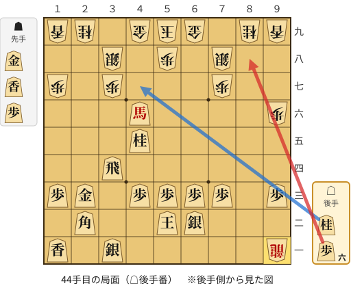

🔴 実戦 △８八歩打　🔵 AI推奨 △４七桂打　🟨 直前の相手の指し手

<details><summary>テキストの盤面図（BOD・将棋ソフトに貼り付け可）</summary>

```text
後手の持駒：桂　歩六
  ９ ８ ７ ６ ５ ４ ３ ２ １
+---------------------------+
| 龍 ・ ・ ・ ・ ・v銀 ・v香|一
| ・ ・ ・v銀v玉 ・ ・v角 ・|二
|v歩 ・v歩v歩v歩v歩 ・v金v歩|三
| ・ ・ ・ ・ ・ ・v飛 ・ ・|四
| ・ ・ ・ ・ ・v桂 ・ ・ ・|五
| 歩 ・ ・ ・ ・v馬 ・ ・ ・|六
| ・ ・ 歩 ・ ・ ・ 歩 ・ 歩|七
| ・ ・ 銀 ・ 歩 ・ 銀 ・ ・|八
| 香 桂 ・ 金 玉 金 ・ 桂 香|九
+---------------------------+
先手の持駒：金　香　歩
後手番
手数＝43　▲９一飛成　まで
```

</details>

| | 指し手 | 評価値 | 読み筋 |
|---|---|--:|---|
| 実戦 | △８八歩打 | +75 | ▲４七香打 △２四馬(46) ▲２五歩打 △５一馬(24) ▲９七桂(89) △２八歩打 |
| AI 1位 | △４七桂打 | +957 | △４七桂打 ▲同銀(38) △同馬(46) ▲３八金打 △５六馬(47) ▲４八金(49) |
| AI 2位 | △８四飛(34) | +756 | △８四飛(34) ▲４八香打 △５六馬(46) ▲８七歩打 △８八歩打 ▲４七銀(38) |
| AI 3位 | △６四飛(34) | +692 | △６四飛(34) ▲４七金打 △２四馬(46) ▲８二龍(91) △２八歩打 ▲６七香打 |

SFEN: `+R5s1l/3sk2b1/p1pppp1gp/6r2/5n3/P4+b3/2P3P1P/2S1P1S2/LN1GKG1NL w GLPn6p 44`

<a id="ply-46"></a>
### 46手目 △５六馬(46) — 大悪手

| | 着手前 | 着手後 | 差 |
|---|--:|--:|--:|
| 期待勝率 | 54.2% | 22.9% | -31.3pt |
| 評価値 | +101 | -728 | |

着手前の局面:

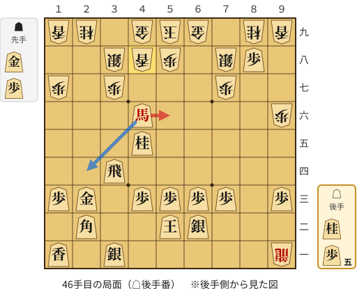

🔴 実戦 △５六馬(46)　🔵 AI推奨 △２四馬(46)　🟨 直前の相手の指し手

<details><summary>テキストの盤面図（BOD・将棋ソフトに貼り付け可）</summary>

```text
後手の持駒：桂　歩五
  ９ ８ ７ ６ ５ ４ ３ ２ １
+---------------------------+
| 龍 ・ ・ ・ ・ ・v銀 ・v香|一
| ・ ・ ・v銀v玉 ・ ・v角 ・|二
|v歩 ・v歩v歩v歩v歩 ・v金v歩|三
| ・ ・ ・ ・ ・ ・v飛 ・ ・|四
| ・ ・ ・ ・ ・v桂 ・ ・ ・|五
| 歩 ・ ・ ・ ・v馬 ・ ・ ・|六
| ・ ・ 歩 ・ ・ ・ 歩 ・ 歩|七
| ・v歩 銀 ・ 歩 香 銀 ・ ・|八
| 香 桂 ・ 金 玉 金 ・ 桂 香|九
+---------------------------+
先手の持駒：金　歩
後手番
手数＝45　▲４八香　まで
```

</details>

| | 指し手 | 評価値 | 読み筋 |
|---|---|--:|---|
| 実戦 | △５六馬(46) | -728 | ▲４六金打 △同馬(56) ▲同香(48) △５一金打 ▲９七桂(89) △８九歩成(88) |
| AI 1位 | △２四馬(46) | +101 | △２四馬(46) ▲２五歩打 △５一馬(24) ▲９七桂(89) △８九歩成(88) ▲４五香(48) |
| AI 2位 | △３五馬(46) | +24 | △３五馬(46) ▲３六金打 △２四馬(35) ▲４五金(36) △６四飛(34) ▲４六香(48) |
| AI 3位 | △６四馬(46) | -528 | △６四馬(46) ▲４五香(48) △８九歩成(88) ▲２一金打 △７一桂打 ▲８二龍(91) |

SFEN: `+R5s1l/3sk2b1/p1pppp1gp/6r2/5n3/P4+b3/2P3P1P/1pS1PLS2/LN1GKG1NL w GPn5p 46`

<a id="ply-54"></a>
### 54手目 △同飛(34) — 悪手

| | 着手前 | 着手後 | 差 |
|---|--:|--:|--:|
| 期待勝率 | 62.0% | 46.0% | -16.0pt |
| 評価値 | +293 | -96 | |

着手前の局面:

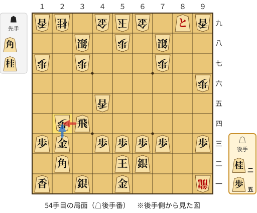

🔴 実戦 △同飛(34)　🔵 AI推奨 △同金(23)　🟨 直前の相手の指し手

<details><summary>テキストの盤面図（BOD・将棋ソフトに貼り付け可）</summary>

```text
後手の持駒：桂二　歩五
  ９ ８ ７ ６ ５ ４ ３ ２ １
+---------------------------+
| 龍 ・ ・ ・v金 ・v銀 ・v香|一
| ・ ・ ・v銀v玉 ・ ・v角 ・|二
|v歩 ・v歩v歩v歩v歩 ・v金v歩|三
| ・ ・ ・ ・ ・ ・v飛 歩 ・|四
| ・ ・ ・ ・ ・ 香 ・ ・ ・|五
| 歩 ・ ・ ・ ・ ・ ・ ・ ・|六
| ・ ・ 歩 ・ ・ ・ 歩 ・ 歩|七
| ・ ・ 銀 ・ 歩 ・ 銀 ・ ・|八
| 香vと ・ 金 玉 金 ・ 桂 香|九
+---------------------------+
先手の持駒：角　桂
後手番
手数＝53　▲２四歩　まで
```

</details>

| | 指し手 | 評価値 | 読み筋 |
|---|---|--:|---|
| 実戦 | △同飛(34) | -96 | ▲３五桂打 △３三金(23) |
| AI 1位 | △同金(23) | +293 | △同金(23) ▲３六桂打 △３五金(24) ▲４三香成(45) △同玉(52) ▲４四歩打 |
| AI 2位 | △同飛(34) | -77 | △同飛(34) ▲１五角打 △５六桂打 ▲５七歩(58) △２五飛(24) ▲５一角成(15) |
| AI 3位 | △３三金(23) | -372 | △３三金(23) ▲５五桂打 △２四飛(34) ▲１五角打 △２三飛(24) ▲３三角成(15) |

SFEN: `+R3g1s1l/3sk2b1/p1pppp1gp/6rP1/5L3/P8/2P3P1P/2S1P1S2/L+p1GKG1NL w BN2n5p 54`

<a id="ply-56"></a>
### 56手目 △４四歩(43) — 大悪手

| | 着手前 | 着手後 | 差 |
|---|--:|--:|--:|
| 期待勝率 | 50.3% | 0.7% | -49.6pt |
| 評価値 | +7 | -2942 | |

着手前の局面:

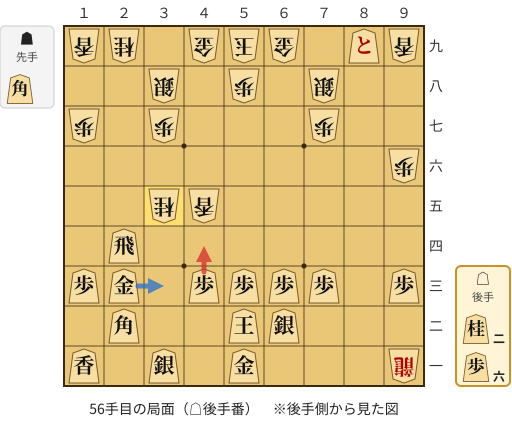

🔴 実戦 △４四歩(43)　🔵 AI推奨 △３三金(23)　🟨 直前の相手の指し手

<details><summary>テキストの盤面図（BOD・将棋ソフトに貼り付け可）</summary>

```text
後手の持駒：桂二　歩六
  ９ ８ ７ ６ ５ ４ ３ ２ １
+---------------------------+
| 龍 ・ ・ ・v金 ・v銀 ・v香|一
| ・ ・ ・v銀v玉 ・ ・v角 ・|二
|v歩 ・v歩v歩v歩v歩 ・v金v歩|三
| ・ ・ ・ ・ ・ ・ ・v飛 ・|四
| ・ ・ ・ ・ ・ 香 桂 ・ ・|五
| 歩 ・ ・ ・ ・ ・ ・ ・ ・|六
| ・ ・ 歩 ・ ・ ・ 歩 ・ 歩|七
| ・ ・ 銀 ・ 歩 ・ 銀 ・ ・|八
| 香vと ・ 金 玉 金 ・ 桂 香|九
+---------------------------+
先手の持駒：角
後手番
手数＝55　▲３五桂　まで
```

</details>

| | 指し手 | 評価値 | 読み筋 |
|---|---|--:|---|
| 実戦 | △４四歩(43) | -2942 | ▲２三桂成(35) △同飛(24) ▲３四角打 △４三飛(23) ▲２一金打 △４五歩(44) |
| AI 1位 | △３三金(23) | +7 | △３三金(23) ▲８九銀(78) △３二銀(31) ▲２三歩打 △同金(33) ▲同桂成(35) |
| AI 2位 | △３二銀(31) | -633 | △３二銀(31) ▲４三桂不成(35) △同銀(32) ▲４一角打 △同金(51) ▲４三香成(45) |
| AI 3位 | △３二銀(31) | -743 | △３二銀(31) ▲４三香成(45) △同銀(32) ▲４一角打 △同金(51) ▲４三桂成(35) |

SFEN: `+R3g1s1l/3sk2b1/p1pppp1gp/7r1/5LN2/P8/2P3P1P/2S1P1S2/L+p1GKG1NL w B2n6p 56`

<a id="ply-72"></a>
### 72手目 △８八と(89) — 大悪手

| | 着手前 | 着手後 | 差 |
|---|--:|--:|--:|
| 期待勝率 | 25.4% | 1.1% | -24.3pt |
| 評価値 | -646 | -2695 | |

着手前の局面:

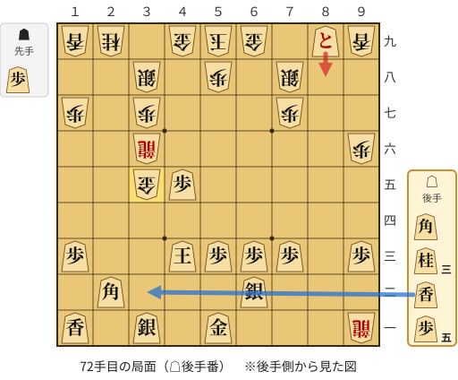

🔴 実戦 △８八と(89)　🔵 AI推奨 △３二香打　🟨 直前の相手の指し手

<details><summary>テキストの盤面図（BOD・将棋ソフトに貼り付け可）</summary>

```text
後手の持駒：角　桂三　香　歩五
  ９ ８ ７ ６ ５ ４ ３ ２ １
+---------------------------+
| 龍 ・ ・ ・v金 ・v銀 ・v香|一
| ・ ・ ・v銀 ・ ・ ・v角 ・|二
|v歩 ・v歩v歩v歩v玉 ・ ・v歩|三
| ・ ・ ・ ・ ・ ・ ・ ・ ・|四
| ・ ・ ・ ・ ・v歩 金 ・ ・|五
| 歩 ・ ・ ・ ・ ・ 龍 ・ ・|六
| ・ ・ 歩 ・ ・ ・ 歩 ・ 歩|七
| ・ ・ 銀 ・ 歩 ・ 銀 ・ ・|八
| 香vと ・ 金 玉 金 ・ 桂 香|九
+---------------------------+
先手の持駒：歩
後手番
手数＝71　▲３五金　まで
```

</details>

| | 指し手 | 評価値 | 読み筋 |
|---|---|--:|---|
| 実戦 | △８八と(89) | -2695 | ▲２三歩打 △６六角(22) ▲３四金(35) △５二玉(43) ▲６六龍(36) △４二銀(31) |
| AI 1位 | △３二香打 | -646 | △３二香打 ▲４四歩打 △５二玉(43) ▲３四金(35) △同香(32) ▲同龍(36) |
| AI 2位 | △３二銀(31) | -873 | △３二銀(31) ▲４四歩打 △４二玉(43) ▲４五金(35) △３一桂打 ▲８九銀(78) |
| AI 3位 | △５四歩(53) | -933 | △５四歩(53) ▲４五金(35) △３二香打 ▲４四歩打 △同角(22) ▲５六龍(36) |

SFEN: `+R3g1s1l/3s3b1/p1pppk2p/9/5pG2/P5+R2/2P3P1P/2S1P1S2/L+p1GKG1NL w Pb3nl5p 72`

<a id="ply-76"></a>
### 76手目 △７八と(88) — 大悪手

| | 着手前 | 着手後 | 差 |
|---|--:|--:|--:|
| 期待勝率 | 89.8% | 0.0% | -89.8pt |
| 評価値 | +1302 | 5手で詰まされる | |

着手前の局面:

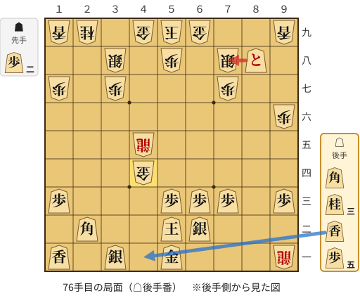

🔴 実戦 △７八と(88)　🔵 AI推奨 △４一香打　🟨 直前の相手の指し手

<details><summary>テキストの盤面図（BOD・将棋ソフトに貼り付け可）</summary>

```text
後手の持駒：角　桂三　香　歩五
  ９ ８ ７ ６ ５ ４ ３ ２ １
+---------------------------+
| 龍 ・ ・ ・v金 ・v銀 ・v香|一
| ・ ・ ・v銀v玉 ・ ・v角 ・|二
|v歩 ・v歩v歩v歩 ・ ・ ・v歩|三
| ・ ・ ・ ・ ・ 金 ・ ・ ・|四
| ・ ・ ・ ・ ・ 龍 ・ ・ ・|五
| 歩 ・ ・ ・ ・ ・ ・ ・ ・|六
| ・ ・ 歩 ・ ・ ・ 歩 ・ 歩|七
| ・vと 銀 ・ 歩 ・ 銀 ・ ・|八
| 香 ・ ・ 金 玉 金 ・ 桂 香|九
+---------------------------+
先手の持駒：歩二
後手番
手数＝75　▲４四金　まで
```

</details>

| | 指し手 | 評価値 | 読み筋 |
|---|---|--:|---|
| 実戦 | △７八と(88) | 5手で詰まされる | ▲４三金(44) △４一玉(52) ▲４二歩打 △同銀(31) ▲同金(43) |
| AI 1位 | △４一香打 | +1302 | △４一香打 ▲４二歩打 △同銀(31) ▲４三歩打 △４四角(22) ▲同龍(45) |
| AI 2位 | △４二歩打 | +917 | △４二歩打 ▲６七銀(78) △４三香打 ▲同金(44) △同歩(42) ▲６八金(69) |
| AI 3位 | △同角(22) | +911 | △同角(22) ▲同龍(45) △４三歩打 ▲３五龍(44) △３二香打 ▲５五龍(35) |

SFEN: `+R3g1s1l/3sk2b1/p1ppp3p/5G3/5+R3/P8/2P3P1P/1+pS1P1S2/L2GKG1NL w 2Pb3nl5p 76`

