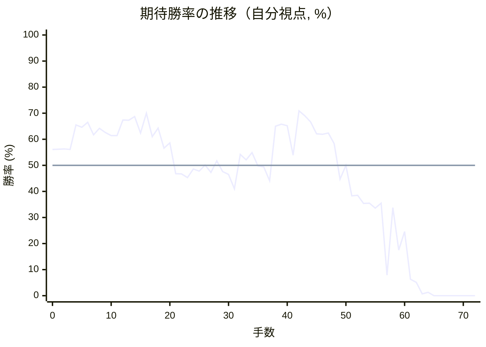

# 解析レポート eg7154z0mkxn

[README に戻る](../../../README.md)　/　棋譜: [CSA](../../../data/csa/shogi5/eg7154z0mkxn.csa)　/　解析の見方: [docs/mistake_analysis.md](../../../docs/mistake_analysis.md)

## 対局情報

| 項目 | 内容 |
|---|---|
| 日時 | 2026-10-29 20:01:17 |
| 持ち時間 | 5分 |
| 自分 | 先手（▲）（1734） |
| 相手 | 相手（1841） |
| 結果 | 負け（投了, 72手） |

## 解析環境

| 項目 | 内容 |
|---|---|
| エンジン | YaneuraOu NNUE 9.00git 64AVX2（V9.00/YANEURAOU_ENGINE_NNUE/AVX2） |
| 評価関数 | **水匠5**（`suisho5`） |
| nn.bin SHA-256 | `768068f0d534a0603a5d38bcd143de6bbca820d5f1c95a14d40863e5b7892d76` |
| 第1パス | movetime=150ms, MultiPV 1 |
| 第2パス | movetime=2000ms, MultiPV 3 |
| Threads / Hash | 8 / 512MB |
| 判定基準 | 疑問手 ≥5pt, 悪手 ≥10pt, 大悪手 ≥20pt（期待勝率 W(E)=1/(1+exp(-E/600))） |
| 解析日時 | 2026-11-03T04:16:52+09:00（解析バージョン 1, 54秒） |

## サマリー

| 自分の手数 | 深掘りした手 | 詰み逃し | 大悪手 | 悪手 | 疑問手 |
|--:|--:|--:|--:|--:|--:|
| 36 | 11 | 0 | 1 | 5 | 4 |

## 期待勝率の推移



<details><summary>1手ごとの数値（第1パス）</summary>

| 手数 | 指し手 | 評価値 | 勝率 | 低下 | 判定 |
|--:|---|--:|--:|--:|---|
| 1 | ▲７六歩(77) | +150 | 56.2% | -0.1pt |  |
| 2 | △３四歩(33) | +153 | 56.3% |  |  |
| 3 | ▲２六歩(27) | +146 | 56.1% | +0.3pt |  |
| 4 | △３五歩(34) | +384 | 65.5% |  |  |
| 5 | ▲２五歩(26) | +361 | 64.6% | +0.9pt |  |
| 6 | △３二飛(82) | +411 | 66.5% |  |  |
| 7 | ▲４八銀(39) | +286 | 61.7% | +4.8pt |  |
| 8 | △３四飛(32) | +351 | 64.2% |  |  |
| 9 | ▲２二角成(88) | +310 | 62.6% | +1.6pt |  |
| 10 | △同銀(31) | +278 | 61.4% |  |  |
| 11 | ▲７八銀(79) | +278 | 61.4% | +0.0pt |  |
| 12 | △５二金(41) | +437 | 67.4% |  |  |
| 13 | ▲６八玉(59) | +432 | 67.3% | +0.2pt |  |
| 14 | △３三桂(21) | +471 | 68.7% |  |  |
| 15 | ▲７九玉(68) | +304 | 62.4% | +6.3pt |  |
| 16 | △３六歩(35) | +507 | 70.0% |  |  |
| 17 | ▲３八金(49) | +268 | 61.0% | +9.0pt | [疑問手](#ply-17) |
| 18 | △６二玉(51) | +353 | 64.3% |  |  |
| 19 | ▲９六歩(97) | +160 | 56.6% | +7.7pt | [疑問手](#ply-19) |
| 20 | △５五角打 | +208 | 58.6% |  |  |
| 21 | ▲７七桂(89) | -77 | 46.8% | +11.8pt | [悪手](#ply-21) |
| 22 | △４五桂(33) | -80 | 46.7% |  |  |
| 23 | ▲４六角打 | -113 | 45.3% | +1.4pt |  |
| 24 | △同角(55) | -33 | 48.6% |  |  |
| 25 | ▲同歩(47) | -54 | 47.8% | +0.9pt |  |
| 26 | △３七桂成(45) | +3 | 50.1% |  |  |
| 27 | ▲同桂(29) | -66 | 47.3% | +2.9pt |  |
| 28 | △同歩成(36) | +42 | 51.7% |  |  |
| 29 | ▲同銀(48) | -58 | 47.6% | +4.2pt |  |
| 30 | △３六歩打 | -83 | 46.5% |  |  |
| 31 | ▲４八銀(37) | -218 | 41.0% | +5.5pt | [疑問手](#ply-31) |
| 32 | △３七角打 | +100 | 54.2% |  |  |
| 33 | ▲５六角打 | +50 | 52.1% | +2.1pt |  |
| 34 | △３一飛(34) | +118 | 54.9% |  |  |
| 35 | ▲２四歩(25) | -4 | 49.8% | +5.1pt | [悪手](#ply-35) |
| 36 | △２八角成(37) | -14 | 49.4% |  |  |
| 37 | ▲同金(38) | -142 | 44.1% | +5.3pt |  |
| 38 | △３七歩成(36) | +372 | 65.0% |  |  |
| 39 | ▲同銀(48) | +392 | 65.8% | -0.8pt |  |
| 40 | △６四桂打 | +376 | 65.2% |  |  |
| 41 | ▲８三角成(56) | +94 | 53.9% | +11.3pt | [悪手](#ply-41) |
| 42 | △３九飛打 | +533 | 70.9% |  |  |
| 43 | ▲６八桂打 | +481 | 69.0% | +1.8pt |  |
| 44 | △１九飛成(39) | +415 | 66.6% |  |  |
| 45 | ▲２三歩成(24) | +296 | 62.1% | +4.5pt |  |
| 46 | △同銀(22) | +291 | 61.9% |  |  |
| 47 | ▲２二角打 | +304 | 62.4% | -0.5pt |  |
| 48 | △２一飛(31) | +202 | 58.3% |  |  |
| 49 | ▲３三角成(22) | -128 | 44.7% | +13.7pt | [悪手](#ply-49) |
| 50 | △３二香打 | -1 | 50.0% |  |  |
| 51 | ▲２二歩打 | -287 | 38.3% | +11.7pt | [悪手](#ply-51) |
| 52 | △３三香(32) | -280 | 38.5% |  |  |
| 53 | ▲２一歩成(22) | -362 | 35.4% | +3.2pt |  |
| 54 | △３七香成(33) | -357 | 35.5% |  |  |
| 55 | ▲同金(28) | -408 | 33.6% | +1.9pt |  |
| 56 | △５八銀打 | -357 | 35.5% |  |  |
| 57 | ▲３一飛打 | -1470 | 7.9% | +27.6pt | [大悪手](#ply-57) |
| 58 | △６九銀成(58) | -404 | 33.8% |  |  |
| 59 | ▲同銀(78) | -931 | 17.5% | +16.3pt |  |
| 60 | △７二銀(71) | -671 | 24.6% |  |  |
| 61 | ▲８二馬(83) | -1615 | 6.3% | +18.3pt | [疑問手](#ply-61) |
| 62 | △５一金(52) | -1755 | 5.1% |  |  |
| 63 | ▲８五香打 | -2935 | 0.7% | +4.3pt |  |
| 64 | △５八金打 | -2597 | 1.3% |  |  |
| 65 | ▲７一銀打 | -5215 | 0.0% | +1.3pt |  |
| 66 | △５二玉(62) | -5807 | 0.0% |  |  |
| 67 | ▲７二馬(82) | #-7 | 0.0% | +0.0pt |  |
| 68 | △６九龍(19) | #-6 | 0.0% |  |  |
| 69 | ▲８八玉(79) | #-5 | 0.0% | +0.0pt |  |
| 70 | △７九角打 | #-4 | 0.0% |  |  |
| 71 | ▲９八玉(88) | #-3 | 0.0% | +0.0pt |  |
| 72 | △９七銀打 | #-2 | 0.0% |  |  |

</details>

## 課題局面

<a id="ply-17"></a>
### 17手目 ▲３八金(49) — 疑問手

| | 着手前 | 着手後 | 差 |
|---|--:|--:|--:|
| 期待勝率 | 72.8% | 67.1% | -5.7pt |
| 評価値 | +590 | +427 | |

着手前の局面:

```text
後手の持駒：角
  ９ ８ ７ ６ ５ ４ ３ ２ １
+---------------------------+
|v香v桂v銀v金v玉 ・ ・ ・v香|一
| ・ ・ ・ ・v金 ・ ・v銀 ・|二
|v歩v歩v歩v歩v歩v歩v桂v歩v歩|三
| ・ ・ ・ ・ ・ ・v飛 ・ ・|四
| ・ ・ ・ ・ ・ ・ ・ 歩 ・|五
| ・ ・ 歩 ・ ・ ・v歩 ・ ・|六
| 歩 歩 ・ 歩 歩 歩 歩 ・ 歩|七
| ・ ・ 銀 ・ ・ 銀 ・ 飛 ・|八
| 香 桂 玉 金 ・ 金 ・ 桂 香|九
+---------------------------+
先手の持駒：角
手数＝16　△３六歩　まで
```

| | 指し手 | 評価値 | 読み筋 |
|---|---|--:|---|
| 実戦 | ▲３八金(49) | +427 | △７二銀(71) ▲４六歩(47) |
| AI 1位 | ▲５六角打 | +590 | ▲５六角打 △８四飛(34) ▲８八玉(79) △６二玉(51) ▲７七銀(78) △６四角打 |
| AI 2位 | ▲７七銀(78) | +492 | ▲７七銀(78) △６二玉(51) ▲３六歩(37) △同飛(34) ▲２四歩(25) △同歩(23) |
| AI 3位 | ▲７七桂(89) | +413 | ▲７七桂(89) △５五角打 ▲５六角打 △８四飛(34) ▲５八金(49) △６二玉(51) |

SFEN: `lnsgk3l/4g2s1/ppppppnpp/6r2/7P1/2P3p2/PP1PPPP1P/2S2S1R1/LNKG1G1NL b Bb 17`

<a id="ply-19"></a>
### 19手目 ▲９六歩(97) — 疑問手

| | 着手前 | 着手後 | 差 |
|---|--:|--:|--:|
| 期待勝率 | 65.4% | 59.1% | -6.3pt |
| 評価値 | +381 | +221 | |

着手前の局面:

```text
後手の持駒：角
  ９ ８ ７ ６ ５ ４ ３ ２ １
+---------------------------+
|v香v桂v銀v金 ・ ・ ・ ・v香|一
| ・ ・ ・v玉v金 ・ ・v銀 ・|二
|v歩v歩v歩v歩v歩v歩v桂v歩v歩|三
| ・ ・ ・ ・ ・ ・v飛 ・ ・|四
| ・ ・ ・ ・ ・ ・ ・ 歩 ・|五
| ・ ・ 歩 ・ ・ ・v歩 ・ ・|六
| 歩 歩 ・ 歩 歩 歩 歩 ・ 歩|七
| ・ ・ 銀 ・ ・ 銀 金 飛 ・|八
| 香 桂 玉 金 ・ ・ ・ 桂 香|九
+---------------------------+
先手の持駒：角
手数＝18　△６二玉　まで
```

| | 指し手 | 評価値 | 読み筋 |
|---|---|--:|---|
| 実戦 | ▲９六歩(97) | +221 | △７二銀(71) ▲８二角打 △９二香(91) ▲５六歩(57) △９四歩(93) ▲８八玉(79) |
| AI 1位 | ▲４六歩(47) | +381 | ▲４六歩(47) △７二銀(71) ▲３六歩(37) △５五角打 ▲７七銀(78) △４六角(55) |
| AI 2位 | ▲５六角打 | +354 | ▲５六角打 △８四飛(34) ▲８八玉(79) △８五飛(84) ▲４六歩(47) △７二銀(71) |
| AI 3位 | ▲７七銀(78) | +225 | ▲７七銀(78) △７二銀(71) ▲３六歩(37) △同飛(34) ▲３七歩打 △３五飛(36) |

SFEN: `lnsg4l/3kg2s1/ppppppnpp/6r2/7P1/2P3p2/PP1PPPP1P/2S2SGR1/LNKG3NL b Bb 19`

<a id="ply-21"></a>
### 21手目 ▲７七桂(89) — 悪手

| | 着手前 | 着手後 | 差 |
|---|--:|--:|--:|
| 期待勝率 | 60.7% | 45.0% | -15.7pt |
| 評価値 | +261 | -120 | |

着手前の局面:

```text
後手の持駒：なし
  ９ ８ ７ ６ ５ ４ ３ ２ １
+---------------------------+
|v香v桂v銀v金 ・ ・ ・ ・v香|一
| ・ ・ ・v玉v金 ・ ・v銀 ・|二
|v歩v歩v歩v歩v歩v歩v桂v歩v歩|三
| ・ ・ ・ ・ ・ ・v飛 ・ ・|四
| ・ ・ ・ ・v角 ・ ・ 歩 ・|五
| 歩 ・ 歩 ・ ・ ・v歩 ・ ・|六
| ・ 歩 ・ 歩 歩 歩 歩 ・ 歩|七
| ・ ・ 銀 ・ ・ 銀 金 飛 ・|八
| 香 桂 玉 金 ・ ・ ・ 桂 香|九
+---------------------------+
先手の持駒：角
手数＝20　△５五角　まで
```

| | 指し手 | 評価値 | 読み筋 |
|---|---|--:|---|
| 実戦 | ▲７七桂(89) | -120 | △４五桂(33) ▲４六角打 △同角(55) ▲同歩(47) △３七桂成(45) ▲同桂(29) |
| AI 1位 | ▲７七角打 | +261 | ▲７七角打 △６四角(55) ▲５六歩(57) △７二銀(71) ▲５五歩(56) △７一玉(62) |
| AI 2位 | ▲８八角打 | +160 | ▲８八角打 △６四角(55) ▲５六歩(57) △７二玉(62) ▲５五歩(56) △９四歩(93) |
| AI 3位 | ▲６六角打 | +97 | ▲６六角打 △同角(55) ▲同歩(67) △４九角打 ▲５八角打 △３八角成(49) |

SFEN: `lnsg4l/3kg2s1/ppppppnpp/6r2/4b2P1/P1P3p2/1P1PPPP1P/2S2SGR1/LNKG3NL b B 21`

<a id="ply-31"></a>
### 31手目 ▲４八銀(37) — 疑問手

| | 着手前 | 着手後 | 差 |
|---|--:|--:|--:|
| 期待勝率 | 48.1% | 41.9% | -6.2pt |
| 評価値 | -45 | -196 | |

着手前の局面:

```text
後手の持駒：角　桂
  ９ ８ ７ ６ ５ ４ ３ ２ １
+---------------------------+
|v香v桂v銀v金 ・ ・ ・ ・v香|一
| ・ ・ ・v玉v金 ・ ・v銀 ・|二
|v歩v歩v歩v歩v歩v歩 ・v歩v歩|三
| ・ ・ ・ ・ ・ ・v飛 ・ ・|四
| ・ ・ ・ ・ ・ ・ ・ 歩 ・|五
| 歩 ・ 歩 ・ ・ 歩v歩 ・ ・|六
| ・ 歩 桂 歩 歩 ・ 銀 ・ 歩|七
| ・ ・ 銀 ・ ・ ・ 金 飛 ・|八
| 香 ・ 玉 金 ・ ・ ・ ・ 香|九
+---------------------------+
先手の持駒：角　桂　歩
手数＝30　△３六歩　まで
```

| | 指し手 | 評価値 | 読み筋 |
|---|---|--:|---|
| 実戦 | ▲４八銀(37) | -196 | △６四桂打 ▲６五桂(77) △４四角打 ▲６六角打 △３三銀(22) ▲４七金(38) |
| AI 1位 | ▲２六銀(37) | -45 | ▲２六銀(37) △１四桂打 ▲５六角打 △３二飛(34) ▲３四歩打 △２六桂(14) |
| AI 2位 | ▲４八銀(37) | -208 | ▲４八銀(37) △６四桂打 ▲６五桂(77) △３七角打 ▲７七角打 △３三銀(22) |
| AI 3位 | ▲５四桂打 | -1444 | ▲５四桂打 △７二玉(62) ▲２六銀(37) △５四歩(53) ▲６六角打 △３二飛(34) |

SFEN: `lnsg4l/3kg2s1/pppppp1pp/6r2/7P1/P1P2Pp2/1PNPP1S1P/2S3GR1/L1KG4L b BNPbn 31`

<a id="ply-35"></a>
### 35手目 ▲２四歩(25) — 悪手

| | 着手前 | 着手後 | 差 |
|---|--:|--:|--:|
| 期待勝率 | 53.2% | 39.5% | -13.8pt |
| 評価値 | +78 | -257 | |

着手前の局面:

```text
後手の持駒：桂
  ９ ８ ７ ６ ５ ４ ３ ２ １
+---------------------------+
|v香v桂v銀v金 ・ ・v飛 ・v香|一
| ・ ・ ・v玉v金 ・ ・v銀 ・|二
|v歩v歩v歩v歩v歩v歩 ・v歩v歩|三
| ・ ・ ・ ・ ・ ・ ・ ・ ・|四
| ・ ・ ・ ・ ・ ・ ・ 歩 ・|五
| 歩 ・ 歩 ・ 角 歩v歩 ・ ・|六
| ・ 歩 桂 歩 歩 ・v角 ・ 歩|七
| ・ ・ 銀 ・ ・ 銀 金 飛 ・|八
| 香 ・ 玉 金 ・ ・ ・ ・ 香|九
+---------------------------+
先手の持駒：桂　歩
手数＝34　△３一飛　まで
```

| | 指し手 | 評価値 | 読み筋 |
|---|---|--:|---|
| 実戦 | ▲２四歩(25) | -257 | △６四桂打 ▲６五角(56) △３五飛(31) ▲２三歩成(24) △２八角成(37) ▲同金(38) |
| AI 1位 | ▲８三角成(56) | +78 | ▲８三角成(56) △４六角成(37) ▲６五馬(83) △６四歩(63) ▲４七馬(65) △同馬(46) |
| AI 2位 | ▲６五角(56) | -28 | ▲６五角(56) △２八角成(37) ▲同金(38) △７二玉(62) ▲３二歩打 △同飛(31) |
| AI 3位 | ▲３二歩打 | -102 | ▲３二歩打 △同飛(31) ▲８三角成(56) △４六角成(37) ▲２四歩(25) △同歩(23) |

SFEN: `lnsg2r1l/3kg2s1/pppppp1pp/9/7P1/P1P1BPp2/1PNPP1b1P/2S2SGR1/L1KG4L b NPn 35`

<a id="ply-41"></a>
### 41手目 ▲８三角成(56) — 悪手

| | 着手前 | 着手後 | 差 |
|---|--:|--:|--:|
| 期待勝率 | 68.7% | 51.1% | -17.6pt |
| 評価値 | +472 | +27 | |

着手前の局面:

```text
後手の持駒：飛
  ９ ８ ７ ６ ５ ４ ３ ２ １
+---------------------------+
|v香v桂v銀v金 ・ ・v飛 ・v香|一
| ・ ・ ・v玉v金 ・ ・v銀 ・|二
|v歩v歩v歩v歩v歩v歩 ・v歩v歩|三
| ・ ・ ・v桂 ・ ・ ・ 歩 ・|四
| ・ ・ ・ ・ ・ ・ ・ ・ ・|五
| 歩 ・ 歩 ・ 角 歩 ・ ・ ・|六
| ・ 歩 桂 歩 歩 ・ 銀 ・ 歩|七
| ・ ・ 銀 ・ ・ ・ ・ 金 ・|八
| 香 ・ 玉 金 ・ ・ ・ ・ 香|九
+---------------------------+
先手の持駒：角　桂　歩二
手数＝40　△６四桂　まで
```

| | 指し手 | 評価値 | 読み筋 |
|---|---|--:|---|
| 実戦 | ▲８三角成(56) | +27 | △７六桂(64) ▲８八桂打 △同桂成(76) ▲同玉(79) △７六桂打 ▲９八玉(88) |
| AI 1位 | ▲６五角(56) | +472 | ▲６五角(56) △３五飛(31) ▲６六角打 △３三銀(22) ▲４五歩(46) △同飛(35) |
| AI 2位 | ▲８三角成(56) | +80 | ▲８三角成(56) △７六桂(64) ▲８八桂打 △同桂成(76) ▲同玉(79) △７二銀(71) |
| AI 3位 | ▲３二歩打 | -156 | ▲３二歩打 △同飛(31) ▲６五角(56) △３五飛(32) ▲６六角打 △３六歩打 |

SFEN: `lnsg2r1l/3kg2s1/pppppp1pp/3n3P1/9/P1P1BP3/1PNPP1S1P/2S4G1/L1KG4L b BN2Pr 41`

<a id="ply-49"></a>
### 49手目 ▲３三角成(22) — 悪手

| | 着手前 | 着手後 | 差 |
|---|--:|--:|--:|
| 期待勝率 | 58.3% | 38.3% | -20.0pt |
| 評価値 | +201 | -285 | |

着手前の局面:

```text
後手の持駒：香　歩
  ９ ８ ７ ６ ５ ４ ３ ２ １
+---------------------------+
|v香v桂v銀v金 ・ ・ ・v飛v香|一
| ・ ・ ・v玉v金 ・ ・ 角 ・|二
|v歩 馬v歩v歩v歩v歩 ・v銀v歩|三
| ・ ・ ・v桂 ・ ・ ・ ・ ・|四
| ・ ・ ・ ・ ・ ・ ・ ・ ・|五
| 歩 ・ 歩 ・ ・ 歩 ・ ・ ・|六
| ・ 歩 桂 歩 歩 ・ 銀 ・ 歩|七
| ・ ・ 銀 桂 ・ ・ ・ 金 ・|八
| 香 ・ 玉 金 ・ ・ ・ ・v龍|九
+---------------------------+
先手の持駒：歩四
手数＝48　△２一飛　まで
```

| | 指し手 | 評価値 | 読み筋 |
|---|---|--:|---|
| 実戦 | ▲３三角成(22) | -285 | △３六歩打 ▲２九金(28) △同龍(19) ▲同馬(83) △３二銀(23) ▲２二歩打 |
| AI 1位 | ▲６六角成(22) | +201 | ▲６六角成(22) △３六歩打 ▲２九金(28) △同龍(19) ▲同馬(83) △３七歩成(36) |
| AI 2位 | ▲３三角成(22) | -45 | ▲３三角成(22) △３六歩打 ▲２九金(28) △同龍(19) ▲同馬(83) △３二銀(23) |
| AI 3位 | ▲５五角成(22) | -138 | ▲５五角成(22) △３六歩打 ▲２九金(28) △同龍(19) ▲同馬(83) △３七歩成(36) |

SFEN: `lnsg3rl/3kg2B1/p+Bpppp1sp/3n5/9/P1P2P3/1PNPP1S1P/2SN3G1/L1KG4+r b 4Plp 49`

<a id="ply-51"></a>
### 51手目 ▲２二歩打 — 悪手

| | 着手前 | 着手後 | 差 |
|---|--:|--:|--:|
| 期待勝率 | 52.8% | 32.9% | -19.9pt |
| 評価値 | +68 | -428 | |

着手前の局面:

```text
後手の持駒：歩
  ９ ８ ７ ６ ５ ４ ３ ２ １
+---------------------------+
|v香v桂v銀v金 ・ ・ ・v飛v香|一
| ・ ・ ・v玉v金 ・v香 ・ ・|二
|v歩 馬v歩v歩v歩v歩 馬v銀v歩|三
| ・ ・ ・v桂 ・ ・ ・ ・ ・|四
| ・ ・ ・ ・ ・ ・ ・ ・ ・|五
| 歩 ・ 歩 ・ ・ 歩 ・ ・ ・|六
| ・ 歩 桂 歩 歩 ・ 銀 ・ 歩|七
| ・ ・ 銀 桂 ・ ・ ・ 金 ・|八
| 香 ・ 玉 金 ・ ・ ・ ・v龍|九
+---------------------------+
先手の持駒：歩四
手数＝50　△３二香　まで
```

| | 指し手 | 評価値 | 読み筋 |
|---|---|--:|---|
| 実戦 | ▲２二歩打 | -428 | △３一飛(21) ▲２一歩成(22) △同飛(31) ▲６六馬(33) △３七香不成(32) ▲同金(28) |
| AI 1位 | ▲６六馬(33) | +68 | ▲６六馬(33) △３七香成(32) ▲同金(28) △５八銀打 ▲２九歩打 △６九銀不成(58) |
| AI 2位 | ▲３四歩打 | -81 | ▲３四歩打 △３三香(32) ▲同歩成(34) △１五角打 ▲２三と(33) △同飛(21) |
| AI 3位 | ▲５五馬(33) | -225 | ▲５五馬(33) △３七香成(32) ▲同金(28) △５八銀打 ▲２九歩打 △１八龍(19) |

SFEN: `lnsg3rl/3kg1l2/p+Bpppp+Bsp/3n5/9/P1P2P3/1PNPP1S1P/2SN3G1/L1KG4+r b 4Pp 51`

<a id="ply-57"></a>
### 57手目 ▲３一飛打 — 大悪手

| | 着手前 | 着手後 | 差 |
|---|--:|--:|--:|
| 期待勝率 | 35.0% | 3.7% | -31.3pt |
| 評価値 | -371 | -1956 | |

着手前の局面:

```text
後手の持駒：角　歩
  ９ ８ ７ ６ ５ ４ ３ ２ １
+---------------------------+
|v香v桂v銀v金 ・ ・ ・ とv香|一
| ・ ・ ・v玉v金 ・ ・ ・ ・|二
|v歩 馬v歩v歩v歩v歩 ・v銀v歩|三
| ・ ・ ・v桂 ・ ・ ・ ・ ・|四
| ・ ・ ・ ・ ・ ・ ・ ・ ・|五
| 歩 ・ 歩 ・ ・ 歩 ・ ・ ・|六
| ・ 歩 桂 歩 歩 ・ 金 ・ 歩|七
| ・ ・ 銀 桂v銀 ・ ・ ・ ・|八
| 香 ・ 玉 金 ・ ・ ・ ・v龍|九
+---------------------------+
先手の持駒：飛　香　歩三
手数＝56　△５八銀　まで
```

| | 指し手 | 評価値 | 読み筋 |
|---|---|--:|---|
| 実戦 | ▲３一飛打 | -1956 | △７二銀(71) ▲同馬(83) △同玉(62) ▲８四香打 △５一金(52) ▲８一香成(84) |
| AI 1位 | ▲２九歩打 | -371 | ▲２九歩打 △１八龍(19) ▲３八金(37) △６九銀不成(58) ▲同銀(78) △８六歩打 |
| AI 2位 | ▲２九香打 | -1115 | ▲２九香打 △６九銀成(58) ▲同銀(78) △７四角打 ▲６一馬(83) △同玉(62) |
| AI 3位 | ▲１一と(21) | -1544 | ▲１一と(21) △６九銀成(58) ▲同銀(78) △８九金打 ▲７八玉(79) △９九金(89) |

SFEN: `lnsg3+Pl/3kg4/p+Bpppp1sp/3n5/9/P1P2P3/1PNPP1G1P/2SNs4/L1KG4+r b RL3Pbp 57`

<a id="ply-61"></a>
### 61手目 ▲８二馬(83) — 疑問手

| | 着手前 | 着手後 | 差 |
|---|--:|--:|--:|
| 期待勝率 | 12.8% | 4.3% | -8.5pt |
| 評価値 | -1150 | -1864 | |

着手前の局面:

```text
後手の持駒：角　金　歩
  ９ ８ ７ ６ ５ ４ ３ ２ １
+---------------------------+
|v香v桂 ・v金 ・ ・ 飛 とv香|一
| ・ ・v銀v玉v金 ・ ・ ・ ・|二
|v歩 馬v歩v歩v歩v歩 ・v銀v歩|三
| ・ ・ ・v桂 ・ ・ ・ ・ ・|四
| ・ ・ ・ ・ ・ ・ ・ ・ ・|五
| 歩 ・ 歩 ・ ・ 歩 ・ ・ ・|六
| ・ 歩 桂 歩 歩 ・ 金 ・ 歩|七
| ・ ・ ・ 桂 ・ ・ ・ ・ ・|八
| 香 ・ 玉 銀 ・ ・ ・ ・v龍|九
+---------------------------+
先手の持駒：銀　香　歩三
手数＝60　△７二銀　まで
```

| | 指し手 | 評価値 | 読み筋 |
|---|---|--:|---|
| 実戦 | ▲８二馬(83) | -1864 | △５一金(52) ▲５四香打 △４四角打 ▲７八玉(79) △８八歩打 ▲５三香成(54) |
| AI 1位 | ▲４七馬(83) | -1150 | ▲４七馬(83) △５九角打 ▲２九歩打 △７六桂(64) ▲８九香打 △３六歩打 |
| AI 2位 | ▲同馬(83) | -1422 | ▲同馬(83) △同玉(62) ▲２九歩打 △同龍(19) ▲３九歩打 △５一金(52) |
| AI 3位 | ▲８四香打 | -1716 | ▲８四香打 △８九金打 ▲同玉(79) △６九龍(19) ▲７九銀打 △８三銀(72) |

SFEN: `ln1g2R+Pl/2skg4/p+Bpppp1sp/3n5/9/P1P2P3/1PNPP1G1P/3N5/L1KS4+r b SL3Pbgp 61`

