# 解析レポート emdmcoq2byj0

[README に戻る](../../../README.md)　/　棋譜: [CSA](../../../data/csa/shogi5/emdmcoq2byj0.csa)　/　解析の見方: [docs/mistake_analysis.md](../../../docs/mistake_analysis.md)

## 対局情報

| 項目 | 内容 |
|---|---|
| 日時 | 2026-11-14 17:06:45 |
| 持ち時間 | 5分 |
| 自分 | 後手（△）（1645） |
| 相手 | 相手（1721） |
| 結果 | 負け（時間切れ, 85手） |

## 解析環境

| 項目 | 内容 |
|---|---|
| エンジン | YaneuraOu NNUE 9.00git 64AVX2（V9.00/YANEURAOU_ENGINE_NNUE/AVX2） |
| 評価関数 | **水匠5**（`suisho5`） |
| nn.bin SHA-256 | `768068f0d534a0603a5d38bcd143de6bbca820d5f1c95a14d40863e5b7892d76` |
| 第1パス | movetime=150ms, MultiPV 1 |
| 第2パス | movetime=2000ms, MultiPV 3 |
| Threads / Hash | 8 / 512MB |
| 判定基準 | 疑問手 ≥5pt, 悪手 ≥10pt, 大悪手 ≥20pt（期待勝率 W(E)=1/(1+exp(-E/600))） |
| 解析日時 | 2026-11-20T20:25:50+09:00（解析バージョン 1, 78秒） |

## サマリー

| 自分の手数 | 深掘りした手 | 詰み逃し | 大悪手 | 悪手 | 疑問手 |
|--:|--:|--:|--:|--:|--:|
| 42 | 16 | 0 | 4 | 6 | 3 |

## 期待勝率の推移

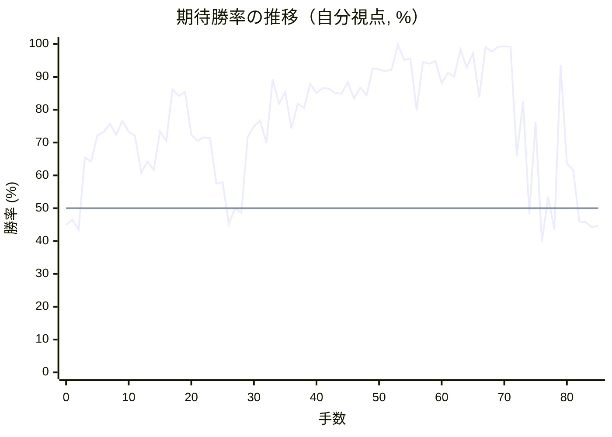

<details><summary>1手ごとの数値（第1パス）</summary>

| 手数 | 指し手 | 評価値 | 勝率 | 低下 | 判定 |
|--:|---|--:|--:|--:|---|
| 1 | ▲７六歩(77) | -83 | 46.5% |  |  |
| 2 | △３四歩(33) | -156 | 43.5% | +3.0pt |  |
| 3 | ▲７七桂(89) | +382 | 65.4% |  |  |
| 4 | △８四歩(83) | +354 | 64.3% | +1.1pt |  |
| 5 | ▲７五歩(76) | +574 | 72.2% |  |  |
| 6 | △６二銀(71) | +604 | 73.2% | -1.0pt |  |
| 7 | ▲７八飛(28) | +683 | 75.7% |  |  |
| 8 | △４二玉(51) | +578 | 72.4% | +3.4pt |  |
| 9 | ▲４八玉(59) | +710 | 76.6% |  |  |
| 10 | △３二玉(42) | +606 | 73.3% | +3.3pt |  |
| 11 | ▲６五桂(77) | +570 | 72.1% |  |  |
| 12 | △８五歩(84) | +264 | 60.8% | +11.3pt | [疑問手](#ply-12) |
| 13 | ▲２二角成(88) | +350 | 64.2% |  |  |
| 14 | △同銀(31) | +285 | 61.7% | +2.5pt |  |
| 15 | ▲４六角打 | +608 | 73.4% |  |  |
| 16 | △６四角打 | +522 | 70.5% | +2.9pt |  |
| 17 | ▲７三桂成(65) | +1100 | 86.2% |  |  |
| 18 | △同銀(62) | +1004 | 84.2% | +2.0pt |  |
| 19 | ▲７四歩(75) | +1062 | 85.4% |  |  |
| 20 | △６二銀(73) | +580 | 72.4% | +13.0pt | [悪手](#ply-20) |
| 21 | ▲６四角(46) | +523 | 70.5% |  |  |
| 22 | △同歩(63) | +554 | 71.6% | -1.1pt |  |
| 23 | ▲７三角打 | +548 | 71.4% |  |  |
| 24 | △同桂(81) | +182 | 57.5% | +13.8pt | [悪手](#ply-24) |
| 25 | ▲同歩成(74) | +190 | 57.9% |  |  |
| 26 | △９二飛(82) | -114 | 45.3% | +12.6pt | [悪手](#ply-26) |
| 27 | ▲８四桂打 | +3 | 50.1% |  |  |
| 28 | △７三銀(62) | -34 | 48.6% | +1.5pt |  |
| 29 | ▲同飛成(78) | +555 | 71.6% |  |  |
| 30 | △４二飛(92) | +655 | 74.9% | -3.3pt |  |
| 31 | ▲６四龍(73) | +714 | 76.7% |  |  |
| 32 | △５一金(61) | +504 | 69.8% | +6.8pt |  |
| 33 | ▲２八銀(39) | +1273 | 89.3% |  |  |
| 34 | △３三銀(22) | +903 | 81.8% | +7.5pt |  |
| 35 | ▲７四歩打 | +1058 | 85.4% |  |  |
| 36 | △４四銀(33) | +637 | 74.3% | +11.1pt | [悪手](#ply-36) |
| 37 | ▲７三歩成(74) | +902 | 81.8% |  |  |
| 38 | △５五角打 | +851 | 80.5% | +1.3pt |  |
| 39 | ▲６五龍(64) | +1190 | 87.9% |  |  |
| 40 | △３六桂打 | +1047 | 85.1% | +2.8pt |  |
| 41 | ▲３八玉(48) | +1118 | 86.6% |  |  |
| 42 | △２八桂成(36) | +1107 | 86.4% | +0.2pt |  |
| 43 | ▲同玉(38) | +1045 | 85.1% |  |  |
| 44 | △９九角成(55) | +1034 | 84.9% | +0.2pt |  |
| 45 | ▲７二桂成(84) | +1215 | 88.3% |  |  |
| 46 | △２四香打 | +968 | 83.4% | +5.0pt |  |
| 47 | ▲３八銀打 | +1123 | 86.7% |  |  |
| 48 | △５四角打 | +1013 | 84.4% | +2.3pt |  |
| 49 | ▲６四龍(65) | +1518 | 92.6% |  |  |
| 50 | △５五馬(99) | +1488 | 92.3% | +0.3pt |  |
| 51 | ▲同龍(64) | +1443 | 91.7% |  |  |
| 52 | △同銀(44) | +1478 | 92.2% | -0.4pt |  |
| 53 | ▲４六桂打 | +3875 | 99.8% |  |  |
| 54 | △８七角成(54) | +1796 | 95.2% | +4.6pt |  |
| 55 | ▲３四桂(46) | +1848 | 95.6% |  |  |
| 56 | △５四馬(87) | +823 | 79.8% | +15.8pt | [悪手](#ply-56) |
| 57 | ▲４二桂成(34) | +1701 | 94.5% |  |  |
| 58 | △同金(51) | +1655 | 94.0% | +0.4pt |  |
| 59 | ▲６三角打 | +1741 | 94.8% |  |  |
| 60 | △同馬(54) | +1202 | 88.1% | +6.7pt | [疑問手](#ply-60) |
| 61 | ▲同と(73) | +1401 | 91.2% |  |  |
| 62 | △４五角打 | +1322 | 90.1% | +1.1pt |  |
| 63 | ▲６二成桂(72) | +2423 | 98.3% |  |  |
| 64 | △３五桂打 | +1542 | 92.9% | +5.4pt |  |
| 65 | ▲３六角打 | +2122 | 97.2% |  |  |
| 66 | △６七角成(45) | +984 | 83.8% | +13.4pt | [悪手](#ply-66) |
| 67 | ▲７二飛打 | +2826 | 99.1% |  |  |
| 68 | △２七香成(24) | +2246 | 97.7% | +1.4pt |  |
| 69 | ▲同角(36) | +2876 | 99.2% |  |  |
| 70 | △同桂成(35) | +2982 | 99.3% | -0.1pt |  |
| 71 | ▲同玉(28) | +2875 | 99.2% |  |  |
| 72 | △４五馬(67) | +396 | 65.9% | +33.3pt | [疑問手](#ply-72) |
| 73 | ▲２八玉(27) | +932 | 82.5% |  |  |
| 74 | △６六飛打 | -40 | 48.3% | +34.2pt | [大悪手](#ply-74) |
| 75 | ▲６八歩打 | +698 | 76.2% |  |  |
| 76 | △８三角打 | -252 | 39.7% | +36.5pt | [大悪手](#ply-76) |
| 77 | ▲８二飛成(72) | +83 | 53.5% |  |  |
| 78 | △４七角成(83) | -156 | 43.5% | +9.9pt |  |
| 79 | ▲３六香打 | +1608 | 93.6% |  |  |
| 80 | △同馬(45) | +335 | 63.6% | +30.0pt | [大悪手](#ply-80) |
| 81 | ▲同歩(37) | +287 | 61.7% |  |  |
| 82 | △２四香打 | -98 | 45.9% | +15.8pt | [大悪手](#ply-82) |
| 83 | ▲２七歩打 | -101 | 45.8% |  |  |
| 84 | △３六馬(47) | -141 | 44.2% | +1.6pt |  |
| 85 | ▲５三と(63) | -128 | 44.7% |  |  |

</details>

## 課題局面

<a id="ply-12"></a>
### 12手目 △８五歩(84) — 疑問手

| | 着手前 | 着手後 | 差 |
|---|--:|--:|--:|
| 期待勝率 | 74.2% | 64.2% | -10.0pt |
| 評価値 | +634 | +351 | |

着手前の局面:

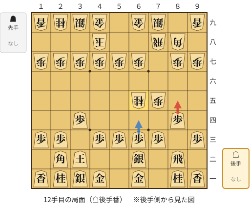

🔴 実戦 △８五歩(84)　🔵 AI推奨 △６四歩(63)　🟨 直前の相手の指し手

<details><summary>テキストの盤面図（BOD・将棋ソフトに貼り付け可）</summary>

```text
後手の持駒：なし
  ９ ８ ７ ６ ５ ４ ３ ２ １
+---------------------------+
|v香v桂 ・v金 ・v金v銀v桂v香|一
| ・v飛 ・v銀 ・ ・v玉v角 ・|二
|v歩 ・v歩v歩v歩v歩 ・v歩v歩|三
| ・v歩 ・ ・ ・ ・v歩 ・ ・|四
| ・ ・ 歩 桂 ・ ・ ・ ・ ・|五
| ・ ・ ・ ・ ・ ・ ・ ・ ・|六
| 歩 歩 ・ 歩 歩 歩 歩 歩 歩|七
| ・ 角 飛 ・ ・ 玉 ・ ・ ・|八
| 香 ・ 銀 金 ・ 金 銀 桂 香|九
+---------------------------+
先手の持駒：なし
後手番
手数＝11　▲６五桂　まで
```

</details>

| | 指し手 | 評価値 | 読み筋 |
|---|---|--:|---|
| 実戦 | △８五歩(84) | +351 | ▲７四歩(75) △同歩(73) ▲同飛(78) △８六歩(85) ▲同歩(87) △同飛(82) |
| AI 1位 | △６四歩(63) | +634 | △６四歩(63) ▲２二角成(88) △同銀(31) ▲７三桂成(65) △同銀(62) ▲７四歩(75) |
| AI 2位 | △８八角成(22) | +423 | △８八角成(22) ▲同銀(79) △６四歩(63) ▲７三桂不成(65) △同銀(62) ▲７四歩(75) |
| AI 3位 | △７二金(61) | +382 | △７二金(61) ▲７四歩(75) △同歩(73) ▲同飛(78) △６四歩(63) ▲２二角成(88) |

SFEN: `ln1g1gsnl/1r1s2kb1/p1pppp1pp/1p4p2/2PN5/9/PP1PPPPPP/1BR2K3/L1SG1GSNL w - 12`

<a id="ply-20"></a>
### 20手目 △６二銀(73) — 悪手

| | 着手前 | 着手後 | 差 |
|---|--:|--:|--:|
| 期待勝率 | 84.9% | 71.6% | -13.3pt |
| 評価値 | +1036 | +554 | |

着手前の局面:

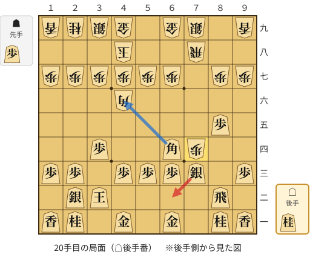

🔴 実戦 △６二銀(73)　🔵 AI推奨 △４六角(64)　🟨 直前の相手の指し手

<details><summary>テキストの盤面図（BOD・将棋ソフトに貼り付け可）</summary>

```text
後手の持駒：桂
  ９ ８ ７ ６ ５ ４ ３ ２ １
+---------------------------+
|v香v桂 ・v金 ・v金 ・v桂v香|一
| ・v飛 ・ ・ ・ ・v玉v銀 ・|二
|v歩 ・v銀v歩v歩v歩 ・v歩v歩|三
| ・ ・ 歩v角 ・ ・v歩 ・ ・|四
| ・v歩 ・ ・ ・ ・ ・ ・ ・|五
| ・ ・ ・ ・ ・ 角 ・ ・ ・|六
| 歩 歩 ・ 歩 歩 歩 歩 歩 歩|七
| ・ ・ 飛 ・ ・ 玉 ・ ・ ・|八
| 香 ・ 銀 金 ・ 金 銀 桂 香|九
+---------------------------+
先手の持駒：歩
後手番
手数＝19　▲７四歩　まで
```

</details>

| | 指し手 | 評価値 | 読み筋 |
|---|---|--:|---|
| 実戦 | △６二銀(73) | +554 | ▲６四角(46) △同歩(63) ▲７三角打 △同銀(62) ▲同歩成(74) △４二飛(82) |
| AI 1位 | △４六角(64) | +1036 | △４六角(64) ▲同歩(47) △６四銀(73) ▲７三角打 △同桂(81) ▲同歩成(74) |
| AI 2位 | △８四銀(73) | +610 | △８四銀(73) ▲６四角(46) △同歩(63) ▲７三角打 △同銀(84) ▲同歩成(74) |
| AI 3位 | △６二銀(73) | +542 | △６二銀(73) ▲６四角(46) △同歩(63) ▲７三角打 △同銀(62) ▲同歩成(74) |

SFEN: `ln1g1g1nl/1r4ks1/p1sppp1pp/2Pb2p2/1p7/5B3/PP1PPPPPP/2R2K3/L1SG1GSNL w Pn 20`

<a id="ply-24"></a>
### 24手目 △同桂(81) — 悪手

| | 着手前 | 着手後 | 差 |
|---|--:|--:|--:|
| 期待勝率 | 71.3% | 60.0% | -11.2pt |
| 評価値 | +545 | +244 | |

着手前の局面:

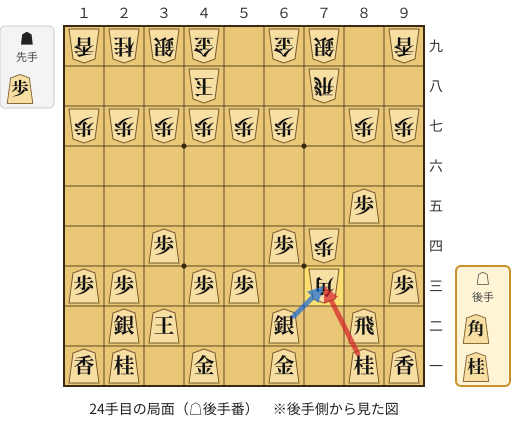

🔴 実戦 △同桂(81)　🔵 AI推奨 △同銀(62)　🟨 直前の相手の指し手

<details><summary>テキストの盤面図（BOD・将棋ソフトに貼り付け可）</summary>

```text
後手の持駒：角　桂
  ９ ８ ７ ６ ５ ４ ３ ２ １
+---------------------------+
|v香v桂 ・v金 ・v金 ・v桂v香|一
| ・v飛 ・v銀 ・ ・v玉v銀 ・|二
|v歩 ・ 角 ・v歩v歩 ・v歩v歩|三
| ・ ・ 歩v歩 ・ ・v歩 ・ ・|四
| ・v歩 ・ ・ ・ ・ ・ ・ ・|五
| ・ ・ ・ ・ ・ ・ ・ ・ ・|六
| 歩 歩 ・ 歩 歩 歩 歩 歩 歩|七
| ・ ・ 飛 ・ ・ 玉 ・ ・ ・|八
| 香 ・ 銀 金 ・ 金 銀 桂 香|九
+---------------------------+
先手の持駒：歩
後手番
手数＝23　▲７三角　まで
```

</details>

| | 指し手 | 評価値 | 読み筋 |
|---|---|--:|---|
| 実戦 | △同桂(81) | +244 | ▲同歩成(74) △同銀(62) ▲同飛成(78) △６二飛(82) ▲４五桂打 △７二歩打 |
| AI 1位 | △同銀(62) | +545 | △同銀(62) ▲同歩成(74) △９二飛(82) ▲７二歩打 △７三桂(81) ▲同飛成(78) |
| AI 2位 | △同桂(81) | +327 | △同桂(81) ▲同歩成(74) △同銀(62) ▲同飛成(78) △６二飛(82) ▲４五桂打 |
| AI 3位 | △７一金(61) | +213 | △７一金(61) ▲６四角成(73) △８六歩(85) ▲８二馬(64) △同金(71) ▲８五飛打 |

SFEN: `ln1g1g1nl/1r1s2ks1/p1B1pp1pp/2Pp2p2/1p7/9/PP1PPPPPP/2R2K3/L1SG1GSNL w Pbn 24`

<a id="ply-26"></a>
### 26手目 △９二飛(82) — 悪手

| | 着手前 | 着手後 | 差 |
|---|--:|--:|--:|
| 期待勝率 | 60.5% | 43.9% | -16.6pt |
| 評価値 | +256 | -148 | |

着手前の局面:

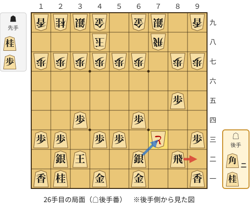

🔴 実戦 △９二飛(82)　🔵 AI推奨 △同銀(62)　🟨 直前の相手の指し手

<details><summary>テキストの盤面図（BOD・将棋ソフトに貼り付け可）</summary>

```text
後手の持駒：角二　桂
  ９ ８ ７ ６ ５ ４ ３ ２ １
+---------------------------+
|v香 ・ ・v金 ・v金 ・v桂v香|一
| ・v飛 ・v銀 ・ ・v玉v銀 ・|二
|v歩 ・ と ・v歩v歩 ・v歩v歩|三
| ・ ・ ・v歩 ・ ・v歩 ・ ・|四
| ・v歩 ・ ・ ・ ・ ・ ・ ・|五
| ・ ・ ・ ・ ・ ・ ・ ・ ・|六
| 歩 歩 ・ 歩 歩 歩 歩 歩 歩|七
| ・ ・ 飛 ・ ・ 玉 ・ ・ ・|八
| 香 ・ 銀 金 ・ 金 銀 桂 香|九
+---------------------------+
先手の持駒：桂　歩
後手番
手数＝25　▲７三同成　まで
```

</details>

| | 指し手 | 評価値 | 読み筋 |
|---|---|--:|---|
| 実戦 | △９二飛(82) | -148 | ▲８四桂打 △７三銀(62) ▲９二桂成(84) △６二銀(73) ▲８一飛打 △７一歩打 |
| AI 1位 | △同銀(62) | +256 | △同銀(62) ▲同飛成(78) △６二飛(82) ▲４五桂打 △７二歩打 ▲８三龍(73) |
| AI 2位 | △５五桂打 | +248 | △５五桂打 ▲８二と(73) △６七桂成(55) ▲７四飛(78) △７三歩打 ▲７六飛(74) |
| AI 3位 | △８一飛(82) | +80 | △８一飛(82) ▲７二と(73) △４五角打 ▲８一と(72) △６七角成(45) ▲８二飛打 |

SFEN: `l2g1g1nl/1r1s2ks1/p1+P1pp1pp/3p2p2/1p7/9/PP1PPPPPP/2R2K3/L1SG1GSNL w NP2bn 26`

<a id="ply-36"></a>
### 36手目 △４四銀(33) — 悪手

| | 着手前 | 着手後 | 差 |
|---|--:|--:|--:|
| 期待勝率 | 88.4% | 75.5% | -12.9pt |
| 評価値 | +1218 | +675 | |

着手前の局面:

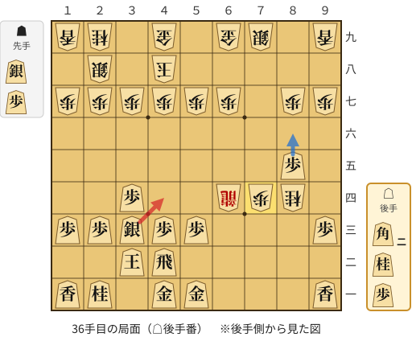

🔴 実戦 △４四銀(33)　🔵 AI推奨 △８六歩(85)　🟨 直前の相手の指し手

<details><summary>テキストの盤面図（BOD・将棋ソフトに貼り付け可）</summary>

```text
後手の持駒：角二　桂　歩
  ９ ８ ７ ６ ５ ４ ３ ２ １
+---------------------------+
|v香 ・ ・ ・v金v金 ・v桂v香|一
| ・ ・ ・ ・ ・v飛v玉 ・ ・|二
|v歩 ・ ・ ・v歩v歩v銀v歩v歩|三
| ・ 桂 歩 龍 ・ ・v歩 ・ ・|四
| ・v歩 ・ ・ ・ ・ ・ ・ ・|五
| ・ ・ ・ ・ ・ ・ ・ ・ ・|六
| 歩 歩 ・ 歩 歩 歩 歩 歩 歩|七
| ・ ・ ・ ・ ・ 玉 ・ 銀 ・|八
| 香 ・ 銀 金 ・ 金 ・ 桂 香|九
+---------------------------+
先手の持駒：銀　歩
後手番
手数＝35　▲７四歩　まで
```

</details>

| | 指し手 | 評価値 | 読み筋 |
|---|---|--:|---|
| 実戦 | △４四銀(33) | +675 | ▲７五龍(64) △５四角打 ▲７三歩成(74) △８七角成(54) ▲７八歩打 △５四角打 |
| AI 1位 | △８六歩(85) | +1218 | △８六歩(85) ▲７三歩成(74) △８七歩成(86) ▲６三と(73) △８六角打 ▲７四龍(64) |
| AI 2位 | △７七角打 | +1067 | △７七角打 ▲７三歩成(74) △９九角成(77) ▲７二桂成(84) △４四香打 ▲５八金(69) |
| AI 3位 | △４四角打 | +1051 | △４四角打 ▲５五銀打 △８二角打 ▲７三歩成(74) △同角(82) ▲同龍(64) |

SFEN: `l3gg1nl/5rk2/p3ppspp/1NP+R2p2/1p7/9/PP1PPPPPP/5K1S1/L1SG1G1NL w SP2bnp 36`

<a id="ply-56"></a>
### 56手目 △５四馬(87) — 悪手

| | 着手前 | 着手後 | 差 |
|---|--:|--:|--:|
| 期待勝率 | 96.6% | 79.5% | -17.1pt |
| 評価値 | +2014 | +814 | |

着手前の局面:

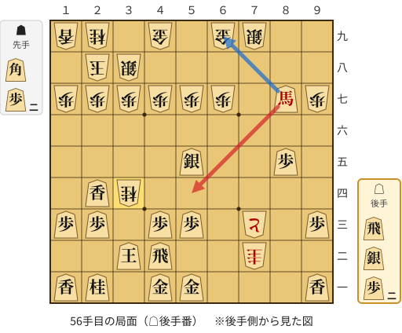

🔴 実戦 △５四馬(87)　🔵 AI推奨 △６九馬(87)　🟨 直前の相手の指し手

<details><summary>テキストの盤面図（BOD・将棋ソフトに貼り付け可）</summary>

```text
後手の持駒：飛　銀　歩二
  ９ ８ ７ ６ ５ ４ ３ ２ １
+---------------------------+
|v香 ・ ・ ・v金v金 ・v桂v香|一
| ・ ・ 圭 ・ ・v飛v玉 ・ ・|二
|v歩 ・ と ・v歩v歩 ・v歩v歩|三
| ・ ・ ・ ・ ・ ・ 桂v香 ・|四
| ・v歩 ・ ・v銀 ・ ・ ・ ・|五
| ・ ・ ・ ・ ・ ・ ・ ・ ・|六
| 歩v馬 ・ 歩 歩 歩 歩 歩 歩|七
| ・ ・ ・ ・ ・ ・ 銀 玉 ・|八
| ・ ・ 銀 金 ・ 金 ・ 桂 香|九
+---------------------------+
先手の持駒：角　歩二
後手番
手数＝55　▲３四桂　まで
```

</details>

| | 指し手 | 評価値 | 読み筋 |
|---|---|--:|---|
| 実戦 | △５四馬(87) | +814 | ▲６二と(73) △３一金(41) ▲６三角打 △３六歩打 ▲同歩(37) △４五銀打 |
| AI 1位 | △６九馬(87) | +2014 | △６九馬(87) ▲６二と(73) △３三銀打 ▲５一と(62) △３四銀(33) ▲４一と(51) |
| AI 2位 | △２五銀打 | +1520 | △２五銀打 ▲４二桂成(34) △同金(51) ▲５九金(69) △５四馬(87) ▲６三角打 |
| AI 3位 | △３三銀打 | +1376 | △３三銀打 ▲４二桂成(34) △同金(51) ▲５九金(69) △５四馬(87) ▲６三角打 |

SFEN: `l3gg1nl/2+N2rk2/p1+P1pp1pp/6Nl1/1p2s4/9/P+b1PPPPPP/6SK1/2SG1G1NL w B2Prs2p 56`

<a id="ply-60"></a>
### 60手目 △同馬(54) — 疑問手

| | 着手前 | 着手後 | 差 |
|---|--:|--:|--:|
| 期待勝率 | 95.2% | 89.8% | -5.4pt |
| 評価値 | +1795 | +1306 | |

着手前の局面:

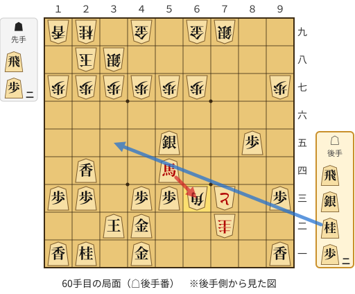

🔴 実戦 △同馬(54)　🔵 AI推奨 △３五桂打　🟨 直前の相手の指し手

<details><summary>テキストの盤面図（BOD・将棋ソフトに貼り付け可）</summary>

```text
後手の持駒：飛　銀　桂　歩二
  ９ ８ ７ ６ ５ ４ ３ ２ １
+---------------------------+
|v香 ・ ・ ・ ・v金 ・v桂v香|一
| ・ ・ 圭 ・ ・v金v玉 ・ ・|二
|v歩 ・ と 角v歩v歩 ・v歩v歩|三
| ・ ・ ・ ・v馬 ・ ・v香 ・|四
| ・v歩 ・ ・v銀 ・ ・ ・ ・|五
| ・ ・ ・ ・ ・ ・ ・ ・ ・|六
| 歩 ・ ・ 歩 歩 歩 歩 歩 歩|七
| ・ ・ ・ ・ ・ ・ 銀 玉 ・|八
| ・ ・ 銀 金 ・ 金 ・ 桂 香|九
+---------------------------+
先手の持駒：飛　歩二
後手番
手数＝59　▲６三角　まで
```

</details>

| | 指し手 | 評価値 | 読み筋 |
|---|---|--:|---|
| 実戦 | △同馬(54) | +1306 | ▲同と(73) △４五角打 ▲３六角打 △同角(45) ▲同歩(37) △４五桂打 |
| AI 1位 | △３五桂打 | +1795 | △３五桂打 ▲３四飛打 △３三飛打 ▲３五飛(34) △同飛(33) ▲６二成桂(72) |
| AI 2位 | △３五桂打 | +1703 | △３五桂打 ▲３四飛打 △３三飛打 ▲５四飛(34) △同歩(53) ▲同角成(63) |
| AI 3位 | △３六歩打 | +1551 | △３六歩打 ▲同歩(37) △４四桂打 ▲１八玉(28) △２二玉(32) ▲５四角成(63) |

SFEN: `l4g1nl/2+N2gk2/p1+PBpp1pp/4+b2l1/1p2s4/9/P2PPPPPP/6SK1/2SG1G1NL w R2Prsn2p 60`

<a id="ply-66"></a>
### 66手目 △６七角成(45) — 悪手

| | 着手前 | 着手後 | 差 |
|---|--:|--:|--:|
| 期待勝率 | 99.0% | 88.4% | -10.6pt |
| 評価値 | +2741 | +1218 | |

着手前の局面:

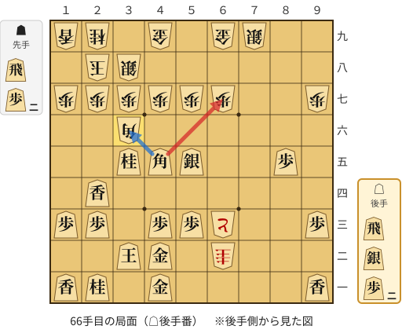

🔴 実戦 △６七角成(45)　🔵 AI推奨 △同角(45)　🟨 直前の相手の指し手

<details><summary>テキストの盤面図（BOD・将棋ソフトに貼り付け可）</summary>

```text
後手の持駒：飛　銀　歩二
  ９ ８ ７ ６ ５ ４ ３ ２ １
+---------------------------+
|v香 ・ ・ ・ ・v金 ・v桂v香|一
| ・ ・ ・ 圭 ・v金v玉 ・ ・|二
|v歩 ・ ・ とv歩v歩 ・v歩v歩|三
| ・ ・ ・ ・ ・ ・ ・v香 ・|四
| ・v歩 ・ ・v銀v角v桂 ・ ・|五
| ・ ・ ・ ・ ・ ・ 角 ・ ・|六
| 歩 ・ ・ 歩 歩 歩 歩 歩 歩|七
| ・ ・ ・ ・ ・ ・ 銀 玉 ・|八
| ・ ・ 銀 金 ・ 金 ・ 桂 香|九
+---------------------------+
先手の持駒：飛　歩二
後手番
手数＝65　▲３六角　まで
```

</details>

| | 指し手 | 評価値 | 読み筋 |
|---|---|--:|---|
| 実戦 | △６七角成(45) | +1218 | ▲５八金(69) △同馬(67) |
| AI 1位 | △同角(45) | +2741 | △同角(45) ▲３四飛打 △３三銀打 ▲３五飛(34) △２七角成(36) ▲同銀(38) |
| AI 2位 | △２七香成(24) | +1561 | △２七香成(24) ▲同銀(38) △同桂成(35) ▲同角(36) △同角成(45) ▲同玉(28) |
| AI 3位 | △２七香成(24) | +1614 | △２七香成(24) ▲同銀(38) △同桂成(35) ▲同角(36) △同角成(45) ▲同玉(28) |

SFEN: `l4g1nl/3+N1gk2/p2+Ppp1pp/7l1/1p2sbn2/6B2/P2PPPPPP/6SK1/2SG1G1NL w R2Prs2p 66`

<a id="ply-72"></a>
### 72手目 △４五馬(67) — 疑問手

| | 着手前 | 着手後 | 差 |
|---|--:|--:|--:|
| 期待勝率 | 99.5% | 90.1% | -9.4pt |
| 評価値 | +3221 | +1325 | |

着手前の局面:

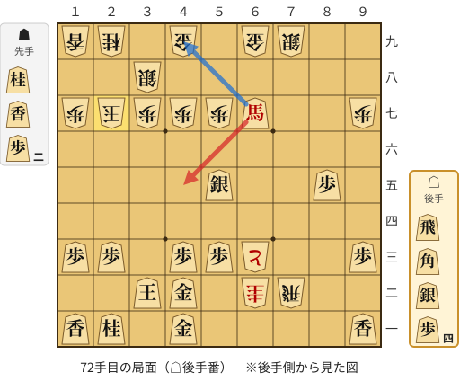

🔴 実戦 △４五馬(67)　🔵 AI推奨 △４九馬(67)　🟨 直前の相手の指し手

<details><summary>テキストの盤面図（BOD・将棋ソフトに貼り付け可）</summary>

```text
後手の持駒：飛　角　銀　歩四
  ９ ８ ７ ６ ５ ４ ３ ２ １
+---------------------------+
|v香 ・ ・ ・ ・v金 ・v桂v香|一
| ・ ・ 飛 圭 ・v金v玉 ・ ・|二
|v歩 ・ ・ とv歩v歩 ・v歩v歩|三
| ・ ・ ・ ・ ・ ・ ・ ・ ・|四
| ・v歩 ・ ・v銀 ・ ・ ・ ・|五
| ・ ・ ・ ・ ・ ・ ・ ・ ・|六
| 歩 ・ ・v馬 歩 歩 歩 玉 歩|七
| ・ ・ ・ ・ ・ ・ 銀 ・ ・|八
| ・ ・ 銀 金 ・ 金 ・ 桂 香|九
+---------------------------+
先手の持駒：桂　香　歩二
後手番
手数＝71　▲２七同玉　まで
```

</details>

| | 指し手 | 評価値 | 読み筋 |
|---|---|--:|---|
| 実戦 | △４五馬(67) | +1325 | ▲２八玉(27) △６一歩打 ▲同成桂(62) △６七角打 ▲５九金(69) △６三馬(45) |
| AI 1位 | △４九馬(67) | +3221 | △４九馬(67) ▲同銀(38) △２六銀打 ▲２八玉(27) △２七飛打 ▲３八玉(28) |
| AI 2位 | △４五角打 | +3175 | △４五角打 ▲３六桂打 △３五歩打 ▲５八金(69) △同馬(67) ▲同金(49) |
| AI 3位 | △２六銀打 | +3031 | △２六銀打 ▲２八玉(27) △４九馬(67) ▲同銀(38) △２七飛打 ▲３八玉(28) |

SFEN: `l4g1nl/2R+N1gk2/p2+Ppp1pp/9/1p2s4/9/P2+bPPPKP/6S2/2SG1G1NL w NL2Prbs4p 72`

<a id="ply-74"></a>
### 74手目 △６六飛打 — 大悪手

| | 着手前 | 着手後 | 差 |
|---|--:|--:|--:|
| 期待勝率 | 91.7% | 51.2% | -40.5pt |
| 評価値 | +1444 | +30 | |

着手前の局面:

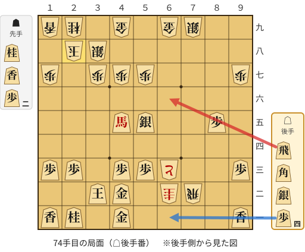

🔴 実戦 △６六飛打　🔵 AI推奨 △６一歩打　🟨 直前の相手の指し手

<details><summary>テキストの盤面図（BOD・将棋ソフトに貼り付け可）</summary>

```text
後手の持駒：飛　角　銀　歩四
  ９ ８ ７ ６ ５ ４ ３ ２ １
+---------------------------+
|v香 ・ ・ ・ ・v金 ・v桂v香|一
| ・ ・ 飛 圭 ・v金v玉 ・ ・|二
|v歩 ・ ・ とv歩v歩 ・v歩v歩|三
| ・ ・ ・ ・ ・ ・ ・ ・ ・|四
| ・v歩 ・ ・v銀v馬 ・ ・ ・|五
| ・ ・ ・ ・ ・ ・ ・ ・ ・|六
| 歩 ・ ・ ・ 歩 歩 歩 ・ 歩|七
| ・ ・ ・ ・ ・ ・ 銀 玉 ・|八
| ・ ・ 銀 金 ・ 金 ・ 桂 香|九
+---------------------------+
先手の持駒：桂　香　歩二
後手番
手数＝73　▲２八玉　まで
```

</details>

| | 指し手 | 評価値 | 読み筋 |
|---|---|--:|---|
| 実戦 | △６六飛打 | +30 | ▲６七歩打 △同飛成(66) ▲６八銀(79) △６六龍(67) ▲７一飛成(72) △３六歩打 |
| AI 1位 | △６一歩打 | +1444 | △６一歩打 ▲同成桂(62) △６三馬(45) ▲６二飛成(72) △同馬(63) ▲同成桂(61) |
| AI 2位 | △６七角打 | +716 | △６七角打 ▲５八金(69) △同角成(67) ▲同金(49) △６一歩打 ▲７八角打 |
| AI 3位 | △５四角打 | +715 | △５四角打 ▲３九桂打 △６一歩打 ▲５二成桂(62) △同金(41) ▲同飛成(72) |

SFEN: `l4g1nl/2R+N1gk2/p2+Ppp1pp/9/1p2s+b3/9/P3PPP1P/6SK1/2SG1G1NL w NL2Prbs4p 74`

<a id="ply-76"></a>
### 76手目 △８三角打 — 大悪手

| | 着手前 | 着手後 | 差 |
|---|--:|--:|--:|
| 期待勝率 | 81.0% | 43.5% | -37.5pt |
| 評価値 | +870 | -158 | |

着手前の局面:

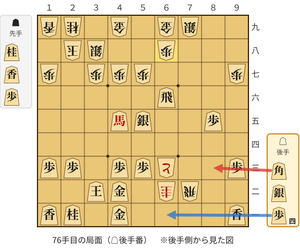

🔴 実戦 △８三角打　🔵 AI推奨 △６一歩打　🟨 直前の相手の指し手

<details><summary>テキストの盤面図（BOD・将棋ソフトに貼り付け可）</summary>

```text
後手の持駒：角　銀　歩四
  ９ ８ ７ ６ ５ ４ ３ ２ １
+---------------------------+
|v香 ・ ・ ・ ・v金 ・v桂v香|一
| ・ ・ 飛 圭 ・v金v玉 ・ ・|二
|v歩 ・ ・ とv歩v歩 ・v歩v歩|三
| ・ ・ ・ ・ ・ ・ ・ ・ ・|四
| ・v歩 ・ ・v銀v馬 ・ ・ ・|五
| ・ ・ ・v飛 ・ ・ ・ ・ ・|六
| 歩 ・ ・ ・ 歩 歩 歩 ・ 歩|七
| ・ ・ ・ 歩 ・ ・ 銀 玉 ・|八
| ・ ・ 銀 金 ・ 金 ・ 桂 香|九
+---------------------------+
先手の持駒：桂　香　歩
後手番
手数＝75　▲６八歩　まで
```

</details>

| | 指し手 | 評価値 | 読み筋 |
|---|---|--:|---|
| 実戦 | △８三角打 | -158 | ▲７五飛成(72) △６一歩打 ▲５二と(63) △同金(42) ▲同成桂(62) △同金(41) |
| AI 1位 | △６一歩打 | +870 | △６一歩打 ▲６七香打 △６二歩(61) ▲６六香(67) △同銀(55) ▲６二飛成(72) |
| AI 2位 | △３六歩打 | +517 | △３六歩打 ▲６七香打 △８六飛(66) ▲８二飛成(72) △２六銀打 ▲５二と(63) |
| AI 3位 | △８七角打 | +352 | △８七角打 ▲６七歩(68) △８六飛(66) ▲３六香打 △３五歩打 ▲同香(36) |

SFEN: `l4g1nl/2R+N1gk2/p2+Ppp1pp/9/1p2s+b3/3r5/P3PPP1P/3P2SK1/2SG1G1NL w NLPbs4p 76`

<a id="ply-80"></a>
### 80手目 △同馬(45) — 大悪手

| | 着手前 | 着手後 | 差 |
|---|--:|--:|--:|
| 期待勝率 | 96.7% | 54.6% | -42.1pt |
| 評価値 | +2034 | +111 | |

着手前の局面:

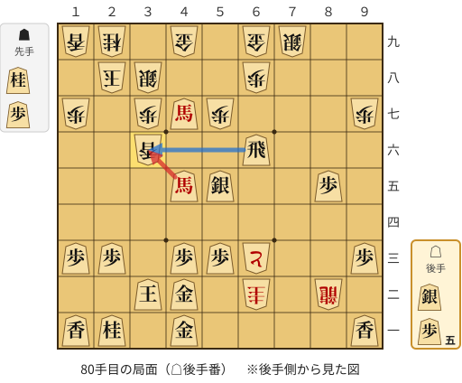

🔴 実戦 △同馬(45)　🔵 AI推奨 △同飛(66)　🟨 直前の相手の指し手

<details><summary>テキストの盤面図（BOD・将棋ソフトに貼り付け可）</summary>

```text
後手の持駒：銀　歩五
  ９ ８ ７ ６ ５ ４ ３ ２ １
+---------------------------+
|v香 ・ ・ ・ ・v金 ・v桂v香|一
| ・ 龍 ・ 圭 ・v金v玉 ・ ・|二
|v歩 ・ ・ とv歩v歩 ・v歩v歩|三
| ・ ・ ・ ・ ・ ・ ・ ・ ・|四
| ・v歩 ・ ・v銀v馬 ・ ・ ・|五
| ・ ・ ・v飛 ・ ・ 香 ・ ・|六
| 歩 ・ ・ ・ 歩v馬 歩 ・ 歩|七
| ・ ・ ・ 歩 ・ ・ 銀 玉 ・|八
| ・ ・ 銀 金 ・ 金 ・ 桂 香|九
+---------------------------+
先手の持駒：桂　歩
後手番
手数＝79　▲３六香　まで
```

</details>

| | 指し手 | 評価値 | 読み筋 |
|---|---|--:|---|
| 実戦 | △同馬(45) | +111 | ▲同歩(37) △６九馬(47) ▲５三と(63) △３六馬(69) ▲４二と(53) △同金(41) |
| AI 1位 | △同飛(66) | +2034 | △同飛(66) ▲３九桂打 △６九馬(47) ▲５三と(63) △７六飛(36) ▲４二と(53) |
| AI 2位 | △３五歩打 | +455 | △３五歩打 ▲４七銀(38) △３六歩(35) ▲同銀(47) △同飛(66) ▲同歩(37) |
| AI 3位 | △同馬(45) | +426 | △同馬(45) ▲同歩(37) △６九馬(47) ▲５二成桂(62) △２五香打 ▲２七歩打 |

SFEN: `l4g1nl/1+R1+N1gk2/p2+Ppp1pp/9/1p2s+b3/3r2L2/P3P+bP1P/3P2SK1/2SG1G1NL w NPs5p 80`

<a id="ply-82"></a>
### 82手目 △２四香打 — 大悪手

| | 着手前 | 着手後 | 差 |
|---|--:|--:|--:|
| 期待勝率 | 63.5% | 42.4% | -21.1pt |
| 評価値 | +331 | -184 | |

着手前の局面:

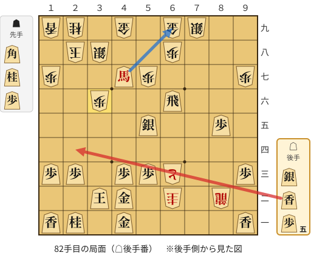

🔴 実戦 △２四香打　🔵 AI推奨 △６九馬(47)　🟨 直前の相手の指し手

<details><summary>テキストの盤面図（BOD・将棋ソフトに貼り付け可）</summary>

```text
後手の持駒：銀　香　歩五
  ９ ８ ７ ６ ５ ４ ３ ２ １
+---------------------------+
|v香 ・ ・ ・ ・v金 ・v桂v香|一
| ・ 龍 ・ 圭 ・v金v玉 ・ ・|二
|v歩 ・ ・ とv歩v歩 ・v歩v歩|三
| ・ ・ ・ ・ ・ ・ ・ ・ ・|四
| ・v歩 ・ ・v銀 ・ ・ ・ ・|五
| ・ ・ ・v飛 ・ ・ 歩 ・ ・|六
| 歩 ・ ・ ・ 歩v馬 ・ ・ 歩|七
| ・ ・ ・ 歩 ・ ・ 銀 玉 ・|八
| ・ ・ 銀 金 ・ 金 ・ 桂 香|九
+---------------------------+
先手の持駒：角　桂　歩
後手番
手数＝81　▲３六同歩　まで
```

</details>

| | 指し手 | 評価値 | 読み筋 |
|---|---|--:|---|
| 実戦 | △２四香打 | -184 | ▲２七歩打 △６九馬(47) ▲５三と(63) △３六馬(69) ▲４二と(53) △同金(41) |
| AI 1位 | △６九馬(47) | +331 | △６九馬(47) ▲５三と(63) △３六馬(69) ▲４二と(53) △同金(41) ▲３七歩打 |
| AI 2位 | △４六飛(66) | -8 | △４六飛(66) ▲５八角打 △３八馬(47) ▲同金(49) △４九銀打 ▲８三角打 |
| AI 3位 | △２五香打 | -102 | △２五香打 ▲２七歩打 △４六飛(66) ▲３九桂打 △３八馬(47) ▲同金(49) |

SFEN: `l4g1nl/1+R1+N1gk2/p2+Ppp1pp/9/1p2s4/3r2P2/P3P+b2P/3P2SK1/2SG1G1NL w BNPsl5p 82`

