# 解析レポート ff4s8bav9rs7

[README に戻る](../../../README.md)　/　棋譜: [CSA](../../../data/csa/shogi5/ff4s8bav9rs7.csa)　/　解析の見方: [docs/mistake_analysis.md](../../../docs/mistake_analysis.md)

## 対局情報

| 項目 | 内容 |
|---|---|
| 日時 | 2026-10-29 23:11:51 |
| 持ち時間 | 5分 |
| 自分 | 後手（△）（1724） |
| 相手 | 相手（1585） |
| 結果 | 負け（投了, 61手） |

## 解析環境

| 項目 | 内容 |
|---|---|
| エンジン | YaneuraOu NNUE 9.00git 64AVX2（V9.00/YANEURAOU_ENGINE_NNUE/AVX2） |
| 評価関数 | **水匠5**（`suisho5`） |
| nn.bin SHA-256 | `768068f0d534a0603a5d38bcd143de6bbca820d5f1c95a14d40863e5b7892d76` |
| 第1パス | movetime=150ms, MultiPV 1 |
| 第2パス | movetime=2000ms, MultiPV 3 |
| Threads / Hash | 8 / 512MB |
| 判定基準 | 疑問手 ≥5pt, 悪手 ≥10pt, 大悪手 ≥20pt（期待勝率 W(E)=1/(1+exp(-E/600))） |
| 解析日時 | 2026-11-03T04:13:10+09:00（解析バージョン 1, 65秒） |

## サマリー

| 自分の手数 | 深掘りした手 | 詰み逃し | 大悪手 | 悪手 | 疑問手 |
|--:|--:|--:|--:|--:|--:|
| 30 | 14 | 0 | 2 | 6 | 3 |

## 期待勝率の推移

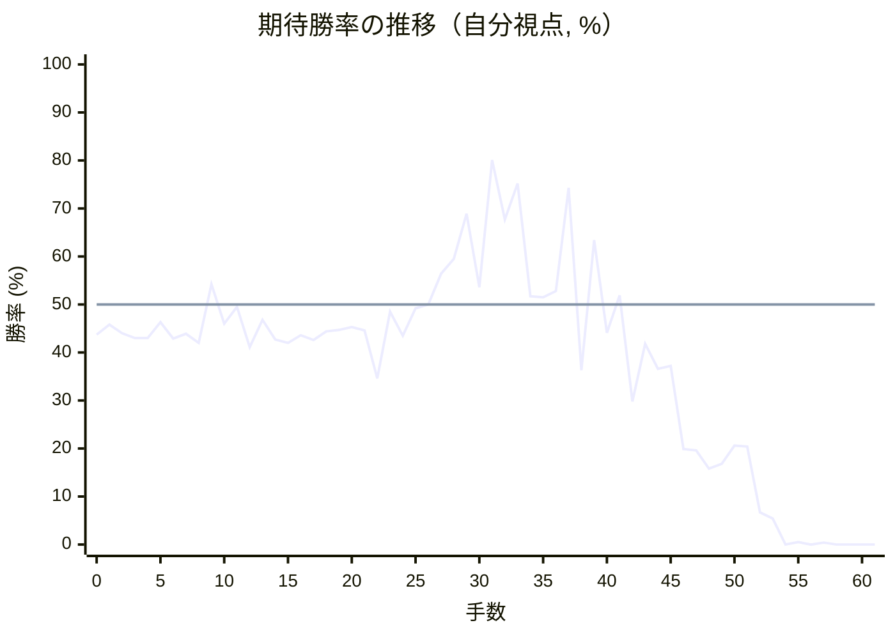

<details><summary>1手ごとの数値（第1パス）</summary>

| 手数 | 指し手 | 評価値 | 勝率 | 低下 | 判定 |
|--:|---|--:|--:|--:|---|
| 1 | ▲７六歩(77) | -102 | 45.8% |  |  |
| 2 | △３四歩(33) | -144 | 44.0% | +1.7pt |  |
| 3 | ▲２六歩(27) | -168 | 43.0% |  |  |
| 4 | △８四歩(83) | -170 | 43.0% | +0.1pt |  |
| 5 | ▲７八金(69) | -88 | 46.3% |  |  |
| 6 | △８五歩(84) | -172 | 42.9% | +3.5pt |  |
| 7 | ▲２五歩(26) | -146 | 43.9% |  |  |
| 8 | △３二金(41) | -194 | 42.0% | +2.0pt |  |
| 9 | ▲１六歩(17) | +102 | 54.2% |  |  |
| 10 | △１四歩(13) | -96 | 46.0% | +8.2pt | [疑問手](#ply-10) |
| 11 | ▲５八玉(59) | -12 | 49.5% |  |  |
| 12 | △９四歩(93) | -216 | 41.1% | +8.4pt | [疑問手](#ply-12) |
| 13 | ▲９六歩(97) | -77 | 46.8% |  |  |
| 14 | △４二玉(51) | -176 | 42.7% | +4.1pt |  |
| 15 | ▲２四歩(25) | -194 | 42.0% |  |  |
| 16 | △同歩(23) | -154 | 43.6% | -1.6pt |  |
| 17 | ▲同飛(28) | -178 | 42.6% |  |  |
| 18 | △８六歩(85) | -135 | 44.4% | -1.8pt |  |
| 19 | ▲同歩(87) | -127 | 44.7% |  |  |
| 20 | △同飛(82) | -114 | 45.3% | -0.5pt |  |
| 21 | ▲３四飛(24) | -130 | 44.6% |  |  |
| 22 | △７六飛(86) | -381 | 34.6% | +10.0pt | [疑問手](#ply-22) |
| 23 | ▲７七角(88) | -36 | 48.5% |  |  |
| 24 | △７四歩(73) | -157 | 43.5% | +5.0pt |  |
| 25 | ▲３六歩(37) | -20 | 49.2% |  |  |
| 26 | △７三桂(81) | +0 | 50.0% | -0.8pt |  |
| 27 | ▲２二角成(77) | +154 | 56.4% |  |  |
| 28 | △同銀(31) | +232 | 59.5% | -3.2pt |  |
| 29 | ▲３五飛(34) | +476 | 68.9% |  |  |
| 30 | △３三桂(21) | +86 | 53.6% | +15.3pt | [悪手](#ply-30) |
| 31 | ▲３七桂(29) | +836 | 80.1% |  |  |
| 32 | △８八歩打 | +444 | 67.7% | +12.4pt | [悪手](#ply-32) |
| 33 | ▲７七歩打 | +667 | 75.2% |  |  |
| 34 | △７五飛(76) | +41 | 51.7% | +23.5pt | [大悪手](#ply-34) |
| 35 | ▲同飛(35) | +35 | 51.5% |  |  |
| 36 | △同歩(74) | +67 | 52.8% | -1.3pt |  |
| 37 | ▲８八銀(79) | +636 | 74.3% |  |  |
| 38 | △７六歩(75) | -338 | 36.3% | +38.0pt | [大悪手](#ply-38) |
| 39 | ▲３八金(49) | +330 | 63.4% |  |  |
| 40 | △７七歩成(76) | -143 | 44.1% | +19.3pt | [悪手](#ply-40) |
| 41 | ▲同銀(88) | +46 | 51.9% |  |  |
| 42 | △２九飛打 | -514 | 29.8% | +22.1pt | [悪手](#ply-42) |
| 43 | ▲７四歩打 | -198 | 41.8% |  |  |
| 44 | △６五桂(73) | -330 | 36.6% | +5.2pt |  |
| 45 | ▲６六銀(77) | -313 | 37.2% |  |  |
| 46 | △８八歩打 | -836 | 19.9% | +17.4pt | [悪手](#ply-46) |
| 47 | ▲６五銀(66) | -845 | 19.6% |  |  |
| 48 | △８九歩成(88) | -1005 | 15.8% | +3.9pt |  |
| 49 | ▲３四桂打 | -962 | 16.8% |  |  |
| 50 | △３一玉(42) | -811 | 20.6% | -3.8pt |  |
| 51 | ▲２二桂成(34) | -817 | 20.4% |  |  |
| 52 | △同玉(31) | -1581 | 6.7% | +13.7pt | [悪手](#ply-52) |
| 53 | ▲２三歩打 | -1720 | 5.4% |  |  |
| 54 | △同玉(22) | -4608 | 0.0% | +5.3pt |  |
| 55 | ▲２四歩打 | -3180 | 0.5% |  |  |
| 56 | △同玉(23) | -4982 | 0.0% | +0.5pt |  |
| 57 | ▲３五銀打 | -3323 | 0.4% |  |  |
| 58 | △２三玉(24) | -5064 | 0.0% | +0.4pt |  |
| 59 | ▲２一飛打 | -5654 | 0.0% |  |  |
| 60 | △２二歩打 | #-5 | 0.0% | +0.0pt |  |
| 61 | ▲３四角打 | #-4 | 0.0% |  |  |

</details>

## 課題局面

<a id="ply-10"></a>
### 10手目 △１四歩(13) — 疑問手

| | 着手前 | 着手後 | 差 |
|---|--:|--:|--:|
| 期待勝率 | 54.3% | 48.3% | -6.0pt |
| 評価値 | +103 | -41 | |

着手前の局面:

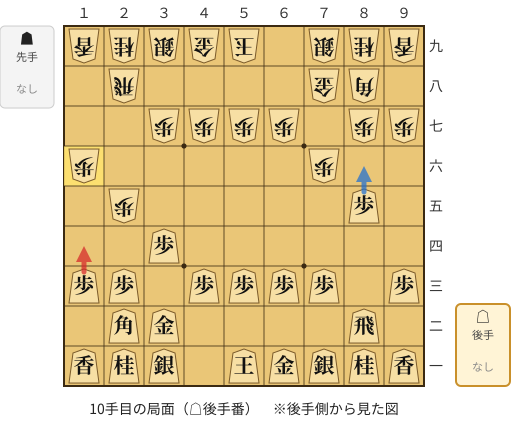

🔴 実戦 △１四歩(13)　🔵 AI推奨 △８六歩(85)　🟨 直前の相手の指し手

<details><summary>テキストの盤面図（BOD・将棋ソフトに貼り付け可）</summary>

```text
後手の持駒：なし
  ９ ８ ７ ６ ５ ４ ３ ２ １
+---------------------------+
|v香v桂v銀v金v玉 ・v銀v桂v香|一
| ・v飛 ・ ・ ・ ・v金v角 ・|二
|v歩 ・v歩v歩v歩v歩 ・v歩v歩|三
| ・ ・ ・ ・ ・ ・v歩 ・ ・|四
| ・v歩 ・ ・ ・ ・ ・ 歩 ・|五
| ・ ・ 歩 ・ ・ ・ ・ ・ 歩|六
| 歩 歩 ・ 歩 歩 歩 歩 ・ ・|七
| ・ 角 金 ・ ・ ・ ・ 飛 ・|八
| 香 桂 銀 ・ 玉 金 銀 桂 香|九
+---------------------------+
先手の持駒：なし
後手番
手数＝9　▲１六歩　まで
```

</details>

| | 指し手 | 評価値 | 読み筋 |
|---|---|--:|---|
| 実戦 | △１四歩(13) | -41 | ▲２四歩(25) △同歩(23) ▲同飛(28) △８六歩(85) ▲同歩(87) △同飛(82) |
| AI 1位 | △８六歩(85) | +103 | △８六歩(85) ▲同歩(87) △同飛(82) ▲５八玉(59) △７六飛(86) ▲７七角(88) |
| AI 2位 | △５二玉(51) | +12 | △５二玉(51) ▲５八玉(59) △８六歩(85) ▲同歩(87) △同飛(82) ▲２四歩(25) |
| AI 3位 | △１四歩(13) | -58 | △１四歩(13) ▲５八玉(59) △８六歩(85) ▲同歩(87) △同飛(82) ▲２四歩(25) |

SFEN: `lnsgk1snl/1r4gb1/p1pppp1pp/6p2/1p5P1/2P5P/PP1PPPP2/1BG4R1/LNS1KGSNL w - 10`

<a id="ply-12"></a>
### 12手目 △９四歩(93) — 疑問手

| | 着手前 | 着手後 | 差 |
|---|--:|--:|--:|
| 期待勝率 | 49.3% | 42.3% | -7.0pt |
| 評価値 | -18 | -187 | |

着手前の局面:

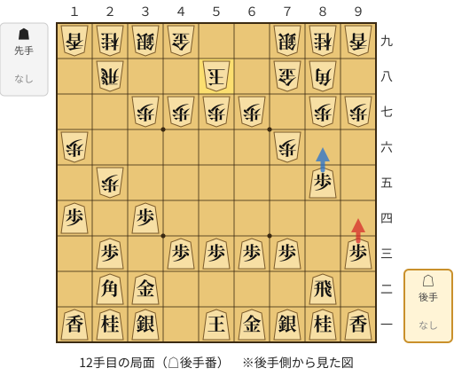

🔴 実戦 △９四歩(93)　🔵 AI推奨 △８六歩(85)　🟨 直前の相手の指し手

<details><summary>テキストの盤面図（BOD・将棋ソフトに貼り付け可）</summary>

```text
後手の持駒：なし
  ９ ８ ７ ６ ５ ４ ３ ２ １
+---------------------------+
|v香v桂v銀v金v玉 ・v銀v桂v香|一
| ・v飛 ・ ・ ・ ・v金v角 ・|二
|v歩 ・v歩v歩v歩v歩 ・v歩 ・|三
| ・ ・ ・ ・ ・ ・v歩 ・v歩|四
| ・v歩 ・ ・ ・ ・ ・ 歩 ・|五
| ・ ・ 歩 ・ ・ ・ ・ ・ 歩|六
| 歩 歩 ・ 歩 歩 歩 歩 ・ ・|七
| ・ 角 金 ・ 玉 ・ ・ 飛 ・|八
| 香 桂 銀 ・ ・ 金 銀 桂 香|九
+---------------------------+
先手の持駒：なし
後手番
手数＝11　▲５八玉　まで
```

</details>

| | 指し手 | 評価値 | 読み筋 |
|---|---|--:|---|
| 実戦 | △９四歩(93) | -187 | ▲２四歩(25) △同歩(23) ▲同飛(28) △４二玉(51) ▲３四飛(24) △８六歩(85) |
| AI 1位 | △８六歩(85) | -18 | △８六歩(85) ▲同歩(87) △同飛(82) ▲２四歩(25) △同歩(23) ▲同飛(28) |
| AI 2位 | △５二玉(51) | -27 | △５二玉(51) ▲２四歩(25) △同歩(23) ▲同飛(28) △８六歩(85) ▲同歩(87) |
| AI 3位 | △３三角(22) | -57 | △３三角(22) ▲同角成(88) △同金(32) ▲８八銀(79) △８六歩(85) ▲同歩(87) |

SFEN: `lnsgk1snl/1r4gb1/p1pppp1p1/6p1p/1p5P1/2P5P/PP1PPPP2/1BG1K2R1/LNS2GSNL w - 12`

<a id="ply-22"></a>
### 22手目 △７六飛(86) — 疑問手

| | 着手前 | 着手後 | 差 |
|---|--:|--:|--:|
| 期待勝率 | 45.1% | 35.9% | -9.2pt |
| 評価値 | -117 | -348 | |

着手前の局面:

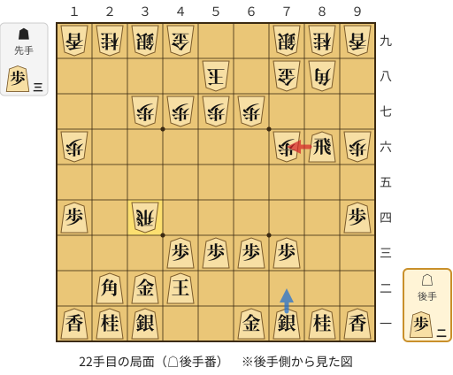

🔴 実戦 △７六飛(86)　🔵 AI推奨 △７二銀(71)　🟨 直前の相手の指し手

<details><summary>テキストの盤面図（BOD・将棋ソフトに貼り付け可）</summary>

```text
後手の持駒：歩二
  ９ ８ ７ ６ ５ ４ ３ ２ １
+---------------------------+
|v香v桂v銀v金 ・ ・v銀v桂v香|一
| ・ ・ ・ ・ ・v玉v金v角 ・|二
| ・ ・v歩v歩v歩v歩 ・ ・ ・|三
|v歩 ・ ・ ・ ・ ・ 飛 ・v歩|四
| ・ ・ ・ ・ ・ ・ ・ ・ ・|五
| 歩v飛 歩 ・ ・ ・ ・ ・ 歩|六
| ・ ・ ・ 歩 歩 歩 歩 ・ ・|七
| ・ 角 金 ・ 玉 ・ ・ ・ ・|八
| 香 桂 銀 ・ ・ 金 銀 桂 香|九
+---------------------------+
先手の持駒：歩三
後手番
手数＝21　▲３四飛　まで
```

</details>

| | 指し手 | 評価値 | 読み筋 |
|---|---|--:|---|
| 実戦 | △７六飛(86) | -348 | ▲２二角成(88) △同銀(31) ▲８四飛(34) △８二歩打 ▲３八金(49) △７四飛(76) |
| AI 1位 | △７二銀(71) | -117 | △７二銀(71) ▲２四飛(34) △７六飛(86) ▲７七桂(89) △６四歩(63) ▲３八銀(39) |
| AI 2位 | △３三角(22) | -220 | △３三角(22) ▲３六歩(37) △２二銀(31) ▲３七桂(29) △６二銀(71) ▲１五歩(16) |
| AI 3位 | △７四歩(73) | -231 | △７四歩(73) ▲同飛(34) △７二銀(71) ▲８七歩打 △８三飛(86) ▲２四飛(74) |

SFEN: `lnsg2snl/5kgb1/2pppp3/p5R1p/9/PrP5P/3PPPP2/1BG1K4/LNS2GSNL w 3P2p 22`

<a id="ply-30"></a>
### 30手目 △３三桂(21) — 悪手

| | 着手前 | 着手後 | 差 |
|---|--:|--:|--:|
| 期待勝率 | 71.2% | 52.0% | -19.2pt |
| 評価値 | +543 | +48 | |

着手前の局面:

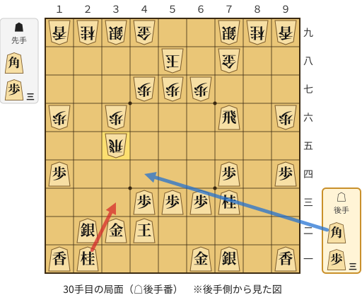

🔴 実戦 △３三桂(21)　🔵 AI推奨 △４四角打　🟨 直前の相手の指し手

<details><summary>テキストの盤面図（BOD・将棋ソフトに貼り付け可）</summary>

```text
後手の持駒：角　歩三
  ９ ８ ７ ６ ５ ４ ３ ２ １
+---------------------------+
|v香 ・v銀v金 ・ ・ ・v桂v香|一
| ・ ・ ・ ・ ・v玉v金v銀 ・|二
| ・ ・v桂v歩v歩v歩 ・ ・ ・|三
|v歩 ・v歩 ・ ・ ・ ・ ・v歩|四
| ・ ・ ・ ・ ・ ・ 飛 ・ ・|五
| 歩 ・v飛 ・ ・ ・ 歩 ・ 歩|六
| ・ ・ ・ 歩 歩 歩 ・ ・ ・|七
| ・ ・ 金 ・ 玉 ・ ・ ・ ・|八
| 香 桂 銀 ・ ・ 金 銀 桂 香|九
+---------------------------+
先手の持駒：角　歩三
後手番
手数＝29　▲３五飛　まで
```

</details>

| | 指し手 | 評価値 | 読み筋 |
|---|---|--:|---|
| 実戦 | △３三桂(21) | +48 | ▲７七金(78) △３四歩打 ▲７六金(77) △３五歩(34) ▲８三角打 △５一金(61) |
| AI 1位 | △４四角打 | +543 | △４四角打 ▲７七歩打 △８六飛(76) ▲８七歩打 △８一飛(86) ▲２五飛(35) |
| AI 2位 | △７二銀(71) | +495 | △７二銀(71) ▲３八銀(39) △３三桂(21) ▲７七金(78) △３四歩打 ▲同飛(35) |
| AI 3位 | △３四歩打 | +305 | △３四歩打 ▲同飛(35) △７二銀(71) ▲７七歩打 △８六飛(76) ▲８七歩打 |

SFEN: `l1sg3nl/5kgs1/2nppp3/p1p5p/6R2/P1r3P1P/3PPP3/2G1K4/LNS2GSNL w B3Pb3p 30`

<a id="ply-32"></a>
### 32手目 △８八歩打 — 悪手

| | 着手前 | 着手後 | 差 |
|---|--:|--:|--:|
| 期待勝率 | 84.7% | 73.3% | -11.3pt |
| 評価値 | +1026 | +607 | |

着手前の局面:

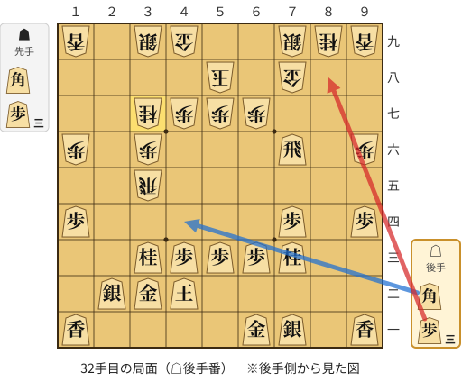

🔴 実戦 △８八歩打　🔵 AI推奨 △４四角打　🟨 直前の相手の指し手

<details><summary>テキストの盤面図（BOD・将棋ソフトに貼り付け可）</summary>

```text
後手の持駒：角　歩三
  ９ ８ ７ ６ ５ ４ ３ ２ １
+---------------------------+
|v香 ・v銀v金 ・ ・ ・ ・v香|一
| ・ ・ ・ ・ ・v玉v金v銀 ・|二
| ・ ・v桂v歩v歩v歩v桂 ・ ・|三
|v歩 ・v歩 ・ ・ ・ ・ ・v歩|四
| ・ ・ ・ ・ ・ ・ 飛 ・ ・|五
| 歩 ・v飛 ・ ・ ・ 歩 ・ 歩|六
| ・ ・ ・ 歩 歩 歩 桂 ・ ・|七
| ・ ・ 金 ・ 玉 ・ ・ ・ ・|八
| 香 桂 銀 ・ ・ 金 銀 ・ 香|九
+---------------------------+
先手の持駒：角　歩三
後手番
手数＝31　▲３七桂　まで
```

</details>

| | 指し手 | 評価値 | 読み筋 |
|---|---|--:|---|
| 実戦 | △８八歩打 | +607 | ▲７七桂(89) △３四歩打 |
| AI 1位 | △４四角打 | +1026 | △４四角打 ▲７七歩打 △８六飛(76) ▲８七歩打 △８三飛(86) ▲３四飛(35) |
| AI 2位 | △８八歩打 | +572 | △８八歩打 ▲７七桂(89) △３四歩打 ▲同飛(35) △２三銀(22) ▲８三角打 |
| AI 3位 | △２六角打 | +503 | △２六角打 ▲７七金(78) △同飛成(76) ▲同桂(89) △３七角成(26) ▲７五歩打 |

SFEN: `l1sg4l/5kgs1/2npppn2/p1p5p/6R2/P1r3P1P/3PPPN2/2G1K4/LNS2GS1L w B3Pb3p 32`

<a id="ply-34"></a>
### 34手目 △７五飛(76) — 大悪手

| | 着手前 | 着手後 | 差 |
|---|--:|--:|--:|
| 期待勝率 | 75.6% | 55.0% | -20.6pt |
| 評価値 | +678 | +121 | |

着手前の局面:

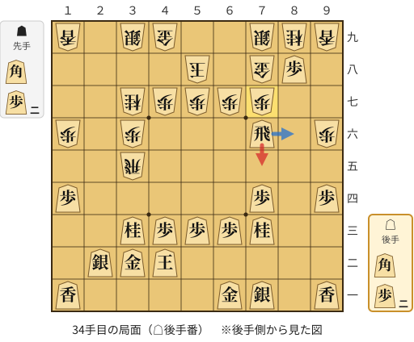

🔴 実戦 △７五飛(76)　🔵 AI推奨 △８六飛(76)　🟨 直前の相手の指し手

<details><summary>テキストの盤面図（BOD・将棋ソフトに貼り付け可）</summary>

```text
後手の持駒：角　歩二
  ９ ８ ７ ６ ５ ４ ３ ２ １
+---------------------------+
|v香 ・v銀v金 ・ ・ ・ ・v香|一
| ・ ・ ・ ・ ・v玉v金v銀 ・|二
| ・ ・v桂v歩v歩v歩v桂 ・ ・|三
|v歩 ・v歩 ・ ・ ・ ・ ・v歩|四
| ・ ・ ・ ・ ・ ・ 飛 ・ ・|五
| 歩 ・v飛 ・ ・ ・ 歩 ・ 歩|六
| ・ ・ 歩 歩 歩 歩 桂 ・ ・|七
| ・v歩 金 ・ 玉 ・ ・ ・ ・|八
| 香 桂 銀 ・ ・ 金 銀 ・ 香|九
+---------------------------+
先手の持駒：角　歩二
後手番
手数＝33　▲７七歩　まで
```

</details>

| | 指し手 | 評価値 | 読み筋 |
|---|---|--:|---|
| 実戦 | △７五飛(76) | +121 | ▲同飛(35) △同歩(74) ▲８三角打 △７二銀(71) ▲８二飛打 △５二飛打 |
| AI 1位 | △８六飛(76) | +678 | △８六飛(76) ▲８八銀(79) △７二銀(71) ▲７六歩(77) △２六角打 ▲５九角打 |
| AI 2位 | △３四歩打 | +148 | △３四歩打 ▲同飛(35) △７五飛(76) ▲８八銀(79) △２三銀(22) ▲８三角打 |
| AI 3位 | △７五飛(76) | +58 | △７五飛(76) ▲同飛(35) △同歩(74) ▲８三角打 △７二銀(71) ▲８二飛打 |

SFEN: `l1sg4l/5kgs1/2npppn2/p1p5p/6R2/P1r3P1P/2PPPPN2/1pG1K4/LNS2GS1L w B2Pb2p 34`

<a id="ply-38"></a>
### 38手目 △７六歩(75) — 大悪手

| | 着手前 | 着手後 | 差 |
|---|--:|--:|--:|
| 期待勝率 | 74.0% | 34.6% | -39.4pt |
| 評価値 | +627 | -383 | |

着手前の局面:

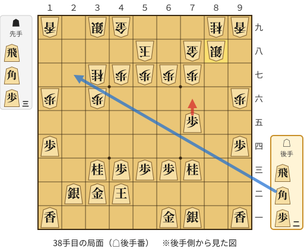

🔴 実戦 △７六歩(75)　🔵 AI推奨 △２七角打　🟨 直前の相手の指し手

<details><summary>テキストの盤面図（BOD・将棋ソフトに貼り付け可）</summary>

```text
後手の持駒：飛　角　歩二
  ９ ８ ７ ６ ５ ４ ３ ２ １
+---------------------------+
|v香 ・v銀v金 ・ ・ ・ ・v香|一
| ・ ・ ・ ・ ・v玉v金v銀 ・|二
| ・ ・v桂v歩v歩v歩v桂 ・ ・|三
|v歩 ・ ・ ・ ・ ・ ・ ・v歩|四
| ・ ・v歩 ・ ・ ・ ・ ・ ・|五
| 歩 ・ ・ ・ ・ ・ 歩 ・ 歩|六
| ・ ・ 歩 歩 歩 歩 桂 ・ ・|七
| ・ 銀 金 ・ 玉 ・ ・ ・ ・|八
| 香 桂 ・ ・ ・ 金 銀 ・ 香|九
+---------------------------+
先手の持駒：飛　角　歩三
後手番
手数＝37　▲８八銀　まで
```

</details>

| | 指し手 | 評価値 | 読み筋 |
|---|---|--:|---|
| 実戦 | △７六歩(75) | -383 | ▲２三歩打 △３一銀(22) ▲８三角打 △７二銀(71) ▲８二飛打 △２七角打 |
| AI 1位 | △２七角打 | +627 | △２七角打 ▲２三歩打 △４九角成(27) ▲同玉(58) △２三銀(22) ▲２一飛打 |
| AI 2位 | △７二銀(71) | +413 | △７二銀(71) ▲８三歩打 △８一歩打 ▲３八銀(39) △２八飛打 ▲４八金(49) |
| AI 3位 | △８七歩打 | +20 | △８七歩打 ▲２三歩打 △同銀(22) ▲８七銀(88) △２七角打 ▲３八銀(39) |

SFEN: `l1sg4l/5kgs1/2npppn2/p7p/2p6/P5P1P/2PPPPN2/1SG1K4/LN3GS1L w RB3Prb2p 38`

<a id="ply-40"></a>
### 40手目 △７七歩成(76) — 悪手

| | 着手前 | 着手後 | 差 |
|---|--:|--:|--:|
| 期待勝率 | 68.8% | 49.6% | -19.2pt |
| 評価値 | +475 | -10 | |

着手前の局面:

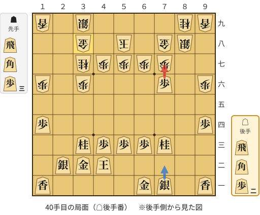

🔴 実戦 △７七歩成(76)　🔵 AI推奨 △７二銀(71)　🟨 直前の相手の指し手

<details><summary>テキストの盤面図（BOD・将棋ソフトに貼り付け可）</summary>

```text
後手の持駒：飛　角　歩二
  ９ ８ ７ ６ ５ ４ ３ ２ １
+---------------------------+
|v香 ・v銀v金 ・ ・ ・ ・v香|一
| ・ ・ ・ ・ ・v玉v金v銀 ・|二
| ・ ・v桂v歩v歩v歩v桂 ・ ・|三
|v歩 ・ ・ ・ ・ ・ ・ ・v歩|四
| ・ ・ ・ ・ ・ ・ ・ ・ ・|五
| 歩 ・v歩 ・ ・ ・ 歩 ・ 歩|六
| ・ ・ 歩 歩 歩 歩 桂 ・ ・|七
| ・ 銀 金 ・ 玉 ・ 金 ・ ・|八
| 香 桂 ・ ・ ・ ・ 銀 ・ 香|九
+---------------------------+
先手の持駒：飛　角　歩三
後手番
手数＝39　▲３八金　まで
```

</details>

| | 指し手 | 評価値 | 読み筋 |
|---|---|--:|---|
| 実戦 | △７七歩成(76) | -10 | ▲同銀(88) △２六歩打 ▲２八歩打 △３五歩打 ▲５五角打 △８五桂(73) |
| AI 1位 | △７二銀(71) | +475 | △７二銀(71) ▲８三歩打 △８一歩打 ▲７六歩(77) △２九飛打 ▲２八角打 |
| AI 2位 | △８七歩打 | +408 | △８七歩打 ▲７九銀(88) △７七歩成(76) ▲同金(78) △７二銀(71) ▲７四歩打 |
| AI 3位 | △２九飛打 | +345 | △２九飛打 ▲８三角打 △７二銀(71) ▲同角成(83) △同金(61) ▲８一飛打 |

SFEN: `l1sg4l/5kgs1/2npppn2/p7p/9/P1p3P1P/2PPPPN2/1SG1K1G2/LN4S1L w RB3Prb2p 40`

<a id="ply-42"></a>
### 42手目 △２九飛打 — 悪手

| | 着手前 | 着手後 | 差 |
|---|--:|--:|--:|
| 期待勝率 | 53.4% | 37.1% | -16.3pt |
| 評価値 | +82 | -317 | |

着手前の局面:

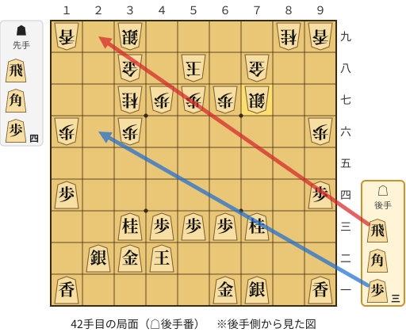

🔴 実戦 △２九飛打　🔵 AI推奨 △２六歩打　🟨 直前の相手の指し手

<details><summary>テキストの盤面図（BOD・将棋ソフトに貼り付け可）</summary>

```text
後手の持駒：飛　角　歩三
  ９ ８ ７ ６ ５ ４ ３ ２ １
+---------------------------+
|v香 ・v銀v金 ・ ・ ・ ・v香|一
| ・ ・ ・ ・ ・v玉v金v銀 ・|二
| ・ ・v桂v歩v歩v歩v桂 ・ ・|三
|v歩 ・ ・ ・ ・ ・ ・ ・v歩|四
| ・ ・ ・ ・ ・ ・ ・ ・ ・|五
| 歩 ・ ・ ・ ・ ・ 歩 ・ 歩|六
| ・ ・ 銀 歩 歩 歩 桂 ・ ・|七
| ・ ・ 金 ・ 玉 ・ 金 ・ ・|八
| 香 桂 ・ ・ ・ ・ 銀 ・ 香|九
+---------------------------+
先手の持駒：飛　角　歩四
後手番
手数＝41　▲７七同銀　まで
```

</details>

| | 指し手 | 評価値 | 読み筋 |
|---|---|--:|---|
| 実戦 | △２九飛打 | -317 | ▲７四歩打 △８五桂(73) ▲７三歩成(74) △２六歩打 ▲２三歩打 △同銀(22) |
| AI 1位 | △２六歩打 | +82 | △２六歩打 ▲７四歩打 △２七歩成(26) ▲７三歩成(74) △３八と(27) ▲同銀(39) |
| AI 2位 | △７二銀(71) | -180 | △７二銀(71) ▲８三歩打 △８四飛打 ▲９八角打 △６五角打 ▲７六歩打 |
| AI 3位 | △８七歩打 | -168 | △８七歩打 ▲２三歩打 △同銀(22) ▲２四歩打 △１二銀(23) ▲２三角打 |

SFEN: `l1sg4l/5kgs1/2npppn2/p7p/9/P5P1P/2SPPPN2/2G1K1G2/LN4S1L w RB4Prb3p 42`

<a id="ply-46"></a>
### 46手目 △８八歩打 — 悪手

| | 着手前 | 着手後 | 差 |
|---|--:|--:|--:|
| 期待勝率 | 30.7% | 18.5% | -12.2pt |
| 評価値 | -488 | -890 | |

着手前の局面:

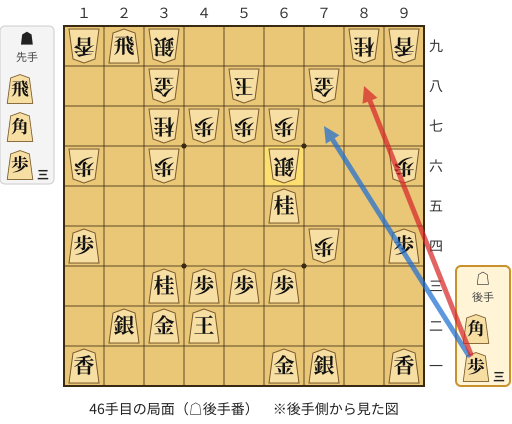

🔴 実戦 △８八歩打　🔵 AI推奨 △７七歩打　🟨 直前の相手の指し手

<details><summary>テキストの盤面図（BOD・将棋ソフトに貼り付け可）</summary>

```text
後手の持駒：角　歩三
  ９ ８ ７ ６ ５ ４ ３ ２ １
+---------------------------+
|v香 ・v銀v金 ・ ・ ・ ・v香|一
| ・ ・ ・ ・ ・v玉v金v銀 ・|二
| ・ ・ ・v歩v歩v歩v桂 ・ ・|三
|v歩 ・ 歩 ・ ・ ・ ・ ・v歩|四
| ・ ・ ・v桂 ・ ・ ・ ・ ・|五
| 歩 ・ ・ 銀 ・ ・ 歩 ・ 歩|六
| ・ ・ ・ 歩 歩 歩 桂 ・ ・|七
| ・ ・ 金 ・ 玉 ・ 金 ・ ・|八
| 香 桂 ・ ・ ・ ・ 銀v飛 香|九
+---------------------------+
先手の持駒：飛　角　歩三
後手番
手数＝45　▲６六銀　まで
```

</details>

| | 指し手 | 評価値 | 読み筋 |
|---|---|--:|---|
| 実戦 | △８八歩打 | -890 | ▲６五銀(66) △８九歩成(88) ▲３四桂打 △３一玉(42) ▲２二桂成(34) △同飛成(29) |
| AI 1位 | △７七歩打 | -488 | △７七歩打 ▲同桂(89) △同桂成(65) ▲同銀(66) △２六桂打 ▲３四桂打 |
| AI 2位 | △２七角打 | -582 | △２七角打 ▲６五銀(66) △３八角成(27) ▲同銀(39) △８九飛成(29) ▲７九飛打 |
| AI 3位 | △２七歩打 | -871 | △２七歩打 ▲６五銀(66) △２八歩成(27) ▲３四桂打 △３一玉(42) ▲２二桂成(34) |

SFEN: `l1sg4l/5kgs1/3pppn2/p1P5p/3n5/P2S2P1P/3PPPN2/2G1K1G2/LN4SrL w RB3Pb3p 46`

<a id="ply-52"></a>
### 52手目 △同玉(31) — 悪手

| | 着手前 | 着手後 | 差 |
|---|--:|--:|--:|
| 期待勝率 | 22.5% | 5.4% | -17.1pt |
| 評価値 | -742 | -1715 | |

着手前の局面:

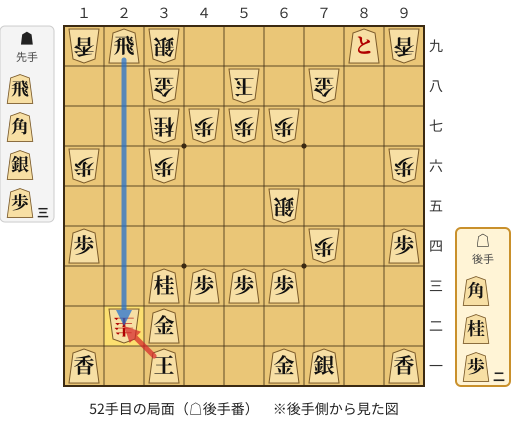

🔴 実戦 △同玉(31)　🔵 AI推奨 △同飛成(29)　🟨 直前の相手の指し手

<details><summary>テキストの盤面図（BOD・将棋ソフトに貼り付け可）</summary>

```text
後手の持駒：角　桂　歩二
  ９ ８ ７ ６ ５ ４ ３ ２ １
+---------------------------+
|v香 ・v銀v金 ・ ・v玉 ・v香|一
| ・ ・ ・ ・ ・ ・v金 圭 ・|二
| ・ ・ ・v歩v歩v歩v桂 ・ ・|三
|v歩 ・ 歩 ・ ・ ・ ・ ・v歩|四
| ・ ・ ・ 銀 ・ ・ ・ ・ ・|五
| 歩 ・ ・ ・ ・ ・ 歩 ・ 歩|六
| ・ ・ ・ 歩 歩 歩 桂 ・ ・|七
| ・ ・ 金 ・ 玉 ・ 金 ・ ・|八
| 香vと ・ ・ ・ ・ 銀v飛 香|九
+---------------------------+
先手の持駒：飛　角　銀　歩三
後手番
手数＝51　▲２二桂成　まで
```

</details>

| | 指し手 | 評価値 | 読み筋 |
|---|---|--:|---|
| 実戦 | △同玉(31) | -1715 | ▲２三歩打 △３一玉(22) ▲２二銀打 △同金(32) ▲同歩成(23) △同飛成(29) |
| AI 1位 | △同飛成(29) | -742 | △同飛成(29) ▲２三歩打 △同龍(22) ▲３五角打 △７七歩打 ▲同金(78) |
| AI 2位 | △同金(32) | -1391 | △同金(32) ▲３四銀打 △７七歩打 ▲同金(78) △３二金(22) ▲２二歩打 |
| AI 3位 | △同玉(31) | -1491 | △同玉(31) ▲２三歩打 △同飛成(29) ▲３五角打 △２四歩打 ▲２五歩打 |

SFEN: `l1sg2k1l/6g+N1/3pppn2/p1P5p/3S5/P5P1P/3PPPN2/2G1K1G2/L+p4SrL w RBS3Pbn2p 52`

