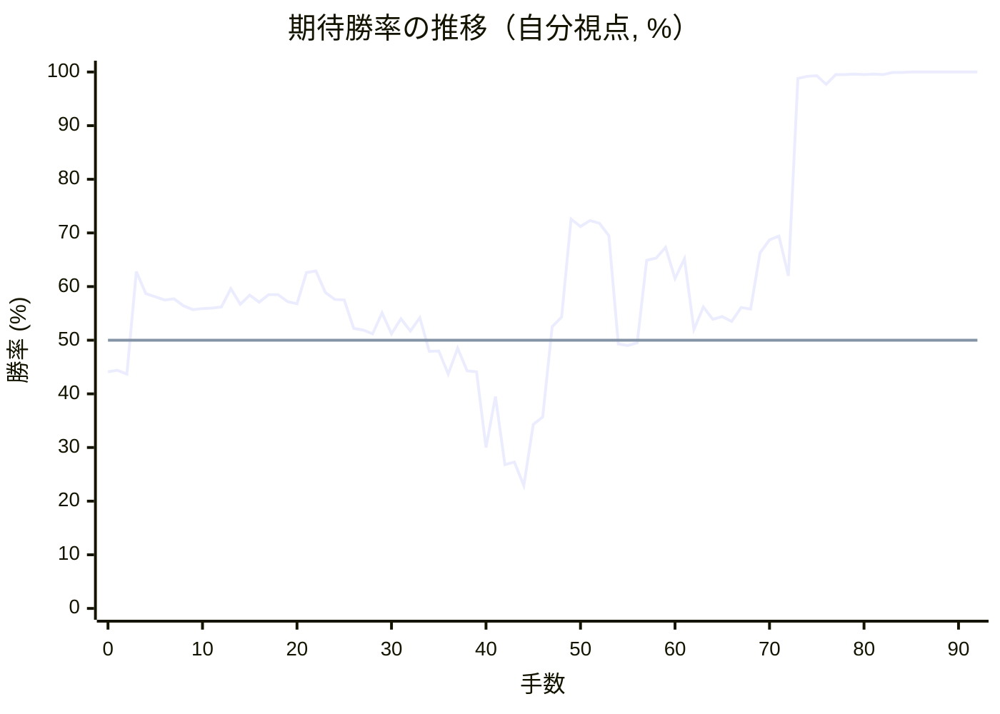

# 解析レポート fhngvo8e596v

[README に戻る](../../../README.md)　/　棋譜: [CSA](../../../data/csa/shogi5/fhngvo8e596v.csa)　/　解析の見方: [docs/mistake_analysis.md](../../../docs/mistake_analysis.md)

## 対局情報

| 項目 | 内容 |
|---|---|
| 日時 | 2026-11-07 04:10:16 |
| 持ち時間 | 5分 |
| 自分 | 後手（△）（1718） |
| 相手 | 相手（1803） |
| 結果 | 勝ち（投了, 92手） |

## 解析環境

| 項目 | 内容 |
|---|---|
| エンジン | YaneuraOu NNUE 9.00git 64AVX2（V9.00/YANEURAOU_ENGINE_NNUE/AVX2） |
| 評価関数 | **水匠5**（`suisho5`） |
| nn.bin SHA-256 | `768068f0d534a0603a5d38bcd143de6bbca820d5f1c95a14d40863e5b7892d76` |
| 第1パス | movetime=150ms, MultiPV 1 |
| 第2パス | movetime=2000ms, MultiPV 3 |
| Threads / Hash | 8 / 512MB |
| 判定基準 | 疑問手 ≥5pt, 悪手 ≥10pt, 大悪手 ≥20pt（期待勝率 W(E)=1/(1+exp(-E/600))） |
| 解析日時 | 2026-11-11T20:32:25+09:00（解析バージョン 1, 46秒） |

## サマリー

| 自分の手数 | 深掘りした手 | 詰み逃し | 大悪手 | 悪手 | 疑問手 |
|--:|--:|--:|--:|--:|--:|
| 46 | 8 | 0 | 1 | 3 | 3 |

## 期待勝率の推移



<details><summary>1手ごとの数値（第1パス）</summary>

| 手数 | 指し手 | 評価値 | 勝率 | 低下 | 判定 |
|--:|---|--:|--:|--:|---|
| 1 | ▲７六歩(77) | -134 | 44.4% |  |  |
| 2 | △８四歩(83) | -151 | 43.7% | +0.7pt |  |
| 3 | ▲６八飛(28) | +315 | 62.8% |  |  |
| 4 | △８五歩(84) | +210 | 58.7% | +4.2pt |  |
| 5 | ▲７七角(88) | +197 | 58.1% |  |  |
| 6 | △３四歩(33) | +182 | 57.5% | +0.6pt |  |
| 7 | ▲６六歩(67) | +186 | 57.7% |  |  |
| 8 | △６二銀(71) | +155 | 56.4% | +1.3pt |  |
| 9 | ▲７八銀(79) | +138 | 55.7% |  |  |
| 10 | △５四歩(53) | +143 | 55.9% | -0.2pt |  |
| 11 | ▲４八玉(59) | +144 | 56.0% |  |  |
| 12 | △４二玉(51) | +150 | 56.2% | -0.2pt |  |
| 13 | ▲３八玉(48) | +233 | 59.6% |  |  |
| 14 | △３二玉(42) | +162 | 56.7% | +2.9pt |  |
| 15 | ▲２八玉(38) | +204 | 58.4% |  |  |
| 16 | △１四歩(13) | +172 | 57.1% | +1.3pt |  |
| 17 | ▲１六歩(17) | +207 | 58.5% |  |  |
| 18 | △５三銀(62) | +206 | 58.5% | +0.0pt |  |
| 19 | ▲６七銀(78) | +173 | 57.2% |  |  |
| 20 | △２四歩(23) | +164 | 56.8% | +0.4pt |  |
| 21 | ▲１八香(19) | +310 | 62.6% |  |  |
| 22 | △２三玉(32) | +316 | 62.9% | -0.2pt |  |
| 23 | ▲１九玉(28) | +216 | 58.9% |  |  |
| 24 | △３二銀(31) | +185 | 57.6% | +1.3pt |  |
| 25 | ▲２八銀(39) | +181 | 57.5% |  |  |
| 26 | △４四銀(53) | +52 | 52.2% | +5.3pt | [疑問手](#ply-26) |
| 27 | ▲６五歩(66) | +45 | 51.9% |  |  |
| 28 | △３一角(22) | +30 | 51.2% | +0.6pt |  |
| 29 | ▲８八飛(68) | +124 | 55.1% |  |  |
| 30 | △９四歩(93) | +30 | 51.2% | +3.9pt |  |
| 31 | ▲３九金(49) | +95 | 54.0% |  |  |
| 32 | △７四歩(73) | +40 | 51.7% | +2.3pt |  |
| 33 | ▲６六銀(67) | +101 | 54.2% |  |  |
| 34 | △３三桂(21) | -51 | 47.9% | +6.3pt | [疑問手](#ply-34) |
| 35 | ▲５六歩(57) | -48 | 48.0% |  |  |
| 36 | △３五銀(44) | -152 | 43.7% | +4.3pt |  |
| 37 | ▲５八金(69) | -37 | 48.5% |  |  |
| 38 | △２五歩(24) | -137 | 44.3% | +4.1pt |  |
| 39 | ▲４八金(58) | -142 | 44.1% |  |  |
| 40 | △５三角(31) | -507 | 30.0% | +14.1pt | [悪手](#ply-40) |
| 41 | ▲３八金(48) | -255 | 39.5% |  |  |
| 42 | △１五歩(14) | -604 | 26.8% | +12.8pt | [疑問手](#ply-42) |
| 43 | ▲同歩(16) | -588 | 27.3% |  |  |
| 44 | △２六歩(25) | -727 | 22.9% | +4.3pt |  |
| 45 | ▲同歩(27) | -391 | 34.3% |  |  |
| 46 | △同銀(35) | -352 | 35.7% | -1.5pt |  |
| 47 | ▲２七歩打 | +60 | 52.5% |  |  |
| 48 | △１五銀(26) | +103 | 54.3% | -1.8pt |  |
| 49 | ▲６八角(77) | +586 | 72.6% |  |  |
| 50 | △１六歩打 | +542 | 71.2% | +1.5pt |  |
| 51 | ▲４六角(68) | +577 | 72.3% |  |  |
| 52 | △９二飛(82) | +561 | 71.8% | +0.5pt |  |
| 53 | ▲５五歩(56) | +495 | 69.5% |  |  |
| 54 | △２五桂(33) | -17 | 49.3% | +20.2pt | [大悪手](#ply-54) |
| 55 | ▲５四歩(55) | -23 | 49.0% |  |  |
| 56 | △７一角(53) | -12 | 49.5% | -0.5pt |  |
| 57 | ▲５三歩成(54) | +370 | 64.9% |  |  |
| 58 | △同角(71) | +380 | 65.3% | -0.4pt |  |
| 59 | ▲５八飛(88) | +432 | 67.3% |  |  |
| 60 | △７一角(53) | +282 | 61.5% | +5.7pt |  |
| 61 | ▲５三歩打 | +378 | 65.2% |  |  |
| 62 | △８六歩(85) | +48 | 52.0% | +13.3pt | [悪手](#ply-62) |
| 63 | ▲５五飛(58) | +150 | 56.2% |  |  |
| 64 | △２四歩打 | +93 | 53.9% | +2.4pt |  |
| 65 | ▲５四飛(55) | +105 | 54.4% |  |  |
| 66 | △８七歩成(86) | +84 | 53.5% | +0.9pt |  |
| 67 | ▲８四歩打 | +146 | 56.1% |  |  |
| 68 | △９三飛(92) | +140 | 55.8% | +0.2pt |  |
| 69 | ▲８三歩成(84) | +407 | 66.3% |  |  |
| 70 | △同飛(93) | +471 | 68.7% | -2.3pt |  |
| 71 | ▲９一角成(46) | +492 | 69.4% |  |  |
| 72 | △７八と(87) | +293 | 62.0% | +7.5pt | [悪手](#ply-72) |
| 73 | ▲９二馬(91) | +2645 | 98.8% |  |  |
| 74 | △８九飛成(83) | +2873 | 99.2% | -0.4pt |  |
| 75 | ▲７四馬(92) | +2944 | 99.3% |  |  |
| 76 | △１七桂打 | +2243 | 97.7% | +1.6pt |  |
| 77 | ▲５九香打 | +3166 | 99.5% |  |  |
| 78 | △２九桂成(17) | +3177 | 99.5% | -0.0pt |  |
| 79 | ▲同金(39) | +3344 | 99.6% |  |  |
| 80 | △１七歩成(16) | +3226 | 99.5% | +0.1pt |  |
| 81 | ▲同香(18) | +3355 | 99.6% |  |  |
| 82 | △１八歩打 | +3181 | 99.5% | +0.1pt |  |
| 83 | ▲同玉(19) | +4202 | 99.9% |  |  |
| 84 | △１六歩打 | +4396 | 99.9% | -0.0pt |  |
| 85 | ▲６三馬(74) | +4814 | 100.0% |  |  |
| 86 | △１七歩成(16) | +5290 | 100.0% | -0.0pt |  |
| 87 | ▲同銀(28) | +5693 | 100.0% |  |  |
| 88 | △２六銀(15) | +5950 | 100.0% | -0.0pt |  |
| 89 | ▲同歩(27) | #+5 | 100.0% |  |  |
| 90 | △１七桂成(25) | #+4 | 100.0% | +0.0pt |  |
| 91 | ▲１九玉(18) | #+3 | 100.0% |  |  |
| 92 | △１八歩打 | #+2 | 100.0% | +0.0pt |  |

</details>

## 課題局面

<a id="ply-26"></a>
### 26手目 △４四銀(53) — 疑問手

| | 着手前 | 着手後 | 差 |
|---|--:|--:|--:|
| 期待勝率 | 59.8% | 54.7% | -5.1pt |
| 評価値 | +238 | +114 | |

着手前の局面:

```text
後手の持駒：なし
  ９ ８ ７ ６ ５ ４ ３ ２ １
+---------------------------+
|v香v桂 ・v金 ・v金 ・v桂v香|一
| ・v飛 ・ ・ ・ ・v銀v角 ・|二
|v歩 ・v歩v歩v銀v歩 ・v玉 ・|三
| ・ ・ ・ ・v歩 ・v歩v歩v歩|四
| ・v歩 ・ ・ ・ ・ ・ ・ ・|五
| ・ ・ 歩 歩 ・ ・ ・ ・ 歩|六
| 歩 歩 角 銀 歩 歩 歩 歩 ・|七
| ・ ・ ・ 飛 ・ ・ ・ 銀 香|八
| 香 桂 ・ 金 ・ 金 ・ 桂 玉|九
+---------------------------+
先手の持駒：なし
後手番
手数＝25　▲２八銀　まで
```

| | 指し手 | 評価値 | 読み筋 |
|---|---|--:|---|
| 実戦 | △４四銀(53) | +114 | ▲６五歩(66) △７四歩(73) ▲６六銀(67) △３一角(22) ▲５八金(69) △７三桂(81) |
| AI 1位 | △５一金(61) | +238 | △５一金(61) ▲３九金(49) △９四歩(93) ▲５九金(69) △１二玉(23) ▲７五歩(76) |
| AI 2位 | △９四歩(93) | +218 | △９四歩(93) ▲５九金(69) △１二玉(23) ▲３九金(49) △２三銀(32) ▲４九金(59) |
| AI 3位 | △１二玉(23) | +194 | △１二玉(23) ▲５八金(69) △９四歩(93) ▲７八飛(68) △２三銀(32) ▲４八金(58) |

SFEN: `ln1g1g1nl/1r4sb1/p1ppsp1k1/4p1ppp/1p7/2PP4P/PPBSPPPP1/3R3SL/LN1G1G1NK w - 26`

<a id="ply-34"></a>
### 34手目 △３三桂(21) — 疑問手

| | 着手前 | 着手後 | 差 |
|---|--:|--:|--:|
| 期待勝率 | 56.3% | 47.7% | -8.6pt |
| 評価値 | +152 | -55 | |

着手前の局面:

```text
後手の持駒：なし
  ９ ８ ７ ６ ５ ４ ３ ２ １
+---------------------------+
|v香v桂 ・v金 ・v金v角v桂v香|一
| ・v飛 ・ ・ ・ ・v銀 ・ ・|二
| ・ ・ ・v歩 ・v歩 ・v玉 ・|三
|v歩 ・v歩 ・v歩v銀v歩v歩v歩|四
| ・v歩 ・ 歩 ・ ・ ・ ・ ・|五
| ・ ・ 歩 銀 ・ ・ ・ ・ 歩|六
| 歩 歩 角 ・ 歩 歩 歩 歩 ・|七
| ・ 飛 ・ ・ ・ ・ ・ 銀 香|八
| 香 桂 ・ 金 ・ ・ 金 桂 玉|九
+---------------------------+
先手の持駒：なし
後手番
手数＝33　▲６六銀　まで
```

| | 指し手 | 評価値 | 読み筋 |
|---|---|--:|---|
| 実戦 | △３三桂(21) | -55 | ▲５八金(69) △５二金(61) ▲４六歩(47) △６二飛(82) ▲６八飛(88) △８二飛(62) |
| AI 1位 | △６二飛(82) | +152 | △６二飛(82) ▲５八金(69) △５二金(61) ▲６八飛(88) △７三桂(81) ▲５六歩(57) |
| AI 2位 | △７三桂(81) | +145 | △７三桂(81) ▲５九金(69) △５二金(61) ▲４九金(59) △６四歩(63) ▲同歩(65) |
| AI 3位 | △５二金(61) | +131 | △５二金(61) ▲５九金(69) △６二飛(82) ▲４九金(59) △７三桂(81) ▲６八飛(88) |

SFEN: `ln1g1gbnl/1r4s2/3p1p1k1/p1p1psppp/1p1P5/2PS4P/PPB1PPPP1/1R5SL/LN1G2GNK w - 34`

<a id="ply-40"></a>
### 40手目 △５三角(31) — 悪手

| | 着手前 | 着手後 | 差 |
|---|--:|--:|--:|
| 期待勝率 | 43.5% | 29.4% | -14.1pt |
| 評価値 | -157 | -525 | |

着手前の局面:

```text
後手の持駒：なし
  ９ ８ ７ ６ ５ ４ ３ ２ １
+---------------------------+
|v香v桂 ・v金 ・v金v角 ・v香|一
| ・v飛 ・ ・ ・ ・v銀 ・ ・|二
| ・ ・ ・v歩 ・v歩v桂v玉 ・|三
|v歩 ・v歩 ・v歩 ・v歩 ・v歩|四
| ・v歩 ・ 歩 ・ ・v銀v歩 ・|五
| ・ ・ 歩 銀 歩 ・ ・ ・ 歩|六
| 歩 歩 角 ・ ・ 歩 歩 歩 ・|七
| ・ 飛 ・ ・ ・ 金 ・ 銀 香|八
| 香 桂 ・ ・ ・ ・ 金 桂 玉|九
+---------------------------+
先手の持駒：なし
後手番
手数＝39　▲４八金寄　まで
```

| | 指し手 | 評価値 | 読み筋 |
|---|---|--:|---|
| 実戦 | △５三角(31) | -525 | ▲５五歩(56) △同歩(54) ▲同銀(66) △７三桂(81) ▲６六角(77) △３一角(53) |
| AI 1位 | △７三桂(81) | -157 | △７三桂(81) ▲３八金(48) △５二金(61) ▲６八角(77) △６四歩(63) ▲同歩(65) |
| AI 2位 | △５二金(61) | -171 | △５二金(61) ▲３八金(48) △７三桂(81) ▲６八角(77) △６四歩(63) ▲同歩(65) |
| AI 3位 | △６二金(61) | -264 | △６二金(61) ▲５五歩(56) △５三金(62) ▲５八飛(88) △５二飛(82) ▲３八金(48) |

SFEN: `ln1g1gb1l/1r4s2/3p1pnk1/p1p1p1p1p/1p1P2sp1/2PSP3P/PPB2PPP1/1R3G1SL/LN4GNK w - 40`

<a id="ply-42"></a>
### 42手目 △１五歩(14) — 疑問手

| | 着手前 | 着手後 | 差 |
|---|--:|--:|--:|
| 期待勝率 | 33.5% | 24.8% | -8.7pt |
| 評価値 | -411 | -664 | |

着手前の局面:

```text
後手の持駒：なし
  ９ ８ ７ ６ ５ ４ ３ ２ １
+---------------------------+
|v香v桂 ・v金 ・v金 ・ ・v香|一
| ・v飛 ・ ・ ・ ・v銀 ・ ・|二
| ・ ・ ・v歩v角v歩v桂v玉 ・|三
|v歩 ・v歩 ・v歩 ・v歩 ・v歩|四
| ・v歩 ・ 歩 ・ ・v銀v歩 ・|五
| ・ ・ 歩 銀 歩 ・ ・ ・ 歩|六
| 歩 歩 角 ・ ・ 歩 歩 歩 ・|七
| ・ 飛 ・ ・ ・ ・ 金 銀 香|八
| 香 桂 ・ ・ ・ ・ 金 桂 玉|九
+---------------------------+
先手の持駒：なし
後手番
手数＝41　▲３八金寄　まで
```

| | 指し手 | 評価値 | 読み筋 |
|---|---|--:|---|
| 実戦 | △１五歩(14) | -664 | ▲同歩(16) △７三桂(81) ▲５五歩(56) △同歩(54) ▲同銀(66) △６五桂(73) |
| AI 1位 | △２六歩(25) | -411 | △２六歩(25) ▲同歩(27) △１五歩(14) ▲同歩(16) △２六銀(35) ▲５五歩(56) |
| AI 2位 | △７三桂(81) | -502 | △７三桂(81) ▲５五歩(56) △同歩(54) ▲同銀(66) △６五桂(73) ▲６六角(77) |
| AI 3位 | △８六歩(85) | -516 | △８六歩(85) ▲同歩(87) △２六歩(25) ▲同歩(27) △１五歩(14) ▲同歩(16) |

SFEN: `ln1g1g2l/1r4s2/3pbpnk1/p1p1p1p1p/1p1P2sp1/2PSP3P/PPB2PPP1/1R4GSL/LN4GNK w - 42`

<a id="ply-54"></a>
### 54手目 △２五桂(33) — 大悪手

| | 着手前 | 着手後 | 差 |
|---|--:|--:|--:|
| 期待勝率 | 70.5% | 50.0% | -20.5pt |
| 評価値 | +523 | +0 | |

着手前の局面:

```text
後手の持駒：歩
  ９ ８ ７ ６ ５ ４ ３ ２ １
+---------------------------+
|v香v桂 ・v金 ・v金 ・ ・v香|一
|v飛 ・ ・ ・ ・ ・v銀 ・ ・|二
| ・ ・ ・v歩v角v歩v桂v玉 ・|三
|v歩 ・v歩 ・v歩 ・v歩 ・ ・|四
| ・v歩 ・ 歩 歩 ・ ・ ・v銀|五
| ・ ・ 歩 銀 ・ 角 ・ ・v歩|六
| 歩 歩 ・ ・ ・ 歩 歩 歩 ・|七
| ・ 飛 ・ ・ ・ ・ 金 銀 香|八
| 香 桂 ・ ・ ・ ・ 金 桂 玉|九
+---------------------------+
先手の持駒：歩
後手番
手数＝53　▲５五歩　まで
```

| | 指し手 | 評価値 | 読み筋 |
|---|---|--:|---|
| 実戦 | △２五桂(33) | +0 | ▲５四歩(55) △６二角(53) ▲５八飛(88) △１七歩成(16) ▲同桂(29) △同桂成(25) |
| AI 1位 | △４四角(53) | +523 | △４四角(53) ▲１三歩打 △同香(11) ▲６八飛(88) △５二金(61) ▲５四歩(55) |
| AI 2位 | △同歩(54) | +141 | △同歩(54) ▲５四歩打 △７一角(53) ▲５五銀(66) △２五桂(33) ▲１三歩打 |
| AI 3位 | △７一角(53) | +46 | △７一角(53) ▲５四歩(55) △２五桂(33) ▲５五銀(66) △１七歩成(16) ▲同桂(29) |

SFEN: `ln1g1g2l/r5s2/3pbpnk1/p1p1p1p2/1p1PP3s/2PS1B2p/PP3PPP1/1R4GSL/LN4GNK w Pp 54`

<a id="ply-62"></a>
### 62手目 △８六歩(85) — 悪手

| | 着手前 | 着手後 | 差 |
|---|--:|--:|--:|
| 期待勝率 | 67.3% | 49.4% | -17.9pt |
| 評価値 | +432 | -15 | |

着手前の局面:

```text
後手の持駒：歩二
  ９ ８ ７ ６ ５ ４ ３ ２ １
+---------------------------+
|v香v桂v角v金 ・v金 ・ ・v香|一
|v飛 ・ ・ ・ ・ ・v銀 ・ ・|二
| ・ ・ ・v歩 歩v歩 ・v玉 ・|三
|v歩 ・v歩 ・ ・ ・v歩 ・ ・|四
| ・v歩 ・ 歩 ・ ・ ・v桂v銀|五
| ・ ・ 歩 銀 ・ 角 ・ ・v歩|六
| 歩 歩 ・ ・ ・ 歩 歩 歩 ・|七
| ・ ・ ・ ・ 飛 ・ 金 銀 香|八
| 香 桂 ・ ・ ・ ・ 金 桂 玉|九
+---------------------------+
先手の持駒：歩
後手番
手数＝61　▲５三歩　まで
```

| | 指し手 | 評価値 | 読み筋 |
|---|---|--:|---|
| 実戦 | △８六歩(85) | -15 | ▲同歩(87) △４二金(41) ▲５五飛(58) △２四歩打 ▲６四歩(65) △同歩(63) |
| AI 1位 | △６二金(61) | +432 | △６二金(61) ▲１四歩打 △２四歩打 ▲２六歩(27) △同銀(15) ▲１六香(18) |
| AI 2位 | △５一金(61) | +255 | △５一金(61) ▲７五歩(76) △４二金(51) ▲７四歩(75) △５三角(71) ▲５四歩打 |
| AI 3位 | △２四歩打 | +158 | △２四歩打 ▲５六飛(58) △４二金(41) ▲６四歩(65) △同歩(63) ▲同角(46) |

SFEN: `lnbg1g2l/r5s2/3pPp1k1/p1p3p2/1p1P3ns/2PS1B2p/PP3PPP1/4R1GSL/LN4GNK w P2p 62`

<a id="ply-72"></a>
### 72手目 △７八と(87) — 悪手

| | 着手前 | 着手後 | 差 |
|---|--:|--:|--:|
| 期待勝率 | 72.9% | 62.0% | -10.9pt |
| 評価値 | +594 | +294 | |

着手前の局面:

```text
後手の持駒：歩三
  ９ ８ ７ ６ ５ ４ ３ ２ １
+---------------------------+
| 馬v桂v角v金 ・v金 ・ ・v香|一
| ・ ・ ・ ・ ・ ・v銀 ・ ・|二
| ・v飛 ・v歩 歩v歩 ・v玉 ・|三
|v歩 ・v歩 ・ 飛 ・v歩v歩 ・|四
| ・ ・ ・ 歩 ・ ・ ・v桂v銀|五
| ・ ・ 歩 銀 ・ ・ ・ ・v歩|六
| 歩vと ・ ・ ・ 歩 歩 歩 ・|七
| ・ ・ ・ ・ ・ ・ 金 銀 香|八
| 香 桂 ・ ・ ・ ・ 金 桂 玉|九
+---------------------------+
先手の持駒：香
後手番
手数＝71　▲９一角成　まで
```

| | 指し手 | 評価値 | 読み筋 |
|---|---|--:|---|
| 実戦 | △７八と(87) | +294 | ▲５五馬(91) △８九飛成(83) ▲１一馬(55) △９九龍(89) ▲２六香打 △１七香打 |
| AI 1位 | △１七歩成(16) | +594 | △１七歩成(16) ▲同桂(29) △同桂成(25) ▲同銀(28) △２五桂打 ▲２八金(39) |
| AI 2位 | △９七と(87) | +470 | △９七と(87) ▲５五馬(91) △８九飛成(83) ▲１一馬(55) △９九龍(89) ▲２六香打 |
| AI 3位 | △９八と(87) | +418 | △９八と(87) ▲５五馬(91) △９九と(98) ▲１一馬(55) △８九飛成(83) ▲１四香打 |

SFEN: `+Bnbg1g2l/6s2/1r1pPp1k1/p1p1R1pp1/3P3ns/2PS4p/P+p3PPP1/6GSL/LN4GNK w L3p 72`

