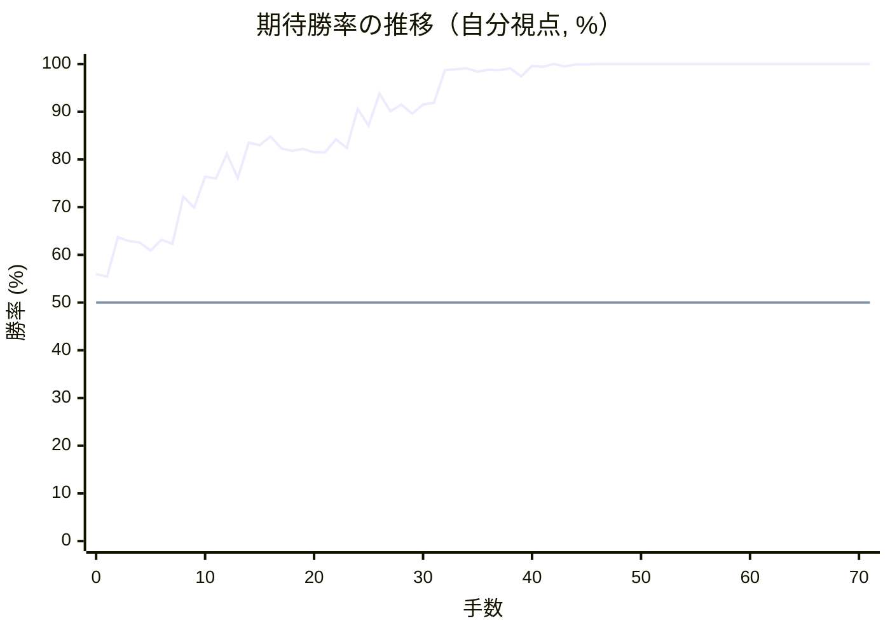
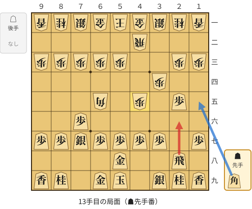

# 解析レポート ft98xnite99i

[README に戻る](../../../README.md)　/　棋譜: [CSA](../../../data/csa/shogi5/ft98xnite99i.csa)　/　解析の見方: [docs/mistake_analysis.md](../../../docs/mistake_analysis.md)

## 対局情報

| 項目 | 内容 |
|---|---|
| 日時 | 2026-11-16 20:52:23 |
| 持ち時間 | 5分 |
| 自分 | 先手（▲）（1673） |
| 相手 | 相手（1669） |
| 結果 | 勝ち（時間切れ, 71手） |

## 解析環境

| 項目 | 内容 |
|---|---|
| エンジン | YaneuraOu NNUE 9.00git 64AVX2（V9.00/YANEURAOU_ENGINE_NNUE/AVX2） |
| 評価関数 | **水匠5**（`suisho5`） |
| nn.bin SHA-256 | `768068f0d534a0603a5d38bcd143de6bbca820d5f1c95a14d40863e5b7892d76` |
| 第1パス | movetime=150ms, MultiPV 1 |
| 第2パス | movetime=2000ms, MultiPV 3 |
| Threads / Hash | 8 / 512MB |
| 判定基準 | 疑問手 ≥5pt, 悪手 ≥10pt, 大悪手 ≥20pt（期待勝率 W(E)=1/(1+exp(-E/600))） |
| 解析日時 | 2026-11-20T20:18:11+09:00（解析バージョン 1, 15秒） |

## サマリー

| 自分の手数 | 深掘りした手 | 詰み逃し | 大悪手 | 悪手 | 疑問手 |
|--:|--:|--:|--:|--:|--:|
| 36 | 2 | 0 | 0 | 0 | 1 |

## 期待勝率の推移



<details><summary>1手ごとの数値（第1パス）</summary>

| 手数 | 指し手 | 評価値 | 勝率 | 低下 | 判定 |
|--:|---|--:|--:|--:|---|
| 1 | ▲７六歩(77) | +131 | 55.4% | +0.5pt |  |
| 2 | △４二飛(82) | +337 | 63.7% |  |  |
| 3 | ▲２六歩(27) | +317 | 62.9% | +0.8pt |  |
| 4 | △３四歩(33) | +308 | 62.6% |  |  |
| 5 | ▲２五歩(26) | +266 | 60.9% | +1.7pt |  |
| 6 | △８八角成(22) | +325 | 63.2% |  |  |
| 7 | ▲同銀(79) | +302 | 62.3% | +0.9pt |  |
| 8 | △６五角打 | +572 | 72.2% |  |  |
| 9 | ▲５八金(49) | +505 | 69.9% | +2.3pt |  |
| 10 | △４四歩(43) | +705 | 76.4% |  |  |
| 11 | ▲７七銀(88) | +690 | 76.0% | +0.5pt |  |
| 12 | △４五歩(44) | +876 | 81.2% |  |  |
| 13 | ▲２六飛(28) | +695 | 76.1% | +5.1pt | [疑問手](#ply-13) |
| 14 | △４六歩(45) | +971 | 83.5% |  |  |
| 15 | ▲同歩(47) | +952 | 83.0% | +0.4pt |  |
| 16 | △２二銀(31) | +1030 | 84.8% |  |  |
| 17 | ▲６六歩(67) | +921 | 82.3% | +2.5pt |  |
| 18 | △５四角(65) | +903 | 81.8% |  |  |
| 19 | ▲４八銀(39) | +920 | 82.2% | -0.4pt |  |
| 20 | △３三銀(22) | +891 | 81.5% |  |  |
| 21 | ▲４七銀(48) | +891 | 81.5% | +0.0pt |  |
| 22 | △４四銀(33) | +1004 | 84.2% |  |  |
| 23 | ▲２八飛(26) | +926 | 82.4% | +1.8pt |  |
| 24 | △３五銀(44) | +1356 | 90.6% |  |  |
| 25 | ▲１五角打 | +1148 | 87.1% | +3.4pt |  |
| 26 | △２四歩(23) | +1634 | 93.8% |  |  |
| 27 | ▲同歩(25) | +1327 | 90.1% | +3.7pt |  |
| 28 | △１四歩(13) | +1428 | 91.5% |  |  |
| 29 | ▲２六角(15) | +1292 | 89.6% | +1.9pt |  |
| 30 | △同銀(35) | +1425 | 91.5% |  |  |
| 31 | ▲同飛(28) | +1457 | 91.9% | -0.4pt |  |
| 32 | △７六角(54) | +2581 | 98.7% |  |  |
| 33 | ▲同銀(77) | +2692 | 98.9% | -0.2pt |  |
| 34 | △８八角打 | +2816 | 99.1% |  |  |
| 35 | ▲２三歩成(24) | +2468 | 98.4% | +0.7pt |  |
| 36 | △９九角成(88) | +2637 | 98.8% |  |  |
| 37 | ▲３二と(23) | +2611 | 98.7% | +0.1pt |  |
| 38 | △同飛(42) | +2800 | 99.1% |  |  |
| 39 | ▲２一飛成(26) | +2172 | 97.4% | +1.7pt |  |
| 40 | △６六馬(99) | +3277 | 99.6% |  |  |
| 41 | ▲４三桂打 | +3070 | 99.4% | +0.2pt |  |
| 42 | △４二玉(51) | +5783 | 100.0% |  |  |
| 43 | ▲２三銀打 | +3228 | 99.5% | +0.5pt |  |
| 44 | △３三飛(32) | +4455 | 99.9% |  |  |
| 45 | ▲２四角打 | +4416 | 99.9% | +0.0pt |  |
| 46 | △２二香打 | +7114 | 100.0% |  |  |
| 47 | ▲同銀不成(23) | +7634 | 100.0% | -0.0pt |  |
| 48 | △４三玉(42) | #+9 | 100.0% |  |  |
| 49 | ▲４一龍(21) | #+8 | 100.0% | +0.0pt |  |
| 50 | △４二歩打 | #+7 | 100.0% |  |  |
| 51 | ▲３三銀成(22) | #+6 | 100.0% | +0.0pt |  |
| 52 | △同馬(66) | #+5 | 100.0% |  |  |
| 53 | ▲同角成(24) | #+6 | 100.0% | +0.0pt |  |
| 54 | △同玉(43) | #+5 | 100.0% |  |  |
| 55 | ▲３二飛打 | #+4 | 100.0% | +0.0pt |  |
| 56 | △２四玉(33) | #+3 | 100.0% |  |  |
| 57 | ▲２一龍(41) | #+4 | 100.0% | +0.0pt |  |
| 58 | △２三歩打 | #+3 | 100.0% |  |  |
| 59 | ▲２五歩打 | #+6 | 100.0% | +0.0pt |  |
| 60 | △３五玉(24) | #+5 | 100.0% |  |  |
| 61 | ▲３六金打 | #+6 | 100.0% | +0.0pt |  |
| 62 | △４四玉(35) | #+5 | 100.0% |  |  |
| 63 | ▲４二飛成(32) | #+4 | 100.0% | +0.0pt |  |
| 64 | △５四玉(44) | #+3 | 100.0% |  |  |
| 65 | ▲４五金(36) | #+6 | 100.0% | +0.0pt |  |
| 66 | △６四玉(54) | #+5 | 100.0% |  |  |
| 67 | ▲６八香打 | #+12 | 100.0% | +0.0pt |  |
| 68 | △７四玉(64) | #+11 | 100.0% |  |  |
| 69 | ▲６一龍(21) | #+10 | 100.0% | +0.0pt |  |
| 70 | △８四歩(83) | #+3 | 100.0% |  |  |
| 71 | ▲７一龍(61) | +35281 | 100.0% | +0.0pt |  |

</details>

## 課題局面

<a id="ply-13"></a>
### 13手目 ▲２六飛(28) — 疑問手

| | 着手前 | 着手後 | 差 |
|---|--:|--:|--:|
| 期待勝率 | 81.9% | 74.6% | -7.3pt |
| 評価値 | +906 | +646 | |

着手前の局面:



🔴 実戦 ▲２六飛(28)　🔵 AI推奨 ▲１五角打　🟨 直前の相手の指し手

<details><summary>テキストの盤面図（BOD・将棋ソフトに貼り付け可）</summary>

```text
後手の持駒：なし
  ９ ８ ７ ６ ５ ４ ３ ２ １
+---------------------------+
|v香v桂v銀v金v玉v金v銀v桂v香|一
| ・ ・ ・ ・ ・v飛 ・ ・ ・|二
|v歩v歩v歩v歩v歩 ・ ・v歩v歩|三
| ・ ・ ・ ・ ・ ・v歩 ・ ・|四
| ・ ・ ・v角 ・v歩 ・ 歩 ・|五
| ・ ・ 歩 ・ ・ ・ ・ ・ ・|六
| 歩 歩 銀 歩 歩 歩 歩 ・ 歩|七
| ・ ・ ・ ・ 金 ・ ・ 飛 ・|八
| 香 桂 ・ 金 玉 ・ 銀 桂 香|九
+---------------------------+
先手の持駒：角
手数＝12　△４五歩　まで
```

</details>

| | 指し手 | 評価値 | 読み筋 |
|---|---|--:|---|
| 実戦 | ▲２六飛(28) | +646 | △２二銀(31) ▲９六歩(97) △９四歩(93) ▲４八銀(39) △６二玉(51) ▲６八玉(59) |
| AI 1位 | ▲１五角打 | +906 | ▲１五角打 △６二玉(51) ▲４二角成(15) △同銀(31) ▲２四歩(25) △同歩(23) |
| AI 2位 | ▲４八銀(39) | +786 | ▲４八銀(39) △２二銀(31) ▲９六歩(97) △９四歩(93) ▲３六歩(37) △６二玉(51) |
| AI 3位 | ▲６八玉(59) | +777 | ▲６八玉(59) △２二銀(31) ▲４八銀(39) △９四歩(93) ▲３六歩(37) △３三銀(22) |

SFEN: `lnsgkgsnl/5r3/ppppp2pp/6p2/3b1p1P1/2P6/PPSPPPP1P/4G2R1/LN1GK1SNL b B 13`

