# 解析レポート g24bxc67f4bd

[README に戻る](../../../README.md)　/　棋譜: [CSA](../../../data/csa/shogi5/g24bxc67f4bd.csa)　/　解析の見方: [docs/mistake_analysis.md](../../../docs/mistake_analysis.md)

## 対局情報

| 項目 | 内容 |
|---|---|
| 日時 | 2026-11-01 15:26:27 |
| 持ち時間 | 5分 |
| 自分 | 後手（△）（1719） |
| 相手 | 相手（1699） |
| 結果 | 負け（投了, 81手） |

## 解析環境

| 項目 | 内容 |
|---|---|
| エンジン | YaneuraOu NNUE 9.00git 64AVX2（V9.00/YANEURAOU_ENGINE_NNUE/AVX2） |
| 評価関数 | **水匠5**（`suisho5`） |
| nn.bin SHA-256 | `768068f0d534a0603a5d38bcd143de6bbca820d5f1c95a14d40863e5b7892d76` |
| 第1パス | movetime=150ms, MultiPV 1 |
| 第2パス | movetime=2000ms, MultiPV 3 |
| Threads / Hash | 8 / 512MB |
| 判定基準 | 疑問手 ≥5pt, 悪手 ≥10pt, 大悪手 ≥20pt（期待勝率 W(E)=1/(1+exp(-E/600))） |
| 解析日時 | 2026-11-03T03:35:18+09:00（解析バージョン 1, 76秒） |

## サマリー

| 自分の手数 | 深掘りした手 | 詰み逃し | 大悪手 | 悪手 | 疑問手 |
|--:|--:|--:|--:|--:|--:|
| 40 | 16 | 0 | 5 | 4 | 5 |

## 期待勝率の推移

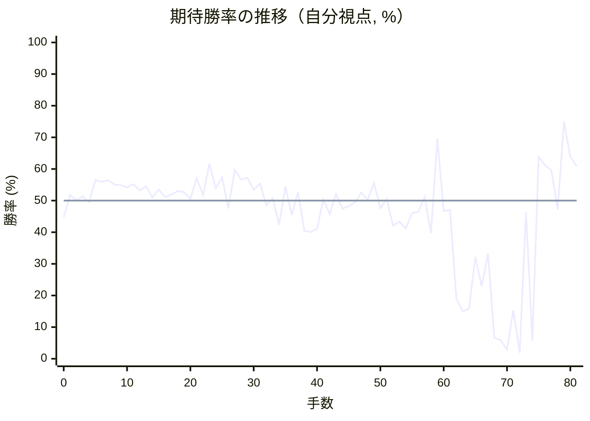

<details><summary>1手ごとの数値（第1パス）</summary>

| 手数 | 指し手 | 評価値 | 勝率 | 低下 | 判定 |
|--:|---|--:|--:|--:|---|
| 1 | ▲５六歩(57) | +43 | 51.8% |  |  |
| 2 | △８四歩(83) | +2 | 50.1% | +1.7pt |  |
| 3 | ▲７六歩(77) | +33 | 51.4% |  |  |
| 4 | △３四歩(33) | -12 | 49.5% | +1.9pt |  |
| 5 | ▲５五歩(56) | +157 | 56.5% |  |  |
| 6 | △８五歩(84) | +142 | 55.9% | +0.6pt |  |
| 7 | ▲７七角(88) | +157 | 56.5% |  |  |
| 8 | △６二銀(71) | +124 | 55.1% | +1.4pt |  |
| 9 | ▲５八飛(28) | +117 | 54.9% |  |  |
| 10 | △４二玉(51) | +100 | 54.2% | +0.7pt |  |
| 11 | ▲６八銀(79) | +125 | 55.2% |  |  |
| 12 | △３二銀(31) | +78 | 53.2% | +1.9pt |  |
| 13 | ▲５七銀(68) | +108 | 54.5% |  |  |
| 14 | △３三銀(32) | +24 | 51.0% | +3.5pt |  |
| 15 | ▲５六銀(57) | +85 | 53.5% |  |  |
| 16 | △４四銀(33) | +27 | 51.1% | +2.4pt |  |
| 17 | ▲４八玉(59) | +45 | 51.9% |  |  |
| 18 | △３二玉(42) | +72 | 53.0% | -1.1pt |  |
| 19 | ▲３八玉(48) | +66 | 52.7% |  |  |
| 20 | △７四歩(73) | +15 | 50.6% | +2.1pt |  |
| 21 | ▲６五銀(56) | +168 | 57.0% |  |  |
| 22 | △７三銀(62) | +41 | 51.7% | +5.2pt |  |
| 23 | ▲９六歩(97) | +285 | 61.7% |  |  |
| 24 | △９四歩(93) | +95 | 54.0% | +7.7pt | [疑問手](#ply-24) |
| 25 | ▲２八玉(38) | +178 | 57.4% |  |  |
| 26 | △４二金(41) | -60 | 47.5% | +9.9pt | [悪手](#ply-26) |
| 27 | ▲１八香(19) | +237 | 59.7% |  |  |
| 28 | △１四歩(13) | +162 | 56.7% | +3.0pt |  |
| 29 | ▲１九玉(28) | +174 | 57.2% |  |  |
| 30 | △１五歩(14) | +81 | 53.4% | +3.8pt |  |
| 31 | ▲２八銀(39) | +130 | 55.4% |  |  |
| 32 | △３三角(22) | -37 | 48.5% | +6.9pt | [疑問手](#ply-32) |
| 33 | ▲３九金(49) | +20 | 50.8% |  |  |
| 34 | △２四角(33) | -185 | 42.4% | +8.5pt | [疑問手](#ply-34) |
| 35 | ▲５九飛(58) | +107 | 54.4% |  |  |
| 36 | △３三桂(21) | -108 | 45.5% | +8.9pt |  |
| 37 | ▲５八金(69) | +64 | 52.7% |  |  |
| 38 | △６四歩(63) | -234 | 40.4% | +12.3pt | [悪手](#ply-38) |
| 39 | ▲５六銀(65) | -240 | 40.1% |  |  |
| 40 | △６二銀(73) | -215 | 41.1% | -1.0pt |  |
| 41 | ▲４八金(58) | +10 | 50.4% |  |  |
| 42 | △６三銀(62) | -102 | 45.8% | +4.7pt |  |
| 43 | ▲３八金(48) | +51 | 52.1% |  |  |
| 44 | △７三桂(81) | -61 | 47.5% | +4.7pt |  |
| 45 | ▲６六歩(67) | -44 | 48.2% |  |  |
| 46 | △７二金(61) | -13 | 49.5% | -1.3pt |  |
| 47 | ▲２六歩(27) | +61 | 52.5% |  |  |
| 48 | △８一飛(82) | +7 | 50.3% | +2.2pt |  |
| 49 | ▲２七銀(28) | +133 | 55.5% |  |  |
| 50 | △１二香(11) | -57 | 47.6% | +7.9pt | [疑問手](#ply-50) |
| 51 | ▲２八金(39) | +12 | 50.5% |  |  |
| 52 | △１一飛(81) | -190 | 42.1% | +8.4pt | [疑問手](#ply-52) |
| 53 | ▲３六歩(37) | -161 | 43.3% |  |  |
| 54 | △５四歩(53) | -213 | 41.2% | +2.1pt |  |
| 55 | ▲同歩(55) | -95 | 46.0% |  |  |
| 56 | △同銀(63) | -85 | 46.5% | -0.4pt |  |
| 57 | ▲５五歩打 | +26 | 51.1% |  |  |
| 58 | △４五銀(54) | -250 | 39.7% | +11.4pt | [悪手](#ply-58) |
| 59 | ▲９五歩(96) | +498 | 69.6% |  |  |
| 60 | △８六歩(85) | -80 | 46.7% | +23.0pt | [大悪手](#ply-60) |
| 61 | ▲同角(77) | -71 | 47.0% |  |  |
| 62 | △８八歩打 | -865 | 19.1% | +27.9pt | [大悪手](#ply-62) |
| 63 | ▲４五銀(56) | -1046 | 14.9% |  |  |
| 64 | △同桂(33) | -1000 | 15.9% | -1.0pt |  |
| 65 | ▲４六銀打 | -446 | 32.2% |  |  |
| 66 | △８九歩成(88) | -727 | 22.9% | +9.3pt |  |
| 67 | ▲５四歩(55) | -417 | 33.3% |  |  |
| 68 | △９九と(89) | -1593 | 6.6% | +26.7pt | [大悪手](#ply-68) |
| 69 | ▲２五歩(26) | -1664 | 5.9% |  |  |
| 70 | △１三角(24) | -2108 | 2.9% | +3.0pt |  |
| 71 | ▲６四角(86) | -1024 | 15.4% |  |  |
| 72 | △５七香打 | -2351 | 1.9% | +13.4pt | [悪手](#ply-72) |
| 73 | ▲９九飛(59) | -88 | 46.3% |  |  |
| 74 | △５八香成(57) | -1682 | 5.7% | +40.6pt | [大悪手](#ply-74) |
| 75 | ▲９四歩(95) | +340 | 63.8% |  |  |
| 76 | △５七桂成(45) | +274 | 61.2% | +2.6pt |  |
| 77 | ▲９三歩成(94) | +234 | 59.6% |  |  |
| 78 | △４八成香(58) | -68 | 47.2% | +12.5pt | [大悪手](#ply-78) |
| 79 | ▲９二と(93) | +657 | 74.9% |  |  |
| 80 | △３八成香(48) | +340 | 63.8% | +11.1pt |  |
| 81 | ▲同金(28) | +265 | 60.9% |  |  |

</details>

## 課題局面

<a id="ply-24"></a>
### 24手目 △９四歩(93) — 疑問手

| | 着手前 | 着手後 | 差 |
|---|--:|--:|--:|
| 期待勝率 | 64.8% | 58.0% | -6.8pt |
| 評価値 | +367 | +194 | |

着手前の局面:

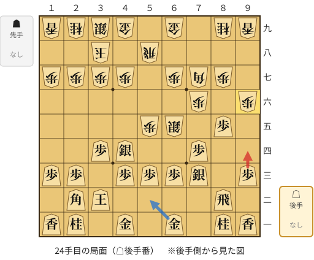

🔴 実戦 △９四歩(93)　🔵 AI推奨 △５二金(61)　🟨 直前の相手の指し手

<details><summary>テキストの盤面図（BOD・将棋ソフトに貼り付け可）</summary>

```text
後手の持駒：なし
  ９ ８ ７ ６ ５ ４ ３ ２ １
+---------------------------+
|v香v桂 ・v金 ・v金 ・v桂v香|一
| ・v飛 ・ ・ ・ ・v玉v角 ・|二
|v歩 ・v銀v歩v歩v歩 ・v歩v歩|三
| ・ ・v歩 ・ ・v銀v歩 ・ ・|四
| ・v歩 ・ 銀 歩 ・ ・ ・ ・|五
| 歩 ・ 歩 ・ ・ ・ ・ ・ ・|六
| ・ 歩 角 歩 ・ 歩 歩 歩 歩|七
| ・ ・ ・ ・ 飛 ・ 玉 ・ ・|八
| 香 桂 ・ 金 ・ 金 銀 桂 香|九
+---------------------------+
先手の持駒：なし
後手番
手数＝23　▲９六歩　まで
```

</details>

| | 指し手 | 評価値 | 読み筋 |
|---|---|--:|---|
| 実戦 | △９四歩(93) | +194 | ▲５四歩(55) △同歩(53) ▲同飛(58) △５二金(61) ▲２八玉(38) △１四歩(13) |
| AI 1位 | △５二金(61) | +367 | △５二金(61) ▲２八玉(38) △６四銀(73) ▲５四歩(55) △同歩(53) ▲６四銀(65) |
| AI 2位 | △１四歩(13) | +366 | △１四歩(13) ▲５四歩(55) △同歩(53) ▲同銀(65) △６二金(61) ▲６八金(69) |
| AI 3位 | △８六歩(85) | +337 | △８六歩(85) ▲同歩(87) △５二金(61) ▲２八玉(38) △６四銀(73) ▲７四銀(65) |

SFEN: `ln1g1g1nl/1r4kb1/p1sppp1pp/2p2sp2/1p1SP4/P1P6/1PBP1PPPP/4R1K2/LN1G1GSNL w - 24`

<a id="ply-26"></a>
### 26手目 △４二金(41) — 悪手

| | 着手前 | 着手後 | 差 |
|---|--:|--:|--:|
| 期待勝率 | 58.9% | 48.3% | -10.5pt |
| 評価値 | +215 | -40 | |

着手前の局面:

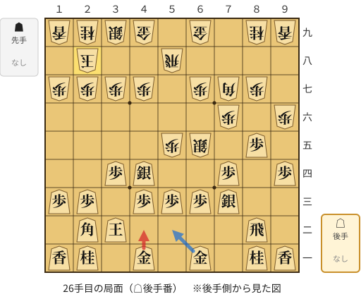

🔴 実戦 △４二金(41)　🔵 AI推奨 △５二金(61)　🟨 直前の相手の指し手

<details><summary>テキストの盤面図（BOD・将棋ソフトに貼り付け可）</summary>

```text
後手の持駒：なし
  ９ ８ ７ ６ ５ ４ ３ ２ １
+---------------------------+
|v香v桂 ・v金 ・v金 ・v桂v香|一
| ・v飛 ・ ・ ・ ・v玉v角 ・|二
| ・ ・v銀v歩v歩v歩 ・v歩v歩|三
|v歩 ・v歩 ・ ・v銀v歩 ・ ・|四
| ・v歩 ・ 銀 歩 ・ ・ ・ ・|五
| 歩 ・ 歩 ・ ・ ・ ・ ・ ・|六
| ・ 歩 角 歩 ・ 歩 歩 歩 歩|七
| ・ ・ ・ ・ 飛 ・ ・ 玉 ・|八
| 香 桂 ・ 金 ・ 金 銀 桂 香|九
+---------------------------+
先手の持駒：なし
後手番
手数＝25　▲２八玉　まで
```

</details>

| | 指し手 | 評価値 | 読み筋 |
|---|---|--:|---|
| 実戦 | △４二金(41) | -40 | ▲５四歩(55) △同歩(53) ▲同銀(65) △６二金(61) ▲４六歩(47) △８六歩(85) |
| AI 1位 | △５二金(61) | +215 | △５二金(61) ▲５四歩(55) △同歩(53) ▲同飛(58) △１四歩(13) ▲３八銀(39) |
| AI 2位 | △８六歩(85) | +176 | △８六歩(85) ▲同歩(87) △５二金(61) ▲３八銀(39) △６四銀(73) ▲５四歩(55) |
| AI 3位 | △１四歩(13) | +77 | △１四歩(13) ▲５四歩(55) △同歩(53) ▲同銀(65) △８六歩(85) ▲同歩(87) |

SFEN: `ln1g1g1nl/1r4kb1/2sppp1pp/p1p2sp2/1p1SP4/P1P6/1PBP1PPPP/4R2K1/LN1G1GSNL w - 26`

<a id="ply-32"></a>
### 32手目 △３三角(22) — 疑問手

| | 着手前 | 着手後 | 差 |
|---|--:|--:|--:|
| 期待勝率 | 55.6% | 48.6% | -7.0pt |
| 評価値 | +134 | -34 | |

着手前の局面:

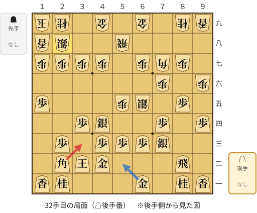

🔴 実戦 △３三角(22)　🔵 AI推奨 △５二金(61)　🟨 直前の相手の指し手

<details><summary>テキストの盤面図（BOD・将棋ソフトに貼り付け可）</summary>

```text
後手の持駒：なし
  ９ ８ ７ ６ ５ ４ ３ ２ １
+---------------------------+
|v香v桂 ・v金 ・ ・ ・v桂v香|一
| ・v飛 ・ ・ ・v金v玉v角 ・|二
| ・ ・v銀v歩v歩v歩 ・v歩 ・|三
|v歩 ・v歩 ・ ・v銀v歩 ・ ・|四
| ・v歩 ・ 銀 歩 ・ ・ ・v歩|五
| 歩 ・ 歩 ・ ・ ・ ・ ・ ・|六
| ・ 歩 角 歩 ・ 歩 歩 歩 歩|七
| ・ ・ ・ ・ 飛 ・ ・ 銀 香|八
| 香 桂 ・ 金 ・ 金 ・ 桂 玉|九
+---------------------------+
先手の持駒：なし
後手番
手数＝31　▲２八銀　まで
```

</details>

| | 指し手 | 評価値 | 読み筋 |
|---|---|--:|---|
| 実戦 | △３三角(22) | -34 | ▲５四歩(55) △６四歩(63) ▲５三歩成(54) △同銀(44) ▲５四銀(65) △７七角成(33) |
| AI 1位 | △５二金(61) | +134 | △５二金(61) ▲３九金(49) △６四銀(73) ▲同銀(65) △同歩(63) ▲５四歩(55) |
| AI 2位 | △８六歩(85) | +60 | △８六歩(85) ▲同歩(87) △５二金(61) ▲３九金(49) △６四銀(73) ▲同銀(65) |
| AI 3位 | △６四銀(73) | +23 | △６四銀(73) ▲同銀(65) △同歩(63) ▲５四歩(55) △同歩(53) ▲同飛(58) |

SFEN: `ln1g3nl/1r3gkb1/2sppp1p1/p1p2sp2/1p1SP3p/P1P6/1PBP1PPPP/4R2SL/LN1G1G1NK w - 32`

<a id="ply-34"></a>
### 34手目 △２四角(33) — 疑問手

| | 着手前 | 着手後 | 差 |
|---|--:|--:|--:|
| 期待勝率 | 52.1% | 43.0% | -9.0pt |
| 評価値 | +50 | -168 | |

着手前の局面:

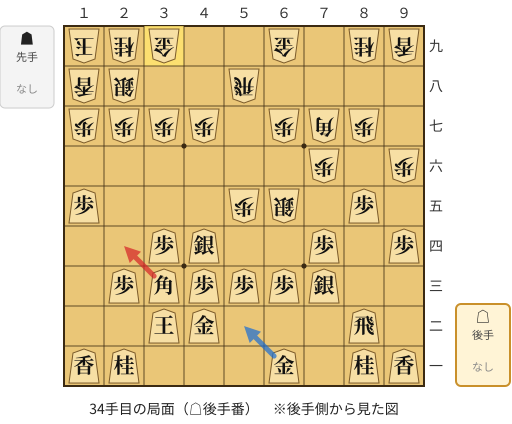

🔴 実戦 △２四角(33)　🔵 AI推奨 △５二金(61)　🟨 直前の相手の指し手

<details><summary>テキストの盤面図（BOD・将棋ソフトに貼り付け可）</summary>

```text
後手の持駒：なし
  ９ ８ ７ ６ ５ ４ ３ ２ １
+---------------------------+
|v香v桂 ・v金 ・ ・ ・v桂v香|一
| ・v飛 ・ ・ ・v金v玉 ・ ・|二
| ・ ・v銀v歩v歩v歩v角v歩 ・|三
|v歩 ・v歩 ・ ・v銀v歩 ・ ・|四
| ・v歩 ・ 銀 歩 ・ ・ ・v歩|五
| 歩 ・ 歩 ・ ・ ・ ・ ・ ・|六
| ・ 歩 角 歩 ・ 歩 歩 歩 歩|七
| ・ ・ ・ ・ 飛 ・ ・ 銀 香|八
| 香 桂 ・ 金 ・ ・ 金 桂 玉|九
+---------------------------+
先手の持駒：なし
後手番
手数＝33　▲３九金　まで
```

</details>

| | 指し手 | 評価値 | 読み筋 |
|---|---|--:|---|
| 実戦 | △２四角(33) | -168 | ▲５四歩(55) △５二金(61) ▲５三歩成(54) △同金(52) ▲４六歩(47) △同角(24) |
| AI 1位 | △５二金(61) | +50 | △５二金(61) ▲４六歩(47) △６四銀(73) ▲同銀(65) △同歩(63) ▲５四歩(55) |
| AI 2位 | △８六歩(85) | -8 | △８六歩(85) ▲同歩(87) △５二金(61) ▲３六歩(37) △６四銀(73) ▲同銀(65) |
| AI 3位 | △６二金(61) | -70 | △６二金(61) ▲５四歩(55) △同歩(53) ▲同銀(65) △５三歩打 ▲６五銀(54) |

SFEN: `ln1g3nl/1r3gk2/2spppbp1/p1p2sp2/1p1SP3p/P1P6/1PBP1PPPP/4R2SL/LN1G2GNK w - 34`

<a id="ply-38"></a>
### 38手目 △６四歩(63) — 悪手

| | 着手前 | 着手後 | 差 |
|---|--:|--:|--:|
| 期待勝率 | 53.6% | 42.1% | -11.4pt |
| 評価値 | +86 | -190 | |

着手前の局面:

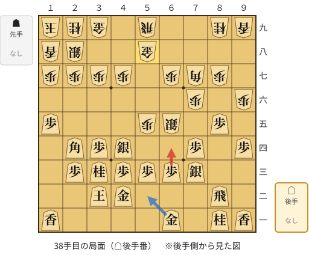

🔴 実戦 △６四歩(63)　🔵 AI推奨 △５二金(61)　🟨 直前の相手の指し手

<details><summary>テキストの盤面図（BOD・将棋ソフトに貼り付け可）</summary>

```text
後手の持駒：なし
  ９ ８ ７ ６ ５ ４ ３ ２ １
+---------------------------+
|v香v桂 ・v金 ・ ・ ・ ・v香|一
| ・v飛 ・ ・ ・v金v玉 ・ ・|二
| ・ ・v銀v歩v歩v歩v桂v歩 ・|三
|v歩 ・v歩 ・ ・v銀v歩v角 ・|四
| ・v歩 ・ 銀 歩 ・ ・ ・v歩|五
| 歩 ・ 歩 ・ ・ ・ ・ ・ ・|六
| ・ 歩 角 歩 ・ 歩 歩 歩 歩|七
| ・ ・ ・ ・ 金 ・ ・ 銀 香|八
| 香 桂 ・ ・ 飛 ・ 金 桂 玉|九
+---------------------------+
先手の持駒：なし
後手番
手数＝37　▲５八金　まで
```

</details>

| | 指し手 | 評価値 | 読み筋 |
|---|---|--:|---|
| 実戦 | △６四歩(63) | -190 | ▲５六銀(65) △６二銀(73) ▲４九飛(59) △３五銀(44) ▲６八角(77) △６三銀(62) |
| AI 1位 | △５二金(61) | +86 | △５二金(61) ▲４六歩(47) △同角(24) ▲５四歩(55) △同歩(53) ▲同銀(65) |
| AI 2位 | △６四銀(73) | +16 | △６四銀(73) ▲同銀(65) △同歩(63) ▲４六歩(47) △同角(24) ▲５四歩(55) |
| AI 3位 | △８六歩(85) | -73 | △８六歩(85) ▲同歩(87) △６四銀(73) ▲同銀(65) △同歩(63) ▲４六歩(47) |

SFEN: `ln1g4l/1r3gk2/2spppnp1/p1p2spb1/1p1SP3p/P1P6/1PBP1PPPP/4G2SL/LN2R1GNK w - 38`

<a id="ply-50"></a>
### 50手目 △１二香(11) — 疑問手

| | 着手前 | 着手後 | 差 |
|---|--:|--:|--:|
| 期待勝率 | 59.3% | 53.6% | -5.7pt |
| 評価値 | +225 | +86 | |

着手前の局面:

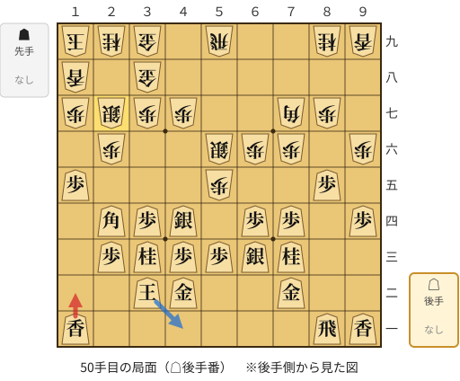

🔴 実戦 △１二香(11)　🔵 AI推奨 △４一玉(32)　🟨 直前の相手の指し手

<details><summary>テキストの盤面図（BOD・将棋ソフトに貼り付け可）</summary>

```text
後手の持駒：なし
  ９ ８ ７ ６ ５ ４ ３ ２ １
+---------------------------+
|v香v飛 ・ ・ ・ ・ ・ ・v香|一
| ・ ・v金 ・ ・v金v玉 ・ ・|二
| ・ ・v桂v銀v歩v歩v桂v歩 ・|三
|v歩 ・v歩v歩 ・v銀v歩v角 ・|四
| ・v歩 ・ ・ 歩 ・ ・ ・v歩|五
| 歩 ・ 歩 歩 銀 ・ ・ 歩 ・|六
| ・ 歩 角 ・ ・ 歩 歩 銀 歩|七
| ・ ・ ・ ・ ・ ・ 金 ・ 香|八
| 香 桂 ・ ・ 飛 ・ 金 桂 玉|九
+---------------------------+
先手の持駒：なし
後手番
手数＝49　▲２七銀　まで
```

</details>

| | 指し手 | 評価値 | 読み筋 |
|---|---|--:|---|
| 実戦 | △１二香(11) | +86 | ▲２八金(39) △４一玉(32) ▲９五歩(96) △同歩(94) ▲６五歩(66) △同桂(73) |
| AI 1位 | △４一玉(32) | +225 | △４一玉(32) ▲３六歩(37) △５二玉(41) ▲２八金(38) △２一飛(81) ▲４八金(39) |
| AI 2位 | △５一飛(81) | +173 | △５一飛(81) ▲２八金(39) △５四歩(53) ▲同歩(55) △同飛(51) ▲５七歩打 |
| AI 3位 | △２一飛(81) | +137 | △２一飛(81) ▲２八金(39) △４一玉(32) ▲９五歩(96) △同歩(94) ▲４六歩(47) |

SFEN: `lr6l/2g2gk2/2nsppnp1/p1pp1spb1/1p2P3p/P1PPS2P1/1PB2PPSP/6G1L/LN2R1GNK w - 50`

<a id="ply-52"></a>
### 52手目 △１一飛(81) — 疑問手

| | 着手前 | 着手後 | 差 |
|---|--:|--:|--:|
| 期待勝率 | 54.1% | 46.3% | -7.7pt |
| 評価値 | +98 | -88 | |

着手前の局面:

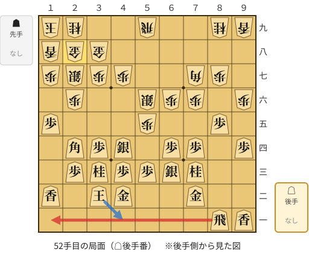

🔴 実戦 △１一飛(81)　🔵 AI推奨 △４一玉(32)　🟨 直前の相手の指し手

<details><summary>テキストの盤面図（BOD・将棋ソフトに貼り付け可）</summary>

```text
後手の持駒：なし
  ９ ８ ７ ６ ５ ４ ３ ２ １
+---------------------------+
|v香v飛 ・ ・ ・ ・ ・ ・ ・|一
| ・ ・v金 ・ ・v金v玉 ・v香|二
| ・ ・v桂v銀v歩v歩v桂v歩 ・|三
|v歩 ・v歩v歩 ・v銀v歩v角 ・|四
| ・v歩 ・ ・ 歩 ・ ・ ・v歩|五
| 歩 ・ 歩 歩 銀 ・ ・ 歩 ・|六
| ・ 歩 角 ・ ・ 歩 歩 銀 歩|七
| ・ ・ ・ ・ ・ ・ 金 金 香|八
| 香 桂 ・ ・ 飛 ・ ・ 桂 玉|九
+---------------------------+
先手の持駒：なし
後手番
手数＝51　▲２八金上　まで
```

</details>

| | 指し手 | 評価値 | 読み筋 |
|---|---|--:|---|
| 実戦 | △１一飛(81) | -88 | ▲３六歩(37) △５四歩(53) ▲同歩(55) △同銀(63) ▲４六歩(47) △同角(24) |
| AI 1位 | △４一玉(32) | +98 | △４一玉(32) ▲９五歩(96) △同歩(94) ▲４六歩(47) △同角(24) ▲６五歩(66) |
| AI 2位 | △１四香(12) | -1 | △１四香(12) ▲３六歩(37) △４一玉(32) ▲３七金(28) △４五銀(44) ▲同銀(56) |
| AI 3位 | △２一飛(81) | -42 | △２一飛(81) ▲３六歩(37) △４一玉(32) ▲３七金(28) △４五銀(44) ▲同銀(56) |

SFEN: `lr7/2g2gk1l/2nsppnp1/p1pp1spb1/1p2P3p/P1PPS2P1/1PB2PPSP/6GGL/LN2R2NK w - 52`

<a id="ply-58"></a>
### 58手目 △４五銀(54) — 悪手

| | 着手前 | 着手後 | 差 |
|---|--:|--:|--:|
| 期待勝率 | 52.6% | 36.4% | -16.2pt |
| 評価値 | +62 | -336 | |

着手前の局面:

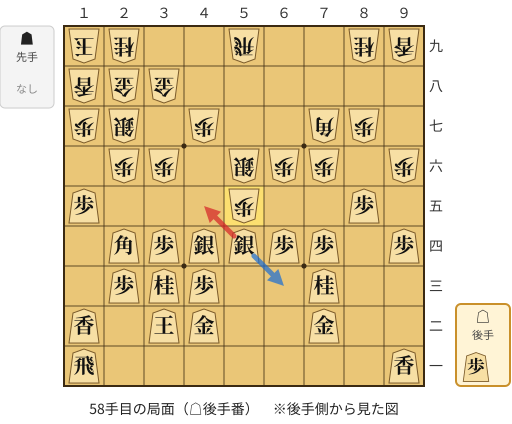

🔴 実戦 △４五銀(54)　🔵 AI推奨 △６三銀(54)　🟨 直前の相手の指し手

<details><summary>テキストの盤面図（BOD・将棋ソフトに貼り付け可）</summary>

```text
後手の持駒：歩
  ９ ８ ７ ６ ５ ４ ３ ２ １
+---------------------------+
|v香 ・ ・ ・ ・ ・ ・ ・v飛|一
| ・ ・v金 ・ ・v金v玉 ・v香|二
| ・ ・v桂 ・ ・v歩v桂v歩 ・|三
|v歩 ・v歩v歩v銀v銀v歩v角 ・|四
| ・v歩 ・ ・ 歩 ・ ・ ・v歩|五
| 歩 ・ 歩 歩 銀 ・ 歩 歩 ・|六
| ・ 歩 角 ・ ・ 歩 ・ 銀 歩|七
| ・ ・ ・ ・ ・ ・ 金 金 香|八
| 香 桂 ・ ・ 飛 ・ ・ 桂 玉|九
+---------------------------+
先手の持駒：なし
後手番
手数＝57　▲５五歩　まで
```

</details>

| | 指し手 | 評価値 | 読み筋 |
|---|---|--:|---|
| 実戦 | △４五銀(54) | -336 | ▲同銀(56) △同桂(33) ▲３五歩(36) △５八歩打 ▲同飛(59) △３五角(24) |
| AI 1位 | △６三銀(54) | +62 | △６三銀(54) ▲４八金(38) △７五歩(74) ▲５七金(48) △７六歩(75) ▲６八角(77) |
| AI 2位 | △４五銀(54) | -225 | △４五銀(54) ▲同銀(56) △同桂(33) ▲３五歩(36) △５八歩打 ▲同飛(59) |
| AI 3位 | △５八歩打 | -261 | △５八歩打 ▲同飛(59) △４五銀(54) ▲同銀(56) △同桂(33) ▲３五歩(36) |

SFEN: `l7r/2g2gk1l/2n2pnp1/p1ppsspb1/1p2P3p/P1PPS1PP1/1PB2P1SP/6GGL/LN2R2NK w p 58`

<a id="ply-60"></a>
### 60手目 △８六歩(85) — 大悪手

| | 着手前 | 着手後 | 差 |
|---|--:|--:|--:|
| 期待勝率 | 68.9% | 45.8% | -23.1pt |
| 評価値 | +476 | -101 | |

着手前の局面:

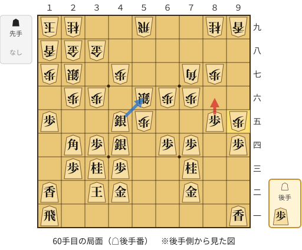

🔴 実戦 △８六歩(85)　🔵 AI推奨 △５六銀(45)　🟨 直前の相手の指し手

<details><summary>テキストの盤面図（BOD・将棋ソフトに貼り付け可）</summary>

```text
後手の持駒：歩
  ９ ８ ７ ６ ５ ４ ３ ２ １
+---------------------------+
|v香 ・ ・ ・ ・ ・ ・ ・v飛|一
| ・ ・v金 ・ ・v金v玉 ・v香|二
| ・ ・v桂 ・ ・v歩v桂v歩 ・|三
|v歩 ・v歩v歩 ・v銀v歩v角 ・|四
| 歩v歩 ・ ・ 歩v銀 ・ ・v歩|五
| ・ ・ 歩 歩 銀 ・ 歩 歩 ・|六
| ・ 歩 角 ・ ・ 歩 ・ 銀 歩|七
| ・ ・ ・ ・ ・ ・ 金 金 香|八
| 香 桂 ・ ・ 飛 ・ ・ 桂 玉|九
+---------------------------+
先手の持駒：なし
後手番
手数＝59　▲９五歩　まで
```

</details>

| | 指し手 | 評価値 | 読み筋 |
|---|---|--:|---|
| 実戦 | △８六歩(85) | -101 | ▲同角(77) △５六銀(45) ▲同飛(59) △６七銀打 ▲５九飛(56) △５七歩打 |
| AI 1位 | △５六銀(45) | +476 | △５六銀(45) ▲同飛(59) △７九角成(24) ▲５九飛(56) △７八馬(79) ▲３五歩(36) |
| AI 2位 | △６三金(72) | +147 | △６三金(72) ▲４五銀(56) △同銀(44) ▲５四銀打 △同銀(45) ▲同歩(55) |
| AI 3位 | △６三金(72) | +142 | △６三金(72) ▲４五銀(56) △同銀(44) ▲５四銀打 △同銀(45) ▲同歩(55) |

SFEN: `l7r/2g2gk1l/2n2pnp1/p1pp1spb1/Pp2Ps2p/2PPS1PP1/1PB2P1SP/6GGL/LN2R2NK w p 60`

<a id="ply-62"></a>
### 62手目 △８八歩打 — 大悪手

| | 着手前 | 着手後 | 差 |
|---|--:|--:|--:|
| 期待勝率 | 45.9% | 12.3% | -33.7pt |
| 評価値 | -98 | -1180 | |

着手前の局面:

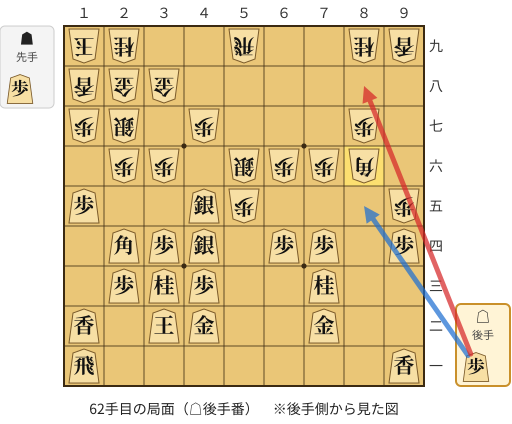

🔴 実戦 △８八歩打　🔵 AI推奨 △８五歩打　🟨 直前の相手の指し手

<details><summary>テキストの盤面図（BOD・将棋ソフトに貼り付け可）</summary>

```text
後手の持駒：歩
  ９ ８ ７ ６ ５ ４ ３ ２ １
+---------------------------+
|v香 ・ ・ ・ ・ ・ ・ ・v飛|一
| ・ ・v金 ・ ・v金v玉 ・v香|二
| ・ ・v桂 ・ ・v歩v桂v歩 ・|三
|v歩 ・v歩v歩 ・v銀v歩v角 ・|四
| 歩 ・ ・ ・ 歩v銀 ・ ・v歩|五
| ・ 角 歩 歩 銀 ・ 歩 歩 ・|六
| ・ 歩 ・ ・ ・ 歩 ・ 銀 歩|七
| ・ ・ ・ ・ ・ ・ 金 金 香|八
| 香 桂 ・ ・ 飛 ・ ・ 桂 玉|九
+---------------------------+
先手の持駒：歩
後手番
手数＝61　▲８六同角　まで
```

</details>

| | 指し手 | 評価値 | 読み筋 |
|---|---|--:|---|
| 実戦 | △８八歩打 | -1180 | ▲４五銀(56) △同桂(33) ▲３五歩(36) △８九歩成(88) ▲４六歩(47) △３五銀(44) |
| AI 1位 | △８五歩打 | -98 | △８五歩打 ▲２五歩(26) △１三角(24) ▲６四角(86) △６八角成(13) ▲４五銀(56) |
| AI 2位 | △５六銀(45) | -104 | △５六銀(45) ▲同飛(59) △６七銀打 ▲５九飛(56) △５七歩打 ▲４八金(38) |
| AI 3位 | △５七歩打 | -327 | △５七歩打 ▲４五銀(56) △同桂(33) ▲３五歩(36) △同角(24) ▲４六銀打 |

SFEN: `l7r/2g2gk1l/2n2pnp1/p1pp1spb1/P3Ps2p/1BPPS1PP1/1P3P1SP/6GGL/LN2R2NK w Pp 62`

<a id="ply-68"></a>
### 68手目 △９九と(89) — 大悪手

| | 着手前 | 着手後 | 差 |
|---|--:|--:|--:|
| 期待勝率 | 35.7% | 4.4% | -31.3pt |
| 評価値 | -353 | -1852 | |

着手前の局面:

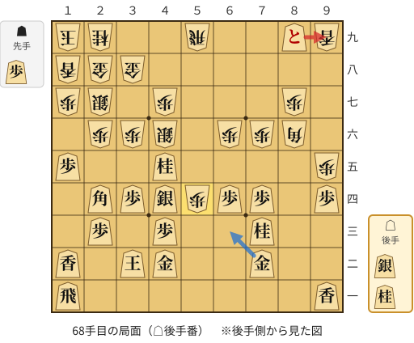

🔴 実戦 △９九と(89)　🔵 AI推奨 △６三金(72)　🟨 直前の相手の指し手

<details><summary>テキストの盤面図（BOD・将棋ソフトに貼り付け可）</summary>

```text
後手の持駒：銀　桂
  ９ ８ ７ ６ ５ ４ ３ ２ １
+---------------------------+
|v香 ・ ・ ・ ・ ・ ・ ・v飛|一
| ・ ・v金 ・ ・v金v玉 ・v香|二
| ・ ・v桂 ・ ・v歩 ・v歩 ・|三
|v歩 ・v歩v歩 歩v銀v歩v角 ・|四
| 歩 ・ ・ ・ ・v桂 ・ ・v歩|五
| ・ 角 歩 歩 ・ 銀 歩 歩 ・|六
| ・ 歩 ・ ・ ・ 歩 ・ 銀 歩|七
| ・ ・ ・ ・ ・ ・ 金 金 香|八
| 香vと ・ ・ 飛 ・ ・ 桂 玉|九
+---------------------------+
先手の持駒：歩
後手番
手数＝67　▲５四歩　まで
```

</details>

| | 指し手 | 評価値 | 読み筋 |
|---|---|--:|---|
| 実戦 | △９九と(89) | -1852 | ▲４五銀(46) △同銀(44) ▲２五歩(26) △３三角(24) ▲５三歩成(54) △同金(42) |
| AI 1位 | △６三金(72) | -353 | △６三金(72) ▲７五歩(76) △６二桂打 ▲３五歩(36) △７五歩(74) ▲２五歩(26) |
| AI 2位 | △６七桂打 | -740 | △６七桂打 ▲５六飛(59) △６三金(72) ▲３五歩(36) △９九と(89) ▲３四歩(35) |
| AI 3位 | △５一飛(11) | -871 | △５一飛(11) ▲６四角(86) △４一桂打 ▲３五歩(36) △６三銀打 ▲８六角(64) |

SFEN: `l7r/2g2gk1l/2n2p1p1/p1ppPspb1/P4n2p/1BPP1SPP1/1P3P1SP/6GGL/L+p2R2NK w Psn 68`

<a id="ply-72"></a>
### 72手目 △５七香打 — 悪手

| | 着手前 | 着手後 | 差 |
|---|--:|--:|--:|
| 期待勝率 | 14.2% | 1.2% | -13.0pt |
| 評価値 | -1080 | -2665 | |

着手前の局面:

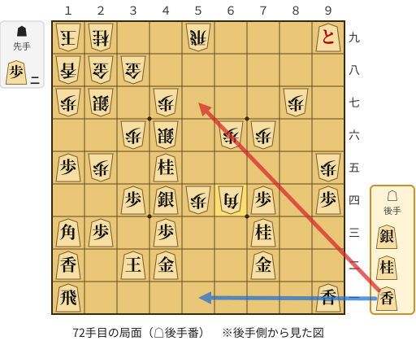

🔴 実戦 △５七香打　🔵 AI推奨 △５一香打　🟨 直前の相手の指し手

<details><summary>テキストの盤面図（BOD・将棋ソフトに貼り付け可）</summary>

```text
後手の持駒：銀　桂　香
  ９ ８ ７ ６ ５ ４ ３ ２ １
+---------------------------+
|v香 ・ ・ ・ ・ ・ ・ ・v飛|一
| ・ ・v金 ・ ・v金v玉 ・v香|二
| ・ ・v桂 ・ ・v歩 ・v歩v角|三
|v歩 ・v歩 角 歩v銀v歩 ・ ・|四
| 歩 ・ ・ ・ ・v桂 ・ 歩v歩|五
| ・ ・ 歩 歩 ・ 銀 歩 ・ ・|六
| ・ 歩 ・ ・ ・ 歩 ・ 銀 歩|七
| ・ ・ ・ ・ ・ ・ 金 金 香|八
|vと ・ ・ ・ 飛 ・ ・ 桂 玉|九
+---------------------------+
先手の持駒：歩二
後手番
手数＝71　▲６四角　まで
```

</details>

| | 指し手 | 評価値 | 読み筋 |
|---|---|--:|---|
| 実戦 | △５七香打 | -2665 | ▲４五銀(46) △同銀(44) ▲５三歩成(54) △４一金(42) ▲２四桂打 △同歩(23) |
| AI 1位 | △５一香打 | -1080 | △５一香打 ▲４五銀(46) △同銀(44) ▲５三歩成(54) △同香(51) ▲同角成(64) |
| AI 2位 | △４一桂打 | -1415 | △４一桂打 ▲４五銀(46) △同銀(44) ▲３七桂打 △５四銀(45) ▲同飛(59) |
| AI 3位 | △６一桂打 | -1502 | △６一桂打 ▲４五銀(46) △同銀(44) ▲３七桂打 △５四銀(45) ▲同飛(59) |

SFEN: `l7r/2g2gk1l/2n2p1pb/p1pBPsp2/P4n1Pp/2PP1SP2/1P3P1SP/6GGL/+p3R2NK w 2Psnl 72`

<a id="ply-74"></a>
### 74手目 △５八香成(57) — 大悪手

| | 着手前 | 着手後 | 差 |
|---|--:|--:|--:|
| 期待勝率 | 50.7% | 7.4% | -43.3pt |
| 評価値 | +16 | -1515 | |

着手前の局面:

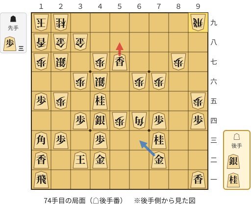

🔴 実戦 △５八香成(57)　🔵 AI推奨 △６三金(72)　🟨 直前の相手の指し手

<details><summary>テキストの盤面図（BOD・将棋ソフトに貼り付け可）</summary>

```text
後手の持駒：銀　桂
  ９ ８ ７ ６ ５ ４ ３ ２ １
+---------------------------+
|v香 ・ ・ ・ ・ ・ ・ ・v飛|一
| ・ ・v金 ・ ・v金v玉 ・v香|二
| ・ ・v桂 ・ ・v歩 ・v歩v角|三
|v歩 ・v歩 角 歩v銀v歩 ・ ・|四
| 歩 ・ ・ ・ ・v桂 ・ 歩v歩|五
| ・ ・ 歩 歩 ・ 銀 歩 ・ ・|六
| ・ 歩 ・ ・v香 歩 ・ 銀 歩|七
| ・ ・ ・ ・ ・ ・ 金 金 香|八
| 飛 ・ ・ ・ ・ ・ ・ 桂 玉|九
+---------------------------+
先手の持駒：歩三
後手番
手数＝73　▲９九飛　まで
```

</details>

| | 指し手 | 評価値 | 読み筋 |
|---|---|--:|---|
| 実戦 | △５八香成(57) | -1515 | ▲４五銀(46) △５五銀打 ▲同角(64) △同銀(44) ▲３四銀(45) △２二桂打 |
| AI 1位 | △６三金(72) | +16 | △６三金(72) ▲４二角成(64) △同玉(32) ▲７五歩(76) △同歩(74) ▲７九飛(99) |
| AI 2位 | △６三銀打 | -152 | △６三銀打 ▲８六角(64) △５四銀(63) ▲７五歩(76) △５八香成(57) ▲７四歩(75) |
| AI 3位 | △５一飛(11) | -171 | △５一飛(11) ▲７五歩(76) △５四飛(51) ▲６五歩(66) △５八香成(57) ▲７四歩(75) |

SFEN: `l7r/2g2gk1l/2n2p1pb/p1pBPsp2/P4n1Pp/2PP1SP2/1P2lP1SP/6GGL/R6NK w 3Psn 74`

<a id="ply-78"></a>
### 78手目 △４八成香(58) — 大悪手

| | 着手前 | 着手後 | 差 |
|---|--:|--:|--:|
| 期待勝率 | 60.5% | 39.3% | -21.3pt |
| 評価値 | +257 | -261 | |

着手前の局面:

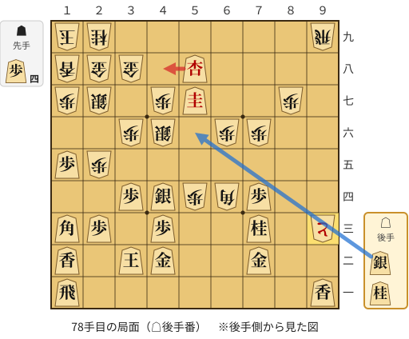

🔴 実戦 △４八成香(58)　🔵 AI推奨 △５六銀打　🟨 直前の相手の指し手

<details><summary>テキストの盤面図（BOD・将棋ソフトに貼り付け可）</summary>

```text
後手の持駒：銀　桂
  ９ ８ ７ ６ ５ ４ ３ ２ １
+---------------------------+
|v香 ・ ・ ・ ・ ・ ・ ・v飛|一
| ・ ・v金 ・ ・v金v玉 ・v香|二
| と ・v桂 ・ ・v歩 ・v歩v角|三
| ・ ・v歩 角 歩v銀v歩 ・ ・|四
| ・ ・ ・ ・ ・ ・ ・ 歩v歩|五
| ・ ・ 歩 歩 ・ 銀 歩 ・ ・|六
| ・ 歩 ・ ・v圭 歩 ・ 銀 歩|七
| ・ ・ ・ ・v杏 ・ 金 金 香|八
| 飛 ・ ・ ・ ・ ・ ・ 桂 玉|九
+---------------------------+
先手の持駒：歩四
後手番
手数＝77　▲９三歩成　まで
```

</details>

| | 指し手 | 評価値 | 読み筋 |
|---|---|--:|---|
| 実戦 | △４八成香(58) | -261 | ▲３五歩(36) △５六銀打 ▲４八金(38) △同成桂(57) ▲５九香打 △４七銀不成(56) |
| AI 1位 | △５六銀打 | +257 | △５六銀打 ▲８三と(93) △９九香成(91) ▲７二と(83) △４七成桂(57) ▲４五歩打 |
| AI 2位 | △５六銀打 | +237 | △５六銀打 ▲８三と(93) △同金(72) ▲９二歩打 △４八成香(58) ▲同金(38) |
| AI 3位 | △３三銀打 | +156 | △３三銀打 ▲９二歩打 △４八成香(58) ▲９一歩成(92) △３八成香(48) ▲同金(28) |

SFEN: `l7r/2g2gk1l/+P1n2p1pb/2pBPsp2/7Pp/2PP1SP2/1P2+nP1SP/4+l1GGL/R6NK w 4Psn 78`

