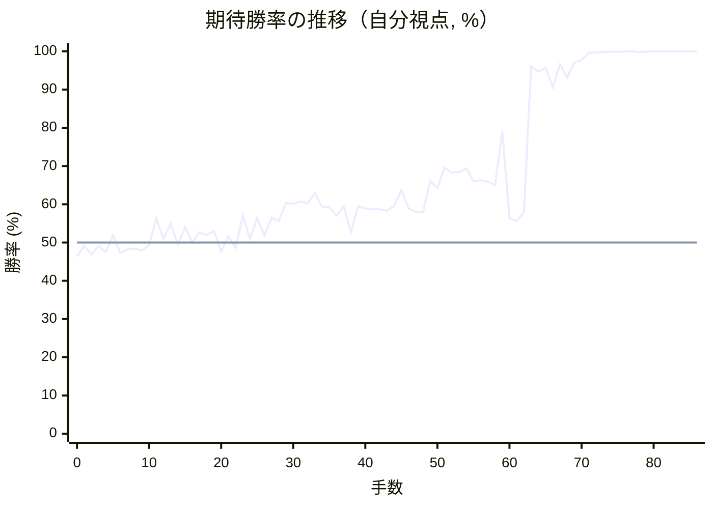
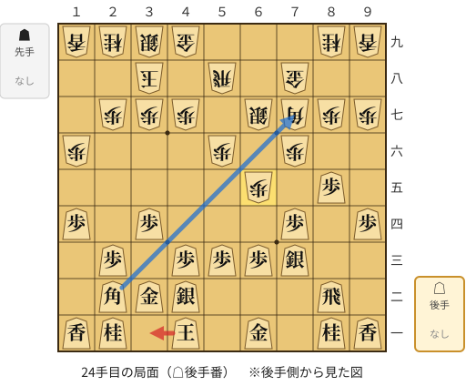
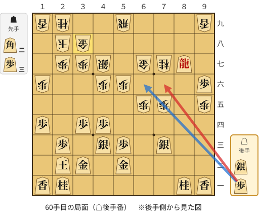

# 解析レポート gfyvc296cxem

[README に戻る](../../../README.md)　/　棋譜: [CSA](../../../data/csa/shogi5/gfyvc296cxem.csa)　/　解析の見方: [docs/mistake_analysis.md](../../../docs/mistake_analysis.md)

## 対局情報

| 項目 | 内容 |
|---|---|
| 日時 | 2026-11-18 00:59:50 |
| 持ち時間 | 5分 |
| 自分 | 後手（△）（1659） |
| 相手 | 相手（1856） |
| 結果 | 勝ち（投了, 86手） |

## 解析環境

| 項目 | 内容 |
|---|---|
| エンジン | YaneuraOu NNUE 9.00git 64AVX2（V9.00/YANEURAOU_ENGINE_NNUE/AVX2） |
| 評価関数 | **水匠5**（`suisho5`） |
| nn.bin SHA-256 | `768068f0d534a0603a5d38bcd143de6bbca820d5f1c95a14d40863e5b7892d76` |
| 第1パス | movetime=150ms, MultiPV 1 |
| 第2パス | movetime=2000ms, MultiPV 3 |
| Threads / Hash | 8 / 512MB |
| 判定基準 | 疑問手 ≥5pt, 悪手 ≥10pt, 大悪手 ≥20pt（期待勝率 W(E)=1/(1+exp(-E/600))） |
| 解析日時 | 2026-11-20T20:11:34+09:00（解析バージョン 1, 41秒） |

## サマリー

| 自分の手数 | 深掘りした手 | 詰み逃し | 大悪手 | 悪手 | 疑問手 |
|--:|--:|--:|--:|--:|--:|
| 43 | 7 | 0 | 1 | 0 | 1 |

## 期待勝率の推移



<details><summary>1手ごとの数値（第1パス）</summary>

| 手数 | 指し手 | 評価値 | 勝率 | 低下 | 判定 |
|--:|---|--:|--:|--:|---|
| 1 | ▲７六歩(77) | -20 | 49.2% |  |  |
| 2 | △８四歩(83) | -74 | 46.9% | +2.2pt |  |
| 3 | ▲６八銀(79) | -21 | 49.1% |  |  |
| 4 | △３四歩(33) | -60 | 47.5% | +1.6pt |  |
| 5 | ▲６六歩(67) | +45 | 51.9% |  |  |
| 6 | △８五歩(84) | -67 | 47.2% | +4.7pt |  |
| 7 | ▲７七角(88) | -42 | 48.3% |  |  |
| 8 | △６二銀(71) | -38 | 48.4% | -0.2pt |  |
| 9 | ▲５六歩(57) | -50 | 47.9% |  |  |
| 10 | △４二銀(31) | -17 | 49.3% | -1.4pt |  |
| 11 | ▲５八飛(28) | +151 | 56.3% |  |  |
| 12 | △３二金(41) | +25 | 51.0% | +5.2pt |  |
| 13 | ▲４八玉(59) | +118 | 54.9% |  |  |
| 14 | △４一玉(51) | -15 | 49.4% | +5.5pt |  |
| 15 | ▲３八玉(48) | +96 | 54.0% |  |  |
| 16 | △９四歩(93) | +2 | 50.1% | +3.9pt |  |
| 17 | ▲６七銀(68) | +66 | 52.7% |  |  |
| 18 | △１四歩(13) | +45 | 51.9% | +0.9pt |  |
| 19 | ▲１六歩(17) | +73 | 53.0% |  |  |
| 20 | △７四歩(73) | -56 | 47.7% | +5.4pt |  |
| 21 | ▲７八金(69) | +38 | 51.6% |  |  |
| 22 | △７三銀(62) | -34 | 48.6% | +3.0pt |  |
| 23 | ▲６五歩(66) | +170 | 57.0% |  |  |
| 24 | △３一玉(41) | +21 | 50.9% | +6.2pt | [疑問手](#ply-24) |
| 25 | ▲５九飛(58) | +156 | 56.5% |  |  |
| 26 | △５二金(61) | +43 | 51.8% | +4.7pt |  |
| 27 | ▲２二角成(77) | +158 | 56.5% |  |  |
| 28 | △同玉(31) | +135 | 55.6% | +0.9pt |  |
| 29 | ▲４八銀(39) | +254 | 60.4% |  |  |
| 30 | △４四歩(43) | +247 | 60.1% | +0.3pt |  |
| 31 | ▲７七桂(89) | +261 | 60.7% |  |  |
| 32 | △４三銀(42) | +252 | 60.3% | +0.4pt |  |
| 33 | ▲９六歩(97) | +318 | 62.9% |  |  |
| 34 | △８六歩(85) | +226 | 59.3% | +3.6pt |  |
| 35 | ▲同歩(87) | +227 | 59.3% |  |  |
| 36 | △同飛(82) | +168 | 57.0% | +2.4pt |  |
| 37 | ▲８七歩打 | +232 | 59.5% |  |  |
| 38 | △８四飛(86) | +66 | 52.7% | +6.8pt |  |
| 39 | ▲４六歩(47) | +230 | 59.5% |  |  |
| 40 | △６四歩(63) | +217 | 58.9% | +0.5pt |  |
| 41 | ▲同歩(65) | +211 | 58.7% |  |  |
| 42 | △同銀(73) | +211 | 58.7% | +0.0pt |  |
| 43 | ▲６五歩打 | +200 | 58.3% |  |  |
| 44 | △７三銀(64) | +233 | 59.6% | -1.3pt |  |
| 45 | ▲４七銀(48) | +338 | 63.7% |  |  |
| 46 | △９五歩(94) | +216 | 58.9% | +4.8pt |  |
| 47 | ▲同歩(96) | +194 | 58.0% |  |  |
| 48 | △９六歩打 | +193 | 58.0% | +0.0pt |  |
| 49 | ▲２八玉(38) | +398 | 66.0% |  |  |
| 50 | △７五歩(74) | +354 | 64.3% | +1.7pt |  |
| 51 | ▲同歩(76) | +496 | 69.6% |  |  |
| 52 | △６六歩打 | +460 | 68.3% | +1.3pt |  |
| 53 | ▲７六銀(67) | +464 | 68.4% |  |  |
| 54 | △６七角打 | +492 | 69.4% | -1.0pt |  |
| 55 | ▲同銀(76) | +397 | 66.0% |  |  |
| 56 | △同歩成(66) | +407 | 66.3% | -0.4pt |  |
| 57 | ▲同金(78) | +394 | 65.9% |  |  |
| 58 | △８七飛成(84) | +371 | 65.0% | +0.9pt |  |
| 59 | ▲３八金(49) | +797 | 79.1% |  |  |
| 60 | △７六歩打 | +155 | 56.4% | +22.6pt | [大悪手](#ply-60) |
| 61 | ▲９八角打 | +136 | 55.6% |  |  |
| 62 | △７八龍(87) | +190 | 57.9% | -2.2pt |  |
| 63 | ▲７六金(67) | +1903 | 96.0% |  |  |
| 64 | △６八龍(78) | +1735 | 94.7% | +1.2pt |  |
| 65 | ▲５八飛(59) | +1855 | 95.7% |  |  |
| 66 | △７九龍(68) | +1360 | 90.6% | +5.0pt |  |
| 67 | ▲７四歩(75) | +2007 | 96.6% |  |  |
| 68 | △６二銀(73) | +1564 | 93.1% | +3.5pt |  |
| 69 | ▲４五歩(46) | +2106 | 97.1% |  |  |
| 70 | △９七歩成(96) | +2245 | 97.7% | -0.6pt |  |
| 71 | ▲８九角(98) | +3373 | 99.6% |  |  |
| 72 | △同龍(79) | +3467 | 99.7% | -0.1pt |  |
| 73 | ▲４四歩(45) | +3794 | 99.8% |  |  |
| 74 | △同銀(43) | +4301 | 99.9% | -0.1pt |  |
| 75 | ▲４五歩打 | +4508 | 99.9% |  |  |
| 76 | △３三銀(44) | +4266 | 99.9% | +0.0pt |  |
| 77 | ▲５五角打 | +4920 | 100.0% |  |  |
| 78 | △９五香(91) | +3834 | 99.8% | +0.1pt |  |
| 79 | ▲６四歩(65) | +4542 | 99.9% |  |  |
| 80 | △４九銀打 | +5037 | 100.0% | -0.0pt |  |
| 81 | ▲６五桂(77) | +5441 | 100.0% |  |  |
| 82 | △５八銀成(49) | +5612 | 100.0% | -0.0pt |  |
| 83 | ▲同銀(47) | +5751 | 100.0% |  |  |
| 84 | △７九飛打 | +4800 | 100.0% | +0.0pt |  |
| 85 | ▲３九銀打 | +4881 | 100.0% |  |  |
| 86 | △７六飛成(79) | +4551 | 99.9% | +0.0pt |  |

</details>

## 課題局面

<a id="ply-24"></a>
### 24手目 △３一玉(41) — 疑問手

| | 着手前 | 着手後 | 差 |
|---|--:|--:|--:|
| 期待勝率 | 57.9% | 48.5% | -9.4pt |
| 評価値 | +190 | -36 | |

着手前の局面:



🔴 実戦 △３一玉(41)　🔵 AI推奨 △７七角成(22)　🟨 直前の相手の指し手

<details><summary>テキストの盤面図（BOD・将棋ソフトに貼り付け可）</summary>

```text
後手の持駒：なし
  ９ ８ ７ ６ ５ ４ ３ ２ １
+---------------------------+
|v香v桂 ・v金 ・v玉 ・v桂v香|一
| ・v飛 ・ ・ ・v銀v金v角 ・|二
| ・ ・v銀v歩v歩v歩 ・v歩 ・|三
|v歩 ・v歩 ・ ・ ・v歩 ・v歩|四
| ・v歩 ・ 歩 ・ ・ ・ ・ ・|五
| ・ ・ 歩 ・ 歩 ・ ・ ・ 歩|六
| 歩 歩 角 銀 ・ 歩 歩 歩 ・|七
| ・ ・ 金 ・ 飛 ・ 玉 ・ ・|八
| 香 桂 ・ ・ ・ 金 銀 桂 香|九
+---------------------------+
先手の持駒：なし
後手番
手数＝23　▲６五歩　まで
```

</details>

| | 指し手 | 評価値 | 読み筋 |
|---|---|--:|---|
| 実戦 | △３一玉(41) | -36 | ▲５五歩(56) △４四歩(43) ▲５六銀(67) △３三角(22) ▲２八玉(38) △５二金(61) |
| AI 1位 | △７七角成(22) | +190 | △７七角成(22) ▲同桂(89) △４四歩(43) ▲２八玉(38) △３一玉(41) ▲３八金(49) |
| AI 2位 | △３一玉(41) | -13 | △３一玉(41) ▲６六銀(67) △５二金(61) ▲２八玉(38) △４四歩(43) ▲３八銀(39) |
| AI 3位 | △４四歩(43) | -17 | △４四歩(43) ▲２八玉(38) △３一玉(41) ▲６六銀(67) △３三角(22) ▲３八銀(39) |

SFEN: `ln1g1k1nl/1r3sgb1/2sppp1p1/p1p3p1p/1p1P5/2P1P3P/PPBS1PPP1/2G1R1K2/LN3GSNL w - 24`

<a id="ply-60"></a>
### 60手目 △７六歩打 — 大悪手

| | 着手前 | 着手後 | 差 |
|---|--:|--:|--:|
| 期待勝率 | 85.2% | 57.8% | -27.4pt |
| 評価値 | +1051 | +188 | |

着手前の局面:



🔴 実戦 △７六歩打　🔵 AI推奨 △６六歩打　🟨 直前の相手の指し手

<details><summary>テキストの盤面図（BOD・将棋ソフトに貼り付け可）</summary>

```text
後手の持駒：銀　歩
  ９ ８ ７ ６ ５ ４ ３ ２ １
+---------------------------+
|v香v桂 ・ ・ ・ ・ ・v桂v香|一
| ・ ・ ・ ・v金 ・v金v玉 ・|二
| ・ ・v銀 ・v歩v銀 ・v歩 ・|三
| ・ ・ ・ ・ ・v歩v歩 ・v歩|四
| 歩 ・ 歩 歩 ・ ・ ・ ・ ・|五
|v歩 ・ ・ ・ 歩 歩 ・ ・ 歩|六
| ・v龍 桂 金 ・ 銀 歩 歩 ・|七
| ・ ・ ・ ・ ・ ・ 金 玉 ・|八
| 香 ・ ・ ・ 飛 ・ ・ 桂 香|九
+---------------------------+
先手の持駒：角二　歩三
後手番
手数＝59　▲３八金　まで
```

</details>

| | 指し手 | 評価値 | 読み筋 |
|---|---|--:|---|
| 実戦 | △７六歩打 | +188 | ▲９八角打 △７八龍(87) ▲７六角(98) △９五香(91) ▲６六角打 △９七歩成(96) |
| AI 1位 | △６六歩打 | +1051 | △６六歩打 ▲６八金(67) △６七銀打 ▲６九金(68) △７七龍(87) ▲７四歩(75) |
| AI 2位 | △７八龍(87) | +900 | △７八龍(87) ▲８九角打 △８八龍(78) ▲６六角打 △９七歩成(96) ▲４五歩(46) |
| AI 3位 | △４二金(52) | +510 | △４二金(52) ▲６六角打 △７八龍(87) ▲５七金(67) △７六歩打 ▲４五歩(46) |

SFEN: `ln5nl/4g1gk1/2s1ps1p1/5pp1p/P1PP5/p3PP2P/1+rNG1SPP1/6GK1/L3R2NL w 2B3Psp 60`

