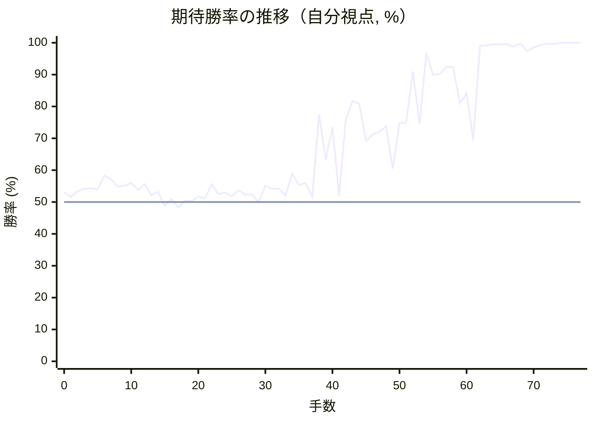
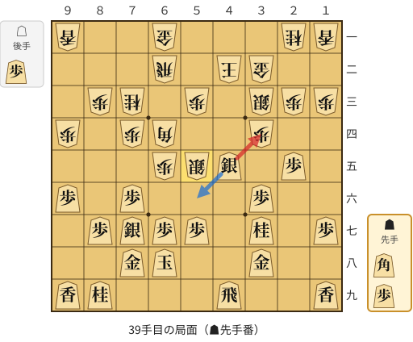
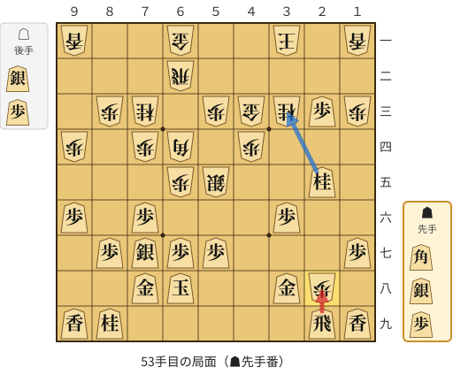
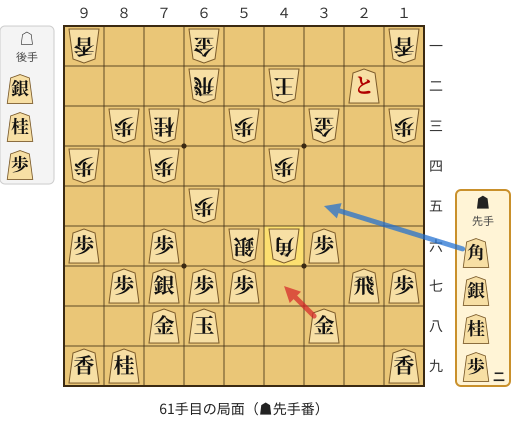

# 解析レポート ghbg9r4zvprp

[README に戻る](../../../README.md)　/　棋譜: [CSA](../../../data/csa/shogi5/ghbg9r4zvprp.csa)　/　解析の見方: [docs/mistake_analysis.md](../../../docs/mistake_analysis.md)

## 対局情報

| 項目 | 内容 |
|---|---|
| 日時 | 2026-11-19 12:54:44 |
| 持ち時間 | 5分 |
| 自分 | 先手（▲）（1708） |
| 相手 | 相手（1676） |
| 結果 | 勝ち（投了, 77手） |

## 解析環境

| 項目 | 内容 |
|---|---|
| エンジン | YaneuraOu NNUE 9.00git 64AVX2（V9.00/YANEURAOU_ENGINE_NNUE/AVX2） |
| 評価関数 | **水匠5**（`suisho5`） |
| nn.bin SHA-256 | `768068f0d534a0603a5d38bcd143de6bbca820d5f1c95a14d40863e5b7892d76` |
| 第1パス | movetime=150ms, MultiPV 1 |
| 第2パス | movetime=2000ms, MultiPV 3 |
| Threads / Hash | 8 / 512MB |
| 判定基準 | 疑問手 ≥5pt, 悪手 ≥10pt, 大悪手 ≥20pt（期待勝率 W(E)=1/(1+exp(-E/600))） |
| 解析日時 | 2026-11-20T20:02:56+09:00（解析バージョン 1, 44秒） |

## サマリー

| 自分の手数 | 深掘りした手 | 詰み逃し | 大悪手 | 悪手 | 疑問手 |
|--:|--:|--:|--:|--:|--:|
| 39 | 8 | 0 | 0 | 2 | 1 |

## 期待勝率の推移



<details><summary>1手ごとの数値（第1パス）</summary>

| 手数 | 指し手 | 評価値 | 勝率 | 低下 | 判定 |
|--:|---|--:|--:|--:|---|
| 1 | ▲７六歩(77) | +38 | 51.6% | +1.4pt |  |
| 2 | △３四歩(33) | +81 | 53.4% |  |  |
| 3 | ▲２六歩(27) | +101 | 54.2% | -0.8pt |  |
| 4 | △３二金(41) | +103 | 54.3% |  |  |
| 5 | ▲２五歩(26) | +97 | 54.0% | +0.2pt |  |
| 6 | △８八角成(22) | +202 | 58.3% |  |  |
| 7 | ▲同銀(79) | +173 | 57.2% | +1.2pt |  |
| 8 | △２二銀(31) | +114 | 54.7% |  |  |
| 9 | ▲７七銀(88) | +124 | 55.1% | -0.4pt |  |
| 10 | △３三銀(22) | +144 | 56.0% |  |  |
| 11 | ▲４八銀(39) | +91 | 53.8% | +2.2pt |  |
| 12 | △６二銀(71) | +135 | 55.6% |  |  |
| 13 | ▲７八金(69) | +52 | 52.2% | +3.4pt |  |
| 14 | △６四歩(63) | +78 | 53.2% |  |  |
| 15 | ▲４六歩(47) | -28 | 48.8% | +4.4pt |  |
| 16 | △６三銀(62) | +22 | 50.9% |  |  |
| 17 | ▲４七銀(48) | -41 | 48.3% | +2.6pt |  |
| 18 | △５四銀(63) | +7 | 50.3% |  |  |
| 19 | ▲６八玉(59) | +7 | 50.3% | +0.0pt |  |
| 20 | △９四歩(93) | +40 | 51.7% |  |  |
| 21 | ▲９六歩(97) | +27 | 51.1% | +0.5pt |  |
| 22 | △６五歩(64) | +135 | 55.6% |  |  |
| 23 | ▲５六銀(47) | +60 | 52.5% | +3.1pt |  |
| 24 | △４二玉(51) | +73 | 53.0% |  |  |
| 25 | ▲３六歩(37) | +43 | 51.8% | +1.2pt |  |
| 26 | △６二飛(82) | +88 | 53.7% |  |  |
| 27 | ▲３七桂(29) | +55 | 52.3% | +1.4pt |  |
| 28 | △７四歩(73) | +58 | 52.4% |  |  |
| 29 | ▲３八金(49) | -4 | 49.8% | +2.6pt |  |
| 30 | △４四歩(43) | +122 | 55.1% |  |  |
| 31 | ▲２九飛(28) | +101 | 54.2% | +0.9pt |  |
| 32 | △６四角打 | +102 | 54.2% |  |  |
| 33 | ▲４九飛(29) | +50 | 52.1% | +2.2pt |  |
| 34 | △７三桂(81) | +217 | 58.9% |  |  |
| 35 | ▲４五歩(46) | +128 | 55.3% | +3.6pt |  |
| 36 | △同歩(44) | +143 | 55.9% |  |  |
| 37 | ▲同銀(56) | +42 | 51.7% | +4.2pt |  |
| 38 | △５五銀(54) | +747 | 77.6% |  |  |
| 39 | ▲３四銀(45) | +324 | 63.2% | +14.5pt | [疑問手](#ply-39) |
| 40 | △４四歩打 | +613 | 73.5% |  |  |
| 41 | ▲４三歩打 | +47 | 52.0% | +21.6pt |  |
| 42 | △３一玉(42) | +692 | 76.0% |  |  |
| 43 | ▲３三銀成(34) | +896 | 81.7% | -5.6pt |  |
| 44 | △同桂(21) | +864 | 80.8% |  |  |
| 45 | ▲２四歩(25) | +486 | 69.2% | +11.6pt |  |
| 46 | △同歩(23) | +542 | 71.2% |  |  |
| 47 | ▲２三歩打 | +566 | 72.0% | -0.8pt |  |
| 48 | △４三金(32) | +622 | 73.8% |  |  |
| 49 | ▲２九飛(49) | +255 | 60.5% | +13.4pt |  |
| 50 | △２五歩(24) | +654 | 74.8% |  |  |
| 51 | ▲同桂(37) | +655 | 74.9% | -0.0pt |  |
| 52 | △２八歩打 | +1386 | 91.0% |  |  |
| 53 | ▲同飛(29) | +646 | 74.6% | +16.4pt | [悪手](#ply-53) |
| 54 | △５六銀(55) | +2058 | 96.9% |  |  |
| 55 | ▲２二歩成(23) | +1314 | 89.9% | +6.9pt |  |
| 56 | △４二玉(31) | +1335 | 90.2% |  |  |
| 57 | ▲３三桂成(25) | +1496 | 92.4% | -2.1pt |  |
| 58 | △同金(43) | +1497 | 92.4% |  |  |
| 59 | ▲２七飛(28) | +870 | 81.0% | +11.4pt |  |
| 60 | △４六角(64) | +998 | 84.1% |  |  |
| 61 | ▲４七金(38) | +491 | 69.4% | +14.7pt | [悪手](#ply-61) |
| 62 | △３八銀打 | +2740 | 99.0% |  |  |
| 63 | ▲４六金(47) | +2881 | 99.2% | -0.2pt |  |
| 64 | △２七銀成(38) | +3208 | 99.5% |  |  |
| 65 | ▲５六金(46) | +3051 | 99.4% | +0.1pt |  |
| 66 | △２九飛打 | +3287 | 99.6% |  |  |
| 67 | ▲３五歩(36) | +2598 | 98.7% | +0.9pt |  |
| 68 | △８五桂打 | +3898 | 99.8% |  |  |
| 69 | ▲５四桂打 | +2167 | 97.4% | +2.5pt |  |
| 70 | △同歩(53) | +2524 | 98.5% |  |  |
| 71 | ▲３一角打 | +2958 | 99.3% | -0.8pt |  |
| 72 | △５一玉(42) | +3557 | 99.7% |  |  |
| 73 | ▲５三銀打 | +3253 | 99.6% | +0.2pt |  |
| 74 | △７七桂成(85) | +5110 | 100.0% |  |  |
| 75 | ▲同玉(68) | +6885 | 100.0% | -0.0pt |  |
| 76 | △８九飛成(29) | #+3 | 100.0% |  |  |
| 77 | ▲４二銀打 | #+2 | 100.0% | +0.0pt |  |

</details>

## 課題局面

<a id="ply-39"></a>
### 39手目 ▲３四銀(45) — 疑問手

| | 着手前 | 着手後 | 差 |
|---|--:|--:|--:|
| 期待勝率 | 75.2% | 68.3% | -6.9pt |
| 評価値 | +667 | +461 | |

着手前の局面:



🔴 実戦 ▲３四銀(45)　🔵 AI推奨 ▲５六銀(45)　🟨 直前の相手の指し手

<details><summary>テキストの盤面図（BOD・将棋ソフトに貼り付け可）</summary>

```text
後手の持駒：歩
  ９ ８ ７ ６ ５ ４ ３ ２ １
+---------------------------+
|v香 ・ ・v金 ・ ・ ・v桂v香|一
| ・ ・ ・v飛 ・v玉v金 ・ ・|二
| ・v歩v桂 ・v歩 ・v銀v歩v歩|三
|v歩 ・v歩v角 ・ ・v歩 ・ ・|四
| ・ ・ ・v歩v銀 銀 ・ 歩 ・|五
| 歩 ・ 歩 ・ ・ ・ 歩 ・ ・|六
| ・ 歩 銀 歩 歩 ・ 桂 ・ 歩|七
| ・ ・ 金 玉 ・ ・ 金 ・ ・|八
| 香 桂 ・ ・ ・ 飛 ・ ・ 香|九
+---------------------------+
先手の持駒：角　歩
手数＝38　△５五銀　まで
```

</details>

| | 指し手 | 評価値 | 読み筋 |
|---|---|--:|---|
| 実戦 | ▲３四銀(45) | +461 | △４六歩打 ▲４三歩打 |
| AI 1位 | ▲５六銀(45) | +667 | ▲５六銀(45) △３一玉(42) ▲５五銀(56) △同角(64) ▲４三銀打 △４二銀打 |
| AI 2位 | ▲３五歩(36) | +534 | ▲３五歩(36) △４三歩打 ▲３四歩(35) △４四銀(33) ▲同銀(45) △同歩(43) |
| AI 3位 | ▲２四歩(25) | +503 | ▲２四歩(25) △同歩(23) ▲５六銀(45) △４七歩打 ▲同銀(56) △３一玉(42) |

SFEN: `l2g3nl/3r1kg2/1pn1p1spp/p1pb2p2/3psS1P1/P1P3P2/1PSPP1N1P/2GK2G2/LN3R2L b BPp 39`

<a id="ply-53"></a>
### 53手目 ▲同飛(29) — 悪手

| | 着手前 | 着手後 | 差 |
|---|--:|--:|--:|
| 期待勝率 | 92.9% | 77.8% | -15.1pt |
| 評価値 | +1543 | +753 | |

着手前の局面:



🔴 実戦 ▲同飛(29)　🔵 AI推奨 ▲３三桂成(25)　🟨 直前の相手の指し手

<details><summary>テキストの盤面図（BOD・将棋ソフトに貼り付け可）</summary>

```text
後手の持駒：銀　歩
  ９ ８ ７ ６ ５ ４ ３ ２ １
+---------------------------+
|v香 ・ ・v金 ・ ・v玉 ・v香|一
| ・ ・ ・v飛 ・ ・ ・ ・ ・|二
| ・v歩v桂 ・v歩v金v桂 歩v歩|三
|v歩 ・v歩v角 ・v歩 ・ ・ ・|四
| ・ ・ ・v歩v銀 ・ ・ 桂 ・|五
| 歩 ・ 歩 ・ ・ ・ 歩 ・ ・|六
| ・ 歩 銀 歩 歩 ・ ・ ・ 歩|七
| ・ ・ 金 玉 ・ ・ 金v歩 ・|八
| 香 桂 ・ ・ ・ ・ ・ 飛 香|九
+---------------------------+
先手の持駒：角　銀　歩
手数＝52　△２八歩　まで
```

</details>

| | 指し手 | 評価値 | 読み筋 |
|---|---|--:|---|
| 実戦 | ▲同飛(29) | +753 | △４五桂(33) ▲２二歩成(23) △同飛(62) ▲３三銀打 △６二飛(22) ▲４二歩打 |
| AI 1位 | ▲３三桂成(25) | +1543 | ▲３三桂成(25) △同金(43) ▲２二銀打 △４二玉(31) ▲３三銀不成(22) △同玉(42) |
| AI 2位 | ▲２二銀打 | +1482 | ▲２二銀打 △４二玉(31) ▲３三銀成(22) △同金(43) ▲同桂成(25) △同玉(42) |
| AI 3位 | ▲同飛(29) | +764 | ▲同飛(29) △４五桂(33) ▲２四角打 △５七桂成(45) ▲７九玉(68) △４一玉(31) |

SFEN: `l2g2k1l/3r5/1pn1pgnPp/p1pb1p3/3ps2N1/P1P3P2/1PSPP3P/2GK2Gp1/LN5RL b BSPsp 53`

<a id="ply-61"></a>
### 61手目 ▲４七金(38) — 悪手

| | 着手前 | 着手後 | 差 |
|---|--:|--:|--:|
| 期待勝率 | 91.8% | 72.2% | -19.5pt |
| 評価値 | +1446 | +573 | |

着手前の局面:



🔴 実戦 ▲４七金(38)　🔵 AI推奨 ▲３五角打　🟨 直前の相手の指し手

<details><summary>テキストの盤面図（BOD・将棋ソフトに貼り付け可）</summary>

```text
後手の持駒：銀　桂　歩
  ９ ８ ７ ６ ５ ４ ３ ２ １
+---------------------------+
|v香 ・ ・v金 ・ ・ ・ ・v香|一
| ・ ・ ・v飛 ・v玉 ・ と ・|二
| ・v歩v桂 ・v歩 ・v金 ・v歩|三
|v歩 ・v歩 ・ ・v歩 ・ ・ ・|四
| ・ ・ ・v歩 ・ ・ ・ ・ ・|五
| 歩 ・ 歩 ・v銀v角 歩 ・ ・|六
| ・ 歩 銀 歩 歩 ・ ・ 飛 歩|七
| ・ ・ 金 玉 ・ ・ 金 ・ ・|八
| 香 桂 ・ ・ ・ ・ ・ ・ 香|九
+---------------------------+
先手の持駒：角　銀　桂　歩二
手数＝60　△４六角　まで
```

</details>

| | 指し手 | 評価値 | 読み筋 |
|---|---|--:|---|
| 実戦 | ▲４七金(38) | +573 | △同銀成(56) ▲同飛(27) △１九角成(46) ▲７九玉(68) △５八銀打 ▲２七飛(47) |
| AI 1位 | ▲３五角打 | +1446 | ▲３五角打 △同角(46) ▲同歩(36) △４六角打 ▲７九玉(68) △３六銀打 |
| AI 2位 | ▲２三と(22) | +1356 | ▲２三と(22) △５七銀成(56) ▲７九玉(68) △６七成銀(57) ▲６八歩打 △７八成銀(67) |
| AI 3位 | ▲７九玉(68) | +1301 | ▲７九玉(68) △６六歩(65) ▲同歩(67) △２六歩打 ▲同飛(27) △５七銀成(56) |

SFEN: `l2g4l/3r1k1+P1/1pn1p1g1p/p1p2p3/3p5/P1P1sbP2/1PSPP2RP/2GK2G2/LN6L b BSN2Psnp 61`

