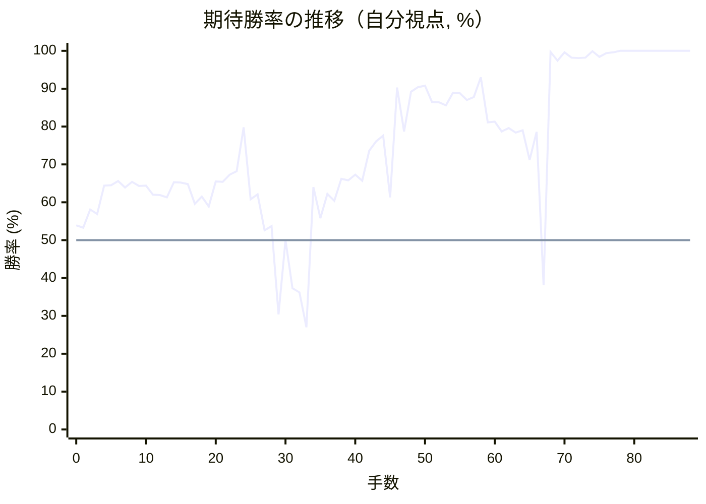

# 解析レポート giiimb75lt6g

[README に戻る](../../../README.md)　/　棋譜: [CSA](../../../data/csa/shogi5/giiimb75lt6g.csa)　/　解析の見方: [docs/mistake_analysis.md](../../../docs/mistake_analysis.md)

## 対局情報

| 項目 | 内容 |
|---|---|
| 日時 | 2026-11-06 00:57:49 |
| 持ち時間 | 5分 |
| 自分 | 先手（▲）（1719） |
| 相手 | 相手（1602） |
| 結果 | 負け（時間切れ, 88手） |

## 解析環境

| 項目 | 内容 |
|---|---|
| エンジン | YaneuraOu NNUE 9.00git 64AVX2（V9.00/YANEURAOU_ENGINE_NNUE/AVX2） |
| 評価関数 | **水匠5**（`suisho5`） |
| nn.bin SHA-256 | `768068f0d534a0603a5d38bcd143de6bbca820d5f1c95a14d40863e5b7892d76` |
| 第1パス | movetime=150ms, MultiPV 1 |
| 第2パス | movetime=2000ms, MultiPV 3 |
| Threads / Hash | 8 / 512MB |
| 判定基準 | 疑問手 ≥5pt, 悪手 ≥10pt, 大悪手 ≥20pt（期待勝率 W(E)=1/(1+exp(-E/600))） |
| 解析日時 | 2026-11-11T20:35:56+09:00（解析バージョン 1, 61秒） |

## サマリー

| 自分の手数 | 深掘りした手 | 詰み逃し | 大悪手 | 悪手 | 疑問手 |
|--:|--:|--:|--:|--:|--:|
| 44 | 12 | 0 | 2 | 5 | 4 |

## 期待勝率の推移



<details><summary>1手ごとの数値（第1パス）</summary>

| 手数 | 指し手 | 評価値 | 勝率 | 低下 | 判定 |
|--:|---|--:|--:|--:|---|
| 1 | ▲７六歩(77) | +80 | 53.3% | +0.6pt |  |
| 2 | △５四歩(53) | +195 | 58.1% |  |  |
| 3 | ▲２六歩(27) | +166 | 56.9% | +1.2pt |  |
| 4 | △５二飛(82) | +356 | 64.4% |  |  |
| 5 | ▲２五歩(26) | +358 | 64.5% | -0.1pt |  |
| 6 | △３二金(41) | +386 | 65.6% |  |  |
| 7 | ▲２四歩(25) | +342 | 63.9% | +1.7pt |  |
| 8 | △同歩(23) | +382 | 65.4% |  |  |
| 9 | ▲同飛(28) | +352 | 64.3% | +1.1pt |  |
| 10 | △１四歩(13) | +355 | 64.4% |  |  |
| 11 | ▲５八玉(59) | +295 | 62.0% | +2.3pt |  |
| 12 | △２三歩打 | +292 | 61.9% |  |  |
| 13 | ▲２八飛(24) | +276 | 61.3% | +0.6pt |  |
| 14 | △１五歩(14) | +380 | 65.3% |  |  |
| 15 | ▲３八銀(39) | +376 | 65.2% | +0.2pt |  |
| 16 | △３四歩(33) | +366 | 64.8% |  |  |
| 17 | ▲２七銀(38) | +234 | 59.6% | +5.2pt | [疑問手](#ply-17) |
| 18 | △８八角成(22) | +282 | 61.5% |  |  |
| 19 | ▲同銀(79) | +215 | 58.9% | +2.7pt |  |
| 20 | △４二銀(31) | +384 | 65.5% |  |  |
| 21 | ▲３六銀(27) | +382 | 65.4% | +0.1pt |  |
| 22 | △３三銀(42) | +432 | 67.3% |  |  |
| 23 | ▲７七銀(88) | +458 | 68.2% | -0.9pt |  |
| 24 | △６二玉(51) | +823 | 79.8% |  |  |
| 25 | ▲７八金(69) | +264 | 60.8% | +18.9pt | [悪手](#ply-25) |
| 26 | △５一飛(52) | +296 | 62.1% |  |  |
| 27 | ▲２五銀(36) | +62 | 52.6% | +9.5pt | [悪手](#ply-27) |
| 28 | △５五歩(54) | +88 | 53.7% |  |  |
| 29 | ▲２四歩打 | -498 | 30.4% | +23.3pt | [悪手](#ply-29) |
| 30 | △同銀(33) | +0 | 50.0% |  |  |
| 31 | ▲同銀(25) | -312 | 37.3% | +12.7pt | [疑問手](#ply-31) |
| 32 | △同歩(23) | -341 | 36.2% |  |  |
| 33 | ▲同飛(28) | -597 | 27.0% | +9.2pt | [大悪手](#ply-33) |
| 34 | △２三銀打 | +345 | 64.0% |  |  |
| 35 | ▲２六飛(24) | +141 | 55.8% | +8.1pt | [悪手](#ply-35) |
| 36 | △２四歩打 | +298 | 62.2% |  |  |
| 37 | ▲６六銀(77) | +254 | 60.4% | +1.7pt |  |
| 38 | △４四角打 | +403 | 66.2% |  |  |
| 39 | ▲２八飛(26) | +392 | 65.8% | +0.4pt |  |
| 40 | △３三桂(21) | +434 | 67.3% |  |  |
| 41 | ▲７七桂(89) | +391 | 65.7% | +1.6pt |  |
| 42 | △５六歩(55) | +614 | 73.6% |  |  |
| 43 | ▲同歩(57) | +694 | 76.1% | -2.5pt |  |
| 44 | △同飛(51) | +746 | 77.6% |  |  |
| 45 | ▲５七歩打 | +276 | 61.3% | +16.3pt | [疑問手](#ply-45) |
| 46 | △２六飛(56) | +1336 | 90.3% |  |  |
| 47 | ▲２七歩打 | +784 | 78.7% | +11.6pt | [疑問手](#ply-47) |
| 48 | △６六飛(26) | +1264 | 89.2% |  |  |
| 49 | ▲同歩(67) | +1347 | 90.4% | -1.3pt |  |
| 50 | △同角(44) | +1371 | 90.8% |  |  |
| 51 | ▲６七金(78) | +1112 | 86.5% | +4.3pt |  |
| 52 | △４四角(66) | +1108 | 86.4% |  |  |
| 53 | ▲６九玉(58) | +1068 | 85.6% | +0.8pt |  |
| 54 | △６六銀打 | +1250 | 88.9% |  |  |
| 55 | ▲同金(67) | +1241 | 88.8% | +0.1pt |  |
| 56 | △同角(44) | +1143 | 87.0% |  |  |
| 57 | ▲６八銀打 | +1186 | 87.8% | -0.8pt |  |
| 58 | △６七金打 | +1552 | 93.0% |  |  |
| 59 | ▲同銀(68) | +875 | 81.1% | +11.9pt | [悪手](#ply-59) |
| 60 | △７七角成(66) | +882 | 81.3% |  |  |
| 61 | ▲６八銀打 | +785 | 78.7% | +2.6pt |  |
| 62 | △９九馬(77) | +816 | 79.6% |  |  |
| 63 | ▲２一飛打 | +774 | 78.4% | +1.2pt |  |
| 64 | △５一香打 | +796 | 79.0% |  |  |
| 65 | ▲５八金(49) | +544 | 71.2% | +7.8pt |  |
| 66 | △４五桂(33) | +782 | 78.6% |  |  |
| 67 | ▲６六角打 | -291 | 38.1% | +40.5pt | [大悪手](#ply-67) |
| 68 | △５七香成(51) | +3542 | 99.7% |  |  |
| 69 | ▲同銀(68) | +2165 | 97.4% | +2.4pt |  |
| 70 | △同桂成(45) | +3300 | 99.6% |  |  |
| 71 | ▲同金(58) | +2393 | 98.2% | +1.4pt |  |
| 72 | △６六馬(99) | +2357 | 98.1% |  |  |
| 73 | ▲同銀(67) | +2408 | 98.2% | -0.2pt |  |
| 74 | △３九角打 | +3927 | 99.9% |  |  |
| 75 | ▲６八飛(28) | +2472 | 98.4% | +1.5pt |  |
| 76 | △４五桂打 | +3068 | 99.4% |  |  |
| 77 | ▲５六金(57) | +3387 | 99.6% | -0.2pt |  |
| 78 | △５七銀打 | +4690 | 100.0% |  |  |
| 79 | ▲同銀(66) | +5436 | 100.0% | -0.0pt |  |
| 80 | △同桂成(45) | #+7 | 100.0% |  |  |
| 81 | ▲６三飛成(68) | #+10 | 100.0% | +0.0pt |  |
| 82 | △同玉(62) | #+9 | 100.0% |  |  |
| 83 | ▲６一飛成(21) | #+8 | 100.0% | +0.0pt |  |
| 84 | △６二銀打 | #+7 | 100.0% |  |  |
| 85 | ▲６六香打 | #+10 | 100.0% | +0.0pt |  |
| 86 | △６四歩打 | #+7 | 100.0% |  |  |
| 87 | ▲同香(66) | #+6 | 100.0% | +0.0pt |  |
| 88 | △同玉(63) | #+5 | 100.0% |  |  |

</details>

## 課題局面

<a id="ply-17"></a>
### 17手目 ▲２七銀(38) — 疑問手

| | 着手前 | 着手後 | 差 |
|---|--:|--:|--:|
| 期待勝率 | 63.1% | 56.8% | -6.3pt |
| 評価値 | +321 | +164 | |

着手前の局面:

```text
後手の持駒：なし
  ９ ８ ７ ６ ５ ４ ３ ２ １
+---------------------------+
|v香v桂v銀v金v玉 ・v銀v桂v香|一
| ・ ・ ・ ・v飛 ・v金v角 ・|二
|v歩v歩v歩v歩 ・v歩 ・v歩 ・|三
| ・ ・ ・ ・v歩 ・v歩 ・ ・|四
| ・ ・ ・ ・ ・ ・ ・ ・v歩|五
| ・ ・ 歩 ・ ・ ・ ・ ・ ・|六
| 歩 歩 ・ 歩 歩 歩 歩 ・ 歩|七
| ・ 角 ・ ・ 玉 ・ 銀 飛 ・|八
| 香 桂 銀 金 ・ 金 ・ 桂 香|九
+---------------------------+
先手の持駒：歩
手数＝16　△３四歩　まで
```

| | 指し手 | 評価値 | 読み筋 |
|---|---|--:|---|
| 実戦 | ▲２七銀(38) | +164 | △８八角成(22) ▲同銀(79) △５五歩(54) ▲６八金(69) △６二玉(51) ▲６九玉(58) |
| AI 1位 | ▲６八玉(58) | +321 | ▲６八玉(58) △７四歩(73) ▲５八金(49) △７二銀(71) ▲２七銀(38) △７五歩(74) |
| AI 2位 | ▲４六歩(47) | +307 | ▲４六歩(47) △５五歩(54) ▲４七銀(38) △６二銀(71) ▲７八金(69) △９四歩(93) |
| AI 3位 | ▲６八金(69) | +296 | ▲６八金(69) △５五歩(54) ▲６九玉(58) △９四歩(93) ▲９六歩(97) △６二玉(51) |

SFEN: `lnsgk1snl/4r1gb1/pppp1p1p1/4p1p2/8p/2P6/PP1PPPP1P/1B2K1SR1/LNSG1G1NL b P 17`

<a id="ply-25"></a>
### 25手目 ▲７八金(69) — 悪手

| | 着手前 | 着手後 | 差 |
|---|--:|--:|--:|
| 期待勝率 | 80.1% | 61.0% | -19.1pt |
| 評価値 | +835 | +268 | |

着手前の局面:

```text
後手の持駒：角
  ９ ８ ７ ６ ５ ４ ３ ２ １
+---------------------------+
|v香v桂v銀v金 ・ ・ ・v桂v香|一
| ・ ・ ・v玉v飛 ・v金 ・ ・|二
|v歩v歩v歩v歩 ・v歩v銀v歩 ・|三
| ・ ・ ・ ・v歩 ・v歩 ・ ・|四
| ・ ・ ・ ・ ・ ・ ・ ・v歩|五
| ・ ・ 歩 ・ ・ ・ 銀 ・ ・|六
| 歩 歩 銀 歩 歩 歩 歩 ・ 歩|七
| ・ ・ ・ ・ 玉 ・ ・ 飛 ・|八
| 香 桂 ・ 金 ・ 金 ・ 桂 香|九
+---------------------------+
先手の持駒：角　歩
手数＝24　△６二玉　まで
```

| | 指し手 | 評価値 | 読み筋 |
|---|---|--:|---|
| 実戦 | ▲７八金(69) | +268 | △５一飛(52) ▲９六歩(97) △５五歩(54) ▲６八金(78) △７二玉(62) ▲６九玉(58) |
| AI 1位 | ▲４一角打 | +835 | ▲４一角打 △２四歩(23) ▲５二角成(41) △同玉(62) ▲６八玉(58) △７四歩(73) |
| AI 2位 | ▲９六歩(97) | +445 | ▲９六歩(97) △５一飛(52) ▲９五歩(96) △５五歩(54) ▲６八玉(58) △４四銀(33) |
| AI 3位 | ▲６八玉(58) | +405 | ▲６八玉(58) △５一飛(52) ▲９六歩(97) △９四歩(93) ▲５八金(49) △５五歩(54) |

SFEN: `lnsg3nl/3kr1g2/pppp1psp1/4p1p2/8p/2P3S2/PPSPPPP1P/4K2R1/LN1G1G1NL b BPb 25`

<a id="ply-27"></a>
### 27手目 ▲２五銀(36) — 悪手

| | 着手前 | 着手後 | 差 |
|---|--:|--:|--:|
| 期待勝率 | 61.0% | 49.8% | -11.2pt |
| 評価値 | +268 | -6 | |

着手前の局面:

```text
後手の持駒：角
  ９ ８ ７ ６ ５ ４ ３ ２ １
+---------------------------+
|v香v桂v銀v金v飛 ・ ・v桂v香|一
| ・ ・ ・v玉 ・ ・v金 ・ ・|二
|v歩v歩v歩v歩 ・v歩v銀v歩 ・|三
| ・ ・ ・ ・v歩 ・v歩 ・ ・|四
| ・ ・ ・ ・ ・ ・ ・ ・v歩|五
| ・ ・ 歩 ・ ・ ・ 銀 ・ ・|六
| 歩 歩 銀 歩 歩 歩 歩 ・ 歩|七
| ・ ・ 金 ・ 玉 ・ ・ 飛 ・|八
| 香 桂 ・ ・ ・ 金 ・ 桂 香|九
+---------------------------+
先手の持駒：角　歩
手数＝26　△５一飛　まで
```

| | 指し手 | 評価値 | 読み筋 |
|---|---|--:|---|
| 実戦 | ▲２五銀(36) | -6 | △５五歩(54) ▲６八金(78) △３五歩(34) ▲２四歩打 △同歩(23) ▲同銀(25) |
| AI 1位 | ▲９六歩(97) | +268 | ▲９六歩(97) △７二玉(62) ▲６九玉(58) △９四歩(93) ▲６六歩(67) △８二玉(72) |
| AI 2位 | ▲６九玉(58) | +260 | ▲６九玉(58) △７二玉(62) ▲９六歩(97) △５五歩(54) ▲６八金(78) △４四銀(33) |
| AI 3位 | ▲６八金(78) | +248 | ▲６八金(78) △９四歩(93) ▲９六歩(97) △７四歩(73) ▲６九玉(58) △７二銀(71) |

SFEN: `lnsgr2nl/3k2g2/pppp1psp1/4p1p2/8p/2P3S2/PPSPPPP1P/2G1K2R1/LN3G1NL b BPb 27`

<a id="ply-29"></a>
### 29手目 ▲２四歩打 — 悪手

| | 着手前 | 着手後 | 差 |
|---|--:|--:|--:|
| 期待勝率 | 48.8% | 28.9% | -19.9pt |
| 評価値 | -28 | -540 | |

着手前の局面:

```text
後手の持駒：角
  ９ ８ ７ ６ ５ ４ ３ ２ １
+---------------------------+
|v香v桂v銀v金v飛 ・ ・v桂v香|一
| ・ ・ ・v玉 ・ ・v金 ・ ・|二
|v歩v歩v歩v歩 ・v歩v銀v歩 ・|三
| ・ ・ ・ ・ ・ ・v歩 ・ ・|四
| ・ ・ ・ ・v歩 ・ ・ 銀v歩|五
| ・ ・ 歩 ・ ・ ・ ・ ・ ・|六
| 歩 歩 銀 歩 歩 歩 歩 ・ 歩|七
| ・ ・ 金 ・ 玉 ・ ・ 飛 ・|八
| 香 桂 ・ ・ ・ 金 ・ 桂 香|九
+---------------------------+
先手の持駒：角　歩
手数＝28　△５五歩　まで
```

| | 指し手 | 評価値 | 読み筋 |
|---|---|--:|---|
| 実戦 | ▲２四歩打 | -540 | △同歩(23) ▲３六銀(25) |
| AI 1位 | ▲６八金(78) | -28 | ▲６八金(78) △３五歩(34) ▲２四歩打 △同歩(23) ▲同銀(25) △同銀(33) |
| AI 2位 | ▲６九玉(58) | -54 | ▲６九玉(58) △７二玉(62) ▲７九玉(69) △５六歩(55) ▲同歩(57) △同飛(51) |
| AI 3位 | ▲６六銀(77) | -45 | ▲６六銀(77) △３五歩(34) ▲２四歩打 △同歩(23) ▲同銀(25) △５六歩(55) |

SFEN: `lnsgr2nl/3k2g2/pppp1psp1/6p2/4p2Sp/2P6/PPSPPPP1P/2G1K2R1/LN3G1NL b BPb 29`

<a id="ply-31"></a>
### 31手目 ▲同銀(25) — 疑問手

| | 着手前 | 着手後 | 差 |
|---|--:|--:|--:|
| 期待勝率 | 45.0% | 37.4% | -7.6pt |
| 評価値 | -121 | -310 | |

着手前の局面:

```text
後手の持駒：角　歩
  ９ ８ ７ ６ ５ ４ ３ ２ １
+---------------------------+
|v香v桂v銀v金v飛 ・ ・v桂v香|一
| ・ ・ ・v玉 ・ ・v金 ・ ・|二
|v歩v歩v歩v歩 ・v歩 ・v歩 ・|三
| ・ ・ ・ ・ ・ ・v歩v銀 ・|四
| ・ ・ ・ ・v歩 ・ ・ 銀v歩|五
| ・ ・ 歩 ・ ・ ・ ・ ・ ・|六
| 歩 歩 銀 歩 歩 歩 歩 ・ 歩|七
| ・ ・ 金 ・ 玉 ・ ・ 飛 ・|八
| 香 桂 ・ ・ ・ 金 ・ 桂 香|九
+---------------------------+
先手の持駒：角
手数＝30　△２四同銀　まで
```

| | 指し手 | 評価値 | 読み筋 |
|---|---|--:|---|
| 実戦 | ▲同銀(25) | -310 | △同歩(23) ▲６六銀(77) △３三桂(21) ▲２四飛(28) △７二玉(62) ▲２八飛(24) |
| AI 1位 | ▲３四銀(25) | -121 | ▲３四銀(25) △７二玉(62) ▲６八金(78) △３六歩打 ▲同歩(37) △５六歩(55) |
| AI 2位 | ▲同銀(25) | -324 | ▲同銀(25) △同歩(23) ▲６六銀(77) △７二玉(62) ▲２四飛(28) △３三桂(21) |
| AI 3位 | ▲６六銀(77) | -475 | ▲６六銀(77) △２五銀(24) ▲同飛(28) △７二玉(62) ▲９六歩(97) △３三桂(21) |

SFEN: `lnsgr2nl/3k2g2/pppp1p1p1/6ps1/4p2Sp/2P6/PPSPPPP1P/2G1K2R1/LN3G1NL b Bbp 31`

<a id="ply-33"></a>
### 33手目 ▲同飛(28) — 大悪手

| | 着手前 | 着手後 | 差 |
|---|--:|--:|--:|
| 期待勝率 | 36.9% | 11.3% | -25.6pt |
| 評価値 | -323 | -1238 | |

着手前の局面:

```text
後手の持駒：角　銀　歩
  ９ ８ ７ ６ ５ ４ ３ ２ １
+---------------------------+
|v香v桂v銀v金v飛 ・ ・v桂v香|一
| ・ ・ ・v玉 ・ ・v金 ・ ・|二
|v歩v歩v歩v歩 ・v歩 ・ ・ ・|三
| ・ ・ ・ ・ ・ ・v歩v歩 ・|四
| ・ ・ ・ ・v歩 ・ ・ ・v歩|五
| ・ ・ 歩 ・ ・ ・ ・ ・ ・|六
| 歩 歩 銀 歩 歩 歩 歩 ・ 歩|七
| ・ ・ 金 ・ 玉 ・ ・ 飛 ・|八
| 香 桂 ・ ・ ・ 金 ・ 桂 香|九
+---------------------------+
先手の持駒：角　銀
手数＝32　△２四同歩　まで
```

| | 指し手 | 評価値 | 読み筋 |
|---|---|--:|---|
| 実戦 | ▲同飛(28) | -1238 | △５六歩(55) ▲同歩(57) △５七歩打 ▲６八玉(58) △５八銀打 ▲２六角打 |
| AI 1位 | ▲６六銀(77) | -323 | ▲６六銀(77) △３三桂(21) ▲２四飛(28) △７二玉(62) ▲２八飛(24) △５四角打 |
| AI 2位 | ▲８六角打 | -376 | ▲８六角打 △５六歩(55) ▲同歩(57) △３三桂(21) ▲６九玉(58) △７二玉(62) |
| AI 3位 | ▲６八銀(77) | -377 | ▲６八銀(77) △５六歩(55) ▲同歩(57) △３三桂(21) ▲６九玉(58) △２一飛(51) |

SFEN: `lnsgr2nl/3k2g2/pppp1p3/6pp1/4p3p/2P6/PPSPPPP1P/2G1K2R1/LN3G1NL b BSbsp 33`

<a id="ply-35"></a>
### 35手目 ▲２六飛(24) — 悪手

| | 着手前 | 着手後 | 差 |
|---|--:|--:|--:|
| 期待勝率 | 63.7% | 51.0% | -12.7pt |
| 評価値 | +338 | +25 | |

着手前の局面:

```text
後手の持駒：角　歩
  ９ ８ ７ ６ ５ ４ ３ ２ １
+---------------------------+
|v香v桂v銀v金v飛 ・ ・v桂v香|一
| ・ ・ ・v玉 ・ ・v金 ・ ・|二
|v歩v歩v歩v歩 ・v歩 ・v銀 ・|三
| ・ ・ ・ ・ ・ ・v歩 飛 ・|四
| ・ ・ ・ ・v歩 ・ ・ ・v歩|五
| ・ ・ 歩 ・ ・ ・ ・ ・ ・|六
| 歩 歩 銀 歩 歩 歩 歩 ・ 歩|七
| ・ ・ 金 ・ 玉 ・ ・ ・ ・|八
| 香 桂 ・ ・ ・ 金 ・ 桂 香|九
+---------------------------+
先手の持駒：角　銀　歩
手数＝34　△２三銀　まで
```

| | 指し手 | 評価値 | 読み筋 |
|---|---|--:|---|
| 実戦 | ▲２六飛(24) | +25 | △３三桂(21) ▲６六銀(77) △４四角打 ▲２八飛(26) △２六歩打 ▲６九玉(58) |
| AI 1位 | ▲２八飛(24) | +338 | ▲２八飛(24) △５六歩(55) ▲同歩(57) △同飛(51) ▲５七歩打 △５一飛(56) |
| AI 2位 | ▲２六飛(24) | +102 | ▲２六飛(24) △３三桂(21) ▲６六銀(77) △７二玉(62) ▲２八飛(26) △２一飛(51) |
| AI 3位 | ▲２七飛(24) | +31 | ▲２七飛(24) △５六歩(55) ▲同歩(57) △同飛(51) ▲５七歩打 △２六歩打 |

SFEN: `lnsgr2nl/3k2g2/pppp1p1s1/6pR1/4p3p/2P6/PPSPPPP1P/2G1K4/LN3G1NL b BSPbp 35`

<a id="ply-45"></a>
### 45手目 ▲５七歩打 — 疑問手

| | 着手前 | 着手後 | 差 |
|---|--:|--:|--:|
| 期待勝率 | 76.2% | 68.9% | -7.2pt |
| 評価値 | +697 | +478 | |

着手前の局面:

```text
後手の持駒：歩
  ９ ８ ７ ６ ５ ４ ３ ２ １
+---------------------------+
|v香v桂v銀v金 ・ ・ ・ ・v香|一
| ・ ・ ・v玉 ・ ・v金 ・ ・|二
|v歩v歩v歩v歩 ・v歩v桂v銀 ・|三
| ・ ・ ・ ・ ・v角v歩v歩 ・|四
| ・ ・ ・ ・ ・ ・ ・ ・v歩|五
| ・ ・ 歩 銀v飛 ・ ・ ・ ・|六
| 歩 歩 桂 歩 ・ 歩 歩 ・ 歩|七
| ・ ・ 金 ・ 玉 ・ ・ 飛 ・|八
| 香 ・ ・ ・ ・ 金 ・ 桂 香|九
+---------------------------+
先手の持駒：角　銀　歩二
手数＝44　△５六同飛　まで
```

| | 指し手 | 評価値 | 読み筋 |
|---|---|--:|---|
| 実戦 | ▲５七歩打 | +478 | △５一飛(56) ▲６八玉(58) △２五歩(24) ▲５八飛(28) △７二玉(62) ▲５六歩(57) |
| AI 1位 | ▲６八玉(58) | +697 | ▲６八玉(58) △７二玉(62) ▲７九玉(68) △９四歩(93) ▲９六歩(97) △６二銀(71) |
| AI 2位 | ▲６九玉(58) | +684 | ▲６九玉(58) △７二玉(62) ▲７九玉(69) △９四歩(93) ▲９六歩(97) △６二銀(71) |
| AI 3位 | ▲５七銀(66) | +384 | ▲５七銀(66) △５一飛(56) ▲６八玉(58) △２五歩(24) ▲４六銀(57) △７二玉(62) |

SFEN: `lnsg4l/3k2g2/pppp1pns1/5bpp1/8p/2PSr4/PPNP1PP1P/2G1K2R1/L4G1NL b BS2Pp 45`

<a id="ply-47"></a>
### 47手目 ▲２七歩打 — 疑問手

| | 着手前 | 着手後 | 差 |
|---|--:|--:|--:|
| 期待勝率 | 89.2% | 83.7% | -5.5pt |
| 評価値 | +1267 | +983 | |

着手前の局面:

```text
後手の持駒：歩
  ９ ８ ７ ６ ５ ４ ３ ２ １
+---------------------------+
|v香v桂v銀v金 ・ ・ ・ ・v香|一
| ・ ・ ・v玉 ・ ・v金 ・ ・|二
|v歩v歩v歩v歩 ・v歩v桂v銀 ・|三
| ・ ・ ・ ・ ・v角v歩v歩 ・|四
| ・ ・ ・ ・ ・ ・ ・ ・v歩|五
| ・ ・ 歩 銀 ・ ・ ・v飛 ・|六
| 歩 歩 桂 歩 歩 歩 歩 ・ 歩|七
| ・ ・ 金 ・ 玉 ・ ・ 飛 ・|八
| 香 ・ ・ ・ ・ 金 ・ 桂 香|九
+---------------------------+
先手の持駒：角　銀　歩
手数＝46　△２六飛　まで
```

| | 指し手 | 評価値 | 読み筋 |
|---|---|--:|---|
| 実戦 | ▲２七歩打 | +983 | △２五飛(26) ▲９六歩(97) △７二玉(62) ▲３六歩(37) △６六角(44) ▲同歩(67) |
| AI 1位 | ▲同飛(28) | +1267 | ▲同飛(28) △同角(44) ▲２一飛打 △３一飛打 ▲同飛成(21) △同金(32) |
| AI 2位 | ▲２七歩打 | +938 | ▲２七歩打 △２五飛(26) ▲３六歩(37) △７二玉(62) ▲９六歩(97) △６六角(44) |
| AI 3位 | ▲２七銀打 | +697 | ▲２七銀打 △２五飛(26) ▲９六歩(97) △７二玉(62) ▲４六歩(47) △６六角(44) |

SFEN: `lnsg4l/3k2g2/pppp1pns1/5bpp1/8p/2PS3r1/PPNPPPP1P/2G1K2R1/L4G1NL b BSPp 47`

<a id="ply-59"></a>
### 59手目 ▲同銀(68) — 悪手

| | 着手前 | 着手後 | 差 |
|---|--:|--:|--:|
| 期待勝率 | 94.4% | 82.4% | -12.0pt |
| 評価値 | +1696 | +926 | |

着手前の局面:

```text
後手の持駒：歩二
  ９ ８ ７ ６ ５ ４ ３ ２ １
+---------------------------+
|v香v桂v銀v金 ・ ・ ・ ・v香|一
| ・ ・ ・v玉 ・ ・v金 ・ ・|二
|v歩v歩v歩v歩 ・v歩v桂v銀 ・|三
| ・ ・ ・ ・ ・ ・v歩v歩 ・|四
| ・ ・ ・ ・ ・ ・ ・ ・v歩|五
| ・ ・ 歩v角 ・ ・ ・ ・ ・|六
| 歩 歩 桂v金 歩 歩 歩 歩 歩|七
| ・ ・ ・ 銀 ・ ・ ・ 飛 ・|八
| 香 ・ ・ 玉 ・ 金 ・ 桂 香|九
+---------------------------+
先手の持駒：飛　角　銀
手数＝58　△６七金　まで
```

| | 指し手 | 評価値 | 読み筋 |
|---|---|--:|---|
| 実戦 | ▲同銀(68) | +926 | △７七角成(66) ▲５八金(49) △９九馬(77) ▲４一飛打 △５一香打 ▲１一飛成(41) |
| AI 1位 | ▲６五桂(77) | +1696 | ▲６五桂(77) △９九角成(66) ▲６七銀(68) △５一香打 ▲６六角打 △同馬(99) |
| AI 2位 | ▲８六角打 | +1436 | ▲８六角打 △５七金(67) ▲２一飛打 △５二歩打 ▲１一飛成(21) △４五桂(33) |
| AI 3位 | ▲７八銀打 | +932 | ▲７八銀打 △５七金(67) ▲２一飛打 △１二香(11) ▲７九玉(69) △４五桂(33) |

SFEN: `lnsg4l/3k2g2/pppp1pns1/6pp1/8p/2Pb5/PPNgPPPPP/3S3R1/L2K1G1NL b RBS2p 59`

<a id="ply-67"></a>
### 67手目 ▲６六角打 — 大悪手

| | 着手前 | 着手後 | 差 |
|---|--:|--:|--:|
| 期待勝率 | 79.4% | 53.0% | -26.4pt |
| 評価値 | +811 | +72 | |

着手前の局面:

```text
後手の持駒：桂　歩二
  ９ ８ ７ ６ ５ ４ ３ ２ １
+---------------------------+
|v香v桂v銀v金v香 ・ ・ 飛v香|一
| ・ ・ ・v玉 ・ ・v金 ・ ・|二
|v歩v歩v歩v歩 ・v歩 ・v銀 ・|三
| ・ ・ ・ ・ ・ ・v歩v歩 ・|四
| ・ ・ ・ ・ ・v桂 ・ ・v歩|五
| ・ ・ 歩 ・ ・ ・ ・ ・ ・|六
| 歩 歩 ・ 銀 歩 歩 歩 歩 歩|七
| ・ ・ ・ 銀 金 ・ ・ 飛 ・|八
|v馬 ・ ・ 玉 ・ ・ ・ 桂 香|九
+---------------------------+
先手の持駒：角　金
手数＝66　△４五桂　まで
```

| | 指し手 | 評価値 | 読み筋 |
|---|---|--:|---|
| 実戦 | ▲６六角打 | +72 | △同馬(99) ▲同銀(67) △５六歩打 ▲同歩(57) △３九角打 ▲４八飛(28) |
| AI 1位 | ▲４六歩(47) | +811 | ▲４六歩(47) △５七桂成(45) ▲同銀(68) △３三馬(99) ▲７五桂打 △７二玉(62) |
| AI 2位 | ▲５六歩(57) | +383 | ▲５六歩(57) △５七歩打 ▲４八金(58) △６五桂打 ▲７八玉(69) △３三馬(99) |
| AI 3位 | ▲４一飛成(21) | +353 | ▲４一飛成(21) △５二金(61) ▲６六角打 △同馬(99) ▲同銀(67) △２二角打 |

SFEN: `lnsgl2Rl/3k2g2/pppp1p1s1/6pp1/5n2p/2P6/PP1SPPPPP/3SG2R1/+b2K3NL b BGn2p 67`

