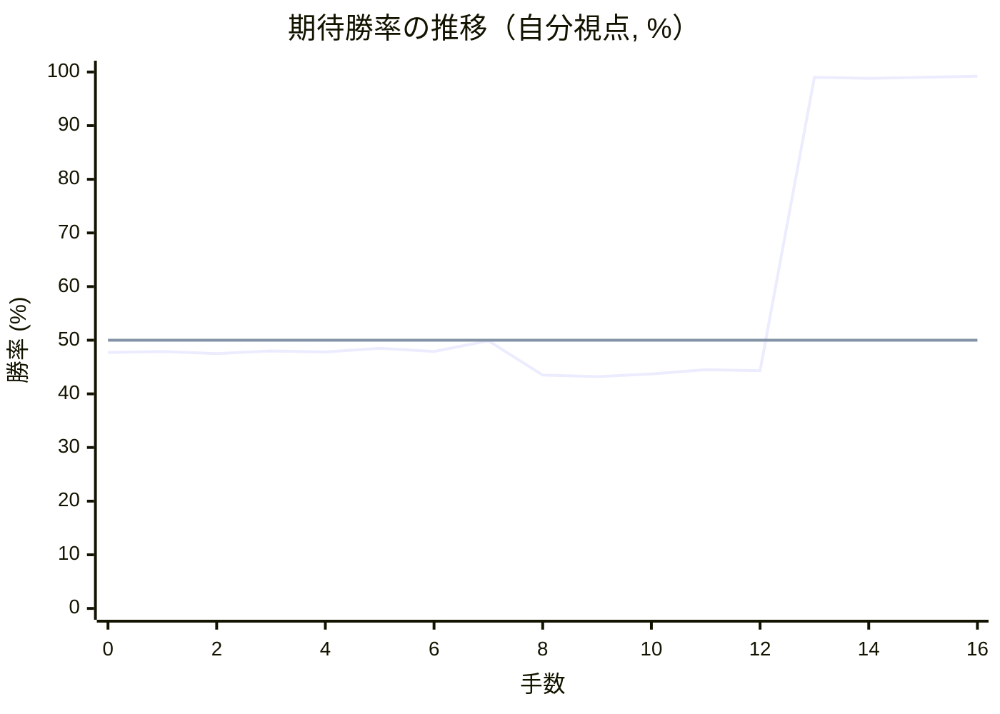
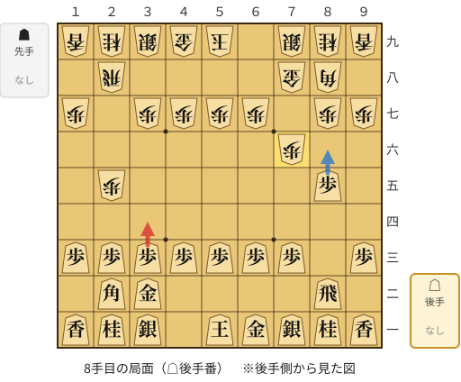

# 解析レポート gpbd1plec803

[README に戻る](../../../README.md)　/　棋譜: [CSA](../../../data/csa/shogi5/gpbd1plec803.csa)　/　解析の見方: [docs/mistake_analysis.md](../../../docs/mistake_analysis.md)

## 対局情報

| 項目 | 内容 |
|---|---|
| 日時 | 2026-11-16 01:47:27 |
| 持ち時間 | 5分 |
| 自分 | 後手（△）（1649） |
| 相手 | 相手（1635） |
| 結果 | 勝ち（投了, 16手） |

## 解析環境

| 項目 | 内容 |
|---|---|
| エンジン | YaneuraOu NNUE 9.00git 64AVX2（V9.00/YANEURAOU_ENGINE_NNUE/AVX2） |
| 評価関数 | **水匠5**（`suisho5`） |
| nn.bin SHA-256 | `768068f0d534a0603a5d38bcd143de6bbca820d5f1c95a14d40863e5b7892d76` |
| 第1パス | movetime=150ms, MultiPV 1 |
| 第2パス | movetime=2000ms, MultiPV 3 |
| Threads / Hash | 8 / 512MB |
| 判定基準 | 疑問手 ≥5pt, 悪手 ≥10pt, 大悪手 ≥20pt（期待勝率 W(E)=1/(1+exp(-E/600))） |
| 解析日時 | 2026-11-20T20:20:23+09:00（解析バージョン 1, 7秒） |

## サマリー

| 自分の手数 | 深掘りした手 | 詰み逃し | 大悪手 | 悪手 | 疑問手 |
|--:|--:|--:|--:|--:|--:|
| 8 | 1 | 0 | 0 | 0 | 1 |

## 期待勝率の推移



<details><summary>1手ごとの数値（第1パス）</summary>

| 手数 | 指し手 | 評価値 | 勝率 | 低下 | 判定 |
|--:|---|--:|--:|--:|---|
| 1 | ▲２六歩(27) | -51 | 47.9% |  |  |
| 2 | △８四歩(83) | -61 | 47.5% | +0.4pt |  |
| 3 | ▲２五歩(26) | -47 | 48.0% |  |  |
| 4 | △８五歩(84) | -53 | 47.8% | +0.2pt |  |
| 5 | ▲７八金(69) | -35 | 48.5% |  |  |
| 6 | △３二金(41) | -50 | 47.9% | +0.6pt |  |
| 7 | ▲７六歩(77) | -3 | 49.9% |  |  |
| 8 | △３四歩(33) | -158 | 43.5% | +6.4pt | [疑問手](#ply-8) |
| 9 | ▲２四歩(25) | -164 | 43.2% |  |  |
| 10 | △同歩(23) | -151 | 43.7% | -0.5pt |  |
| 11 | ▲同飛(28) | -133 | 44.5% |  |  |
| 12 | △８六歩(85) | -138 | 44.3% | +0.2pt |  |
| 13 | ▲２八飛(24) | +2768 | 99.0% |  |  |
| 14 | △８七歩成(86) | +2668 | 98.8% | +0.2pt |  |
| 15 | ▲２二角成(88) | +2778 | 99.0% |  |  |
| 16 | △同銀(31) | +2884 | 99.2% | -0.2pt |  |

</details>

## 課題局面

<a id="ply-8"></a>
### 8手目 △３四歩(33) — 疑問手

| | 着手前 | 着手後 | 差 |
|---|--:|--:|--:|
| 期待勝率 | 49.4% | 43.1% | -6.3pt |
| 評価値 | -15 | -167 | |

着手前の局面:



🔴 実戦 △３四歩(33)　🔵 AI推奨 △８六歩(85)　🟨 直前の相手の指し手

<details><summary>テキストの盤面図（BOD・将棋ソフトに貼り付け可）</summary>

```text
後手の持駒：なし
  ９ ８ ７ ６ ５ ４ ３ ２ １
+---------------------------+
|v香v桂v銀v金v玉 ・v銀v桂v香|一
| ・v飛 ・ ・ ・ ・v金v角 ・|二
|v歩 ・v歩v歩v歩v歩v歩v歩v歩|三
| ・ ・ ・ ・ ・ ・ ・ ・ ・|四
| ・v歩 ・ ・ ・ ・ ・ 歩 ・|五
| ・ ・ 歩 ・ ・ ・ ・ ・ ・|六
| 歩 歩 ・ 歩 歩 歩 歩 ・ 歩|七
| ・ 角 金 ・ ・ ・ ・ 飛 ・|八
| 香 桂 銀 ・ 玉 金 銀 桂 香|九
+---------------------------+
先手の持駒：なし
後手番
手数＝7　▲７六歩　まで
```

</details>

| | 指し手 | 評価値 | 読み筋 |
|---|---|--:|---|
| 実戦 | △３四歩(33) | -167 | ▲２四歩(25) △同歩(23) ▲同飛(28) △８六歩(85) ▲同歩(87) △同飛(82) |
| AI 1位 | △８六歩(85) | -15 | △８六歩(85) ▲同歩(87) △同飛(82) ▲２四歩(25) △同歩(23) ▲同飛(28) |
| AI 2位 | △１四歩(13) | -51 | △１四歩(13) ▲７七角(88) △３四歩(33) ▲６八銀(79) △７七角成(22) ▲同銀(68) |
| AI 3位 | △９四歩(93) | -80 | △９四歩(93) ▲５八玉(59) △８六歩(85) ▲同歩(87) △同飛(82) ▲３六歩(37) |

SFEN: `lnsgk1snl/1r4gb1/p1ppppppp/9/1p5P1/2P6/PP1PPPP1P/1BG4R1/LNS1KGSNL w - 8`

