# 解析レポート gr88ed23d2qo

[README に戻る](../../../README.md)　/　棋譜: [CSA](../../../data/csa/shogi5/gr88ed23d2qo.csa)　/　解析の見方: [docs/mistake_analysis.md](../../../docs/mistake_analysis.md)

## 対局情報

| 項目 | 内容 |
|---|---|
| 日時 | 2026-11-11 07:28:06 |
| 持ち時間 | 5分 |
| 自分 | 先手（▲）（1651） |
| 相手 | 相手（1487） |
| 結果 | 勝ち（詰み, 111手） |

## 解析環境

| 項目 | 内容 |
|---|---|
| エンジン | YaneuraOu NNUE 9.00git 64AVX2（V9.00/YANEURAOU_ENGINE_NNUE/AVX2） |
| 評価関数 | **水匠5**（`suisho5`） |
| nn.bin SHA-256 | `768068f0d534a0603a5d38bcd143de6bbca820d5f1c95a14d40863e5b7892d76` |
| 第1パス | movetime=150ms, MultiPV 1 |
| 第2パス | movetime=2000ms, MultiPV 3 |
| Threads / Hash | 8 / 512MB |
| 判定基準 | 疑問手 ≥5pt, 悪手 ≥10pt, 大悪手 ≥20pt（期待勝率 W(E)=1/(1+exp(-E/600))） |
| 解析日時 | 2026-11-14T10:40:32+09:00（解析バージョン 1, 71秒） |

## サマリー

| 自分の手数 | 深掘りした手 | 詰み逃し | 大悪手 | 悪手 | 疑問手 |
|--:|--:|--:|--:|--:|--:|
| 56 | 14 | 0 | 4 | 5 | 3 |

## 期待勝率の推移

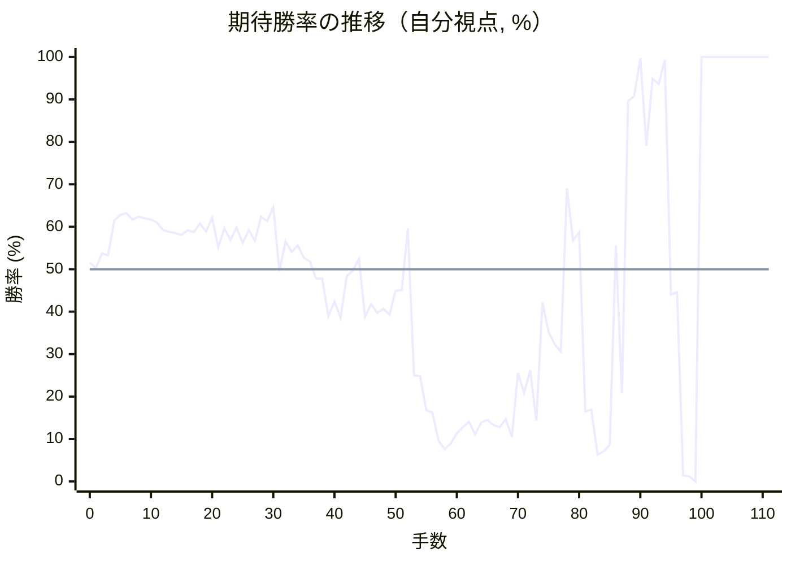

<details><summary>1手ごとの数値（第1パス）</summary>

| 手数 | 指し手 | 評価値 | 勝率 | 低下 | 判定 |
|--:|---|--:|--:|--:|---|
| 1 | ▲７六歩(77) | +7 | 50.3% | +1.2pt |  |
| 2 | △３四歩(33) | +90 | 53.7% |  |  |
| 3 | ▲２六歩(27) | +80 | 53.3% | +0.4pt |  |
| 4 | △４二飛(82) | +280 | 61.5% |  |  |
| 5 | ▲２五歩(26) | +314 | 62.8% | -1.3pt |  |
| 6 | △６二玉(51) | +324 | 63.2% |  |  |
| 7 | ▲４八銀(39) | +286 | 61.7% | +1.5pt |  |
| 8 | △７二玉(62) | +303 | 62.4% |  |  |
| 9 | ▲６八玉(59) | +295 | 62.0% | +0.3pt |  |
| 10 | △８八角成(22) | +285 | 61.7% |  |  |
| 11 | ▲同銀(79) | +268 | 61.0% | +0.7pt |  |
| 12 | △２二銀(31) | +223 | 59.2% |  |  |
| 13 | ▲７七銀(88) | +214 | 58.8% | +0.4pt |  |
| 14 | △３三銀(22) | +205 | 58.5% |  |  |
| 15 | ▲７八玉(68) | +195 | 58.1% | +0.4pt |  |
| 16 | △９四歩(93) | +223 | 59.2% |  |  |
| 17 | ▲９六歩(97) | +212 | 58.7% | +0.4pt |  |
| 18 | △１四歩(13) | +264 | 60.8% |  |  |
| 19 | ▲１六歩(17) | +216 | 58.9% | +1.9pt |  |
| 20 | △３五歩(34) | +297 | 62.1% |  |  |
| 21 | ▲６六銀(77) | +126 | 55.2% | +6.9pt | [疑問手](#ply-21) |
| 22 | △４四歩(43) | +233 | 59.6% |  |  |
| 23 | ▲５六歩(57) | +167 | 56.9% | +2.7pt |  |
| 24 | △３二金(41) | +238 | 59.8% |  |  |
| 25 | ▲７七桂(89) | +150 | 56.2% | +3.6pt |  |
| 26 | △６二銀(71) | +223 | 59.2% |  |  |
| 27 | ▲６八金(69) | +162 | 56.7% | +2.5pt |  |
| 28 | △５一金(61) | +304 | 62.4% |  |  |
| 29 | ▲５七銀(48) | +276 | 61.3% | +1.1pt |  |
| 30 | △３四銀(33) | +362 | 64.6% |  |  |
| 31 | ▲２四歩(25) | -11 | 49.5% | +15.1pt | [疑問手](#ply-31) |
| 32 | △同歩(23) | +160 | 56.6% |  |  |
| 33 | ▲同飛(28) | +98 | 54.1% | +2.6pt |  |
| 34 | △２三金(32) | +134 | 55.6% |  |  |
| 35 | ▲２八飛(24) | +66 | 52.7% | +2.8pt |  |
| 36 | △２五歩打 | +43 | 51.8% |  |  |
| 37 | ▲７五歩(76) | -54 | 47.8% | +4.0pt |  |
| 38 | △３三金(23) | -53 | 47.8% |  |  |
| 39 | ▲５五歩(56) | -271 | 38.9% | +8.9pt | [悪手](#ply-39) |
| 40 | △２二飛(42) | -185 | 42.4% |  |  |
| 41 | ▲２七歩打 | -278 | 38.6% | +3.7pt |  |
| 42 | △４三金(33) | -41 | 48.3% |  |  |
| 43 | ▲６五銀(66) | -7 | 49.7% | -1.4pt |  |
| 44 | △３三桂(21) | +58 | 52.4% |  |  |
| 45 | ▲５四歩(55) | -273 | 38.8% | +13.6pt | [悪手](#ply-45) |
| 46 | △同歩(53) | -198 | 41.8% |  |  |
| 47 | ▲７四歩(75) | -251 | 39.7% | +2.1pt |  |
| 48 | △同歩(73) | -225 | 40.7% |  |  |
| 49 | ▲３一角打 | -260 | 39.3% | +1.4pt |  |
| 50 | △２一飛(22) | -123 | 44.9% |  |  |
| 51 | ▲８六角成(31) | -118 | 45.1% | -0.2pt |  |
| 52 | △３六歩(35) | +233 | 59.6% |  |  |
| 53 | ▲３八金(49) | -660 | 25.0% | +34.6pt | [大悪手](#ply-53) |
| 54 | △３七歩成(36) | -665 | 24.8% |  |  |
| 55 | ▲同金(38) | -960 | 16.8% | +8.0pt | [悪手](#ply-55) |
| 56 | △４五桂(33) | -986 | 16.2% |  |  |
| 57 | ▲４六銀(57) | -1342 | 9.7% | +6.6pt |  |
| 58 | △３七桂成(45) | -1501 | 7.6% |  |  |
| 59 | ▲同銀(46) | -1397 | 8.9% | -1.3pt |  |
| 60 | △２六歩(25) | -1237 | 11.3% |  |  |
| 61 | ▲同歩(27) | -1152 | 12.8% | -1.5pt |  |
| 62 | △３六歩打 | -1082 | 14.1% |  |  |
| 63 | ▲４六銀(37) | -1250 | 11.1% | +3.1pt |  |
| 64 | △３九角打 | -1096 | 13.9% |  |  |
| 65 | ▲３八飛(28) | -1064 | 14.5% | -0.6pt |  |
| 66 | △８四角成(39) | -1126 | 13.3% |  |  |
| 67 | ▲３六飛(38) | -1152 | 12.8% | +0.5pt |  |
| 68 | △３五歩打 | -1053 | 14.7% |  |  |
| 69 | ▲同銀(46) | -1283 | 10.5% | +4.2pt |  |
| 70 | △４五銀(34) | -644 | 25.5% |  |  |
| 71 | ▲７六飛(36) | -804 | 20.8% | +4.7pt |  |
| 72 | △７五金打 | -622 | 26.2% |  |  |
| 73 | ▲同飛(76) | -1076 | 14.3% | +11.9pt | [悪手](#ply-73) |
| 74 | △同馬(84) | -188 | 42.2% |  |  |
| 75 | ▲同馬(86) | -365 | 35.2% | +7.0pt |  |
| 76 | △同歩(74) | -443 | 32.3% |  |  |
| 77 | ▲３二角打 | -492 | 30.6% | +1.8pt |  |
| 78 | △４一飛(21) | +482 | 69.1% |  |  |
| 79 | ▲同角成(32) | +163 | 56.8% | +12.3pt |  |
| 80 | △同金(51) | +210 | 58.7% |  |  |
| 81 | ▲２一飛打 | -971 | 16.5% | +42.1pt | [大悪手](#ply-81) |
| 82 | △３一歩打 | -955 | 16.9% |  |  |
| 83 | ▲２二飛成(21) | -1624 | 6.3% | +10.7pt | [疑問手](#ply-83) |
| 84 | △３二金(41) | -1541 | 7.1% |  |  |
| 85 | ▲１一龍(22) | -1417 | 8.6% | -1.5pt |  |
| 86 | △７三桂(81) | +136 | 55.6% |  |  |
| 87 | ▲７四桂打 | -804 | 20.8% | +34.9pt | [悪手](#ply-87) |
| 88 | △６五桂(73) | +1290 | 89.6% |  |  |
| 89 | ▲同桂(77) | +1375 | 90.8% | -1.3pt |  |
| 90 | △３八飛打 | +3413 | 99.7% |  |  |
| 91 | ▲７三歩打 | +797 | 79.1% | +20.6pt |  |
| 92 | △同銀(62) | +1756 | 94.9% |  |  |
| 93 | ▲８五桂打 | +1613 | 93.6% | +1.3pt |  |
| 94 | △８四銀打 | +2987 | 99.3% |  |  |
| 95 | ▲７三桂成(85) | -145 | 44.0% | +55.3pt | [大悪手](#ply-95) |
| 96 | △同銀(84) | -131 | 44.6% |  |  |
| 97 | ▲６一銀打 | -2573 | 1.4% | +43.2pt | [大悪手](#ply-97) |
| 98 | △同玉(72) | -2671 | 1.2% |  |  |
| 99 | ▲７三桂成(65) | #-13 | 0.0% | +1.2pt |  |
| 100 | △５二玉(61) | #+7 | 100.0% |  |  |
| 101 | ▲６二桂成(74) | #+6 | 100.0% | +0.0pt |  |
| 102 | △４二玉(52) | #+3 | 100.0% |  |  |
| 103 | ▲５一銀打 | #+2 | 100.0% | +0.0pt |  |
| 104 | △３三玉(42) | #+1 | 100.0% |  |  |
| 105 | ▲１三龍(11) | #+6 | 100.0% | +0.0pt |  |
| 106 | △２三金(32) | #+5 | 100.0% |  |  |
| 107 | ▲２四金打 | #+4 | 100.0% | +0.0pt |  |
| 108 | △３二玉(33) | #+3 | 100.0% |  |  |
| 109 | ▲２三金(24) | #+2 | 100.0% | +0.0pt |  |
| 110 | △４一玉(32) | #+1 | 100.0% |  |  |
| 111 | ▲５二金打 | #+ | 100.0% | +0.0pt |  |

</details>

## 課題局面

<a id="ply-21"></a>
### 21手目 ▲６六銀(77) — 疑問手

| | 着手前 | 着手後 | 差 |
|---|--:|--:|--:|
| 期待勝率 | 64.2% | 58.8% | -5.4pt |
| 評価値 | +350 | +214 | |

着手前の局面:

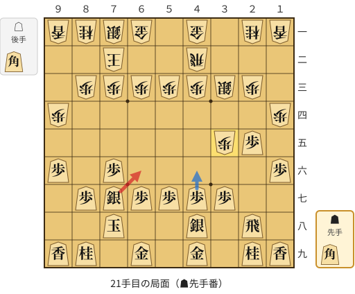

🔴 実戦 ▲６六銀(77)　🔵 AI推奨 ▲４六歩(47)　🟨 直前の相手の指し手

<details><summary>テキストの盤面図（BOD・将棋ソフトに貼り付け可）</summary>

```text
後手の持駒：角
  ９ ８ ７ ６ ５ ４ ３ ２ １
+---------------------------+
|v香v桂v銀v金 ・v金 ・v桂v香|一
| ・ ・v玉 ・ ・v飛 ・ ・ ・|二
| ・v歩v歩v歩v歩v歩v銀v歩 ・|三
|v歩 ・ ・ ・ ・ ・ ・ ・v歩|四
| ・ ・ ・ ・ ・ ・v歩 歩 ・|五
| 歩 ・ 歩 ・ ・ ・ ・ ・ 歩|六
| ・ 歩 銀 歩 歩 歩 歩 ・ ・|七
| ・ ・ 玉 ・ ・ 銀 ・ 飛 ・|八
| 香 桂 ・ 金 ・ 金 ・ 桂 香|九
+---------------------------+
先手の持駒：角
手数＝20　△３五歩　まで
```

</details>

| | 指し手 | 評価値 | 読み筋 |
|---|---|--:|---|
| 実戦 | ▲６六銀(77) | +214 | △４四歩(43) ▲５八金(49) △３二金(41) ▲４六歩(47) △４五歩(44) ▲同歩(46) |
| AI 1位 | ▲４六歩(47) | +350 | ▲４六歩(47) △３二金(41) ▲４七銀(48) △４四歩(43) ▲５八金(49) △４五歩(44) |
| AI 2位 | ▲５八金(49) | +308 | ▲５八金(49) △３二金(41) ▲８八玉(78) △４四歩(43) ▲４六歩(47) △８二玉(72) |
| AI 3位 | ▲８八玉(78) | +296 | ▲８八玉(78) △４四歩(43) ▲４六歩(47) △８二玉(72) ▲５八金(49) △３二金(41) |

SFEN: `lnsg1g1nl/2k2r3/1pppppsp1/p7p/6pP1/P1P5P/1PSPPPP2/2K2S1R1/LN1G1G1NL b Bb 21`

<a id="ply-31"></a>
### 31手目 ▲２四歩(25) — 疑問手

| | 着手前 | 着手後 | 差 |
|---|--:|--:|--:|
| 期待勝率 | 67.6% | 59.6% | -8.0pt |
| 評価値 | +441 | +234 | |

着手前の局面:

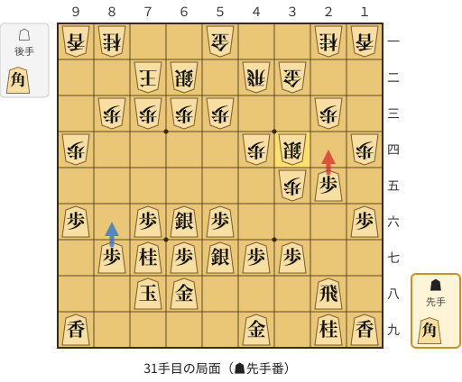

🔴 実戦 ▲２四歩(25)　🔵 AI推奨 ▲８六歩(87)　🟨 直前の相手の指し手

<details><summary>テキストの盤面図（BOD・将棋ソフトに貼り付け可）</summary>

```text
後手の持駒：角
  ９ ８ ７ ６ ５ ４ ３ ２ １
+---------------------------+
|v香v桂 ・ ・v金 ・ ・v桂v香|一
| ・ ・v玉v銀 ・v飛v金 ・ ・|二
| ・v歩v歩v歩v歩 ・ ・v歩 ・|三
|v歩 ・ ・ ・ ・v歩v銀 ・v歩|四
| ・ ・ ・ ・ ・ ・v歩 歩 ・|五
| 歩 ・ 歩 銀 歩 ・ ・ ・ 歩|六
| ・ 歩 桂 歩 銀 歩 歩 ・ ・|七
| ・ ・ 玉 金 ・ ・ ・ 飛 ・|八
| 香 ・ ・ ・ ・ 金 ・ 桂 香|九
+---------------------------+
先手の持駒：角
手数＝30　△３四銀　まで
```

</details>

| | 指し手 | 評価値 | 読み筋 |
|---|---|--:|---|
| 実戦 | ▲２四歩(25) | +234 | △同歩(23) ▲同飛(28) △２三金(32) ▲２八飛(24) △２五歩打 ▲７五銀(66) |
| AI 1位 | ▲８六歩(87) | +441 | ▲８六歩(87) △３三桂(21) ▲８五歩(86) △７四歩(73) ▲２四歩(25) △４五歩(44) |
| AI 2位 | ▲８六歩(87) | +388 | ▲８六歩(87) △３三桂(21) ▲８五歩(86) △４五歩(44) ▲５八金(49) △４四飛(42) |
| AI 3位 | ▲５八金(49) | +341 | ▲５八金(49) △３三桂(21) ▲７五銀(66) △４五歩(44) ▲６五角打 △４一金(51) |

SFEN: `ln2g2nl/2ks1rg2/1pppp2p1/p4ps1p/6pP1/P1PSP3P/1PNPSPP2/2KG3R1/L4G1NL b Bb 31`

<a id="ply-39"></a>
### 39手目 ▲５五歩(56) — 悪手

| | 着手前 | 着手後 | 差 |
|---|--:|--:|--:|
| 期待勝率 | 48.5% | 38.3% | -10.2pt |
| 評価値 | -37 | -286 | |

着手前の局面:

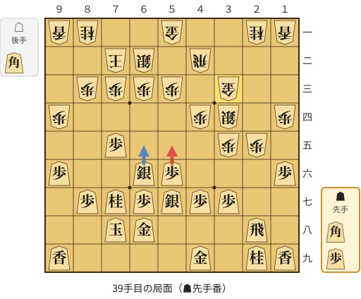

🔴 実戦 ▲５五歩(56)　🔵 AI推奨 ▲６五銀(66)　🟨 直前の相手の指し手

<details><summary>テキストの盤面図（BOD・将棋ソフトに貼り付け可）</summary>

```text
後手の持駒：角
  ９ ８ ７ ６ ５ ４ ３ ２ １
+---------------------------+
|v香v桂 ・ ・v金 ・ ・v桂v香|一
| ・ ・v玉v銀 ・v飛 ・ ・ ・|二
| ・v歩v歩v歩v歩 ・v金 ・ ・|三
|v歩 ・ ・ ・ ・v歩v銀 ・v歩|四
| ・ ・ 歩 ・ ・ ・v歩v歩 ・|五
| 歩 ・ ・ 銀 歩 ・ ・ ・ 歩|六
| ・ 歩 桂 歩 銀 歩 歩 ・ ・|七
| ・ ・ 玉 金 ・ ・ ・ 飛 ・|八
| 香 ・ ・ ・ ・ 金 ・ 桂 香|九
+---------------------------+
先手の持駒：角　歩
手数＝38　△３三金　まで
```

</details>

| | 指し手 | 評価値 | 読み筋 |
|---|---|--:|---|
| 実戦 | ▲５五歩(56) | -286 | △２二飛(42) ▲２七歩打 △６四歩(63) ▲５六銀(57) △６三銀(62) ▲５七銀(66) |
| AI 1位 | ▲６五銀(66) | -37 | ▲６五銀(66) △２二飛(42) ▲２七歩打 △４五銀(34) ▲５五歩(56) △３六歩(35) |
| AI 2位 | ▲６五桂(77) | -208 | ▲６五桂(77) △４三金(33) ▲２三歩打 △同銀(34) ▲７四歩(75) △同歩(73) |
| AI 3位 | ▲５五歩(56) | -291 | ▲５五歩(56) △２二飛(42) ▲２七歩打 △６四歩(63) ▲５六銀(57) △６三銀(62) |

SFEN: `ln2g2nl/2ks1r3/1pppp1g2/p4ps1p/2P3pp1/P2SP3P/1PNPSPP2/2KG3R1/L4G1NL b BPb 39`

<a id="ply-45"></a>
### 45手目 ▲５四歩(55) — 悪手

| | 着手前 | 着手後 | 差 |
|---|--:|--:|--:|
| 期待勝率 | 52.4% | 35.2% | -17.2pt |
| 評価値 | +57 | -367 | |

着手前の局面:

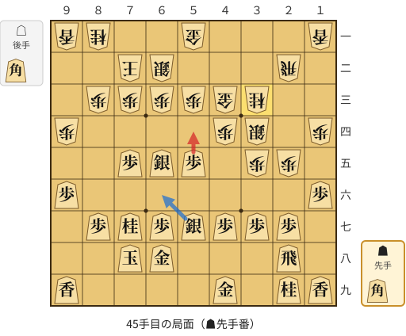

🔴 実戦 ▲５四歩(55)　🔵 AI推奨 ▲６六銀(57)　🟨 直前の相手の指し手

<details><summary>テキストの盤面図（BOD・将棋ソフトに貼り付け可）</summary>

```text
後手の持駒：角
  ９ ８ ７ ６ ５ ４ ３ ２ １
+---------------------------+
|v香v桂 ・ ・v金 ・ ・ ・v香|一
| ・ ・v玉v銀 ・ ・ ・v飛 ・|二
| ・v歩v歩v歩v歩v金v桂 ・ ・|三
|v歩 ・ ・ ・ ・v歩v銀 ・v歩|四
| ・ ・ 歩 銀 歩 ・v歩v歩 ・|五
| 歩 ・ ・ ・ ・ ・ ・ ・ 歩|六
| ・ 歩 桂 歩 銀 歩 歩 歩 ・|七
| ・ ・ 玉 金 ・ ・ ・ 飛 ・|八
| 香 ・ ・ ・ ・ 金 ・ 桂 香|九
+---------------------------+
先手の持駒：角
手数＝44　△３三桂　まで
```

</details>

| | 指し手 | 評価値 | 読み筋 |
|---|---|--:|---|
| 実戦 | ▲５四歩(55) | -367 | △同歩(53) ▲７四歩(75) △同歩(73) ▲３一角打 △２四飛(22) ▲６六銀(57) |
| AI 1位 | ▲６六銀(57) | +57 | ▲６六銀(57) △８二玉(72) ▲５八飛(28) △２六歩(25) ▲５四歩(55) △同歩(53) |
| AI 2位 | ▲８八玉(78) | -52 | ▲８八玉(78) △７一玉(72) ▲７八金(68) △６一金(51) ▲８六歩(87) △６四歩(63) |
| AI 3位 | ▲８六歩(87) | -72 | ▲８六歩(87) △６四歩(63) ▲７六銀(65) △６三銀(62) ▲６六歩(67) △６二金(51) |

SFEN: `ln2g3l/2ks3r1/1ppppgn2/p4ps1p/2PSP1pp1/P7P/1PNPSPPP1/2KG3R1/L4G1NL b Bb 45`

<a id="ply-53"></a>
### 53手目 ▲３八金(49) — 大悪手

| | 着手前 | 着手後 | 差 |
|---|--:|--:|--:|
| 期待勝率 | 58.5% | 23.6% | -34.9pt |
| 評価値 | +207 | -705 | |

着手前の局面:

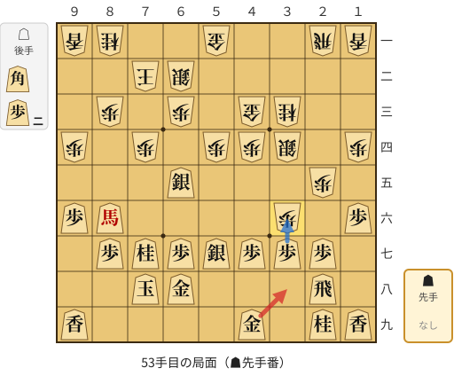

🔴 実戦 ▲３八金(49)　🔵 AI推奨 ▲同歩(37)　🟨 直前の相手の指し手

<details><summary>テキストの盤面図（BOD・将棋ソフトに貼り付け可）</summary>

```text
後手の持駒：角　歩二
  ９ ８ ７ ６ ５ ４ ３ ２ １
+---------------------------+
|v香v桂 ・ ・v金 ・ ・v飛v香|一
| ・ ・v玉v銀 ・ ・ ・ ・ ・|二
| ・v歩 ・v歩 ・v金v桂 ・ ・|三
|v歩 ・v歩 ・v歩v歩v銀 ・v歩|四
| ・ ・ ・ 銀 ・ ・ ・v歩 ・|五
| 歩 馬 ・ ・ ・ ・v歩 ・ 歩|六
| ・ 歩 桂 歩 銀 歩 歩 歩 ・|七
| ・ ・ 玉 金 ・ ・ ・ 飛 ・|八
| 香 ・ ・ ・ ・ 金 ・ 桂 香|九
+---------------------------+
先手の持駒：なし
手数＝52　△３六歩　まで
```

</details>

| | 指し手 | 評価値 | 読み筋 |
|---|---|--:|---|
| 実戦 | ▲３八金(49) | -705 | △３七歩成(36) ▲同桂(29) △３六歩打 ▲６六銀(57) △３七歩成(36) ▲同金(38) |
| AI 1位 | ▲同歩(37) | +207 | ▲同歩(37) △８二角打 ▲４六銀(57) △４五歩(44) ▲３七銀(46) △２四飛(21) |
| AI 2位 | ▲４八銀(57) | -447 | ▲４八銀(57) △３七歩成(36) ▲同銀(48) △３六歩打 ▲同銀(37) △３五歩打 |
| AI 3位 | ▲６六銀(57) | -596 | ▲６六銀(57) △３七歩成(36) ▲同桂(29) △３六歩打 ▲３八歩打 △７三銀(62) |

SFEN: `ln2g2rl/2ks5/1p1p1gn2/p1p1pps1p/3S3p1/P+B4p1P/1PNPSPPP1/2KG3R1/L4G1NL b b2p 53`

<a id="ply-55"></a>
### 55手目 ▲同金(38) — 悪手

| | 着手前 | 着手後 | 差 |
|---|--:|--:|--:|
| 期待勝率 | 23.7% | 12.4% | -11.3pt |
| 評価値 | -701 | -1171 | |

着手前の局面:

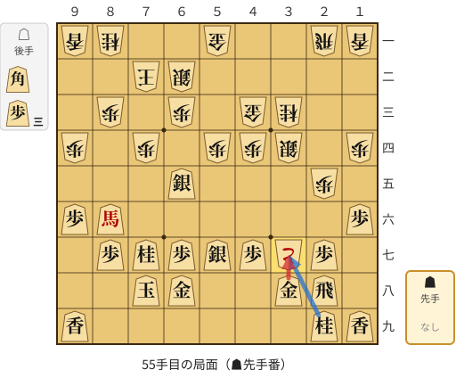

🔴 実戦 ▲同金(38)　🔵 AI推奨 ▲同桂(29)　🟨 直前の相手の指し手

<details><summary>テキストの盤面図（BOD・将棋ソフトに貼り付け可）</summary>

```text
後手の持駒：角　歩三
  ９ ８ ７ ６ ５ ４ ３ ２ １
+---------------------------+
|v香v桂 ・ ・v金 ・ ・v飛v香|一
| ・ ・v玉v銀 ・ ・ ・ ・ ・|二
| ・v歩 ・v歩 ・v金v桂 ・ ・|三
|v歩 ・v歩 ・v歩v歩v銀 ・v歩|四
| ・ ・ ・ 銀 ・ ・ ・v歩 ・|五
| 歩 馬 ・ ・ ・ ・ ・ ・ 歩|六
| ・ 歩 桂 歩 銀 歩vと 歩 ・|七
| ・ ・ 玉 金 ・ ・ 金 飛 ・|八
| 香 ・ ・ ・ ・ ・ ・ 桂 香|九
+---------------------------+
先手の持駒：なし
手数＝54　△３七歩成　まで
```

</details>

| | 指し手 | 評価値 | 読み筋 |
|---|---|--:|---|
| 実戦 | ▲同金(38) | -1171 | △４五桂(33) ▲５八飛(28) △３七桂成(45) ▲同桂(29) △３六歩打 ▲７三歩打 |
| AI 1位 | ▲同桂(29) | -701 | ▲同桂(29) △３六歩打 ▲６六銀(57) △３七歩成(36) ▲同金(38) △４五桂(33) |
| AI 2位 | ▲同金(38) | -1090 | ▲同金(38) △４五桂(33) ▲６六銀(57) △３七桂成(45) ▲同桂(29) △３六歩打 |
| AI 3位 | ▲１八飛(28) | -2650 | ▲１八飛(28) △２六歩(25) ▲同歩(27) △３八と(37) ▲同飛(18) △２六飛(21) |

SFEN: `ln2g2rl/2ks5/1p1p1gn2/p1p1pps1p/3S3p1/P+B6P/1PNPSP+pP1/2KG2GR1/L6NL b b3p 55`

<a id="ply-73"></a>
### 73手目 ▲同飛(76) — 悪手

| | 着手前 | 着手後 | 差 |
|---|--:|--:|--:|
| 期待勝率 | 24.0% | 11.5% | -12.6pt |
| 評価値 | -690 | -1226 | |

着手前の局面:

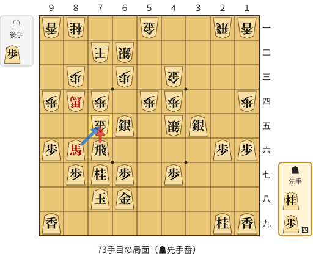

🔴 実戦 ▲同飛(76)　🔵 AI推奨 ▲同馬(86)　🟨 直前の相手の指し手

<details><summary>テキストの盤面図（BOD・将棋ソフトに貼り付け可）</summary>

```text
後手の持駒：歩
  ９ ８ ７ ６ ５ ４ ３ ２ １
+---------------------------+
|v香v桂 ・ ・v金 ・ ・v飛v香|一
| ・ ・v玉v銀 ・ ・ ・ ・ ・|二
| ・v歩 ・v歩 ・v金 ・ ・ ・|三
|v歩v馬v歩 ・v歩v歩 ・ ・v歩|四
| ・ ・v金 銀 ・v銀 銀 ・ ・|五
| 歩 馬 飛 ・ ・ ・ ・ 歩 歩|六
| ・ 歩 桂 歩 ・ 歩 ・ ・ ・|七
| ・ ・ 玉 金 ・ ・ ・ ・ ・|八
| 香 ・ ・ ・ ・ ・ ・ 桂 香|九
+---------------------------+
先手の持駒：桂　歩四
手数＝72　△７五金　まで
```

</details>

| | 指し手 | 評価値 | 読み筋 |
|---|---|--:|---|
| 実戦 | ▲同飛(76) | -1226 | △同歩(74) ▲７三歩打 △同桂(81) ▲４六歩(47) △３一飛(21) ▲３四歩打 |
| AI 1位 | ▲同馬(86) | -690 | ▲同馬(86) △同歩(74) ▲８六飛(76) △３一飛(21) ▲３六歩打 △３四歩打 |
| AI 2位 | ▲８五桂打 | -1018 | ▲８五桂打 △７六金(75) ▲同銀(65) △３九飛打 ▲７三歩打 △同桂(81) |
| AI 3位 | ▲同飛(76) | -1108 | ▲同飛(76) △同歩(74) ▲３七桂(29) △３八飛打 ▲８五金打 △３七飛成(38) |

SFEN: `ln2g2rl/2ks5/1p1p1g3/p+bp1pp2p/2gS1sS2/P+BR4PP/1PNP1P3/2KG5/L6NL b N4Pp 73`

<a id="ply-81"></a>
### 81手目 ▲２一飛打 — 大悪手

| | 着手前 | 着手後 | 差 |
|---|--:|--:|--:|
| 期待勝率 | 56.3% | 12.9% | -43.4pt |
| 評価値 | +153 | -1144 | |

着手前の局面:

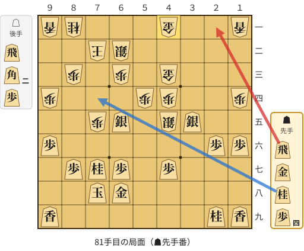

🔴 実戦 ▲２一飛打　🔵 AI推奨 ▲７四桂打　🟨 直前の相手の指し手

<details><summary>テキストの盤面図（BOD・将棋ソフトに貼り付け可）</summary>

```text
後手の持駒：飛　角二　歩
  ９ ８ ７ ６ ５ ４ ３ ２ １
+---------------------------+
|v香v桂 ・ ・ ・v金 ・ ・v香|一
| ・ ・v玉v銀 ・ ・ ・ ・ ・|二
| ・v歩 ・v歩 ・v金 ・ ・ ・|三
|v歩 ・ ・ ・v歩v歩 ・ ・v歩|四
| ・ ・v歩 銀 ・v銀 銀 ・ ・|五
| 歩 ・ ・ ・ ・ ・ ・ 歩 歩|六
| ・ 歩 桂 歩 ・ 歩 ・ ・ ・|七
| ・ ・ 玉 金 ・ ・ ・ ・ ・|八
| 香 ・ ・ ・ ・ ・ ・ 桂 香|九
+---------------------------+
先手の持駒：飛　金　桂　歩四
手数＝80　△４一同金　まで
```

</details>

| | 指し手 | 評価値 | 読み筋 |
|---|---|--:|---|
| 実戦 | ▲２一飛打 | -1144 | △３一歩打 ▲１一飛成(21) △３九飛打 ▲６九桂打 △２九飛成(39) ▲７四香打 |
| AI 1位 | ▲７四桂打 | +153 | ▲７四桂打 △７一角打 ▲６二桂成(74) △同玉(72) ▲７二歩打 △９三角(71) |
| AI 2位 | ▲７三歩打 | -251 | ▲７三歩打 △同銀(62) ▲７四歩打 △８四銀(73) ▲７三桂打 △３九飛打 |
| AI 3位 | ▲８五桂(77) | -652 | ▲８五桂(77) △５五角打 ▲７四桂打 △５九角打 ▲６六金打 △１九角成(55) |

SFEN: `ln3g2l/2ks5/1p1p1g3/p3pp2p/2pS1sS2/P6PP/1PNP1P3/2KG5/L6NL b RGN4Pr2bp 81`

<a id="ply-83"></a>
### 83手目 ▲２二飛成(21) — 疑問手

| | 着手前 | 着手後 | 差 |
|---|--:|--:|--:|
| 期待勝率 | 12.5% | 3.7% | -8.8pt |
| 評価値 | -1168 | -1951 | |

着手前の局面:

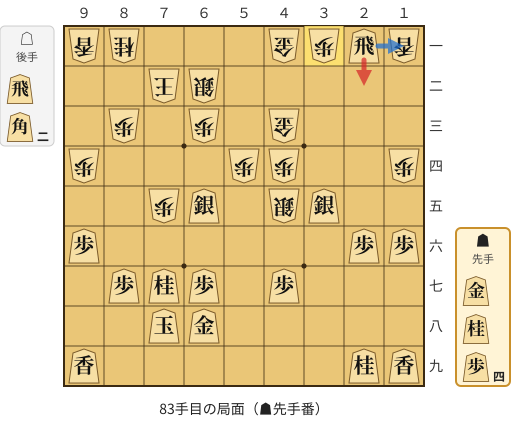

🔴 実戦 ▲２二飛成(21)　🔵 AI推奨 ▲１一飛成(21)　🟨 直前の相手の指し手

<details><summary>テキストの盤面図（BOD・将棋ソフトに貼り付け可）</summary>

```text
後手の持駒：飛　角二
  ９ ８ ７ ６ ５ ４ ３ ２ １
+---------------------------+
|v香v桂 ・ ・ ・v金v歩 飛v香|一
| ・ ・v玉v銀 ・ ・ ・ ・ ・|二
| ・v歩 ・v歩 ・v金 ・ ・ ・|三
|v歩 ・ ・ ・v歩v歩 ・ ・v歩|四
| ・ ・v歩 銀 ・v銀 銀 ・ ・|五
| 歩 ・ ・ ・ ・ ・ ・ 歩 歩|六
| ・ 歩 桂 歩 ・ 歩 ・ ・ ・|七
| ・ ・ 玉 金 ・ ・ ・ ・ ・|八
| 香 ・ ・ ・ ・ ・ ・ 桂 香|九
+---------------------------+
先手の持駒：金　桂　歩四
手数＝82　△３一歩　まで
```

</details>

| | 指し手 | 評価値 | 読み筋 |
|---|---|--:|---|
| 実戦 | ▲２二飛成(21) | -1951 | △４九飛打 ▲６九桂打 △３二金(41) ▲１一龍(22) △５九角打 ▲７四香打 |
| AI 1位 | ▲１一飛成(21) | -1168 | ▲１一飛成(21) △３九飛打 ▲６九桂打 △２九飛成(39) ▲７四香打 △７三桂打 |
| AI 2位 | ▲７三歩打 | -1613 | ▲７三歩打 △同桂(81) ▲７四歩打 △６五桂(73) ▲同桂(77) △５九角打 |
| AI 3位 | ▲２二飛成(21) | -1455 | ▲２二飛成(21) △４九飛打 ▲７四桂打 △３二金(41) ▲５二金打 △８九角打 |

SFEN: `ln3gpRl/2ks5/1p1p1g3/p3pp2p/2pS1sS2/P6PP/1PNP1P3/2KG5/L6NL b GN4Pr2b 83`

<a id="ply-87"></a>
### 87手目 ▲７四桂打 — 悪手

| | 着手前 | 着手後 | 差 |
|---|--:|--:|--:|
| 期待勝率 | 32.3% | 12.3% | -20.0pt |
| 評価値 | -444 | -1178 | |

着手前の局面:

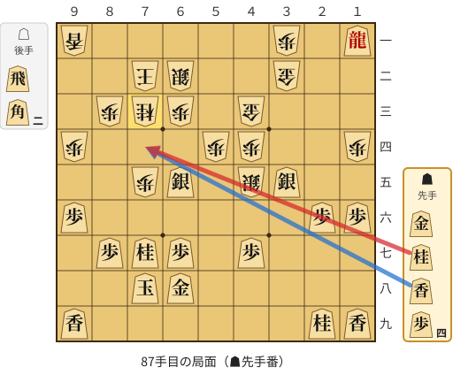

🔴 実戦 ▲７四桂打　🔵 AI推奨 ▲７四香打　🟨 直前の相手の指し手

<details><summary>テキストの盤面図（BOD・将棋ソフトに貼り付け可）</summary>

```text
後手の持駒：飛　角二
  ９ ８ ７ ６ ５ ４ ３ ２ １
+---------------------------+
|v香 ・ ・ ・ ・ ・v歩 ・ 龍|一
| ・ ・v玉v銀 ・ ・v金 ・ ・|二
| ・v歩v桂v歩 ・v金 ・ ・ ・|三
|v歩 ・ ・ ・v歩v歩 ・ ・v歩|四
| ・ ・v歩 銀 ・v銀 銀 ・ ・|五
| 歩 ・ ・ ・ ・ ・ ・ 歩 歩|六
| ・ 歩 桂 歩 ・ 歩 ・ ・ ・|七
| ・ ・ 玉 金 ・ ・ ・ ・ ・|八
| 香 ・ ・ ・ ・ ・ ・ 桂 香|九
+---------------------------+
先手の持駒：金　桂　香　歩四
手数＝86　△７三桂　まで
```

</details>

| | 指し手 | 評価値 | 読み筋 |
|---|---|--:|---|
| 実戦 | ▲７四桂打 | -1178 | △５九角打 ▲５八金打 △４九飛打 ▲６九香打 △５五角打 ▲６六歩(67) |
| AI 1位 | ▲７四香打 | -444 | ▲７四香打 △４九飛打 ▲８五桂打 △９九飛成(49) ▲７三桂成(85) △同銀(62) |
| AI 2位 | ▲７四香打 | -713 | ▲７四香打 △４九飛打 ▲８五桂打 △８九角打 ▲８八玉(78) △７九角打 |
| AI 3位 | ▲８九桂打 | -1101 | ▲８九桂打 △５九角打 ▲６九金(68) △２八飛打 ▲５八金打 △７七角成(59) |

SFEN: `l5p1+R/2ks2g2/1pnp1g3/p3pp2p/2pS1sS2/P6PP/1PNP1P3/2KG5/L6NL b GNL4Pr2b 87`

<a id="ply-95"></a>
### 95手目 ▲７三桂成(85) — 大悪手

| | 着手前 | 着手後 | 差 |
|---|--:|--:|--:|
| 期待勝率 | 99.9% | 30.6% | -69.3pt |
| 評価値 | +4332 | -490 | |

着手前の局面:

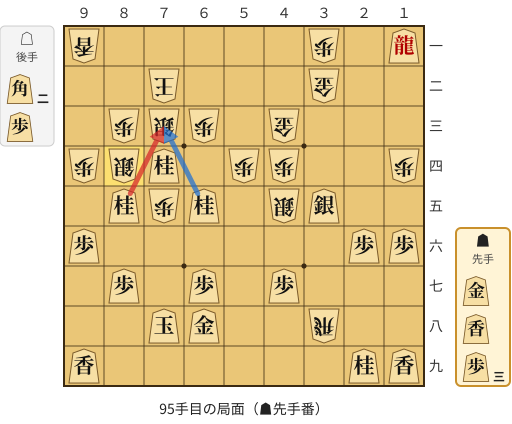

🔴 実戦 ▲７三桂成(85)　🔵 AI推奨 ▲７三桂成(65)　🟨 直前の相手の指し手

<details><summary>テキストの盤面図（BOD・将棋ソフトに貼り付け可）</summary>

```text
後手の持駒：角二　歩
  ９ ８ ７ ６ ５ ４ ３ ２ １
+---------------------------+
|v香 ・ ・ ・ ・ ・v歩 ・ 龍|一
| ・ ・v玉 ・ ・ ・v金 ・ ・|二
| ・v歩v銀v歩 ・v金 ・ ・ ・|三
|v歩v銀 桂 ・v歩v歩 ・ ・v歩|四
| ・ 桂v歩 桂 ・v銀 銀 ・ ・|五
| 歩 ・ ・ ・ ・ ・ ・ 歩 歩|六
| ・ 歩 ・ 歩 ・ 歩 ・ ・ ・|七
| ・ ・ 玉 金 ・ ・v飛 ・ ・|八
| 香 ・ ・ ・ ・ ・ ・ 桂 香|九
+---------------------------+
先手の持駒：金　香　歩三
手数＝94　△８四銀打　まで
```

</details>

| | 指し手 | 評価値 | 読み筋 |
|---|---|--:|---|
| 実戦 | ▲７三桂成(85) | -490 | △同銀(84) ▲５八歩打 △７六桂打 ▲７三桂成(65) △同玉(72) ▲６二銀打 |
| AI 1位 | ▲７三桂成(65) | +4332 | ▲７三桂成(65) △同銀(84) ▲８二銀打 △６一玉(72) ▲７三桂成(85) △６六桂打 |
| AI 2位 | ▲４九金打 | -83 | ▲４九金打 △８九角打 ▲６九玉(78) △７八角打 ▲７九玉(69) △６八飛成(38) |
| AI 3位 | ▲３九歩打 | -355 | ▲３九歩打 △同飛成(38) ▲７三桂成(85) △同銀(84) ▲８五銀打 △８九角打 |

SFEN: `l5p1+R/2k3g2/1psp1g3/psN1pp2p/1NpN1sS2/P6PP/1P1P1P3/2KG2r2/L6NL b GL3P2bp 95`

<a id="ply-97"></a>
### 97手目 ▲６一銀打 — 大悪手

| | 着手前 | 着手後 | 差 |
|---|--:|--:|--:|
| 期待勝率 | 38.4% | 1.4% | -37.1pt |
| 評価値 | -283 | -2568 | |

着手前の局面:

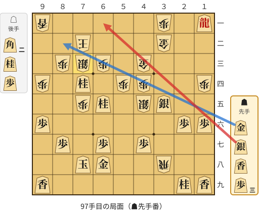

🔴 実戦 ▲６一銀打　🔵 AI推奨 ▲８二金打　🟨 直前の相手の指し手

<details><summary>テキストの盤面図（BOD・将棋ソフトに貼り付け可）</summary>

```text
後手の持駒：角二　桂　歩
  ９ ８ ７ ６ ５ ４ ３ ２ １
+---------------------------+
|v香 ・ ・ ・ ・ ・v歩 ・ 龍|一
| ・ ・v玉 ・ ・ ・v金 ・ ・|二
| ・v歩v銀v歩 ・v金 ・ ・ ・|三
|v歩 ・ 桂 ・v歩v歩 ・ ・v歩|四
| ・ ・v歩 桂 ・v銀 銀 ・ ・|五
| 歩 ・ ・ ・ ・ ・ ・ 歩 歩|六
| ・ 歩 ・ 歩 ・ 歩 ・ ・ ・|七
| ・ ・ 玉 金 ・ ・v飛 ・ ・|八
| 香 ・ ・ ・ ・ ・ ・ 桂 香|九
+---------------------------+
先手の持駒：金　銀　香　歩三
手数＝96　△７三同銀　まで
```

</details>

| | 指し手 | 評価値 | 読み筋 |
|---|---|--:|---|
| 実戦 | ▲６一銀打 | -2568 | △同玉(72) ▲６二香打 △５二玉(61) ▲１三龍(11) △６六桂打 ▲同歩(67) |
| AI 1位 | ▲８二金打 | -283 | ▲８二金打 △同銀(73) ▲同桂成(74) △６二玉(72) ▲７三銀打 △５二玉(62) |
| AI 2位 | ▲３七桂(29) | -431 | ▲３七桂(29) △７六桂打 ▲７三桂成(65) △同玉(72) ▲６二銀打 △６四玉(73) |
| AI 3位 | ▲４六銀(35) | -486 | ▲４六銀(35) △７六桂打 ▲７三桂成(65) △同玉(72) ▲６二銀打 △６四玉(73) |

SFEN: `l5p1+R/2k3g2/1psp1g3/p1N1pp2p/2pN1sS2/P6PP/1P1P1P3/2KG2r2/L6NL b GSL3P2bnp 97`

