# 解析レポート h5ccfu6chc64

[README に戻る](../../../README.md)　/　棋譜: [CSA](../../../data/csa/shogi5/h5ccfu6chc64.csa)　/　解析の見方: [docs/mistake_analysis.md](../../../docs/mistake_analysis.md)

## 対局情報

| 項目 | 内容 |
|---|---|
| 日時 | 2026-11-07 04:25:22 |
| 持ち時間 | 5分 |
| 自分 | 後手（△）（1725） |
| 相手 | 相手（1726） |
| 結果 | 勝ち（投了, 104手） |

## 解析環境

| 項目 | 内容 |
|---|---|
| エンジン | YaneuraOu NNUE 9.00git 64AVX2（V9.00/YANEURAOU_ENGINE_NNUE/AVX2） |
| 評価関数 | **水匠5**（`suisho5`） |
| nn.bin SHA-256 | `768068f0d534a0603a5d38bcd143de6bbca820d5f1c95a14d40863e5b7892d76` |
| 第1パス | movetime=150ms, MultiPV 1 |
| 第2パス | movetime=2000ms, MultiPV 3 |
| Threads / Hash | 8 / 512MB |
| 判定基準 | 疑問手 ≥5pt, 悪手 ≥10pt, 大悪手 ≥20pt（期待勝率 W(E)=1/(1+exp(-E/600))） |
| 解析日時 | 2026-11-11T20:31:37+09:00（解析バージョン 1, 64秒） |

## サマリー

| 自分の手数 | 深掘りした手 | 詰み逃し | 大悪手 | 悪手 | 疑問手 |
|--:|--:|--:|--:|--:|--:|
| 52 | 12 | 0 | 7 | 1 | 4 |

## 期待勝率の推移

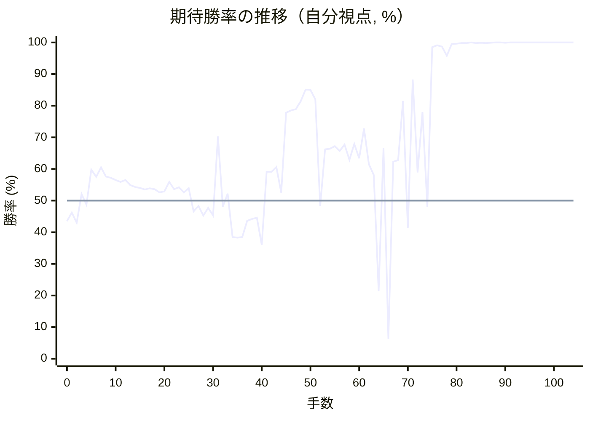

<details><summary>1手ごとの数値（第1パス）</summary>

| 手数 | 指し手 | 評価値 | 勝率 | 低下 | 判定 |
|--:|---|--:|--:|--:|---|
| 1 | ▲７六歩(77) | -91 | 46.2% |  |  |
| 2 | △３四歩(33) | -170 | 43.0% | +3.3pt |  |
| 3 | ▲６六歩(67) | +50 | 52.1% |  |  |
| 4 | △８四歩(83) | -31 | 48.7% | +3.4pt |  |
| 5 | ▲７八飛(28) | +238 | 59.8% |  |  |
| 6 | △６二銀(71) | +182 | 57.5% | +2.3pt |  |
| 7 | ▲７五歩(76) | +257 | 60.5% |  |  |
| 8 | △４二玉(51) | +185 | 57.6% | +2.9pt |  |
| 9 | ▲４八玉(59) | +174 | 57.2% |  |  |
| 10 | △３二玉(42) | +157 | 56.5% | +0.7pt |  |
| 11 | ▲５八金(69) | +143 | 55.9% |  |  |
| 12 | △８五歩(84) | +156 | 56.5% | -0.5pt |  |
| 13 | ▲７六飛(78) | +118 | 54.9% |  |  |
| 14 | △１四歩(13) | +104 | 54.3% | +0.6pt |  |
| 15 | ▲１六歩(17) | +97 | 54.0% |  |  |
| 16 | △２四歩(23) | +84 | 53.5% | +0.5pt |  |
| 17 | ▲３八銀(39) | +93 | 53.9% |  |  |
| 18 | △２三玉(32) | +86 | 53.6% | +0.3pt |  |
| 19 | ▲３九玉(48) | +63 | 52.6% |  |  |
| 20 | △３二銀(31) | +70 | 52.9% | -0.3pt |  |
| 21 | ▲９六歩(97) | +142 | 55.9% |  |  |
| 22 | △９四歩(93) | +87 | 53.6% | +2.3pt |  |
| 23 | ▲６八銀(79) | +102 | 54.2% |  |  |
| 24 | △５四歩(53) | +62 | 52.6% | +1.7pt |  |
| 25 | ▲６七銀(68) | +94 | 53.9% |  |  |
| 26 | △３三桂(21) | -82 | 46.6% | +7.3pt | [疑問手](#ply-26) |
| 27 | ▲７七桂(89) | -41 | 48.3% |  |  |
| 28 | △３一角(22) | -113 | 45.3% | +3.0pt |  |
| 29 | ▲２八玉(39) | -56 | 47.7% |  |  |
| 30 | △５三銀(62) | -113 | 45.3% | +2.4pt |  |
| 31 | ▲５六歩(57) | +516 | 70.3% |  |  |
| 32 | △６四銀(53) | -46 | 48.1% | +22.2pt | [大悪手](#ply-32) |
| 33 | ▲９七角(88) | +52 | 52.2% |  |  |
| 34 | △４四歩(43) | -280 | 38.5% | +13.6pt | [疑問手](#ply-34) |
| 35 | ▲６五歩(66) | -286 | 38.3% |  |  |
| 36 | △５三銀(64) | -282 | 38.5% | -0.2pt |  |
| 37 | ▲７四歩(75) | -154 | 43.6% |  |  |
| 38 | △同歩(73) | -140 | 44.2% | -0.6pt |  |
| 39 | ▲同飛(76) | -131 | 44.6% |  |  |
| 40 | △９五歩(94) | -346 | 36.0% | +8.6pt | [疑問手](#ply-40) |
| 41 | ▲７五飛(74) | +221 | 59.1% |  |  |
| 42 | △９六歩(95) | +220 | 59.1% | +0.0pt |  |
| 43 | ▲７九角(97) | +258 | 60.6% |  |  |
| 44 | △８六歩(85) | +61 | 52.5% | +8.0pt | [疑問手](#ply-44) |
| 45 | ▲８五飛(75) | +752 | 77.8% |  |  |
| 46 | △同飛(82) | +778 | 78.5% | -0.7pt |  |
| 47 | ▲同桂(77) | +792 | 78.9% |  |  |
| 48 | △８七歩成(86) | +886 | 81.4% | -2.5pt |  |
| 49 | ▲６四歩(65) | +1047 | 85.1% |  |  |
| 50 | △同銀(53) | +1041 | 85.0% | +0.1pt |  |
| 51 | ▲８三飛打 | +910 | 82.0% |  |  |
| 52 | △７八と(87) | -42 | 48.3% | +33.8pt | [大悪手](#ply-52) |
| 53 | ▲５七角(79) | +403 | 66.2% |  |  |
| 54 | △７七と(78) | +408 | 66.4% | -0.2pt |  |
| 55 | ▲６六銀(67) | +431 | 67.2% |  |  |
| 56 | △７六と(77) | +391 | 65.7% | +1.5pt |  |
| 57 | ▲８一飛成(83) | +444 | 67.7% |  |  |
| 58 | △６六と(76) | +318 | 62.9% | +4.8pt |  |
| 59 | ▲同角(57) | +450 | 67.9% |  |  |
| 60 | △５二金(61) | +330 | 63.4% | +4.5pt |  |
| 61 | ▲４四角(66) | +590 | 72.8% |  |  |
| 62 | △７九飛打 | +280 | 61.5% | +11.3pt | [悪手](#ply-62) |
| 63 | ▲９一龍(81) | +196 | 58.1% |  |  |
| 64 | △５三角(31) | -780 | 21.4% | +36.7pt | [大悪手](#ply-64) |
| 65 | ▲６六角(44) | +413 | 66.6% |  |  |
| 66 | △７五銀(64) | -1623 | 6.3% | +60.3pt | [大悪手](#ply-66) |
| 67 | ▲５七角(66) | +302 | 62.3% |  |  |
| 68 | △９九飛成(79) | +314 | 62.8% | -0.5pt |  |
| 69 | ▲３六桂打 | +891 | 81.5% |  |  |
| 70 | △４五桂(33) | -211 | 41.3% | +40.2pt | [大悪手](#ply-70) |
| 71 | ▲４六角(57) | +1215 | 88.3% |  |  |
| 72 | △５七香打 | +217 | 58.9% | +29.4pt | [大悪手](#ply-72) |
| 73 | ▲４八金(58) | +760 | 78.0% |  |  |
| 74 | △３五銀打 | -47 | 48.0% | +30.0pt | [大悪手](#ply-74) |
| 75 | ▲５七角(46) | +2491 | 98.5% |  |  |
| 76 | △同桂成(45) | +2810 | 99.1% | -0.6pt |  |
| 77 | ▲同金(48) | +2617 | 98.7% |  |  |
| 78 | △３六銀(35) | +1877 | 95.8% | +2.9pt |  |
| 79 | ▲同歩(37) | +3140 | 99.5% |  |  |
| 80 | △６四角(53) | +3282 | 99.6% | -0.1pt |  |
| 81 | ▲４六金(57) | +3782 | 99.8% |  |  |
| 82 | △９一角(64) | +3710 | 99.8% | +0.0pt |  |
| 83 | ▲４四桂打 | +5212 | 100.0% |  |  |
| 84 | △４五歩打 | +3845 | 99.8% | +0.1pt |  |
| 85 | ▲５二桂成(44) | +4337 | 99.9% |  |  |
| 86 | △同金(41) | +3863 | 99.8% | +0.1pt |  |
| 87 | ▲３七香打 | +4285 | 99.9% |  |  |
| 88 | △４六歩(45) | +4721 | 100.0% | -0.0pt |  |
| 89 | ▲同歩(47) | +6006 | 100.0% |  |  |
| 90 | △４七歩打 | +4264 | 99.9% | +0.1pt |  |
| 91 | ▲３一銀打 | +4895 | 100.0% |  |  |
| 92 | △２一金打 | +5063 | 100.0% | -0.0pt |  |
| 93 | ▲４二金打 | +5736 | 100.0% |  |  |
| 94 | △４八歩成(47) | +6194 | 100.0% | -0.0pt |  |
| 95 | ▲３九香打 | +6281 | 100.0% |  |  |
| 96 | △４九と(48) | +6505 | 100.0% | -0.0pt |  |
| 97 | ▲同銀(38) | #+11 | 100.0% |  |  |
| 98 | △同龍(99) | #+10 | 100.0% | +0.0pt |  |
| 99 | ▲５二金(42) | #+7 | 100.0% |  |  |
| 100 | △８八飛打 | #+12 | 100.0% | +0.0pt |  |
| 101 | ▲３八金打 | #+7 | 100.0% |  |  |
| 102 | △同飛成(88) | #+6 | 100.0% | +0.0pt |  |
| 103 | ▲同香(39) | #+5 | 100.0% |  |  |
| 104 | △３九角打 | #+4 | 100.0% | +0.0pt |  |

</details>

## 課題局面

<a id="ply-26"></a>
### 26手目 △３三桂(21) — 疑問手

| | 着手前 | 着手後 | 差 |
|---|--:|--:|--:|
| 期待勝率 | 54.2% | 46.6% | -7.6pt |
| 評価値 | +101 | -81 | |

着手前の局面:

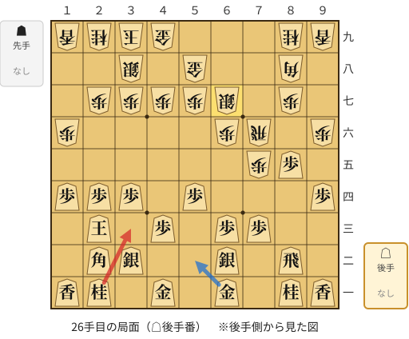

🔴 実戦 △３三桂(21)　🔵 AI推奨 △５二金(61)　🟨 直前の相手の指し手

<details><summary>テキストの盤面図（BOD・将棋ソフトに貼り付け可）</summary>

```text
後手の持駒：なし
  ９ ８ ７ ６ ５ ４ ３ ２ １
+---------------------------+
|v香v桂 ・v金 ・v金 ・v桂v香|一
| ・v飛 ・v銀 ・ ・v銀v角 ・|二
| ・ ・v歩v歩 ・v歩 ・v玉 ・|三
|v歩 ・ ・ ・v歩 ・v歩v歩v歩|四
| ・v歩 歩 ・ ・ ・ ・ ・ ・|五
| 歩 ・ 飛 歩 ・ ・ ・ ・ 歩|六
| ・ 歩 ・ 銀 歩 歩 歩 歩 ・|七
| ・ 角 ・ ・ 金 ・ 銀 ・ ・|八
| 香 桂 ・ ・ ・ 金 玉 桂 香|九
+---------------------------+
先手の持駒：なし
後手番
手数＝25　▲６七銀　まで
```

</details>

| | 指し手 | 評価値 | 読み筋 |
|---|---|--:|---|
| 実戦 | △３三桂(21) | -81 | ▲７七桂(89) △３一角(22) ▲２八玉(39) △５二金(61) ▲４六歩(47) △８四飛(82) |
| AI 1位 | △５二金(61) | +101 | △５二金(61) ▲７七桂(89) △５三銀(62) ▲２八玉(39) △６四歩(63) ▲７九角(88) |
| AI 2位 | △５三銀(62) | +98 | △５三銀(62) ▲７七桂(89) △５二金(61) ▲２八玉(39) △６四歩(63) ▲７九角(88) |
| AI 3位 | △６四歩(63) | +70 | △６四歩(63) ▲７七桂(89) △５二金(61) ▲５六歩(57) △７二飛(82) ▲２八玉(39) |

SFEN: `ln1g1g1nl/1r1s2sb1/2pp1p1k1/p3p1ppp/1pP6/P1RP4P/1P1SPPPP1/1B2G1S2/LN3GKNL w - 26`

<a id="ply-32"></a>
### 32手目 △６四銀(53) — 大悪手

| | 着手前 | 着手後 | 差 |
|---|--:|--:|--:|
| 期待勝率 | 72.0% | 48.2% | -23.8pt |
| 評価値 | +566 | -43 | |

着手前の局面:

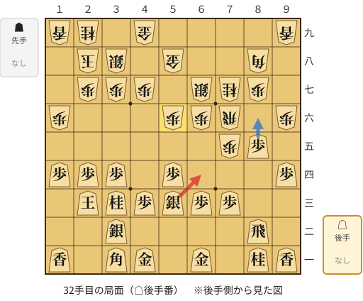

🔴 実戦 △６四銀(53)　🔵 AI推奨 △８六歩(85)　🟨 直前の相手の指し手

<details><summary>テキストの盤面図（BOD・将棋ソフトに貼り付け可）</summary>

```text
後手の持駒：なし
  ９ ８ ７ ６ ５ ４ ３ ２ １
+---------------------------+
|v香v桂 ・v金 ・v金v角 ・v香|一
| ・v飛 ・ ・ ・ ・v銀 ・ ・|二
| ・ ・v歩v歩v銀v歩v桂v玉 ・|三
|v歩 ・ ・ ・v歩 ・v歩v歩v歩|四
| ・v歩 歩 ・ ・ ・ ・ ・ ・|五
| 歩 ・ 飛 歩 歩 ・ ・ ・ 歩|六
| ・ 歩 桂 銀 ・ 歩 歩 歩 ・|七
| ・ 角 ・ ・ 金 ・ 銀 玉 ・|八
| 香 ・ ・ ・ ・ 金 ・ 桂 香|九
+---------------------------+
先手の持駒：なし
後手番
手数＝31　▲５六歩　まで
```

</details>

| | 指し手 | 評価値 | 読み筋 |
|---|---|--:|---|
| 実戦 | △６四銀(53) | -43 | ▲９七角(88) △９五歩(94) ▲同歩(96) △同香(91) ▲９六歩打 △８六歩(85) |
| AI 1位 | △８六歩(85) | +566 | △８六歩(85) ▲同歩(87) △６四銀(53) ▲８五桂(77) △７五銀(64) ▲７八飛(76) |
| AI 2位 | △９五歩(94) | +275 | △９五歩(94) ▲７九角(88) △６四銀(53) ▲７四歩(75) △同歩(73) ▲４六角(79) |
| AI 3位 | △１五歩(14) | +31 | △１五歩(14) ▲同歩(16) △８六歩(85) ▲同飛(76) △同飛(82) ▲同歩(87) |

SFEN: `ln1g1gb1l/1r4s2/2ppspnk1/p3p1ppp/1pP6/P1RPP3P/1PNS1PPP1/1B2G1SK1/L4G1NL w - 32`

<a id="ply-34"></a>
### 34手目 △４四歩(43) — 疑問手

| | 着手前 | 着手後 | 差 |
|---|--:|--:|--:|
| 期待勝率 | 48.3% | 39.6% | -8.7pt |
| 評価値 | -41 | -254 | |

着手前の局面:

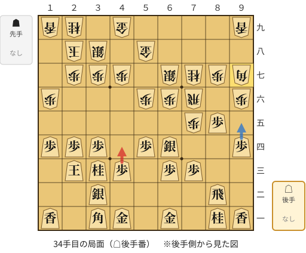

🔴 実戦 △４四歩(43)　🔵 AI推奨 △９五歩(94)　🟨 直前の相手の指し手

<details><summary>テキストの盤面図（BOD・将棋ソフトに貼り付け可）</summary>

```text
後手の持駒：なし
  ９ ８ ７ ６ ５ ４ ３ ２ １
+---------------------------+
|v香v桂 ・v金 ・v金v角 ・v香|一
| ・v飛 ・ ・ ・ ・v銀 ・ ・|二
| ・ ・v歩v歩 ・v歩v桂v玉 ・|三
|v歩 ・ ・v銀v歩 ・v歩v歩v歩|四
| ・v歩 歩 ・ ・ ・ ・ ・ ・|五
| 歩 ・ 飛 歩 歩 ・ ・ ・ 歩|六
| 角 歩 桂 銀 ・ 歩 歩 歩 ・|七
| ・ ・ ・ ・ 金 ・ 銀 玉 ・|八
| 香 ・ ・ ・ ・ 金 ・ 桂 香|九
+---------------------------+
先手の持駒：なし
後手番
手数＝33　▲９七角　まで
```

</details>

| | 指し手 | 評価値 | 読み筋 |
|---|---|--:|---|
| 実戦 | △４四歩(43) | -254 | ▲６五歩(66) △８六歩(85) ▲同角(97) △５三銀(64) ▲４六歩(47) △５二金(61) |
| AI 1位 | △９五歩(94) | -41 | △９五歩(94) ▲同歩(96) △同香(91) ▲９六歩打 △８六歩(85) ▲同飛(76) |
| AI 2位 | △８四飛(82) | -183 | △８四飛(82) ▲６五歩(66) △８六歩(85) ▲同角(97) △５三銀(64) ▲６六銀(67) |
| AI 3位 | △８四飛(82) | -183 | △８四飛(82) ▲６五歩(66) △８六歩(85) ▲同角(97) △５三銀(64) ▲６六銀(67) |

SFEN: `ln1g1gb1l/1r4s2/2pp1pnk1/p2sp1ppp/1pP6/P1RPP3P/BPNS1PPP1/4G1SK1/L4G1NL w - 34`

<a id="ply-40"></a>
### 40手目 △９五歩(94) — 疑問手

| | 着手前 | 着手後 | 差 |
|---|--:|--:|--:|
| 期待勝率 | 44.7% | 37.3% | -7.4pt |
| 評価値 | -128 | -311 | |

着手前の局面:

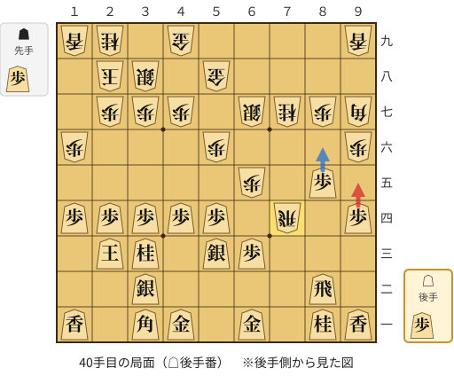

🔴 実戦 △９五歩(94)　🔵 AI推奨 △８六歩(85)　🟨 直前の相手の指し手

<details><summary>テキストの盤面図（BOD・将棋ソフトに貼り付け可）</summary>

```text
後手の持駒：歩
  ９ ８ ７ ６ ５ ４ ３ ２ １
+---------------------------+
|v香v桂 ・v金 ・v金v角 ・v香|一
| ・v飛 ・ ・ ・ ・v銀 ・ ・|二
| ・ ・ ・v歩v銀 ・v桂v玉 ・|三
|v歩 ・ 飛 ・v歩v歩v歩v歩v歩|四
| ・v歩 ・ 歩 ・ ・ ・ ・ ・|五
| 歩 ・ ・ ・ 歩 ・ ・ ・ 歩|六
| 角 歩 桂 銀 ・ 歩 歩 歩 ・|七
| ・ ・ ・ ・ 金 ・ 銀 玉 ・|八
| 香 ・ ・ ・ ・ 金 ・ 桂 香|九
+---------------------------+
先手の持駒：歩
後手番
手数＝39　▲７四同飛　まで
```

</details>

| | 指し手 | 評価値 | 読み筋 |
|---|---|--:|---|
| 実戦 | △９五歩(94) | -311 | ▲同歩(96) △同香(91) ▲５三角成(97) △同角(31) ▲９五香(99) △８六歩(85) |
| AI 1位 | △８六歩(85) | -128 | △８六歩(85) ▲同歩(87) △６二銀(53) ▲７六飛(74) △７二飛(82) ▲７五歩打 |
| AI 2位 | △６二銀(53) | -225 | △６二銀(53) ▲３一角成(97) △同金(41) ▲５五歩(56) △同歩(54) ▲６四歩(65) |
| AI 3位 | △７三歩打 | -292 | △７三歩打 ▲７六飛(74) △４五歩(44) ▲５五歩(56) △同歩(54) ▲６六銀(67) |

SFEN: `ln1g1gb1l/1r4s2/3ps1nk1/p1R1ppppp/1p1P5/P3P3P/BPNS1PPP1/4G1SK1/L4G1NL w Pp 40`

<a id="ply-44"></a>
### 44手目 △８六歩(85) — 疑問手

| | 着手前 | 着手後 | 差 |
|---|--:|--:|--:|
| 期待勝率 | 61.7% | 52.0% | -9.7pt |
| 評価値 | +285 | +48 | |

着手前の局面:

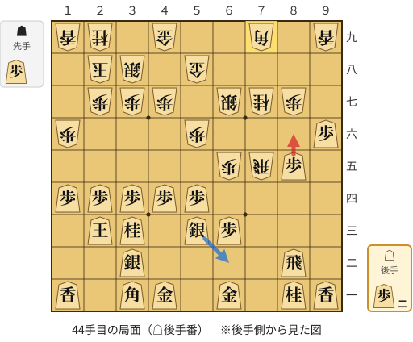

🔴 実戦 △８六歩(85)　🔵 AI推奨 △６二銀(53)　🟨 直前の相手の指し手

<details><summary>テキストの盤面図（BOD・将棋ソフトに貼り付け可）</summary>

```text
後手の持駒：歩二
  ９ ８ ７ ６ ５ ４ ３ ２ １
+---------------------------+
|v香v桂 ・v金 ・v金v角 ・v香|一
| ・v飛 ・ ・ ・ ・v銀 ・ ・|二
| ・ ・ ・v歩v銀 ・v桂v玉 ・|三
| ・ ・ ・ ・v歩v歩v歩v歩v歩|四
| ・v歩 飛 歩 ・ ・ ・ ・ ・|五
|v歩 ・ ・ ・ 歩 ・ ・ ・ 歩|六
| ・ 歩 桂 銀 ・ 歩 歩 歩 ・|七
| ・ ・ ・ ・ 金 ・ 銀 玉 ・|八
| 香 ・ 角 ・ ・ 金 ・ 桂 香|九
+---------------------------+
先手の持駒：歩
後手番
手数＝43　▲７九角　まで
```

</details>

| | 指し手 | 評価値 | 読み筋 |
|---|---|--:|---|
| 実戦 | △８六歩(85) | +48 | ▲４六角(79) △７三歩打 ▲７四歩打 △８七歩成(86) ▲７三歩成(74) △８六飛(82) |
| AI 1位 | △６二銀(53) | +285 | △６二銀(53) ▲７六飛(75) △９七歩成(96) ▲６六銀(67) △９二飛(82) ▲４六角(79) |
| AI 2位 | △９七歩成(96) | +211 | △９七歩成(96) ▲４六角(79) △７三歩打 ▲８五飛(75) △８四歩打 ▲８六飛(85) |
| AI 3位 | △４五歩(44) | +211 | △４五歩(44) ▲５七角(79) △９七歩成(96) ▲７四歩打 △７二歩打 ▲８五飛(75) |

SFEN: `ln1g1gb1l/1r4s2/3ps1nk1/4ppppp/1pRP5/p3P3P/1PNS1PPP1/4G1SK1/L1B2G1NL w P2p 44`

<a id="ply-52"></a>
### 52手目 △７八と(87) — 大悪手

| | 着手前 | 着手後 | 差 |
|---|--:|--:|--:|
| 期待勝率 | 88.0% | 46.3% | -41.8pt |
| 評価値 | +1198 | -90 | |

着手前の局面:

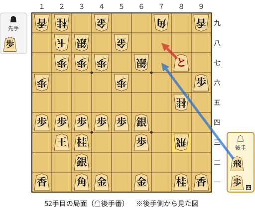

🔴 実戦 △７八と(87)　🔵 AI推奨 △７七飛打　🟨 直前の相手の指し手

<details><summary>テキストの盤面図（BOD・将棋ソフトに貼り付け可）</summary>

```text
後手の持駒：飛　歩四
  ９ ８ ７ ６ ５ ４ ３ ２ １
+---------------------------+
|v香v桂 ・v金 ・v金v角 ・v香|一
| ・ ・ ・ ・ ・ ・v銀 ・ ・|二
| ・ 飛 ・v歩 ・ ・v桂v玉 ・|三
| ・ ・ ・v銀v歩v歩v歩v歩v歩|四
| ・ 桂 ・ ・ ・ ・ ・ ・ ・|五
|v歩 ・ ・ ・ 歩 ・ ・ ・ 歩|六
| ・vと ・ 銀 ・ 歩 歩 歩 ・|七
| ・ ・ ・ ・ 金 ・ 銀 玉 ・|八
| 香 ・ 角 ・ ・ 金 ・ 桂 香|九
+---------------------------+
先手の持駒：歩
後手番
手数＝51　▲８三飛　まで
```

</details>

| | 指し手 | 評価値 | 読み筋 |
|---|---|--:|---|
| 実戦 | △７八と(87) | -90 | ▲８一飛成(83) △７一飛打 ▲同龍(81) △同金(61) ▲７八銀(67) △７五飛打 |
| AI 1位 | △７七飛打 | +1198 | △７七飛打 ▲８一飛成(83) △７一金(61) ▲７八歩打 △同と(87) ▲９一龍(81) |
| AI 2位 | △７七と(87) | +1000 | △７七と(87) ▲６六銀(67) △６九飛打 ▲８一飛成(83) △５一金(61) ▲５七角(79) |
| AI 3位 | △７七と(87) | +952 | △７七と(87) ▲６六銀(67) △６九飛打 ▲５七角(79) △７六と(77) ▲８一飛成(83) |

SFEN: `ln1g1gb1l/6s2/1R1p2nk1/3sppppp/1N7/p3P3P/1+p1S1PPP1/4G1SK1/L1B2G1NL w Pr4p 52`

<a id="ply-62"></a>
### 62手目 △７九飛打 — 悪手

| | 着手前 | 着手後 | 差 |
|---|--:|--:|--:|
| 期待勝率 | 69.6% | 53.6% | -15.9pt |
| 評価値 | +496 | +87 | |

着手前の局面:

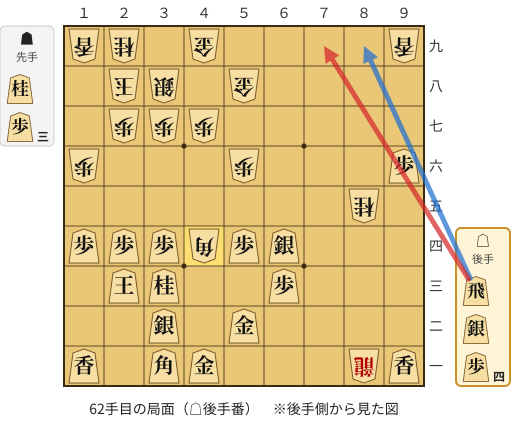

🔴 実戦 △７九飛打　🔵 AI推奨 △８九飛打　🟨 直前の相手の指し手

<details><summary>テキストの盤面図（BOD・将棋ソフトに貼り付け可）</summary>

```text
後手の持駒：飛　銀　歩四
  ９ ８ ７ ６ ５ ４ ３ ２ １
+---------------------------+
|v香 龍 ・ ・ ・v金v角 ・v香|一
| ・ ・ ・ ・v金 ・v銀 ・ ・|二
| ・ ・ ・v歩 ・ ・v桂v玉 ・|三
| ・ ・ ・v銀v歩 角v歩v歩v歩|四
| ・ 桂 ・ ・ ・ ・ ・ ・ ・|五
|v歩 ・ ・ ・ 歩 ・ ・ ・ 歩|六
| ・ ・ ・ ・ ・ 歩 歩 歩 ・|七
| ・ ・ ・ ・ 金 ・ 銀 玉 ・|八
| 香 ・ ・ ・ ・ 金 ・ 桂 香|九
+---------------------------+
先手の持駒：桂　歩三
後手番
手数＝61　▲４四角　まで
```

</details>

| | 指し手 | 評価値 | 読み筋 |
|---|---|--:|---|
| 実戦 | △７九飛打 | +87 | ▲９一龍(81) △２二銀打 ▲６六角(44) △６九飛成(79) ▲６八歩打 △７五銀(64) |
| AI 1位 | △８九飛打 | +496 | △８九飛打 ▲７一角成(44) △４三歩打 ▲６一馬(71) △２二角(31) ▲９一龍(81) |
| AI 2位 | △４八歩打 | +436 | △４八歩打 ▲同金(58) △８九飛打 ▲７一角成(44) △４三歩打 ▲６一馬(71) |
| AI 3位 | △４八歩打 | +451 | △４八歩打 ▲同金(58) △５三銀(64) ▲３三角成(44) △同玉(23) ▲４五桂打 |

SFEN: `l+R3gb1l/4g1s2/3p2nk1/3spBppp/1N7/p3P3P/5PPP1/4G1SK1/L4G1NL w N3Prs4p 62`

<a id="ply-64"></a>
### 64手目 △５三角(31) — 大悪手

| | 着手前 | 着手後 | 差 |
|---|--:|--:|--:|
| 期待勝率 | 56.7% | 23.6% | -33.1pt |
| 評価値 | +161 | -705 | |

着手前の局面:

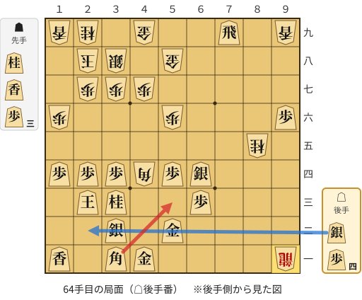

🔴 実戦 △５三角(31)　🔵 AI推奨 △２二銀打　🟨 直前の相手の指し手

<details><summary>テキストの盤面図（BOD・将棋ソフトに貼り付け可）</summary>

```text
後手の持駒：銀　歩四
  ９ ８ ７ ６ ５ ４ ３ ２ １
+---------------------------+
| 龍 ・ ・ ・ ・v金v角 ・v香|一
| ・ ・ ・ ・v金 ・v銀 ・ ・|二
| ・ ・ ・v歩 ・ ・v桂v玉 ・|三
| ・ ・ ・v銀v歩 角v歩v歩v歩|四
| ・ 桂 ・ ・ ・ ・ ・ ・ ・|五
|v歩 ・ ・ ・ 歩 ・ ・ ・ 歩|六
| ・ ・ ・ ・ ・ 歩 歩 歩 ・|七
| ・ ・ ・ ・ 金 ・ 銀 玉 ・|八
| 香 ・v飛 ・ ・ 金 ・ 桂 香|九
+---------------------------+
先手の持駒：桂　香　歩三
後手番
手数＝63　▲９一龍　まで
```

</details>

| | 指し手 | 評価値 | 読み筋 |
|---|---|--:|---|
| 実戦 | △５三角(31) | -705 | ▲３三角成(44) △同玉(23) ▲４五桂打 △４二玉(33) ▲５三桂成(45) △同銀(64) |
| AI 1位 | △２二銀打 | +161 | △２二銀打 ▲６六角(44) △６九飛成(79) ▲６八歩打 △４三歩打 ▲９六香(99) |
| AI 2位 | △５一金(52) | +63 | △５一金(52) ▲６六角(44) △４二金(51) ▲８一龍(91) △４四歩打 ▲９三角成(66) |
| AI 3位 | △４二金(52) | +45 | △４二金(52) ▲６二角成(44) △５三銀(64) ▲８四馬(62) △９九飛成(79) ▲６四歩打 |

SFEN: `+R4gb1l/4g1s2/3p2nk1/3spBppp/1N7/p3P3P/5PPP1/4G1SK1/L1r2G1NL w NL3Ps4p 64`

<a id="ply-66"></a>
### 66手目 △７五銀(64) — 大悪手

| | 着手前 | 着手後 | 差 |
|---|--:|--:|--:|
| 期待勝率 | 69.6% | 2.9% | -66.8pt |
| 評価値 | +498 | -2117 | |

着手前の局面:

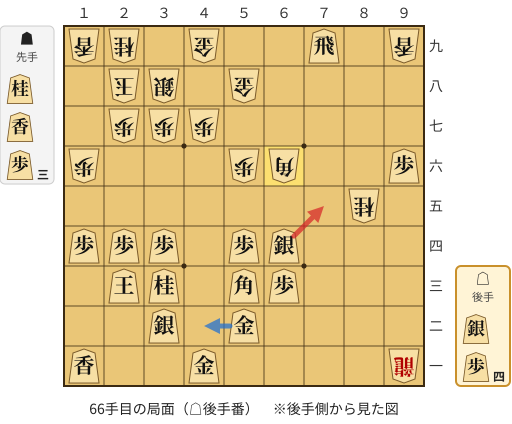

🔴 実戦 △７五銀(64)　🔵 AI推奨 △４二金(52)　🟨 直前の相手の指し手

<details><summary>テキストの盤面図（BOD・将棋ソフトに貼り付け可）</summary>

```text
後手の持駒：銀　歩四
  ９ ８ ７ ６ ５ ４ ３ ２ １
+---------------------------+
| 龍 ・ ・ ・ ・v金 ・ ・v香|一
| ・ ・ ・ ・v金 ・v銀 ・ ・|二
| ・ ・ ・v歩v角 ・v桂v玉 ・|三
| ・ ・ ・v銀v歩 ・v歩v歩v歩|四
| ・ 桂 ・ ・ ・ ・ ・ ・ ・|五
|v歩 ・ ・ 角 歩 ・ ・ ・ 歩|六
| ・ ・ ・ ・ ・ 歩 歩 歩 ・|七
| ・ ・ ・ ・ 金 ・ 銀 玉 ・|八
| 香 ・v飛 ・ ・ 金 ・ 桂 香|九
+---------------------------+
先手の持駒：桂　香　歩三
後手番
手数＝65　▲６六角　まで
```

</details>

| | 指し手 | 評価値 | 読み筋 |
|---|---|--:|---|
| 実戦 | △７五銀(64) | -2117 | ▲３三角成(66) △同玉(23) ▲４五桂打 △４三玉(33) ▲５三桂成(45) △同金(52) |
| AI 1位 | △４二金(52) | +498 | △４二金(52) ▲９三角成(66) △９九飛成(79) ▲６五歩打 △７五銀(64) ▲７三桂成(85) |
| AI 2位 | △４三金(52) | +390 | △４三金(52) ▲６一龍(91) △４五歩打 ▲９三角成(66) △１五歩(14) ▲６六馬(93) |
| AI 3位 | △４八歩打 | +333 | △４八歩打 ▲同金(58) △４二金(52) ▲９三角成(66) △１五歩(14) ▲同歩(16) |

SFEN: `+R4g2l/4g1s2/3pb1nk1/3sp1ppp/1N7/p2BP3P/5PPP1/4G1SK1/L1r2G1NL w NL3Ps4p 66`

<a id="ply-70"></a>
### 70手目 △４五桂(33) — 大悪手

| | 着手前 | 着手後 | 差 |
|---|--:|--:|--:|
| 期待勝率 | 85.1% | 42.9% | -42.2pt |
| 評価値 | +1045 | -172 | |

着手前の局面:

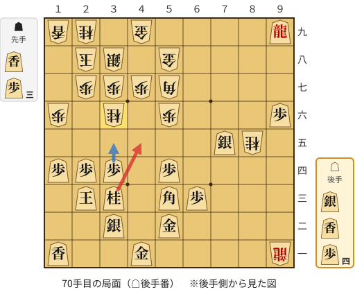

🔴 実戦 △４五桂(33)　🔵 AI推奨 △３五歩(34)　🟨 直前の相手の指し手

<details><summary>テキストの盤面図（BOD・将棋ソフトに貼り付け可）</summary>

```text
後手の持駒：銀　香　歩四
  ９ ８ ７ ６ ５ ４ ３ ２ １
+---------------------------+
| 龍 ・ ・ ・ ・v金 ・ ・v香|一
| ・ ・ ・ ・v金 ・v銀 ・ ・|二
| ・ ・ ・v歩v角 ・v桂v玉 ・|三
| ・ ・ ・ ・v歩 ・v歩v歩v歩|四
| ・ 桂v銀 ・ ・ ・ ・ ・ ・|五
|v歩 ・ ・ ・ 歩 ・ 桂 ・ 歩|六
| ・ ・ ・ ・ 角 歩 歩 歩 ・|七
| ・ ・ ・ ・ 金 ・ 銀 玉 ・|八
|v龍 ・ ・ ・ ・ 金 ・ 桂 香|九
+---------------------------+
先手の持駒：香　歩三
後手番
手数＝69　▲３六桂　まで
```

</details>

| | 指し手 | 評価値 | 読み筋 |
|---|---|--:|---|
| 実戦 | △４五桂(33) | -172 | ▲２四角(57) △７一歩打 ▲２六香打 △１二玉(23) ▲９二龍(91) △２五歩打 |
| AI 1位 | △３五歩(34) | +1045 | △３五歩(34) ▲４四桂(36) △同角(53) ▲７五角(57) △５一香打 ▲９四龍(91) |
| AI 2位 | △７一歩打 | +706 | △７一歩打 ▲９四龍(91) △６四銀(75) ▲６五歩打 △同銀(64) ▲７九歩打 |
| AI 3位 | △８一歩打 | +570 | △８一歩打 ▲９四龍(91) △４三銀打 ▲２四桂(36) △２六歩打 ▲３二桂成(24) |

SFEN: `+R4g2l/4g1s2/3pb1nk1/4p1ppp/1Ns6/p3P1N1P/4BPPP1/4G1SK1/+r4G1NL w L3Psl4p 70`

<a id="ply-72"></a>
### 72手目 △５七香打 — 大悪手

| | 着手前 | 着手後 | 差 |
|---|--:|--:|--:|
| 期待勝率 | 90.5% | 61.0% | -29.6pt |
| 評価値 | +1355 | +268 | |

着手前の局面:

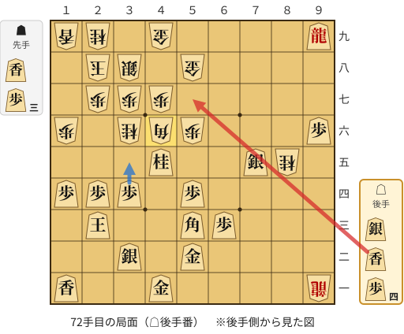

🔴 実戦 △５七香打　🔵 AI推奨 △３五歩(34)　🟨 直前の相手の指し手

<details><summary>テキストの盤面図（BOD・将棋ソフトに貼り付け可）</summary>

```text
後手の持駒：銀　香　歩四
  ９ ８ ７ ６ ５ ４ ３ ２ １
+---------------------------+
| 龍 ・ ・ ・ ・v金 ・ ・v香|一
| ・ ・ ・ ・v金 ・v銀 ・ ・|二
| ・ ・ ・v歩v角 ・ ・v玉 ・|三
| ・ ・ ・ ・v歩 ・v歩v歩v歩|四
| ・ 桂v銀 ・ ・v桂 ・ ・ ・|五
|v歩 ・ ・ ・ 歩 角 桂 ・ 歩|六
| ・ ・ ・ ・ ・ 歩 歩 歩 ・|七
| ・ ・ ・ ・ 金 ・ 銀 玉 ・|八
|v龍 ・ ・ ・ ・ 金 ・ 桂 香|九
+---------------------------+
先手の持駒：香　歩三
後手番
手数＝71　▲４六角　まで
```

</details>

| | 指し手 | 評価値 | 読み筋 |
|---|---|--:|---|
| 実戦 | △５七香打 | +268 | ▲２四角(46) △３三銀打 ▲同角成(24) △同玉(23) ▲４八金(58) △２六歩打 |
| AI 1位 | △３五歩(34) | +1355 | △３五歩(34) ▲２四桂(36) △同玉(23) ▲７三桂成(85) △３四桂打 ▲７九歩打 |
| AI 2位 | △４八歩打 | +1064 | △４八歩打 ▲同金(58) △３五歩(34) ▲２四桂(36) △同玉(23) ▲９四龍(91) |
| AI 3位 | △３五香打 | +842 | △３五香打 ▲２六香打 △３六香(35) ▲７九歩打 △３三銀打 ▲３六歩(37) |

SFEN: `+R4g2l/4g1s2/3pb2k1/4p1ppp/1Ns2n3/p3PBN1P/5PPP1/4G1SK1/+r4G1NL w L3Psl4p 72`

<a id="ply-74"></a>
### 74手目 △３五銀打 — 大悪手

| | 着手前 | 着手後 | 差 |
|---|--:|--:|--:|
| 期待勝率 | 80.8% | 50.0% | -30.8pt |
| 評価値 | +864 | +1 | |

着手前の局面:

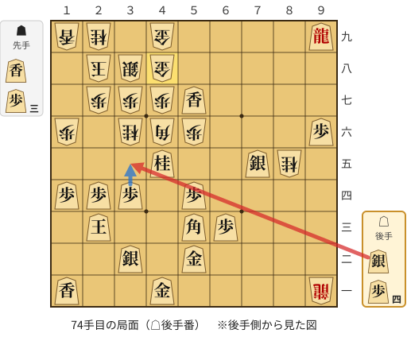

🔴 実戦 △３五銀打　🔵 AI推奨 △３五歩(34)　🟨 直前の相手の指し手

<details><summary>テキストの盤面図（BOD・将棋ソフトに貼り付け可）</summary>

```text
後手の持駒：銀　歩四
  ９ ８ ７ ６ ５ ４ ３ ２ １
+---------------------------+
| 龍 ・ ・ ・ ・v金 ・ ・v香|一
| ・ ・ ・ ・v金 ・v銀 ・ ・|二
| ・ ・ ・v歩v角 ・ ・v玉 ・|三
| ・ ・ ・ ・v歩 ・v歩v歩v歩|四
| ・ 桂v銀 ・ ・v桂 ・ ・ ・|五
|v歩 ・ ・ ・ 歩 角 桂 ・ 歩|六
| ・ ・ ・ ・v香 歩 歩 歩 ・|七
| ・ ・ ・ ・ ・ 金 銀 玉 ・|八
|v龍 ・ ・ ・ ・ 金 ・ 桂 香|九
+---------------------------+
先手の持駒：香　歩三
後手番
手数＝73　▲４八金寄　まで
```

</details>

| | 指し手 | 評価値 | 読み筋 |
|---|---|--:|---|
| 実戦 | △３五銀打 | +1 | ▲２六香打 △５九香成(57) ▲３九金(49) △７一歩打 ▲２四香(26) △１二玉(23) |
| AI 1位 | △３五歩(34) | +864 | △３五歩(34) ▲２四桂(36) △同玉(23) ▲５五歩(56) △４四角(53) ▲５四歩(55) |
| AI 2位 | △５九香成(57) | +195 | △５九香成(57) ▲２六香打 △４九成香(59) ▲同金(48) △７一歩打 ▲９四龍(91) |
| AI 3位 | △７一歩打 | +38 | △７一歩打 ▲９四龍(91) △４三金(52) ▲５五歩(56) △５九香成(57) ▲５四歩(55) |

SFEN: `+R4g2l/4g1s2/3pb2k1/4p1ppp/1Ns2n3/p3PBN1P/4lPPP1/5GSK1/+r4G1NL w L3Ps4p 74`

