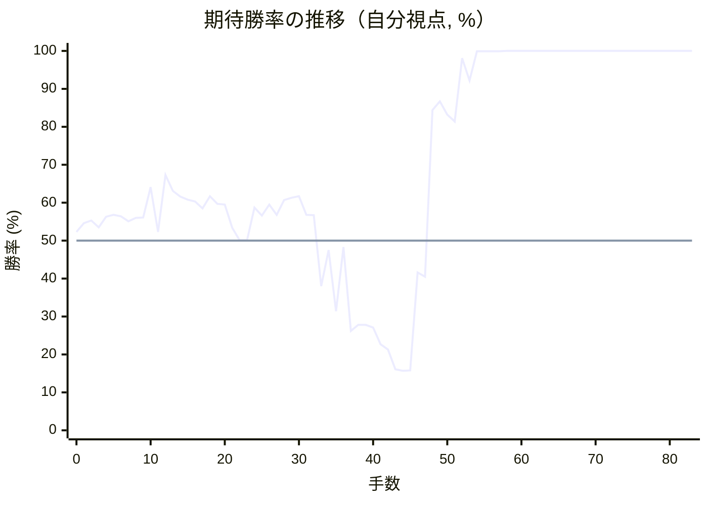
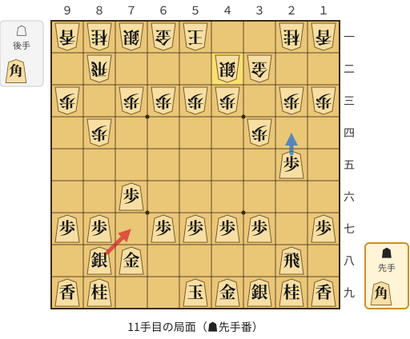
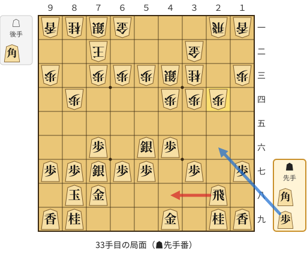
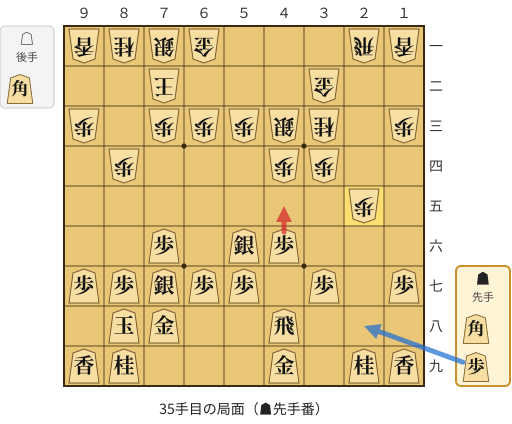
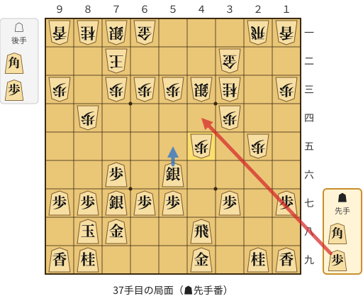
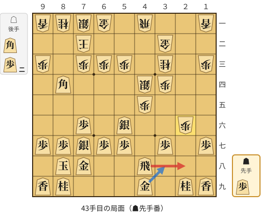

# 解析レポート hm9k1flvfmqf

[README に戻る](../../../README.md)　/　棋譜: [CSA](../../../data/csa/shogi5/hm9k1flvfmqf.csa)　/　解析の見方: [docs/mistake_analysis.md](../../../docs/mistake_analysis.md)

## 対局情報

| 項目 | 内容 |
|---|---|
| 日時 | 2026-11-15 00:42:53 |
| 持ち時間 | 5分 |
| 自分 | 先手（▲）（1642） |
| 相手 | 相手（1663） |
| 結果 | 勝ち（詰み, 83手） |

## 解析環境

| 項目 | 内容 |
|---|---|
| エンジン | YaneuraOu NNUE 9.00git 64AVX2（V9.00/YANEURAOU_ENGINE_NNUE/AVX2） |
| 評価関数 | **水匠5**（`suisho5`） |
| nn.bin SHA-256 | `768068f0d534a0603a5d38bcd143de6bbca820d5f1c95a14d40863e5b7892d76` |
| 第1パス | movetime=150ms, MultiPV 1 |
| 第2パス | movetime=2000ms, MultiPV 3 |
| Threads / Hash | 8 / 512MB |
| 判定基準 | 疑問手 ≥5pt, 悪手 ≥10pt, 大悪手 ≥20pt（期待勝率 W(E)=1/(1+exp(-E/600))） |
| 解析日時 | 2026-11-20T20:20:59+09:00（解析バージョン 1, 36秒） |

## サマリー

| 自分の手数 | 深掘りした手 | 詰み逃し | 大悪手 | 悪手 | 疑問手 |
|--:|--:|--:|--:|--:|--:|
| 42 | 6 | 0 | 0 | 3 | 2 |

## 期待勝率の推移



<details><summary>1手ごとの数値（第1パス）</summary>

| 手数 | 指し手 | 評価値 | 勝率 | 低下 | 判定 |
|--:|---|--:|--:|--:|---|
| 1 | ▲７六歩(77) | +110 | 54.6% | -2.3pt |  |
| 2 | △８四歩(83) | +128 | 55.3% |  |  |
| 3 | ▲２六歩(27) | +85 | 53.5% | +1.8pt |  |
| 4 | △３四歩(33) | +151 | 56.3% |  |  |
| 5 | ▲２五歩(26) | +164 | 56.8% | -0.5pt |  |
| 6 | △３二金(41) | +155 | 56.4% |  |  |
| 7 | ▲７八金(69) | +124 | 55.1% | +1.3pt |  |
| 8 | △８八角成(22) | +144 | 56.0% |  |  |
| 9 | ▲同銀(79) | +146 | 56.1% | -0.1pt |  |
| 10 | △４二銀(31) | +347 | 64.1% |  |  |
| 11 | ▲７七銀(88) | +56 | 52.3% | +11.7pt | [疑問手](#ply-11) |
| 12 | △３三桂(21) | +433 | 67.3% |  |  |
| 13 | ▲４八銀(39) | +321 | 63.1% | +4.2pt |  |
| 14 | △４四歩(43) | +283 | 61.6% |  |  |
| 15 | ▲４六歩(47) | +264 | 60.8% | +0.8pt |  |
| 16 | △４三銀(42) | +252 | 60.3% |  |  |
| 17 | ▲４七銀(48) | +205 | 58.5% | +1.9pt |  |
| 18 | △４二飛(82) | +287 | 61.7% |  |  |
| 19 | ▲５六銀(47) | +235 | 59.7% | +2.1pt |  |
| 20 | △６二玉(51) | +232 | 59.5% |  |  |
| 21 | ▲２四歩(25) | +82 | 53.4% | +6.1pt |  |
| 22 | △同歩(23) | +3 | 50.1% |  |  |
| 23 | ▲同飛(28) | +2 | 50.1% | +0.0pt |  |
| 24 | △２三歩打 | +210 | 58.7% |  |  |
| 25 | ▲２八飛(24) | +160 | 56.6% | +2.0pt |  |
| 26 | △７二玉(62) | +232 | 59.5% |  |  |
| 27 | ▲６八玉(59) | +163 | 56.8% | +2.8pt |  |
| 28 | △４一飛(42) | +261 | 60.7% |  |  |
| 29 | ▲７九玉(68) | +275 | 61.3% | -0.6pt |  |
| 30 | △２一飛(41) | +285 | 61.7% |  |  |
| 31 | ▲８八玉(79) | +163 | 56.8% | +4.9pt |  |
| 32 | △２四歩(23) | +161 | 56.7% |  |  |
| 33 | ▲４八飛(28) | -293 | 38.0% | +18.6pt | [疑問手](#ply-33) |
| 34 | △２五歩(24) | -60 | 47.5% |  |  |
| 35 | ▲４五歩(46) | -468 | 31.4% | +16.1pt | [悪手](#ply-35) |
| 36 | △同歩(44) | -42 | 48.3% |  |  |
| 37 | ▲４四歩打 | -621 | 26.2% | +22.0pt | [悪手](#ply-37) |
| 38 | △同銀(43) | -574 | 27.8% |  |  |
| 39 | ▲６六角打 | -574 | 27.8% | +0.0pt |  |
| 40 | △４一飛(21) | -593 | 27.1% |  |  |
| 41 | ▲８四角(66) | -735 | 22.7% | +4.4pt |  |
| 42 | △２六歩(25) | -784 | 21.3% |  |  |
| 43 | ▲２八飛(48) | -992 | 16.1% | +5.2pt | [悪手](#ply-43) |
| 44 | △２一飛(41) | -1008 | 15.7% |  |  |
| 45 | ▲３八金(49) | -1003 | 15.8% | -0.1pt |  |
| 46 | △４九角打 | -203 | 41.6% |  |  |
| 47 | ▲６六角(84) | -232 | 40.5% | +1.2pt |  |
| 48 | △４三金(32) | +1013 | 84.4% |  |  |
| 49 | ▲４八金(38) | +1125 | 86.7% | -2.3pt |  |
| 50 | △２七角成(49) | +962 | 83.2% |  |  |
| 51 | ▲同飛(28) | +885 | 81.4% | +1.9pt |  |
| 52 | △同歩成(26) | +2365 | 98.1% |  |  |
| 53 | ▲３二角打 | +1482 | 92.2% | +5.9pt |  |
| 54 | △５四金(43) | +3911 | 99.9% |  |  |
| 55 | ▲２一角成(32) | +4131 | 99.9% | -0.0pt |  |
| 56 | △３八と(27) | +4125 | 99.9% |  |  |
| 57 | ▲同金(48) | +4247 | 99.9% | -0.0pt |  |
| 58 | △２六飛打 | +4924 | 100.0% |  |  |
| 59 | ▲５四馬(21) | +5055 | 100.0% | -0.0pt |  |
| 60 | △同歩(53) | +5165 | 100.0% |  |  |
| 61 | ▲２七歩打 | +5340 | 100.0% | -0.0pt |  |
| 62 | △５六飛(26) | +5534 | 100.0% |  |  |
| 63 | ▲同歩(57) | +5641 | 100.0% | -0.0pt |  |
| 64 | △５三銀(44) | +5790 | 100.0% |  |  |
| 65 | ▲２二飛打 | +5633 | 100.0% | +0.0pt |  |
| 66 | △６二銀(53) | +5634 | 100.0% |  |  |
| 67 | ▲３三角成(66) | +5895 | 100.0% | -0.0pt |  |
| 68 | △４六歩(45) | +6278 | 100.0% |  |  |
| 69 | ▲３四馬(33) | +6395 | 100.0% | -0.0pt |  |
| 70 | △３二歩打 | #+15 | 100.0% |  |  |
| 71 | ▲８四桂打 | +7081 | 100.0% | +0.0pt |  |
| 72 | △８二玉(72) | +7852 | 100.0% |  |  |
| 73 | ▲６一馬(34) | +8114 | 100.0% | -0.0pt |  |
| 74 | △７二銀打 | #+23 | 100.0% |  |  |
| 75 | ▲同桂成(84) | #+22 | 100.0% | +0.0pt |  |
| 76 | △同銀(71) | #+19 | 100.0% |  |  |
| 77 | ▲６二馬(61) | #+26 | 100.0% | +0.0pt |  |
| 78 | △１四角打 | #+5 | 100.0% |  |  |
| 79 | ▲８四飛打 | #+4 | 100.0% | +0.0pt |  |
| 80 | △８三歩打 | #+3 | 100.0% |  |  |
| 81 | ▲７一銀打 | #+2 | 100.0% | +0.0pt |  |
| 82 | △９二玉(82) | #+1 | 100.0% |  |  |
| 83 | ▲８二金打 | #+ | 100.0% | +0.0pt |  |

</details>

## 課題局面

<a id="ply-11"></a>
### 11手目 ▲７七銀(88) — 疑問手

| | 着手前 | 着手後 | 差 |
|---|--:|--:|--:|
| 期待勝率 | 62.5% | 54.1% | -8.4pt |
| 評価値 | +307 | +98 | |

着手前の局面:



🔴 実戦 ▲７七銀(88)　🔵 AI推奨 ▲２四歩(25)　🟨 直前の相手の指し手

<details><summary>テキストの盤面図（BOD・将棋ソフトに貼り付け可）</summary>

```text
後手の持駒：角
  ９ ８ ７ ６ ５ ４ ３ ２ １
+---------------------------+
|v香v桂v銀v金v玉 ・ ・v桂v香|一
| ・v飛 ・ ・ ・v銀v金 ・ ・|二
|v歩 ・v歩v歩v歩v歩 ・v歩v歩|三
| ・v歩 ・ ・ ・ ・v歩 ・ ・|四
| ・ ・ ・ ・ ・ ・ ・ 歩 ・|五
| ・ ・ 歩 ・ ・ ・ ・ ・ ・|六
| 歩 歩 ・ 歩 歩 歩 歩 ・ 歩|七
| ・ 銀 金 ・ ・ ・ ・ 飛 ・|八
| 香 桂 ・ ・ 玉 金 銀 桂 香|九
+---------------------------+
先手の持駒：角
手数＝10　△４二銀　まで
```

</details>

| | 指し手 | 評価値 | 読み筋 |
|---|---|--:|---|
| 実戦 | ▲７七銀(88) | +98 | △３三銀(42) ▲３八銀(39) △７二銀(71) ▲３六歩(37) △６四歩(63) ▲３七銀(38) |
| AI 1位 | ▲２四歩(25) | +307 | ▲２四歩(25) △同歩(23) ▲同飛(28) △２三歩打 ▲３四飛(24) △３三銀(42) |
| AI 2位 | ▲３八銀(39) | +175 | ▲３八銀(39) △３三銀(42) ▲３六歩(37) △７二銀(71) ▲３七銀(38) △６四歩(63) |
| AI 3位 | ▲４八銀(39) | +166 | ▲４八銀(39) △３三銀(42) ▲３六歩(37) △７二銀(71) ▲６八玉(59) △６四歩(63) |

SFEN: `lnsgk2nl/1r3sg2/p1pppp1pp/1p4p2/7P1/2P6/PP1PPPP1P/1SG4R1/LN2KGSNL b Bb 11`

<a id="ply-33"></a>
### 33手目 ▲４八飛(28) — 疑問手

| | 着手前 | 着手後 | 差 |
|---|--:|--:|--:|
| 期待勝率 | 55.3% | 47.2% | -8.1pt |
| 評価値 | +128 | -67 | |

着手前の局面:



🔴 実戦 ▲４八飛(28)　🔵 AI推奨 ▲２六歩打　🟨 直前の相手の指し手

<details><summary>テキストの盤面図（BOD・将棋ソフトに貼り付け可）</summary>

```text
後手の持駒：角
  ９ ８ ７ ６ ５ ４ ３ ２ １
+---------------------------+
|v香v桂v銀v金 ・ ・ ・v飛v香|一
| ・ ・v玉 ・ ・ ・v金 ・ ・|二
|v歩 ・v歩v歩v歩v銀v桂 ・v歩|三
| ・v歩 ・ ・ ・v歩v歩v歩 ・|四
| ・ ・ ・ ・ ・ ・ ・ ・ ・|五
| ・ ・ 歩 ・ 銀 歩 ・ ・ ・|六
| 歩 歩 銀 歩 歩 ・ 歩 ・ 歩|七
| ・ 玉 金 ・ ・ ・ ・ 飛 ・|八
| 香 桂 ・ ・ ・ 金 ・ 桂 香|九
+---------------------------+
先手の持駒：角　歩
手数＝32　△２四歩　まで
```

</details>

| | 指し手 | 評価値 | 読み筋 |
|---|---|--:|---|
| 実戦 | ▲４八飛(28) | -67 | △２五歩(24) ▲２八歩打 △２六歩(25) ▲３八金(49) △３五歩(34) ▲９六歩(97) |
| AI 1位 | ▲２六歩打 | +128 | ▲２六歩打 △８二玉(72) ▲９六歩(97) △９四歩(93) ▲６六歩(67) △７二銀(71) |
| AI 2位 | ▲９六歩(97) | +50 | ▲９六歩(97) △２五歩(24) ▲２七歩打 △８二銀(71) ▲７五歩(76) △９四歩(93) |
| AI 3位 | ▲５八金(49) | +47 | ▲５八金(49) △２五歩(24) ▲２七歩打 △８二銀(71) ▲７五歩(76) △９四歩(93) |

SFEN: `lnsg3rl/2k3g2/p1pppsn1p/1p3ppp1/9/2P1SP3/PPSPP1P1P/1KG4R1/LN3G1NL b BPb 33`

<a id="ply-35"></a>
### 35手目 ▲４五歩(46) — 悪手

| | 着手前 | 着手後 | 差 |
|---|--:|--:|--:|
| 期待勝率 | 48.2% | 28.8% | -19.4pt |
| 評価値 | -44 | -544 | |

着手前の局面:



🔴 実戦 ▲４五歩(46)　🔵 AI推奨 ▲２八歩打　🟨 直前の相手の指し手

<details><summary>テキストの盤面図（BOD・将棋ソフトに貼り付け可）</summary>

```text
後手の持駒：角
  ９ ８ ７ ６ ５ ４ ３ ２ １
+---------------------------+
|v香v桂v銀v金 ・ ・ ・v飛v香|一
| ・ ・v玉 ・ ・ ・v金 ・ ・|二
|v歩 ・v歩v歩v歩v銀v桂 ・v歩|三
| ・v歩 ・ ・ ・v歩v歩 ・ ・|四
| ・ ・ ・ ・ ・ ・ ・v歩 ・|五
| ・ ・ 歩 ・ 銀 歩 ・ ・ ・|六
| 歩 歩 銀 歩 歩 ・ 歩 ・ 歩|七
| ・ 玉 金 ・ ・ 飛 ・ ・ ・|八
| 香 桂 ・ ・ ・ 金 ・ 桂 香|九
+---------------------------+
先手の持駒：角　歩
手数＝34　△２五歩　まで
```

</details>

| | 指し手 | 評価値 | 読み筋 |
|---|---|--:|---|
| 実戦 | ▲４五歩(46) | -544 | △同桂(33) ▲７五角打 △７四歩(73) ▲６六角(75) △２六歩(25) ▲２二歩打 |
| AI 1位 | ▲２八歩打 | -44 | ▲２八歩打 △２六歩(25) ▲３八金(49) △３五歩(34) ▲９六歩(97) △９四歩(93) |
| AI 2位 | ▲３八金(49) | -134 | ▲３八金(49) △９四歩(93) ▲３六歩(37) △５九角打 ▲４九飛(48) △２六角成(59) |
| AI 3位 | ▲７五角打 | -348 | ▲７五角打 △６二金(61) ▲２八歩打 △３五歩(34) ▲８四角(75) △８二銀(71) |

SFEN: `lnsg3rl/2k3g2/p1pppsn1p/1p3pp2/7p1/2P1SP3/PPSPP1P1P/1KG2R3/LN3G1NL b BPb 35`

<a id="ply-37"></a>
### 37手目 ▲４四歩打 — 悪手

| | 着手前 | 着手後 | 差 |
|---|--:|--:|--:|
| 期待勝率 | 43.6% | 26.4% | -17.2pt |
| 評価値 | -154 | -614 | |

着手前の局面:



🔴 実戦 ▲４四歩打　🔵 AI推奨 ▲５五銀(56)　🟨 直前の相手の指し手

<details><summary>テキストの盤面図（BOD・将棋ソフトに貼り付け可）</summary>

```text
後手の持駒：角　歩
  ９ ８ ７ ６ ５ ４ ３ ２ １
+---------------------------+
|v香v桂v銀v金 ・ ・ ・v飛v香|一
| ・ ・v玉 ・ ・ ・v金 ・ ・|二
|v歩 ・v歩v歩v歩v銀v桂 ・v歩|三
| ・v歩 ・ ・ ・ ・v歩 ・ ・|四
| ・ ・ ・ ・ ・v歩 ・v歩 ・|五
| ・ ・ 歩 ・ 銀 ・ ・ ・ ・|六
| 歩 歩 銀 歩 歩 ・ 歩 ・ 歩|七
| ・ 玉 金 ・ ・ 飛 ・ ・ ・|八
| 香 桂 ・ ・ ・ 金 ・ 桂 香|九
+---------------------------+
先手の持駒：角　歩
手数＝36　△４五同歩　まで
```

</details>

| | 指し手 | 評価値 | 読み筋 |
|---|---|--:|---|
| 実戦 | ▲４四歩打 | -614 | △同銀(43) ▲６六角打 △４一飛(21) ▲９六歩(97) △６二銀(71) ▲３六歩(37) |
| AI 1位 | ▲５五銀(56) | -154 | ▲５五銀(56) △９二角打 ▲５六角打 △同角(92) ▲同歩(57) △２四飛(21) |
| AI 2位 | ▲３六歩(37) | -328 | ▲３六歩(37) △２六歩(25) ▲３五歩(36) △同歩(34) ▲３七桂(29) △２七歩成(26) |
| AI 3位 | ▲２八歩打 | -351 | ▲２八歩打 △２六歩(25) ▲３八金(49) △５四銀(43) ▲３六歩(37) △９四歩(93) |

SFEN: `lnsg3rl/2k3g2/p1pppsn1p/1p4p2/5p1p1/2P1S4/PPSPP1P1P/1KG2R3/LN3G1NL b BPbp 37`

<a id="ply-43"></a>
### 43手目 ▲２八飛(48) — 悪手

| | 着手前 | 着手後 | 差 |
|---|--:|--:|--:|
| 期待勝率 | 24.8% | 13.8% | -11.0pt |
| 評価値 | -665 | -1098 | |

着手前の局面:



🔴 実戦 ▲２八飛(48)　🔵 AI推奨 ▲３八金(49)　🟨 直前の相手の指し手

<details><summary>テキストの盤面図（BOD・将棋ソフトに貼り付け可）</summary>

```text
後手の持駒：角　歩二
  ９ ８ ７ ６ ５ ４ ３ ２ １
+---------------------------+
|v香v桂v銀v金 ・v飛 ・ ・v香|一
| ・ ・v玉 ・ ・ ・v金 ・ ・|二
|v歩 ・v歩v歩v歩 ・v桂 ・v歩|三
| ・ 角 ・ ・ ・v銀v歩 ・ ・|四
| ・ ・ ・ ・ ・v歩 ・ ・ ・|五
| ・ ・ 歩 ・ 銀 ・ ・v歩 ・|六
| 歩 歩 銀 歩 歩 ・ 歩 ・ 歩|七
| ・ 玉 金 ・ ・ 飛 ・ ・ ・|八
| 香 桂 ・ ・ ・ 金 ・ 桂 香|九
+---------------------------+
先手の持駒：歩
手数＝42　△２六歩　まで
```

</details>

| | 指し手 | 評価値 | 読み筋 |
|---|---|--:|---|
| 実戦 | ▲２八飛(48) | -1098 | △２一飛(41) ▲３八金(49) △４六歩(45) ▲９六歩(97) △３五銀(44) ▲６六角(84) |
| AI 1位 | ▲３八金(49) | -665 | ▲３八金(49) △５四歩(53) ▲６六角(84) △５五歩(54) ▲同銀(56) △同銀(44) |
| AI 2位 | ▲２八歩打 | -715 | ▲２八歩打 △３五銀(44) ▲６六角(84) △４六歩(45) ▲９六歩(97) △９四歩(93) |
| AI 3位 | ▲２八飛(48) | -997 | ▲２八飛(48) △２一飛(41) ▲３八金(49) △３五銀(44) ▲６六角(84) △４六歩(45) |

SFEN: `lnsg1r2l/2k3g2/p1ppp1n1p/1B3sp2/5p3/2P1S2p1/PPSPP1P1P/1KG2R3/LN3G1NL b Pb2p 43`

