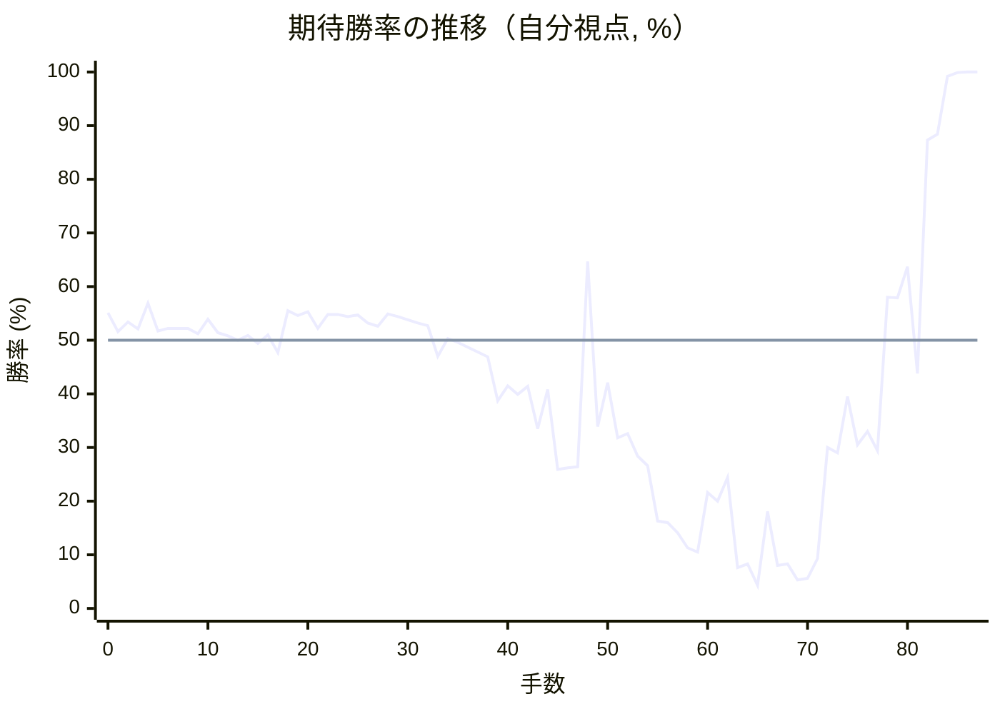

# 解析レポート hsawomndbp0u

[README に戻る](../../../README.md)　/　棋譜: [CSA](../../../data/csa/shogi5/hsawomndbp0u.csa)　/　解析の見方: [docs/mistake_analysis.md](../../../docs/mistake_analysis.md)

## 対局情報

| 項目 | 内容 |
|---|---|
| 日時 | 2026-10-27 20:54:00 |
| 持ち時間 | 5分 |
| 自分 | 先手（▲）（1758） |
| 相手 | 相手（1886） |
| 結果 | 勝ち（投了, 87手） |

## 解析環境

| 項目 | 内容 |
|---|---|
| エンジン | YaneuraOu NNUE 9.00git 64AVX2（V9.00/YANEURAOU_ENGINE_NNUE/AVX2） |
| 評価関数 | **水匠5**（`suisho5`） |
| nn.bin SHA-256 | `768068f0d534a0603a5d38bcd143de6bbca820d5f1c95a14d40863e5b7892d76` |
| 第1パス | movetime=150ms, MultiPV 1 |
| 第2パス | movetime=2000ms, MultiPV 3 |
| Threads / Hash | 8 / 512MB |
| 判定基準 | 疑問手 ≥5pt, 悪手 ≥10pt, 大悪手 ≥20pt（期待勝率 W(E)=1/(1+exp(-E/600))） |
| 解析日時 | 2026-11-03T04:28:46+09:00（解析バージョン 1, 53秒） |

## サマリー

| 自分の手数 | 深掘りした手 | 詰み逃し | 大悪手 | 悪手 | 疑問手 |
|--:|--:|--:|--:|--:|--:|
| 44 | 10 | 0 | 3 | 4 | 2 |

## 期待勝率の推移



<details><summary>1手ごとの数値（第1パス）</summary>

| 手数 | 指し手 | 評価値 | 勝率 | 低下 | 判定 |
|--:|---|--:|--:|--:|---|
| 1 | ▲７六歩(77) | +38 | 51.6% | +3.6pt |  |
| 2 | △８四歩(83) | +82 | 53.4% |  |  |
| 3 | ▲２六歩(27) | +50 | 52.1% | +1.3pt |  |
| 4 | △３二金(41) | +166 | 56.9% |  |  |
| 5 | ▲２五歩(26) | +40 | 51.7% | +5.2pt |  |
| 6 | △８五歩(84) | +54 | 52.2% |  |  |
| 7 | ▲７七角(88) | +52 | 52.2% | +0.1pt |  |
| 8 | △３四歩(33) | +52 | 52.2% |  |  |
| 9 | ▲６八銀(79) | +28 | 51.2% | +1.0pt |  |
| 10 | △７七角成(22) | +93 | 53.9% |  |  |
| 11 | ▲同銀(68) | +33 | 51.4% | +2.5pt |  |
| 12 | △２二銀(31) | +20 | 50.8% |  |  |
| 13 | ▲７八金(69) | -1 | 50.0% | +0.9pt |  |
| 14 | △３三銀(22) | +21 | 50.9% |  |  |
| 15 | ▲４八銀(39) | -14 | 49.4% | +1.5pt |  |
| 16 | △６二銀(71) | +24 | 51.0% |  |  |
| 17 | ▲４六歩(47) | -56 | 47.7% | +3.3pt |  |
| 18 | △５二金(61) | +133 | 55.5% |  |  |
| 19 | ▲４七銀(48) | +111 | 54.6% | +0.9pt |  |
| 20 | △４二玉(51) | +127 | 55.3% |  |  |
| 21 | ▲５六銀(47) | +53 | 52.2% | +3.1pt |  |
| 22 | △６四歩(63) | +116 | 54.8% |  |  |
| 23 | ▲１六歩(17) | +115 | 54.8% | +0.0pt |  |
| 24 | △１四歩(13) | +106 | 54.4% |  |  |
| 25 | ▲３六歩(37) | +114 | 54.7% | -0.3pt |  |
| 26 | △６三銀(62) | +76 | 53.2% |  |  |
| 27 | ▲３七桂(29) | +63 | 52.6% | +0.5pt |  |
| 28 | △５四銀(63) | +118 | 54.9% |  |  |
| 29 | ▲４八金(49) | +107 | 54.4% | +0.5pt |  |
| 30 | △３一玉(42) | +92 | 53.8% |  |  |
| 31 | ▲６六歩(67) | +76 | 53.2% | +0.7pt |  |
| 32 | △７四歩(73) | +65 | 52.7% |  |  |
| 33 | ▲５八玉(59) | -73 | 47.0% | +5.7pt | [疑問手](#ply-33) |
| 34 | △６三金(52) | +7 | 50.3% |  |  |
| 35 | ▲２九飛(28) | -10 | 49.6% | +0.7pt |  |
| 36 | △７三桂(81) | -31 | 48.7% |  |  |
| 37 | ▲９六歩(97) | -54 | 47.8% | +1.0pt |  |
| 38 | △４四歩(43) | -75 | 46.9% |  |  |
| 39 | ▲６八銀(77) | -276 | 38.7% | +8.2pt | [疑問手](#ply-39) |
| 40 | △８六歩(85) | -206 | 41.5% |  |  |
| 41 | ▲同歩(87) | -247 | 39.9% | +1.6pt |  |
| 42 | △同飛(82) | -208 | 41.4% |  |  |
| 43 | ▲７七桂(89) | -411 | 33.5% | +7.9pt | [悪手](#ply-43) |
| 44 | △８二飛(86) | -223 | 40.8% |  |  |
| 45 | ▲８七歩打 | -631 | 25.9% | +14.9pt | [悪手](#ply-45) |
| 46 | △７五歩(74) | -621 | 26.2% |  |  |
| 47 | ▲６七銀(68) | -616 | 26.4% | -0.2pt |  |
| 48 | △９四角打 | +363 | 64.7% |  |  |
| 49 | ▲９五歩(96) | -400 | 33.9% | +30.8pt | [大悪手](#ply-49) |
| 50 | △７六角(94) | -191 | 42.1% |  |  |
| 51 | ▲同銀(67) | -457 | 31.8% | +10.3pt | [悪手](#ply-51) |
| 52 | △同歩(75) | -435 | 32.6% |  |  |
| 53 | ▲２四歩(25) | -556 | 28.4% | +4.3pt |  |
| 54 | △同歩(23) | -610 | 26.6% |  |  |
| 55 | ▲４五歩(46) | -981 | 16.3% | +10.3pt | [悪手](#ply-55) |
| 56 | △７七歩成(76) | -995 | 16.0% |  |  |
| 57 | ▲同金(78) | -1082 | 14.1% | +1.9pt |  |
| 58 | △７六歩打 | -1238 | 11.3% |  |  |
| 59 | ▲７八金(77) | -1286 | 10.5% | +0.8pt |  |
| 60 | △７四桂打 | -775 | 21.6% |  |  |
| 61 | ▲４七玉(58) | -832 | 20.0% | +1.6pt |  |
| 62 | △６六桂(74) | -678 | 24.4% |  |  |
| 63 | ▲８八金(78) | -1501 | 7.6% | +16.8pt | [大悪手](#ply-63) |
| 64 | △４五歩(44) | -1441 | 8.3% |  |  |
| 65 | ▲７四歩打 | -1867 | 4.3% | +4.0pt |  |
| 66 | △４六歩(45) | -907 | 18.1% |  |  |
| 67 | ▲３八玉(47) | -1466 | 8.0% | +10.1pt |  |
| 68 | △６五桂(73) | -1438 | 8.3% |  |  |
| 69 | ▲７三歩成(74) | -1732 | 5.3% | +3.1pt |  |
| 70 | △同金(63) | -1694 | 5.6% |  |  |
| 71 | ▲７一角打 | -1368 | 9.3% | -3.7pt |  |
| 72 | △４二飛(82) | -507 | 30.0% |  |  |
| 73 | ▲５三角成(71) | -537 | 29.0% | +1.0pt |  |
| 74 | △４七銀打 | -256 | 39.5% |  |  |
| 75 | ▲同銀(56) | -493 | 30.5% | +9.0pt |  |
| 76 | △同歩成(46) | -426 | 33.0% |  |  |
| 77 | ▲同金(48) | -527 | 29.4% | +3.6pt |  |
| 78 | △４六歩打 | +193 | 58.0% |  |  |
| 79 | ▲同金(47) | +190 | 57.9% | +0.1pt |  |
| 80 | △５七桂成(65) | +337 | 63.7% |  |  |
| 81 | ▲２三歩打 | -150 | 43.8% | +19.9pt | [大悪手](#ply-81) |
| 82 | △同金(32) | +1156 | 87.3% |  |  |
| 83 | ▲５四馬(53) | +1218 | 88.4% | -1.1pt |  |
| 84 | △４六飛(42) | +2885 | 99.2% |  |  |
| 85 | ▲３二銀打 | +3936 | 99.9% | -0.7pt |  |
| 86 | △２二玉(31) | #+3 | 100.0% |  |  |
| 87 | ▲２三銀成(32) | #+4 | 100.0% | +0.0pt |  |

</details>

## 課題局面

<a id="ply-33"></a>
### 33手目 ▲５八玉(59) — 疑問手

| | 着手前 | 着手後 | 差 |
|---|--:|--:|--:|
| 期待勝率 | 52.2% | 46.6% | -5.6pt |
| 評価値 | +52 | -82 | |

着手前の局面:

```text
後手の持駒：角
  ９ ８ ７ ６ ５ ４ ３ ２ １
+---------------------------+
|v香v桂 ・ ・ ・ ・v玉v桂v香|一
| ・v飛 ・ ・v金 ・v金 ・ ・|二
|v歩 ・ ・ ・v歩v歩v銀v歩 ・|三
| ・ ・v歩v歩v銀 ・v歩 ・v歩|四
| ・v歩 ・ ・ ・ ・ ・ 歩 ・|五
| ・ ・ 歩 歩 銀 歩 歩 ・ 歩|六
| 歩 歩 銀 ・ 歩 ・ 桂 ・ ・|七
| ・ ・ 金 ・ ・ 金 ・ 飛 ・|八
| 香 桂 ・ ・ 玉 ・ ・ ・ 香|九
+---------------------------+
先手の持駒：角
手数＝32　△７四歩　まで
```

| | 指し手 | 評価値 | 読み筋 |
|---|---|--:|---|
| 実戦 | ▲５八玉(59) | -82 | △４四歩(43) ▲２九飛(28) △７三桂(81) ▲６八玉(58) △６三金(52) ▲９六歩(97) |
| AI 1位 | ▲６八玉(59) | +52 | ▲６八玉(59) △９四歩(93) ▲９六歩(97) △６三金(52) ▲７九玉(68) △７三桂(81) |
| AI 2位 | ▲２九飛(28) | +35 | ▲２九飛(28) △７三桂(81) ▲６八玉(59) △６三金(52) ▲９六歩(97) △９四歩(93) |
| AI 3位 | ▲９六歩(97) | +38 | ▲９六歩(97) △７三桂(81) ▲２九飛(28) △６三金(52) ▲６八玉(59) △９四歩(93) |

SFEN: `ln4knl/1r2g1g2/p3ppsp1/2pps1p1p/1p5P1/2PPSPP1P/PPS1P1N2/2G2G1R1/LN2K3L b Bb 33`

<a id="ply-39"></a>
### 39手目 ▲６八銀(77) — 疑問手

| | 着手前 | 着手後 | 差 |
|---|--:|--:|--:|
| 期待勝率 | 50.1% | 42.0% | -8.1pt |
| 評価値 | +2 | -194 | |

着手前の局面:

```text
後手の持駒：角
  ９ ８ ７ ６ ５ ４ ３ ２ １
+---------------------------+
|v香 ・ ・ ・ ・ ・v玉v桂v香|一
| ・v飛 ・ ・ ・ ・v金 ・ ・|二
|v歩 ・v桂v金v歩 ・v銀v歩 ・|三
| ・ ・v歩v歩v銀v歩v歩 ・v歩|四
| ・v歩 ・ ・ ・ ・ ・ 歩 ・|五
| 歩 ・ 歩 歩 銀 歩 歩 ・ 歩|六
| ・ 歩 銀 ・ 歩 ・ 桂 ・ ・|七
| ・ ・ 金 ・ 玉 金 ・ ・ ・|八
| 香 桂 ・ ・ ・ ・ ・ 飛 香|九
+---------------------------+
先手の持駒：角
手数＝38　△４四歩　まで
```

| | 指し手 | 評価値 | 読み筋 |
|---|---|--:|---|
| 実戦 | ▲６八銀(77) | -194 | △８六歩(85) ▲同歩(87) △同飛(82) ▲８七歩打 △８二飛(86) ▲４七金(48) |
| AI 1位 | ▲９五歩(96) | +2 | ▲９五歩(96) △６五歩(64) ▲４七金(48) △６六歩(65) ▲４八玉(58) △６七歩成(66) |
| AI 2位 | ▲６八玉(58) | -120 | ▲６八玉(58) △６五歩(64) ▲同歩(66) △同銀(54) ▲６四歩打 △６二金(63) |
| AI 3位 | ▲４五歩(46) | -125 | ▲４五歩(46) △同歩(44) ▲同桂(37) △４二銀(33) ▲４四歩打 △４三歩打 |

SFEN: `l5knl/1r4g2/p1ngp1sp1/2ppspp1p/1p5P1/P1PPSPP1P/1PS1P1N2/2G1KG3/LN5RL b Bb 39`

<a id="ply-43"></a>
### 43手目 ▲７七桂(89) — 悪手

| | 着手前 | 着手後 | 差 |
|---|--:|--:|--:|
| 期待勝率 | 41.3% | 28.0% | -13.3pt |
| 評価値 | -211 | -568 | |

着手前の局面:

```text
後手の持駒：角　歩
  ９ ８ ７ ６ ５ ４ ３ ２ １
+---------------------------+
|v香 ・ ・ ・ ・ ・v玉v桂v香|一
| ・ ・ ・ ・ ・ ・v金 ・ ・|二
|v歩 ・v桂v金v歩 ・v銀v歩 ・|三
| ・ ・v歩v歩v銀v歩v歩 ・v歩|四
| ・ ・ ・ ・ ・ ・ ・ 歩 ・|五
| 歩v飛 歩 歩 銀 歩 歩 ・ 歩|六
| ・ ・ ・ ・ 歩 ・ 桂 ・ ・|七
| ・ ・ 金 銀 玉 金 ・ ・ ・|八
| 香 桂 ・ ・ ・ ・ ・ 飛 香|九
+---------------------------+
先手の持駒：角　歩
手数＝42　△８六同飛　まで
```

| | 指し手 | 評価値 | 読み筋 |
|---|---|--:|---|
| 実戦 | ▲７七桂(89) | -568 | △３五歩(34) ▲同歩(36) △３六歩打 ▲５二角打 △３七歩成(36) ▲同金(48) |
| AI 1位 | ▲４七玉(58) | -211 | ▲４七玉(58) △８二飛(86) ▲８七歩打 △４三銀(54) ▲６七銀(68) △３五歩(34) |
| AI 2位 | ▲８七歩打 | -221 | ▲８七歩打 △８二飛(86) ▲４七玉(58) △４三銀(54) ▲６七銀(68) △５四歩(53) |
| AI 3位 | ▲２四歩(25) | -356 | ▲２四歩(25) △同歩(23) ▲２五歩打 △同歩(24) ▲同桂(37) △２四銀(33) |

SFEN: `l5knl/6g2/p1ngp1sp1/2ppspp1p/7P1/PrPPSPP1P/4P1N2/2GSKG3/LN5RL b BPbp 43`

<a id="ply-45"></a>
### 45手目 ▲８七歩打 — 悪手

| | 着手前 | 着手後 | 差 |
|---|--:|--:|--:|
| 期待勝率 | 39.3% | 24.3% | -15.0pt |
| 評価値 | -261 | -682 | |

着手前の局面:

```text
後手の持駒：角　歩
  ９ ８ ７ ６ ５ ４ ３ ２ １
+---------------------------+
|v香 ・ ・ ・ ・ ・v玉v桂v香|一
| ・v飛 ・ ・ ・ ・v金 ・ ・|二
|v歩 ・v桂v金v歩 ・v銀v歩 ・|三
| ・ ・v歩v歩v銀v歩v歩 ・v歩|四
| ・ ・ ・ ・ ・ ・ ・ 歩 ・|五
| 歩 ・ 歩 歩 銀 歩 歩 ・ 歩|六
| ・ ・ 桂 ・ 歩 ・ 桂 ・ ・|七
| ・ ・ 金 銀 玉 金 ・ ・ ・|八
| 香 ・ ・ ・ ・ ・ ・ 飛 香|九
+---------------------------+
先手の持駒：角　歩
手数＝44　△８二飛　まで
```

| | 指し手 | 評価値 | 読み筋 |
|---|---|--:|---|
| 実戦 | ▲８七歩打 | -682 | △３五歩(34) ▲同歩(36) △３六歩打 ▲６七銀(68) △３七歩成(36) ▲同金(48) |
| AI 1位 | ▲４七玉(58) | -261 | ▲４七玉(58) △８七歩打 ▲７九銀(68) △２二玉(31) ▲８九歩打 △４三銀(54) |
| AI 2位 | ▲６七銀(68) | -355 | ▲６七銀(68) △３五歩(34) ▲８三歩打 △同飛(82) ▲３五歩(36) △３六歩打 |
| AI 3位 | ▲９五歩(96) | -460 | ▲９五歩(96) △７五歩(74) ▲６七銀(68) △８七歩打 ▲８九飛(29) △３五歩(34) |

SFEN: `l5knl/1r4g2/p1ngp1sp1/2ppspp1p/7P1/P1PPSPP1P/2N1P1N2/2GSKG3/L6RL b BPbp 45`

<a id="ply-49"></a>
### 49手目 ▲９五歩(96) — 大悪手

| | 着手前 | 着手後 | 差 |
|---|--:|--:|--:|
| 期待勝率 | 63.1% | 40.7% | -22.5pt |
| 評価値 | +323 | -227 | |

着手前の局面:

```text
後手の持駒：歩
  ９ ８ ７ ６ ５ ４ ３ ２ １
+---------------------------+
|v香 ・ ・ ・ ・ ・v玉v桂v香|一
| ・v飛 ・ ・ ・ ・v金 ・ ・|二
|v歩 ・v桂v金v歩 ・v銀v歩 ・|三
|v角 ・ ・v歩v銀v歩v歩 ・v歩|四
| ・ ・v歩 ・ ・ ・ ・ 歩 ・|五
| 歩 ・ 歩 歩 銀 歩 歩 ・ 歩|六
| ・ 歩 桂 銀 歩 ・ 桂 ・ ・|七
| ・ ・ 金 ・ 玉 金 ・ ・ ・|八
| 香 ・ ・ ・ ・ ・ ・ 飛 香|九
+---------------------------+
先手の持駒：角
手数＝48　△９四角　まで
```

| | 指し手 | 評価値 | 読み筋 |
|---|---|--:|---|
| 実戦 | ▲９五歩(96) | -227 | △７六角(94) ▲９六角打 △６二金(63) ▲４七玉(58) △９四歩(93) ▲同歩(95) |
| AI 1位 | ▲７五歩(76) | +323 | ▲７五歩(76) △７六歩打 ▲９五歩(96) △７七歩成(76) ▲９四歩(95) △７八と(77) |
| AI 2位 | ▲９五歩(96) | -157 | ▲９五歩(96) △７六角(94) ▲９六角打 △６二金(63) ▲８六歩(87) △同飛(82) |
| AI 3位 | ▲２四歩(25) | -264 | ▲２四歩(25) △同歩(23) ▲７五歩(76) △７六歩打 ▲７四歩(75) △７七歩成(76) |

SFEN: `l5knl/1r4g2/p1ngp1sp1/b2pspp1p/2p4P1/P1PPSPP1P/1PNSP1N2/2G1KG3/L6RL b Bp 49`

<a id="ply-51"></a>
### 51手目 ▲同銀(67) — 悪手

| | 着手前 | 着手後 | 差 |
|---|--:|--:|--:|
| 期待勝率 | 40.4% | 28.2% | -12.3pt |
| 評価値 | -233 | -562 | |

着手前の局面:

```text
後手の持駒：歩二
  ９ ８ ７ ６ ５ ４ ３ ２ １
+---------------------------+
|v香 ・ ・ ・ ・ ・v玉v桂v香|一
| ・v飛 ・ ・ ・ ・v金 ・ ・|二
|v歩 ・v桂v金v歩 ・v銀v歩 ・|三
| ・ ・ ・v歩v銀v歩v歩 ・v歩|四
| 歩 ・v歩 ・ ・ ・ ・ 歩 ・|五
| ・ ・v角 歩 銀 歩 歩 ・ 歩|六
| ・ 歩 桂 銀 歩 ・ 桂 ・ ・|七
| ・ ・ 金 ・ 玉 金 ・ ・ ・|八
| 香 ・ ・ ・ ・ ・ ・ 飛 香|九
+---------------------------+
先手の持駒：角
手数＝50　△７六角　まで
```

| | 指し手 | 評価値 | 読み筋 |
|---|---|--:|---|
| 実戦 | ▲同銀(67) | -562 | △同歩(75) ▲４七玉(58) △２二玉(31) ▲４一角打 △５二銀打 ▲３二角成(41) |
| AI 1位 | ▲９六角打 | -233 | ▲９六角打 △６二金(63) ▲４七玉(58) △９四歩(93) ▲７六銀(67) △同歩(75) |
| AI 2位 | ▲２四歩(25) | -318 | ▲２四歩(25) △同歩(23) ▲９六角打 △６二金(63) ▲４七玉(58) △９四歩(93) |
| AI 3位 | ▲８九飛(29) | -378 | ▲８九飛(29) △３五歩(34) ▲同歩(36) △３六歩打 ▲７四歩打 △同金(63) |

SFEN: `l5knl/1r4g2/p1ngp1sp1/3pspp1p/P1p4P1/2bPSPP1P/1PNSP1N2/2G1KG3/L6RL b B2p 51`

<a id="ply-55"></a>
### 55手目 ▲４五歩(46) — 悪手

| | 着手前 | 着手後 | 差 |
|---|--:|--:|--:|
| 期待勝率 | 29.7% | 12.5% | -17.2pt |
| 評価値 | -516 | -1168 | |

着手前の局面:

```text
後手の持駒：銀　歩三
  ９ ８ ７ ６ ５ ４ ３ ２ １
+---------------------------+
|v香 ・ ・ ・ ・ ・v玉v桂v香|一
| ・v飛 ・ ・ ・ ・v金 ・ ・|二
|v歩 ・v桂v金v歩 ・v銀 ・ ・|三
| ・ ・ ・v歩v銀v歩v歩v歩v歩|四
| 歩 ・ ・ ・ ・ ・ ・ ・ ・|五
| ・ ・v歩 歩 銀 歩 歩 ・ 歩|六
| ・ 歩 桂 ・ 歩 ・ 桂 ・ ・|七
| ・ ・ 金 ・ 玉 金 ・ ・ ・|八
| 香 ・ ・ ・ ・ ・ ・ 飛 香|九
+---------------------------+
先手の持駒：角二
手数＝54　△２四同歩　まで
```

| | 指し手 | 評価値 | 読み筋 |
|---|---|--:|---|
| 実戦 | ▲４五歩(46) | -1168 | △７七歩成(76) ▲同金(78) △７六歩打 ▲８六金(77) △７七歩成(76) ▲７四歩打 |
| AI 1位 | ▲６一角打 | -516 | ▲６一角打 △３五歩(34) ▲７一角打 △４二飛(82) ▲３五歩(36) △７二銀打 |
| AI 2位 | ▲４七玉(58) | -607 | ▲４七玉(58) △２二玉(31) ▲４一角打 △５二銀打 ▲３二角成(41) △同玉(22) |
| AI 3位 | ▲９四歩(95) | -677 | ▲９四歩(95) △同歩(93) ▲６一角打 △３五歩(34) ▲７一角打 △４二飛(82) |

SFEN: `l5knl/1r4g2/p1ngp1s2/3pspppp/P8/2pPSPP1P/1PN1P1N2/2G1KG3/L6RL b 2Bs3p 55`

<a id="ply-63"></a>
### 63手目 ▲８八金(78) — 大悪手

| | 着手前 | 着手後 | 差 |
|---|--:|--:|--:|
| 期待勝率 | 30.6% | 7.9% | -22.7pt |
| 評価値 | -490 | -1470 | |

着手前の局面:

```text
後手の持駒：銀　歩三
  ９ ８ ７ ６ ５ ４ ３ ２ １
+---------------------------+
|v香 ・ ・ ・ ・ ・v玉v桂v香|一
| ・v飛 ・ ・ ・ ・v金 ・ ・|二
|v歩 ・v桂v金v歩 ・v銀 ・ ・|三
| ・ ・ ・v歩v銀v歩v歩v歩v歩|四
| 歩 ・ ・ ・ ・ 歩 ・ ・ ・|五
| ・ ・v歩v桂 銀 ・ 歩 ・ 歩|六
| ・ 歩 ・ ・ 歩 玉 桂 ・ ・|七
| ・ ・ 金 ・ ・ 金 ・ ・ ・|八
| 香 ・ ・ ・ ・ ・ ・ 飛 香|九
+---------------------------+
先手の持駒：角二　歩
手数＝62　△６六桂　まで
```

| | 指し手 | 評価値 | 読み筋 |
|---|---|--:|---|
| 実戦 | ▲８八金(78) | -1470 | △４五歩(44) ▲同桂(37) △４六歩打 ▲３七玉(47) △４七銀打 ▲同金(48) |
| AI 1位 | ▲７四歩打 | -490 | ▲７四歩打 △６五桂(73) ▲７三歩成(74) △同金(63) ▲７一角打 △５二飛(82) |
| AI 2位 | ▲６七金(78) | -930 | ▲６七金(78) △５八銀打 ▲３八玉(47) △６七銀不成(58) ▲同銀(56) △７七歩成(76) |
| AI 3位 | ▲７九金(78) | -1088 | ▲７九金(78) △６五桂(73) ▲９六角打 △７七歩成(76) ▲２五歩打 △４五歩(44) |

SFEN: `l5knl/1r4g2/p1ngp1s2/3pspppp/P4P3/2pnS1P1P/1P2PKN2/2G2G3/L6RL b 2BPs3p 63`

<a id="ply-81"></a>
### 81手目 ▲２三歩打 — 大悪手

| | 着手前 | 着手後 | 差 |
|---|--:|--:|--:|
| 期待勝率 | 66.6% | 38.7% | -27.9pt |
| 評価値 | +414 | -275 | |

着手前の局面:

```text
後手の持駒：銀　歩五
  ９ ８ ７ ６ ５ ４ ３ ２ １
+---------------------------+
|v香 ・ ・ ・ ・ ・v玉v桂v香|一
| ・ ・ ・ ・ ・v飛v金 ・ ・|二
|v歩 ・v金 ・ 馬 ・v銀 ・ ・|三
| ・ ・ ・v歩v銀 ・v歩v歩v歩|四
| 歩 ・ ・ ・ ・ ・ ・ ・ ・|五
| ・ ・v歩v桂 ・ 金 歩 ・ 歩|六
| ・ 歩 ・ ・v圭 ・ 桂 ・ ・|七
| ・ 金 ・ ・ ・ ・ 玉 ・ ・|八
| 香 ・ ・ ・ ・ ・ ・ 飛 香|九
+---------------------------+
先手の持駒：角　銀　歩三
手数＝80　△５七桂成　まで
```

| | 指し手 | 評価値 | 読み筋 |
|---|---|--:|---|
| 実戦 | ▲２三歩打 | -275 | △６三金(73) ▲２二銀打 △同銀(33) ▲同歩成(23) △同玉(31) ▲４二馬(53) |
| AI 1位 | ▲５一銀打 | +414 | ▲５一銀打 △５八桂成(66) ▲４二銀不成(51) △同銀(33) ▲５一飛打 △４一歩打 |
| AI 2位 | ▲２三歩打 | -186 | ▲２三歩打 △６三金(73) ▲２二銀打 △同銀(33) ▲同歩成(23) △同金(32) |
| AI 3位 | ▲４三歩打 | -436 | ▲４三歩打 △同銀(54) ▲２三歩打 △５八桂成(66) ▲４五桂(37) △４八成桂(58) |

SFEN: `l5knl/5rg2/p1g1+B1s2/3ps1ppp/P8/2pn1GP1P/1P2+n1N2/1G4K2/L6RL b BS3Ps5p 81`

