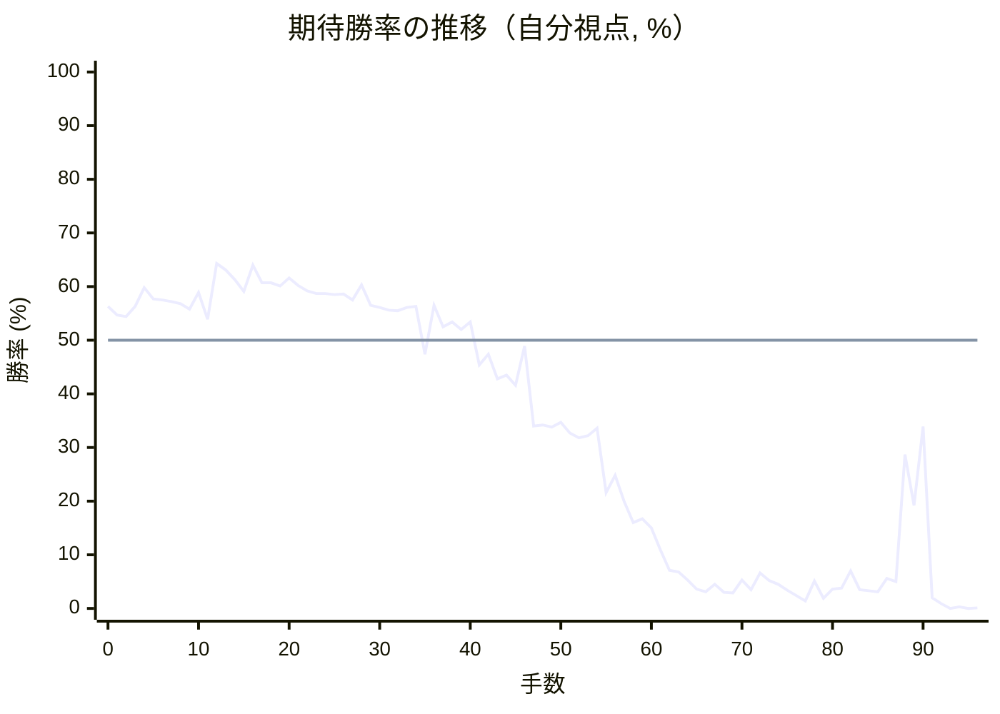
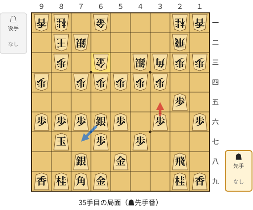
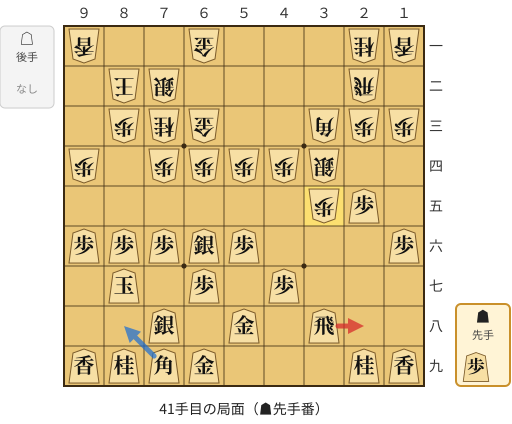
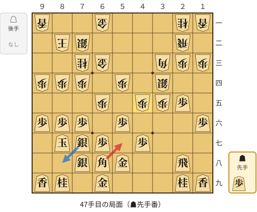
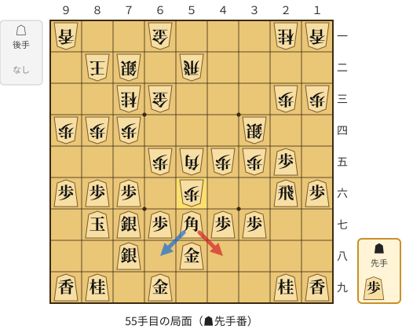
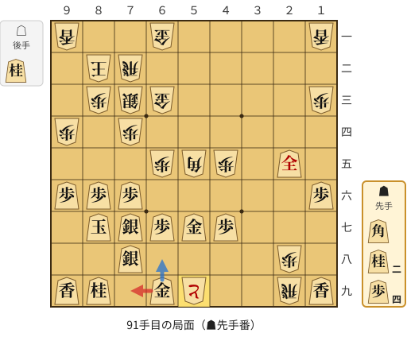

# 解析レポート hssbkifqjuc4

[README に戻る](../../../README.md)　/　棋譜: [CSA](../../../data/csa/shogi5/hssbkifqjuc4.csa)　/　解析の見方: [docs/mistake_analysis.md](../../../docs/mistake_analysis.md)

## 対局情報

| 項目 | 内容 |
|---|---|
| 日時 | 2026-11-11 08:13:57 |
| 持ち時間 | 5分 |
| 自分 | 先手（▲）（1657） |
| 相手 | 相手（1656） |
| 結果 | 負け（投了, 96手） |

## 解析環境

| 項目 | 内容 |
|---|---|
| エンジン | YaneuraOu NNUE 9.00git 64AVX2（V9.00/YANEURAOU_ENGINE_NNUE/AVX2） |
| 評価関数 | **水匠5**（`suisho5`） |
| nn.bin SHA-256 | `768068f0d534a0603a5d38bcd143de6bbca820d5f1c95a14d40863e5b7892d76` |
| 第1パス | movetime=150ms, MultiPV 1 |
| 第2パス | movetime=2000ms, MultiPV 3 |
| Threads / Hash | 8 / 512MB |
| 判定基準 | 疑問手 ≥5pt, 悪手 ≥10pt, 大悪手 ≥20pt（期待勝率 W(E)=1/(1+exp(-E/600))） |
| 解析日時 | 2026-11-14T10:36:11+09:00（解析バージョン 1, 39秒） |

## サマリー

| 自分の手数 | 深掘りした手 | 詰み逃し | 大悪手 | 悪手 | 疑問手 |
|--:|--:|--:|--:|--:|--:|
| 48 | 6 | 0 | 1 | 1 | 3 |

## 期待勝率の推移



<details><summary>1手ごとの数値（第1パス）</summary>

| 手数 | 指し手 | 評価値 | 勝率 | 低下 | 判定 |
|--:|---|--:|--:|--:|---|
| 1 | ▲７六歩(77) | +113 | 54.7% | +1.6pt |  |
| 2 | △３四歩(33) | +106 | 54.4% |  |  |
| 3 | ▲２六歩(27) | +151 | 56.3% | -1.9pt |  |
| 4 | △４四歩(43) | +238 | 59.8% |  |  |
| 5 | ▲２五歩(26) | +187 | 57.7% | +2.1pt |  |
| 6 | △３三角(22) | +182 | 57.5% |  |  |
| 7 | ▲４八銀(39) | +175 | 57.2% | +0.3pt |  |
| 8 | △３二銀(31) | +163 | 56.8% |  |  |
| 9 | ▲６八玉(59) | +141 | 55.8% | +0.9pt |  |
| 10 | △９四歩(93) | +215 | 58.9% |  |  |
| 11 | ▲９六歩(97) | +93 | 53.9% | +5.0pt |  |
| 12 | △４二飛(82) | +353 | 64.3% |  |  |
| 13 | ▲５六歩(57) | +323 | 63.1% | +1.2pt |  |
| 14 | △６二玉(51) | +276 | 61.3% |  |  |
| 15 | ▲７八玉(68) | +221 | 59.1% | +2.2pt |  |
| 16 | △７二玉(62) | +345 | 64.0% |  |  |
| 17 | ▲８六歩(87) | +261 | 60.7% | +3.3pt |  |
| 18 | △８二玉(72) | +261 | 60.7% |  |  |
| 19 | ▲８七玉(78) | +246 | 60.1% | +0.6pt |  |
| 20 | △７二銀(71) | +284 | 61.6% |  |  |
| 21 | ▲７八銀(79) | +248 | 60.2% | +1.4pt |  |
| 22 | △５二金(41) | +223 | 59.2% |  |  |
| 23 | ▲５七銀(48) | +210 | 58.7% | +0.5pt |  |
| 24 | △４三銀(32) | +210 | 58.7% |  |  |
| 25 | ▲６六銀(57) | +207 | 58.5% | +0.1pt |  |
| 26 | △６四歩(63) | +208 | 58.6% |  |  |
| 27 | ▲７九角(88) | +181 | 57.5% | +1.1pt |  |
| 28 | △５四歩(53) | +252 | 60.3% |  |  |
| 29 | ▲１六歩(17) | +157 | 56.5% | +3.8pt |  |
| 30 | △７四歩(73) | +147 | 56.1% |  |  |
| 31 | ▲５八金(49) | +136 | 55.6% | +0.5pt |  |
| 32 | △２二飛(42) | +133 | 55.5% |  |  |
| 33 | ▲３六歩(37) | +147 | 56.1% | -0.6pt |  |
| 34 | △６三金(52) | +153 | 56.3% |  |  |
| 35 | ▲３五歩(36) | -63 | 47.4% | +9.0pt | [疑問手](#ply-35) |
| 36 | △７三桂(81) | +158 | 56.5% |  |  |
| 37 | ▲３四歩(35) | +60 | 52.5% | +4.0pt |  |
| 38 | △同銀(43) | +81 | 53.4% |  |  |
| 39 | ▲３八飛(28) | +48 | 52.0% | +1.4pt |  |
| 40 | △３五歩打 | +81 | 53.4% |  |  |
| 41 | ▲２八飛(38) | -110 | 45.4% | +7.9pt | [疑問手](#ply-41) |
| 42 | △８四歩(83) | -62 | 47.4% |  |  |
| 43 | ▲６八角(79) | -174 | 42.8% | +4.6pt |  |
| 44 | △６五歩(64) | -158 | 43.5% |  |  |
| 45 | ▲７七銀(66) | -203 | 41.6% | +1.8pt |  |
| 46 | △４五歩(44) | -26 | 48.9% |  |  |
| 47 | ▲５七角(68) | -398 | 34.0% | +14.9pt | [悪手](#ply-47) |
| 48 | △５五歩(54) | -393 | 34.2% |  |  |
| 49 | ▲２六飛(28) | -404 | 33.8% | +0.4pt |  |
| 50 | △５二飛(22) | -380 | 34.7% |  |  |
| 51 | ▲５五歩(56) | -432 | 32.7% | +1.9pt |  |
| 52 | △同角(33) | -458 | 31.8% |  |  |
| 53 | ▲３七歩打 | -448 | 32.2% | -0.4pt |  |
| 54 | △５六歩打 | -410 | 33.6% |  |  |
| 55 | ▲４八角(57) | -772 | 21.6% | +11.9pt | [疑問手](#ply-55) |
| 56 | △３三桂(21) | -666 | 24.8% |  |  |
| 57 | ▲２四歩(25) | -834 | 19.9% | +4.8pt |  |
| 58 | △２五銀(34) | -993 | 16.0% |  |  |
| 59 | ▲２八飛(26) | -966 | 16.7% | -0.6pt |  |
| 60 | △２四歩(23) | -1042 | 15.0% |  |  |
| 61 | ▲１七桂(29) | -1262 | 10.9% | +4.1pt |  |
| 62 | △３六歩(35) | -1546 | 7.1% |  |  |
| 63 | ▲２五桂(17) | -1573 | 6.8% | +0.3pt |  |
| 64 | △同桂(33) | -1726 | 5.3% |  |  |
| 65 | ▲２六飛(28) | -1980 | 3.6% | +1.8pt |  |
| 66 | △３七歩成(36) | -2071 | 3.1% |  |  |
| 67 | ▲８四角(48) | -1830 | 4.5% | -1.4pt |  |
| 68 | △４四角(55) | -2086 | 3.0% |  |  |
| 69 | ▲２九飛(26) | -2098 | 2.9% | +0.1pt |  |
| 70 | △８三歩打 | -1727 | 5.3% |  |  |
| 71 | ▲７三角成(84) | -1986 | 3.5% | +1.8pt |  |
| 72 | △同銀(72) | -1586 | 6.6% |  |  |
| 73 | ▲４三銀打 | -1743 | 5.2% | +1.4pt |  |
| 74 | △７二飛(52) | -1840 | 4.5% |  |  |
| 75 | ▲３四銀成(43) | -2012 | 3.4% | +1.1pt |  |
| 76 | △５五角(44) | -2213 | 2.4% |  |  |
| 77 | ▲２四成銀(34) | -2532 | 1.4% | +1.0pt |  |
| 78 | △２八歩打 | -1748 | 5.1% |  |  |
| 79 | ▲３九飛(29) | -2376 | 1.9% | +3.3pt |  |
| 80 | △５七歩成(56) | -1974 | 3.6% |  |  |
| 81 | ▲同金(58) | -1931 | 3.8% | -0.3pt |  |
| 82 | △４八角打 | -1550 | 7.0% |  |  |
| 83 | ▲５九飛(39) | -1997 | 3.5% | +3.6pt |  |
| 84 | △同角成(48) | -2026 | 3.3% |  |  |
| 85 | ▲同金(69) | -2070 | 3.1% | +0.2pt |  |
| 86 | △２九飛打 | -1696 | 5.6% |  |  |
| 87 | ▲６九金(59) | -1762 | 5.0% | +0.6pt |  |
| 88 | △４八と(37) | -545 | 28.7% |  |  |
| 89 | ▲２五成銀(24) | -861 | 19.2% | +9.5pt |  |
| 90 | △５九と(48) | -401 | 33.9% |  |  |
| 91 | ▲７九金(69) | -2347 | 2.0% | +31.9pt | [大悪手](#ply-91) |
| 92 | △５八と(59) | -2823 | 0.9% |  |  |
| 93 | ▲同金(57) | -4768 | 0.0% | +0.9pt |  |
| 94 | △７九飛成(29) | -3536 | 0.3% |  |  |
| 95 | ▲８五桂打 | #-15 | 0.0% | +0.3pt |  |
| 96 | △８四銀(73) | -4158 | 0.1% |  |  |

</details>

## 課題局面

<a id="ply-35"></a>
### 35手目 ▲３五歩(36) — 疑問手

| | 着手前 | 着手後 | 差 |
|---|--:|--:|--:|
| 期待勝率 | 54.6% | 46.9% | -7.7pt |
| 評価値 | +111 | -75 | |

着手前の局面:



🔴 実戦 ▲３五歩(36)　🔵 AI推奨 ▲７七銀(66)　🟨 直前の相手の指し手

<details><summary>テキストの盤面図（BOD・将棋ソフトに貼り付け可）</summary>

```text
後手の持駒：なし
  ９ ８ ７ ６ ５ ４ ３ ２ １
+---------------------------+
|v香v桂 ・v金 ・ ・ ・v桂v香|一
| ・v玉v銀 ・ ・ ・ ・v飛 ・|二
| ・v歩 ・v金 ・v銀v角v歩v歩|三
|v歩 ・v歩v歩v歩v歩v歩 ・ ・|四
| ・ ・ ・ ・ ・ ・ ・ 歩 ・|五
| 歩 歩 歩 銀 歩 ・ 歩 ・ 歩|六
| ・ 玉 ・ 歩 ・ 歩 ・ ・ ・|七
| ・ ・ 銀 ・ 金 ・ ・ 飛 ・|八
| 香 桂 角 金 ・ ・ ・ 桂 香|九
+---------------------------+
先手の持駒：なし
手数＝34　△６三金　まで
```

</details>

| | 指し手 | 評価値 | 読み筋 |
|---|---|--:|---|
| 実戦 | ▲３五歩(36) | -75 | △同歩(34) ▲同角(79) △５一角(33) ▲７七銀(66) △３二飛(22) ▲５七角(35) |
| AI 1位 | ▲７七銀(66) | +111 | ▲７七銀(66) △７三桂(81) ▲６六歩(67) △５五歩(54) ▲同歩(56) △４五歩(44) |
| AI 2位 | ▲３七桂(29) | +104 | ▲３七桂(29) △７三桂(81) ▲７七桂(89) △８四歩(83) ▲８八玉(87) △６二金(61) |
| AI 3位 | ▲７七桂(89) | +24 | ▲７七桂(89) △４五歩(44) ▲３七桂(29) △４四銀(43) ▲４六歩(47) △同歩(45) |

SFEN: `ln1g3nl/1ks4r1/1p1g1sbpp/p1ppppp2/7P1/PPPSP1P1P/1K1P1P3/2S1G2R1/LNBG3NL b - 35`

<a id="ply-41"></a>
### 41手目 ▲２八飛(38) — 疑問手

| | 着手前 | 着手後 | 差 |
|---|--:|--:|--:|
| 期待勝率 | 50.2% | 44.7% | -5.5pt |
| 評価値 | +5 | -128 | |

着手前の局面:



🔴 実戦 ▲２八飛(38)　🔵 AI推奨 ▲８八角(79)　🟨 直前の相手の指し手

<details><summary>テキストの盤面図（BOD・将棋ソフトに貼り付け可）</summary>

```text
後手の持駒：なし
  ９ ８ ７ ６ ５ ４ ３ ２ １
+---------------------------+
|v香 ・ ・v金 ・ ・ ・v桂v香|一
| ・v玉v銀 ・ ・ ・ ・v飛 ・|二
| ・v歩v桂v金 ・ ・v角v歩v歩|三
|v歩 ・v歩v歩v歩v歩v銀 ・ ・|四
| ・ ・ ・ ・ ・ ・v歩 歩 ・|五
| 歩 歩 歩 銀 歩 ・ ・ ・ 歩|六
| ・ 玉 ・ 歩 ・ 歩 ・ ・ ・|七
| ・ ・ 銀 ・ 金 ・ 飛 ・ ・|八
| 香 桂 角 金 ・ ・ ・ 桂 香|九
+---------------------------+
先手の持駒：歩
手数＝40　△３五歩　まで
```

</details>

| | 指し手 | 評価値 | 読み筋 |
|---|---|--:|---|
| 実戦 | ▲２八飛(38) | -128 | △８四歩(83) ▲７七銀(66) △６五歩(64) ▲６六歩(67) △同歩(65) ▲５七角(79) |
| AI 1位 | ▲８八角(79) | +5 | ▲８八角(79) △８四歩(83) ▲５七銀(66) △４五歩(44) ▲２八飛(38) △６五歩(64) |
| AI 2位 | ▲７七銀(66) | +2 | ▲７七銀(66) △８四歩(83) ▲５七角(79) △２四歩(23) ▲３五角(57) △同銀(34) |
| AI 3位 | ▲７七銀(66) | -13 | ▲７七銀(66) △８四歩(83) ▲５七角(79) △２四歩(23) ▲３五角(57) △同銀(34) |

SFEN: `l2g3nl/1ks4r1/1png2bpp/p1pppps2/6pP1/PPPSP3P/1K1P1P3/2S1G1R2/LNBG3NL b P 41`

<a id="ply-47"></a>
### 47手目 ▲５七角(68) — 悪手

| | 着手前 | 着手後 | 差 |
|---|--:|--:|--:|
| 期待勝率 | 49.6% | 31.4% | -18.2pt |
| 評価値 | -10 | -468 | |

着手前の局面:



🔴 実戦 ▲５七角(68)　🔵 AI推奨 ▲８八銀(77)　🟨 直前の相手の指し手

<details><summary>テキストの盤面図（BOD・将棋ソフトに貼り付け可）</summary>

```text
後手の持駒：なし
  ９ ８ ７ ６ ５ ４ ３ ２ １
+---------------------------+
|v香 ・ ・v金 ・ ・ ・v桂v香|一
| ・v玉v銀 ・ ・ ・ ・v飛 ・|二
| ・ ・v桂v金 ・ ・v角v歩v歩|三
|v歩v歩v歩 ・v歩 ・v銀 ・ ・|四
| ・ ・ ・v歩 ・v歩v歩 歩 ・|五
| 歩 歩 歩 ・ 歩 ・ ・ ・ 歩|六
| ・ 玉 銀 歩 ・ 歩 ・ ・ ・|七
| ・ ・ 銀 角 金 ・ ・ 飛 ・|八
| 香 桂 ・ 金 ・ ・ ・ 桂 香|九
+---------------------------+
先手の持駒：歩
手数＝46　△４五歩　まで
```

</details>

| | 指し手 | 評価値 | 読み筋 |
|---|---|--:|---|
| 実戦 | ▲５七角(68) | -468 | △５五歩(54) ▲同歩(56) △同角(33) ▲１八飛(28) △２四歩(23) ▲５六歩打 |
| AI 1位 | ▲８八銀(77) | -10 | ▲８八銀(77) △５五歩(54) ▲同歩(56) △５二飛(22) ▲７七角(68) △８五歩(84) |
| AI 2位 | ▲２六飛(28) | -146 | ▲２六飛(28) △５二飛(22) ▲３七桂(29) △５五歩(54) ▲同歩(56) △同角(33) |
| AI 3位 | ▲５七金(58) | -142 | ▲５七金(58) △５二飛(22) ▲５八飛(28) △５五歩(54) ▲８八銀(77) △５六歩(55) |

SFEN: `l2g3nl/1ks4r1/2ng2bpp/ppp1p1s2/3p1ppP1/PPP1P3P/1KSP1P3/2SBG2R1/LN1G3NL b P 47`

<a id="ply-55"></a>
### 55手目 ▲４八角(57) — 疑問手

| | 着手前 | 着手後 | 差 |
|---|--:|--:|--:|
| 期待勝率 | 28.4% | 18.7% | -9.7pt |
| 評価値 | -556 | -882 | |

着手前の局面:



🔴 実戦 ▲４八角(57)　🔵 AI推奨 ▲６八角(57)　🟨 直前の相手の指し手

<details><summary>テキストの盤面図（BOD・将棋ソフトに貼り付け可）</summary>

```text
後手の持駒：なし
  ９ ８ ７ ６ ５ ４ ３ ２ １
+---------------------------+
|v香 ・ ・v金 ・ ・ ・v桂v香|一
| ・v玉v銀 ・v飛 ・ ・ ・ ・|二
| ・ ・v桂v金 ・ ・ ・v歩v歩|三
|v歩v歩v歩 ・ ・ ・v銀 ・ ・|四
| ・ ・ ・v歩v角v歩v歩 歩 ・|五
| 歩 歩 歩 ・v歩 ・ ・ 飛 歩|六
| ・ 玉 銀 歩 角 歩 歩 ・ ・|七
| ・ ・ 銀 ・ 金 ・ ・ ・ ・|八
| 香 桂 ・ 金 ・ ・ ・ 桂 香|九
+---------------------------+
先手の持駒：歩
手数＝54　△５六歩　まで
```

</details>

| | 指し手 | 評価値 | 読み筋 |
|---|---|--:|---|
| 実戦 | ▲４八角(57) | -882 | △８五歩(84) ▲９八玉(87) △８六歩(85) ▲同銀(77) △３三桂(21) ▲７七桂(89) |
| AI 1位 | ▲６八角(57) | -556 | ▲６八角(57) △３三角(55) ▲８八銀(77) △６四金(63) ▲９八玉(87) △５四飛(52) |
| AI 2位 | ▲８四角(57) | -707 | ▲８四角(57) △３三桂(21) ▲２四歩(25) △２五銀(34) ▲５六飛(26) △７七角成(55) |
| AI 3位 | ▲４八角(57) | -766 | ▲４八角(57) △８五歩(84) ▲９八玉(87) △８六歩(85) ▲同銀(77) △６四角(55) |

SFEN: `l2g3nl/1ks1r4/2ng3pp/ppp3s2/3pbppP1/PPP1p2RP/1KSPBPP2/2S1G4/LN1G3NL b P 55`

<a id="ply-91"></a>
### 91手目 ▲７九金(69) — 大悪手

| | 着手前 | 着手後 | 差 |
|---|--:|--:|--:|
| 期待勝率 | 32.2% | 0.8% | -31.5pt |
| 評価値 | -446 | -2920 | |

着手前の局面:



🔴 実戦 ▲７九金(69)　🔵 AI推奨 ▲６八金(69)　🟨 直前の相手の指し手

<details><summary>テキストの盤面図（BOD・将棋ソフトに貼り付け可）</summary>

```text
後手の持駒：桂
  ９ ８ ７ ６ ５ ４ ３ ２ １
+---------------------------+
|v香 ・ ・v金 ・ ・ ・ ・v香|一
| ・v玉v飛 ・ ・ ・ ・ ・ ・|二
| ・v歩v銀v金 ・ ・ ・ ・v歩|三
|v歩 ・v歩 ・ ・ ・ ・ ・ ・|四
| ・ ・ ・v歩v角v歩 ・ 全 ・|五
| 歩 歩 歩 ・ ・ ・ ・ ・ 歩|六
| ・ 玉 銀 歩 金 歩 ・ ・ ・|七
| ・ ・ 銀 ・ ・ ・ ・v歩 ・|八
| 香 桂 ・ 金vと ・ ・v飛 香|九
+---------------------------+
先手の持駒：角　桂二　歩四
手数＝90　△５九と　まで
```

</details>

| | 指し手 | 評価値 | 読み筋 |
|---|---|--:|---|
| 実戦 | ▲７九金(69) | -2920 | △５八と(59) ▲８八角打 △５七と(58) ▲５八歩打 △５六と(57) ▲６八桂打 |
| AI 1位 | ▲６八金(69) | -446 | ▲６八金(69) △８四歩(83) ▲６六歩(67) △１九飛成(29) ▲４一角打 △７一桂打 |
| AI 2位 | ▲３四角打 | -2104 | ▲３四角打 △６九と(59) ▲６一角成(34) △７九と(69) ▲７二馬(61) △同玉(82) |
| AI 3位 | ▲４三角打 | -2233 | ▲４三角打 △６九と(59) ▲６一角成(43) △７九と(69) ▲７二馬(61) △同玉(82) |

SFEN: `l2g4l/1kr6/1psg4p/p1p6/3pbp1+S1/PPP5P/1KSPGP3/2S4p1/LN1G+p2rL b B2N4Pn 91`

