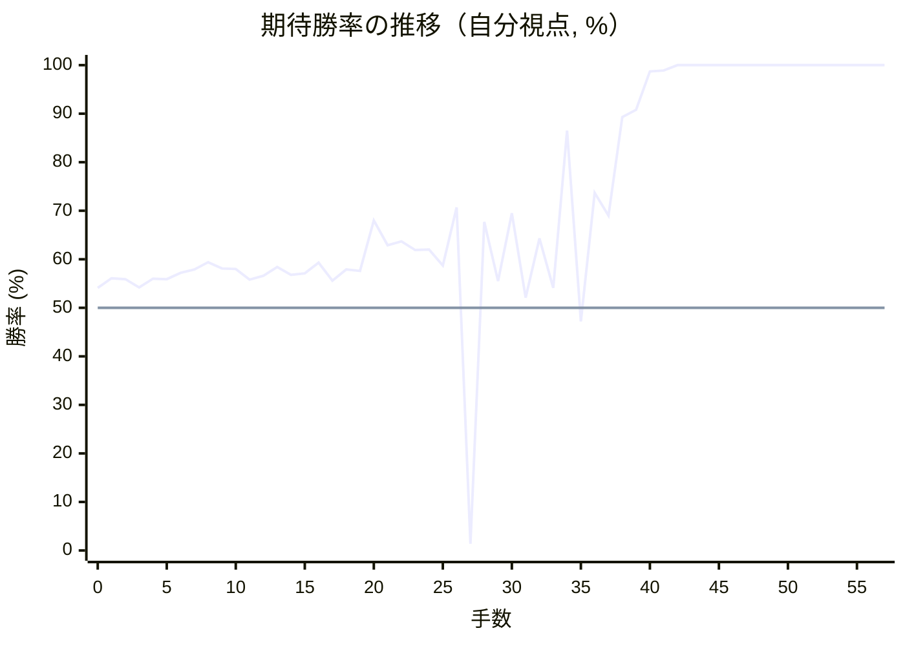
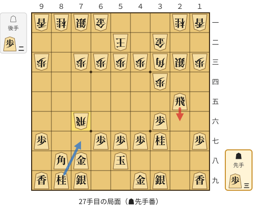
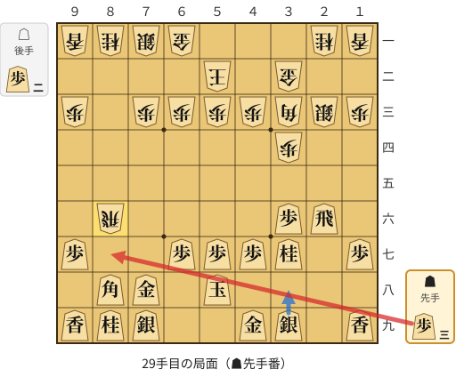
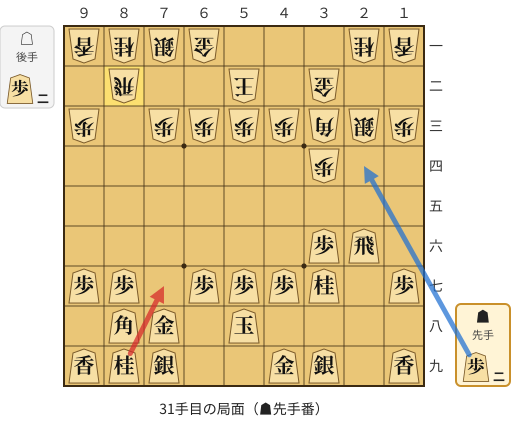
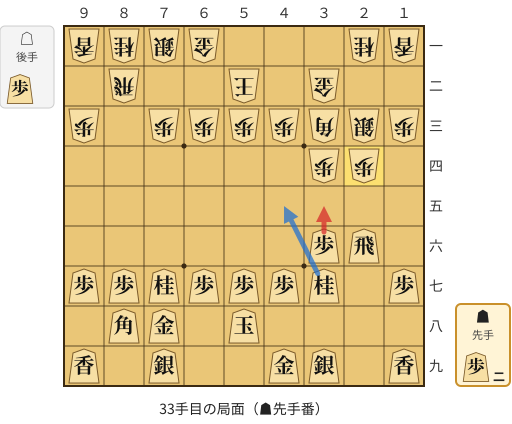
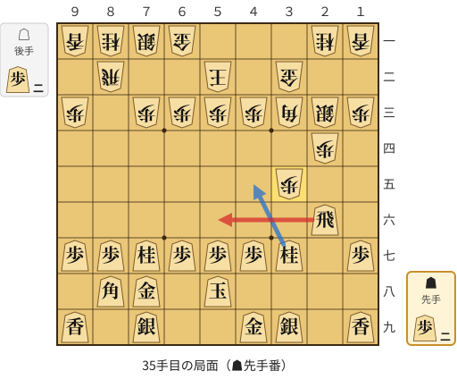
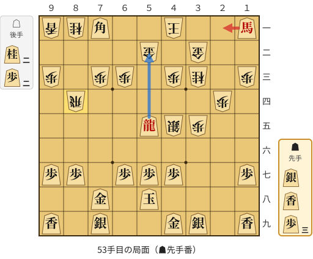

# 解析レポート huc6okuziluw

[README に戻る](../../../README.md)　/　棋譜: [CSA](../../../data/csa/shogi5/huc6okuziluw.csa)　/　解析の見方: [docs/mistake_analysis.md](../../../docs/mistake_analysis.md)

## 対局情報

| 項目 | 内容 |
|---|---|
| 日時 | 2026-11-01 02:19:33 |
| 持ち時間 | 5分 |
| 自分 | 先手（▲）（1722） |
| 相手 | 相手（1700） |
| 結果 | 勝ち（投了, 57手） |

## 解析環境

| 項目 | 内容 |
|---|---|
| エンジン | YaneuraOu NNUE 9.00git 64AVX2（V9.00/YANEURAOU_ENGINE_NNUE/AVX2） |
| 評価関数 | **水匠5**（`suisho5`） |
| nn.bin SHA-256 | `768068f0d534a0603a5d38bcd143de6bbca820d5f1c95a14d40863e5b7892d76` |
| 第1パス | movetime=150ms, MultiPV 1 |
| 第2パス | movetime=2000ms, MultiPV 3 |
| Threads / Hash | 8 / 512MB |
| 判定基準 | 疑問手 ≥5pt, 悪手 ≥10pt, 大悪手 ≥20pt（期待勝率 W(E)=1/(1+exp(-E/600))） |
| 解析日時 | 2026-11-03T04:05:28+09:00（解析バージョン 1, 37秒） |

## サマリー

| 自分の手数 | 深掘りした手 | 詰み逃し | 大悪手 | 悪手 | 疑問手 |
|--:|--:|--:|--:|--:|--:|
| 29 | 7 | 1 | 3 | 2 | 0 |

## 期待勝率の推移



<details><summary>1手ごとの数値（第1パス）</summary>

| 手数 | 指し手 | 評価値 | 勝率 | 低下 | 判定 |
|--:|---|--:|--:|--:|---|
| 1 | ▲７六歩(77) | +148 | 56.1% | -2.1pt |  |
| 2 | △８四歩(83) | +142 | 55.9% |  |  |
| 3 | ▲２六歩(27) | +101 | 54.2% | +1.7pt |  |
| 4 | △３四歩(33) | +145 | 56.0% |  |  |
| 5 | ▲２五歩(26) | +143 | 55.9% | +0.1pt |  |
| 6 | △８五歩(84) | +174 | 57.2% |  |  |
| 7 | ▲７八金(69) | +190 | 57.9% | -0.7pt |  |
| 8 | △３二金(41) | +228 | 59.4% |  |  |
| 9 | ▲２四歩(25) | +197 | 58.1% | +1.3pt |  |
| 10 | △同歩(23) | +194 | 58.0% |  |  |
| 11 | ▲同飛(28) | +140 | 55.8% | +2.2pt |  |
| 12 | △８六歩(85) | +160 | 56.6% |  |  |
| 13 | ▲同歩(87) | +203 | 58.4% | -1.8pt |  |
| 14 | △同飛(82) | +165 | 56.8% |  |  |
| 15 | ▲３四飛(24) | +172 | 57.1% | -0.3pt |  |
| 16 | △３三角(22) | +227 | 59.3% |  |  |
| 17 | ▲５八玉(59) | +135 | 55.6% | +3.7pt |  |
| 18 | △５二玉(51) | +190 | 57.9% |  |  |
| 19 | ▲３六歩(37) | +183 | 57.6% | +0.3pt |  |
| 20 | △２二銀(31) | +451 | 68.0% |  |  |
| 21 | ▲３七桂(29) | +316 | 62.9% | +5.1pt |  |
| 22 | △２三銀(22) | +338 | 63.7% |  |  |
| 23 | ▲３五飛(34) | +292 | 61.9% | +1.8pt |  |
| 24 | △３四歩打 | +294 | 62.0% |  |  |
| 25 | ▲２五飛(35) | +210 | 58.7% | +3.3pt |  |
| 26 | △７六飛(86) | +528 | 70.7% |  |  |
| 27 | ▲２六飛(25) | -2560 | 1.4% | +69.3pt | [大悪手](#ply-27) |
| 28 | △８六飛(76) | +444 | 67.7% |  |  |
| 29 | ▲８七歩打 | +132 | 55.5% | +12.2pt | [悪手](#ply-29) |
| 30 | △８二飛(86) | +493 | 69.5% |  |  |
| 31 | ▲７七桂(89) | +51 | 52.1% | +17.3pt | [大悪手](#ply-31) |
| 32 | △２四歩打 | +354 | 64.3% |  |  |
| 33 | ▲３五歩(36) | +98 | 54.1% | +10.3pt | [悪手](#ply-33) |
| 34 | △同歩(34) | +1113 | 86.5% |  |  |
| 35 | ▲５六飛(26) | -68 | 47.2% | +39.3pt | [大悪手](#ply-35) |
| 36 | △６二銀(71) | +618 | 73.7% |  |  |
| 37 | ▲４五桂(37) | +480 | 69.0% | +4.7pt |  |
| 38 | △４四角(33) | +1274 | 89.3% |  |  |
| 39 | ▲６五桂(77) | +1373 | 90.8% | -1.5pt |  |
| 40 | △３四銀(23) | +2601 | 98.7% |  |  |
| 41 | ▲４四角(88) | +2720 | 98.9% | -0.2pt |  |
| 42 | △４五銀(34) | +4644 | 100.0% |  |  |
| 43 | ▲５三桂成(65) | +5107 | 100.0% | -0.0pt |  |
| 44 | △同銀(62) | +5300 | 100.0% |  |  |
| 45 | ▲同飛成(56) | +5436 | 100.0% | -0.0pt |  |
| 46 | △４一玉(52) | +5507 | 100.0% |  |  |
| 47 | ▲１一角成(44) | +5608 | 100.0% | -0.0pt |  |
| 48 | △５二金(61) | +5598 | 100.0% |  |  |
| 49 | ▲５五龍(53) | +5857 | 100.0% | -0.0pt |  |
| 50 | △３三桂(21) | +5616 | 100.0% |  |  |
| 51 | ▲７一角打 | +5991 | 100.0% | -0.0pt |  |
| 52 | △８四飛(82) | #+25 | 100.0% |  |  |
| 53 | ▲２一馬(11) | +6172 | 100.0% | +0.0pt | [詰み逃し](#ply-53) |
| 54 | △５四歩打 | +6394 | 100.0% |  |  |
| 55 | ▲５三香打 | +6328 | 100.0% | +0.0pt |  |
| 56 | △５五歩(54) | #+5 | 100.0% |  |  |
| 57 | ▲５二香成(53) | #+4 | 100.0% | +0.0pt |  |

</details>

## 課題局面

<a id="ply-27"></a>
### 27手目 ▲２六飛(25) — 大悪手

| | 着手前 | 着手後 | 差 |
|---|--:|--:|--:|
| 期待勝率 | 71.1% | 0.8% | -70.3pt |
| 評価値 | +540 | -2903 | |

着手前の局面:



🔴 実戦 ▲２六飛(25)　🔵 AI推奨 ▲７七桂(89)　🟨 直前の相手の指し手

<details><summary>テキストの盤面図（BOD・将棋ソフトに貼り付け可）</summary>

```text
後手の持駒：歩二
  ９ ８ ７ ６ ５ ４ ３ ２ １
+---------------------------+
|v香v桂v銀v金 ・ ・ ・v桂v香|一
| ・ ・ ・ ・v玉 ・v金 ・ ・|二
|v歩 ・v歩v歩v歩v歩v角v銀v歩|三
| ・ ・ ・ ・ ・ ・v歩 ・ ・|四
| ・ ・ ・ ・ ・ ・ ・ 飛 ・|五
| ・ ・v飛 ・ ・ ・ 歩 ・ ・|六
| 歩 ・ ・ 歩 歩 歩 桂 ・ 歩|七
| ・ 角 金 ・ 玉 ・ ・ ・ ・|八
| 香 桂 銀 ・ ・ 金 銀 ・ 香|九
+---------------------------+
先手の持駒：歩三
手数＝26　△７六飛　まで
```

</details>

| | 指し手 | 評価値 | 読み筋 |
|---|---|--:|---|
| 実戦 | ▲２六飛(25) | -2903 | △７八飛成(76) ▲同銀(79) △８八角成(33) ▲６九銀(78) △９九馬(88) ▲２四歩打 |
| AI 1位 | ▲７七桂(89) | +540 | ▲７七桂(89) △４四歩(43) ▲８五飛(25) △８二歩打 ▲３八金(49) △３六飛(76) |
| AI 2位 | ▲７七角(88) | +478 | ▲７七角(88) △３六飛(76) ▲３八銀(39) △７七角成(33) ▲同桂(89) △３三桂(21) |
| AI 3位 | ▲３三角成(88) | +227 | ▲３三角成(88) △同桂(21) ▲８五飛(25) △８二歩打 ▲８三歩打 △９四角打 |

SFEN: `lnsg3nl/4k1g2/p1ppppbsp/6p2/7R1/2r3P2/P2PPPN1P/1BG1K4/LNS2GS1L b 3P2p 27`

<a id="ply-29"></a>
### 29手目 ▲８七歩打 — 悪手

| | 着手前 | 着手後 | 差 |
|---|--:|--:|--:|
| 期待勝率 | 65.0% | 54.3% | -10.7pt |
| 評価値 | +371 | +103 | |

着手前の局面:



🔴 実戦 ▲８七歩打　🔵 AI推奨 ▲３八銀(39)　🟨 直前の相手の指し手

<details><summary>テキストの盤面図（BOD・将棋ソフトに貼り付け可）</summary>

```text
後手の持駒：歩二
  ９ ８ ７ ６ ５ ４ ３ ２ １
+---------------------------+
|v香v桂v銀v金 ・ ・ ・v桂v香|一
| ・ ・ ・ ・v玉 ・v金 ・ ・|二
|v歩 ・v歩v歩v歩v歩v角v銀v歩|三
| ・ ・ ・ ・ ・ ・v歩 ・ ・|四
| ・ ・ ・ ・ ・ ・ ・ ・ ・|五
| ・v飛 ・ ・ ・ ・ 歩 飛 ・|六
| 歩 ・ ・ 歩 歩 歩 桂 ・ 歩|七
| ・ 角 金 ・ 玉 ・ ・ ・ ・|八
| 香 桂 銀 ・ ・ 金 銀 ・ 香|九
+---------------------------+
先手の持駒：歩三
手数＝28　△８六飛　まで
```

</details>

| | 指し手 | 評価値 | 読み筋 |
|---|---|--:|---|
| 実戦 | ▲８七歩打 | +103 | △７六飛(86) ▲７七角(88) △７二銀(71) ▲２四歩打 △１四銀(23) ▲１六歩(17) |
| AI 1位 | ▲３八銀(39) | +371 | ▲３八銀(39) △２二歩打 ▲８七歩打 △７六飛(86) ▲３三角成(88) △同桂(21) |
| AI 2位 | ▲２四歩打 | +366 | ▲２四歩打 △１四銀(23) ▲３八銀(39) △８八角成(33) ▲同銀(79) △４四角打 |
| AI 3位 | ▲４五桂(37) | +353 | ▲４五桂(37) △８八角成(33) ▲同銀(79) △４四角打 ▲７七角打 △７六飛(86) |

SFEN: `lnsg3nl/4k1g2/p1ppppbsp/6p2/9/1r4PR1/P2PPPN1P/1BG1K4/LNS2GS1L b 3P2p 29`

<a id="ply-31"></a>
### 31手目 ▲７七桂(89) — 大悪手

| | 着手前 | 着手後 | 差 |
|---|--:|--:|--:|
| 期待勝率 | 71.0% | 49.6% | -21.4pt |
| 評価値 | +536 | -10 | |

着手前の局面:



🔴 実戦 ▲７七桂(89)　🔵 AI推奨 ▲２四歩打　🟨 直前の相手の指し手

<details><summary>テキストの盤面図（BOD・将棋ソフトに貼り付け可）</summary>

```text
後手の持駒：歩二
  ９ ８ ７ ６ ５ ４ ３ ２ １
+---------------------------+
|v香v桂v銀v金 ・ ・ ・v桂v香|一
| ・v飛 ・ ・v玉 ・v金 ・ ・|二
|v歩 ・v歩v歩v歩v歩v角v銀v歩|三
| ・ ・ ・ ・ ・ ・v歩 ・ ・|四
| ・ ・ ・ ・ ・ ・ ・ ・ ・|五
| ・ ・ ・ ・ ・ ・ 歩 飛 ・|六
| 歩 歩 ・ 歩 歩 歩 桂 ・ 歩|七
| ・ 角 金 ・ 玉 ・ ・ ・ ・|八
| 香 桂 銀 ・ ・ 金 銀 ・ 香|九
+---------------------------+
先手の持駒：歩二
手数＝30　△８二飛　まで
```

</details>

| | 指し手 | 評価値 | 読み筋 |
|---|---|--:|---|
| 実戦 | ▲７七桂(89) | -10 | △６二銀(71) ▲４五桂(37) △４四角(33) ▲３五歩(36) △６四歩(63) ▲２四歩打 |
| AI 1位 | ▲２四歩打 | +536 | ▲２四歩打 △同銀(23) ▲３三角成(88) △同金(32) ▲２二角打 △２五歩打 |
| AI 2位 | ▲３三角成(88) | +385 | ▲３三角成(88) △同桂(21) ▲２四歩打 △１四銀(23) ▲３五歩(36) △８四飛(82) |
| AI 3位 | ▲３八銀(39) | +254 | ▲３八銀(39) △２四歩打 ▲３五歩(36) △６二銀(71) ▲３四歩(35) △同銀(23) |

SFEN: `lnsg3nl/1r2k1g2/p1ppppbsp/6p2/9/6PR1/PP1PPPN1P/1BG1K4/LNS2GS1L b 2P2p 31`

<a id="ply-33"></a>
### 33手目 ▲３五歩(36) — 悪手

| | 着手前 | 着手後 | 差 |
|---|--:|--:|--:|
| 期待勝率 | 63.2% | 50.2% | -13.0pt |
| 評価値 | +324 | +5 | |

着手前の局面:



🔴 実戦 ▲３五歩(36)　🔵 AI推奨 ▲４五桂(37)　🟨 直前の相手の指し手

<details><summary>テキストの盤面図（BOD・将棋ソフトに貼り付け可）</summary>

```text
後手の持駒：歩
  ９ ８ ７ ６ ５ ４ ３ ２ １
+---------------------------+
|v香v桂v銀v金 ・ ・ ・v桂v香|一
| ・v飛 ・ ・v玉 ・v金 ・ ・|二
|v歩 ・v歩v歩v歩v歩v角v銀v歩|三
| ・ ・ ・ ・ ・ ・v歩v歩 ・|四
| ・ ・ ・ ・ ・ ・ ・ ・ ・|五
| ・ ・ ・ ・ ・ ・ 歩 飛 ・|六
| 歩 歩 桂 歩 歩 歩 桂 ・ 歩|七
| ・ 角 金 ・ 玉 ・ ・ ・ ・|八
| 香 ・ 銀 ・ ・ 金 銀 ・ 香|九
+---------------------------+
先手の持駒：歩二
手数＝32　△２四歩　まで
```

</details>

| | 指し手 | 評価値 | 読み筋 |
|---|---|--:|---|
| 実戦 | ▲３五歩(36) | +5 | △６四歩(63) ▲４五桂(37) △４四角(33) ▲８六飛(26) △同飛(82) ▲同歩(87) |
| AI 1位 | ▲４五桂(37) | +324 | ▲４五桂(37) △４四角(33) ▲６五桂(77) △２六角(44) ▲１一角成(88) △６二銀(71) |
| AI 2位 | ▲３五歩(36) | +91 | ▲３五歩(36) △４四歩(43) ▲２五歩打 △３五歩(34) ▲２四歩(25) △３四銀(23) |
| AI 3位 | ▲３八銀(39) | +1 | ▲３八銀(39) △６四歩(63) ▲３五歩(36) △４四角(33) ▲８六飛(26) △同飛(82) |

SFEN: `lnsg3nl/1r2k1g2/p1ppppbsp/6pp1/9/6PR1/PPNPPPN1P/1BG1K4/L1S2GS1L b 2Pp 33`

<a id="ply-35"></a>
### 35手目 ▲５六飛(26) — 大悪手

| | 着手前 | 着手後 | 差 |
|---|--:|--:|--:|
| 期待勝率 | 90.5% | 43.6% | -46.9pt |
| 評価値 | +1350 | -155 | |

着手前の局面:



🔴 実戦 ▲５六飛(26)　🔵 AI推奨 ▲４五桂(37)　🟨 直前の相手の指し手

<details><summary>テキストの盤面図（BOD・将棋ソフトに貼り付け可）</summary>

```text
後手の持駒：歩二
  ９ ８ ７ ６ ５ ４ ３ ２ １
+---------------------------+
|v香v桂v銀v金 ・ ・ ・v桂v香|一
| ・v飛 ・ ・v玉 ・v金 ・ ・|二
|v歩 ・v歩v歩v歩v歩v角v銀v歩|三
| ・ ・ ・ ・ ・ ・ ・v歩 ・|四
| ・ ・ ・ ・ ・ ・v歩 ・ ・|五
| ・ ・ ・ ・ ・ ・ ・ 飛 ・|六
| 歩 歩 桂 歩 歩 歩 桂 ・ 歩|七
| ・ 角 金 ・ 玉 ・ ・ ・ ・|八
| 香 ・ 銀 ・ ・ 金 銀 ・ 香|九
+---------------------------+
先手の持駒：歩二
手数＝34　△３五同歩　まで
```

</details>

| | 指し手 | 評価値 | 読み筋 |
|---|---|--:|---|
| 実戦 | ▲５六飛(26) | -155 | △４四歩(43) ▲７四歩打 △６二銀(71) ▲６五桂(77) △７二金(61) ▲５五角(88) |
| AI 1位 | ▲４五桂(37) | +1350 | ▲４五桂(37) △４四角(33) ▲５六飛(26) △６二銀(71) ▲６五桂(77) △４二金(32) |
| AI 2位 | ▲７四歩打 | +582 | ▲７四歩打 △６二銀(71) ▲４五桂(37) △４四角(33) ▲６五桂(77) △８五飛(82) |
| AI 3位 | ▲７二歩打 | +197 | ▲７二歩打 △６二銀(71) ▲４五桂(37) △４四角(33) ▲６五桂(77) △６四歩(63) |

SFEN: `lnsg3nl/1r2k1g2/p1ppppbsp/7p1/6p2/7R1/PPNPPPN1P/1BG1K4/L1S2GS1L b 2P2p 35`

<a id="ply-53"></a>
### 53手目 ▲２一馬(11) — 詰み逃し

| | 着手前 | 着手後 | 差 |
|---|--:|--:|--:|
| 期待勝率 | 100.0% | 100.0% | -0.0pt |
| 評価値 | 17手詰め | +6402 | |

着手前の局面:



🔴 実戦 ▲２一馬(11)　🔵 AI推奨 ▲５二龍(55)　🟨 直前の相手の指し手

<details><summary>テキストの盤面図（BOD・将棋ソフトに貼り付け可）</summary>

```text
後手の持駒：桂二　歩二
  ９ ８ ７ ６ ５ ４ ３ ２ １
+---------------------------+
|v香v桂 角 ・ ・v玉 ・ ・ 馬|一
| ・ ・ ・ ・v金 ・v金 ・ ・|二
|v歩 ・v歩v歩 ・v歩v桂 ・v歩|三
| ・v飛 ・ ・ ・ ・ ・v歩 ・|四
| ・ ・ ・ ・ 龍v銀v歩 ・ ・|五
| ・ ・ ・ ・ ・ ・ ・ ・ ・|六
| 歩 歩 ・ 歩 歩 歩 ・ ・ 歩|七
| ・ ・ 金 ・ 玉 ・ ・ ・ ・|八
| 香 ・ 銀 ・ ・ 金 銀 ・ 香|九
+---------------------------+
先手の持駒：銀　香　歩三
手数＝52　△８四飛　まで
```

</details>

| | 指し手 | 評価値 | 読み筋 |
|---|---|--:|---|
| 実戦 | ▲２一馬(11) | +6402 | △５三歩打 ▲同角成(71) |
| AI 1位 | ▲５二龍(55) | 17手詰め | ▲５二龍(55) △同玉(41) ▲５三銀打 △４一玉(52) ▲６二角成(71) △６六桂打 |
| AI 2位 | ▲５三香打 | +7968 | ▲５三香打 △４二金(52) ▲５一香成(53) △３一玉(41) ▲２一銀打 △２五桂(33) |
| AI 3位 | ▲５三銀打 | +6451 | ▲５三銀打 △５一歩打 ▲５二銀成(53) △同歩(51) ▲６二角成(71) △５四桂打 |

SFEN: `lnB2k2+B/4g1g2/p1pp1pn1p/1r5p1/4+Rsp2/9/PP1PPP2P/2G1K4/L1S2GS1L b SL3P2n2p 53`

