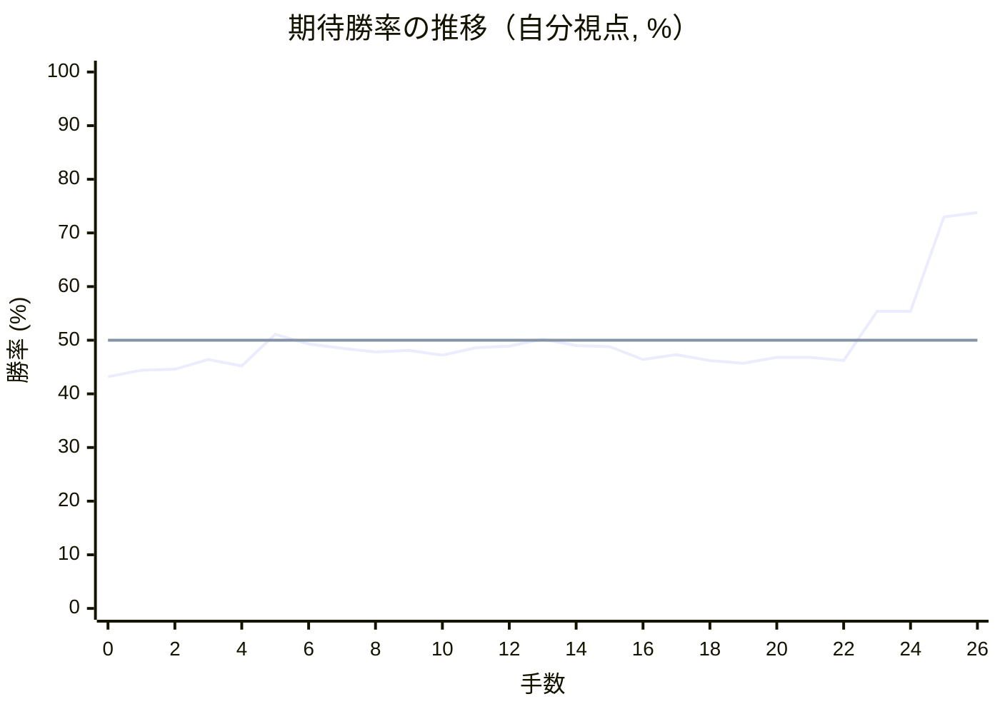

# 解析レポート hx9ye06ag4ck

[README に戻る](../../../README.md)　/　棋譜: [CSA](../../../data/csa/shogi5/hx9ye06ag4ck.csa)　/　解析の見方: [docs/mistake_analysis.md](../../../docs/mistake_analysis.md)

## 対局情報

| 項目 | 内容 |
|---|---|
| 日時 | 2026-11-01 23:06:15 |
| 持ち時間 | 5分 |
| 自分 | 後手（△）（1716） |
| 相手 | 相手（1640） |
| 結果 | 勝ち（投了, 26手） |

## 解析環境

| 項目 | 内容 |
|---|---|
| エンジン | YaneuraOu NNUE 9.00git 64AVX2（V9.00/YANEURAOU_ENGINE_NNUE/AVX2） |
| 評価関数 | **水匠5**（`suisho5`） |
| nn.bin SHA-256 | `768068f0d534a0603a5d38bcd143de6bbca820d5f1c95a14d40863e5b7892d76` |
| 第1パス | movetime=150ms, MultiPV 1 |
| 第2パス | movetime=2000ms, MultiPV 3 |
| Threads / Hash | 8 / 512MB |
| 判定基準 | 疑問手 ≥5pt, 悪手 ≥10pt, 大悪手 ≥20pt（期待勝率 W(E)=1/(1+exp(-E/600))） |
| 解析日時 | 2026-11-03T03:31:07+09:00（解析バージョン 1, 5秒） |

## サマリー

| 自分の手数 | 深掘りした手 | 詰み逃し | 大悪手 | 悪手 | 疑問手 |
|--:|--:|--:|--:|--:|--:|
| 13 | 0 | 0 | 0 | 0 | 0 |

## 期待勝率の推移

1手ごとの数値（第1パス）

| 手数 | 指し手 | 評価値 | 勝率 | 低下 | 判定 |
|--:|---|--:|--:|--:|---|
| 1 | ▲２六歩(27) | -135 | 44.4% |  |  |
| 2 | △８四歩(83) | -131 | 44.6% | -0.2pt |  |
| 3 | ▲２五歩(26) | -87 | 46.4% |  |  |
| 4 | △８五歩(84) | -115 | 45.2% | +1.2pt |  |
| 5 | ▲２四歩(25) | +26 | 51.1% |  |  |
| 6 | △同歩(23) | -18 | 49.3% | +1.8pt |  |
| 7 | ▲７八金(69) | -36 | 48.5% |  |  |
| 8 | △３二金(41) | -54 | 47.8% | +0.7pt |  |
| 9 | ▲２四飛(28) | -45 | 48.1% |  |  |
| 10 | △１四歩(13) | -68 | 47.2% | +1.0pt |  |
| 11 | ▲５八玉(59) | -33 | 48.6% |  |  |
| 12 | △２三歩打 | -27 | 48.9% | -0.2pt |  |
| 13 | ▲２六飛(24) | +5 | 50.2% |  |  |
| 14 | △５二玉(51) | -25 | 49.0% | +1.2pt |  |
| 15 | ▲９六歩(97) | -28 | 48.8% |  |  |
| 16 | △９四歩(93) | -86 | 46.4% | +2.4pt |  |
| 17 | ▲３八銀(39) | -64 | 47.3% |  |  |
| 18 | △７二銀(71) | -91 | 46.2% | +1.1pt |  |
| 19 | ▲７六歩(77) | -103 | 45.7% |  |  |
| 20 | △８六歩(85) | -76 | 46.8% | -1.1pt |  |
| 21 | ▲同歩(87) | -77 | 46.8% |  |  |
| 22 | △同飛(82) | -92 | 46.2% | +0.6pt |  |
| 23 | ▲４六歩(47) | +131 | 55.4% |  |  |
| 24 | △３四歩(33) | +131 | 55.4% | +0.0pt |  |
| 25 | ▲４七銀(38) | +597 | 73.0% |  |  |
| 26 | △８八角成(22) | +622 | 73.8% | -0.8pt |  |

## 課題局面

判定基準に該当する手はありませんでした。
