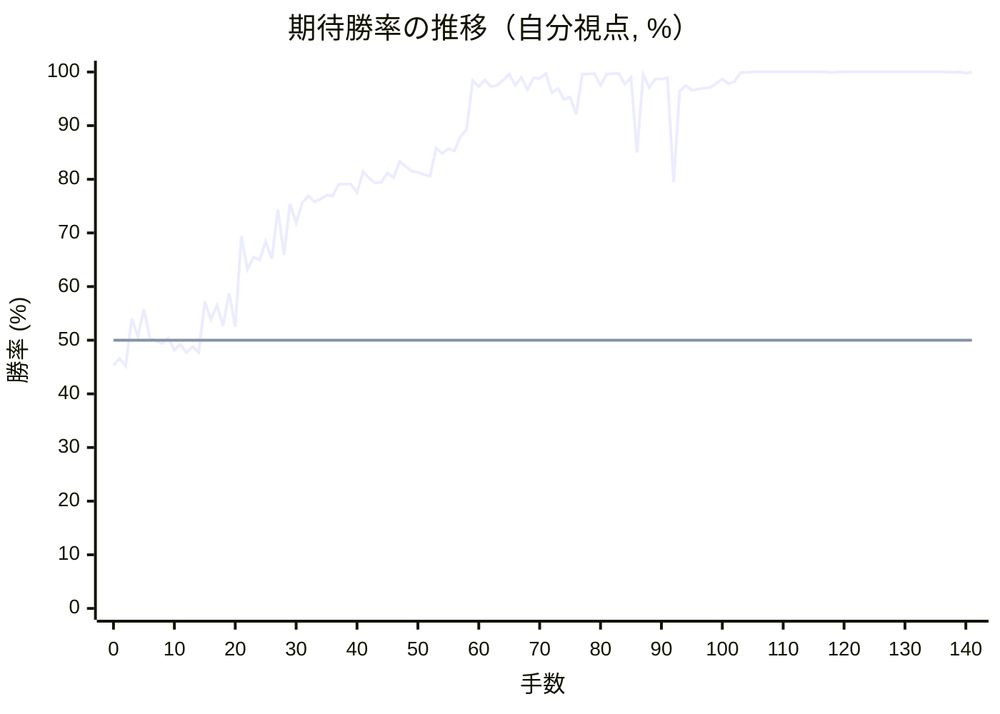
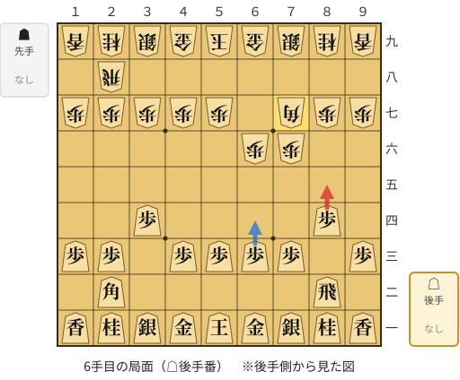
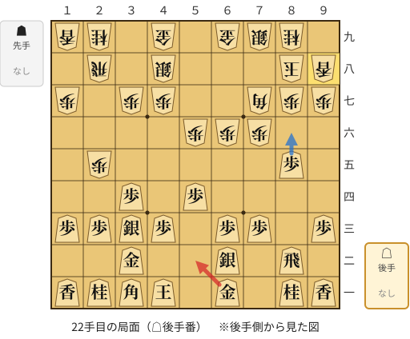
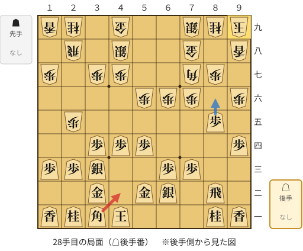
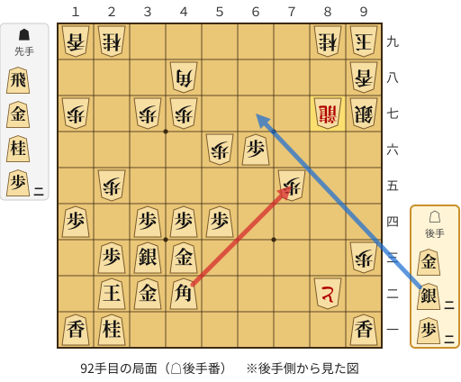
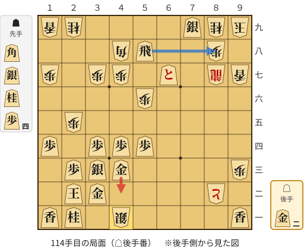
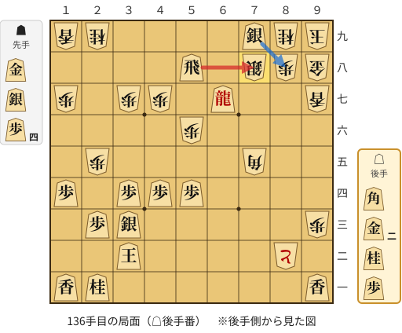
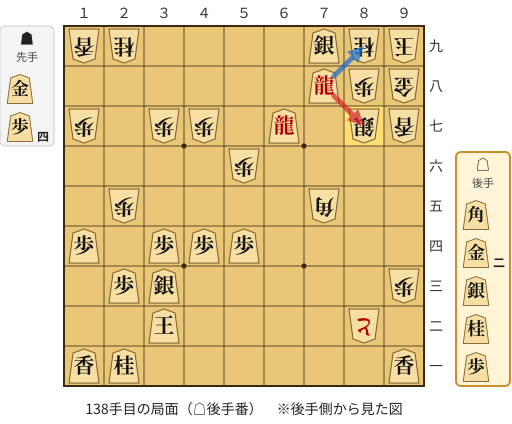

# 解析レポート i733sdd6lfai

[README に戻る](../../../README.md)　/　棋譜: [CSA](../../../data/csa/shogi5/i733sdd6lfai.csa)　/　解析の見方: [docs/mistake_analysis.md](../../../docs/mistake_analysis.md)

## 対局情報

| 項目 | 内容 |
|---|---|
| 日時 | 2026-11-20 00:30:12 |
| 持ち時間 | 5分 |
| 自分 | 後手（△）（1713） |
| 相手 | 相手（1652） |
| 結果 | 負け（時間切れ, 141手） |

## 解析環境

| 項目 | 内容 |
|---|---|
| エンジン | YaneuraOu NNUE 9.00git 64AVX2（V9.00/YANEURAOU_ENGINE_NNUE/AVX2） |
| 評価関数 | **水匠5**（`suisho5`） |
| nn.bin SHA-256 | `768068f0d534a0603a5d38bcd143de6bbca820d5f1c95a14d40863e5b7892d76` |
| 第1パス | movetime=150ms, MultiPV 1 |
| 第2パス | movetime=2000ms, MultiPV 3 |
| Threads / Hash | 8 / 512MB |
| 判定基準 | 疑問手 ≥5pt, 悪手 ≥10pt, 大悪手 ≥20pt（期待勝率 W(E)=1/(1+exp(-E/600))） |
| 解析日時 | 2026-11-20T20:00:30+09:00（解析バージョン 1, 58秒） |

## サマリー

| 自分の手数 | 深掘りした手 | 詰み逃し | 大悪手 | 悪手 | 疑問手 |
|--:|--:|--:|--:|--:|--:|
| 70 | 9 | 3 | 0 | 1 | 3 |

## 期待勝率の推移



<details><summary>1手ごとの数値（第1パス）</summary>

| 手数 | 指し手 | 評価値 | 勝率 | 低下 | 判定 |
|--:|---|--:|--:|--:|---|
| 1 | ▲７六歩(77) | -82 | 46.6% |  |  |
| 2 | △３四歩(33) | -116 | 45.2% | +1.4pt |  |
| 3 | ▲６六歩(67) | +95 | 54.0% |  |  |
| 4 | △８四歩(83) | +17 | 50.7% | +3.2pt |  |
| 5 | ▲７七角(88) | +140 | 55.8% |  |  |
| 6 | △８五歩(84) | +4 | 50.2% | +5.6pt | [疑問手](#ply-6) |
| 7 | ▲２六歩(27) | -3 | 49.9% |  |  |
| 8 | △４二銀(31) | -14 | 49.4% | +0.5pt |  |
| 9 | ▲２五歩(26) | +10 | 50.4% |  |  |
| 10 | △３三銀(42) | -43 | 48.2% | +2.2pt |  |
| 11 | ▲４八銀(39) | -20 | 49.2% |  |  |
| 12 | △６二銀(71) | -56 | 47.7% | +1.5pt |  |
| 13 | ▲５六歩(57) | -30 | 48.8% |  |  |
| 14 | △５四歩(53) | -56 | 47.7% | +1.1pt |  |
| 15 | ▲６八玉(59) | +173 | 57.2% |  |  |
| 16 | △３二金(41) | +93 | 53.9% | +3.3pt |  |
| 17 | ▲７八玉(68) | +157 | 56.5% |  |  |
| 18 | △３一角(22) | +66 | 52.7% | +3.8pt |  |
| 19 | ▲８八玉(78) | +213 | 58.8% |  |  |
| 20 | △４一玉(51) | +61 | 52.5% | +6.2pt |  |
| 21 | ▲９八香(99) | +491 | 69.4% |  |  |
| 22 | △５二金(61) | +325 | 63.2% | +6.2pt | [疑問手](#ply-22) |
| 23 | ▲７八金(69) | +385 | 65.5% |  |  |
| 24 | △９四歩(93) | +372 | 65.0% | +0.5pt |  |
| 25 | ▲９六歩(97) | +462 | 68.4% |  |  |
| 26 | △４四歩(43) | +377 | 65.2% | +3.1pt |  |
| 27 | ▲９九玉(88) | +640 | 74.4% |  |  |
| 28 | △４二角(31) | +394 | 65.9% | +8.5pt | [疑問手](#ply-28) |
| 29 | ▲８八金(78) | +673 | 75.4% |  |  |
| 30 | △４三金(52) | +564 | 71.9% | +3.5pt |  |
| 31 | ▲５九金(49) | +678 | 75.6% |  |  |
| 32 | △３一玉(41) | +721 | 76.9% | -1.3pt |  |
| 33 | ▲６九金(59) | +686 | 75.8% |  |  |
| 34 | △２二玉(31) | +703 | 76.3% | -0.5pt |  |
| 35 | ▲７八金(69) | +724 | 77.0% |  |  |
| 36 | △１四歩(13) | +721 | 76.9% | +0.1pt |  |
| 37 | ▲５九角(77) | +797 | 79.1% |  |  |
| 38 | △７四歩(73) | +798 | 79.1% | -0.0pt |  |
| 39 | ▲５七銀(48) | +798 | 79.1% |  |  |
| 40 | △７三銀(62) | +743 | 77.5% | +1.6pt |  |
| 41 | ▲６八銀(57) | +885 | 81.4% |  |  |
| 42 | △８六歩(85) | +840 | 80.2% | +1.2pt |  |
| 43 | ▲同歩(87) | +806 | 79.3% |  |  |
| 44 | △同飛(82) | +812 | 79.5% | -0.2pt |  |
| 45 | ▲７七銀(68) | +876 | 81.2% |  |  |
| 46 | △８二飛(86) | +844 | 80.3% | +0.8pt |  |
| 47 | ▲８六歩打 | +966 | 83.3% |  |  |
| 48 | △８四銀(73) | +926 | 82.4% | +0.9pt |  |
| 49 | ▲８七金(78) | +891 | 81.5% |  |  |
| 50 | △６四角(42) | +880 | 81.3% | +0.3pt |  |
| 51 | ▲７八銀(79) | +866 | 80.9% |  |  |
| 52 | △７三桂(81) | +855 | 80.6% | +0.3pt |  |
| 53 | ▲６八飛(28) | +1078 | 85.8% |  |  |
| 54 | △９五歩(94) | +1032 | 84.8% | +1.0pt |  |
| 55 | ▲同歩(96) | +1076 | 85.7% |  |  |
| 56 | △８五歩打 | +1054 | 85.3% | +0.5pt |  |
| 57 | ▲６五歩(66) | +1197 | 88.0% |  |  |
| 58 | △４二角(64) | +1272 | 89.3% | -1.3pt |  |
| 59 | ▲４八角(59) | +2457 | 98.4% |  |  |
| 60 | △８六歩(85) | +2151 | 97.3% | +1.1pt |  |
| 61 | ▲同銀(77) | +2496 | 98.5% |  |  |
| 62 | △８五歩打 | +2140 | 97.3% | +1.2pt |  |
| 63 | ▲９七銀(86) | +2194 | 97.5% |  |  |
| 64 | △９五銀(84) | +2518 | 98.5% | -1.0pt |  |
| 65 | ▲６四歩(65) | +3254 | 99.6% |  |  |
| 66 | △同歩(63) | +2197 | 97.5% | +2.1pt |  |
| 67 | ▲９二歩打 | +2775 | 99.0% |  |  |
| 68 | △同飛(82) | +2031 | 96.7% | +2.3pt |  |
| 69 | ▲９三歩打 | +2676 | 98.9% |  |  |
| 70 | △８二飛(92) | +2657 | 98.8% | +0.0pt |  |
| 71 | ▲７五歩(76) | +3514 | 99.7% |  |  |
| 72 | △８六銀(95) | +1923 | 96.1% | +3.6pt |  |
| 73 | ▲７四歩(75) | +2066 | 96.9% |  |  |
| 74 | △８七銀成(86) | +1750 | 94.9% | +2.0pt |  |
| 75 | ▲同銀(78) | +1808 | 95.3% |  |  |
| 76 | △８六歩(85) | +1473 | 92.1% | +3.2pt |  |
| 77 | ▲７三歩成(74) | +3326 | 99.6% |  |  |
| 78 | △８七歩成(86) | +3313 | 99.6% | +0.0pt |  |
| 79 | ▲８二と(73) | +3415 | 99.7% |  |  |
| 80 | △８八と(87) | +2205 | 97.5% | +2.1pt |  |
| 81 | ▲同飛(68) | +3323 | 99.6% |  |  |
| 82 | △８七歩打 | +3433 | 99.7% | -0.1pt |  |
| 83 | ▲同飛(88) | +3447 | 99.7% |  |  |
| 84 | △７六金打 | +2252 | 97.7% | +2.0pt |  |
| 85 | ▲８三飛成(87) | +2773 | 99.0% |  |  |
| 86 | △６五歩(64) | +1040 | 85.0% | +14.0pt |  |
| 87 | ▲７五歩打 | +3140 | 99.5% |  |  |
| 88 | △６六歩(65) | +2111 | 97.1% | +2.3pt |  |
| 89 | ▲８七銀打 | +2581 | 98.7% |  |  |
| 90 | △同金(76) | +2591 | 98.7% | -0.0pt |  |
| 91 | ▲同龍(83) | +2697 | 98.9% |  |  |
| 92 | △７五角(42) | +811 | 79.4% | +19.5pt | [悪手](#ply-92) |
| 93 | ▲７六金打 | +1976 | 96.4% |  |  |
| 94 | △９七角成(75) | +2193 | 97.5% | -1.1pt |  |
| 95 | ▲同香(98) | +2013 | 96.6% |  |  |
| 96 | △６七銀打 | +2038 | 96.8% | -0.1pt |  |
| 97 | ▲７七金(76) | +2083 | 97.0% |  |  |
| 98 | △７六歩打 | +2103 | 97.1% | -0.1pt |  |
| 99 | ▲６七金(77) | +2291 | 97.9% |  |  |
| 100 | △８六歩打 | +2586 | 98.7% | -0.8pt |  |
| 101 | ▲同龍(87) | +2288 | 97.8% |  |  |
| 102 | △６七歩成(66) | +2403 | 98.2% | -0.4pt |  |
| 103 | ▲７六龍(86) | +3931 | 99.9% |  |  |
| 104 | △７八銀打 | +4103 | 99.9% | -0.0pt |  |
| 105 | ▲８三飛打 | +4900 | 100.0% |  |  |
| 106 | △８七歩打 | +5217 | 100.0% | -0.0pt |  |
| 107 | ▲８八歩打 | +5493 | 100.0% |  |  |
| 108 | △７九銀打 | +4926 | 100.0% | +0.0pt |  |
| 109 | ▲８七飛成(83) | +4721 | 100.0% |  |  |
| 110 | △同銀成(78) | +5296 | 100.0% | -0.0pt |  |
| 111 | ▲同龍(76) | +5694 | 100.0% |  |  |
| 112 | △５八飛打 | +5237 | 100.0% | +0.0pt |  |
| 113 | ▲４一銀打 | #+11 | 100.0% |  |  |
| 114 | △４二金(43) | +4660 | 100.0% | +0.0pt | [詰み逃し](#ply-114) |
| 115 | ▲３二銀成(41) | +4615 | 100.0% |  |  |
| 116 | △同金(42) | +4887 | 100.0% | -0.0pt |  |
| 117 | ▲９八金打 | +6355 | 100.0% |  |  |
| 118 | △４八飛成(58) | +4516 | 99.9% | +0.1pt |  |
| 119 | ▲７五角打 | +5593 | 100.0% |  |  |
| 120 | △６八龍(48) | +5798 | 100.0% | -0.0pt |  |
| 121 | ▲７六銀打 | +6262 | 100.0% |  |  |
| 122 | △７八銀打 | +6452 | 100.0% | -0.0pt |  |
| 123 | ▲６七銀(76) | +6503 | 100.0% |  |  |
| 124 | △同銀成(78) | +6266 | 100.0% | +0.0pt |  |
| 125 | ▲同龍(87) | +6376 | 100.0% |  |  |
| 126 | △同龍(68) | +6454 | 100.0% | -0.0pt |  |
| 127 | ▲８七銀打 | +6797 | 100.0% |  |  |
| 128 | △５八飛打 | +6187 | 100.0% | +0.0pt |  |
| 129 | ▲７八歩打 | +6484 | 100.0% |  |  |
| 130 | △６九銀打 | +6560 | 100.0% | -0.0pt |  |
| 131 | ▲２四桂打 | +7318 | 100.0% |  |  |
| 132 | △７八銀成(69) | +7212 | 100.0% | +0.0pt |  |
| 133 | ▲３二桂成(24) | +35281 | 100.0% |  |  |
| 134 | △同玉(22) | +35281 | 100.0% | +0.0pt |  |
| 135 | ▲７八銀(87) | #+15 | 100.0% |  |  |
| 136 | △同飛成(58) | +34194 | 100.0% | +0.0pt | [詰み逃し](#ply-136) |
| 137 | ▲８七銀打 | #+5 | 100.0% |  |  |
| 138 | △同龍(78) | +3976 | 99.9% | +0.1pt | [詰み逃し](#ply-138) |
| 139 | ▲同金(98) | +5427 | 100.0% |  |  |
| 140 | △同龍(67) | +3878 | 99.8% | +0.1pt |  |
| 141 | ▲３一金打 | +7155 | 100.0% |  |  |

</details>

## 課題局面

<a id="ply-6"></a>
### 6手目 △８五歩(84) — 疑問手

| | 着手前 | 着手後 | 差 |
|---|--:|--:|--:|
| 期待勝率 | 55.9% | 50.1% | -5.8pt |
| 評価値 | +142 | +2 | |

着手前の局面:



🔴 実戦 △８五歩(84)　🔵 AI推奨 △６四歩(63)　🟨 直前の相手の指し手

<details><summary>テキストの盤面図（BOD・将棋ソフトに貼り付け可）</summary>

```text
後手の持駒：なし
  ９ ８ ７ ６ ５ ４ ３ ２ １
+---------------------------+
|v香v桂v銀v金v玉v金v銀v桂v香|一
| ・v飛 ・ ・ ・ ・ ・v角 ・|二
|v歩 ・v歩v歩v歩v歩 ・v歩v歩|三
| ・v歩 ・ ・ ・ ・v歩 ・ ・|四
| ・ ・ ・ ・ ・ ・ ・ ・ ・|五
| ・ ・ 歩 歩 ・ ・ ・ ・ ・|六
| 歩 歩 角 ・ 歩 歩 歩 歩 歩|七
| ・ ・ ・ ・ ・ ・ ・ 飛 ・|八
| 香 桂 銀 金 玉 金 銀 桂 香|九
+---------------------------+
先手の持駒：なし
後手番
手数＝5　▲７七角　まで
```

</details>

| | 指し手 | 評価値 | 読み筋 |
|---|---|--:|---|
| 実戦 | △８五歩(84) | +2 | ▲２六歩(27) △６二銀(71) |
| AI 1位 | △６四歩(63) | +142 | △６四歩(63) ▲２六歩(27) △６二飛(82) ▲６八銀(79) △７二銀(71) ▲４八銀(39) |
| AI 2位 | △６二飛(82) | +136 | △６二飛(82) ▲２六歩(27) △７二銀(71) ▲６八銀(79) △６四歩(63) ▲５六歩(57) |
| AI 3位 | △７二銀(71) | +140 | △７二銀(71) ▲２六歩(27) △６四歩(63) ▲５六歩(57) △６三銀(72) ▲６八銀(79) |

SFEN: `lnsgkgsnl/1r5b1/p1pppp1pp/1p4p2/9/2PP5/PPB1PPPPP/7R1/LNSGKGSNL w - 6`

<a id="ply-22"></a>
### 22手目 △５二金(61) — 疑問手

| | 着手前 | 着手後 | 差 |
|---|--:|--:|--:|
| 期待勝率 | 69.8% | 61.4% | -8.4pt |
| 評価値 | +502 | +278 | |

着手前の局面:



🔴 実戦 △５二金(61)　🔵 AI推奨 △８六歩(85)　🟨 直前の相手の指し手

<details><summary>テキストの盤面図（BOD・将棋ソフトに貼り付け可）</summary>

```text
後手の持駒：なし
  ９ ８ ７ ６ ５ ４ ３ ２ １
+---------------------------+
|v香v桂 ・v金 ・v玉v角v桂v香|一
| ・v飛 ・v銀 ・ ・v金 ・ ・|二
|v歩 ・v歩v歩 ・v歩v銀v歩v歩|三
| ・ ・ ・ ・v歩 ・v歩 ・ ・|四
| ・v歩 ・ ・ ・ ・ ・ 歩 ・|五
| ・ ・ 歩 歩 歩 ・ ・ ・ ・|六
| 歩 歩 角 ・ ・ 歩 歩 ・ 歩|七
| 香 玉 ・ ・ ・ 銀 ・ 飛 ・|八
| ・ 桂 銀 金 ・ 金 ・ 桂 香|九
+---------------------------+
先手の持駒：なし
後手番
手数＝21　▲９八香　まで
```

</details>

| | 指し手 | 評価値 | 読み筋 |
|---|---|--:|---|
| 実戦 | △５二金(61) | +278 | ▲５八金(49) △７四歩(73) ▲６七金(58) △７三桂(81) ▲５七銀(48) △４四歩(43) |
| AI 1位 | △８六歩(85) | +502 | △８六歩(85) ▲同歩(87) △同角(31) ▲同角(77) △同飛(82) ▲８七歩打 |
| AI 2位 | △７四歩(73) | +336 | △７四歩(73) ▲５八金(49) △４四歩(43) ▲６七金(58) △７三桂(81) ▲７八銀(79) |
| AI 3位 | △４四歩(43) | +336 | △４四歩(43) ▲５八金(49) △７四歩(73) ▲６七金(58) △７三桂(81) ▲３六歩(37) |

SFEN: `ln1g1kbnl/1r1s2g2/p1pp1pspp/4p1p2/1p5P1/2PPP4/PPB2PP1P/LK3S1R1/1NSG1G1NL w - 22`

<a id="ply-28"></a>
### 28手目 △４二角(31) — 疑問手

| | 着手前 | 着手後 | 差 |
|---|--:|--:|--:|
| 期待勝率 | 75.5% | 68.2% | -7.3pt |
| 評価値 | +674 | +458 | |

着手前の局面:



🔴 実戦 △４二角(31)　🔵 AI推奨 △８六歩(85)　🟨 直前の相手の指し手

<details><summary>テキストの盤面図（BOD・将棋ソフトに貼り付け可）</summary>

```text
後手の持駒：なし
  ９ ８ ７ ６ ５ ４ ３ ２ １
+---------------------------+
|v香v桂 ・ ・ ・v玉v角v桂v香|一
| ・v飛 ・v銀v金 ・v金 ・ ・|二
| ・ ・v歩v歩 ・ ・v銀v歩v歩|三
|v歩 ・ ・ ・v歩v歩v歩 ・ ・|四
| ・v歩 ・ ・ ・ ・ ・ 歩 ・|五
| 歩 ・ 歩 歩 歩 ・ ・ ・ ・|六
| ・ 歩 角 ・ ・ 歩 歩 ・ 歩|七
| 香 ・ 金 ・ ・ 銀 ・ 飛 ・|八
| 玉 桂 銀 ・ ・ 金 ・ 桂 香|九
+---------------------------+
先手の持駒：なし
後手番
手数＝27　▲９九玉　まで
```

</details>

| | 指し手 | 評価値 | 読み筋 |
|---|---|--:|---|
| 実戦 | △４二角(31) | +458 | ▲５七銀(48) △７四歩(73) ▲５八金(49) △８六歩(85) ▲同歩(87) △同角(42) |
| AI 1位 | △８六歩(85) | +674 | △８六歩(85) ▲同歩(87) △同角(31) ▲同角(77) △同飛(82) ▲５八金(49) |
| AI 2位 | △７四歩(73) | +536 | △７四歩(73) ▲５八金(49) △７三桂(81) ▲５七銀(48) △８六歩(85) ▲同角(77) |
| AI 3位 | △７四歩(73) | +530 | △７四歩(73) ▲５八金(49) △７三桂(81) ▲５七銀(48) △１四歩(13) ▲８八銀(79) |

SFEN: `ln3kbnl/1r1sg1g2/2pp2spp/p3ppp2/1p5P1/P1PPP4/1PB2PP1P/L1G2S1R1/KNS2G1NL w - 28`

<a id="ply-92"></a>
### 92手目 △７五角(42) — 悪手

| | 着手前 | 着手後 | 差 |
|---|--:|--:|--:|
| 期待勝率 | 99.0% | 83.0% | -16.1pt |
| 評価値 | +2784 | +951 | |

着手前の局面:



🔴 実戦 △７五角(42)　🔵 AI推奨 △６七銀打　🟨 直前の相手の指し手

<details><summary>テキストの盤面図（BOD・将棋ソフトに貼り付け可）</summary>

```text
後手の持駒：金　銀二　歩二
  ９ ８ ７ ６ ５ ４ ３ ２ １
+---------------------------+
|v香 ・ ・ ・ ・ ・ ・v桂v香|一
| ・ と ・ ・ ・v角v金v玉 ・|二
| 歩 ・ ・ ・ ・v金v銀v歩 ・|三
| ・ ・ ・ ・v歩v歩v歩 ・v歩|四
| ・ ・ 歩 ・ ・ ・ ・ 歩 ・|五
| ・ ・ ・v歩 歩 ・ ・ ・ ・|六
| 銀 龍 ・ ・ ・ 歩 歩 ・ 歩|七
| 香 ・ ・ ・ ・ 角 ・ ・ ・|八
| 玉 桂 ・ ・ ・ ・ ・ 桂 香|九
+---------------------------+
先手の持駒：飛　金　桂　歩二
後手番
手数＝91　▲８七同龍　まで
```

</details>

| | 指し手 | 評価値 | 読み筋 |
|---|---|--:|---|
| 実戦 | △７五角(42) | +951 | ▲２四歩(25) △同銀(33) ▲７二飛打 △４二角(75) ▲５二金打 △９三香(91) |
| AI 1位 | △６七銀打 | +2784 | △６七銀打 ▲７七金打 △９三香(91) ▲２四桂打 △同歩(23) ▲同歩(25) |
| AI 2位 | △９三香(91) | +2706 | △９三香(91) ▲８八銀(97) △７七歩打 ▲同龍(87) △９七歩打 ▲同香(98) |
| AI 3位 | △７七歩打 | +2620 | △７七歩打 ▲同龍(87) △９三香(91) ▲２四桂打 △同歩(23) ▲同歩(25) |

SFEN: `l6nl/1+P3bgk1/P4gsp1/4ppp1p/2P4P1/3pP4/S+R3PP1P/L4B3/KN5NL w RGN2Pg2s2p 92`

<a id="ply-114"></a>
### 114手目 △４二金(43) — 詰み逃し

| | 着手前 | 着手後 | 差 |
|---|--:|--:|--:|
| 期待勝率 | 100.0% | 100.0% | -0.0pt |
| 評価値 | 11手詰め | +5154 | |

着手前の局面:



🔴 実戦 △４二金(43)　🔵 AI推奨 △８八飛成(58)　🟨 直前の相手の指し手

<details><summary>テキストの盤面図（BOD・将棋ソフトに貼り付け可）</summary>

```text
後手の持駒：金二
  ９ ８ ７ ６ ５ ４ ３ ２ １
+---------------------------+
|v香 ・ ・ ・ ・ 銀 ・v桂v香|一
| ・ と ・ ・ ・ ・v金v玉 ・|二
| 歩 ・ ・ ・ ・v金v銀v歩 ・|三
| ・ ・ ・ ・v歩v歩v歩 ・v歩|四
| ・ ・ ・ ・ ・ ・ ・ 歩 ・|五
| ・ ・ ・ ・ 歩 ・ ・ ・ ・|六
| 香 龍 ・vと ・ 歩 歩 ・ 歩|七
| ・ 歩 ・ ・v飛 角 ・ ・ ・|八
| 玉 桂v銀 ・ ・ ・ ・ 桂 香|九
+---------------------------+
先手の持駒：角　銀　桂　歩四
後手番
手数＝113　▲４一銀　まで
```

</details>

| | 指し手 | 評価値 | 読み筋 |
|---|---|--:|---|
| 実戦 | △４二金(43) | +5154 | ▲６八歩打 △７八金打 |
| AI 1位 | △８八飛成(58) | 11手詰め | △８八飛成(58) ▲同龍(87) △同銀成(79) ▲同玉(99) △８六飛打 ▲８七飛打 |
| AI 2位 | △８八銀不成(79) | 11手詰め | △８八銀不成(79) ▲同龍(87) △同飛成(58) ▲同玉(99) △８六飛打 ▲８七飛打 |
| AI 3位 | △８八銀成(79) | 11手詰め | △８八銀成(79) ▲同龍(87) △同飛成(58) ▲同玉(99) △８六飛打 ▲８七飛打 |

SFEN: `l4S1nl/1+P4gk1/P4gsp1/4ppp1p/7P1/4P4/L+R1+p1PP1P/1P2rB3/KNs4NL w BSN4P2g 114`

<a id="ply-136"></a>
### 136手目 △同飛成(58) — 詰み逃し

| | 着手前 | 着手後 | 差 |
|---|--:|--:|--:|
| 期待勝率 | 100.0% | 100.0% | -0.0pt |
| 評価値 | 15手詰め | +35281 | |

着手前の局面:



🔴 実戦 △同飛成(58)　🔵 AI推奨 △８八銀成(79)　🟨 直前の相手の指し手

<details><summary>テキストの盤面図（BOD・将棋ソフトに貼り付け可）</summary>

```text
後手の持駒：角　金二　桂　歩
  ９ ８ ７ ６ ５ ４ ３ ２ １
+---------------------------+
|v香 ・ ・ ・ ・ ・ ・v桂v香|一
| ・ と ・ ・ ・ ・v玉 ・ ・|二
| 歩 ・ ・ ・ ・ ・v銀v歩 ・|三
| ・ ・ ・ ・v歩v歩v歩 ・v歩|四
| ・ ・ 角 ・ ・ ・ ・ 歩 ・|五
| ・ ・ ・ ・ 歩 ・ ・ ・ ・|六
| 香 ・ ・v龍 ・ 歩 歩 ・ 歩|七
| 金 歩 銀 ・v飛 ・ ・ ・ ・|八
| 玉 桂v銀 ・ ・ ・ ・ 桂 香|九
+---------------------------+
先手の持駒：金　銀　歩四
後手番
手数＝135　▲７八銀　まで
```

</details>

| | 指し手 | 評価値 | 読み筋 |
|---|---|--:|---|
| 実戦 | △同飛成(58) | +35281 | ▲３一金打 △２二玉(32) |
| AI 1位 | △８八銀成(79) | 15手詰め | △８八銀成(79) ▲同金(98) △８七桂打 ▲同銀(78) △８八飛成(58) ▲同玉(99) |
| AI 2位 | △８八銀不成(79) | 15手詰め | △８八銀不成(79) ▲同金(98) △８七桂打 ▲同銀(78) △８八飛成(58) ▲同玉(99) |
| AI 3位 | △８七桂打 | 19手詰め | △８七桂打 ▲同金(98) △９八歩打 ▲同玉(99) △８八銀成(79) ▲同金(87) |

SFEN: `l6nl/1+P4k2/P5sp1/4ppp1p/2B4P1/4P4/L2+r1PP1P/GPS1r4/KNs4NL w GS4Pb2gnp 136`

<a id="ply-138"></a>
### 138手目 △同龍(78) — 詰み逃し

| | 着手前 | 着手後 | 差 |
|---|--:|--:|--:|
| 期待勝率 | 100.0% | 100.0% | -0.0pt |
| 評価値 | 5手詰め | +6493 | |

着手前の局面:



🔴 実戦 △同龍(78)　🔵 AI推奨 △８九龍(78)　🟨 直前の相手の指し手

<details><summary>テキストの盤面図（BOD・将棋ソフトに貼り付け可）</summary>

```text
後手の持駒：角　金二　銀　桂　歩
  ９ ８ ７ ６ ５ ４ ３ ２ １
+---------------------------+
|v香 ・ ・ ・ ・ ・ ・v桂v香|一
| ・ と ・ ・ ・ ・v玉 ・ ・|二
| 歩 ・ ・ ・ ・ ・v銀v歩 ・|三
| ・ ・ ・ ・v歩v歩v歩 ・v歩|四
| ・ ・ 角 ・ ・ ・ ・ 歩 ・|五
| ・ ・ ・ ・ 歩 ・ ・ ・ ・|六
| 香 銀 ・v龍 ・ 歩 歩 ・ 歩|七
| 金 歩v龍 ・ ・ ・ ・ ・ ・|八
| 玉 桂v銀 ・ ・ ・ ・ 桂 香|九
+---------------------------+
先手の持駒：金　歩四
後手番
手数＝137　▲８七銀　まで
```

</details>

| | 指し手 | 評価値 | 読み筋 |
|---|---|--:|---|
| 実戦 | △同龍(78) | +6493 | ▲同金(98) △同龍(67) ▲７二飛打 △４二桂打 ▲同角成(75) △同銀(33) |
| AI 1位 | △８九龍(78) | 5手詰め | △８九龍(78) ▲同玉(99) △７七桂打 ▲７九玉(89) △６八角打 |
| AI 2位 | △８八銀不成(79) | 9手詰め | △８八銀不成(79) ▲同金(98) △同龍(78) ▲同玉(99) △７六桂打 ▲同銀(87) |
| AI 3位 | △８八龍(78) | 9手詰め | △８八龍(78) ▲同金(98) △同銀成(79) ▲同玉(99) △７六桂打 ▲同銀(87) |

SFEN: `l6nl/1+P4k2/P5sp1/4ppp1p/2B4P1/4P4/LS1+r1PP1P/GP+r6/KNs4NL w G4Pb2gsnp 138`

