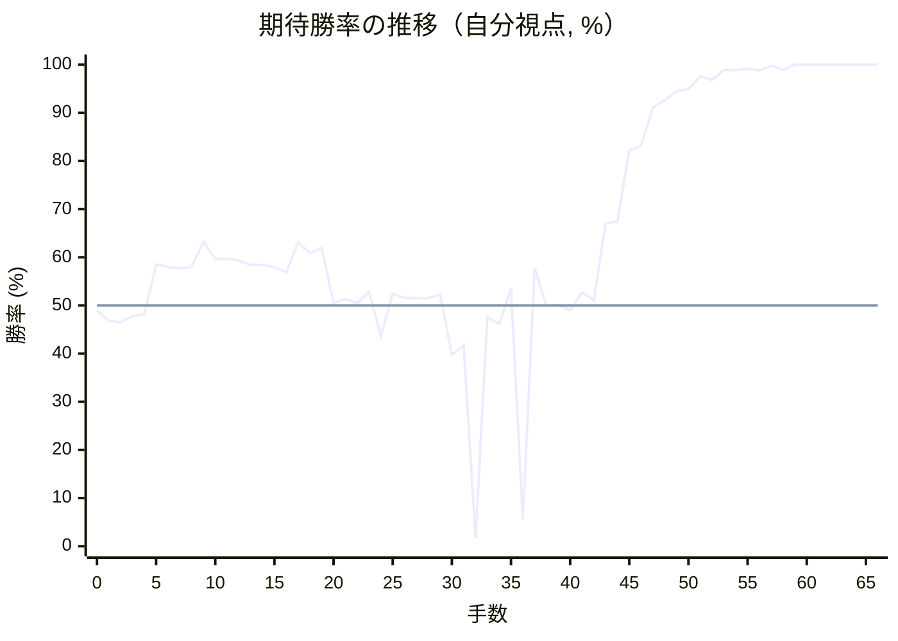
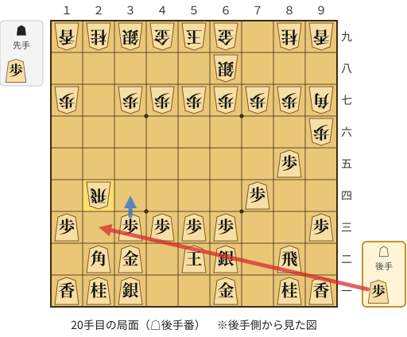
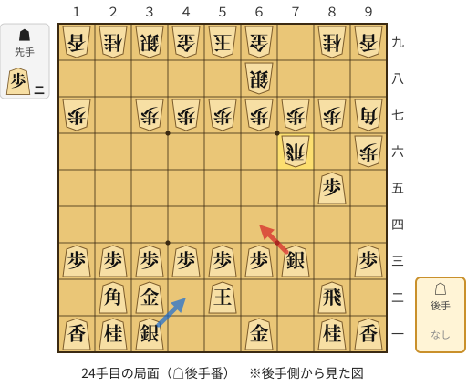
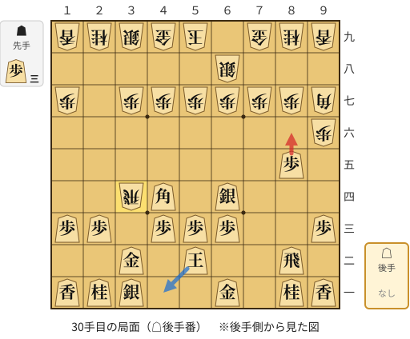
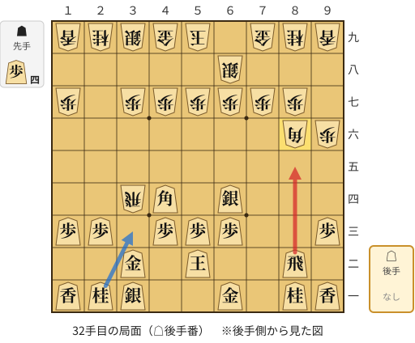
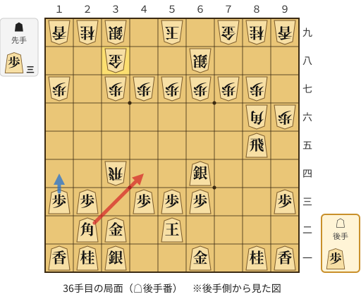
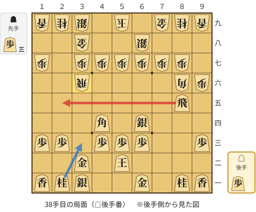

# 解析レポート ibyp1c1n4fsv

[README に戻る](../../../README.md)　/　棋譜: [CSA](../../../data/csa/shogi5/ibyp1c1n4fsv.csa)　/　解析の見方: [docs/mistake_analysis.md](../../../docs/mistake_analysis.md)

## 対局情報

| 項目 | 内容 |
|---|---|
| 日時 | 2026-11-05 00:22:44 |
| 持ち時間 | 5分 |
| 自分 | 後手（△）（1729） |
| 相手 | 相手（1652） |
| 結果 | 勝ち（投了, 66手） |

## 解析環境

| 項目 | 内容 |
|---|---|
| エンジン | YaneuraOu NNUE 9.00git 64AVX2（V9.00/YANEURAOU_ENGINE_NNUE/AVX2） |
| 評価関数 | **水匠5**（`suisho5`） |
| nn.bin SHA-256 | `768068f0d534a0603a5d38bcd143de6bbca820d5f1c95a14d40863e5b7892d76` |
| 第1パス | movetime=150ms, MultiPV 1 |
| 第2パス | movetime=2000ms, MultiPV 3 |
| Threads / Hash | 8 / 512MB |
| 判定基準 | 疑問手 ≥5pt, 悪手 ≥10pt, 大悪手 ≥20pt（期待勝率 W(E)=1/(1+exp(-E/600))） |
| 解析日時 | 2026-11-06T01:49:42+09:00（解析バージョン 1, 34秒） |

## サマリー

| 自分の手数 | 深掘りした手 | 詰み逃し | 大悪手 | 悪手 | 疑問手 |
|--:|--:|--:|--:|--:|--:|
| 33 | 6 | 0 | 2 | 2 | 2 |

## 期待勝率の推移



<details><summary>1手ごとの数値（第1パス）</summary>

| 手数 | 指し手 | 評価値 | 勝率 | 低下 | 判定 |
|--:|---|--:|--:|--:|---|
| 1 | ▲２六歩(27) | -76 | 46.8% |  |  |
| 2 | △８四歩(83) | -84 | 46.5% | +0.3pt |  |
| 3 | ▲９六歩(97) | -53 | 47.8% |  |  |
| 4 | △８五歩(84) | -46 | 48.1% | -0.3pt |  |
| 5 | ▲９七角(88) | +207 | 58.5% |  |  |
| 6 | △６二銀(71) | +193 | 58.0% | +0.6pt |  |
| 7 | ▲２五歩(26) | +187 | 57.7% |  |  |
| 8 | △３二金(41) | +194 | 58.0% | -0.3pt |  |
| 9 | ▲６八銀(79) | +325 | 63.2% |  |  |
| 10 | △５二玉(51) | +237 | 59.7% | +3.5pt |  |
| 11 | ▲２四歩(25) | +235 | 59.7% |  |  |
| 12 | △同歩(23) | +227 | 59.3% | +0.3pt |  |
| 13 | ▲同飛(28) | +203 | 58.4% |  |  |
| 14 | △２三歩打 | +204 | 58.4% | -0.0pt |  |
| 15 | ▲２六飛(24) | +194 | 58.0% |  |  |
| 16 | △７四歩(73) | +166 | 56.9% | +1.1pt |  |
| 17 | ▲２四歩打 | +323 | 63.1% |  |  |
| 18 | △同歩(23) | +267 | 60.9% | +2.2pt |  |
| 19 | ▲同飛(26) | +292 | 61.9% |  |  |
| 20 | △２三歩打 | +12 | 50.5% | +11.4pt | [悪手](#ply-20) |
| 21 | ▲７四飛(24) | +31 | 51.3% |  |  |
| 22 | △７三銀(62) | +11 | 50.5% | +0.8pt |  |
| 23 | ▲７六飛(74) | +67 | 52.8% |  |  |
| 24 | △６四銀(73) | -152 | 43.7% | +9.1pt | [疑問手](#ply-24) |
| 25 | ▲７九金(69) | +58 | 52.4% |  |  |
| 26 | △３四歩(33) | +38 | 51.6% | +0.8pt |  |
| 27 | ▲３六飛(76) | +37 | 51.5% |  |  |
| 28 | △４四角(22) | +37 | 51.5% | +0.0pt |  |
| 29 | ▲３四飛(36) | +56 | 52.3% |  |  |
| 30 | △８六歩(85) | -248 | 39.8% | +12.5pt | [悪手](#ply-30) |
| 31 | ▲同角(97) | -201 | 41.7% |  |  |
| 32 | △８五飛(82) | -2420 | 1.7% | +40.0pt | [大悪手](#ply-32) |
| 33 | ▲２二歩打 | -58 | 47.6% |  |  |
| 34 | △同角(44) | -93 | 46.1% | +1.5pt |  |
| 35 | ▲３八金(49) | +83 | 53.5% |  |  |
| 36 | △４四角(22) | -1697 | 5.6% | +47.9pt | [大悪手](#ply-36) |
| 37 | ▲３六飛(34) | +187 | 57.7% |  |  |
| 38 | △２五飛(85) | -3 | 49.9% | +7.9pt | [疑問手](#ply-38) |
| 39 | ▲２八銀(39) | +2 | 50.1% |  |  |
| 40 | △８五飛(25) | -23 | 49.0% | +1.0pt |  |
| 41 | ▲１六歩(17) | +65 | 52.7% |  |  |
| 42 | △９四歩(93) | +27 | 51.1% | +1.6pt |  |
| 43 | ▲９七香(99) | +428 | 67.1% |  |  |
| 44 | △３三桂(21) | +435 | 67.4% | -0.3pt |  |
| 45 | ▲７六歩(77) | +920 | 82.2% |  |  |
| 46 | △９九角成(44) | +961 | 83.2% | -1.0pt |  |
| 47 | ▲７七角(86) | +1394 | 91.1% |  |  |
| 48 | △同馬(99) | +1515 | 92.6% | -1.5pt |  |
| 49 | ▲同桂(89) | +1706 | 94.5% |  |  |
| 50 | △８七飛成(85) | +1758 | 94.9% | -0.4pt |  |
| 51 | ▲１五歩(16) | +2232 | 97.6% |  |  |
| 52 | △９七龍(87) | +2054 | 96.8% | +0.8pt |  |
| 53 | ▲６五桂(77) | +2694 | 98.9% |  |  |
| 54 | △７七歩打 | +2633 | 98.8% | +0.1pt |  |
| 55 | ▲２二歩打 | +2890 | 99.2% |  |  |
| 56 | △９九龍(97) | +2643 | 98.8% | +0.4pt |  |
| 57 | ▲２一歩成(22) | +3646 | 99.8% |  |  |
| 58 | △４二銀(31) | +2697 | 98.9% | +0.9pt |  |
| 59 | ▲１一と(21) | +5034 | 100.0% |  |  |
| 60 | △７八歩成(77) | +5342 | 100.0% | -0.0pt |  |
| 61 | ▲６六角打 | +6326 | 100.0% |  |  |
| 62 | △６八と(78) | +6425 | 100.0% | -0.0pt |  |
| 63 | ▲同玉(59) | +6427 | 100.0% |  |  |
| 64 | △８六角打 | +6624 | 100.0% | -0.0pt |  |
| 65 | ▲７七香打 | +6571 | 100.0% |  |  |
| 66 | △６五銀(64) | +6703 | 100.0% | -0.0pt |  |

</details>

## 課題局面

<a id="ply-20"></a>
### 20手目 △２三歩打 — 悪手

| | 着手前 | 着手後 | 差 |
|---|--:|--:|--:|
| 期待勝率 | 62.0% | 51.3% | -10.6pt |
| 評価値 | +293 | +32 | |

着手前の局面:



🔴 実戦 △２三歩打　🔵 AI推奨 △３四歩(33)　🟨 直前の相手の指し手

<details><summary>テキストの盤面図（BOD・将棋ソフトに貼り付け可）</summary>

```text
後手の持駒：歩
  ９ ８ ７ ６ ５ ４ ３ ２ １
+---------------------------+
|v香v桂 ・v金 ・ ・v銀v桂v香|一
| ・v飛 ・v銀v玉 ・v金v角 ・|二
|v歩 ・ ・v歩v歩v歩v歩 ・v歩|三
| ・ ・v歩 ・ ・ ・ ・ 飛 ・|四
| ・v歩 ・ ・ ・ ・ ・ ・ ・|五
| 歩 ・ ・ ・ ・ ・ ・ ・ ・|六
| 角 歩 歩 歩 歩 歩 歩 ・ 歩|七
| ・ ・ ・ 銀 ・ ・ ・ ・ ・|八
| 香 桂 ・ 金 玉 金 銀 桂 香|九
+---------------------------+
先手の持駒：歩
後手番
手数＝19　▲２四同飛　まで
```

</details>

| | 指し手 | 評価値 | 読み筋 |
|---|---|--:|---|
| 実戦 | △２三歩打 | +32 | ▲７四飛(24) △７三銀(62) ▲７六飛(74) △１四歩(13) ▲１六歩(17) △３四歩(33) |
| AI 1位 | △３四歩(33) | +293 | △３四歩(33) ▲７八金(69) △１四歩(13) ▲３四飛(24) △４四角(22) ▲１六歩(17) |
| AI 2位 | △１四歩(13) | +281 | △１四歩(13) ▲７八金(69) △３四歩(33) ▲１六歩(17) △９四歩(93) ▲８八角(97) |
| AI 3位 | △４二銀(31) | +127 | △４二銀(31) ▲２三歩打 △３一角(22) ▲７六歩(77) △３四歩(33) ▲８八角(97) |

SFEN: `ln1g2snl/1r1sk1gb1/p2pppp1p/2p4R1/1p7/P8/BPPPPPP1P/3S5/LN1GKGSNL w Pp 20`

<a id="ply-24"></a>
### 24手目 △６四銀(73) — 疑問手

| | 着手前 | 着手後 | 差 |
|---|--:|--:|--:|
| 期待勝率 | 51.9% | 43.5% | -8.4pt |
| 評価値 | +46 | -157 | |

着手前の局面:



🔴 実戦 △６四銀(73)　🔵 AI推奨 △４二銀(31)　🟨 直前の相手の指し手

<details><summary>テキストの盤面図（BOD・将棋ソフトに貼り付け可）</summary>

```text
後手の持駒：なし
  ９ ８ ７ ６ ５ ４ ３ ２ １
+---------------------------+
|v香v桂 ・v金 ・ ・v銀v桂v香|一
| ・v飛 ・ ・v玉 ・v金v角 ・|二
|v歩 ・v銀v歩v歩v歩v歩v歩v歩|三
| ・ ・ ・ ・ ・ ・ ・ ・ ・|四
| ・v歩 ・ ・ ・ ・ ・ ・ ・|五
| 歩 ・ 飛 ・ ・ ・ ・ ・ ・|六
| 角 歩 歩 歩 歩 歩 歩 ・ 歩|七
| ・ ・ ・ 銀 ・ ・ ・ ・ ・|八
| 香 桂 ・ 金 玉 金 銀 桂 香|九
+---------------------------+
先手の持駒：歩二
後手番
手数＝23　▲７六飛　まで
```

</details>

| | 指し手 | 評価値 | 読み筋 |
|---|---|--:|---|
| 実戦 | △６四銀(73) | -157 | ▲６六歩(67) △３四歩(33) ▲１六歩(17) △１四歩(13) ▲４八玉(59) △９四歩(93) |
| AI 1位 | △４二銀(31) | +46 | △４二銀(31) ▲３八銀(39) △９四歩(93) ▲４八玉(59) △１四歩(13) ▲１六歩(17) |
| AI 2位 | △１四歩(13) | +30 | △１四歩(13) ▲１六歩(17) △９四歩(93) ▲３八銀(39) △４二銀(31) ▲６六歩(67) |
| AI 3位 | △９四歩(93) | +22 | △９四歩(93) ▲１六歩(17) △１四歩(13) ▲４八玉(59) △４二銀(31) ▲３八銀(39) |

SFEN: `ln1g2snl/1r2k1gb1/p1spppppp/9/1p7/P1R6/BPPPPPP1P/3S5/LN1GKGSNL w 2P 24`

<a id="ply-30"></a>
### 30手目 △８六歩(85) — 悪手

| | 着手前 | 着手後 | 差 |
|---|--:|--:|--:|
| 期待勝率 | 50.0% | 37.8% | -12.2pt |
| 評価値 | +0 | -300 | |

着手前の局面:



🔴 実戦 △８六歩(85)　🔵 AI推奨 △４一玉(52)　🟨 直前の相手の指し手

<details><summary>テキストの盤面図（BOD・将棋ソフトに貼り付け可）</summary>

```text
後手の持駒：なし
  ９ ８ ７ ６ ５ ４ ３ ２ １
+---------------------------+
|v香v桂 ・v金 ・ ・v銀v桂v香|一
| ・v飛 ・ ・v玉 ・v金 ・ ・|二
|v歩 ・ ・v歩v歩v歩 ・v歩v歩|三
| ・ ・ ・v銀 ・v角 飛 ・ ・|四
| ・v歩 ・ ・ ・ ・ ・ ・ ・|五
| 歩 ・ ・ ・ ・ ・ ・ ・ ・|六
| 角 歩 歩 歩 歩 歩 歩 ・ 歩|七
| ・ ・ ・ 銀 ・ ・ ・ ・ ・|八
| 香 桂 金 ・ 玉 金 銀 桂 香|九
+---------------------------+
先手の持駒：歩三
後手番
手数＝29　▲３四飛　まで
```

</details>

| | 指し手 | 評価値 | 読み筋 |
|---|---|--:|---|
| 実戦 | △８六歩(85) | -300 | ▲同角(97) △３三桂(21) ▲３八銀(39) △４二銀(31) ▲４六歩(47) △５四歩(53) |
| AI 1位 | △４一玉(52) | +0 | △４一玉(52) ▲１六歩(17) △４二銀(31) ▲１五歩(16) △９四歩(93) ▲３八銀(39) |
| AI 2位 | △９四歩(93) | -24 | △９四歩(93) ▲１六歩(17) △４一玉(52) ▲１五歩(16) △４二銀(31) ▲４八玉(59) |
| AI 3位 | △９四歩(93) | -40 | △９四歩(93) ▲３八銀(39) △４一玉(52) ▲１六歩(17) △４二銀(31) ▲１五歩(16) |

SFEN: `ln1g2snl/1r2k1g2/p2ppp1pp/3s1bR2/1p7/P8/BPPPPPP1P/3S5/LNG1KGSNL w 3P 30`

<a id="ply-32"></a>
### 32手目 △８五飛(82) — 大悪手

| | 着手前 | 着手後 | 差 |
|---|--:|--:|--:|
| 期待勝率 | 36.0% | 1.1% | -34.9pt |
| 評価値 | -345 | -2681 | |

着手前の局面:



🔴 実戦 △８五飛(82)　🔵 AI推奨 △３三桂(21)　🟨 直前の相手の指し手

<details><summary>テキストの盤面図（BOD・将棋ソフトに貼り付け可）</summary>

```text
後手の持駒：なし
  ９ ８ ７ ６ ５ ４ ３ ２ １
+---------------------------+
|v香v桂 ・v金 ・ ・v銀v桂v香|一
| ・v飛 ・ ・v玉 ・v金 ・ ・|二
|v歩 ・ ・v歩v歩v歩 ・v歩v歩|三
| ・ ・ ・v銀 ・v角 飛 ・ ・|四
| ・ ・ ・ ・ ・ ・ ・ ・ ・|五
| 歩 角 ・ ・ ・ ・ ・ ・ ・|六
| ・ 歩 歩 歩 歩 歩 歩 ・ 歩|七
| ・ ・ ・ 銀 ・ ・ ・ ・ ・|八
| 香 桂 金 ・ 玉 金 銀 桂 香|九
+---------------------------+
先手の持駒：歩四
後手番
手数＝31　▲８六同角　まで
```

</details>

| | 指し手 | 評価値 | 読み筋 |
|---|---|--:|---|
| 実戦 | △８五飛(82) | -2681 | ▲６四角(86) △同歩(63) ▲４四飛(34) △８七飛成(85) ▲６四飛(44) △６三歩打 |
| AI 1位 | △３三桂(21) | -345 | △３三桂(21) ▲３八銀(39) △４二銀(31) ▲４六歩(47) △７二金(61) ▲６九玉(59) |
| AI 2位 | △７三桂(81) | -356 | △７三桂(81) ▲３八銀(39) △７二金(61) ▲６六歩(67) △３三桂(21) ▲６七銀(68) |
| AI 3位 | △１四歩(13) | -346 | △１四歩(13) ▲３八銀(39) △７二金(61) ▲６六歩(67) △３三桂(21) ▲４八玉(59) |

SFEN: `ln1g2snl/1r2k1g2/p2ppp1pp/3s1bR2/9/PB7/1PPPPPP1P/3S5/LNG1KGSNL w 4P 32`

<a id="ply-36"></a>
### 36手目 △４四角(22) — 大悪手

| | 着手前 | 着手後 | 差 |
|---|--:|--:|--:|
| 期待勝率 | 54.2% | 4.6% | -49.6pt |
| 評価値 | +101 | -1822 | |

着手前の局面:



🔴 実戦 △４四角(22)　🔵 AI推奨 △１四歩(13)　🟨 直前の相手の指し手

<details><summary>テキストの盤面図（BOD・将棋ソフトに貼り付け可）</summary>

```text
後手の持駒：歩
  ９ ８ ７ ６ ５ ４ ３ ２ １
+---------------------------+
|v香v桂 ・v金 ・ ・v銀v桂v香|一
| ・ ・ ・ ・v玉 ・v金v角 ・|二
|v歩 ・ ・v歩v歩v歩 ・v歩v歩|三
| ・ ・ ・v銀 ・ ・ 飛 ・ ・|四
| ・v飛 ・ ・ ・ ・ ・ ・ ・|五
| 歩 角 ・ ・ ・ ・ ・ ・ ・|六
| ・ 歩 歩 歩 歩 歩 歩 ・ 歩|七
| ・ ・ ・ 銀 ・ ・ 金 ・ ・|八
| 香 桂 金 ・ 玉 ・ 銀 桂 香|九
+---------------------------+
先手の持駒：歩三
後手番
手数＝35　▲３八金　まで
```

</details>

| | 指し手 | 評価値 | 読み筋 |
|---|---|--:|---|
| 実戦 | △４四角(22) | -1822 | ▲６四角(86) △同歩(63) ▲４四飛(34) △８七飛成(85) ▲６四飛(44) △６三歩打 |
| AI 1位 | △１四歩(13) | +101 | △１四歩(13) ▲５八玉(59) △７二金(61) ▲３六飛(34) △９四歩(93) ▲１六歩(17) |
| AI 2位 | △９四歩(93) | +84 | △９四歩(93) ▲５八玉(59) △１四歩(13) ▲１六歩(17) △７三桂(81) ▲３六飛(34) |
| AI 3位 | △７二金(61) | +90 | △７二金(61) ▲３六飛(34) △７三桂(81) ▲７八金(79) △１四歩(13) ▲５八玉(59) |

SFEN: `ln1g2snl/4k1gb1/p2ppp1pp/3s2R2/1r7/PB7/1PPPPPP1P/3S2G2/LNG1K1SNL w 3Pp 36`

<a id="ply-38"></a>
### 38手目 △２五飛(85) — 疑問手

| | 着手前 | 着手後 | 差 |
|---|--:|--:|--:|
| 期待勝率 | 56.0% | 47.8% | -8.2pt |
| 評価値 | +144 | -53 | |

着手前の局面:



🔴 実戦 △２五飛(85)　🔵 AI推奨 △３三桂(21)　🟨 直前の相手の指し手

<details><summary>テキストの盤面図（BOD・将棋ソフトに貼り付け可）</summary>

```text
後手の持駒：歩
  ９ ８ ７ ６ ５ ４ ３ ２ １
+---------------------------+
|v香v桂 ・v金 ・ ・v銀v桂v香|一
| ・ ・ ・ ・v玉 ・v金 ・ ・|二
|v歩 ・ ・v歩v歩v歩 ・v歩v歩|三
| ・ ・ ・v銀 ・v角 ・ ・ ・|四
| ・v飛 ・ ・ ・ ・ ・ ・ ・|五
| 歩 角 ・ ・ ・ ・ 飛 ・ ・|六
| ・ 歩 歩 歩 歩 歩 歩 ・ 歩|七
| ・ ・ ・ 銀 ・ ・ 金 ・ ・|八
| 香 桂 金 ・ 玉 ・ 銀 桂 香|九
+---------------------------+
先手の持駒：歩三
後手番
手数＝37　▲３六飛　まで
```

</details>

| | 指し手 | 評価値 | 読み筋 |
|---|---|--:|---|
| 実戦 | △２五飛(85) | -53 | ▲２八銀(39) △８五飛(25) ▲５八玉(59) △７二金(61) ▲９七角(86) △８七飛成(85) |
| AI 1位 | △３三桂(21) | +144 | △３三桂(21) ▲５八玉(59) △４二銀(31) ▲４八銀(39) △７二金(61) ▲９七角(86) |
| AI 2位 | △１四歩(13) | +113 | △１四歩(13) ▲５八玉(59) △４一玉(52) ▲７八金(79) △８四飛(85) ▲９七角(86) |
| AI 3位 | △１四歩(13) | +113 | △１四歩(13) ▲５八玉(59) △４一玉(52) ▲７八金(79) △８四飛(85) ▲９七角(86) |

SFEN: `ln1g2snl/4k1g2/p2ppp1pp/3s1b3/1r7/PB4R2/1PPPPPP1P/3S2G2/LNG1K1SNL w 3Pp 38`

