# 解析レポート ixmo9fev7z7u

[README に戻る](../../../README.md)　/　棋譜: [CSA](../../../data/csa/shogi5/ixmo9fev7z7u.csa)　/　解析の見方: [docs/mistake_analysis.md](../../../docs/mistake_analysis.md)

## 対局情報

| 項目 | 内容 |
|---|---|
| 日時 | 2026-11-19 02:37:39 |
| 持ち時間 | 5分 |
| 自分 | 先手（▲）（1689） |
| 相手 | 相手（1654） |
| 結果 | 負け（時間切れ, 98手） |

## 解析環境

| 項目 | 内容 |
|---|---|
| エンジン | YaneuraOu NNUE 9.00git 64AVX2（V9.00/YANEURAOU_ENGINE_NNUE/AVX2） |
| 評価関数 | **水匠5**（`suisho5`） |
| nn.bin SHA-256 | `768068f0d534a0603a5d38bcd143de6bbca820d5f1c95a14d40863e5b7892d76` |
| 第1パス | movetime=150ms, MultiPV 1 |
| 第2パス | movetime=2000ms, MultiPV 3 |
| Threads / Hash | 8 / 512MB |
| 判定基準 | 疑問手 ≥5pt, 悪手 ≥10pt, 大悪手 ≥20pt（期待勝率 W(E)=1/(1+exp(-E/600))） |
| 解析日時 | 2026-11-20T20:07:16+09:00（解析バージョン 1, 80秒） |

## サマリー

| 自分の手数 | 深掘りした手 | 詰み逃し | 大悪手 | 悪手 | 疑問手 |
|--:|--:|--:|--:|--:|--:|
| 49 | 16 | 0 | 6 | 4 | 4 |

## 期待勝率の推移

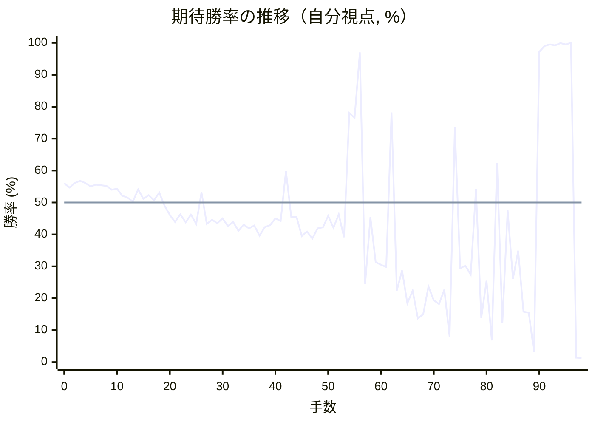

<details><summary>1手ごとの数値（第1パス）</summary>

| 手数 | 指し手 | 評価値 | 勝率 | 低下 | 判定 |
|--:|---|--:|--:|--:|---|
| 1 | ▲７六歩(77) | +114 | 54.7% | +1.3pt |  |
| 2 | △８四歩(83) | +146 | 56.1% |  |  |
| 3 | ▲２六歩(27) | +163 | 56.8% | -0.7pt |  |
| 4 | △８五歩(84) | +147 | 56.1% |  |  |
| 5 | ▲７七角(88) | +120 | 55.0% | +1.1pt |  |
| 6 | △３四歩(33) | +135 | 55.6% |  |  |
| 7 | ▲６八銀(79) | +130 | 55.4% | +0.2pt |  |
| 8 | △３二金(41) | +125 | 55.2% |  |  |
| 9 | ▲２五歩(26) | +97 | 54.0% | +1.2pt |  |
| 10 | △７七角成(22) | +104 | 54.3% |  |  |
| 11 | ▲同銀(68) | +50 | 52.1% | +2.2pt |  |
| 12 | △２二銀(31) | +36 | 51.5% |  |  |
| 13 | ▲４八銀(39) | +8 | 50.3% | +1.2pt |  |
| 14 | △９四歩(93) | +98 | 54.1% |  |  |
| 15 | ▲７八金(69) | +27 | 51.1% | +2.9pt |  |
| 16 | △３三銀(22) | +56 | 52.3% |  |  |
| 17 | ▲４六歩(47) | +17 | 50.7% | +1.6pt |  |
| 18 | △１四歩(13) | +75 | 53.1% |  |  |
| 19 | ▲４七銀(48) | -23 | 49.0% | +4.1pt |  |
| 20 | △６二銀(71) | -93 | 46.1% |  |  |
| 21 | ▲６八玉(59) | -148 | 43.9% | +2.3pt |  |
| 22 | △９五歩(94) | -88 | 46.3% |  |  |
| 23 | ▲１六歩(17) | -150 | 43.8% | +2.6pt |  |
| 24 | △７四歩(73) | -92 | 46.2% |  |  |
| 25 | ▲５六銀(47) | -161 | 43.3% | +2.8pt |  |
| 26 | △７三桂(81) | +76 | 53.2% |  |  |
| 27 | ▲６六歩(67) | -162 | 43.3% | +9.9pt |  |
| 28 | △６四歩(63) | -131 | 44.6% |  |  |
| 29 | ▲３六歩(37) | -158 | 43.5% | +1.1pt |  |
| 30 | △６三銀(62) | -121 | 45.0% |  |  |
| 31 | ▲３七桂(29) | -180 | 42.6% | +2.4pt |  |
| 32 | △４二玉(51) | -148 | 43.9% |  |  |
| 33 | ▲５八金(49) | -217 | 41.1% | +2.8pt |  |
| 34 | △８一飛(82) | -167 | 43.1% |  |  |
| 35 | ▲７九玉(68) | -195 | 41.9% | +1.1pt |  |
| 36 | △６二金(61) | -174 | 42.8% |  |  |
| 37 | ▲４七金(58) | -253 | 39.6% | +3.2pt |  |
| 38 | △５二玉(42) | -186 | 42.3% |  |  |
| 39 | ▲８八玉(79) | -172 | 42.9% | -0.6pt |  |
| 40 | △４一飛(81) | -121 | 45.0% |  |  |
| 41 | ▲４八金(47) | -141 | 44.2% | +0.8pt |  |
| 42 | △６一玉(52) | +240 | 59.9% |  |  |
| 43 | ▲２九飛(28) | -108 | 45.5% | +14.4pt | [悪手](#ply-43) |
| 44 | △７二玉(61) | -108 | 45.5% |  |  |
| 45 | ▲９八香(99) | -257 | 39.5% | +6.1pt |  |
| 46 | △５四歩(53) | -221 | 40.9% |  |  |
| 47 | ▲９九玉(88) | -276 | 38.7% | +2.2pt |  |
| 48 | △５一飛(41) | -196 | 41.9% |  |  |
| 49 | ▲８八銀(77) | -188 | 42.2% | -0.3pt |  |
| 50 | △４四銀(33) | -102 | 45.8% |  |  |
| 51 | ▲２四歩(25) | -190 | 42.1% | +3.6pt |  |
| 52 | △同歩(23) | -90 | 46.3% |  |  |
| 53 | ▲同飛(29) | -267 | 39.1% | +7.2pt | [悪手](#ply-53) |
| 54 | △６九角打 | +761 | 78.0% |  |  |
| 55 | ▲７九金(78) | +711 | 76.6% | +1.5pt |  |
| 56 | △３六角成(69) | +2085 | 97.0% |  |  |
| 57 | ▲６五歩(66) | -678 | 24.4% | +72.6pt | [大悪手](#ply-57) |
| 58 | △３三銀(44) | -111 | 45.4% |  |  |
| 59 | ▲２九飛(24) | -472 | 31.3% | +14.1pt | [疑問手](#ply-59) |
| 60 | △６五歩(64) | -494 | 30.5% |  |  |
| 61 | ▲４五桂(37) | -514 | 29.8% | +0.7pt |  |
| 62 | △２二銀(33) | +767 | 78.2% |  |  |
| 63 | ▲２四角打 | -747 | 22.4% | +55.9pt | [大悪手](#ply-63) |
| 64 | △８一飛(51) | -547 | 28.7% |  |  |
| 65 | ▲４七銀(56) | -892 | 18.4% | +10.2pt | [疑問手](#ply-65) |
| 66 | △２八歩打 | -745 | 22.4% |  |  |
| 67 | ▲同飛(29) | -1102 | 13.7% | +8.7pt |  |
| 68 | △２七歩打 | -1043 | 15.0% |  |  |
| 69 | ▲３六銀(47) | -703 | 23.7% | -8.7pt |  |
| 70 | △２八歩成(27) | -853 | 19.4% |  |  |
| 71 | ▲５三角打 | -903 | 18.2% | +1.3pt |  |
| 72 | △５二銀(63) | -735 | 22.7% |  |  |
| 73 | ▲６四角成(53) | -1468 | 8.0% | +14.7pt | [悪手](#ply-73) |
| 74 | △６三金(62) | +616 | 73.6% |  |  |
| 75 | ▲同馬(64) | -527 | 29.4% | +44.3pt | [大悪手](#ply-75) |
| 76 | △同玉(72) | -504 | 30.2% |  |  |
| 77 | ▲６四歩打 | -586 | 27.4% | +2.8pt |  |
| 78 | △同玉(63) | +101 | 54.2% |  |  |
| 79 | ▲６二金打 | -1097 | 13.8% | +40.4pt | [大悪手](#ply-79) |
| 80 | △６三銀(52) | -643 | 25.5% |  |  |
| 81 | ▲５一角成(24) | -1574 | 6.8% | +18.7pt | [疑問手](#ply-81) |
| 82 | △２六角打 | +301 | 62.3% |  |  |
| 83 | ▲５八金(48) | -1186 | 12.2% | +50.1pt | [大悪手](#ply-83) |
| 84 | △３九飛打 | -57 | 47.6% |  |  |
| 85 | ▲６三金(62) | -626 | 26.1% | +21.6pt |  |
| 86 | △同玉(64) | -375 | 34.9% |  |  |
| 87 | ▲５二銀打 | -1002 | 15.8% | +19.0pt | [疑問手](#ply-87) |
| 88 | △６四玉(63) | -1016 | 15.5% |  |  |
| 89 | ▲２七歩打 | -2063 | 3.1% | +12.4pt | [悪手](#ply-89) |
| 90 | △３七角成(26) | +2120 | 97.2% |  |  |
| 91 | ▲６二馬(51) | +2748 | 99.0% | -1.8pt |  |
| 92 | △５五玉(64) | +3127 | 99.5% |  |  |
| 93 | ▲４七金(58) | +2895 | 99.2% | +0.3pt |  |
| 94 | △同馬(37) | +3931 | 99.9% |  |  |
| 95 | ▲同銀(36) | +3204 | 99.5% | +0.3pt |  |
| 96 | △６六玉(55) | +35281 | 100.0% |  |  |
| 97 | ▲７七角打 | -2532 | 1.4% | +98.6pt | [大悪手](#ply-97) |
| 98 | △５七玉(66) | -2597 | 1.3% |  |  |

</details>

## 課題局面

<a id="ply-43"></a>
### 43手目 ▲２九飛(28) — 悪手

| | 着手前 | 着手後 | 差 |
|---|--:|--:|--:|
| 期待勝率 | 59.2% | 44.3% | -14.9pt |
| 評価値 | +223 | -138 | |

着手前の局面:

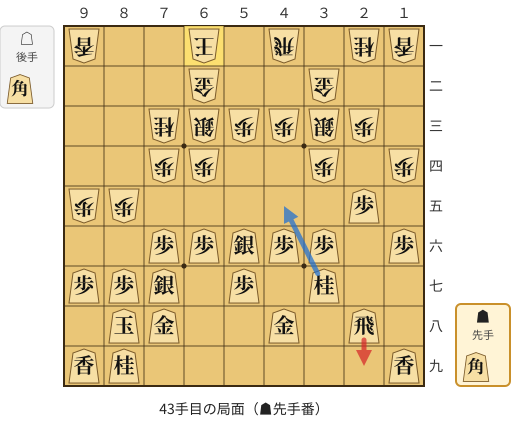

🔴 実戦 ▲２九飛(28)　🔵 AI推奨 ▲４五桂(37)　🟨 直前の相手の指し手

<details><summary>テキストの盤面図（BOD・将棋ソフトに貼り付け可）</summary>

```text
後手の持駒：角
  ９ ８ ７ ６ ５ ４ ３ ２ １
+---------------------------+
|v香 ・ ・v玉 ・v飛 ・v桂v香|一
| ・ ・ ・v金 ・ ・v金 ・ ・|二
| ・ ・v桂v銀v歩v歩v銀v歩 ・|三
| ・ ・v歩v歩 ・ ・v歩 ・v歩|四
|v歩v歩 ・ ・ ・ ・ ・ 歩 ・|五
| ・ ・ 歩 歩 銀 歩 歩 ・ 歩|六
| 歩 歩 銀 ・ 歩 ・ 桂 ・ ・|七
| ・ 玉 金 ・ ・ 金 ・ 飛 ・|八
| 香 桂 ・ ・ ・ ・ ・ ・ 香|九
+---------------------------+
先手の持駒：角
手数＝42　△６一玉　まで
```

</details>

| | 指し手 | 評価値 | 読み筋 |
|---|---|--:|---|
| 実戦 | ▲２九飛(28) | -138 | △５二玉(61) ▲２八飛(29) △８一飛(41) ▲２七飛(28) △４一玉(52) ▲７九玉(88) |
| AI 1位 | ▲４五桂(37) | +223 | ▲４五桂(37) △２二銀(33) ▲２四歩(25) △同歩(23) ▲６五歩(66) △同桂(73) |
| AI 2位 | ▲３五歩(36) | +162 | ▲３五歩(36) △同歩(34) ▲４五桂(37) △３四銀(33) ▲２四歩(25) △７二玉(61) |
| AI 3位 | ▲１五歩(16) | +112 | ▲１五歩(16) △同歩(14) ▲４五桂(37) △４四銀(33) ▲１五香(19) △同香(11) |

SFEN: `l2k1r1nl/3g2g2/2nsppsp1/2pp2p1p/pp5P1/2PPSPP1P/PPS1P1N2/1KG2G1R1/LN6L b Bb 43`

<a id="ply-53"></a>
### 53手目 ▲同飛(29) — 悪手

| | 着手前 | 着手後 | 差 |
|---|--:|--:|--:|
| 期待勝率 | 45.8% | 33.6% | -12.2pt |
| 評価値 | -101 | -408 | |

着手前の局面:

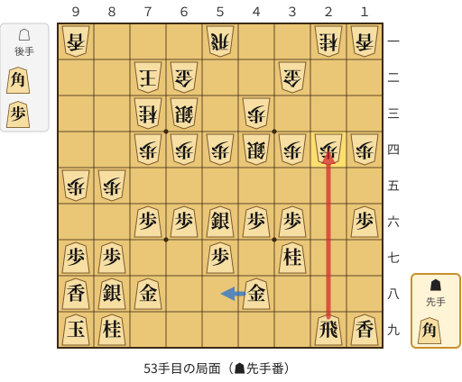

🔴 実戦 ▲同飛(29)　🔵 AI推奨 ▲５八金(48)　🟨 直前の相手の指し手

<details><summary>テキストの盤面図（BOD・将棋ソフトに貼り付け可）</summary>

```text
後手の持駒：角　歩
  ９ ８ ７ ６ ５ ４ ３ ２ １
+---------------------------+
|v香 ・ ・ ・v飛 ・ ・v桂v香|一
| ・ ・v玉v金 ・ ・v金 ・ ・|二
| ・ ・v桂v銀 ・v歩 ・ ・ ・|三
| ・ ・v歩v歩v歩v銀v歩v歩v歩|四
|v歩v歩 ・ ・ ・ ・ ・ ・ ・|五
| ・ ・ 歩 歩 銀 歩 歩 ・ 歩|六
| 歩 歩 ・ ・ 歩 ・ 桂 ・ ・|七
| 香 銀 金 ・ ・ 金 ・ ・ ・|八
| 玉 桂 ・ ・ ・ ・ ・ 飛 香|九
+---------------------------+
先手の持駒：角
手数＝52　△２四同歩　まで
```

</details>

| | 指し手 | 評価値 | 読み筋 |
|---|---|--:|---|
| 実戦 | ▲同飛(29) | -408 | △５九角打 ▲４七金(48) △８六歩(85) ▲同歩(87) △同角成(59) ▲６七銀(56) |
| AI 1位 | ▲５八金(48) | -101 | ▲５八金(48) △８一飛(51) ▲２四飛(29) △２三歩打 ▲２八飛(24) △３三桂(21) |
| AI 2位 | ▲６七銀(56) | -302 | ▲６七銀(56) △８一飛(51) ▲２四飛(29) △５九角打 ▲４七金(48) △８六歩(85) |
| AI 3位 | ▲同飛(29) | -353 | ▲同飛(29) △５九角打 ▲４七金(48) △８六歩(85) ▲２九飛(24) △８七歩成(86) |

SFEN: `l3r2nl/2kg2g2/2ns1p3/2pppsppp/pp7/2PPSPP1P/PP2P1N2/LSG2G3/KN5RL b Bbp 53`

<a id="ply-57"></a>
### 57手目 ▲６五歩(66) — 大悪手

| | 着手前 | 着手後 | 差 |
|---|--:|--:|--:|
| 期待勝率 | 96.9% | 20.3% | -76.7pt |
| 評価値 | +2075 | -821 | |

着手前の局面:

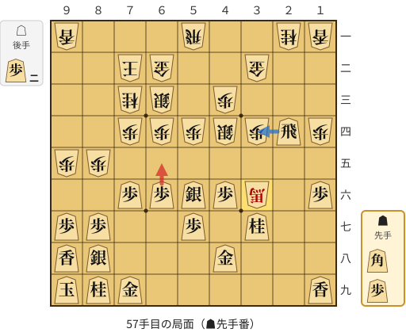

🔴 実戦 ▲６五歩(66)　🔵 AI推奨 ▲３四飛(24)　🟨 直前の相手の指し手

<details><summary>テキストの盤面図（BOD・将棋ソフトに貼り付け可）</summary>

```text
後手の持駒：歩二
  ９ ８ ７ ６ ５ ４ ３ ２ １
+---------------------------+
|v香 ・ ・ ・v飛 ・ ・v桂v香|一
| ・ ・v玉v金 ・ ・v金 ・ ・|二
| ・ ・v桂v銀 ・v歩 ・ ・ ・|三
| ・ ・v歩v歩v歩v銀v歩 飛v歩|四
|v歩v歩 ・ ・ ・ ・ ・ ・ ・|五
| ・ ・ 歩 歩 銀 歩v馬 ・ 歩|六
| 歩 歩 ・ ・ 歩 ・ 桂 ・ ・|七
| 香 銀 ・ ・ ・ 金 ・ ・ ・|八
| 玉 桂 金 ・ ・ ・ ・ ・ 香|九
+---------------------------+
先手の持駒：角　歩
手数＝56　△３六角成　まで
```

</details>

| | 指し手 | 評価値 | 読み筋 |
|---|---|--:|---|
| 実戦 | ▲６五歩(66) | -821 | △３五馬(36) ▲２九飛(24) △６五歩(64) ▲１五歩(16) △同歩(14) ▲２二歩打 |
| AI 1位 | ▲３四飛(24) | +2075 | ▲３四飛(24) △３三桂(21) ▲３六飛(34) △８一飛(51) ▲４五歩(46) △５五銀(44) |
| AI 2位 | ▲８三角打 | -123 | ▲８三角打 △同玉(72) ▲３四飛(24) △３三桂(21) ▲３六飛(34) △２一飛(51) |
| AI 3位 | ▲２九飛(24) | -596 | ▲２九飛(24) △２七歩打 ▲４七金(48) △２六馬(36) ▲２四歩打 △８一飛(51) |

SFEN: `l3r2nl/2kg2g2/2ns1p3/2pppspRp/pp7/2PPSP+b1P/PP2P1N2/LS3G3/KNG5L b BP2p 57`

<a id="ply-59"></a>
### 59手目 ▲２九飛(24) — 疑問手

| | 着手前 | 着手後 | 差 |
|---|--:|--:|--:|
| 期待勝率 | 35.6% | 27.5% | -8.1pt |
| 評価値 | -355 | -581 | |

着手前の局面:

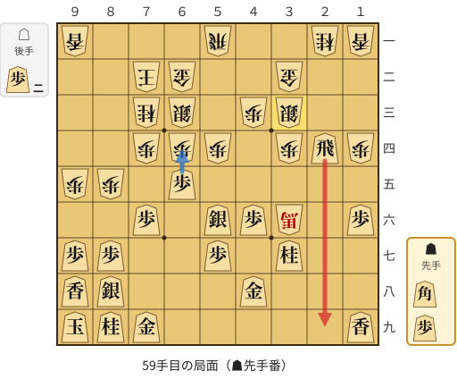

🔴 実戦 ▲２九飛(24)　🔵 AI推奨 ▲６四歩(65)　🟨 直前の相手の指し手

<details><summary>テキストの盤面図（BOD・将棋ソフトに貼り付け可）</summary>

```text
後手の持駒：歩二
  ９ ８ ７ ６ ５ ４ ３ ２ １
+---------------------------+
|v香 ・ ・ ・v飛 ・ ・v桂v香|一
| ・ ・v玉v金 ・ ・v金 ・ ・|二
| ・ ・v桂v銀 ・v歩v銀 ・ ・|三
| ・ ・v歩v歩v歩 ・v歩 飛v歩|四
|v歩v歩 ・ 歩 ・ ・ ・ ・ ・|五
| ・ ・ 歩 ・ 銀 歩v馬 ・ 歩|六
| 歩 歩 ・ ・ 歩 ・ 桂 ・ ・|七
| 香 銀 ・ ・ ・ 金 ・ ・ ・|八
| 玉 桂 金 ・ ・ ・ ・ ・ 香|九
+---------------------------+
先手の持駒：角　歩
手数＝58　△３三銀　まで
```

</details>

| | 指し手 | 評価値 | 読み筋 |
|---|---|--:|---|
| 実戦 | ▲２九飛(24) | -581 | △６五歩(64) ▲４五桂(37) △８六歩(85) ▲４七金(48) △３五馬(36) ▲８六歩(87) |
| AI 1位 | ▲６四歩(65) | -355 | ▲６四歩(65) △２四銀(33) ▲６三歩成(64) △同玉(72) ▲２三歩打 △６四歩打 |
| AI 2位 | ▲２九飛(24) | -568 | ▲２九飛(24) △６五歩(64) ▲４五桂(37) △８六歩(85) ▲同歩(87) △４六馬(36) |
| AI 3位 | ▲２八飛(24) | -613 | ▲２八飛(24) △６五歩(64) ▲４七金(48) △３五馬(36) ▲１五歩(16) △同歩(14) |

SFEN: `l3r2nl/2kg2g2/2ns1ps2/2ppp1pRp/pp1P5/2P1SP+b1P/PP2P1N2/LS3G3/KNG5L b BP2p 59`

<a id="ply-63"></a>
### 63手目 ▲２四角打 — 大悪手

| | 着手前 | 着手後 | 差 |
|---|--:|--:|--:|
| 期待勝率 | 86.8% | 20.4% | -66.4pt |
| 評価値 | +1131 | -818 | |

着手前の局面:

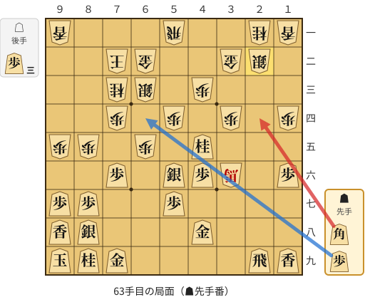

🔴 実戦 ▲２四角打　🔵 AI推奨 ▲６四歩打　🟨 直前の相手の指し手

<details><summary>テキストの盤面図（BOD・将棋ソフトに貼り付け可）</summary>

```text
後手の持駒：歩三
  ９ ８ ７ ６ ５ ４ ３ ２ １
+---------------------------+
|v香 ・ ・ ・v飛 ・ ・v桂v香|一
| ・ ・v玉v金 ・ ・v金v銀 ・|二
| ・ ・v桂v銀 ・v歩 ・ ・ ・|三
| ・ ・v歩 ・v歩 ・v歩 ・v歩|四
|v歩v歩 ・v歩 ・ 桂 ・ ・ ・|五
| ・ ・ 歩 ・ 銀 歩v馬 ・ 歩|六
| 歩 歩 ・ ・ 歩 ・ ・ ・ ・|七
| 香 銀 ・ ・ ・ 金 ・ ・ ・|八
| 玉 桂 金 ・ ・ ・ ・ 飛 香|九
+---------------------------+
先手の持駒：角　歩
手数＝62　△２二銀　まで
```

</details>

| | 指し手 | 評価値 | 読み筋 |
|---|---|--:|---|
| 実戦 | ▲２四角打 | -818 | △８一飛(51) ▲３七歩打 △３五馬(36) ▲同角(24) △同歩(34) ▲７七角打 |
| AI 1位 | ▲６四歩打 | +1131 | ▲６四歩打 △５二銀(63) ▲２二飛成(29) △同金(32) ▲４二角打 △６一飛(51) |
| AI 2位 | ▲同飛成(29) | +1043 | ▲同飛成(29) △同金(32) ▲６四歩打 △５二銀(63) ▲４二角打 △６一飛(51) |
| AI 3位 | ▲４七金(48) | +522 | ▲４七金(48) △３五馬(36) ▲６四歩打 △５二銀(63) ▲６五銀(56) △同桂(73) |

SFEN: `l3r2nl/2kg2gs1/2ns1p3/2p1p1p1p/pp1p1N3/2P1SP+b1P/PP2P4/LS3G3/KNG4RL b BP3p 63`

<a id="ply-65"></a>
### 65手目 ▲４七銀(56) — 疑問手

| | 着手前 | 着手後 | 差 |
|---|--:|--:|--:|
| 期待勝率 | 18.5% | 10.4% | -8.1pt |
| 評価値 | -890 | -1293 | |

着手前の局面:

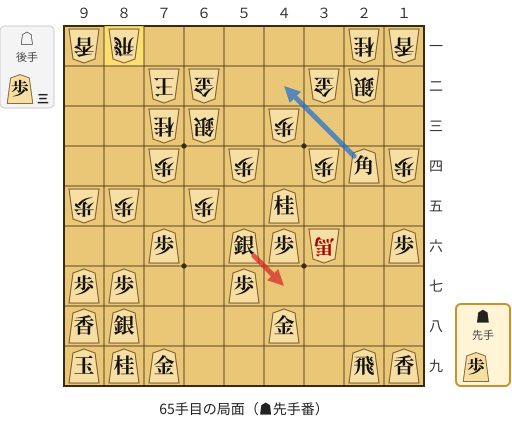

🔴 実戦 ▲４七銀(56)　🔵 AI推奨 ▲４二角成(24)　🟨 直前の相手の指し手

<details><summary>テキストの盤面図（BOD・将棋ソフトに貼り付け可）</summary>

```text
後手の持駒：歩三
  ９ ８ ７ ６ ５ ４ ３ ２ １
+---------------------------+
|v香v飛 ・ ・ ・ ・ ・v桂v香|一
| ・ ・v玉v金 ・ ・v金v銀 ・|二
| ・ ・v桂v銀 ・v歩 ・ ・ ・|三
| ・ ・v歩 ・v歩 ・v歩 角v歩|四
|v歩v歩 ・v歩 ・ 桂 ・ ・ ・|五
| ・ ・ 歩 ・ 銀 歩v馬 ・ 歩|六
| 歩 歩 ・ ・ 歩 ・ ・ ・ ・|七
| 香 銀 ・ ・ ・ 金 ・ ・ ・|八
| 玉 桂 金 ・ ・ ・ ・ 飛 香|九
+---------------------------+
先手の持駒：歩
手数＝64　△８一飛　まで
```

</details>

| | 指し手 | 評価値 | 読み筋 |
|---|---|--:|---|
| 実戦 | ▲４七銀(56) | -1293 | △同馬(36) ▲同金(48) △８六歩(85) ▲同歩(87) △２三歩打 ▲３三歩打 |
| AI 1位 | ▲４二角成(24) | -890 | ▲４二角成(24) △同金(32) ▲２二飛成(29) △６四角打 ▲６六歩打 △同歩(65) |
| AI 2位 | ▲３七歩打 | -920 | ▲３七歩打 △３五馬(36) ▲同角(24) △同歩(34) ▲７七角打 △３一角打 |
| AI 3位 | ▲４七銀(56) | -1003 | ▲４七銀(56) △同馬(36) ▲同金(48) △８六歩(85) ▲１七角打 △８七歩成(86) |

SFEN: `lr5nl/2kg2gs1/2ns1p3/2p1p1pBp/pp1p1N3/2P1SP+b1P/PP2P4/LS3G3/KNG4RL b P3p 65`

<a id="ply-73"></a>
### 73手目 ▲６四角成(53) — 悪手

| | 着手前 | 着手後 | 差 |
|---|--:|--:|--:|
| 期待勝率 | 21.0% | 8.5% | -12.4pt |
| 評価値 | -795 | -1422 | |

着手前の局面:

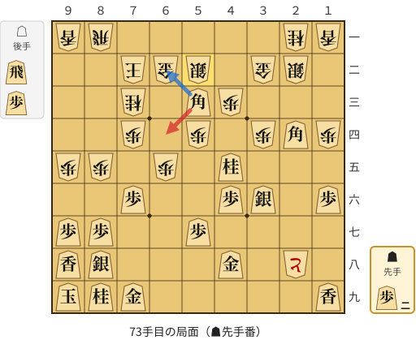

🔴 実戦 ▲６四角成(53)　🔵 AI推奨 ▲６二角成(53)　🟨 直前の相手の指し手

<details><summary>テキストの盤面図（BOD・将棋ソフトに貼り付け可）</summary>

```text
後手の持駒：飛　歩
  ９ ８ ７ ６ ５ ４ ３ ２ １
+---------------------------+
|v香v飛 ・ ・ ・ ・ ・v桂v香|一
| ・ ・v玉v金v銀 ・v金v銀 ・|二
| ・ ・v桂 ・ 角v歩 ・ ・ ・|三
| ・ ・v歩 ・v歩 ・v歩 角v歩|四
|v歩v歩 ・v歩 ・ 桂 ・ ・ ・|五
| ・ ・ 歩 ・ ・ 歩 銀 ・ 歩|六
| 歩 歩 ・ ・ 歩 ・ ・ ・ ・|七
| 香 銀 ・ ・ ・ 金 ・vと ・|八
| 玉 桂 金 ・ ・ ・ ・ ・ 香|九
+---------------------------+
先手の持駒：歩二
手数＝72　△５二銀　まで
```

</details>

| | 指し手 | 評価値 | 読み筋 |
|---|---|--:|---|
| 実戦 | ▲６四角成(53) | -1422 | △８六歩(85) ▲同歩(87) △６三銀(52) ▲４二馬(64) △同金(32) ▲同角成(24) |
| AI 1位 | ▲６二角成(53) | -795 | ▲６二角成(53) △同玉(72) ▲６四歩打 △８六歩(85) ▲５三金打 △同銀(52) |
| AI 2位 | ▲３三歩打 | -1237 | ▲３三歩打 △３一金(32) ▲３二歩成(33) △５三銀(52) ▲３一と(32) △８六歩(85) |
| AI 3位 | ▲４二角成(53) | -1403 | ▲４二角成(53) △同金(32) ▲同角成(24) △３一角打 ▲６三歩打 △４二角(31) |

SFEN: `lr5nl/2kgs1gs1/2n1Bp3/2p1p1pBp/pp1p1N3/2P2PS1P/PP2P4/LS3G1+p1/KNG5L b 2Prp 73`

<a id="ply-75"></a>
### 75手目 ▲同馬(64) — 大悪手

| | 着手前 | 着手後 | 差 |
|---|--:|--:|--:|
| 期待勝率 | 84.6% | 31.7% | -52.9pt |
| 評価値 | +1021 | -460 | |

着手前の局面:

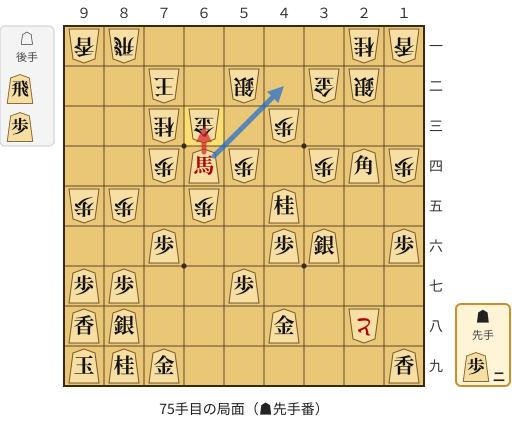

🔴 実戦 ▲同馬(64)　🔵 AI推奨 ▲４二馬(64)　🟨 直前の相手の指し手

<details><summary>テキストの盤面図（BOD・将棋ソフトに貼り付け可）</summary>

```text
後手の持駒：飛　歩
  ９ ８ ７ ６ ５ ４ ３ ２ １
+---------------------------+
|v香v飛 ・ ・ ・ ・ ・v桂v香|一
| ・ ・v玉 ・v銀 ・v金v銀 ・|二
| ・ ・v桂v金 ・v歩 ・ ・ ・|三
| ・ ・v歩 馬v歩 ・v歩 角v歩|四
|v歩v歩 ・v歩 ・ 桂 ・ ・ ・|五
| ・ ・ 歩 ・ ・ 歩 銀 ・ 歩|六
| 歩 歩 ・ ・ 歩 ・ ・ ・ ・|七
| 香 銀 ・ ・ ・ 金 ・vと ・|八
| 玉 桂 金 ・ ・ ・ ・ ・ 香|九
+---------------------------+
先手の持駒：歩二
手数＝74　△６三金　まで
```

</details>

| | 指し手 | 評価値 | 読み筋 |
|---|---|--:|---|
| 実戦 | ▲同馬(64) | -460 | △同玉(72) ▲６四歩打 △７二玉(63) ▲４二金打 △８六歩(85) ▲５二金(42) |
| AI 1位 | ▲４二馬(64) | +1021 | ▲４二馬(64) △同金(32) ▲同角成(24) △８六歩(85) ▲５二馬(42) △８七歩成(86) |
| AI 2位 | ▲４二馬(64) | +825 | ▲４二馬(64) △８六歩(85) ▲５二馬(42) △８七歩成(86) ▲同銀(88) △６二金(63) |
| AI 3位 | ▲同馬(64) | -368 | ▲同馬(64) △同玉(72) ▲６四歩打 △７二玉(63) ▲５一金打 △８六歩(85) |

SFEN: `lr5nl/2k1s1gs1/2ng1p3/2p+Bp1pBp/pp1p1N3/2P2PS1P/PP2P4/LS3G1+p1/KNG5L b 2Prp 75`

<a id="ply-79"></a>
### 79手目 ▲６二金打 — 大悪手

| | 着手前 | 着手後 | 差 |
|---|--:|--:|--:|
| 期待勝率 | 28.6% | 6.2% | -22.5pt |
| 評価値 | -548 | -1632 | |

着手前の局面:

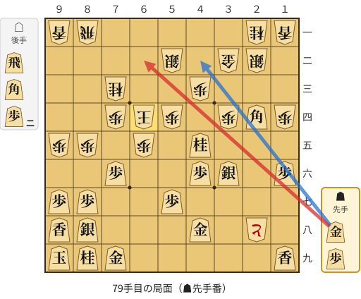

🔴 実戦 ▲６二金打　🔵 AI推奨 ▲４二金打　🟨 直前の相手の指し手

<details><summary>テキストの盤面図（BOD・将棋ソフトに貼り付け可）</summary>

```text
後手の持駒：飛　角　歩二
  ９ ８ ７ ６ ５ ４ ３ ２ １
+---------------------------+
|v香v飛 ・ ・ ・ ・ ・v桂v香|一
| ・ ・ ・ ・v銀 ・v金v銀 ・|二
| ・ ・v桂 ・ ・v歩 ・ ・ ・|三
| ・ ・v歩v玉v歩 ・v歩 角v歩|四
|v歩v歩 ・v歩 ・ 桂 ・ ・ ・|五
| ・ ・ 歩 ・ ・ 歩 銀 ・ 歩|六
| 歩 歩 ・ ・ 歩 ・ ・ ・ ・|七
| 香 銀 ・ ・ ・ 金 ・vと ・|八
| 玉 桂 金 ・ ・ ・ ・ ・ 香|九
+---------------------------+
先手の持駒：金　歩
手数＝78　△６四同玉　まで
```

</details>

| | 指し手 | 評価値 | 読み筋 |
|---|---|--:|---|
| 実戦 | ▲６二金打 | -1632 | △８六歩(85) ▲５一角成(24) △同飛(81) ▲同金(62) △６三銀(52) ▲８二飛打 |
| AI 1位 | ▲４二金打 | -548 | ▲４二金打 △８六歩(85) ▲３二金(42) △３三銀(22) ▲同金(32) △８七歩成(86) |
| AI 2位 | ▲７二金打 | -626 | ▲７二金打 △３一飛(81) ▲６二金(72) △６三銀(52) ▲同金(62) △同玉(64) |
| AI 3位 | ▲６六歩打 | -1202 | ▲６六歩打 △８六歩(85) ▲７二金打 △８七歩成(86) ▲８一金(72) △８八と(87) |

SFEN: `lr5nl/4s1gs1/2n2p3/2pkp1pBp/pp1p1N3/2P2PS1P/PP2P4/LS3G1+p1/KNG5L b GPrb2p 79`

<a id="ply-81"></a>
### 81手目 ▲５一角成(24) — 疑問手

| | 着手前 | 着手後 | 差 |
|---|--:|--:|--:|
| 期待勝率 | 8.3% | 2.5% | -5.8pt |
| 評価値 | -1443 | -2193 | |

着手前の局面:

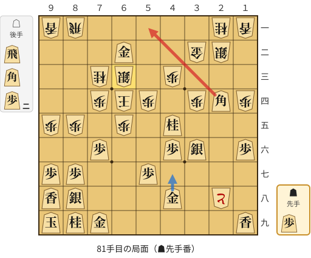

🔴 実戦 ▲５一角成(24)　🔵 AI推奨 ▲４七金(48)　🟨 直前の相手の指し手

<details><summary>テキストの盤面図（BOD・将棋ソフトに貼り付け可）</summary>

```text
後手の持駒：飛　角　歩二
  ９ ８ ７ ６ ５ ４ ３ ２ １
+---------------------------+
|v香v飛 ・ ・ ・ ・ ・v桂v香|一
| ・ ・ ・ 金 ・ ・v金v銀 ・|二
| ・ ・v桂v銀 ・v歩 ・ ・ ・|三
| ・ ・v歩v玉v歩 ・v歩 角v歩|四
|v歩v歩 ・v歩 ・ 桂 ・ ・ ・|五
| ・ ・ 歩 ・ ・ 歩 銀 ・ 歩|六
| 歩 歩 ・ ・ 歩 ・ ・ ・ ・|七
| 香 銀 ・ ・ ・ 金 ・vと ・|八
| 玉 桂 金 ・ ・ ・ ・ ・ 香|九
+---------------------------+
先手の持駒：歩
手数＝80　△６三銀　まで
```

</details>

| | 指し手 | 評価値 | 読み筋 |
|---|---|--:|---|
| 実戦 | ▲５一角成(24) | -2193 | △同飛(81) ▲同金(62) △８六歩(85) ▲８二飛打 △４四角打 ▲５三桂成(45) |
| AI 1位 | ▲４七金(48) | -1443 | ▲４七金(48) △２九飛打 ▲３九歩打 △４四角打 ▲６三金(62) △同玉(64) |
| AI 2位 | ▲２九歩打 | -1672 | ▲２九歩打 △８六歩(85) ▲同歩(87) △４四角打 ▲６三金(62) △同玉(64) |
| AI 3位 | ▲同金(62) | -1697 | ▲同金(62) △同玉(64) ▲６四歩打 △同玉(63) ▲６二銀打 △８六歩(85) |

SFEN: `lr5nl/3G2gs1/2ns1p3/2pkp1pBp/pp1p1N3/2P2PS1P/PP2P4/LS3G1+p1/KNG5L b Prb2p 81`

<a id="ply-83"></a>
### 83手目 ▲５八金(48) — 大悪手

| | 着手前 | 着手後 | 差 |
|---|--:|--:|--:|
| 期待勝率 | 39.2% | 3.4% | -35.8pt |
| 評価値 | -263 | -2012 | |

着手前の局面:

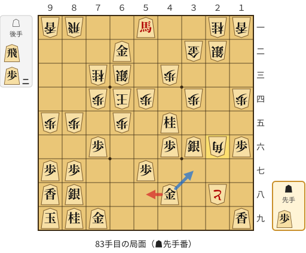

🔴 実戦 ▲５八金(48)　🔵 AI推奨 ▲３七金(48)　🟨 直前の相手の指し手

<details><summary>テキストの盤面図（BOD・将棋ソフトに貼り付け可）</summary>

```text
後手の持駒：飛　歩二
  ９ ８ ７ ６ ５ ４ ３ ２ １
+---------------------------+
|v香v飛 ・ ・ 馬 ・ ・v桂v香|一
| ・ ・ ・ 金 ・ ・v金v銀 ・|二
| ・ ・v桂v銀 ・v歩 ・ ・ ・|三
| ・ ・v歩v玉v歩 ・v歩 ・v歩|四
|v歩v歩 ・v歩 ・ 桂 ・ ・ ・|五
| ・ ・ 歩 ・ ・ 歩 銀v角 歩|六
| 歩 歩 ・ ・ 歩 ・ ・ ・ ・|七
| 香 銀 ・ ・ ・ 金 ・vと ・|八
| 玉 桂 金 ・ ・ ・ ・ ・ 香|九
+---------------------------+
先手の持駒：歩
手数＝82　△２六角　まで
```

</details>

| | 指し手 | 評価値 | 読み筋 |
|---|---|--:|---|
| 実戦 | ▲５八金(48) | -2012 | △５一飛(81) ▲同金(62) △３九飛打 ▲６一飛打 △８六歩(85) ▲６九歩打 |
| AI 1位 | ▲３七金(48) | -263 | ▲３七金(48) △４四角(26) ▲６三金(62) △同玉(64) ▲６四歩打 △同玉(63) |
| AI 2位 | ▲６三金(62) | -536 | ▲６三金(62) △同玉(64) ▲６四歩打 △同玉(63) ▲５二馬(51) △４二金打 |
| AI 3位 | ▲３三歩打 | -695 | ▲３三歩打 △５一飛(81) ▲３二歩成(33) △６二角(26) ▲２一と(32) △６六歩(65) |

SFEN: `lr2+B2nl/3G2gs1/2ns1p3/2pkp1p1p/pp1p1N3/2P2PSbP/PP2P4/LS3G1+p1/KNG5L b Pr2p 83`

<a id="ply-87"></a>
### 87手目 ▲５二銀打 — 疑問手

| | 着手前 | 着手後 | 差 |
|---|--:|--:|--:|
| 期待勝率 | 18.2% | 10.4% | -7.8pt |
| 評価値 | -901 | -1294 | |

着手前の局面:

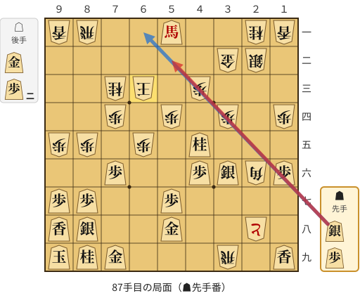

🔴 実戦 ▲５二銀打　🔵 AI推奨 ▲６一銀打　🟨 直前の相手の指し手

<details><summary>テキストの盤面図（BOD・将棋ソフトに貼り付け可）</summary>

```text
後手の持駒：金　歩二
  ９ ８ ７ ６ ５ ４ ３ ２ １
+---------------------------+
|v香v飛 ・ ・ 馬 ・ ・v桂v香|一
| ・ ・ ・ ・ ・ ・v金v銀 ・|二
| ・ ・v桂v玉 ・v歩 ・ ・ ・|三
| ・ ・v歩 ・v歩 ・v歩 ・v歩|四
|v歩v歩 ・v歩 ・ 桂 ・ ・ ・|五
| ・ ・ 歩 ・ ・ 歩 銀v角 歩|六
| 歩 歩 ・ ・ 歩 ・ ・ ・ ・|七
| 香 銀 ・ ・ 金 ・ ・vと ・|八
| 玉 桂 金 ・ ・ ・v飛 ・ 香|九
+---------------------------+
先手の持駒：銀　歩
手数＝86　△６三同玉　まで
```

</details>

| | 指し手 | 評価値 | 読み筋 |
|---|---|--:|---|
| 実戦 | ▲５二銀打 | -1294 | △６四玉(63) ▲３五歩打 △５一飛(81) ▲同銀成(52) △６三金打 ▲５三桂成(45) |
| AI 1位 | ▲６一銀打 | -901 | ▲６一銀打 △４二金打 ▲５六歩(57) △４四角(26) ▲７八金(79) △８六歩(85) |
| AI 2位 | ▲５二銀打 | -987 | ▲５二銀打 △６四玉(63) ▲３五歩打 △５一飛(81) ▲同銀不成(52) △４四角打 |
| AI 3位 | ▲６四歩打 | -1190 | ▲６四歩打 △同玉(63) ▲５二馬(51) △４二金打 ▲５三銀打 △同角(26) |

SFEN: `lr2+B2nl/6gs1/2nk1p3/2p1p1p1p/pp1p1N3/2P2PSbP/PP2P4/LS2G2+p1/KNG3r1L b SPg2p 87`

<a id="ply-89"></a>
### 89手目 ▲２七歩打 — 悪手

| | 着手前 | 着手後 | 差 |
|---|--:|--:|--:|
| 期待勝率 | 12.4% | 0.4% | -12.0pt |
| 評価値 | -1173 | -3323 | |

着手前の局面:

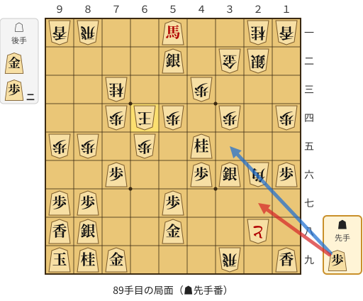

🔴 実戦 ▲２七歩打　🔵 AI推奨 ▲３五歩打　🟨 直前の相手の指し手

<details><summary>テキストの盤面図（BOD・将棋ソフトに貼り付け可）</summary>

```text
後手の持駒：金　歩二
  ９ ８ ７ ６ ５ ４ ３ ２ １
+---------------------------+
|v香v飛 ・ ・ 馬 ・ ・v桂v香|一
| ・ ・ ・ ・ 銀 ・v金v銀 ・|二
| ・ ・v桂 ・ ・v歩 ・ ・ ・|三
| ・ ・v歩v玉v歩 ・v歩 ・v歩|四
|v歩v歩 ・v歩 ・ 桂 ・ ・ ・|五
| ・ ・ 歩 ・ ・ 歩 銀v角 歩|六
| 歩 歩 ・ ・ 歩 ・ ・ ・ ・|七
| 香 銀 ・ ・ 金 ・ ・vと ・|八
| 玉 桂 金 ・ ・ ・v飛 ・ 香|九
+---------------------------+
先手の持駒：歩
手数＝88　△６四玉　まで
```

</details>

| | 指し手 | 評価値 | 読み筋 |
|---|---|--:|---|
| 実戦 | ▲２七歩打 | -3323 | △４四角(26) ▲５三桂成(45) △同角(44) ▲７八金(79) △８六歩(85) ▲９六歩(97) |
| AI 1位 | ▲３五歩打 | -1173 | ▲３五歩打 △３六飛成(39) ▲６二馬(51) △５五玉(64) ▲７三馬(62) △４四玉(55) |
| AI 2位 | ▲４一馬(51) | -1461 | ▲４一馬(51) △同飛(81) ▲同銀不成(52) △８六歩(85) ▲６九歩打 △８七歩成(86) |
| AI 3位 | ▲６一馬(51) | -1696 | ▲６一馬(51) △同飛(81) ▲同銀不成(52) △８六歩(85) ▲５二銀不成(61) △６二金打 |

SFEN: `lr2+B2nl/4S1gs1/2n2p3/2pkp1p1p/pp1p1N3/2P2PSbP/PP2P4/LS2G2+p1/KNG3r1L b Pg2p 89`

<a id="ply-97"></a>
### 97手目 ▲７七角打 — 大悪手

| | 着手前 | 着手後 | 差 |
|---|--:|--:|--:|
| 期待勝率 | 100.0% | 1.0% | -99.0pt |
| 評価値 | +35281 | -2746 | |

着手前の局面:

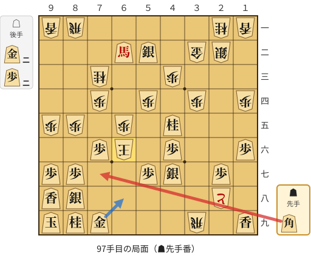

🔴 実戦 ▲７七角打　🔵 AI推奨 ▲６八金(79)　🟨 直前の相手の指し手

<details><summary>テキストの盤面図（BOD・将棋ソフトに貼り付け可）</summary>

```text
後手の持駒：金二　歩二
  ９ ８ ７ ６ ５ ４ ３ ２ １
+---------------------------+
|v香v飛 ・ ・ ・ ・ ・v桂v香|一
| ・ ・ ・ 馬 銀 ・v金v銀 ・|二
| ・ ・v桂 ・ ・v歩 ・ ・ ・|三
| ・ ・v歩 ・v歩 ・v歩 ・v歩|四
|v歩v歩 ・v歩 ・ 桂 ・ ・ ・|五
| ・ ・ 歩v玉 ・ 歩 ・ ・ 歩|六
| 歩 歩 ・ ・ 歩 銀 ・ 歩 ・|七
| 香 銀 ・ ・ ・ ・ ・vと ・|八
| 玉 桂 金 ・ ・ ・v飛 ・ 香|九
+---------------------------+
先手の持駒：角
手数＝96　△６六玉　まで
```

</details>

| | 指し手 | 評価値 | 読み筋 |
|---|---|--:|---|
| 実戦 | ▲７七角打 | -2746 | △５七玉(66) ▲２二角成(77) △４七玉(57) ▲３二馬(22) △５七金打 ▲６八銀打 |
| AI 1位 | ▲６八金(79) | +35281 | ▲６八金(79) △７六玉(66) ▲７三馬(62) △８九飛成(39) ▲同玉(99) △７九金打 |
| AI 2位 | ▲４八角打 | +5338 | ▲４八角打 △７九飛成(39) ▲同銀(88) △８六歩(85) ▲７三馬(62) △７六玉(66) |
| AI 3位 | ▲５八銀(47) | +4611 | ▲５八銀(47) △６七金打 ▲７七角打 △７六玉(66) ▲６七銀(58) △同玉(76) |

SFEN: `lr5nl/3+BS1gs1/2n2p3/2p1p1p1p/pp1p1N3/2Pk1P2P/PP2PS1P1/LS5+p1/KNG3r1L b B2g2p 97`

