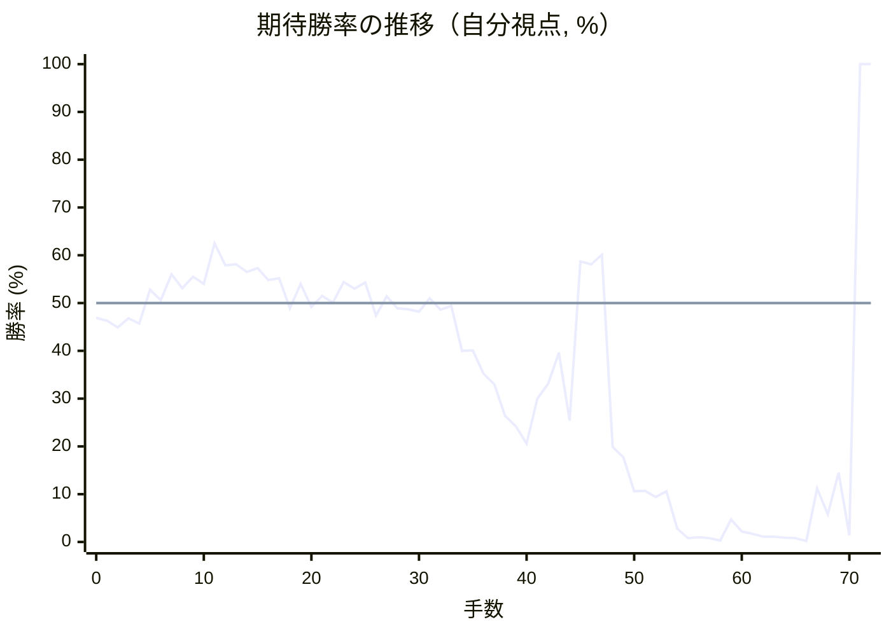
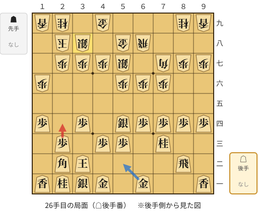
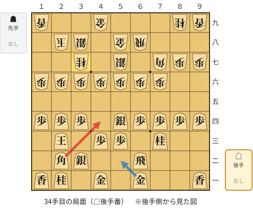
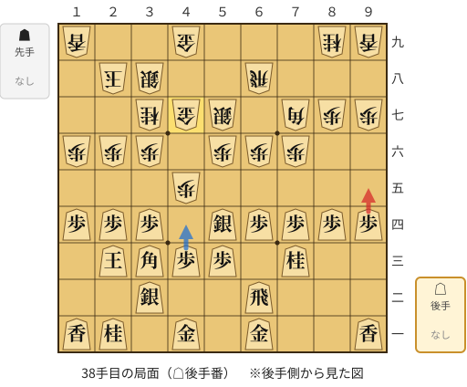
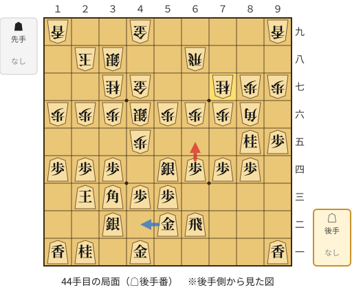
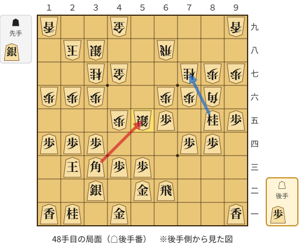
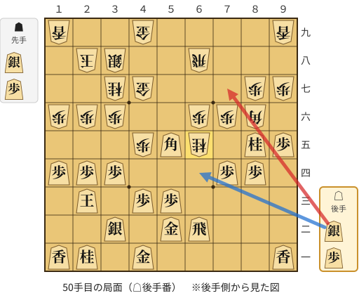

# 解析レポート iyaqgwnqktdq

[README に戻る](../../../README.md)　/　棋譜: [CSA](../../../data/csa/shogi5/iyaqgwnqktdq.csa)　/　解析の見方: [docs/mistake_analysis.md](../../../docs/mistake_analysis.md)

## 対局情報

| 項目 | 内容 |
|---|---|
| 日時 | 2026-11-19 03:14:02 |
| 持ち時間 | 5分 |
| 自分 | 後手（△）（1682） |
| 相手 | 相手（1948） |
| 結果 | 勝ち（投了, 72手） |

## 解析環境

| 項目 | 内容 |
|---|---|
| エンジン | YaneuraOu NNUE 9.00git 64AVX2（V9.00/YANEURAOU_ENGINE_NNUE/AVX2） |
| 評価関数 | **水匠5**（`suisho5`） |
| nn.bin SHA-256 | `768068f0d534a0603a5d38bcd143de6bbca820d5f1c95a14d40863e5b7892d76` |
| 第1パス | movetime=150ms, MultiPV 1 |
| 第2パス | movetime=2000ms, MultiPV 3 |
| Threads / Hash | 8 / 512MB |
| 判定基準 | 疑問手 ≥5pt, 悪手 ≥10pt, 大悪手 ≥20pt（期待勝率 W(E)=1/(1+exp(-E/600))） |
| 解析日時 | 2026-11-20T20:05:56+09:00（解析バージョン 1, 47秒） |

## サマリー

| 自分の手数 | 深掘りした手 | 詰み逃し | 大悪手 | 悪手 | 疑問手 |
|--:|--:|--:|--:|--:|--:|
| 36 | 9 | 0 | 1 | 4 | 1 |

## 期待勝率の推移



<details><summary>1手ごとの数値（第1パス）</summary>

| 手数 | 指し手 | 評価値 | 勝率 | 低下 | 判定 |
|--:|---|--:|--:|--:|---|
| 1 | ▲７六歩(77) | -90 | 46.3% |  |  |
| 2 | △８四歩(83) | -123 | 44.9% | +1.4pt |  |
| 3 | ▲６八銀(79) | -78 | 46.8% |  |  |
| 4 | △３四歩(33) | -103 | 45.7% | +1.0pt |  |
| 5 | ▲６六歩(67) | +68 | 52.8% |  |  |
| 6 | △６二銀(71) | +14 | 50.6% | +2.2pt |  |
| 7 | ▲７七角(88) | +144 | 56.0% |  |  |
| 8 | △６四歩(63) | +74 | 53.1% | +2.9pt |  |
| 9 | ▲５六歩(57) | +133 | 55.5% |  |  |
| 10 | △４二玉(51) | +95 | 54.0% | +1.6pt |  |
| 11 | ▲５七銀(68) | +307 | 62.5% |  |  |
| 12 | △６三銀(62) | +192 | 57.9% | +4.6pt |  |
| 13 | ▲６八飛(28) | +195 | 58.1% |  |  |
| 14 | △９四歩(93) | +158 | 56.5% | +1.5pt |  |
| 15 | ▲５八金(69) | +176 | 57.3% |  |  |
| 16 | △５四銀(63) | +115 | 54.8% | +2.5pt |  |
| 17 | ▲４八玉(59) | +126 | 55.2% |  |  |
| 18 | △７四歩(73) | -26 | 48.9% | +6.3pt |  |
| 19 | ▲３八玉(48) | +97 | 54.0% |  |  |
| 20 | △７三桂(81) | -20 | 49.2% | +4.9pt |  |
| 21 | ▲１六歩(17) | +36 | 51.5% |  |  |
| 22 | △１四歩(13) | +3 | 50.1% | +1.4pt |  |
| 23 | ▲２八玉(38) | +106 | 54.4% |  |  |
| 24 | △３二玉(42) | +71 | 53.0% | +1.5pt |  |
| 25 | ▲３八銀(39) | +104 | 54.3% |  |  |
| 26 | △２四歩(23) | -63 | 47.4% | +6.9pt | [疑問手](#ply-26) |
| 27 | ▲４六歩(47) | +33 | 51.4% |  |  |
| 28 | △２三玉(32) | -26 | 48.9% | +2.5pt |  |
| 29 | ▲３六歩(37) | -32 | 48.7% |  |  |
| 30 | △３二銀(31) | -43 | 48.2% | +0.5pt |  |
| 31 | ▲２六歩(27) | +23 | 51.0% |  |  |
| 32 | △６二飛(82) | -34 | 48.6% | +2.4pt |  |
| 33 | ▲３七桂(29) | -15 | 49.4% |  |  |
| 34 | △４四角(22) | -244 | 40.0% | +9.4pt | [悪手](#ply-34) |
| 35 | ▲４五歩(46) | -240 | 40.1% |  |  |
| 36 | △３三角(44) | -366 | 35.2% | +4.9pt |  |
| 37 | ▲４七金(58) | -425 | 33.0% |  |  |
| 38 | △９五歩(94) | -615 | 26.4% | +6.6pt | [悪手](#ply-38) |
| 39 | ▲４六銀(57) | -685 | 24.2% |  |  |
| 40 | △８五桂(73) | -811 | 20.6% | +3.6pt |  |
| 41 | ▲８六角(77) | -507 | 30.0% |  |  |
| 42 | △５二金(61) | -423 | 33.1% | -3.0pt |  |
| 43 | ▲７七桂(89) | -254 | 39.6% |  |  |
| 44 | △６五歩(64) | -648 | 25.4% | +14.2pt | [悪手](#ply-44) |
| 45 | ▲５五歩(56) | +210 | 58.7% |  |  |
| 46 | △同銀(54) | +195 | 58.1% | +0.6pt |  |
| 47 | ▲同銀(46) | +245 | 60.1% |  |  |
| 48 | △同角(33) | -836 | 19.9% | +40.2pt | [大悪手](#ply-48) |
| 49 | ▲６五桂(77) | -922 | 17.7% |  |  |
| 50 | △７七銀打 | -1277 | 10.6% | +7.1pt | [悪手](#ply-50) |
| 51 | ▲５八飛(68) | -1276 | 10.7% |  |  |
| 52 | △６六角(55) | -1361 | 9.4% | +1.3pt |  |
| 53 | ▲５三桂成(65) | -1281 | 10.6% |  |  |
| 54 | △５七歩打 | -2126 | 2.8% | +7.8pt |  |
| 55 | ▲同金(47) | -2878 | 0.8% |  |  |
| 56 | △同角成(66) | -2735 | 1.0% | -0.2pt |  |
| 57 | ▲同飛(58) | -2882 | 0.8% |  |  |
| 58 | △６八飛成(62) | -3562 | 0.3% | +0.6pt |  |
| 59 | ▲５八銀打 | -1807 | 4.7% |  |  |
| 60 | △５三金(52) | -2288 | 2.2% | +2.5pt |  |
| 61 | ▲同角成(86) | -2431 | 1.7% |  |  |
| 62 | △４六桂打 | -2692 | 1.1% | +0.6pt |  |
| 63 | ▲５五角打 | -2683 | 1.1% |  |  |
| 64 | △３八桂成(46) | -2822 | 0.9% | +0.2pt |  |
| 65 | ▲同金(49) | -2894 | 0.8% |  |  |
| 66 | △３三桂(21) | -3603 | 0.2% | +0.6pt |  |
| 67 | ▲３五桂打 | -1241 | 11.2% |  |  |
| 68 | △同歩(34) | -1677 | 5.8% | +5.5pt |  |
| 69 | ▲同歩(36) | -1064 | 14.5% |  |  |
| 70 | △５七龍(68) | -2558 | 1.4% | +13.1pt |  |
| 71 | ▲４七銀(58) | +4950 | 100.0% |  |  |
| 72 | △５五龍(57) | +5533 | 100.0% | -0.0pt |  |

</details>

## 課題局面

<a id="ply-26"></a>
### 26手目 △２四歩(23) — 疑問手

| | 着手前 | 着手後 | 差 |
|---|--:|--:|--:|
| 期待勝率 | 52.5% | 46.7% | -5.8pt |
| 評価値 | +60 | -80 | |

着手前の局面:



🔴 実戦 △２四歩(23)　🔵 AI推奨 △５二金(61)　🟨 直前の相手の指し手

<details><summary>テキストの盤面図（BOD・将棋ソフトに貼り付け可）</summary>

```text
後手の持駒：なし
  ９ ８ ７ ６ ５ ４ ３ ２ １
+---------------------------+
|v香 ・ ・v金 ・v金v銀v桂v香|一
| ・v飛 ・ ・ ・ ・v玉v角 ・|二
| ・ ・v桂 ・v歩v歩 ・v歩 ・|三
|v歩v歩v歩v歩v銀 ・v歩 ・v歩|四
| ・ ・ ・ ・ ・ ・ ・ ・ ・|五
| ・ ・ 歩 歩 歩 ・ ・ ・ 歩|六
| 歩 歩 角 ・ 銀 歩 歩 歩 ・|七
| ・ ・ ・ 飛 金 ・ 銀 玉 ・|八
| 香 桂 ・ ・ ・ 金 ・ 桂 香|九
+---------------------------+
先手の持駒：なし
後手番
手数＝25　▲３八銀　まで
```

</details>

| | 指し手 | 評価値 | 読み筋 |
|---|---|--:|---|
| 実戦 | △２四歩(23) | -80 | ▲４六銀(57) △５二金(61) ▲５五歩(56) △同銀(54) ▲同銀(46) △同角(22) |
| AI 1位 | △５二金(61) | +60 | △５二金(61) ▲４六銀(57) △６二飛(82) ▲８八角(77) △８五歩(84) ▲７五歩(76) |
| AI 2位 | △５二金(61) | +56 | △５二金(61) ▲３六歩(37) △４二金(52) ▲２六歩(27) △７二飛(82) ▲４六銀(57) |
| AI 3位 | △８五歩(84) | +37 | △８五歩(84) ▲３六歩(37) △５二金(61) ▲４六銀(57) △４四歩(43) ▲３七桂(29) |

SFEN: `l2g1gsnl/1r4kb1/2n1pp1p1/pppps1p1p/9/2PPP3P/PPB1SPPP1/3RG1SK1/LN3G1NL w - 26`

<a id="ply-34"></a>
### 34手目 △４四角(22) — 悪手

| | 着手前 | 着手後 | 差 |
|---|--:|--:|--:|
| 期待勝率 | 50.0% | 35.0% | -15.0pt |
| 評価値 | -1 | -372 | |

着手前の局面:



🔴 実戦 △４四角(22)　🔵 AI推奨 △５二金(61)　🟨 直前の相手の指し手

<details><summary>テキストの盤面図（BOD・将棋ソフトに貼り付け可）</summary>

```text
後手の持駒：なし
  ９ ８ ７ ６ ５ ４ ３ ２ １
+---------------------------+
|v香 ・ ・v金 ・v金 ・v桂v香|一
| ・ ・ ・v飛 ・ ・v銀v角 ・|二
| ・ ・v桂 ・v歩v歩 ・v玉 ・|三
|v歩v歩v歩v歩v銀 ・v歩v歩v歩|四
| ・ ・ ・ ・ ・ ・ ・ ・ ・|五
| ・ ・ 歩 歩 歩 歩 歩 歩 歩|六
| 歩 歩 角 ・ 銀 ・ 桂 ・ ・|七
| ・ ・ ・ 飛 金 ・ 銀 玉 ・|八
| 香 桂 ・ ・ ・ 金 ・ ・ 香|九
+---------------------------+
先手の持駒：なし
後手番
手数＝33　▲３七桂　まで
```

</details>

| | 指し手 | 評価値 | 読み筋 |
|---|---|--:|---|
| 実戦 | △４四角(22) | -372 | ▲４五歩(46) △２二角(44) ▲４七金(58) △５二金(61) ▲３五歩(36) △７五歩(74) |
| AI 1位 | △５二金(61) | -1 | △５二金(61) ▲４七金(58) △１二玉(23) ▲４五歩(46) △２三銀(32) ▲６五歩(66) |
| AI 2位 | △１二玉(23) | -21 | △１二玉(23) ▲４七金(58) △５二金(61) ▲４五歩(46) △２三銀(32) ▲４六銀(57) |
| AI 3位 | △５一金(61) | -51 | △５一金(61) ▲４七金(58) △１二玉(23) ▲４五歩(46) △４二金(51) ▲６五歩(66) |

SFEN: `l2g1g1nl/3r2sb1/2n1pp1k1/pppps1ppp/9/2PPPPPPP/PPB1S1N2/3RG1SK1/LN3G2L w - 34`

<a id="ply-38"></a>
### 38手目 △９五歩(94) — 悪手

| | 着手前 | 着手後 | 差 |
|---|--:|--:|--:|
| 期待勝率 | 31.1% | 20.0% | -11.1pt |
| 評価値 | -478 | -832 | |

着手前の局面:



🔴 実戦 △９五歩(94)　🔵 AI推奨 △４四歩(43)　🟨 直前の相手の指し手

<details><summary>テキストの盤面図（BOD・将棋ソフトに貼り付け可）</summary>

```text
後手の持駒：なし
  ９ ８ ７ ６ ５ ４ ３ ２ １
+---------------------------+
|v香 ・ ・v金 ・v金 ・v桂v香|一
| ・ ・ ・v飛 ・ ・v銀 ・ ・|二
| ・ ・v桂 ・v歩v歩v角v玉 ・|三
|v歩v歩v歩v歩v銀 ・v歩v歩v歩|四
| ・ ・ ・ ・ ・ 歩 ・ ・ ・|五
| ・ ・ 歩 歩 歩 ・ 歩 歩 歩|六
| 歩 歩 角 ・ 銀 金 桂 ・ ・|七
| ・ ・ ・ 飛 ・ ・ 銀 玉 ・|八
| 香 桂 ・ ・ ・ 金 ・ ・ 香|九
+---------------------------+
先手の持駒：なし
後手番
手数＝37　▲４七金　まで
```

</details>

| | 指し手 | 評価値 | 読み筋 |
|---|---|--:|---|
| 実戦 | △９五歩(94) | -832 | ▲４六銀(57) △５二金(61) ▲２五歩(26) △同歩(24) ▲３五歩(36) △６五歩(64) |
| AI 1位 | △４四歩(43) | -478 | △４四歩(43) ▲同歩(45) △同角(33) ▲４六銀(57) △５二金(61) ▲４五歩打 |
| AI 2位 | △５二金(61) | -501 | △５二金(61) ▲３五歩(36) △同歩(34) ▲４六銀(57) △７五歩(74) ▲８八角(77) |
| AI 3位 | △６五歩(64) | -532 | △６五歩(64) ▲２五歩(26) △６六歩(65) ▲２四歩(25) △２二玉(23) ▲６六角(77) |

SFEN: `l2g1g1nl/3r2s2/2n1ppbk1/pppps1ppp/5P3/2PPP1PPP/PPB1SGN2/3R2SK1/LN3G2L w - 38`

<a id="ply-44"></a>
### 44手目 △６五歩(64) — 悪手

| | 着手前 | 着手後 | 差 |
|---|--:|--:|--:|
| 期待勝率 | 34.4% | 23.8% | -10.5pt |
| 評価値 | -388 | -697 | |

着手前の局面:



🔴 実戦 △６五歩(64)　🔵 AI推奨 △４二金(52)　🟨 直前の相手の指し手

<details><summary>テキストの盤面図（BOD・将棋ソフトに貼り付け可）</summary>

```text
後手の持駒：なし
  ９ ８ ７ ６ ５ ４ ３ ２ １
+---------------------------+
|v香 ・ ・ ・ ・v金 ・v桂v香|一
| ・ ・ ・v飛v金 ・v銀 ・ ・|二
| ・ ・ ・ ・v歩v歩v角v玉 ・|三
| ・v歩v歩v歩v銀 ・v歩v歩v歩|四
|v歩v桂 ・ ・ ・ 歩 ・ ・ ・|五
| ・ 角 歩 歩 歩 銀 歩 歩 歩|六
| 歩 歩 桂 ・ ・ 金 桂 ・ ・|七
| ・ ・ ・ 飛 ・ ・ 銀 玉 ・|八
| 香 ・ ・ ・ ・ 金 ・ ・ 香|九
+---------------------------+
先手の持駒：なし
後手番
手数＝43　▲７七桂　まで
```

</details>

| | 指し手 | 評価値 | 読み筋 |
|---|---|--:|---|
| 実戦 | △６五歩(64) | -697 | ▲同桂(77) △同銀(54) ▲同歩(66) △９九角成(33) ▲６九飛(68) △８八馬(99) |
| AI 1位 | △４二金(52) | -388 | △４二金(52) ▲３五歩(36) △同歩(34) ▲２五歩(26) △同歩(24) ▲３五銀(46) |
| AI 2位 | △同桂成(85) | -324 | △同桂成(85) ▲同角(86) △６五歩(64) ▲２五歩(26) △６六歩(65) ▲２四歩(25) |
| AI 3位 | △同桂成(85) | -324 | △同桂成(85) ▲同角(86) △６五歩(64) ▲２五歩(26) △６六歩(65) ▲２四歩(25) |

SFEN: `l4g1nl/3rg1s2/4ppbk1/1ppps1ppp/pn3P3/1BPPPSPPP/PPN2GN2/3R2SK1/L4G2L w - 44`

<a id="ply-48"></a>
### 48手目 △同角(33) — 大悪手

| | 着手前 | 着手後 | 差 |
|---|--:|--:|--:|
| 期待勝率 | 58.2% | 13.4% | -44.8pt |
| 評価値 | +198 | -1120 | |

着手前の局面:



🔴 実戦 △同角(33)　🔵 AI推奨 △７七桂成(85)　🟨 直前の相手の指し手

<details><summary>テキストの盤面図（BOD・将棋ソフトに貼り付け可）</summary>

```text
後手の持駒：歩
  ９ ８ ７ ６ ５ ４ ３ ２ １
+---------------------------+
|v香 ・ ・ ・ ・v金 ・v桂v香|一
| ・ ・ ・v飛v金 ・v銀 ・ ・|二
| ・ ・ ・ ・v歩v歩v角v玉 ・|三
| ・v歩v歩 ・ ・ ・v歩v歩v歩|四
|v歩v桂 ・v歩 銀 歩 ・ ・ ・|五
| ・ 角 歩 歩 ・ ・ 歩 歩 歩|六
| 歩 歩 桂 ・ ・ 金 桂 ・ ・|七
| ・ ・ ・ 飛 ・ ・ 銀 玉 ・|八
| 香 ・ ・ ・ ・ 金 ・ ・ 香|九
+---------------------------+
先手の持駒：銀
後手番
手数＝47　▲５五同銀　まで
```

</details>

| | 指し手 | 評価値 | 読み筋 |
|---|---|--:|---|
| 実戦 | △同角(33) | -1120 | ▲６五桂(77) △４六銀打 ▲同金(47) △同角(55) ▲４八飛(68) △５七角成(46) |
| AI 1位 | △７七桂成(85) | +198 | △７七桂成(85) ▲同角(86) △５五角(33) ▲５八飛(68) △６六角(55) ▲同角(77) |
| AI 2位 | △６六歩(65) | -146 | △６六歩(65) ▲７三銀打 △６一飛(62) ▲７二銀成(73) △７七桂成(85) ▲同角(86) |
| AI 3位 | △７七桂不成(85) | -765 | △７七桂不成(85) ▲４四歩(45) △６六歩(65) ▲同飛(68) △同飛(62) ▲同銀(55) |

SFEN: `l4g1nl/3rg1s2/4ppbk1/1pp3ppp/pn1pSP3/1BPP2PPP/PPN2GN2/3R2SK1/L4G2L w Sp 48`

<a id="ply-50"></a>
### 50手目 △７七銀打 — 悪手

| | 着手前 | 着手後 | 差 |
|---|--:|--:|--:|
| 期待勝率 | 13.6% | 3.5% | -10.1pt |
| 評価値 | -1110 | -1993 | |

着手前の局面:



🔴 実戦 △７七銀打　🔵 AI推奨 △６四銀打　🟨 直前の相手の指し手

<details><summary>テキストの盤面図（BOD・将棋ソフトに貼り付け可）</summary>

```text
後手の持駒：銀　歩
  ９ ８ ７ ６ ５ ４ ３ ２ １
+---------------------------+
|v香 ・ ・ ・ ・v金 ・v桂v香|一
| ・ ・ ・v飛v金 ・v銀 ・ ・|二
| ・ ・ ・ ・v歩v歩 ・v玉 ・|三
| ・v歩v歩 ・ ・ ・v歩v歩v歩|四
|v歩v桂 ・ 桂v角 歩 ・ ・ ・|五
| ・ 角 歩 歩 ・ ・ 歩 歩 歩|六
| 歩 歩 ・ ・ ・ 金 桂 ・ ・|七
| ・ ・ ・ 飛 ・ ・ 銀 玉 ・|八
| 香 ・ ・ ・ ・ 金 ・ ・ 香|九
+---------------------------+
先手の持駒：銀　歩
後手番
手数＝49　▲６五桂　まで
```

</details>

| | 指し手 | 評価値 | 読み筋 |
|---|---|--:|---|
| 実戦 | △７七銀打 | -1993 | ▲５八飛(68) △８六銀成(77) ▲５五飛(58) △６四角打 ▲５六飛(55) △７六成銀(86) |
| AI 1位 | △６四銀打 | -1110 | △６四銀打 ▲２五歩(26) △同歩(24) ▲２四歩打 △同玉(23) ▲５八飛(68) |
| AI 2位 | △４二銀打 | -1112 | △４二銀打 ▲２五歩(26) △同歩(24) ▲２四歩打 △同玉(23) ▲５八飛(68) |
| AI 3位 | △同飛(62) | -1167 | △同飛(62) ▲同歩(66) △９九角成(55) ▲６四角(86) △９三香(91) ▲５八飛(68) |

SFEN: `l4g1nl/3rg1s2/4pp1k1/1pp3ppp/pn1NbP3/1BPP2PPP/PP3GN2/3R2SK1/L4G2L w SPsp 50`

