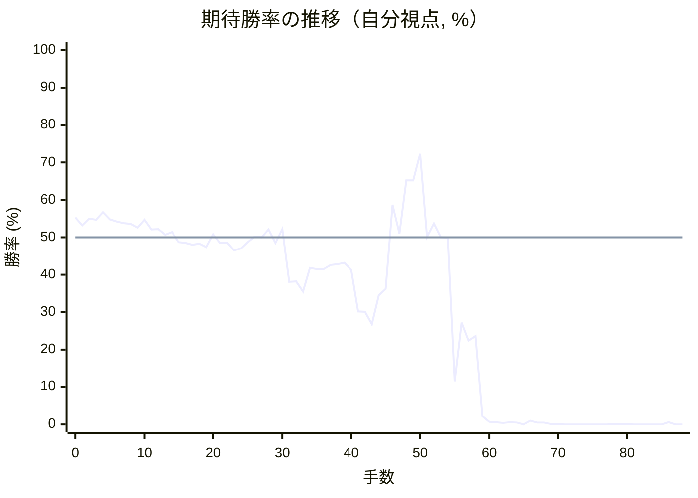
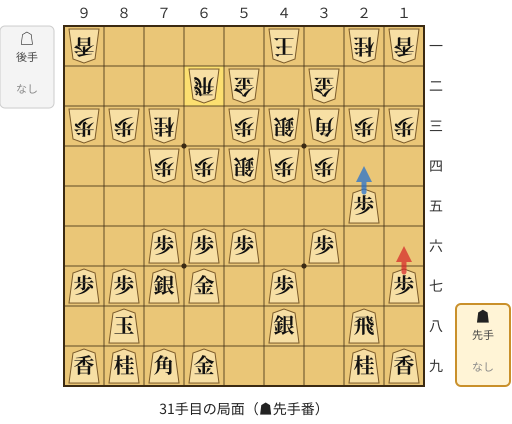
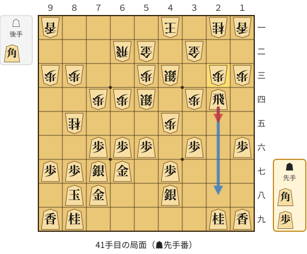
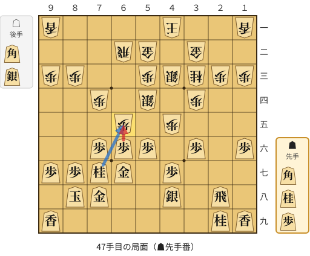
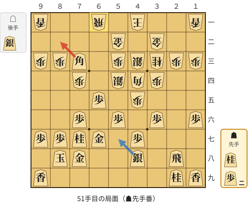
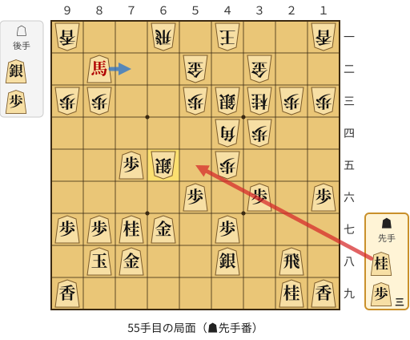
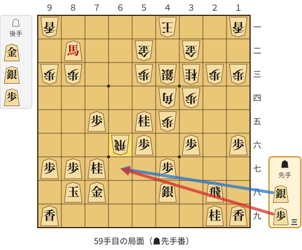

# 解析レポート j28zuxvxl045

[README に戻る](../../../README.md)　/　棋譜: [CSA](../../../data/csa/shogi5/j28zuxvxl045.csa)　/　解析の見方: [docs/mistake_analysis.md](../../../docs/mistake_analysis.md)

## 対局情報

| 項目 | 内容 |
|---|---|
| 日時 | 2026-10-31 09:41:07 |
| 持ち時間 | 5分 |
| 自分 | 先手（▲）（1727） |
| 相手 | 相手（1768） |
| 結果 | 負け（投了, 88手） |

## 解析環境

| 項目 | 内容 |
|---|---|
| エンジン | YaneuraOu NNUE 9.00git 64AVX2（V9.00/YANEURAOU_ENGINE_NNUE/AVX2） |
| 評価関数 | **水匠5**（`suisho5`） |
| nn.bin SHA-256 | `768068f0d534a0603a5d38bcd143de6bbca820d5f1c95a14d40863e5b7892d76` |
| 第1パス | movetime=150ms, MultiPV 1 |
| 第2パス | movetime=2000ms, MultiPV 3 |
| Threads / Hash | 8 / 512MB |
| 判定基準 | 疑問手 ≥5pt, 悪手 ≥10pt, 大悪手 ≥20pt（期待勝率 W(E)=1/(1+exp(-E/600))） |
| 解析日時 | 2026-11-03T04:08:29+09:00（解析バージョン 1, 37秒） |

## サマリー

| 自分の手数 | 深掘りした手 | 詰み逃し | 大悪手 | 悪手 | 疑問手 |
|--:|--:|--:|--:|--:|--:|
| 44 | 6 | 0 | 3 | 2 | 1 |

## 期待勝率の推移



<details><summary>1手ごとの数値（第1パス）</summary>

| 手数 | 指し手 | 評価値 | 勝率 | 低下 | 判定 |
|--:|---|--:|--:|--:|---|
| 1 | ▲７六歩(77) | +76 | 53.2% | +2.2pt |  |
| 2 | △３四歩(33) | +121 | 55.0% |  |  |
| 3 | ▲２六歩(27) | +113 | 54.7% | +0.3pt |  |
| 4 | △４四歩(43) | +162 | 56.7% |  |  |
| 5 | ▲２五歩(26) | +116 | 54.8% | +1.9pt |  |
| 6 | △３三角(22) | +101 | 54.2% |  |  |
| 7 | ▲４八銀(39) | +92 | 53.8% | +0.4pt |  |
| 8 | △３二銀(31) | +86 | 53.6% |  |  |
| 9 | ▲６八玉(59) | +62 | 52.6% | +1.0pt |  |
| 10 | △４三銀(32) | +112 | 54.7% |  |  |
| 11 | ▲７八玉(68) | +51 | 52.1% | +2.5pt |  |
| 12 | △３二金(41) | +54 | 52.2% |  |  |
| 13 | ▲５六歩(57) | +18 | 50.7% | +1.5pt |  |
| 14 | △５二金(61) | +33 | 51.4% |  |  |
| 15 | ▲６八銀(79) | -32 | 48.7% | +2.7pt |  |
| 16 | △６二銀(71) | -36 | 48.5% |  |  |
| 17 | ▲７七銀(68) | -48 | 48.0% | +0.5pt |  |
| 18 | △６四歩(63) | -42 | 48.3% |  |  |
| 19 | ▲７九角(88) | -62 | 47.4% | +0.8pt |  |
| 20 | △６三銀(62) | +20 | 50.8% |  |  |
| 21 | ▲５八金(49) | -35 | 48.5% | +2.3pt |  |
| 22 | △７四歩(73) | -34 | 48.6% |  |  |
| 23 | ▲６六歩(67) | -83 | 46.5% | +2.0pt |  |
| 24 | △７三桂(81) | -72 | 47.0% |  |  |
| 25 | ▲６七金(58) | -31 | 48.7% | -1.7pt |  |
| 26 | △４一玉(51) | +6 | 50.2% |  |  |
| 27 | ▲３六歩(37) | -1 | 50.0% | +0.3pt |  |
| 28 | △５四銀(63) | +51 | 52.1% |  |  |
| 29 | ▲８八玉(78) | -37 | 48.5% | +3.7pt |  |
| 30 | △６二飛(82) | +54 | 52.2% |  |  |
| 31 | ▲１六歩(17) | -290 | 38.1% | +14.1pt | [悪手](#ply-31) |
| 32 | △８五桂(73) | -288 | 38.2% |  |  |
| 33 | ▲７八金(69) | -357 | 35.5% | +2.7pt |  |
| 34 | △４五歩(44) | -198 | 41.8% |  |  |
| 35 | ▲２四歩(25) | -205 | 41.5% | +0.3pt |  |
| 36 | △同歩(23) | -205 | 41.5% |  |  |
| 37 | ▲同角(79) | -178 | 42.6% | -1.1pt |  |
| 38 | △同角(33) | -173 | 42.8% |  |  |
| 39 | ▲同飛(28) | -163 | 43.2% | -0.4pt |  |
| 40 | △２三歩打 | -210 | 41.3% |  |  |
| 41 | ▲２五飛(24) | -504 | 30.2% | +11.2pt | [悪手](#ply-41) |
| 42 | △７七桂成(85) | -506 | 30.1% |  |  |
| 43 | ▲同桂(89) | -602 | 26.8% | +3.3pt |  |
| 44 | △３三桂(21) | -384 | 34.5% |  |  |
| 45 | ▲２八飛(25) | -341 | 36.2% | -1.6pt |  |
| 46 | △６五歩(64) | +212 | 58.7% |  |  |
| 47 | ▲同歩(66) | +25 | 51.0% | +7.7pt | [疑問手](#ply-47) |
| 48 | △４四角打 | +376 | 65.2% |  |  |
| 49 | ▲７三角打 | +377 | 65.2% | -0.0pt |  |
| 50 | △６一飛(62) | +577 | 72.3% |  |  |
| 51 | ▲８二角成(73) | +2 | 50.1% | +22.3pt | [大悪手](#ply-51) |
| 52 | △７五歩(74) | +88 | 53.7% |  |  |
| 53 | ▲同歩(76) | +0 | 50.0% | +3.7pt |  |
| 54 | △６五銀(54) | -2 | 49.9% |  |  |
| 55 | ▲５五桂打 | -1230 | 11.4% | +38.5pt | [大悪手](#ply-55) |
| 56 | △６六銀(65) | -591 | 27.2% |  |  |
| 57 | ▲同金(67) | -747 | 22.4% | +4.8pt |  |
| 58 | △同飛(61) | -706 | 23.6% |  |  |
| 59 | ▲６七歩打 | -2265 | 2.2% | +21.3pt | [大悪手](#ply-59) |
| 60 | △５六飛(66) | -2971 | 0.7% |  |  |
| 61 | ▲４三桂成(55) | -3038 | 0.6% | +0.1pt |  |
| 62 | △同金(52) | -3293 | 0.4% |  |  |
| 63 | ▲６五銀打 | -3032 | 0.6% | -0.2pt |  |
| 64 | △５八飛成(56) | -3214 | 0.5% |  |  |
| 65 | ▲５九歩打 | -5057 | 0.0% | +0.4pt |  |
| 66 | △７七角成(44) | -2730 | 1.0% |  |  |
| 67 | ▲同玉(88) | -3125 | 0.5% | +0.5pt |  |
| 68 | △８五桂打 | -3135 | 0.5% |  |  |
| 69 | ▲８六玉(77) | -4356 | 0.1% | +0.5pt |  |
| 70 | △７八龍(58) | -4261 | 0.1% |  |  |
| 71 | ▲８三馬(82) | -6014 | 0.0% | +0.1pt |  |
| 72 | △９四銀打 | -6476 | 0.0% |  |  |
| 73 | ▲同馬(83) | -7423 | 0.0% | +0.0pt |  |
| 74 | △同歩(93) | -7812 | 0.0% |  |  |
| 75 | ▲８五玉(86) | -35281 | 0.0% | +0.0pt |  |
| 76 | △７三桂打 | -5708 | 0.0% |  |  |
| 77 | ▲７四玉(85) | -5776 | 0.0% | +0.0pt |  |
| 78 | △６五桂(73) | -4386 | 0.1% |  |  |
| 79 | ▲６三角打 | -4191 | 0.1% | -0.0pt |  |
| 80 | △５二銀打 | -4395 | 0.1% |  |  |
| 81 | ▲７二角成(63) | #-17 | 0.0% | +0.1pt |  |
| 82 | △６一金打 | -6293 | 0.0% |  |  |
| 83 | ▲７三馬(72) | #-13 | 0.0% | +0.0pt |  |
| 84 | △７二歩打 | -4904 | 0.0% |  |  |
| 85 | ▲９一馬(73) | -6280 | 0.0% | +0.0pt |  |
| 86 | △７三金打 | -3047 | 0.6% |  |  |
| 87 | ▲６五玉(74) | #-3 | 0.0% | +0.6pt |  |
| 88 | △６七龍(78) | #-2 | 0.0% |  |  |

</details>

## 課題局面

<a id="ply-31"></a>
### 31手目 ▲１六歩(17) — 悪手

| | 着手前 | 着手後 | 差 |
|---|--:|--:|--:|
| 期待勝率 | 50.2% | 35.2% | -15.0pt |
| 評価値 | +5 | -366 | |

着手前の局面:



🔴 実戦 ▲１六歩(17)　🔵 AI推奨 ▲２四歩(25)　🟨 直前の相手の指し手

<details><summary>テキストの盤面図（BOD・将棋ソフトに貼り付け可）</summary>

```text
後手の持駒：なし
  ９ ８ ７ ６ ５ ４ ３ ２ １
+---------------------------+
|v香 ・ ・ ・ ・v玉 ・v桂v香|一
| ・ ・ ・v飛v金 ・v金 ・ ・|二
|v歩v歩v桂 ・v歩v銀v角v歩v歩|三
| ・ ・v歩v歩v銀v歩v歩 ・ ・|四
| ・ ・ ・ ・ ・ ・ ・ 歩 ・|五
| ・ ・ 歩 歩 歩 ・ 歩 ・ ・|六
| 歩 歩 銀 金 ・ 歩 ・ ・ 歩|七
| ・ 玉 ・ ・ ・ 銀 ・ 飛 ・|八
| 香 桂 角 金 ・ ・ ・ 桂 香|九
+---------------------------+
先手の持駒：なし
手数＝30　△６二飛　まで
```

</details>

| | 指し手 | 評価値 | 読み筋 |
|---|---|--:|---|
| 実戦 | ▲１六歩(17) | -366 | △８五桂(73) ▲７八金(69) △７五歩(74) ▲同歩(76) △６五歩(64) ▲同歩(66) |
| AI 1位 | ▲２四歩(25) | +5 | ▲２四歩(25) △同歩(23) ▲同角(79) △同角(33) ▲同飛(28) △２三歩打 |
| AI 2位 | ▲７八金(69) | -5 | ▲７八金(69) △６五歩(64) ▲同歩(66) △８五桂(73) ▲８六銀(77) △６五銀(54) |
| AI 3位 | ▲３七桂(29) | -233 | ▲３七桂(29) △８五桂(73) ▲７八金(69) △８四歩(83) ▲２四歩(25) △７七桂成(85) |

SFEN: `l4k1nl/3rg1g2/ppn1psbpp/2ppspp2/7P1/2PPP1P2/PPSG1P2P/1K3S1R1/LNBG3NL b - 31`

<a id="ply-41"></a>
### 41手目 ▲２五飛(24) — 悪手

| | 着手前 | 着手後 | 差 |
|---|--:|--:|--:|
| 期待勝率 | 39.8% | 27.9% | -11.9pt |
| 評価値 | -248 | -570 | |

着手前の局面:



🔴 実戦 ▲２五飛(24)　🔵 AI推奨 ▲２八飛(24)　🟨 直前の相手の指し手

<details><summary>テキストの盤面図（BOD・将棋ソフトに貼り付け可）</summary>

```text
後手の持駒：角
  ９ ８ ７ ６ ５ ４ ３ ２ １
+---------------------------+
|v香 ・ ・ ・ ・v玉 ・v桂v香|一
| ・ ・ ・v飛v金 ・v金 ・ ・|二
|v歩v歩 ・ ・v歩v銀 ・v歩v歩|三
| ・ ・v歩v歩v銀 ・v歩 飛 ・|四
| ・v桂 ・ ・ ・v歩 ・ ・ ・|五
| ・ ・ 歩 歩 歩 ・ 歩 ・ 歩|六
| 歩 歩 銀 金 ・ 歩 ・ ・ ・|七
| ・ 玉 金 ・ ・ 銀 ・ ・ ・|八
| 香 桂 ・ ・ ・ ・ ・ 桂 香|九
+---------------------------+
先手の持駒：角　歩
手数＝40　△２三歩　まで
```

</details>

| | 指し手 | 評価値 | 読み筋 |
|---|---|--:|---|
| 実戦 | ▲２五飛(24) | -570 | △７七桂成(85) ▲同金(67) △５八角打 ▲９六歩(97) △４九角成(58) ▲３七銀(48) |
| AI 1位 | ▲２八飛(24) | -248 | ▲２八飛(24) △７七桂成(85) ▲同金(67) △３一玉(41) ▲３七桂(29) △７五歩(74) |
| AI 2位 | ▲２五飛(24) | -575 | ▲２五飛(24) △７七桂成(85) ▲同金(67) △５八角打 ▲７三角打 △６一飛(62) |
| AI 3位 | ▲２七飛(24) | -853 | ▲２七飛(24) △４九角打 ▲２八飛(27) △７七桂不成(85) ▲同金(78) △２七銀打 |

SFEN: `l4k1nl/3rg1g2/pp2ps1pp/2pps1pR1/1n3p3/2PPP1P1P/PPSG1P3/1KG2S3/LN5NL b BPb 41`

<a id="ply-47"></a>
### 47手目 ▲同歩(66) — 疑問手

| | 着手前 | 着手後 | 差 |
|---|--:|--:|--:|
| 期待勝率 | 61.7% | 54.9% | -6.9pt |
| 評価値 | +287 | +117 | |

着手前の局面:



🔴 実戦 ▲同歩(66)　🔵 AI推奨 ▲同桂(77)　🟨 直前の相手の指し手

<details><summary>テキストの盤面図（BOD・将棋ソフトに貼り付け可）</summary>

```text
後手の持駒：角　銀
  ９ ８ ７ ６ ５ ４ ３ ２ １
+---------------------------+
|v香 ・ ・ ・ ・v玉 ・ ・v香|一
| ・ ・ ・v飛v金 ・v金 ・ ・|二
|v歩v歩 ・ ・v歩v銀v桂v歩v歩|三
| ・ ・v歩 ・v銀 ・v歩 ・ ・|四
| ・ ・ ・v歩 ・v歩 ・ ・ ・|五
| ・ ・ 歩 歩 歩 ・ 歩 ・ 歩|六
| 歩 歩 桂 金 ・ 歩 ・ ・ ・|七
| ・ 玉 金 ・ ・ 銀 ・ 飛 ・|八
| 香 ・ ・ ・ ・ ・ ・ 桂 香|九
+---------------------------+
先手の持駒：角　桂　歩
手数＝46　△６五歩　まで
```

</details>

| | 指し手 | 評価値 | 読み筋 |
|---|---|--:|---|
| 実戦 | ▲同歩(66) | +117 | △５八角打 ▲７三角打 △６九銀打 ▲６二角成(73) △７八銀成(69) ▲同玉(88) |
| AI 1位 | ▲同桂(77) | +287 | ▲同桂(77) △同銀(54) ▲同歩(66) △７五歩(74) ▲７三角打 △７六歩(75) |
| AI 2位 | ▲同歩(66) | +146 | ▲同歩(66) △５八角打 ▲５七銀(48) △４九角成(58) ▲７三角打 △６一飛(62) |
| AI 3位 | ▲７三角打 | -238 | ▲７三角打 △６六歩(65) ▲６二角成(73) △６七歩成(66) ▲５二馬(62) △同玉(41) |

SFEN: `l4k2l/3rg1g2/pp2psnpp/2p1s1p2/3p1p3/2PPP1P1P/PPNG1P3/1KG2S1R1/L6NL b BNPbs 47`

<a id="ply-51"></a>
### 51手目 ▲８二角成(73) — 大悪手

| | 着手前 | 着手後 | 差 |
|---|--:|--:|--:|
| 期待勝率 | 72.6% | 50.1% | -22.6pt |
| 評価値 | +586 | +2 | |

着手前の局面:



🔴 実戦 ▲８二角成(73)　🔵 AI推奨 ▲５七銀(48)　🟨 直前の相手の指し手

<details><summary>テキストの盤面図（BOD・将棋ソフトに貼り付け可）</summary>

```text
後手の持駒：銀
  ９ ８ ７ ６ ５ ４ ３ ２ １
+---------------------------+
|v香 ・ ・v飛 ・v玉 ・ ・v香|一
| ・ ・ ・ ・v金 ・v金 ・ ・|二
|v歩v歩 角 ・v歩v銀v桂v歩v歩|三
| ・ ・v歩 ・v銀v角v歩 ・ ・|四
| ・ ・ ・ 歩 ・v歩 ・ ・ ・|五
| ・ ・ 歩 ・ 歩 ・ 歩 ・ 歩|六
| 歩 歩 桂 金 ・ 歩 ・ ・ ・|七
| ・ 玉 金 ・ ・ 銀 ・ 飛 ・|八
| 香 ・ ・ ・ ・ ・ ・ 桂 香|九
+---------------------------+
先手の持駒：桂　歩二
手数＝50　△６一飛　まで
```

</details>

| | 指し手 | 評価値 | 読み筋 |
|---|---|--:|---|
| 実戦 | ▲８二角成(73) | +2 | △６五銀(54) ▲７二馬(82) △６四飛(61) ▲７三馬(72) △６一飛(64) ▲７二馬(73) |
| AI 1位 | ▲５七銀(48) | +586 | ▲５七銀(48) △７五歩(74) ▲同歩(76) △６五飛(61) ▲５五桂打 △７五飛(65) |
| AI 2位 | ▲５五桂打 | +574 | ▲５五桂打 △同銀(54) ▲同歩(56) △７五歩(74) ▲同歩(76) △５四歩(53) |
| AI 3位 | ▲６四角成(73) | +396 | ▲６四角成(73) △６六銀打 ▲同金(67) △同角(44) ▲６七銀打 △４四角(66) |

SFEN: `l2r1k2l/4g1g2/ppB1psnpp/2p1sbp2/3P1p3/2P1P1P1P/PPNG1P3/1KG2S1R1/L6NL b N2Ps 51`

<a id="ply-55"></a>
### 55手目 ▲５五桂打 — 大悪手

| | 着手前 | 着手後 | 差 |
|---|--:|--:|--:|
| 期待勝率 | 50.0% | 2.8% | -47.2pt |
| 評価値 | +0 | -2125 | |

着手前の局面:



🔴 実戦 ▲５五桂打　🔵 AI推奨 ▲７二馬(82)　🟨 直前の相手の指し手

<details><summary>テキストの盤面図（BOD・将棋ソフトに貼り付け可）</summary>

```text
後手の持駒：銀　歩
  ９ ８ ７ ６ ５ ４ ３ ２ １
+---------------------------+
|v香 ・ ・v飛 ・v玉 ・ ・v香|一
| ・ 馬 ・ ・v金 ・v金 ・ ・|二
|v歩v歩 ・ ・v歩v銀v桂v歩v歩|三
| ・ ・ ・ ・ ・v角v歩 ・ ・|四
| ・ ・ 歩v銀 ・v歩 ・ ・ ・|五
| ・ ・ ・ ・ 歩 ・ 歩 ・ 歩|六
| 歩 歩 桂 金 ・ 歩 ・ ・ ・|七
| ・ 玉 金 ・ ・ 銀 ・ 飛 ・|八
| 香 ・ ・ ・ ・ ・ ・ 桂 香|九
+---------------------------+
先手の持駒：桂　歩三
手数＝54　△６五銀　まで
```

</details>

| | 指し手 | 評価値 | 読み筋 |
|---|---|--:|---|
| 実戦 | ▲５五桂打 | -2125 | △５六銀(65) ▲同金(67) △６九飛成(61) ▲７九金(78) △５八龍(69) ▲６八銀打 |
| AI 1位 | ▲７二馬(82) | +0 | ▲７二馬(82) △６四飛(61) ▲７三馬(72) △６一飛(64) ▲７二馬(73) |
| AI 2位 | ▲８三馬(82) | -591 | ▲８三馬(82) △６三飛(61) ▲７二馬(83) △７六歩打 ▲６三馬(72) △７七歩成(76) |
| AI 3位 | ▲５七銀(48) | -985 | ▲５七銀(48) △７六銀打 ▲６六歩打 △６七銀不成(76) ▲同金(78) △７六金打 |

SFEN: `l2r1k2l/1+B2g1g2/pp2psnpp/5bp2/2Ps1p3/4P1P1P/PPNG1P3/1KG2S1R1/L6NL b N3Psp 55`

<a id="ply-59"></a>
### 59手目 ▲６七歩打 — 大悪手

| | 着手前 | 着手後 | 差 |
|---|--:|--:|--:|
| 期待勝率 | 28.8% | 0.4% | -28.4pt |
| 評価値 | -544 | -3370 | |

着手前の局面:



🔴 実戦 ▲６七歩打　🔵 AI推奨 ▲６七銀打　🟨 直前の相手の指し手

<details><summary>テキストの盤面図（BOD・将棋ソフトに貼り付け可）</summary>

```text
後手の持駒：金　銀　歩
  ９ ８ ７ ６ ５ ４ ３ ２ １
+---------------------------+
|v香 ・ ・ ・ ・v玉 ・ ・v香|一
| ・ 馬 ・ ・v金 ・v金 ・ ・|二
|v歩v歩 ・ ・v歩v銀v桂v歩v歩|三
| ・ ・ ・ ・ ・v角v歩 ・ ・|四
| ・ ・ 歩 ・ 桂v歩 ・ ・ ・|五
| ・ ・ ・v飛 歩 ・ 歩 ・ 歩|六
| 歩 歩 桂 ・ ・ 歩 ・ ・ ・|七
| ・ 玉 金 ・ ・ 銀 ・ 飛 ・|八
| 香 ・ ・ ・ ・ ・ ・ 桂 香|九
+---------------------------+
先手の持駒：銀　歩三
手数＝58　△６六同飛　まで
```

</details>

| | 指し手 | 評価値 | 読み筋 |
|---|---|--:|---|
| 実戦 | ▲６七歩打 | -3370 | △５六飛(66) ▲４三桂成(55) △同金(52) ▲８五銀打 △７六歩打 ▲同銀(85) |
| AI 1位 | ▲６七銀打 | -544 | ▲６七銀打 △６二飛(66) ▲７三馬(82) △７六歩打 ▲６六歩打 △７七歩成(76) |
| AI 2位 | ▲４三桂成(55) | -2246 | ▲４三桂成(55) △同金(32) ▲６七銀打 △７六桂打 ▲同銀(67) △６九飛成(66) |
| AI 3位 | ▲７九玉(88) | -2271 | ▲７九玉(88) △６七銀打 ▲６八歩打 △７八銀成(67) ▲同玉(79) △８八金打 |

SFEN: `l4k2l/1+B2g1g2/pp2psnpp/5bp2/2P1Np3/3rP1P1P/PPN2P3/1KG2S1R1/L6NL b S3Pgsp 59`

