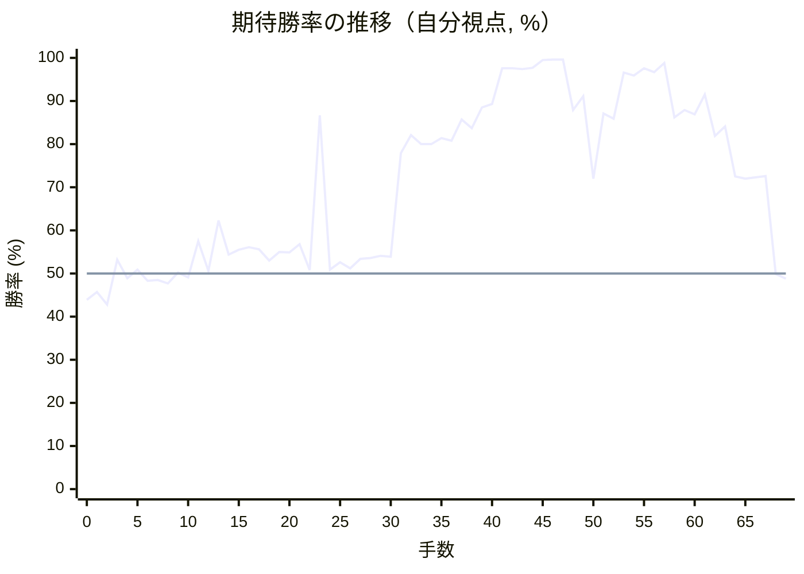
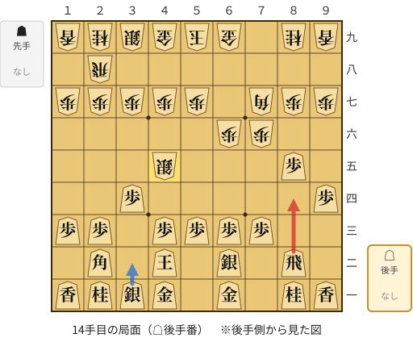
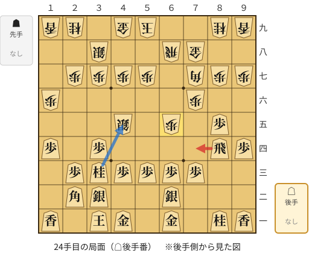
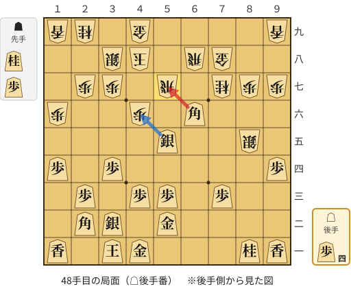
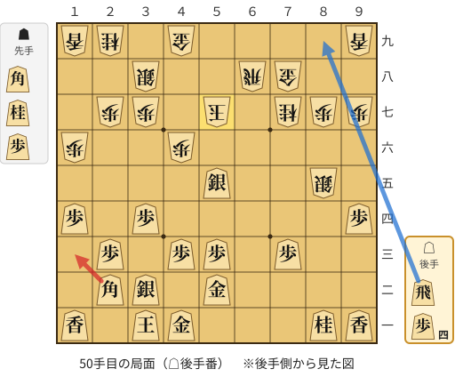
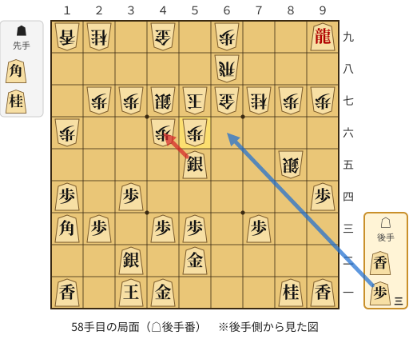
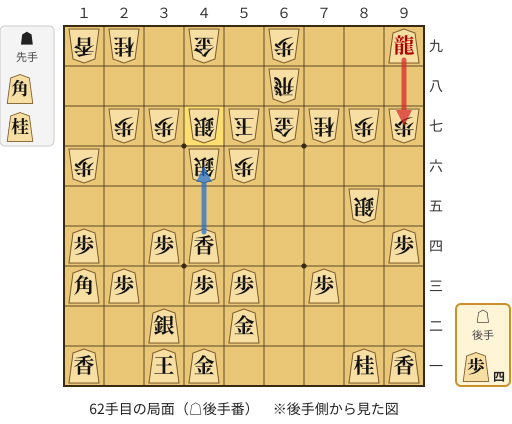
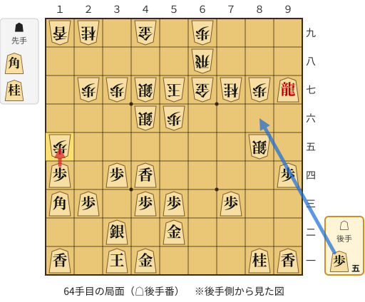
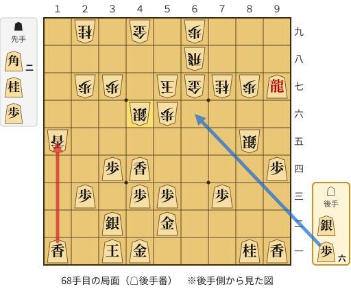

# 解析レポート k39cdwfwahmq

[README に戻る](../../../README.md)　/　棋譜: [CSA](../../../data/csa/shogi5/k39cdwfwahmq.csa)　/　解析の見方: [docs/mistake_analysis.md](../../../docs/mistake_analysis.md)

## 対局情報

| 項目 | 内容 |
|---|---|
| 日時 | 2026-11-11 04:06:54 |
| 持ち時間 | 5分 |
| 自分 | 後手（△）（1661） |
| 相手 | 相手（1881） |
| 結果 | 負け（投了, 69手） |

## 解析環境

| 項目 | 内容 |
|---|---|
| エンジン | YaneuraOu NNUE 9.00git 64AVX2（V9.00/YANEURAOU_ENGINE_NNUE/AVX2） |
| 評価関数 | **水匠5**（`suisho5`） |
| nn.bin SHA-256 | `768068f0d534a0603a5d38bcd143de6bbca820d5f1c95a14d40863e5b7892d76` |
| 第1パス | movetime=150ms, MultiPV 1 |
| 第2パス | movetime=2000ms, MultiPV 3 |
| Threads / Hash | 8 / 512MB |
| 判定基準 | 疑問手 ≥5pt, 悪手 ≥10pt, 大悪手 ≥20pt（期待勝率 W(E)=1/(1+exp(-E/600))） |
| 解析日時 | 2026-11-14T10:45:23+09:00（解析バージョン 1, 51秒） |

## サマリー

| 自分の手数 | 深掘りした手 | 詰み逃し | 大悪手 | 悪手 | 疑問手 |
|--:|--:|--:|--:|--:|--:|
| 34 | 10 | 0 | 2 | 3 | 3 |

## 期待勝率の推移



<details><summary>1手ごとの数値（第1パス）</summary>

| 手数 | 指し手 | 評価値 | 勝率 | 低下 | 判定 |
|--:|---|--:|--:|--:|---|
| 1 | ▲７六歩(77) | -103 | 45.7% |  |  |
| 2 | △３四歩(33) | -173 | 42.8% | +2.9pt |  |
| 3 | ▲６六歩(67) | +77 | 53.2% |  |  |
| 4 | △８四歩(83) | -26 | 48.9% | +4.3pt |  |
| 5 | ▲７八銀(79) | +22 | 50.9% |  |  |
| 6 | △８五歩(84) | -40 | 48.3% | +2.6pt |  |
| 7 | ▲７七角(88) | -35 | 48.5% |  |  |
| 8 | △６二銀(71) | -55 | 47.7% | +0.8pt |  |
| 9 | ▲６七銀(78) | +5 | 50.2% |  |  |
| 10 | △４二玉(51) | -22 | 49.1% | +1.1pt |  |
| 11 | ▲５六銀(67) | +181 | 57.5% |  |  |
| 12 | △９四歩(93) | +15 | 50.6% | +6.9pt |  |
| 13 | ▲４五銀(56) | +301 | 62.3% |  |  |
| 14 | △８四飛(82) | +105 | 54.4% | +7.9pt | [疑問手](#ply-14) |
| 15 | ▲７八金(69) | +132 | 55.5% |  |  |
| 16 | △３二銀(31) | +147 | 56.1% | -0.6pt |  |
| 17 | ▲６八飛(28) | +136 | 55.6% |  |  |
| 18 | △３一玉(42) | +73 | 53.0% | +2.6pt |  |
| 19 | ▲３八銀(39) | +120 | 55.0% |  |  |
| 20 | △１四歩(13) | +118 | 54.9% | +0.1pt |  |
| 21 | ▲１六歩(17) | +163 | 56.8% |  |  |
| 22 | △３三桂(21) | +20 | 50.8% | +5.9pt |  |
| 23 | ▲６五歩(66) | +1124 | 86.7% |  |  |
| 24 | △７四飛(84) | +21 | 50.9% | +35.8pt | [大悪手](#ply-24) |
| 25 | ▲５六銀(45) | +62 | 52.6% |  |  |
| 26 | △７六飛(74) | +28 | 51.2% | +1.4pt |  |
| 27 | ▲６四歩(65) | +82 | 53.4% |  |  |
| 28 | △５二金(61) | +87 | 53.6% | -0.2pt |  |
| 29 | ▲６三歩成(64) | +98 | 54.1% |  |  |
| 30 | △同銀(62) | +94 | 53.9% | +0.2pt |  |
| 31 | ▲６五銀(56) | +755 | 77.9% |  |  |
| 32 | △７七飛成(76) | +914 | 82.1% | -4.2pt |  |
| 33 | ▲同桂(89) | +833 | 80.0% |  |  |
| 34 | △４五桂(33) | +833 | 80.0% | +0.0pt |  |
| 35 | ▲４八玉(59) | +887 | 81.4% |  |  |
| 36 | △６六角打 | +861 | 80.8% | +0.7pt |  |
| 37 | ▲６七飛打 | +1073 | 85.7% |  |  |
| 38 | △８四角(66) | +982 | 83.7% | +2.0pt |  |
| 39 | ▲６六歩打 | +1225 | 88.5% |  |  |
| 40 | △５四銀(63) | +1273 | 89.3% | -0.8pt |  |
| 41 | ▲７六銀(65) | +2234 | 97.6% |  |  |
| 42 | △５五銀(54) | +2215 | 97.6% | +0.1pt |  |
| 43 | ▲８五銀(76) | +2166 | 97.4% |  |  |
| 44 | △６六角(84) | +2260 | 97.7% | -0.4pt |  |
| 45 | ▲４六歩(47) | +3172 | 99.5% |  |  |
| 46 | △５七桂成(45) | +3368 | 99.6% | -0.1pt |  |
| 47 | ▲同飛(67) | +3306 | 99.6% |  |  |
| 48 | △同角成(66) | +1190 | 87.9% | +11.7pt | [疑問手](#ply-48) |
| 49 | ▲同玉(48) | +1396 | 91.1% |  |  |
| 50 | △１三角(22) | +568 | 72.0% | +19.1pt | [悪手](#ply-50) |
| 51 | ▲４七銀(38) | +1145 | 87.1% |  |  |
| 52 | △６七歩打 | +1086 | 85.9% | +1.1pt |  |
| 53 | ▲同金(78) | +2012 | 96.6% |  |  |
| 54 | △８九飛打 | +1886 | 95.9% | +0.8pt |  |
| 55 | ▲６九歩打 | +2222 | 97.6% |  |  |
| 56 | △９九飛成(89) | +2026 | 96.7% | +0.9pt |  |
| 57 | ▲５六歩打 | +2653 | 98.8% |  |  |
| 58 | △４六銀(55) | +1100 | 86.2% | +12.6pt | [疑問手](#ply-58) |
| 59 | ▲同銀(47) | +1192 | 87.9% |  |  |
| 60 | △４四香打 | +1134 | 86.9% | +1.1pt |  |
| 61 | ▲４七銀打 | +1428 | 91.5% |  |  |
| 62 | △９七龍(99) | +905 | 81.9% | +9.6pt | [悪手](#ply-62) |
| 63 | ▲１五歩(16) | +998 | 84.1% |  |  |
| 64 | △同歩(14) | +583 | 72.5% | +11.5pt | [悪手](#ply-64) |
| 65 | ▲同香(19) | +567 | 72.0% |  |  |
| 66 | △４六角(13) | +575 | 72.3% | -0.3pt |  |
| 67 | ▲同銀(47) | +585 | 72.6% |  |  |
| 68 | △１五香(11) | -3 | 49.9% | +22.7pt | [大悪手](#ply-68) |
| 69 | ▲４五歩打 | -30 | 48.8% |  |  |

</details>

## 課題局面

<a id="ply-14"></a>
### 14手目 △８四飛(82) — 疑問手

| | 着手前 | 着手後 | 差 |
|---|--:|--:|--:|
| 期待勝率 | 60.4% | 54.3% | -6.1pt |
| 評価値 | +253 | +103 | |

着手前の局面:



🔴 実戦 △８四飛(82)　🔵 AI推奨 △３二銀(31)　🟨 直前の相手の指し手

<details><summary>テキストの盤面図（BOD・将棋ソフトに貼り付け可）</summary>

```text
後手の持駒：なし
  ９ ８ ７ ６ ５ ４ ３ ２ １
+---------------------------+
|v香v桂 ・v金 ・v金v銀v桂v香|一
| ・v飛 ・v銀 ・v玉 ・v角 ・|二
| ・ ・v歩v歩v歩v歩 ・v歩v歩|三
|v歩 ・ ・ ・ ・ ・v歩 ・ ・|四
| ・v歩 ・ ・ ・ 銀 ・ ・ ・|五
| ・ ・ 歩 歩 ・ ・ ・ ・ ・|六
| 歩 歩 角 ・ 歩 歩 歩 歩 歩|七
| ・ ・ ・ ・ ・ ・ ・ 飛 ・|八
| 香 桂 ・ 金 玉 金 銀 桂 香|九
+---------------------------+
先手の持駒：なし
後手番
手数＝13　▲４五銀　まで
```

</details>

| | 指し手 | 評価値 | 読み筋 |
|---|---|--:|---|
| 実戦 | △８四飛(82) | +103 | ▲２六歩(27) △３二銀(31) |
| AI 1位 | △３二銀(31) | +253 | △３二銀(31) ▲３四銀(45) △７四歩(73) ▲７八金(69) △７三銀(62) ▲６五歩(66) |
| AI 2位 | △７四歩(73) | +183 | △７四歩(73) ▲２六歩(27) △３二銀(31) ▲７八金(69) △３三銀(32) ▲３六歩(37) |
| AI 3位 | △８四飛(82) | +113 | △８四飛(82) ▲２六歩(27) △３二銀(31) ▲５八金(49) △３三銀(32) ▲３六歩(37) |

SFEN: `ln1g1gsnl/1r1s1k1b1/2pppp1pp/p5p2/1p3S3/2PP5/PPB1PPPPP/7R1/LN1GKGSNL w - 14`

<a id="ply-24"></a>
### 24手目 △７四飛(84) — 大悪手

| | 着手前 | 着手後 | 差 |
|---|--:|--:|--:|
| 期待勝率 | 91.2% | 52.6% | -38.5pt |
| 評価値 | +1400 | +63 | |

着手前の局面:



🔴 実戦 △７四飛(84)　🔵 AI推奨 △４五桂(33)　🟨 直前の相手の指し手

<details><summary>テキストの盤面図（BOD・将棋ソフトに貼り付け可）</summary>

```text
後手の持駒：なし
  ９ ８ ７ ６ ５ ４ ３ ２ １
+---------------------------+
|v香v桂 ・v金 ・v金v玉 ・v香|一
| ・ ・ ・v銀 ・ ・v銀v角 ・|二
| ・ ・v歩v歩v歩v歩v桂v歩 ・|三
|v歩v飛 ・ ・ ・ ・v歩 ・v歩|四
| ・v歩 ・ 歩 ・ 銀 ・ ・ ・|五
| ・ ・ 歩 ・ ・ ・ ・ ・ 歩|六
| 歩 歩 角 ・ 歩 歩 歩 歩 ・|七
| ・ ・ 金 飛 ・ ・ 銀 ・ ・|八
| 香 桂 ・ ・ 玉 金 ・ 桂 香|九
+---------------------------+
先手の持駒：なし
後手番
手数＝23　▲６五歩　まで
```

</details>

| | 指し手 | 評価値 | 読み筋 |
|---|---|--:|---|
| 実戦 | △７四飛(84) | +63 | ▲５六銀(45) △７六飛(74) ▲６四歩(65) △５二金(61) ▲３六歩(37) △７五飛(76) |
| AI 1位 | △４五桂(33) | +1400 | △４五桂(33) ▲２二角成(77) △同玉(31) ▲６六角打 △４四飛(84) ▲４八玉(59) |
| AI 2位 | △８六歩(85) | +1051 | △８六歩(85) ▲同歩(87) △４五桂(33) ▲２二角成(77) △同玉(31) ▲６六角打 |
| AI 3位 | △１三角(22) | +778 | △１三角(22) ▲５六銀(45) △５七角成(13) ▲６七金(78) △２四馬(57) ▲３六歩(37) |

SFEN: `ln1g1gk1l/3s2sb1/2ppppnp1/pr4p1p/1p1P1S3/2P5P/PPB1PPPP1/2GR2S2/LN2KG1NL w - 24`

<a id="ply-48"></a>
### 48手目 △同角成(66) — 疑問手

| | 着手前 | 着手後 | 差 |
|---|--:|--:|--:|
| 期待勝率 | 99.5% | 90.8% | -8.7pt |
| 評価値 | +3181 | +1376 | |

着手前の局面:



🔴 実戦 △同角成(66)　🔵 AI推奨 △４六銀(55)　🟨 直前の相手の指し手

<details><summary>テキストの盤面図（BOD・将棋ソフトに貼り付け可）</summary>

```text
後手の持駒：歩四
  ９ ８ ７ ６ ５ ４ ３ ２ １
+---------------------------+
|v香v桂 ・ ・ ・v金v玉 ・v香|一
| ・ ・ ・ ・v金 ・v銀v角 ・|二
| ・ ・v歩 ・v歩v歩 ・v歩 ・|三
|v歩 ・ ・ ・ ・ ・v歩 ・v歩|四
| ・ 銀 ・ ・v銀 ・ ・ ・ ・|五
| ・ ・ ・v角 ・ 歩 ・ ・ 歩|六
| 歩 歩 桂 ・ 飛 ・ 歩 歩 ・|七
| ・ ・ 金 飛 ・ 玉 銀 ・ ・|八
| 香 ・ ・ ・ ・ 金 ・ 桂 香|九
+---------------------------+
先手の持駒：桂　歩
後手番
手数＝47　▲５七同飛　まで
```

</details>

| | 指し手 | 評価値 | 読み筋 |
|---|---|--:|---|
| 実戦 | △同角成(66) | +1376 | ▲同玉(48) △９三桂(81) ▲９四銀(85) △８九飛打 ▲６一飛成(68) △５一金(52) |
| AI 1位 | △４六銀(55) | +3181 | △４六銀(55) ▲５八歩打 △５七銀成(46) ▲同歩(58) △７七角成(66) ▲同金(78) |
| AI 2位 | △５六銀(55) | +2737 | △５六銀(55) ▲６六飛(68) △同角(22) ▲６九桂打 △６七歩打 ▲４七銀(38) |
| AI 3位 | △９三桂(81) | +2604 | △９三桂(81) ▲７六銀(85) △４六銀(55) ▲６六飛(68) △同角(22) ▲５八歩打 |

SFEN: `ln3gk1l/4g1sb1/2p1pp1p1/p5p1p/1S2s4/3b1P2P/PPN1R1PP1/2GR1KS2/L4G1NL w NP4p 48`

<a id="ply-50"></a>
### 50手目 △１三角(22) — 悪手

| | 着手前 | 着手後 | 差 |
|---|--:|--:|--:|
| 期待勝率 | 94.2% | 78.9% | -15.3pt |
| 評価値 | +1673 | +790 | |

着手前の局面:



🔴 実戦 △１三角(22)　🔵 AI推奨 △８九飛打　🟨 直前の相手の指し手

<details><summary>テキストの盤面図（BOD・将棋ソフトに貼り付け可）</summary>

```text
後手の持駒：飛　歩四
  ９ ８ ７ ６ ５ ４ ３ ２ １
+---------------------------+
|v香v桂 ・ ・ ・v金v玉 ・v香|一
| ・ ・ ・ ・v金 ・v銀v角 ・|二
| ・ ・v歩 ・v歩v歩 ・v歩 ・|三
|v歩 ・ ・ ・ ・ ・v歩 ・v歩|四
| ・ 銀 ・ ・v銀 ・ ・ ・ ・|五
| ・ ・ ・ ・ ・ 歩 ・ ・ 歩|六
| 歩 歩 桂 ・ 玉 ・ 歩 歩 ・|七
| ・ ・ 金 飛 ・ ・ 銀 ・ ・|八
| 香 ・ ・ ・ ・ 金 ・ 桂 香|九
+---------------------------+
先手の持駒：角　桂　歩
後手番
手数＝49　▲５七同玉　まで
```

</details>

| | 指し手 | 評価値 | 読み筋 |
|---|---|--:|---|
| 実戦 | △１三角(22) | +790 | ▲６一飛成(68) △４六角(13) ▲４七玉(57) △２四角(46) ▲４八玉(47) △６六飛打 |
| AI 1位 | △８九飛打 | +1673 | △８九飛打 ▲６一飛成(68) △５一金(52) ▲６五龍(61) △９九飛成(89) ▲４八玉(57) |
| AI 2位 | △９三桂(81) | +1535 | △９三桂(81) ▲９四銀(85) △８九飛打 ▲６一飛成(68) △５一金(52) ▲６八龍(61) |
| AI 3位 | △５六飛打 | +1518 | △５六飛打 ▲４八玉(57) △６六銀(55) ▲２六桂打 △５七飛成(56) ▲３九玉(48) |

SFEN: `ln3gk1l/4g1sb1/2p1pp1p1/p5p1p/1S2s4/5P2P/PPN1K1PP1/2GR2S2/L4G1NL w BNPr4p 50`

<a id="ply-58"></a>
### 58手目 △４六銀(55) — 疑問手

| | 着手前 | 着手後 | 差 |
|---|--:|--:|--:|
| 期待勝率 | 98.8% | 92.2% | -6.6pt |
| 評価値 | +2653 | +1486 | |

着手前の局面:



🔴 実戦 △４六銀(55)　🔵 AI推奨 △６六歩打　🟨 直前の相手の指し手

<details><summary>テキストの盤面図（BOD・将棋ソフトに貼り付け可）</summary>

```text
後手の持駒：香　歩三
  ９ ８ ７ ６ ５ ４ ３ ２ １
+---------------------------+
|v香v桂 ・ ・ ・v金v玉 ・v香|一
| ・ ・ ・ ・v金 ・v銀 ・ ・|二
| ・ ・v歩 ・v歩v歩 ・v歩v角|三
|v歩 ・ ・ ・ ・ ・v歩 ・v歩|四
| ・ 銀 ・ ・v銀 ・ ・ ・ ・|五
| ・ ・ ・ ・ 歩 歩 ・ ・ 歩|六
| 歩 歩 桂 金 玉 銀 歩 歩 ・|七
| ・ ・ ・ 飛 ・ ・ ・ ・ ・|八
|v龍 ・ ・ 歩 ・ 金 ・ 桂 香|九
+---------------------------+
先手の持駒：角　桂
後手番
手数＝57　▲５六歩　まで
```

</details>

| | 指し手 | 評価値 | 読み筋 |
|---|---|--:|---|
| 実戦 | △４六銀(55) | +1486 | ▲同銀(47) △７九龍(99) ▲４八飛(68) △４五香打 ▲５五銀打 △４六香(45) |
| AI 1位 | △６六歩打 | +2653 | △６六歩打 ▲５五歩(56) △６七歩成(66) ▲同飛(68) △６三香打 ▲６五桂打 |
| AI 2位 | △９三桂(81) | +1472 | △９三桂(81) ▲５五歩(56) △８五桂(93) ▲同桂(77) △６四香打 ▲２五桂打 |
| AI 3位 | △４六銀(55) | +1434 | △４六銀(55) ▲同銀(47) △７九龍(99) ▲２五桂打 △２四角(13) ▲５五角打 |

SFEN: `ln3gk1l/4g1s2/2p1pp1pb/p5p1p/1S2s4/4PP2P/PPNGKSPP1/3R5/+r2P1G1NL w BNl3p 58`

<a id="ply-62"></a>
### 62手目 △９七龍(99) — 悪手

| | 着手前 | 着手後 | 差 |
|---|--:|--:|--:|
| 期待勝率 | 95.9% | 81.5% | -14.4pt |
| 評価値 | +1894 | +891 | |

着手前の局面:



🔴 実戦 △９七龍(99)　🔵 AI推奨 △４六香(44)　🟨 直前の相手の指し手

<details><summary>テキストの盤面図（BOD・将棋ソフトに貼り付け可）</summary>

```text
後手の持駒：歩四
  ９ ８ ７ ６ ５ ４ ３ ２ １
+---------------------------+
|v香v桂 ・ ・ ・v金v玉 ・v香|一
| ・ ・ ・ ・v金 ・v銀 ・ ・|二
| ・ ・v歩 ・v歩v歩 ・v歩v角|三
|v歩 ・ ・ ・ ・v香v歩 ・v歩|四
| ・ 銀 ・ ・ ・ ・ ・ ・ ・|五
| ・ ・ ・ ・ 歩 銀 ・ ・ 歩|六
| 歩 歩 桂 金 玉 銀 歩 歩 ・|七
| ・ ・ ・ 飛 ・ ・ ・ ・ ・|八
|v龍 ・ ・ 歩 ・ 金 ・ 桂 香|九
+---------------------------+
先手の持駒：角　桂
後手番
手数＝61　▲４七銀　まで
```

</details>

| | 指し手 | 評価値 | 読み筋 |
|---|---|--:|---|
| 実戦 | △９七龍(99) | +891 | ▲１五歩(16) △６六歩打 ▲同金(67) △８七龍(97) ▲７八歩打 △４六香(44) |
| AI 1位 | △４六香(44) | +1894 | △４六香(44) ▲同銀(47) △６六歩打 ▲同金(67) △７九龍(99) ▲７八香打 |
| AI 2位 | △６六歩打 | +1750 | △６六歩打 ▲同金(67) △４六香(44) ▲同銀(47) △７九龍(99) ▲４七玉(57) |
| AI 3位 | △７九龍(99) | +1431 | △７九龍(99) ▲６六角打 △６五歩打 ▲同桂(77) △６四歩打 ▲５三桂不成(65) |

SFEN: `ln3gk1l/4g1s2/2p1pp1pb/p4lp1p/1S7/4PS2P/PPNGKSPP1/3R5/+r2P1G1NL w BN4p 62`

<a id="ply-64"></a>
### 64手目 △同歩(14) — 悪手

| | 着手前 | 着手後 | 差 |
|---|--:|--:|--:|
| 期待勝率 | 84.1% | 72.0% | -12.2pt |
| 評価値 | +1001 | +566 | |

着手前の局面:



🔴 実戦 △同歩(14)　🔵 AI推奨 △８六歩打　🟨 直前の相手の指し手

<details><summary>テキストの盤面図（BOD・将棋ソフトに貼り付け可）</summary>

```text
後手の持駒：歩五
  ９ ８ ７ ６ ５ ４ ３ ２ １
+---------------------------+
|v香v桂 ・ ・ ・v金v玉 ・v香|一
| ・ ・ ・ ・v金 ・v銀 ・ ・|二
| ・ ・v歩 ・v歩v歩 ・v歩v角|三
|v歩 ・ ・ ・ ・v香v歩 ・v歩|四
| ・ 銀 ・ ・ ・ ・ ・ ・ 歩|五
| ・ ・ ・ ・ 歩 銀 ・ ・ ・|六
|v龍 歩 桂 金 玉 銀 歩 歩 ・|七
| ・ ・ ・ 飛 ・ ・ ・ ・ ・|八
| ・ ・ ・ 歩 ・ 金 ・ 桂 香|九
+---------------------------+
先手の持駒：角　桂
後手番
手数＝63　▲１五歩　まで
```

</details>

| | 指し手 | 評価値 | 読み筋 |
|---|---|--:|---|
| 実戦 | △同歩(14) | +566 | ▲同香(19) △４六角(13) ▲同銀(47) △同香(44) ▲同玉(57) △１五香(11) |
| AI 1位 | △８六歩打 | +1001 | △８六歩打 ▲１四歩(15) △４六角(13) ▲同銀(47) △６六歩打 ▲４五歩打 |
| AI 2位 | △６六歩打 | +894 | △６六歩打 ▲同金(67) △８六歩打 ▲７五角打 △７四歩(73) ▲同銀(85) |
| AI 3位 | △４六香(44) | +772 | △４六香(44) ▲同銀(47) △６六歩打 ▲同金(67) △８七龍(97) ▲７八歩打 |

SFEN: `ln3gk1l/4g1s2/2p1pp1pb/p4lp1p/1S6P/4PS3/+rPNGKSPP1/3R5/3P1G1NL w BN5p 64`

<a id="ply-68"></a>
### 68手目 △１五香(11) — 大悪手

| | 着手前 | 着手後 | 差 |
|---|--:|--:|--:|
| 期待勝率 | 73.3% | 42.8% | -30.5pt |
| 評価値 | +606 | -175 | |

着手前の局面:



🔴 実戦 △１五香(11)　🔵 AI推奨 △６六歩打　🟨 直前の相手の指し手

<details><summary>テキストの盤面図（BOD・将棋ソフトに貼り付け可）</summary>

```text
後手の持駒：銀　歩六
  ９ ８ ７ ６ ５ ４ ３ ２ １
+---------------------------+
|v香v桂 ・ ・ ・v金v玉 ・v香|一
| ・ ・ ・ ・v金 ・v銀 ・ ・|二
| ・ ・v歩 ・v歩v歩 ・v歩 ・|三
|v歩 ・ ・ ・ ・v香v歩 ・ ・|四
| ・ 銀 ・ ・ ・ ・ ・ ・ 香|五
| ・ ・ ・ ・ 歩 銀 ・ ・ ・|六
|v龍 歩 桂 金 玉 ・ 歩 歩 ・|七
| ・ ・ ・ 飛 ・ ・ ・ ・ ・|八
| ・ ・ ・ 歩 ・ 金 ・ 桂 ・|九
+---------------------------+
先手の持駒：角二　桂　歩
後手番
手数＝67　▲４六同銀　まで
```

</details>

| | 指し手 | 評価値 | 読み筋 |
|---|---|--:|---|
| 実戦 | △１五香(11) | -175 | ▲４五歩打 △６六歩打 ▲同金(67) △８七龍(97) ▲１三角打 △２二銀打 |
| AI 1位 | △６六歩打 | +606 | △６六歩打 ▲同金(67) △４六香(44) ▲同玉(57) △１五香(11) ▲４七玉(46) |
| AI 2位 | △同香(44) | +611 | △同香(44) ▲同玉(57) △１五香(11) ▲４七玉(46) △６六歩打 ▲同金(67) |
| AI 3位 | △１五香(11) | -51 | △１五香(11) ▲４五歩打 △８六歩打 ▲４四歩(45) △同歩(43) ▲７五角打 |

SFEN: `ln3gk1l/4g1s2/2p1pp1p1/p4lp2/1S6L/4PS3/+rPNGK1PP1/3R5/3P1G1N1 w 2BNPs6p 68`

