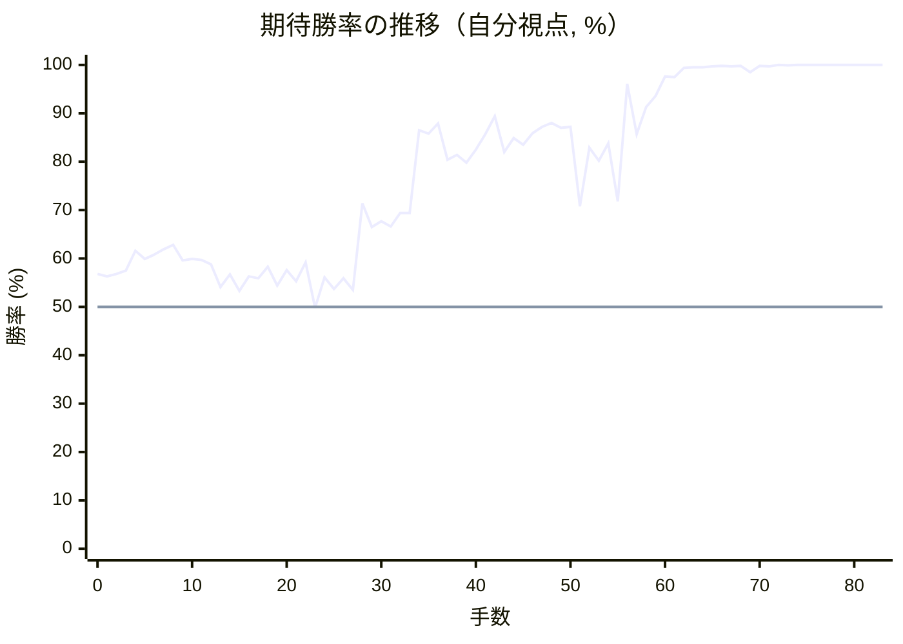

# 解析レポート k98urf1s9vri

[README に戻る](../../../README.md)　/　棋譜: [CSA](../../../data/csa/shogi5/k98urf1s9vri.csa)　/　解析の見方: [docs/mistake_analysis.md](../../../docs/mistake_analysis.md)

## 対局情報

| 項目 | 内容 |
|---|---|
| 日時 | 2026-11-07 09:44:56 |
| 持ち時間 | 5分 |
| 自分 | 先手（▲）（1729） |
| 相手 | 相手（1507） |
| 結果 | 勝ち（投了, 83手） |

## 解析環境

| 項目 | 内容 |
|---|---|
| エンジン | YaneuraOu NNUE 9.00git 64AVX2（V9.00/YANEURAOU_ENGINE_NNUE/AVX2） |
| 評価関数 | **水匠5**（`suisho5`） |
| nn.bin SHA-256 | `768068f0d534a0603a5d38bcd143de6bbca820d5f1c95a14d40863e5b7892d76` |
| 第1パス | movetime=150ms, MultiPV 1 |
| 第2パス | movetime=2000ms, MultiPV 3 |
| Threads / Hash | 8 / 512MB |
| 判定基準 | 疑問手 ≥5pt, 悪手 ≥10pt, 大悪手 ≥20pt（期待勝率 W(E)=1/(1+exp(-E/600))） |
| 解析日時 | 2026-11-11T20:29:48+09:00（解析バージョン 1, 37秒） |

## サマリー

| 自分の手数 | 深掘りした手 | 詰み逃し | 大悪手 | 悪手 | 疑問手 |
|--:|--:|--:|--:|--:|--:|
| 42 | 6 | 0 | 0 | 2 | 2 |

## 期待勝率の推移



<details><summary>1手ごとの数値（第1パス）</summary>

| 手数 | 指し手 | 評価値 | 勝率 | 低下 | 判定 |
|--:|---|--:|--:|--:|---|
| 1 | ▲７六歩(77) | +151 | 56.3% | +0.5pt |  |
| 2 | △３四歩(33) | +165 | 56.8% |  |  |
| 3 | ▲２六歩(27) | +181 | 57.5% | -0.7pt |  |
| 4 | △８八角成(22) | +283 | 61.6% |  |  |
| 5 | ▲同銀(79) | +240 | 59.9% | +1.7pt |  |
| 6 | △２二銀(31) | +263 | 60.8% |  |  |
| 7 | ▲７七銀(88) | +292 | 61.9% | -1.1pt |  |
| 8 | △６二銀(71) | +313 | 62.8% |  |  |
| 9 | ▲２五歩(26) | +233 | 59.6% | +3.2pt |  |
| 10 | △３三銀(22) | +240 | 59.9% |  |  |
| 11 | ▲４八銀(39) | +236 | 59.7% | +0.2pt |  |
| 12 | △３二金(41) | +213 | 58.8% |  |  |
| 13 | ▲７八金(69) | +98 | 54.1% | +4.7pt |  |
| 14 | △６四歩(63) | +161 | 56.7% |  |  |
| 15 | ▲４六歩(47) | +80 | 53.3% | +3.3pt |  |
| 16 | △９四歩(93) | +153 | 56.3% |  |  |
| 17 | ▲９六歩(97) | +143 | 55.9% | +0.4pt |  |
| 18 | △６三銀(62) | +202 | 58.3% |  |  |
| 19 | ▲４七銀(48) | +105 | 54.4% | +4.0pt |  |
| 20 | △５四銀(63) | +183 | 57.6% |  |  |
| 21 | ▲５六銀(47) | +127 | 55.3% | +2.3pt |  |
| 22 | △４四歩(43) | +223 | 59.2% |  |  |
| 23 | ▲６六歩(67) | -6 | 49.8% | +9.4pt | [疑問手](#ply-23) |
| 24 | △６二飛(82) | +147 | 56.1% |  |  |
| 25 | ▲５八金(49) | +88 | 53.7% | +2.4pt |  |
| 26 | △７四歩(73) | +142 | 55.9% |  |  |
| 27 | ▲１六歩(17) | +84 | 53.5% | +2.4pt |  |
| 28 | △８二角打 | +548 | 71.4% |  |  |
| 29 | ▲２六飛(28) | +411 | 66.5% | +4.9pt |  |
| 30 | △１四歩(13) | +443 | 67.7% |  |  |
| 31 | ▲６八玉(59) | +414 | 66.6% | +1.1pt |  |
| 32 | △６五歩(64) | +491 | 69.4% |  |  |
| 33 | ▲同歩(66) | +492 | 69.4% | -0.0pt |  |
| 34 | △５五銀(54) | +1117 | 86.5% |  |  |
| 35 | ▲同銀(56) | +1080 | 85.8% | +0.7pt |  |
| 36 | △同角(82) | +1187 | 87.9% |  |  |
| 37 | ▲７九玉(68) | +846 | 80.4% | +7.5pt |  |
| 38 | △８二角(55) | +887 | 81.4% |  |  |
| 39 | ▲６四角打 | +824 | 79.8% | +1.6pt |  |
| 40 | △同角(82) | +931 | 82.5% |  |  |
| 41 | ▲同歩(65) | +1072 | 85.7% | -3.1pt |  |
| 42 | △５四銀打 | +1281 | 89.4% |  |  |
| 43 | ▲２四歩(25) | +911 | 82.0% | +7.4pt |  |
| 44 | △同歩(23) | +1036 | 84.9% |  |  |
| 45 | ▲６三銀打 | +974 | 83.5% | +1.4pt |  |
| 46 | △同銀(54) | +1085 | 85.9% |  |  |
| 47 | ▲同歩成(64) | +1151 | 87.2% | -1.3pt |  |
| 48 | △同飛(62) | +1198 | 88.0% |  |  |
| 49 | ▲６四歩打 | +1141 | 87.0% | +1.0pt |  |
| 50 | △同飛(63) | +1151 | 87.2% |  |  |
| 51 | ▲５五角打 | +532 | 70.8% | +16.4pt | [悪手](#ply-51) |
| 52 | △７三角打 | +946 | 82.9% |  |  |
| 53 | ▲６四角(55) | +841 | 80.2% | +2.6pt |  |
| 54 | △同角(73) | +987 | 83.8% |  |  |
| 55 | ▲６三飛打 | +560 | 71.8% | +12.0pt | [悪手](#ply-55) |
| 56 | △３五銀打 | +1927 | 96.1% |  |  |
| 57 | ▲２八飛(26) | +1074 | 85.7% | +10.4pt | [疑問手](#ply-57) |
| 58 | △４六角(64) | +1408 | 91.3% |  |  |
| 59 | ▲５三飛成(63) | +1613 | 93.6% | -2.4pt |  |
| 60 | △５二金(61) | +2230 | 97.6% |  |  |
| 61 | ▲８三龍(53) | +2193 | 97.5% | +0.1pt |  |
| 62 | △５六歩打 | +3050 | 99.4% |  |  |
| 63 | ▲８一龍(83) | +3128 | 99.5% | -0.1pt |  |
| 64 | △６一歩打 | +3195 | 99.5% |  |  |
| 65 | ▲４七金(58) | +3392 | 99.7% | -0.1pt |  |
| 66 | △５七角成(46) | +3685 | 99.8% |  |  |
| 67 | ▲同金(47) | +3436 | 99.7% | +0.1pt |  |
| 68 | △同歩成(56) | +3797 | 99.8% |  |  |
| 69 | ▲６二歩打 | +2498 | 98.5% | +1.4pt |  |
| 70 | △同金(52) | +3841 | 99.8% |  |  |
| 71 | ▲５四桂打 | +3405 | 99.7% | +0.2pt |  |
| 72 | △５二金(62) | +4665 | 100.0% |  |  |
| 73 | ▲６二歩打 | +4103 | 99.9% | +0.1pt |  |
| 74 | △同金(52) | +5115 | 100.0% |  |  |
| 75 | ▲同桂成(54) | +5865 | 100.0% | -0.0pt |  |
| 76 | △同玉(51) | +6187 | 100.0% |  |  |
| 77 | ▲４一角打 | +5676 | 100.0% | +0.0pt |  |
| 78 | △５二金打 | +7370 | 100.0% |  |  |
| 79 | ▲６四銀打 | +6195 | 100.0% | +0.0pt |  |
| 80 | △６八と(57) | #+11 | 100.0% |  |  |
| 81 | ▲同飛(28) | #+10 | 100.0% | +0.0pt |  |
| 82 | △８八角打 | #+9 | 100.0% |  |  |
| 83 | ▲同玉(79) | #+8 | 100.0% | +0.0pt |  |

</details>

## 課題局面

<a id="ply-23"></a>
### 23手目 ▲６六歩(67) — 疑問手

| | 着手前 | 着手後 | 差 |
|---|--:|--:|--:|
| 期待勝率 | 60.1% | 54.7% | -5.4pt |
| 評価値 | +246 | +113 | |

着手前の局面:

```text
後手の持駒：角
  ９ ８ ７ ６ ５ ４ ３ ２ １
+---------------------------+
|v香v桂 ・v金v玉 ・ ・v桂v香|一
| ・v飛 ・ ・ ・ ・v金 ・ ・|二
| ・v歩v歩 ・v歩 ・v銀v歩v歩|三
|v歩 ・ ・v歩v銀v歩v歩 ・ ・|四
| ・ ・ ・ ・ ・ ・ ・ 歩 ・|五
| 歩 ・ 歩 ・ 銀 歩 ・ ・ ・|六
| ・ 歩 銀 歩 歩 ・ 歩 ・ 歩|七
| ・ ・ 金 ・ ・ ・ ・ 飛 ・|八
| 香 桂 ・ ・ 玉 金 ・ 桂 香|九
+---------------------------+
先手の持駒：角
手数＝22　△４四歩　まで
```

| | 指し手 | 評価値 | 読み筋 |
|---|---|--:|---|
| 実戦 | ▲６六歩(67) | +113 | △１四歩(13) ▲６八玉(59) △４二玉(51) ▲３六歩(37) △８四歩(83) ▲３七桂(29) |
| AI 1位 | ▲６八玉(59) | +246 | ▲６八玉(59) △８四歩(83) ▲３六歩(37) △４二玉(51) ▲１六歩(17) △１四歩(13) |
| AI 2位 | ▲６八玉(59) | +241 | ▲６八玉(59) △５二金(61) ▲３六歩(37) △１四歩(13) ▲４八金(49) △４二玉(51) |
| AI 3位 | ▲６六銀(77) | +188 | ▲６六銀(77) △７四歩(73) ▲６八玉(59) △５二金(61) ▲５五銀(66) △同銀(54) |

SFEN: `ln1gk2nl/1r4g2/1pp1p1spp/p2pspp2/7P1/P1P1SP3/1PSPP1P1P/2G4R1/LN2KG1NL b Bb 23`

<a id="ply-51"></a>
### 51手目 ▲５五角打 — 悪手

| | 着手前 | 着手後 | 差 |
|---|--:|--:|--:|
| 期待勝率 | 89.4% | 74.2% | -15.2pt |
| 評価値 | +1278 | +633 | |

着手前の局面:

```text
後手の持駒：角　銀　歩三
  ９ ８ ７ ６ ５ ４ ３ ２ １
+---------------------------+
|v香v桂 ・v金v玉 ・ ・v桂v香|一
| ・ ・ ・ ・ ・ ・v金 ・ ・|二
| ・v歩 ・ ・v歩 ・v銀 ・ ・|三
|v歩 ・v歩v飛 ・v歩v歩v歩v歩|四
| ・ ・ ・ ・ ・ ・ ・ ・ ・|五
| 歩 ・ 歩 ・ ・ 歩 ・ 飛 歩|六
| ・ 歩 銀 ・ 歩 ・ 歩 ・ ・|七
| ・ ・ 金 ・ 金 ・ ・ ・ ・|八
| 香 桂 玉 ・ ・ ・ ・ 桂 香|九
+---------------------------+
先手の持駒：角　銀
手数＝50　△６四同飛　まで
```

| | 指し手 | 評価値 | 読み筋 |
|---|---|--:|---|
| 実戦 | ▲５五角打 | +633 | △６三歩打 ▲２八飛(26) △７二銀打 ▲６四角(55) △同歩(63) ▲８二銀打 |
| AI 1位 | ▲８二角打 | +1278 | ▲８二角打 △７三角打 ▲同角成(82) △同桂(81) ▲５五角打 △６三歩打 |
| AI 2位 | ▲８六角打 | +678 | ▲８六角打 △６三歩打 ▲５五銀打 △６五飛(64) ▲６六銀(77) △８五飛(65) |
| AI 3位 | ▲５五角打 | +573 | ▲５五角打 △６三歩打 ▲６四角(55) △同歩(63) ▲２八飛(26) △５二銀打 |

SFEN: `ln1gk2nl/6g2/1p2p1s2/p1pr1pppp/9/P1P2P1RP/1PS1P1P2/2G1G4/LNK4NL b BSbs3p 51`

<a id="ply-55"></a>
### 55手目 ▲６三飛打 — 悪手

| | 着手前 | 着手後 | 差 |
|---|--:|--:|--:|
| 期待勝率 | 83.2% | 72.1% | -11.1pt |
| 評価値 | +960 | +570 | |

着手前の局面:

```text
後手の持駒：角　銀　歩三
  ９ ８ ７ ６ ５ ４ ３ ２ １
+---------------------------+
|v香v桂 ・v金v玉 ・ ・v桂v香|一
| ・ ・ ・ ・ ・ ・v金 ・ ・|二
| ・v歩 ・ ・v歩 ・v銀 ・ ・|三
|v歩 ・v歩v角 ・v歩v歩v歩v歩|四
| ・ ・ ・ ・ ・ ・ ・ ・ ・|五
| 歩 ・ 歩 ・ ・ 歩 ・ 飛 歩|六
| ・ 歩 銀 ・ 歩 ・ 歩 ・ ・|七
| ・ ・ 金 ・ 金 ・ ・ ・ ・|八
| 香 桂 玉 ・ ・ ・ ・ 桂 香|九
+---------------------------+
先手の持駒：飛　銀
手数＝54　△６四同角　まで
```

| | 指し手 | 評価値 | 読み筋 |
|---|---|--:|---|
| 実戦 | ▲６三飛打 | +570 | △７三角(64) ▲５三飛成(63) △５二金(61) ▲５六龍(53) △４一玉(51) ▲５三銀打 |
| AI 1位 | ▲１五歩(16) | +960 | ▲１五歩(16) △５四角打 ▲６七金(58) △１五歩(14) ▲５六金(67) △８二角(64) |
| AI 2位 | ▲６八金(58) | +772 | ▲６八金(58) △３五銀打 ▲２八飛(26) △４六銀(35) ▲６五銀打 △５五角(64) |
| AI 3位 | ▲４五歩(46) | +754 | ▲４五歩(46) △同歩(44) ▲６六飛(26) △６三歩打 ▲６四飛(66) △同歩(63) |

SFEN: `ln1gk2nl/6g2/1p2p1s2/p1pb1pppp/9/P1P2P1RP/1PS1P1P2/2G1G4/LNK4NL b RSbs3p 55`

<a id="ply-57"></a>
### 57手目 ▲２八飛(26) — 疑問手

| | 着手前 | 着手後 | 差 |
|---|--:|--:|--:|
| 期待勝率 | 98.7% | 90.4% | -8.4pt |
| 評価値 | +2616 | +1343 | |

着手前の局面:

```text
後手の持駒：角　歩三
  ９ ８ ７ ６ ５ ４ ３ ２ １
+---------------------------+
|v香v桂 ・v金v玉 ・ ・v桂v香|一
| ・ ・ ・ ・ ・ ・v金 ・ ・|二
| ・v歩 ・ 飛v歩 ・v銀 ・ ・|三
|v歩 ・v歩v角 ・v歩v歩v歩v歩|四
| ・ ・ ・ ・ ・ ・v銀 ・ ・|五
| 歩 ・ 歩 ・ ・ 歩 ・ 飛 歩|六
| ・ 歩 銀 ・ 歩 ・ 歩 ・ ・|七
| ・ ・ 金 ・ 金 ・ ・ ・ ・|八
| 香 桂 玉 ・ ・ ・ ・ 桂 香|九
+---------------------------+
先手の持駒：銀
手数＝56　△３五銀　まで
```

| | 指し手 | 評価値 | 読み筋 |
|---|---|--:|---|
| 実戦 | ▲２八飛(26) | +1343 | △７三角(64) ▲５三飛成(63) △５二金(61) ▲５四龍(53) △４二金(32) ▲２二歩打 |
| AI 1位 | ▲６四飛成(63) | +2616 | ▲６四飛成(63) △２六銀(35) ▲６五角打 △４二金(32) ▲２一角成(65) △３九飛打 |
| AI 2位 | ▲２四飛(26) | +1248 | ▲２四飛(26) △同銀(35) ▲６四飛成(63) △６二歩打 ▲５三龍(64) △５二歩打 |
| AI 3位 | ▲２八飛(26) | +1245 | ▲２八飛(26) △７三角(64) ▲５三飛成(63) △５二金(61) ▲５四龍(53) △６三角打 |

SFEN: `ln1gk2nl/6g2/1p1Rp1s2/p1pb1pppp/6s2/P1P2P1RP/1PS1P1P2/2G1G4/LNK4NL b Sb3p 57`

