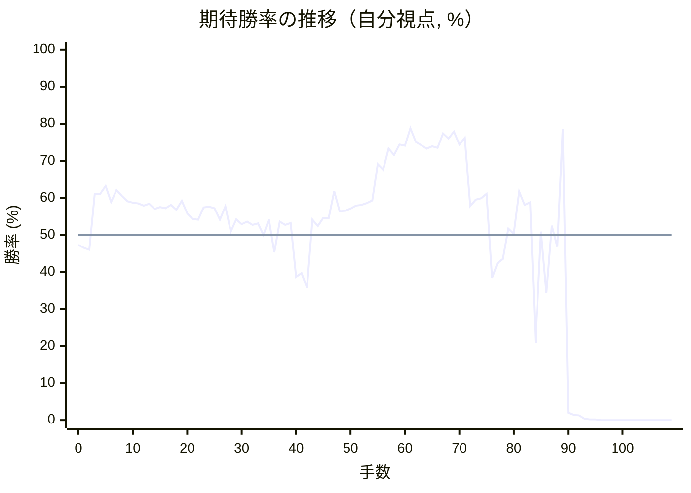

# 解析レポート kjexhh6pnrq1

[README に戻る](../../../README.md)　/　棋譜: [CSA](../../../data/csa/shogi5/kjexhh6pnrq1.csa)　/　解析の見方: [docs/mistake_analysis.md](../../../docs/mistake_analysis.md)

## 対局情報

| 項目 | 内容 |
|---|---|
| 日時 | 2026-10-29 03:08:14 |
| 持ち時間 | 5分 |
| 自分 | 後手（△）（1754） |
| 相手 | 相手（1672） |
| 結果 | 負け（詰み, 109手） |

## 解析環境

| 項目 | 内容 |
|---|---|
| エンジン | YaneuraOu NNUE 9.00git 64AVX2（V9.00/YANEURAOU_ENGINE_NNUE/AVX2） |
| 評価関数 | **水匠5**（`suisho5`） |
| nn.bin SHA-256 | `768068f0d534a0603a5d38bcd143de6bbca820d5f1c95a14d40863e5b7892d76` |
| 第1パス | movetime=150ms, MultiPV 1 |
| 第2パス | movetime=2000ms, MultiPV 3 |
| Threads / Hash | 8 / 512MB |
| 判定基準 | 疑問手 ≥5pt, 悪手 ≥10pt, 大悪手 ≥20pt（期待勝率 W(E)=1/(1+exp(-E/600))） |
| 解析日時 | 2026-11-03T04:23:52+09:00（解析バージョン 1, 52秒） |

## サマリー

| 自分の手数 | 深掘りした手 | 詰み逃し | 大悪手 | 悪手 | 疑問手 |
|--:|--:|--:|--:|--:|--:|
| 54 | 9 | 0 | 4 | 2 | 2 |

## 期待勝率の推移



<details><summary>1手ごとの数値（第1パス）</summary>

| 手数 | 指し手 | 評価値 | 勝率 | 低下 | 判定 |
|--:|---|--:|--:|--:|---|
| 1 | ▲７六歩(77) | -85 | 46.5% |  |  |
| 2 | △８四歩(83) | -95 | 46.0% | +0.4pt |  |
| 3 | ▲７八飛(28) | +272 | 61.1% |  |  |
| 4 | △３四歩(33) | +272 | 61.1% | +0.0pt |  |
| 5 | ▲６六歩(67) | +325 | 63.2% |  |  |
| 6 | △８五歩(84) | +217 | 58.9% | +4.3pt |  |
| 7 | ▲７七角(88) | +296 | 62.1% |  |  |
| 8 | △６二銀(71) | +256 | 60.5% | +1.6pt |  |
| 9 | ▲６八銀(79) | +220 | 59.1% |  |  |
| 10 | △５四歩(53) | +211 | 58.7% | +0.4pt |  |
| 11 | ▲４八玉(59) | +207 | 58.5% |  |  |
| 12 | △４二玉(51) | +192 | 57.9% | +0.6pt |  |
| 13 | ▲３八玉(48) | +204 | 58.4% |  |  |
| 14 | △３二玉(42) | +170 | 57.0% | +1.4pt |  |
| 15 | ▲２八玉(38) | +182 | 57.5% |  |  |
| 16 | △１四歩(13) | +175 | 57.2% | +0.3pt |  |
| 17 | ▲１六歩(17) | +196 | 58.1% |  |  |
| 18 | △２四歩(23) | +163 | 56.8% | +1.3pt |  |
| 19 | ▲１八香(19) | +224 | 59.2% |  |  |
| 20 | △２三玉(32) | +141 | 55.8% | +3.4pt |  |
| 21 | ▲１九玉(28) | +104 | 54.3% |  |  |
| 22 | △３二銀(31) | +98 | 54.1% | +0.2pt |  |
| 23 | ▲２八銀(39) | +178 | 57.4% |  |  |
| 24 | △５三銀(62) | +183 | 57.6% | -0.2pt |  |
| 25 | ▲３九金(49) | +173 | 57.2% |  |  |
| 26 | △４四銀(53) | +98 | 54.1% | +3.1pt |  |
| 27 | ▲６七銀(68) | +187 | 57.7% |  |  |
| 28 | △３一角(22) | +22 | 50.9% | +6.8pt |  |
| 29 | ▲８八飛(78) | +102 | 54.2% |  |  |
| 30 | △９四歩(93) | +70 | 52.9% | +1.3pt |  |
| 31 | ▲５八金(69) | +87 | 53.6% |  |  |
| 32 | △５二金(61) | +65 | 52.7% | +0.9pt |  |
| 33 | ▲４八金(58) | +74 | 53.1% |  |  |
| 34 | △３三桂(21) | -1 | 50.0% | +3.1pt |  |
| 35 | ▲４六歩(47) | +102 | 54.2% |  |  |
| 36 | △２五歩(24) | -113 | 45.3% | +8.9pt | [疑問手](#ply-36) |
| 37 | ▲５六銀(67) | +86 | 53.6% |  |  |
| 38 | △３五銀(44) | +65 | 52.7% | +0.9pt |  |
| 39 | ▲４七銀(56) | +78 | 53.2% |  |  |
| 40 | △２六歩(25) | -277 | 38.7% | +14.6pt | [悪手](#ply-40) |
| 41 | ▲同歩(27) | -252 | 39.7% |  |  |
| 42 | △同銀(35) | -352 | 35.7% | +3.9pt |  |
| 43 | ▲２七歩打 | +98 | 54.1% |  |  |
| 44 | △３五銀(26) | +58 | 52.4% | +1.7pt |  |
| 45 | ▲３六歩(37) | +110 | 54.6% |  |  |
| 46 | △２四銀(35) | +111 | 54.6% | -0.0pt |  |
| 47 | ▲３八金(48) | +288 | 61.8% |  |  |
| 48 | △７四歩(73) | +155 | 56.4% | +5.4pt | [疑問手](#ply-48) |
| 49 | ▲６五歩(66) | +158 | 56.5% |  |  |
| 50 | △７五歩(74) | +172 | 57.1% | -0.6pt |  |
| 51 | ▲同歩(76) | +192 | 57.9% |  |  |
| 52 | △同角(31) | +197 | 58.1% | -0.2pt |  |
| 53 | ▲７八飛(88) | +208 | 58.6% |  |  |
| 54 | △５七角成(75) | +227 | 59.3% | -0.8pt |  |
| 55 | ▲３三角成(77) | +483 | 69.1% |  |  |
| 56 | △同銀(24) | +441 | 67.6% | +1.5pt |  |
| 57 | ▲７一飛成(78) | +605 | 73.3% |  |  |
| 58 | △９三馬(57) | +555 | 71.6% | +1.7pt |  |
| 59 | ▲６四歩(65) | +640 | 74.4% |  |  |
| 60 | △同歩(63) | +631 | 74.1% | +0.3pt |  |
| 61 | ▲３五歩(36) | +787 | 78.8% |  |  |
| 62 | △同歩(34) | +661 | 75.1% | +3.7pt |  |
| 63 | ▲４五桂打 | +634 | 74.2% |  |  |
| 64 | △４四銀(33) | +607 | 73.3% | +0.9pt |  |
| 65 | ▲３三歩打 | +625 | 73.9% |  |  |
| 66 | △同銀(44) | +613 | 73.5% | +0.4pt |  |
| 67 | ▲同桂成(45) | +738 | 77.4% |  |  |
| 68 | △同玉(23) | +692 | 76.0% | +1.4pt |  |
| 69 | ▲７七桂(89) | +755 | 77.9% |  |  |
| 70 | △４四角打 | +641 | 74.4% | +3.4pt |  |
| 71 | ▲７四龍(71) | +698 | 76.2% |  |  |
| 72 | △７六歩打 | +188 | 57.8% | +18.4pt | [悪手](#ply-72) |
| 73 | ▲同龍(74) | +231 | 59.5% |  |  |
| 74 | △７五歩打 | +240 | 59.9% | -0.4pt |  |
| 75 | ▲６七龍(76) | +270 | 61.1% |  |  |
| 76 | △８六歩(85) | -284 | 38.4% | +22.7pt | [大悪手](#ply-76) |
| 77 | ▲４五歩(46) | -183 | 42.4% |  |  |
| 78 | △５三角(44) | -157 | 43.5% | -1.1pt |  |
| 79 | ▲８六歩(87) | +42 | 51.7% |  |  |
| 80 | △同飛(82) | +7 | 50.3% | +1.5pt |  |
| 81 | ▲６五歩打 | +285 | 61.7% |  |  |
| 82 | △７六歩(75) | +195 | 58.1% | +3.6pt |  |
| 83 | ▲６四歩(65) | +214 | 58.8% |  |  |
| 84 | △６六歩打 | -797 | 20.9% | +37.9pt | [大悪手](#ply-84) |
| 85 | ▲５七龍(67) | +21 | 50.9% |  |  |
| 86 | △７七歩成(76) | -390 | 34.3% | +16.6pt | [大悪手](#ply-86) |
| 87 | ▲６三銀打 | +61 | 52.5% |  |  |
| 88 | △６七歩成(66) | -76 | 46.8% | +5.7pt |  |
| 89 | ▲５四龍(57) | +780 | 78.6% |  |  |
| 90 | △５七と(67) | -2327 | 2.0% | +76.6pt | [大悪手](#ply-90) |
| 91 | ▲５二銀成(63) | -2534 | 1.4% |  |  |
| 92 | △同金(41) | -2594 | 1.3% | +0.1pt |  |
| 93 | ▲３四金打 | -3372 | 0.4% |  |  |
| 94 | △２二玉(33) | -3770 | 0.2% | +0.2pt |  |
| 95 | ▲３三歩打 | -3742 | 0.2% |  |  |
| 96 | △２三銀(32) | -4613 | 0.0% | +0.1pt |  |
| 97 | ▲同金(34) | -4860 | 0.0% |  |  |
| 98 | △同玉(22) | -5598 | 0.0% | +0.0pt |  |
| 99 | ▲２四銀打 | -5455 | 0.0% |  |  |
| 100 | △２二玉(23) | -5917 | 0.0% | +0.0pt |  |
| 101 | ▲６三歩成(64) | -5962 | 0.0% |  |  |
| 102 | △同金(52) | -8068 | 0.0% | +0.0pt |  |
| 103 | ▲同龍(54) | #-22 | 0.0% |  |  |
| 104 | △４二金打 | #-9 | 0.0% | +0.0pt |  |
| 105 | ▲５三龍(63) | #-8 | 0.0% |  |  |
| 106 | △同金(42) | #-3 | 0.0% | +0.0pt |  |
| 107 | ▲２三金打 | #-2 | 0.0% |  |  |
| 108 | △２一玉(22) | #-1 | 0.0% | +0.0pt |  |
| 109 | ▲３二歩成(33) | #- | 0.0% |  |  |

</details>

## 課題局面

<a id="ply-36"></a>
### 36手目 △２五歩(24) — 疑問手

| | 着手前 | 着手後 | 差 |
|---|--:|--:|--:|
| 期待勝率 | 52.8% | 46.0% | -6.8pt |
| 評価値 | +67 | -96 | |

着手前の局面:

```text
後手の持駒：なし
  ９ ８ ７ ６ ５ ４ ３ ２ １
+---------------------------+
|v香v桂 ・ ・ ・v金v角 ・v香|一
| ・v飛 ・ ・v金 ・v銀 ・ ・|二
| ・ ・v歩v歩 ・v歩v桂v玉 ・|三
|v歩 ・ ・ ・v歩v銀v歩v歩v歩|四
| ・v歩 ・ ・ ・ ・ ・ ・ ・|五
| ・ ・ 歩 歩 ・ 歩 ・ ・ 歩|六
| 歩 歩 角 銀 歩 ・ 歩 歩 ・|七
| ・ 飛 ・ ・ ・ 金 ・ 銀 香|八
| 香 桂 ・ ・ ・ ・ 金 桂 玉|九
+---------------------------+
先手の持駒：なし
後手番
手数＝35　▲４六歩　まで
```

| | 指し手 | 評価値 | 読み筋 |
|---|---|--:|---|
| 実戦 | △２五歩(24) | -96 | ▲３六歩(37) △１三角(31) ▲３七金(48) △７四歩(73) ▲６八角(77) △６四歩(63) |
| AI 1位 | △３五銀(44) | +67 | △３五銀(44) ▲４七金(48) △２五歩(24) ▲６五歩(66) △２四銀(35) ▲５六歩(57) |
| AI 2位 | △７四歩(73) | +41 | △７四歩(73) ▲５六歩(57) △７二飛(82) ▲６五歩(66) △７五歩(74) ▲７八飛(88) |
| AI 3位 | △７二飛(82) | -77 | △７二飛(82) ▲６五歩(66) △７四歩(73) ▲６六銀(67) △６二飛(72) ▲４七金(48) |

SFEN: `ln3gb1l/1r2g1s2/2pp1pnk1/p3psppp/1p7/2PP1P2P/PPBSP1PP1/1R3G1SL/LN4GNK w - 36`

<a id="ply-40"></a>
### 40手目 △２六歩(25) — 悪手

| | 着手前 | 着手後 | 差 |
|---|--:|--:|--:|
| 期待勝率 | 54.0% | 39.8% | -14.2pt |
| 評価値 | +97 | -248 | |

着手前の局面:

```text
後手の持駒：なし
  ９ ８ ７ ６ ５ ４ ３ ２ １
+---------------------------+
|v香v桂 ・ ・ ・v金v角 ・v香|一
| ・v飛 ・ ・v金 ・v銀 ・ ・|二
| ・ ・v歩v歩 ・v歩v桂v玉 ・|三
|v歩 ・ ・ ・v歩 ・v歩 ・v歩|四
| ・v歩 ・ ・ ・ ・v銀v歩 ・|五
| ・ ・ 歩 歩 ・ 歩 ・ ・ 歩|六
| 歩 歩 角 ・ 歩 銀 歩 歩 ・|七
| ・ 飛 ・ ・ ・ 金 ・ 銀 香|八
| 香 桂 ・ ・ ・ ・ 金 桂 玉|九
+---------------------------+
先手の持駒：なし
後手番
手数＝39　▲４七銀　まで
```

| | 指し手 | 評価値 | 読み筋 |
|---|---|--:|---|
| 実戦 | △２六歩(25) | -248 | ▲同歩(27) △５三角(31) ▲３六歩(37) △２四銀(35) ▲３七金(48) △７四歩(73) |
| AI 1位 | △７四歩(73) | +97 | △７四歩(73) ▲６八角(77) △７五歩(74) ▲同歩(76) △７二飛(82) ▲７八飛(88) |
| AI 2位 | △５三角(31) | +66 | △５三角(31) ▲５六歩(57) △２四銀(35) ▲６五歩(66) △８四飛(82) ▲３八金(39) |
| AI 3位 | △２四銀(35) | +65 | △２四銀(35) ▲３八金(48) △５三角(31) ▲６五歩(66) △７四歩(73) ▲６六角(77) |

SFEN: `ln3gb1l/1r2g1s2/2pp1pnk1/p3p1p1p/1p4sp1/2PP1P2P/PPB1PSPP1/1R3G1SL/LN4GNK w - 40`

<a id="ply-48"></a>
### 48手目 △７四歩(73) — 疑問手

| | 着手前 | 着手後 | 差 |
|---|--:|--:|--:|
| 期待勝率 | 60.8% | 52.1% | -8.7pt |
| 評価値 | +264 | +50 | |

着手前の局面:

```text
後手の持駒：歩
  ９ ８ ７ ６ ５ ４ ３ ２ １
+---------------------------+
|v香v桂 ・ ・ ・v金v角 ・v香|一
| ・v飛 ・ ・v金 ・v銀 ・ ・|二
| ・ ・v歩v歩 ・v歩v桂v玉 ・|三
|v歩 ・ ・ ・v歩 ・v歩v銀v歩|四
| ・v歩 ・ ・ ・ ・ ・ ・ ・|五
| ・ ・ 歩 歩 ・ 歩 歩 ・ 歩|六
| 歩 歩 角 ・ 歩 銀 ・ 歩 ・|七
| ・ 飛 ・ ・ ・ ・ 金 銀 香|八
| 香 桂 ・ ・ ・ ・ 金 桂 玉|九
+---------------------------+
先手の持駒：なし
後手番
手数＝47　▲３八金寄　まで
```

| | 指し手 | 評価値 | 読み筋 |
|---|---|--:|---|
| 実戦 | △７四歩(73) | +50 | ▲５九角(77) △５三角(31) ▲５六歩(57) △７五歩(74) ▲２六歩(27) △７六歩(75) |
| AI 1位 | △５三角(31) | +264 | △５三角(31) ▲６五歩(66) △１五歩(14) ▲同歩(16) △１六歩打 ▲３七金(38) |
| AI 2位 | △８四飛(82) | +181 | △８四飛(82) ▲６五歩(66) △５三角(31) ▲６六角(77) △７四飛(84) ▲７八飛(88) |
| AI 3位 | △１五歩(14) | +167 | △１五歩(14) ▲同歩(16) △５三角(31) ▲３七金(38) △７四歩(73) ▲６五歩(66) |

SFEN: `ln3gb1l/1r2g1s2/2pp1pnk1/p3p1psp/1p7/2PP1PP1P/PPB1PS1P1/1R4GSL/LN4GNK w p 48`

<a id="ply-72"></a>
### 72手目 △７六歩打 — 悪手

| | 着手前 | 着手後 | 差 |
|---|--:|--:|--:|
| 期待勝率 | 82.0% | 62.4% | -19.6pt |
| 評価値 | +908 | +303 | |

着手前の局面:

```text
後手の持駒：桂　歩六
  ９ ８ ７ ６ ５ ４ ３ ２ １
+---------------------------+
|v香v桂 ・ ・ ・v金 ・ ・v香|一
| ・v飛 ・ ・v金 ・v銀 ・ ・|二
|v馬 ・ ・ ・ ・v歩v玉 ・ ・|三
|v歩 ・ 龍v歩v歩v角 ・ ・v歩|四
| ・v歩 ・ ・ ・ ・v歩 ・ ・|五
| ・ ・ ・ ・ ・ 歩 ・ ・ 歩|六
| 歩 歩 桂 ・ ・ 銀 ・ 歩 ・|七
| ・ ・ ・ ・ ・ ・ 金 銀 香|八
| 香 ・ ・ ・ ・ ・ 金 桂 玉|九
+---------------------------+
先手の持駒：銀
後手番
手数＝71　▲７四龍　まで
```

| | 指し手 | 評価値 | 読み筋 |
|---|---|--:|---|
| 実戦 | △７六歩打 | +303 | ▲同龍(74) △７五歩打 ▲６七龍(76) △５五桂打 ▲６八龍(67) △４七桂不成(55) |
| AI 1位 | △８三馬(93) | +908 | △８三馬(93) ▲６四龍(74) △７七角成(44) ▲３七桂(29) △２二玉(33) ▲４五桂(37) |
| AI 2位 | △７三歩打 | +856 | △７三歩打 ▲７六龍(74) △６六馬(93) ▲８五龍(76) △同飛(82) ▲同桂(77) |
| AI 3位 | △８四馬(93) | +858 | △８四馬(93) ▲７六龍(74) △７五歩打 ▲６七龍(76) △６三金(52) ▲５六銀(47) |

SFEN: `ln3g2l/1r2g1s2/+b4pk2/p1+Rppb2p/1p4p2/5P2P/PPN2S1P1/6GSL/L5GNK w Sn6p 72`

<a id="ply-76"></a>
### 76手目 △８六歩(85) — 大悪手

| | 着手前 | 着手後 | 差 |
|---|--:|--:|--:|
| 期待勝率 | 59.2% | 35.5% | -23.6pt |
| 評価値 | +223 | -357 | |

着手前の局面:

```text
後手の持駒：桂　歩四
  ９ ８ ７ ６ ５ ４ ３ ２ １
+---------------------------+
|v香v桂 ・ ・ ・v金 ・ ・v香|一
| ・v飛 ・ ・v金 ・v銀 ・ ・|二
|v馬 ・ ・ ・ ・v歩v玉 ・ ・|三
|v歩 ・ ・v歩v歩v角 ・ ・v歩|四
| ・v歩v歩 ・ ・ ・v歩 ・ ・|五
| ・ ・ ・ ・ ・ 歩 ・ ・ 歩|六
| 歩 歩 桂 龍 ・ 銀 ・ 歩 ・|七
| ・ ・ ・ ・ ・ ・ 金 銀 香|八
| 香 ・ ・ ・ ・ ・ 金 桂 玉|九
+---------------------------+
先手の持駒：銀　歩
後手番
手数＝75　▲６七龍　まで
```

| | 指し手 | 評価値 | 読み筋 |
|---|---|--:|---|
| 実戦 | △８六歩(85) | -357 | ▲４五銀打 △８七歩成(86) ▲３四歩打 △２三玉(33) ▲４四銀(45) △同歩(43) |
| AI 1位 | △５五桂打 | +223 | △５五桂打 ▲６四龍(67) △４七桂成(55) ▲同金(38) △７七角成(44) ▲４五桂打 |
| AI 2位 | △４二玉(33) | +50 | △４二玉(33) ▲４五歩(46) △２二角(44) ▲４六銀(47) △１五歩(14) ▲同歩(16) |
| AI 3位 | △６三金(52) | -123 | △６三金(52) ▲４五歩(46) △７一角(44) ▲５六銀(47) △８四馬(93) ▲６五歩打 |

SFEN: `ln3g2l/1r2g1s2/+b4pk2/p2ppb2p/1pp3p2/5P2P/PPN+R1S1P1/6GSL/L5GNK w SPn4p 76`

<a id="ply-84"></a>
### 84手目 △６六歩打 — 大悪手

| | 着手前 | 着手後 | 差 |
|---|--:|--:|--:|
| 期待勝率 | 54.2% | 14.7% | -39.5pt |
| 評価値 | +100 | -1056 | |

着手前の局面:

```text
後手の持駒：桂　歩五
  ９ ８ ７ ６ ５ ４ ３ ２ １
+---------------------------+
|v香v桂 ・ ・ ・v金 ・ ・v香|一
| ・ ・ ・ ・v金 ・v銀 ・ ・|二
|v馬 ・ ・ ・v角v歩v玉 ・ ・|三
|v歩 ・ ・ 歩v歩 ・ ・ ・v歩|四
| ・ ・ ・ ・ ・ 歩v歩 ・ ・|五
| ・v飛v歩 ・ ・ ・ ・ ・ 歩|六
| 歩 ・ 桂 龍 ・ 銀 ・ 歩 ・|七
| ・ ・ ・ ・ ・ ・ 金 銀 香|八
| 香 ・ ・ ・ ・ ・ 金 桂 玉|九
+---------------------------+
先手の持駒：銀　歩二
後手番
手数＝83　▲６四歩　まで
```

| | 指し手 | 評価値 | 読み筋 |
|---|---|--:|---|
| 実戦 | △６六歩打 | -1056 | ▲５六龍(67) △６四角(53) ▲５四龍(56) △５三金(52) ▲３四歩打 △２四玉(33) |
| AI 1位 | △７七歩成(76) | +100 | △７七歩成(76) ▲３四歩打 △２三玉(33) ▲６五龍(67) △６六馬(93) ▲同龍(65) |
| AI 2位 | △６二歩打 | -406 | △６二歩打 ▲５六龍(67) △４二桂打 ▲４六銀(47) △２六歩打 ▲６五桂(77) |
| AI 3位 | △３九馬(93) | -656 | △３九馬(93) ▲同銀(28) △７七歩成(76) ▲６五龍(67) △５五金打 ▲６三歩成(64) |

SFEN: `ln3g2l/4g1s2/+b3bpk2/p2Pp3p/5Pp2/1rp5P/P1N+R1S1P1/6GSL/L5GNK w S2Pn5p 84`

<a id="ply-86"></a>
### 86手目 △７七歩成(76) — 大悪手

| | 着手前 | 着手後 | 差 |
|---|--:|--:|--:|
| 期待勝率 | 52.7% | 22.7% | -30.0pt |
| 評価値 | +66 | -735 | |

着手前の局面:

```text
後手の持駒：桂　歩四
  ９ ８ ７ ６ ５ ４ ３ ２ １
+---------------------------+
|v香v桂 ・ ・ ・v金 ・ ・v香|一
| ・ ・ ・ ・v金 ・v銀 ・ ・|二
|v馬 ・ ・ ・v角v歩v玉 ・ ・|三
|v歩 ・ ・ 歩v歩 ・ ・ ・v歩|四
| ・ ・ ・ ・ ・ 歩v歩 ・ ・|五
| ・v飛v歩v歩 ・ ・ ・ ・ 歩|六
| 歩 ・ 桂 ・ 龍 銀 ・ 歩 ・|七
| ・ ・ ・ ・ ・ ・ 金 銀 香|八
| 香 ・ ・ ・ ・ ・ 金 桂 玉|九
+---------------------------+
先手の持駒：銀　歩二
後手番
手数＝85　▲５七龍　まで
```

| | 指し手 | 評価値 | 読み筋 |
|---|---|--:|---|
| 実戦 | △７七歩成(76) | -735 | ▲３四歩打 △２三玉(33) |
| AI 1位 | △４二桂打 | +66 | △４二桂打 ▲６三銀打 △６四角(53) ▲５二銀不成(63) △同金(41) ▲７四金打 |
| AI 2位 | △７七歩成(76) | -471 | △７七歩成(76) ▲３四歩打 △２三玉(33) ▲５四龍(57) △６二桂打 ▲６三歩成(64) |
| AI 3位 | △７五馬(93) | -592 | △７五馬(93) ▲５四龍(57) △６四馬(75) ▲３四歩打 △２三玉(33) ▲６四龍(54) |

SFEN: `ln3g2l/4g1s2/+b3bpk2/p2Pp3p/5Pp2/1rpp4P/P1N1+RS1P1/6GSL/L5GNK w S2Pn4p 86`

<a id="ply-90"></a>
### 90手目 △５七と(67) — 大悪手

| | 着手前 | 着手後 | 差 |
|---|--:|--:|--:|
| 期待勝率 | 62.3% | 0.7% | -61.6pt |
| 評価値 | +301 | -2944 | |

着手前の局面:

```text
後手の持駒：桂二　歩四
  ９ ８ ７ ６ ５ ４ ３ ２ １
+---------------------------+
|v香v桂 ・ ・ ・v金 ・ ・v香|一
| ・ ・ ・ ・v金 ・v銀 ・ ・|二
|v馬 ・ ・ 銀v角v歩v玉 ・ ・|三
|v歩 ・ ・ 歩 龍 ・ ・ ・v歩|四
| ・ ・ ・ ・ ・ 歩v歩 ・ ・|五
| ・v飛 ・ ・ ・ ・ ・ ・ 歩|六
| 歩 ・vとvと ・ 銀 ・ 歩 ・|七
| ・ ・ ・ ・ ・ ・ 金 銀 香|八
| 香 ・ ・ ・ ・ ・ 金 桂 玉|九
+---------------------------+
先手の持駒：歩三
後手番
手数＝89　▲５四龍　まで
```

| | 指し手 | 評価値 | 読み筋 |
|---|---|--:|---|
| 実戦 | △５七と(67) | -2944 | ▲５二銀成(63) △同金(41) |
| AI 1位 | △４二金(52) | +301 | △４二金(52) ▲５二銀成(63) △同金(41) ▲６三歩成(64) △２三銀打 ▲５二と(63) |
| AI 2位 | △６二歩打 | -882 | △６二歩打 ▲３四歩打 △４二玉(33) ▲５二銀成(63) △同金(41) ▲６三金打 |
| AI 3位 | △４二桂打 | -1568 | △４二桂打 ▲５二銀成(63) △５四桂(42) ▲５三成銀(52) △５九飛打 ▲３七角打 |

SFEN: `ln3g2l/4g1s2/+b2Sbpk2/p2P+R3p/5Pp2/1r6P/P1+p+p1S1P1/6GSL/L5GNK w 3P2n4p 90`

