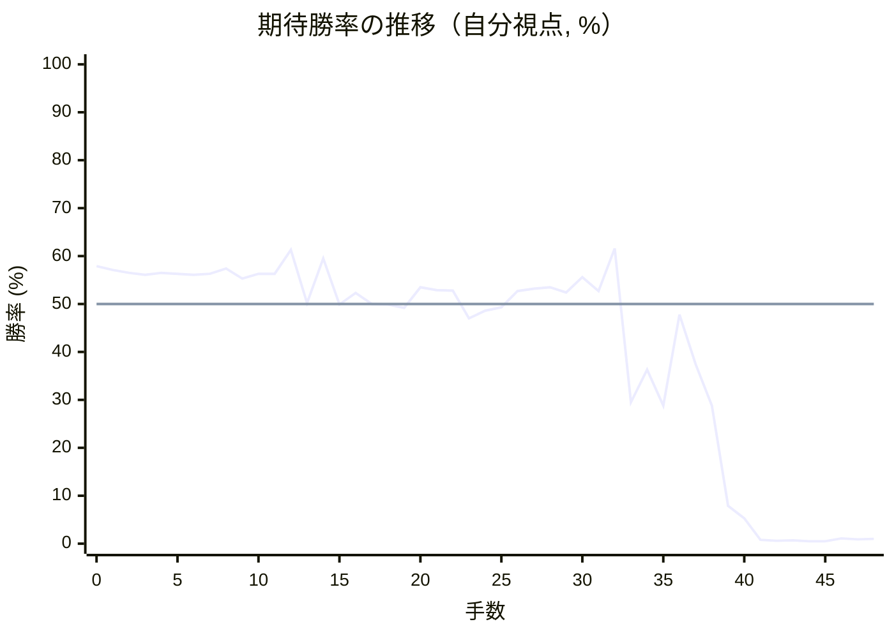
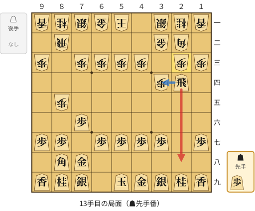
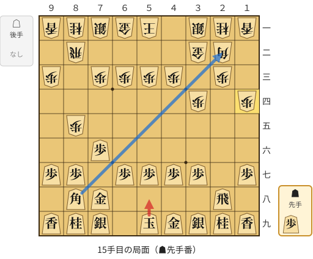
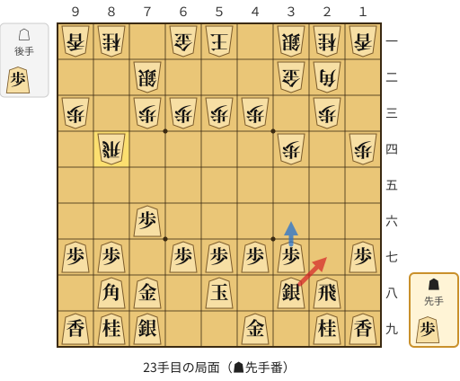
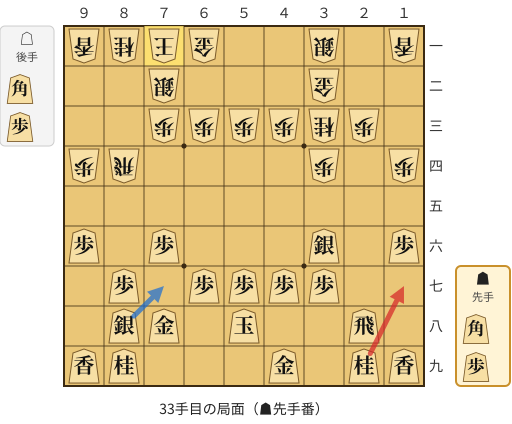
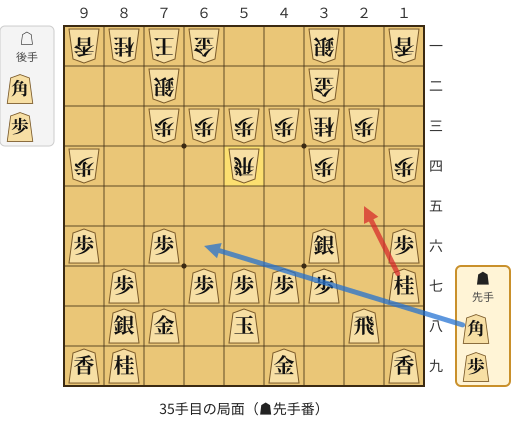
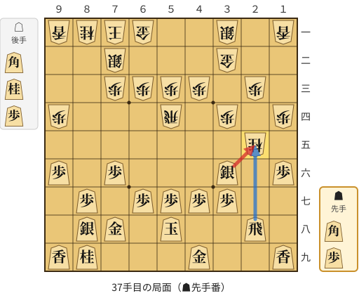
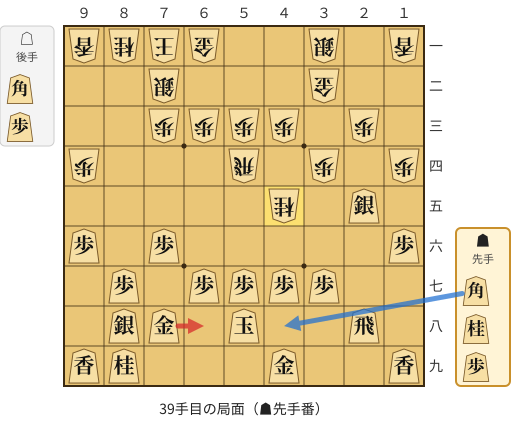

# 解析レポート kndcpdludv3n

[README に戻る](../../../README.md)　/　棋譜: [CSA](../../../data/csa/shogi5/kndcpdludv3n.csa)　/　解析の見方: [docs/mistake_analysis.md](../../../docs/mistake_analysis.md)

## 対局情報

| 項目 | 内容 |
|---|---|
| 日時 | 2026-10-29 21:36:13 |
| 持ち時間 | 5分 |
| 自分 | 先手（▲）（1734） |
| 相手 | 相手（1823） |
| 結果 | 負け（投了, 48手） |

## 解析環境

| 項目 | 内容 |
|---|---|
| エンジン | YaneuraOu NNUE 9.00git 64AVX2（V9.00/YANEURAOU_ENGINE_NNUE/AVX2） |
| 評価関数 | **水匠5**（`suisho5`） |
| nn.bin SHA-256 | `768068f0d534a0603a5d38bcd143de6bbca820d5f1c95a14d40863e5b7892d76` |
| 第1パス | movetime=150ms, MultiPV 1 |
| 第2パス | movetime=2000ms, MultiPV 3 |
| Threads / Hash | 8 / 512MB |
| 判定基準 | 疑問手 ≥5pt, 悪手 ≥10pt, 大悪手 ≥20pt（期待勝率 W(E)=1/(1+exp(-E/600))） |
| 解析日時 | 2026-11-03T04:15:19+09:00（解析バージョン 1, 35秒） |

## サマリー

| 自分の手数 | 深掘りした手 | 詰み逃し | 大悪手 | 悪手 | 疑問手 |
|--:|--:|--:|--:|--:|--:|
| 24 | 7 | 0 | 2 | 2 | 3 |

## 期待勝率の推移



<details><summary>1手ごとの数値（第1パス）</summary>

| 手数 | 指し手 | 評価値 | 勝率 | 低下 | 判定 |
|--:|---|--:|--:|--:|---|
| 1 | ▲７六歩(77) | +172 | 57.1% | +0.8pt |  |
| 2 | △８四歩(83) | +156 | 56.5% |  |  |
| 3 | ▲２六歩(27) | +148 | 56.1% | +0.3pt |  |
| 4 | △３四歩(33) | +158 | 56.5% |  |  |
| 5 | ▲２五歩(26) | +153 | 56.3% | +0.2pt |  |
| 6 | △８五歩(84) | +146 | 56.1% |  |  |
| 7 | ▲７八金(69) | +153 | 56.3% | -0.3pt |  |
| 8 | △３二金(41) | +178 | 57.4% |  |  |
| 9 | ▲２四歩(25) | +128 | 55.3% | +2.0pt |  |
| 10 | △同歩(23) | +153 | 56.3% |  |  |
| 11 | ▲同飛(28) | +152 | 56.3% | +0.0pt |  |
| 12 | △２三歩打 | +277 | 61.3% |  |  |
| 13 | ▲２八飛(24) | +6 | 50.2% | +11.1pt | [悪手](#ply-13) |
| 14 | △１四歩(13) | +230 | 59.5% |  |  |
| 15 | ▲５八玉(59) | -3 | 49.9% | +9.6pt | [疑問手](#ply-15) |
| 16 | △７二銀(71) | +55 | 52.3% |  |  |
| 17 | ▲３八銀(39) | -1 | 50.0% | +2.3pt |  |
| 18 | △８六歩(85) | -2 | 49.9% |  |  |
| 19 | ▲同歩(87) | -20 | 49.2% | +0.7pt |  |
| 20 | △同飛(82) | +84 | 53.5% |  |  |
| 21 | ▲８七歩打 | +70 | 52.9% | +0.6pt |  |
| 22 | △８四飛(86) | +68 | 52.8% |  |  |
| 23 | ▲２七銀(38) | -72 | 47.0% | +5.8pt | [疑問手](#ply-23) |
| 24 | △９四歩(93) | -34 | 48.6% |  |  |
| 25 | ▲３六銀(27) | -17 | 49.3% | -0.7pt |  |
| 26 | △８八角成(22) | +65 | 52.7% |  |  |
| 27 | ▲同銀(79) | +76 | 53.2% | -0.5pt |  |
| 28 | △３三桂(21) | +83 | 53.5% |  |  |
| 29 | ▲１六歩(17) | +58 | 52.4% | +1.0pt |  |
| 30 | △６二玉(51) | +136 | 55.6% |  |  |
| 31 | ▲９六歩(97) | +66 | 52.7% | +2.9pt |  |
| 32 | △７一玉(62) | +284 | 61.6% |  |  |
| 33 | ▲１七桂(29) | -524 | 29.5% | +32.2pt | [大悪手](#ply-33) |
| 34 | △５四飛(84) | -338 | 36.3% |  |  |
| 35 | ▲２五桂(17) | -544 | 28.8% | +7.5pt | [疑問手](#ply-35) |
| 36 | △同桂(33) | -54 | 47.8% |  |  |
| 37 | ▲同銀(36) | -310 | 37.4% | +10.4pt | [大悪手](#ply-37) |
| 38 | △４五桂打 | -544 | 28.8% |  |  |
| 39 | ▲６八金(78) | -1474 | 7.9% | +20.9pt | [悪手](#ply-39) |
| 40 | △３七桂成(45) | -1731 | 5.3% |  |  |
| 41 | ▲２六飛(28) | -2905 | 0.8% | +4.5pt |  |
| 42 | △４四角打 | -3040 | 0.6% |  |  |
| 43 | ▲６六飛(26) | -2948 | 0.7% | -0.1pt |  |
| 44 | △同角(44) | -3131 | 0.5% |  |  |
| 45 | ▲同歩(67) | -3168 | 0.5% | +0.0pt |  |
| 46 | △２八飛打 | -2710 | 1.1% |  |  |
| 47 | ▲６七玉(58) | -2848 | 0.9% | +0.2pt |  |
| 48 | △２五飛成(28) | -2788 | 1.0% |  |  |

</details>

## 課題局面

<a id="ply-13"></a>
### 13手目 ▲２八飛(24) — 悪手

| | 着手前 | 着手後 | 差 |
|---|--:|--:|--:|
| 期待勝率 | 62.5% | 51.1% | -11.4pt |
| 評価値 | +307 | +27 | |

着手前の局面:



🔴 実戦 ▲２八飛(24)　🔵 AI推奨 ▲３四飛(24)　🟨 直前の相手の指し手

<details><summary>テキストの盤面図（BOD・将棋ソフトに貼り付け可）</summary>

```text
後手の持駒：なし
  ９ ８ ７ ６ ５ ４ ３ ２ １
+---------------------------+
|v香v桂v銀v金v玉 ・v銀v桂v香|一
| ・v飛 ・ ・ ・ ・v金v角 ・|二
|v歩 ・v歩v歩v歩v歩 ・v歩v歩|三
| ・ ・ ・ ・ ・ ・v歩 飛 ・|四
| ・v歩 ・ ・ ・ ・ ・ ・ ・|五
| ・ ・ 歩 ・ ・ ・ ・ ・ ・|六
| 歩 歩 ・ 歩 歩 歩 歩 ・ 歩|七
| ・ 角 金 ・ ・ ・ ・ ・ ・|八
| 香 桂 銀 ・ 玉 金 銀 桂 香|九
+---------------------------+
先手の持駒：歩
手数＝12　△２三歩　まで
```

</details>

| | 指し手 | 評価値 | 読み筋 |
|---|---|--:|---|
| 実戦 | ▲２八飛(24) | +27 | △８六歩(85) ▲同歩(87) △同飛(82) ▲２二角成(88) △同銀(31) ▲８八銀(79) |
| AI 1位 | ▲３四飛(24) | +307 | ▲３四飛(24) △４二玉(51) ▲５八玉(59) △１四歩(13) ▲９六歩(97) △８八角成(22) |
| AI 2位 | ▲２六飛(24) | +65 | ▲２六飛(24) △７二銀(71) ▲２二角成(88) △同銀(31) ▲８八銀(79) △７四歩(73) |
| AI 3位 | ▲２二角成(88) | +58 | ▲２二角成(88) △同銀(31) ▲３四飛(24) △３三銀(22) ▲３六飛(34) △２七角打 |

SFEN: `lnsgk1snl/1r4gb1/p1pppp1pp/6pR1/1p7/2P6/PP1PPPP1P/1BG6/LNS1KGSNL b P 13`

<a id="ply-15"></a>
### 15手目 ▲５八玉(59) — 疑問手

| | 着手前 | 着手後 | 差 |
|---|--:|--:|--:|
| 期待勝率 | 59.3% | 49.4% | -9.9pt |
| 評価値 | +227 | -14 | |

着手前の局面:



🔴 実戦 ▲５八玉(59)　🔵 AI推奨 ▲２二角成(88)　🟨 直前の相手の指し手

<details><summary>テキストの盤面図（BOD・将棋ソフトに貼り付け可）</summary>

```text
後手の持駒：なし
  ９ ８ ７ ６ ５ ４ ３ ２ １
+---------------------------+
|v香v桂v銀v金v玉 ・v銀v桂v香|一
| ・v飛 ・ ・ ・ ・v金v角 ・|二
|v歩 ・v歩v歩v歩v歩 ・v歩 ・|三
| ・ ・ ・ ・ ・ ・v歩 ・v歩|四
| ・v歩 ・ ・ ・ ・ ・ ・ ・|五
| ・ ・ 歩 ・ ・ ・ ・ ・ ・|六
| 歩 歩 ・ 歩 歩 歩 歩 ・ 歩|七
| ・ 角 金 ・ ・ ・ ・ 飛 ・|八
| 香 桂 銀 ・ 玉 金 銀 桂 香|九
+---------------------------+
先手の持駒：歩
手数＝14　△１四歩　まで
```

</details>

| | 指し手 | 評価値 | 読み筋 |
|---|---|--:|---|
| 実戦 | ▲５八玉(59) | -14 | △８六歩(85) ▲同歩(87) △同飛(82) ▲２四歩打 △同歩(23) ▲同飛(28) |
| AI 1位 | ▲２二角成(88) | +227 | ▲２二角成(88) △同銀(31) ▲８八銀(79) △４二玉(51) ▲７七銀(88) △７四歩(73) |
| AI 2位 | ▲５八玉(59) | +24 | ▲５八玉(59) △５二玉(51) ▲２二角成(88) △同銀(31) ▲８八銀(79) △８六歩(85) |
| AI 3位 | ▲１六歩(17) | +13 | ▲１六歩(17) △８六歩(85) ▲２二角成(88) △同銀(31) ▲８六歩(87) △同飛(82) |

SFEN: `lnsgk1snl/1r4gb1/p1pppp1p1/6p1p/1p7/2P6/PP1PPPP1P/1BG4R1/LNS1KGSNL b P 15`

<a id="ply-23"></a>
### 23手目 ▲２七銀(38) — 疑問手

| | 着手前 | 着手後 | 差 |
|---|--:|--:|--:|
| 期待勝率 | 54.2% | 47.3% | -6.9pt |
| 評価値 | +100 | -66 | |

着手前の局面:



🔴 実戦 ▲２七銀(38)　🔵 AI推奨 ▲３六歩(37)　🟨 直前の相手の指し手

<details><summary>テキストの盤面図（BOD・将棋ソフトに貼り付け可）</summary>

```text
後手の持駒：歩
  ９ ８ ７ ６ ５ ４ ３ ２ １
+---------------------------+
|v香v桂 ・v金v玉 ・v銀v桂v香|一
| ・ ・v銀 ・ ・ ・v金v角 ・|二
|v歩 ・v歩v歩v歩v歩 ・v歩 ・|三
| ・v飛 ・ ・ ・ ・v歩 ・v歩|四
| ・ ・ ・ ・ ・ ・ ・ ・ ・|五
| ・ ・ 歩 ・ ・ ・ ・ ・ ・|六
| 歩 歩 ・ 歩 歩 歩 歩 ・ 歩|七
| ・ 角 金 ・ 玉 ・ 銀 飛 ・|八
| 香 桂 銀 ・ ・ 金 ・ 桂 香|九
+---------------------------+
先手の持駒：歩
手数＝22　△８四飛　まで
```

</details>

| | 指し手 | 評価値 | 読み筋 |
|---|---|--:|---|
| 実戦 | ▲２七銀(38) | -66 | △４二玉(51) ▲３六銀(27) △８八角成(22) ▲同銀(79) △２二銀(31) ▲７七銀(88) |
| AI 1位 | ▲３六歩(37) | +100 | ▲３六歩(37) △９四歩(93) ▲９六歩(97) △５二玉(51) ▲４六歩(47) △８六歩打 |
| AI 2位 | ▲４六歩(47) | +81 | ▲４六歩(47) △９四歩(93) ▲９六歩(97) △４二玉(51) ▲３六歩(37) △８六歩打 |
| AI 3位 | ▲９六歩(97) | +85 | ▲９六歩(97) △４二玉(51) ▲４六歩(47) △７四歩(73) ▲４七銀(38) △７三桂(81) |

SFEN: `ln1gk1snl/2s3gb1/p1pppp1p1/1r4p1p/9/2P6/PP1PPPP1P/1BG1K1SR1/LNS2G1NL b Pp 23`

<a id="ply-33"></a>
### 33手目 ▲１七桂(29) — 大悪手

| | 着手前 | 着手後 | 差 |
|---|--:|--:|--:|
| 期待勝率 | 60.9% | 23.9% | -37.0pt |
| 評価値 | +265 | -695 | |

着手前の局面:



🔴 実戦 ▲１七桂(29)　🔵 AI推奨 ▲７七銀(88)　🟨 直前の相手の指し手

<details><summary>テキストの盤面図（BOD・将棋ソフトに貼り付け可）</summary>

```text
後手の持駒：角　歩
  ９ ８ ７ ６ ５ ４ ３ ２ １
+---------------------------+
|v香v桂v玉v金 ・ ・v銀 ・v香|一
| ・ ・v銀 ・ ・ ・v金 ・ ・|二
| ・ ・v歩v歩v歩v歩v桂v歩 ・|三
|v歩v飛 ・ ・ ・ ・v歩 ・v歩|四
| ・ ・ ・ ・ ・ ・ ・ ・ ・|五
| 歩 ・ 歩 ・ ・ ・ 銀 ・ 歩|六
| ・ 歩 ・ 歩 歩 歩 歩 ・ ・|七
| ・ 銀 金 ・ 玉 ・ ・ 飛 ・|八
| 香 桂 ・ ・ ・ 金 ・ 桂 香|九
+---------------------------+
先手の持駒：角　歩
手数＝32　△７一玉　まで
```

</details>

| | 指し手 | 評価値 | 読み筋 |
|---|---|--:|---|
| 実戦 | ▲１七桂(29) | -695 | △３五歩(34) ▲同銀(36) △１五歩(14) ▲７五角打 △５四飛(84) ▲２五桂(17) |
| AI 1位 | ▲７七銀(88) | +265 | ▲７七銀(88) △４二銀(31) ▲６八玉(58) △５四歩(53) ▲５八金(49) △５五歩(54) |
| AI 2位 | ▲６八玉(58) | +204 | ▲６八玉(58) △８五飛(84) ▲７七桂(89) △５五飛(85) ▲８六歩(87) △３五歩(34) |
| AI 3位 | ▲８六歩(87) | +170 | ▲８六歩(87) △同飛(84) ▲９七角打 △７六飛(86) ▲７七銀(88) △７四飛(76) |

SFEN: `lnkg2s1l/2s3g2/2ppppnp1/pr4p1p/9/P1P3S1P/1P1PPPP2/1SG1K2R1/LN3G1NL b BPbp 33`

<a id="ply-35"></a>
### 35手目 ▲２五桂(17) — 疑問手

| | 着手前 | 着手後 | 差 |
|---|--:|--:|--:|
| 期待勝率 | 29.0% | 20.3% | -8.7pt |
| 評価値 | -538 | -821 | |

着手前の局面:



🔴 実戦 ▲２五桂(17)　🔵 AI推奨 ▲６六角打　🟨 直前の相手の指し手

<details><summary>テキストの盤面図（BOD・将棋ソフトに貼り付け可）</summary>

```text
後手の持駒：角　歩
  ９ ８ ７ ６ ５ ４ ３ ２ １
+---------------------------+
|v香v桂v玉v金 ・ ・v銀 ・v香|一
| ・ ・v銀 ・ ・ ・v金 ・ ・|二
| ・ ・v歩v歩v歩v歩v桂v歩 ・|三
|v歩 ・ ・ ・v飛 ・v歩 ・v歩|四
| ・ ・ ・ ・ ・ ・ ・ ・ ・|五
| 歩 ・ 歩 ・ ・ ・ 銀 ・ 歩|六
| ・ 歩 ・ 歩 歩 歩 歩 ・ 桂|七
| ・ 銀 金 ・ 玉 ・ ・ 飛 ・|八
| 香 桂 ・ ・ ・ 金 ・ ・ 香|九
+---------------------------+
先手の持駒：角　歩
手数＝34　△５四飛　まで
```

</details>

| | 指し手 | 評価値 | 読み筋 |
|---|---|--:|---|
| 実戦 | ▲２五桂(17) | -821 | △３五歩(34) ▲同銀(36) △３六歩打 ▲４六銀(35) △２四飛(54) ▲３六歩(37) |
| AI 1位 | ▲６六角打 | -538 | ▲６六角打 △２四歩(23) ▲２六飛(28) △１五歩(14) ▲同歩(16) △１六歩打 |
| AI 2位 | ▲２五桂(17) | -604 | ▲２五桂(17) △３五歩(34) ▲同銀(36) △３六歩打 ▲同歩(37) △３七角打 |
| AI 3位 | ▲９五歩(96) | -612 | ▲９五歩(96) △同歩(94) ▲９二歩打 △同香(91) ▲６五角打 △９四飛(54) |

SFEN: `lnkg2s1l/2s3g2/2ppppnp1/p3r1p1p/9/P1P3S1P/1P1PPPP1N/1SG1K2R1/LN3G2L b BPbp 35`

<a id="ply-37"></a>
### 37手目 ▲同銀(36) — 大悪手

| | 着手前 | 着手後 | 差 |
|---|--:|--:|--:|
| 期待勝率 | 41.6% | 19.9% | -21.7pt |
| 評価値 | -204 | -835 | |

着手前の局面:



🔴 実戦 ▲同銀(36)　🔵 AI推奨 ▲同飛(28)　🟨 直前の相手の指し手

<details><summary>テキストの盤面図（BOD・将棋ソフトに貼り付け可）</summary>

```text
後手の持駒：角　桂　歩
  ９ ８ ７ ６ ５ ４ ３ ２ １
+---------------------------+
|v香v桂v玉v金 ・ ・v銀 ・v香|一
| ・ ・v銀 ・ ・ ・v金 ・ ・|二
| ・ ・v歩v歩v歩v歩 ・v歩 ・|三
|v歩 ・ ・ ・v飛 ・v歩 ・v歩|四
| ・ ・ ・ ・ ・ ・ ・v桂 ・|五
| 歩 ・ 歩 ・ ・ ・ 銀 ・ 歩|六
| ・ 歩 ・ 歩 歩 歩 歩 ・ ・|七
| ・ 銀 金 ・ 玉 ・ ・ 飛 ・|八
| 香 桂 ・ ・ ・ 金 ・ ・ 香|九
+---------------------------+
先手の持駒：角　歩
手数＝36　△２五同桂　まで
```

</details>

| | 指し手 | 評価値 | 読み筋 |
|---|---|--:|---|
| 実戦 | ▲同銀(36) | -835 | △４五桂打 ▲４八角打 △３五歩(34) ▲４六桂打 △６四飛(54) ▲２四歩打 |
| AI 1位 | ▲同飛(28) | -204 | ▲同飛(28) △３五歩(34) ▲同銀(36) △５五飛(54) ▲７七角打 △２四歩(23) |
| AI 2位 | ▲同銀(36) | -876 | ▲同銀(36) △４五桂打 ▲４八角打 △３五歩(34) ▲９五歩(96) △同歩(94) |
| AI 3位 | ▲４六角打 | -932 | ▲４六角打 △２四歩(23) ▲２六歩打 △３七桂不成(25) ▲同角(46) △４四歩(43) |

SFEN: `lnkg2s1l/2s3g2/2pppp1p1/p3r1p1p/7n1/P1P3S1P/1P1PPPP2/1SG1K2R1/LN3G2L b BPbnp 37`

<a id="ply-39"></a>
### 39手目 ▲６八金(78) — 悪手

| | 着手前 | 着手後 | 差 |
|---|--:|--:|--:|
| 期待勝率 | 16.7% | 5.6% | -11.1pt |
| 評価値 | -964 | -1691 | |

着手前の局面:



🔴 実戦 ▲６八金(78)　🔵 AI推奨 ▲４八角打　🟨 直前の相手の指し手

<details><summary>テキストの盤面図（BOD・将棋ソフトに貼り付け可）</summary>

```text
後手の持駒：角　歩
  ９ ８ ７ ６ ５ ４ ３ ２ １
+---------------------------+
|v香v桂v玉v金 ・ ・v銀 ・v香|一
| ・ ・v銀 ・ ・ ・v金 ・ ・|二
| ・ ・v歩v歩v歩v歩 ・v歩 ・|三
|v歩 ・ ・ ・v飛 ・v歩 ・v歩|四
| ・ ・ ・ ・ ・v桂 ・ 銀 ・|五
| 歩 ・ 歩 ・ ・ ・ ・ ・ 歩|六
| ・ 歩 ・ 歩 歩 歩 歩 ・ ・|七
| ・ 銀 金 ・ 玉 ・ ・ 飛 ・|八
| 香 桂 ・ ・ ・ 金 ・ ・ 香|九
+---------------------------+
先手の持駒：角　桂　歩
手数＝38　△４五桂　まで
```

</details>

| | 指し手 | 評価値 | 読み筋 |
|---|---|--:|---|
| 実戦 | ▲６八金(78) | -1691 | △３七桂成(45) ▲２九飛(28) △２四歩(23) ▲３八歩打 △４七成桂(37) ▲同玉(58) |
| AI 1位 | ▲４八角打 | -964 | ▲４八角打 △３五歩(34) ▲４六桂打 △４四飛(54) ▲３四銀(25) △同飛(44) |
| AI 2位 | ▲４六角打 | -1336 | ▲４六角打 △６四角打 ▲同角(46) △５七桂成(45) ▲６九玉(58) △６四飛(54) |
| AI 3位 | ▲６八金(78) | -1625 | ▲６八金(78) △３七桂成(45) ▲２九飛(28) △２四歩(23) ▲３八歩打 △４七成桂(37) |

SFEN: `lnkg2s1l/2s3g2/2pppp1p1/p3r1p1p/5n1S1/P1P5P/1P1PPPP2/1SG1K2R1/LN3G2L b BNPbp 39`

