# 解析レポート krkqyboegd0p

[README に戻る](../../../README.md)　/　棋譜: [CSA](../../../data/csa/shogi5/krkqyboegd0p.csa)　/　解析の見方: [docs/mistake_analysis.md](../../../docs/mistake_analysis.md)

## 対局情報

| 項目 | 内容 |
|---|---|
| 日時 | 2026-11-11 04:16:11 |
| 持ち時間 | 5分 |
| 自分 | 先手（▲）（1658） |
| 相手 | 相手（1589） |
| 結果 | 勝ち（詰み, 91手） |

## 解析環境

| 項目 | 内容 |
|---|---|
| エンジン | YaneuraOu NNUE 9.00git 64AVX2（V9.00/YANEURAOU_ENGINE_NNUE/AVX2） |
| 評価関数 | **水匠5**（`suisho5`） |
| nn.bin SHA-256 | `768068f0d534a0603a5d38bcd143de6bbca820d5f1c95a14d40863e5b7892d76` |
| 第1パス | movetime=150ms, MultiPV 1 |
| 第2パス | movetime=2000ms, MultiPV 3 |
| Threads / Hash | 8 / 512MB |
| 判定基準 | 疑問手 ≥5pt, 悪手 ≥10pt, 大悪手 ≥20pt（期待勝率 W(E)=1/(1+exp(-E/600))） |
| 解析日時 | 2026-11-14T10:44:30+09:00（解析バージョン 1, 55秒） |

## サマリー

| 自分の手数 | 深掘りした手 | 詰み逃し | 大悪手 | 悪手 | 疑問手 |
|--:|--:|--:|--:|--:|--:|
| 46 | 11 | 1 | 2 | 5 | 2 |

## 期待勝率の推移

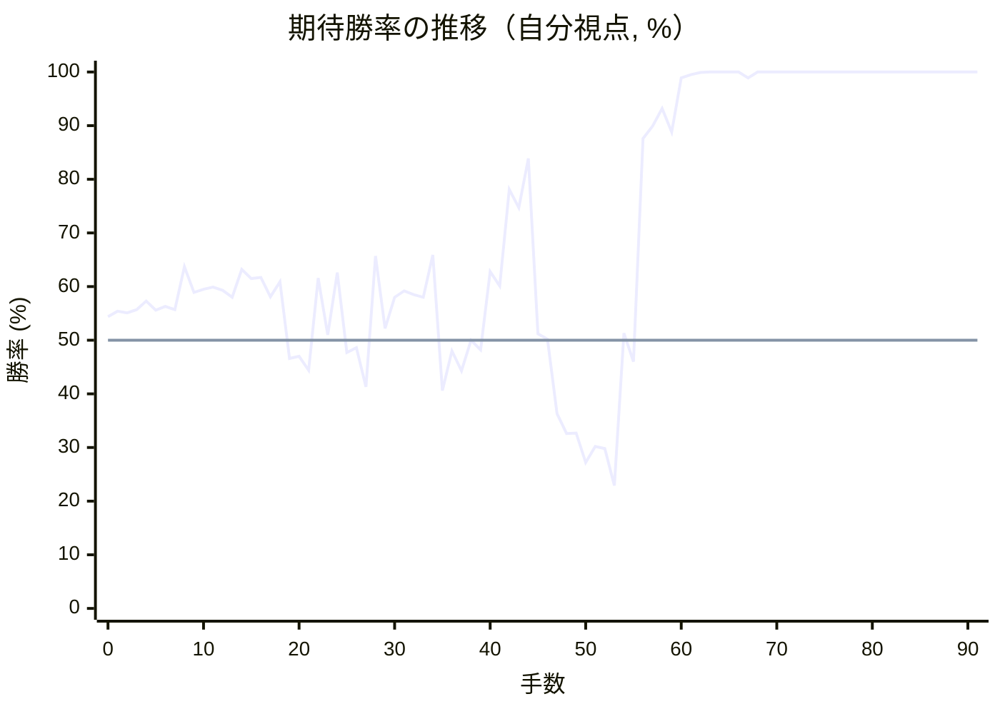

<details><summary>1手ごとの数値（第1パス）</summary>

| 手数 | 指し手 | 評価値 | 勝率 | 低下 | 判定 |
|--:|---|--:|--:|--:|---|
| 1 | ▲７六歩(77) | +131 | 55.4% | -1.0pt |  |
| 2 | △３四歩(33) | +124 | 55.1% |  |  |
| 3 | ▲２六歩(27) | +138 | 55.7% | -0.6pt |  |
| 4 | △４四歩(43) | +177 | 57.3% |  |  |
| 5 | ▲２五歩(26) | +134 | 55.6% | +1.8pt |  |
| 6 | △３三角(22) | +152 | 56.3% |  |  |
| 7 | ▲４八銀(39) | +137 | 55.7% | +0.6pt |  |
| 8 | △４二飛(82) | +338 | 63.7% |  |  |
| 9 | ▲５六歩(57) | +215 | 58.9% | +4.9pt |  |
| 10 | △３二銀(31) | +232 | 59.5% |  |  |
| 11 | ▲６八玉(59) | +240 | 59.9% | -0.3pt |  |
| 12 | △５二金(41) | +225 | 59.3% |  |  |
| 13 | ▲７八玉(68) | +194 | 58.0% | +1.3pt |  |
| 14 | △６四歩(63) | +325 | 63.2% |  |  |
| 15 | ▲９六歩(97) | +281 | 61.5% | +1.7pt |  |
| 16 | △９四歩(93) | +286 | 61.7% |  |  |
| 17 | ▲８六歩(87) | +196 | 58.1% | +3.6pt |  |
| 18 | △６三金(52) | +265 | 60.9% |  |  |
| 19 | ▲８七玉(78) | -81 | 46.6% | +14.2pt | [悪手](#ply-19) |
| 20 | △８二飛(42) | -73 | 47.0% |  |  |
| 21 | ▲７八銀(79) | -136 | 44.4% | +2.6pt |  |
| 22 | △７二銀(71) | +283 | 61.6% |  |  |
| 23 | ▲５八金(49) | +23 | 51.0% | +10.6pt | [悪手](#ply-23) |
| 24 | △７四歩(73) | +308 | 62.6% |  |  |
| 25 | ▲１六歩(17) | -55 | 47.7% | +14.8pt | [悪手](#ply-25) |
| 26 | △８四歩(83) | -33 | 48.6% |  |  |
| 27 | ▲７九角(88) | -210 | 41.3% | +7.3pt | [疑問手](#ply-27) |
| 28 | △７三銀(72) | +391 | 65.7% |  |  |
| 29 | ▲７七桂(89) | +52 | 52.2% | +13.6pt | [悪手](#ply-29) |
| 30 | △６五歩(64) | +194 | 58.0% |  |  |
| 31 | ▲２四歩(25) | +223 | 59.2% | -1.2pt |  |
| 32 | △同歩(23) | +207 | 58.5% |  |  |
| 33 | ▲同角(79) | +193 | 58.0% | +0.6pt |  |
| 34 | △２三歩打 | +396 | 65.9% |  |  |
| 35 | ▲４六角(24) | -228 | 40.6% | +25.3pt | [大悪手](#ply-35) |
| 36 | △４五歩(44) | -47 | 48.0% |  |  |
| 37 | ▲５五角(46) | -138 | 44.3% | +3.8pt |  |
| 38 | △同角(33) | +0 | 50.0% |  |  |
| 39 | ▲同歩(56) | -44 | 48.2% | +1.8pt |  |
| 40 | △６四銀(73) | +315 | 62.8% |  |  |
| 41 | ▲２二歩打 | +246 | 60.1% | +2.7pt |  |
| 42 | △３三桂(21) | +762 | 78.1% |  |  |
| 43 | ▲２一歩成(22) | +650 | 74.7% | +3.4pt |  |
| 44 | △７五歩(74) | +991 | 83.9% |  |  |
| 45 | ▲同歩(76) | +28 | 51.2% | +32.7pt | [大悪手](#ply-45) |
| 46 | △８五歩(84) | +5 | 50.2% |  |  |
| 47 | ▲同歩(86) | -338 | 36.3% | +13.9pt | [悪手](#ply-47) |
| 48 | △７五銀(64) | -436 | 32.6% |  |  |
| 49 | ▲７六歩打 | -432 | 32.7% | -0.1pt |  |
| 50 | △８六歩打 | -590 | 27.2% |  |  |
| 51 | ▲８八玉(87) | -503 | 30.2% | -3.0pt |  |
| 52 | △７六銀(75) | -515 | 29.8% |  |  |
| 53 | ▲３一と(21) | -730 | 22.9% | +6.9pt | [疑問手](#ply-53) |
| 54 | △４三銀(32) | +32 | 51.3% |  |  |
| 55 | ▲２三飛成(28) | -97 | 46.0% | +5.4pt |  |
| 56 | △３五角打 | +1171 | 87.6% |  |  |
| 57 | ▲３三龍(23) | +1312 | 89.9% | -2.3pt |  |
| 58 | △５二金(61) | +1570 | 93.2% |  |  |
| 59 | ▲４一と(31) | +1245 | 88.8% | +4.3pt |  |
| 60 | △６二玉(51) | +2715 | 98.9% |  |  |
| 61 | ▲４二と(41) | +3193 | 99.5% | -0.6pt |  |
| 62 | △４四角(35) | +4352 | 99.9% |  |  |
| 63 | ▲５二と(42) | +4855 | 100.0% | -0.0pt |  |
| 64 | △同玉(62) | +4872 | 100.0% |  |  |
| 65 | ▲３一龍(33) | +5463 | 100.0% | -0.0pt |  |
| 66 | △５五角(44) | +5866 | 100.0% |  |  |
| 67 | ▲４二金打 | +2680 | 98.9% | +1.1pt |  |
| 68 | △６二玉(52) | +4593 | 100.0% |  |  |
| 69 | ▲７一角打 | +4848 | 100.0% | -0.0pt |  |
| 70 | △７二玉(62) | +5020 | 100.0% |  |  |
| 71 | ▲８二角成(71) | +5147 | 100.0% | -0.0pt |  |
| 72 | △同角(55) | +6324 | 100.0% |  |  |
| 73 | ▲４三金(42) | +5677 | 100.0% | +0.0pt |  |
| 74 | △５五角打 | #+11 | 100.0% |  |  |
| 75 | ▲７五飛打 | +6550 | 100.0% | +0.0pt | [詰み逃し](#ply-75) |
| 76 | △７四歩打 | +6731 | 100.0% |  |  |
| 77 | ▲７六飛(75) | +6777 | 100.0% | -0.0pt |  |
| 78 | △６四角(82) | #+11 | 100.0% |  |  |
| 79 | ▲８四桂打 | #+10 | 100.0% | +0.0pt |  |
| 80 | △８三玉(72) | #+9 | 100.0% |  |  |
| 81 | ▲８一龍(31) | #+8 | 100.0% | +0.0pt |  |
| 82 | △８二角(64) | #+7 | 100.0% |  |  |
| 83 | ▲７二銀打 | #+10 | 100.0% | +0.0pt |  |
| 84 | △９三玉(83) | #+3 | 100.0% |  |  |
| 85 | ▲６三銀不成(72) | +35281 | 100.0% | +0.0pt |  |
| 86 | △８七歩成(86) | +35281 | 100.0% |  |  |
| 87 | ▲同銀(78) | #+10 | 100.0% | +0.0pt |  |
| 88 | △８三歩打 | #+3 | 100.0% |  |  |
| 89 | ▲７二銀不成(63) | #+8 | 100.0% | +0.0pt |  |
| 90 | △８四歩(83) | #+1 | 100.0% |  |  |
| 91 | ▲８三金打 | #+ | 100.0% | +0.0pt |  |

</details>

## 課題局面

<a id="ply-19"></a>
### 19手目 ▲８七玉(78) — 悪手

| | 着手前 | 着手後 | 差 |
|---|--:|--:|--:|
| 期待勝率 | 63.5% | 51.5% | -12.0pt |
| 評価値 | +331 | +36 | |

着手前の局面:

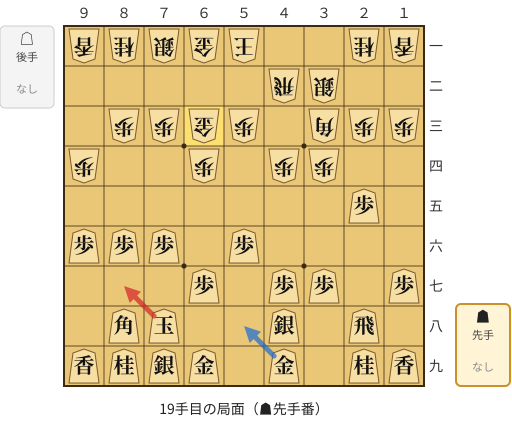

🔴 実戦 ▲８七玉(78)　🔵 AI推奨 ▲５八金(49)　🟨 直前の相手の指し手

<details><summary>テキストの盤面図（BOD・将棋ソフトに貼り付け可）</summary>

```text
後手の持駒：なし
  ９ ８ ７ ６ ５ ４ ３ ２ １
+---------------------------+
|v香v桂v銀v金v玉 ・ ・v桂v香|一
| ・ ・ ・ ・ ・v飛v銀 ・ ・|二
| ・v歩v歩v金v歩 ・v角v歩v歩|三
|v歩 ・ ・v歩 ・v歩v歩 ・ ・|四
| ・ ・ ・ ・ ・ ・ ・ 歩 ・|五
| 歩 歩 歩 ・ 歩 ・ ・ ・ ・|六
| ・ ・ ・ 歩 ・ 歩 歩 ・ 歩|七
| ・ 角 玉 ・ ・ 銀 ・ 飛 ・|八
| 香 桂 銀 金 ・ 金 ・ 桂 香|九
+---------------------------+
先手の持駒：なし
手数＝18　△６三金　まで
```

</details>

| | 指し手 | 評価値 | 読み筋 |
|---|---|--:|---|
| 実戦 | ▲８七玉(78) | +36 | △８四歩(83) ▲６六角(88) △８二飛(42) ▲７八玉(87) △７四金(63) ▲７七桂(89) |
| AI 1位 | ▲５八金(49) | +331 | ▲５八金(49) △７四歩(73) ▲３六歩(37) △６二玉(51) ▲３五歩(36) △同歩(34) |
| AI 2位 | ▲３六歩(37) | +326 | ▲３六歩(37) △７四金(63) ▲７七角(88) △８四歩(83) ▲６八角(77) △８五歩(84) |
| AI 3位 | ▲７七角(88) | +240 | ▲７七角(88) △４三銀(32) ▲３六歩(37) △７二銀(71) ▲５七銀(48) △６二玉(51) |

SFEN: `lnsgk2nl/5rs2/1ppgp1bpp/p2p1pp2/7P1/PPP1P4/3P1PP1P/1BK2S1R1/LNSG1G1NL b - 19`

<a id="ply-23"></a>
### 23手目 ▲５八金(49) — 悪手

| | 着手前 | 着手後 | 差 |
|---|--:|--:|--:|
| 期待勝率 | 62.6% | 46.3% | -16.3pt |
| 評価値 | +308 | -90 | |

着手前の局面:

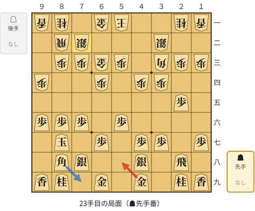

🔴 実戦 ▲５八金(49)　🔵 AI推奨 ▲７九角(88)　🟨 直前の相手の指し手

<details><summary>テキストの盤面図（BOD・将棋ソフトに貼り付け可）</summary>

```text
後手の持駒：なし
  ９ ８ ７ ６ ５ ４ ３ ２ １
+---------------------------+
|v香v桂 ・v金v玉 ・ ・v桂v香|一
| ・v飛v銀 ・ ・ ・v銀 ・ ・|二
| ・v歩v歩v金v歩 ・v角v歩v歩|三
|v歩 ・ ・v歩 ・v歩v歩 ・ ・|四
| ・ ・ ・ ・ ・ ・ ・ 歩 ・|五
| 歩 歩 歩 ・ 歩 ・ ・ ・ ・|六
| ・ 玉 ・ 歩 ・ 歩 歩 ・ 歩|七
| ・ 角 銀 ・ ・ 銀 ・ 飛 ・|八
| 香 桂 ・ 金 ・ 金 ・ 桂 香|九
+---------------------------+
先手の持駒：なし
手数＝22　△７二銀　まで
```

</details>

| | 指し手 | 評価値 | 読み筋 |
|---|---|--:|---|
| 実戦 | ▲５八金(49) | -90 | △８四歩(83) ▲７七銀(78) △９三桂(81) ▲７八玉(87) △８五歩(84) ▲同歩(86) |
| AI 1位 | ▲７九角(88) | +308 | ▲７九角(88) △８四歩(83) ▲２四歩(25) △同歩(23) ▲同角(79) △同角(33) |
| AI 2位 | ▲７七桂(89) | +148 | ▲７七桂(89) △８四歩(83) ▲７九角(88) △４二玉(51) ▲５八金(49) △７四歩(73) |
| AI 3位 | ▲７七銀(78) | +17 | ▲７七銀(78) △８四歩(83) ▲７九角(88) △７四歩(73) ▲２四歩(25) △同歩(23) |

SFEN: `ln1gk2nl/1rs3s2/1ppgp1bpp/p2p1pp2/7P1/PPP1P4/1K1P1PP1P/1BS2S1R1/LN1G1G1NL b - 23`

<a id="ply-25"></a>
### 25手目 ▲１六歩(17) — 悪手

| | 着手前 | 着手後 | 差 |
|---|--:|--:|--:|
| 期待勝率 | 67.3% | 48.7% | -18.6pt |
| 評価値 | +432 | -31 | |

着手前の局面:

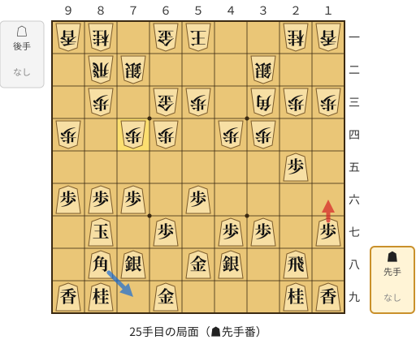

🔴 実戦 ▲１六歩(17)　🔵 AI推奨 ▲７九角(88)　🟨 直前の相手の指し手

<details><summary>テキストの盤面図（BOD・将棋ソフトに貼り付け可）</summary>

```text
後手の持駒：なし
  ９ ８ ７ ６ ５ ４ ３ ２ １
+---------------------------+
|v香v桂 ・v金v玉 ・ ・v桂v香|一
| ・v飛v銀 ・ ・ ・v銀 ・ ・|二
| ・v歩 ・v金v歩 ・v角v歩v歩|三
|v歩 ・v歩v歩 ・v歩v歩 ・ ・|四
| ・ ・ ・ ・ ・ ・ ・ 歩 ・|五
| 歩 歩 歩 ・ 歩 ・ ・ ・ ・|六
| ・ 玉 ・ 歩 ・ 歩 歩 ・ 歩|七
| ・ 角 銀 ・ 金 銀 ・ 飛 ・|八
| 香 桂 ・ 金 ・ ・ ・ 桂 香|九
+---------------------------+
先手の持駒：なし
手数＝24　△７四歩　まで
```

</details>

| | 指し手 | 評価値 | 読み筋 |
|---|---|--:|---|
| 実戦 | ▲１六歩(17) | -31 | △８四歩(83) ▲７七桂(89) △７三桂(81) ▲７九角(88) △８五歩(84) ▲同桂(77) |
| AI 1位 | ▲７九角(88) | +432 | ▲７九角(88) △８四歩(83) ▲２四歩(25) △同歩(23) ▲同角(79) △同角(33) |
| AI 2位 | ▲６六歩(67) | +156 | ▲６六歩(67) △８四歩(83) ▲７九角(88) △８五歩(84) ▲同歩(86) △４二玉(51) |
| AI 3位 | ▲７七桂(89) | +120 | ▲７七桂(89) △８四歩(83) ▲７九角(88) △４二玉(51) ▲６六歩(67) △７三桂(81) |

SFEN: `ln1gk2nl/1rs3s2/1p1gp1bpp/p1pp1pp2/7P1/PPP1P4/1K1P1PP1P/1BS1GS1R1/LN1G3NL b - 25`

<a id="ply-27"></a>
### 27手目 ▲７九角(88) — 疑問手

| | 着手前 | 着手後 | 差 |
|---|--:|--:|--:|
| 期待勝率 | 45.8% | 39.2% | -6.6pt |
| 評価値 | -102 | -264 | |

着手前の局面:

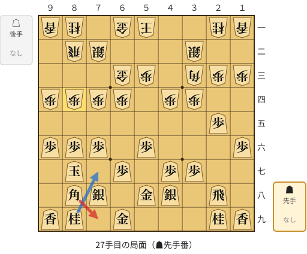

🔴 実戦 ▲７九角(88)　🔵 AI推奨 ▲７七桂(89)　🟨 直前の相手の指し手

<details><summary>テキストの盤面図（BOD・将棋ソフトに貼り付け可）</summary>

```text
後手の持駒：なし
  ９ ８ ７ ６ ５ ４ ３ ２ １
+---------------------------+
|v香v桂 ・v金v玉 ・ ・v桂v香|一
| ・v飛v銀 ・ ・ ・v銀 ・ ・|二
| ・ ・ ・v金v歩 ・v角v歩v歩|三
|v歩v歩v歩v歩 ・v歩v歩 ・ ・|四
| ・ ・ ・ ・ ・ ・ ・ 歩 ・|五
| 歩 歩 歩 ・ 歩 ・ ・ ・ 歩|六
| ・ 玉 ・ 歩 ・ 歩 歩 ・ ・|七
| ・ 角 銀 ・ 金 銀 ・ 飛 ・|八
| 香 桂 ・ 金 ・ ・ ・ 桂 香|九
+---------------------------+
先手の持駒：なし
手数＝26　△８四歩　まで
```

</details>

| | 指し手 | 評価値 | 読み筋 |
|---|---|--:|---|
| 実戦 | ▲７九角(88) | -264 | △８五歩(84) ▲同歩(86) △４五歩(44) ▲７七桂(89) △７三桂(81) ▲２四歩(25) |
| AI 1位 | ▲７七桂(89) | -102 | ▲７七桂(89) △７三桂(81) ▲６六歩(67) △８五歩(84) ▲同桂(77) △同桂(73) |
| AI 2位 | ▲６六歩(67) | -120 | ▲６六歩(67) △７三桂(81) ▲７七桂(89) △８五歩(84) ▲同桂(77) △同桂(73) |
| AI 3位 | ▲２四歩(25) | -197 | ▲２四歩(25) △同歩(23) ▲７九角(88) △２三銀(32) ▲６六歩(67) △８五歩(84) |

SFEN: `ln1gk2nl/1rs3s2/3gp1bpp/pppp1pp2/7P1/PPP1P3P/1K1P1PP2/1BS1GS1R1/LN1G3NL b - 27`

<a id="ply-29"></a>
### 29手目 ▲７七桂(89) — 悪手

| | 着手前 | 着手後 | 差 |
|---|--:|--:|--:|
| 期待勝率 | 63.6% | 51.2% | -12.4pt |
| 評価値 | +336 | +30 | |

着手前の局面:

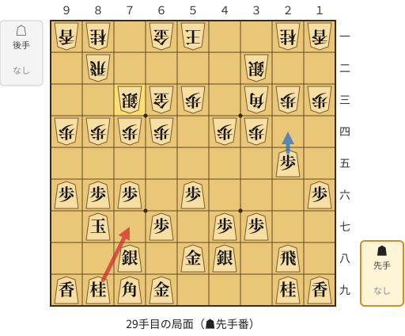

🔴 実戦 ▲７七桂(89)　🔵 AI推奨 ▲２四歩(25)　🟨 直前の相手の指し手

<details><summary>テキストの盤面図（BOD・将棋ソフトに貼り付け可）</summary>

```text
後手の持駒：なし
  ９ ８ ７ ６ ５ ４ ３ ２ １
+---------------------------+
|v香v桂 ・v金v玉 ・ ・v桂v香|一
| ・v飛 ・ ・ ・ ・v銀 ・ ・|二
| ・ ・v銀v金v歩 ・v角v歩v歩|三
|v歩v歩v歩v歩 ・v歩v歩 ・ ・|四
| ・ ・ ・ ・ ・ ・ ・ 歩 ・|五
| 歩 歩 歩 ・ 歩 ・ ・ ・ 歩|六
| ・ 玉 ・ 歩 ・ 歩 歩 ・ ・|七
| ・ ・ 銀 ・ 金 銀 ・ 飛 ・|八
| 香 桂 角 金 ・ ・ ・ 桂 香|九
+---------------------------+
先手の持駒：なし
手数＝28　△７三銀　まで
```

</details>

| | 指し手 | 評価値 | 読み筋 |
|---|---|--:|---|
| 実戦 | ▲７七桂(89) | +30 | △８五歩(84) ▲同歩(86) |
| AI 1位 | ▲２四歩(25) | +336 | ▲２四歩(25) △同角(33) ▲同角(79) △同歩(23) ▲同飛(28) △２三歩打 |
| AI 2位 | ▲７七桂(89) | +30 | ▲７七桂(89) △８五歩(84) ▲同歩(86) △９三桂(81) ▲６六歩(67) △８五桂(93) |
| AI 3位 | ▲７七銀(78) | -22 | ▲７七銀(78) △９三桂(81) ▲８八銀(77) △８五歩(84) ▲同歩(86) △４五歩(44) |

SFEN: `ln1gk2nl/1r4s2/2sgp1bpp/pppp1pp2/7P1/PPP1P3P/1K1P1PP2/2S1GS1R1/LNBG3NL b - 29`

<a id="ply-35"></a>
### 35手目 ▲４六角(24) — 大悪手

| | 着手前 | 着手後 | 差 |
|---|--:|--:|--:|
| 期待勝率 | 61.6% | 38.6% | -23.0pt |
| 評価値 | +284 | -278 | |

着手前の局面:

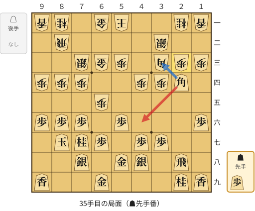

🔴 実戦 ▲４六角(24)　🔵 AI推奨 ▲３三角成(24)　🟨 直前の相手の指し手

<details><summary>テキストの盤面図（BOD・将棋ソフトに貼り付け可）</summary>

```text
後手の持駒：なし
  ９ ８ ７ ６ ５ ４ ３ ２ １
+---------------------------+
|v香v桂 ・v金v玉 ・ ・v桂v香|一
| ・v飛 ・ ・ ・ ・v銀 ・ ・|二
| ・ ・v銀v金v歩 ・v角v歩v歩|三
|v歩v歩v歩 ・ ・v歩v歩 角 ・|四
| ・ ・ ・v歩 ・ ・ ・ ・ ・|五
| 歩 歩 歩 ・ 歩 ・ ・ ・ 歩|六
| ・ 玉 桂 歩 ・ 歩 歩 ・ ・|七
| ・ ・ 銀 ・ 金 銀 ・ 飛 ・|八
| 香 ・ ・ 金 ・ ・ ・ 桂 香|九
+---------------------------+
先手の持駒：歩
手数＝34　△２三歩　まで
```

</details>

| | 指し手 | 評価値 | 読み筋 |
|---|---|--:|---|
| 実戦 | ▲４六角(24) | -278 | △７五歩(74) ▲同歩(76) △６四銀(73) ▲２四歩打 △同角(33) ▲同角(46) |
| AI 1位 | ▲３三角成(24) | +284 | ▲３三角成(24) △同桂(21) ▲２二歩打 △７五歩(74) ▲同歩(76) △６四銀(73) |
| AI 2位 | ▲１五角(24) | +176 | ▲１五角(24) △同角(33) ▲同歩(16) △３三角打 ▲５七銀(48) △４五歩(44) |
| AI 3位 | ▲５七角(24) | -88 | ▲５七角(24) △７五歩(74) ▲同歩(76) △６四銀(73) ▲６六歩(67) △同歩(65) |

SFEN: `ln1gk2nl/1r4s2/2sgp1bpp/ppp2ppB1/3p5/PPP1P3P/1KNP1PP2/2S1GS1R1/L2G3NL b P 35`

<a id="ply-45"></a>
### 45手目 ▲同歩(76) — 大悪手

| | 着手前 | 着手後 | 差 |
|---|--:|--:|--:|
| 期待勝率 | 88.5% | 44.5% | -44.0pt |
| 評価値 | +1225 | -132 | |

着手前の局面:

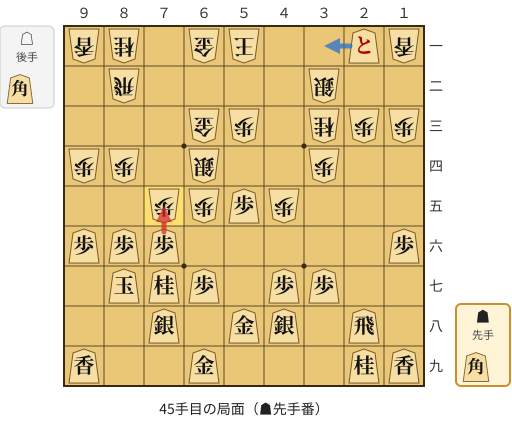

🔴 実戦 ▲同歩(76)　🔵 AI推奨 ▲３一と(21)　🟨 直前の相手の指し手

<details><summary>テキストの盤面図（BOD・将棋ソフトに貼り付け可）</summary>

```text
後手の持駒：角
  ９ ８ ７ ６ ５ ４ ３ ２ １
+---------------------------+
|v香v桂 ・v金v玉 ・ ・ とv香|一
| ・v飛 ・ ・ ・ ・v銀 ・ ・|二
| ・ ・ ・v金v歩 ・v桂v歩v歩|三
|v歩v歩 ・v銀 ・ ・v歩 ・ ・|四
| ・ ・v歩v歩 歩v歩 ・ ・ ・|五
| 歩 歩 歩 ・ ・ ・ ・ ・ 歩|六
| ・ 玉 桂 歩 ・ 歩 歩 ・ ・|七
| ・ ・ 銀 ・ 金 銀 ・ 飛 ・|八
| 香 ・ ・ 金 ・ ・ ・ 桂 香|九
+---------------------------+
先手の持駒：角
手数＝44　△７五歩　まで
```

</details>

| | 指し手 | 評価値 | 読み筋 |
|---|---|--:|---|
| 実戦 | ▲同歩(76) | -132 | △同銀(64) ▲３一と(21) |
| AI 1位 | ▲３一と(21) | +1225 | ▲３一と(21) △７六歩(75) ▲３二と(31) △８五歩(84) ▲同桂(77) △８四歩打 |
| AI 2位 | ▲２二と(21) | +1025 | ▲２二と(21) △４一銀(32) ▲２三飛成(28) △７六歩(75) ▲３一と(22) △５二銀(41) |
| AI 3位 | ▲８八玉(87) | +224 | ▲８八玉(87) △７六歩(75) ▲２二と(21) △７七歩成(76) ▲同玉(88) △４一銀(32) |

SFEN: `ln1gk2+Pl/1r4s2/3gp1npp/pp1s2p2/2ppPp3/PPP5P/1KNP1PP2/2S1GS1R1/L2G3NL b Bb 45`

<a id="ply-47"></a>
### 47手目 ▲同歩(86) — 悪手

| | 着手前 | 着手後 | 差 |
|---|--:|--:|--:|
| 期待勝率 | 41.9% | 27.3% | -14.6pt |
| 評価値 | -196 | -588 | |

着手前の局面:

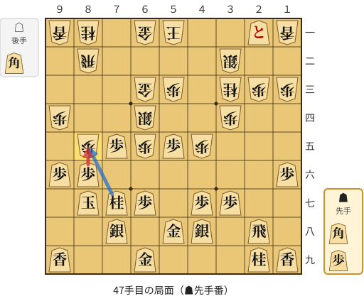

🔴 実戦 ▲同歩(86)　🔵 AI推奨 ▲同桂(77)　🟨 直前の相手の指し手

<details><summary>テキストの盤面図（BOD・将棋ソフトに貼り付け可）</summary>

```text
後手の持駒：角
  ９ ８ ７ ６ ５ ４ ３ ２ １
+---------------------------+
|v香v桂 ・v金v玉 ・ ・ とv香|一
| ・v飛 ・ ・ ・ ・v銀 ・ ・|二
| ・ ・ ・v金v歩 ・v桂v歩v歩|三
|v歩 ・ ・v銀 ・ ・v歩 ・ ・|四
| ・v歩 歩v歩 歩v歩 ・ ・ ・|五
| 歩 歩 ・ ・ ・ ・ ・ ・ 歩|六
| ・ 玉 桂 歩 ・ 歩 歩 ・ ・|七
| ・ ・ 銀 ・ 金 銀 ・ 飛 ・|八
| 香 ・ ・ 金 ・ ・ ・ 桂 香|九
+---------------------------+
先手の持駒：角　歩
手数＝46　△８五歩　まで
```

</details>

| | 指し手 | 評価値 | 読み筋 |
|---|---|--:|---|
| 実戦 | ▲同歩(86) | -588 | △７五銀(64) ▲２二と(21) △７三桂(81) ▲２三と(22) △７六歩打 ▲３二と(23) |
| AI 1位 | ▲同桂(77) | -196 | ▲同桂(77) △７五銀(64) ▲３一と(21) △８四歩打 ▲３二と(31) △８五歩(84) |
| AI 2位 | ▲同歩(86) | -514 | ▲同歩(86) △７五銀(64) ▲２二と(21) △７三桂(81) ▲３二と(22) △７六歩打 |
| AI 3位 | ▲２六飛(28) | -711 | ▲２六飛(28) △７五銀(64) ▲８五桂(77) △７六歩打 ▲７七歩打 △６四角打 |

SFEN: `ln1gk2+Pl/1r4s2/3gp1npp/p2s2p2/1pPpPp3/PP6P/1KNP1PP2/2S1GS1R1/L2G3NL b BPb 47`

<a id="ply-53"></a>
### 53手目 ▲３一と(21) — 疑問手

| | 着手前 | 着手後 | 差 |
|---|--:|--:|--:|
| 期待勝率 | 23.2% | 17.9% | -5.3pt |
| 評価値 | -717 | -912 | |

着手前の局面:

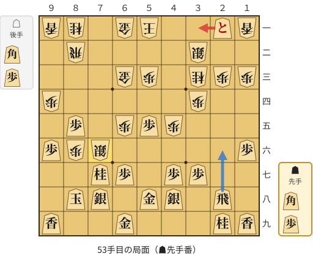

🔴 実戦 ▲３一と(21)　🔵 AI推奨 ▲２六飛(28)　🟨 直前の相手の指し手

<details><summary>テキストの盤面図（BOD・将棋ソフトに貼り付け可）</summary>

```text
後手の持駒：角　歩
  ９ ８ ７ ６ ５ ４ ３ ２ １
+---------------------------+
|v香v桂 ・v金v玉 ・ ・ とv香|一
| ・v飛 ・ ・ ・ ・v銀 ・ ・|二
| ・ ・ ・v金v歩 ・v桂v歩v歩|三
|v歩 ・ ・ ・ ・ ・v歩 ・ ・|四
| ・ 歩 ・v歩 歩v歩 ・ ・ ・|五
| 歩v歩v銀 ・ ・ ・ ・ ・ 歩|六
| ・ ・ 桂 歩 ・ 歩 歩 ・ ・|七
| ・ 玉 銀 ・ 金 銀 ・ 飛 ・|八
| 香 ・ ・ 金 ・ ・ ・ 桂 香|九
+---------------------------+
先手の持駒：角　歩
手数＝52　△７六銀　まで
```

</details>

| | 指し手 | 評価値 | 読み筋 |
|---|---|--:|---|
| 実戦 | ▲３一と(21) | -912 | △７三桂(81) ▲２六飛(28) △７五歩打 ▲８四角打 △４四角打 ▲５六飛(26) |
| AI 1位 | ▲２六飛(28) | -717 | ▲２六飛(28) △７五歩打 ▲８四角打 △７三桂(81) ▲７五角(84) △７七銀不成(76) |
| AI 2位 | ▲３一と(21) | -778 | ▲３一と(21) △７三桂(81) ▲２六飛(28) △７五歩打 ▲８四角打 △４四角打 |
| AI 3位 | ▲２二と(21) | -807 | ▲２二と(21) △７三桂(81) ▲２六飛(28) △７五歩打 ▲３二と(22) △８五桂(73) |

SFEN: `ln1gk2+Pl/1r4s2/3gp1npp/p5p2/1P1pPp3/Pps5P/2NP1PP2/1KS1GS1R1/L2G3NL b BPbp 53`

<a id="ply-75"></a>
### 75手目 ▲７五飛打 — 詰み逃し

| | 着手前 | 着手後 | 差 |
|---|--:|--:|--:|
| 期待勝率 | 100.0% | 100.0% | -0.0pt |
| 評価値 | 11手詰め | +7215 | |

着手前の局面:

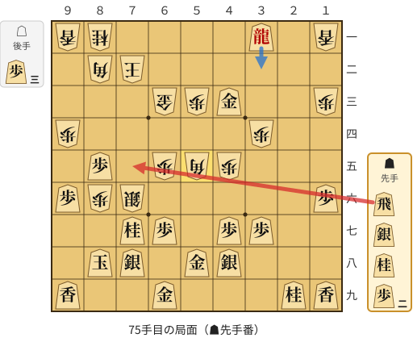

🔴 実戦 ▲７五飛打　🔵 AI推奨 ▲３二龍(31)　🟨 直前の相手の指し手

<details><summary>テキストの盤面図（BOD・将棋ソフトに貼り付け可）</summary>

```text
後手の持駒：歩三
  ９ ８ ７ ６ ５ ４ ３ ２ １
+---------------------------+
|v香v桂 ・ ・ ・ ・ 龍 ・v香|一
| ・v角v玉 ・ ・ ・ ・ ・ ・|二
| ・ ・ ・v金v歩 金 ・ ・v歩|三
|v歩 ・ ・ ・ ・ ・v歩 ・ ・|四
| ・ 歩 ・v歩v角v歩 ・ ・ ・|五
| 歩v歩v銀 ・ ・ ・ ・ ・ 歩|六
| ・ ・ 桂 歩 ・ 歩 歩 ・ ・|七
| ・ 玉 銀 ・ 金 銀 ・ ・ ・|八
| 香 ・ ・ 金 ・ ・ ・ 桂 香|九
+---------------------------+
先手の持駒：飛　銀　桂　歩二
手数＝74　△５五角打　まで
```

</details>

| | 指し手 | 評価値 | 読み筋 |
|---|---|--:|---|
| 実戦 | ▲７五飛打 | +7215 | △７四歩打 ▲７六飛(75) △８七歩成(86) ▲同銀(78) △７一角(82) ▲８四桂打 |
| AI 1位 | ▲３二龍(31) | 11手詰め | ▲３二龍(31) △６二金(63) ▲同龍(32) △同玉(72) ▲５二飛打 △７三玉(62) |
| AI 2位 | ▲４二龍(31) | 11手詰め | ▲４二龍(31) △６二金(63) ▲同龍(42) △同玉(72) ▲５二飛打 △７三玉(62) |
| AI 3位 | ▲３二飛打 | 13手詰め | ▲３二飛打 △８三玉(72) ▲７五桂打 △７三玉(83) ▲８二飛成(32) △６四玉(73) |

SFEN: `ln4+R1l/1bk6/3gpG2p/p5p2/1P1pbp3/Pps5P/2NP1PP2/1KS1GS3/L2G3NL b RSN2P3p 75`

