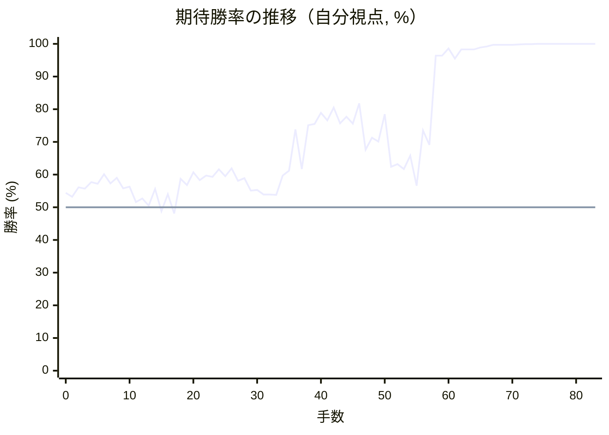

# 解析レポート kv3t4symgjyl

[README に戻る](../../../README.md)　/　棋譜: [CSA](../../../data/csa/shogi5/kv3t4symgjyl.csa)　/　解析の見方: [docs/mistake_analysis.md](../../../docs/mistake_analysis.md)

## 対局情報

| 項目 | 内容 |
|---|---|
| 日時 | 2026-10-29 19:08:57 |
| 持ち時間 | 5分 |
| 自分 | 先手（▲）（1728） |
| 相手 | 相手（1647） |
| 結果 | 勝ち（投了, 83手） |

## 解析環境

| 項目 | 内容 |
|---|---|
| エンジン | YaneuraOu NNUE 9.00git 64AVX2（V9.00/YANEURAOU_ENGINE_NNUE/AVX2） |
| 評価関数 | **水匠5**（`suisho5`） |
| nn.bin SHA-256 | `768068f0d534a0603a5d38bcd143de6bbca820d5f1c95a14d40863e5b7892d76` |
| 第1パス | movetime=150ms, MultiPV 1 |
| 第2パス | movetime=2000ms, MultiPV 3 |
| Threads / Hash | 8 / 512MB |
| 判定基準 | 疑問手 ≥5pt, 悪手 ≥10pt, 大悪手 ≥20pt（期待勝率 W(E)=1/(1+exp(-E/600))） |
| 解析日時 | 2026-11-03T04:19:04+09:00（解析バージョン 1, 36秒） |

## サマリー

| 自分の手数 | 深掘りした手 | 詰み逃し | 大悪手 | 悪手 | 疑問手 |
|--:|--:|--:|--:|--:|--:|
| 42 | 6 | 0 | 0 | 3 | 2 |

## 期待勝率の推移



<details><summary>1手ごとの数値（第1パス）</summary>

| 手数 | 指し手 | 評価値 | 勝率 | 低下 | 判定 |
|--:|---|--:|--:|--:|---|
| 1 | ▲７六歩(77) | +77 | 53.2% | +1.2pt |  |
| 2 | △３四歩(33) | +146 | 56.1% |  |  |
| 3 | ▲２六歩(27) | +137 | 55.7% | +0.4pt |  |
| 4 | △３二金(41) | +186 | 57.7% |  |  |
| 5 | ▲２五歩(26) | +173 | 57.2% | +0.5pt |  |
| 6 | △８八角成(22) | +245 | 60.1% |  |  |
| 7 | ▲同銀(79) | +176 | 57.3% | +2.8pt |  |
| 8 | △２二銀(31) | +218 | 59.0% |  |  |
| 9 | ▲７七銀(88) | +141 | 55.8% | +3.1pt |  |
| 10 | △３三銀(22) | +152 | 56.3% |  |  |
| 11 | ▲７八金(69) | +38 | 51.6% | +4.7pt |  |
| 12 | △６二銀(71) | +66 | 52.7% |  |  |
| 13 | ▲４八銀(39) | +12 | 50.5% | +2.2pt |  |
| 14 | △４二玉(51) | +135 | 55.6% |  |  |
| 15 | ▲４六歩(47) | -28 | 48.8% | +6.8pt | [疑問手](#ply-15) |
| 16 | △７四歩(73) | +97 | 54.0% |  |  |
| 17 | ▲４七銀(48) | -46 | 48.1% | +5.9pt |  |
| 18 | △７三銀(62) | +210 | 58.7% |  |  |
| 19 | ▲６八玉(59) | +164 | 56.8% | +1.9pt |  |
| 20 | △６四銀(73) | +261 | 60.7% |  |  |
| 21 | ▲６六歩(67) | +201 | 58.3% | +2.4pt |  |
| 22 | △８四歩(83) | +236 | 59.7% |  |  |
| 23 | ▲５六銀(47) | +226 | 59.3% | +0.4pt |  |
| 24 | △５四歩(53) | +283 | 61.6% |  |  |
| 25 | ▲５八金(49) | +231 | 59.5% | +2.1pt |  |
| 26 | △７三桂(81) | +290 | 61.9% |  |  |
| 27 | ▲７九玉(68) | +196 | 58.1% | +3.8pt |  |
| 28 | △８一飛(82) | +215 | 58.9% |  |  |
| 29 | ▲３六歩(37) | +122 | 55.1% | +3.8pt |  |
| 30 | △６二金(61) | +127 | 55.3% |  |  |
| 31 | ▲１六歩(17) | +94 | 53.9% | +1.4pt |  |
| 32 | △１四歩(13) | +94 | 53.9% |  |  |
| 33 | ▲３七桂(29) | +91 | 53.8% | +0.1pt |  |
| 34 | △８五歩(84) | +236 | 59.7% |  |  |
| 35 | ▲９六歩(97) | +273 | 61.2% | -1.5pt |  |
| 36 | △７五歩(74) | +621 | 73.8% |  |  |
| 37 | ▲６七銀(56) | +286 | 61.7% | +12.1pt | [悪手](#ply-37) |
| 38 | △８六歩(85) | +662 | 75.1% |  |  |
| 39 | ▲同銀(77) | +675 | 75.5% | -0.4pt |  |
| 40 | △３五歩(34) | +790 | 78.9% |  |  |
| 41 | ▲同歩(36) | +712 | 76.6% | +2.2pt |  |
| 42 | △７六歩(75) | +851 | 80.5% |  |  |
| 43 | ▲４五桂(37) | +683 | 75.7% | +4.8pt |  |
| 44 | △３七角打 | +750 | 77.7% |  |  |
| 45 | ▲３三桂成(45) | +680 | 75.6% | +2.1pt |  |
| 46 | △同桂(21) | +900 | 81.8% |  |  |
| 47 | ▲１八飛(28) | +440 | 67.6% | +14.2pt | [悪手](#ply-47) |
| 48 | △４六角成(37) | +545 | 71.3% |  |  |
| 49 | ▲３四歩(35) | +511 | 70.1% | +1.2pt |  |
| 50 | △２五桂(33) | +777 | 78.5% |  |  |
| 51 | ▲３三銀打 | +305 | 62.4% | +16.1pt | [疑問手](#ply-51) |
| 52 | △同金(32) | +324 | 63.2% |  |  |
| 53 | ▲同歩成(34) | +285 | 61.7% | +1.5pt |  |
| 54 | △同玉(42) | +392 | 65.8% |  |  |
| 55 | ▲７四歩打 | +160 | 56.6% | +9.1pt | [悪手](#ply-55) |
| 56 | △８五桂(73) | +612 | 73.5% |  |  |
| 57 | ▲同銀(86) | +483 | 69.1% | +4.4pt |  |
| 58 | △同飛(81) | +1975 | 96.4% |  |  |
| 59 | ▲５一角打 | +1981 | 96.4% | -0.0pt |  |
| 60 | △４二銀打 | +2573 | 98.6% |  |  |
| 61 | ▲６二角成(51) | +1836 | 95.5% | +3.1pt |  |
| 62 | △７七桂打 | +2437 | 98.3% |  |  |
| 63 | ▲７六銀(67) | +2426 | 98.3% | +0.0pt |  |
| 64 | △８九桂成(77) | +2428 | 98.3% |  |  |
| 65 | ▲同玉(79) | +2685 | 98.9% | -0.6pt |  |
| 66 | △３五飛(85) | +2917 | 99.2% |  |  |
| 67 | ▲同馬(62) | +3502 | 99.7% | -0.5pt |  |
| 68 | △同馬(46) | +3406 | 99.7% |  |  |
| 69 | ▲４七桂打 | +3421 | 99.7% | -0.0pt |  |
| 70 | △４五馬(35) | +3445 | 99.7% |  |  |
| 71 | ▲３五金打 | +3627 | 99.8% | -0.1pt |  |
| 72 | △７七桂打 | +4170 | 99.9% |  |  |
| 73 | ▲８八玉(89) | +4375 | 99.9% | -0.0pt |  |
| 74 | △１八馬(45) | +5455 | 100.0% |  |  |
| 75 | ▲３四飛打 | +5234 | 100.0% | +0.0pt |  |
| 76 | △２二玉(33) | +6032 | 100.0% |  |  |
| 77 | ▲３二金打 | +6055 | 100.0% | -0.0pt |  |
| 78 | △１三玉(22) | +6552 | 100.0% |  |  |
| 79 | ▲１八香(19) | +6182 | 100.0% | +0.0pt |  |
| 80 | △８九飛打 | +7471 | 100.0% |  |  |
| 81 | ▲７七玉(88) | +7732 | 100.0% | -0.0pt |  |
| 82 | △７五歩打 | #+5 | 100.0% |  |  |
| 83 | ▲２二角打 | #+4 | 100.0% | +0.0pt |  |

</details>

## 課題局面

<a id="ply-15"></a>
### 15手目 ▲４六歩(47) — 疑問手

| | 着手前 | 着手後 | 差 |
|---|--:|--:|--:|
| 期待勝率 | 57.6% | 50.9% | -6.7pt |
| 評価値 | +184 | +22 | |

着手前の局面:

```text
後手の持駒：角
  ９ ８ ７ ６ ５ ４ ３ ２ １
+---------------------------+
|v香v桂 ・v金 ・ ・ ・v桂v香|一
| ・v飛 ・v銀 ・v玉v金 ・ ・|二
|v歩v歩v歩v歩v歩v歩v銀v歩v歩|三
| ・ ・ ・ ・ ・ ・v歩 ・ ・|四
| ・ ・ ・ ・ ・ ・ ・ 歩 ・|五
| ・ ・ 歩 ・ ・ ・ ・ ・ ・|六
| 歩 歩 銀 歩 歩 歩 歩 ・ 歩|七
| ・ ・ 金 ・ ・ 銀 ・ 飛 ・|八
| 香 桂 ・ ・ 玉 金 ・ 桂 香|九
+---------------------------+
先手の持駒：角
手数＝14　△４二玉　まで
```

| | 指し手 | 評価値 | 読み筋 |
|---|---|--:|---|
| 実戦 | ▲４六歩(47) | +22 | △９四歩(93) ▲９六歩(97) △６四歩(63) ▲１六歩(17) △１四歩(13) ▲６八玉(59) |
| AI 1位 | ▲３六歩(37) | +184 | ▲３六歩(37) △６四歩(63) ▲１六歩(17) △１四歩(13) ▲３七銀(48) △６三銀(62) |
| AI 2位 | ▲１六歩(17) | +214 | ▲１六歩(17) △９四歩(93) ▲９六歩(97) △１四歩(13) ▲３六歩(37) △６四歩(63) |
| AI 3位 | ▲９六歩(97) | +180 | ▲９六歩(97) △９四歩(93) ▲３六歩(37) △６四歩(63) ▲１六歩(17) △１四歩(13) |

SFEN: `ln1g3nl/1r1s1kg2/ppppppspp/6p2/7P1/2P6/PPSPPPP1P/2G2S1R1/LN2KG1NL b Bb 15`

<a id="ply-37"></a>
### 37手目 ▲６七銀(56) — 悪手

| | 着手前 | 着手後 | 差 |
|---|--:|--:|--:|
| 期待勝率 | 75.6% | 63.1% | -12.5pt |
| 評価値 | +677 | +321 | |

着手前の局面:

```text
後手の持駒：角
  ９ ８ ７ ６ ５ ４ ３ ２ １
+---------------------------+
|v香v飛 ・ ・ ・ ・ ・v桂v香|一
| ・ ・ ・v金 ・v玉v金 ・ ・|二
|v歩 ・v桂v歩 ・v歩v銀v歩 ・|三
| ・ ・ ・v銀v歩 ・v歩 ・v歩|四
| ・v歩v歩 ・ ・ ・ ・ 歩 ・|五
| 歩 ・ 歩 歩 銀 歩 歩 ・ 歩|六
| ・ 歩 銀 ・ 歩 ・ 桂 ・ ・|七
| ・ ・ 金 ・ 金 ・ ・ 飛 ・|八
| 香 桂 玉 ・ ・ ・ ・ ・ 香|九
+---------------------------+
先手の持駒：角
手数＝36　△７五歩　まで
```

| | 指し手 | 評価値 | 読み筋 |
|---|---|--:|---|
| 実戦 | ▲６七銀(56) | +321 | △７六歩(75) ▲同銀(67) △７四歩打 ▲９五歩(96) △４四銀(33) ▲４七金(58) |
| AI 1位 | ▲同歩(76) | +677 | ▲同歩(76) △同銀(64) ▲７四歩打 △７六歩打 ▲８八銀(77) △６六銀(75) |
| AI 2位 | ▲２四歩(25) | +604 | ▲２四歩(25) △同歩(23) ▲７五歩(76) △同銀(64) ▲７四歩打 △７六歩打 |
| AI 3位 | ▲２六角打 | +514 | ▲２六角打 △６一金(62) ▲７五歩(76) △８四飛(81) ▲７六銀(77) △３一玉(42) |

SFEN: `lr5nl/3g1kg2/p1np1psp1/3sp1p1p/1pp4P1/P1PPSPP1P/1PS1P1N2/2G1G2R1/LNK5L b Bb 37`

<a id="ply-47"></a>
### 47手目 ▲１八飛(28) — 悪手

| | 着手前 | 着手後 | 差 |
|---|--:|--:|--:|
| 期待勝率 | 81.2% | 66.9% | -14.3pt |
| 評価値 | +878 | +421 | |

着手前の局面:

```text
後手の持駒：桂　歩
  ９ ８ ７ ６ ５ ４ ３ ２ １
+---------------------------+
|v香v飛 ・ ・ ・ ・ ・ ・v香|一
| ・ ・ ・v金 ・v玉v金 ・ ・|二
|v歩 ・v桂v歩 ・v歩v桂v歩 ・|三
| ・ ・ ・v銀v歩 ・ ・ ・v歩|四
| ・ ・ ・ ・ ・ ・ 歩 歩 ・|五
| 歩 銀v歩 歩 ・ 歩 ・ ・ 歩|六
| ・ 歩 ・ 銀 歩 ・v角 ・ ・|七
| ・ ・ 金 ・ 金 ・ ・ 飛 ・|八
| 香 桂 玉 ・ ・ ・ ・ ・ 香|九
+---------------------------+
先手の持駒：角　銀　歩二
手数＝46　△３三同桂　まで
```

| | 指し手 | 評価値 | 読み筋 |
|---|---|--:|---|
| 実戦 | ▲１八飛(28) | +421 | △２六桂打 ▲１七飛(18) △４六角成(37) ▲７四歩打 △２五桂(33) ▲７三歩成(74) |
| AI 1位 | ▲２九飛(28) | +878 | ▲２九飛(28) △８五歩打 ▲９七銀(86) △４六角成(37) ▲２四歩(25) △同歩(23) |
| AI 2位 | ▲３八飛(28) | +693 | ▲３八飛(28) △１九角成(37) ▲３四歩(35) △３七歩打 ▲４八飛(38) △２九馬(19) |
| AI 3位 | ▲２七飛(28) | +510 | ▲２七飛(28) △１九角成(37) ▲７四歩打 △１八馬(19) ▲７三歩成(74) △同銀(64) |

SFEN: `lr6l/3g1kg2/p1np1pnp1/3sp3p/6PP1/PSpP1P2P/1P1SP1b2/2G1G2R1/LNK5L b BS2Pnp 47`

<a id="ply-51"></a>
### 51手目 ▲３三銀打 — 疑問手

| | 着手前 | 着手後 | 差 |
|---|--:|--:|--:|
| 期待勝率 | 80.6% | 72.1% | -8.5pt |
| 評価値 | +855 | +570 | |

着手前の局面:

```text
後手の持駒：桂　歩三
  ９ ８ ７ ６ ５ ４ ３ ２ １
+---------------------------+
|v香v飛 ・ ・ ・ ・ ・ ・v香|一
| ・ ・ ・v金 ・v玉v金 ・ ・|二
|v歩 ・v桂v歩 ・v歩 ・v歩 ・|三
| ・ ・ ・v銀v歩 ・ 歩 ・v歩|四
| ・ ・ ・ ・ ・ ・ ・v桂 ・|五
| 歩 銀v歩 歩 ・v馬 ・ ・ 歩|六
| ・ 歩 ・ 銀 歩 ・ ・ ・ ・|七
| ・ ・ 金 ・ 金 ・ ・ ・ 飛|八
| 香 桂 玉 ・ ・ ・ ・ ・ 香|九
+---------------------------+
先手の持駒：角　銀　歩二
手数＝50　△２五桂　まで
```

| | 指し手 | 評価値 | 読み筋 |
|---|---|--:|---|
| 実戦 | ▲３三銀打 | +570 | △同金(32) ▲同歩成(34) △同玉(42) ▲４八飛(18) △２四馬(46) ▲３四歩打 |
| AI 1位 | ▲７四歩打 | +855 | ▲７四歩打 △３五馬(46) ▲７三歩成(74) △同銀(64) ▲７六銀(67) △３七桂成(25) |
| AI 2位 | ▲４八飛(18) | +651 | ▲４八飛(18) △２四馬(46) ▲２六角打 △３五歩打 ▲４六銀打 △５二玉(42) |
| AI 3位 | ▲７六銀(67) | +534 | ▲７六銀(67) △７四桂打 ▲３三銀打 △同金(32) ▲同歩成(34) △同玉(42) |

SFEN: `lr6l/3g1kg2/p1np1p1p1/3sp1P1p/7n1/PSpP1+b2P/1P1SP4/2G1G3R/LNK5L b BS2Pn3p 51`

<a id="ply-55"></a>
### 55手目 ▲７四歩打 — 悪手

| | 着手前 | 着手後 | 差 |
|---|--:|--:|--:|
| 期待勝率 | 73.0% | 59.8% | -13.2pt |
| 評価値 | +596 | +238 | |

着手前の局面:

```text
後手の持駒：銀　桂　歩四
  ９ ８ ７ ６ ５ ４ ３ ２ １
+---------------------------+
|v香v飛 ・ ・ ・ ・ ・ ・v香|一
| ・ ・ ・v金 ・ ・ ・ ・ ・|二
|v歩 ・v桂v歩 ・v歩v玉v歩 ・|三
| ・ ・ ・v銀v歩 ・ ・ ・v歩|四
| ・ ・ ・ ・ ・ ・ ・v桂 ・|五
| 歩 銀v歩 歩 ・v馬 ・ ・ 歩|六
| ・ 歩 ・ 銀 歩 ・ ・ ・ ・|七
| ・ ・ 金 ・ 金 ・ ・ ・ 飛|八
| 香 桂 玉 ・ ・ ・ ・ ・ 香|九
+---------------------------+
先手の持駒：角　金　歩二
手数＝54　△３三同玉　まで
```

| | 指し手 | 評価値 | 読み筋 |
|---|---|--:|---|
| 実戦 | ▲７四歩打 | +238 | △３七桂成(25) ▲７三歩成(74) △同銀(64) ▲８八玉(79) △３五馬(46) ▲１五歩(16) |
| AI 1位 | ▲４八飛(18) | +596 | ▲４八飛(18) △３五馬(46) ▲４六角打 △４四馬(35) ▲３五金打 △３四歩打 |
| AI 2位 | ▲３四歩打 | +294 | ▲３四歩打 △同玉(33) ▲４八飛(18) △３五銀打 ▲３六歩打 △同馬(46) |
| AI 3位 | ▲７四歩打 | +271 | ▲７四歩打 △８五歩打 ▲９五銀(86) △３七桂成(25) ▲８四銀(95) △２七銀打 |

SFEN: `lr6l/3g5/p1np1pkp1/3sp3p/7n1/PSpP1+b2P/1P1SP4/2G1G3R/LNK5L b BG2Psn4p 55`

