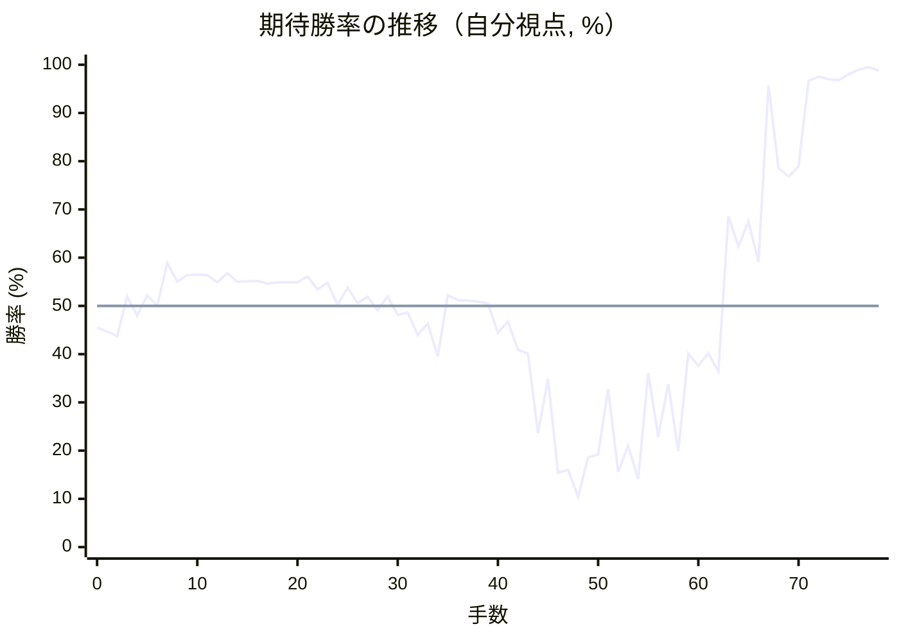

# 解析レポート lcfsldgp37mt

[README に戻る](../../../README.md)　/　棋譜: [CSA](../../../data/csa/shogi5/lcfsldgp37mt.csa)　/　解析の見方: [docs/mistake_analysis.md](../../../docs/mistake_analysis.md)

## 対局情報

| 項目 | 内容 |
|---|---|
| 日時 | 2026-10-31 17:39:04 |
| 持ち時間 | 5分 |
| 自分 | 後手（△）（1719） |
| 相手 | 相手（1507） |
| 結果 | 勝ち（時間切れ, 78手） |

## 解析環境

| 項目 | 内容 |
|---|---|
| エンジン | YaneuraOu NNUE 9.00git 64AVX2（V9.00/YANEURAOU_ENGINE_NNUE/AVX2） |
| 評価関数 | **水匠5**（`suisho5`） |
| nn.bin SHA-256 | `768068f0d534a0603a5d38bcd143de6bbca820d5f1c95a14d40863e5b7892d76` |
| 第1パス | movetime=150ms, MultiPV 1 |
| 第2パス | movetime=2000ms, MultiPV 3 |
| Threads / Hash | 8 / 512MB |
| 判定基準 | 疑問手 ≥5pt, 悪手 ≥10pt, 大悪手 ≥20pt（期待勝率 W(E)=1/(1+exp(-E/600))） |
| 解析日時 | 2026-11-03T04:06:22+09:00（解析バージョン 1, 52秒） |

## サマリー

| 自分の手数 | 深掘りした手 | 詰み逃し | 大悪手 | 悪手 | 疑問手 |
|--:|--:|--:|--:|--:|--:|
| 39 | 10 | 0 | 1 | 5 | 3 |

## 期待勝率の推移



<details><summary>1手ごとの数値（第1パス）</summary>

| 手数 | 指し手 | 評価値 | 勝率 | 低下 | 判定 |
|--:|---|--:|--:|--:|---|
| 1 | ▲７六歩(77) | -128 | 44.7% |  |  |
| 2 | △８四歩(83) | -151 | 43.7% | +0.9pt |  |
| 3 | ▲６六歩(67) | +47 | 52.0% |  |  |
| 4 | △３四歩(33) | -47 | 48.0% | +3.9pt |  |
| 5 | ▲７八銀(79) | +52 | 52.2% |  |  |
| 6 | △６二銀(71) | -1 | 50.0% | +2.2pt |  |
| 7 | ▲６八飛(28) | +217 | 58.9% |  |  |
| 8 | △５四歩(53) | +121 | 55.0% | +3.9pt |  |
| 9 | ▲４八玉(59) | +154 | 56.4% |  |  |
| 10 | △４二玉(51) | +156 | 56.5% | -0.1pt |  |
| 11 | ▲３八銀(39) | +155 | 56.4% |  |  |
| 12 | △３二玉(42) | +117 | 54.9% | +1.6pt |  |
| 13 | ▲３九玉(48) | +165 | 56.8% |  |  |
| 14 | △１四歩(13) | +121 | 55.0% | +1.8pt |  |
| 15 | ▲１六歩(17) | +122 | 55.1% |  |  |
| 16 | △８五歩(84) | +126 | 55.2% | -0.2pt |  |
| 17 | ▲７七角(88) | +110 | 54.6% |  |  |
| 18 | △５三銀(62) | +117 | 54.9% | -0.3pt |  |
| 19 | ▲５八金(69) | +117 | 54.9% |  |  |
| 20 | △５二金(61) | +118 | 54.9% | -0.0pt |  |
| 21 | ▲４六歩(47) | +148 | 56.1% |  |  |
| 22 | △２四歩(23) | +82 | 53.4% | +2.7pt |  |
| 23 | ▲３六歩(37) | +115 | 54.8% |  |  |
| 24 | △２三玉(32) | +4 | 50.2% | +4.6pt |  |
| 25 | ▲３七桂(29) | +92 | 53.8% |  |  |
| 26 | △３二銀(31) | +15 | 50.6% | +3.2pt |  |
| 27 | ▲４七金(58) | +46 | 51.9% |  |  |
| 28 | △９四歩(93) | -22 | 49.1% | +2.8pt |  |
| 29 | ▲６七銀(78) | +48 | 52.0% |  |  |
| 30 | △７四歩(73) | -46 | 48.1% | +3.9pt |  |
| 31 | ▲２六歩(27) | -34 | 48.6% |  |  |
| 32 | △４四銀(53) | -144 | 44.0% | +4.6pt |  |
| 33 | ▲５六銀(67) | -90 | 46.3% |  |  |
| 34 | △３一角(22) | -256 | 39.5% | +6.8pt | [悪手](#ply-34) |
| 35 | ▲９六歩(97) | +54 | 52.2% |  |  |
| 36 | △７五歩(74) | +30 | 51.2% | +1.0pt |  |
| 37 | ▲同歩(76) | +26 | 51.1% |  |  |
| 38 | △同角(31) | +21 | 50.9% | +0.2pt |  |
| 39 | ▲７六歩打 | +11 | 50.5% |  |  |
| 40 | △４二角(75) | -136 | 44.4% | +6.1pt |  |
| 41 | ▲６五歩(66) | -78 | 46.8% |  |  |
| 42 | △８六歩(85) | -221 | 40.9% | +5.9pt | [疑問手](#ply-42) |
| 43 | ▲同歩(87) | -242 | 40.1% |  |  |
| 44 | △８七歩打 | -705 | 23.6% | +16.5pt | [悪手](#ply-44) |
| 45 | ▲４五銀(56) | -374 | 34.9% |  |  |
| 46 | △３三銀(44) | -1021 | 15.4% | +19.5pt | [大悪手](#ply-46) |
| 47 | ▲２五歩(26) | -997 | 16.0% |  |  |
| 48 | △８六角(42) | -1291 | 10.4% | +5.5pt |  |
| 49 | ▲同角(77) | -887 | 18.6% |  |  |
| 50 | △同飛(82) | -863 | 19.2% | -0.6pt |  |
| 51 | ▲７七角打 | -431 | 32.8% |  |  |
| 52 | △７六飛(86) | -1014 | 15.6% | +17.2pt |  |
| 53 | ▲２四歩(25) | -795 | 21.0% |  |  |
| 54 | △同玉(23) | -1084 | 14.1% | +6.9pt | [悪手](#ply-54) |
| 55 | ▲２五歩打 | -342 | 36.1% |  |  |
| 56 | △２三玉(24) | -730 | 22.9% | +13.3pt |  |
| 57 | ▲６四歩(65) | -402 | 33.8% |  |  |
| 58 | △同歩(63) | -835 | 19.9% | +13.9pt | [疑問手](#ply-58) |
| 59 | ▲同飛(68) | -242 | 40.1% |  |  |
| 60 | △２七歩打 | -305 | 37.6% | +2.5pt |  |
| 61 | ▲同銀(38) | -238 | 40.2% |  |  |
| 62 | △８八歩成(87) | -336 | 36.4% | +3.9pt |  |
| 63 | ▲３八金(49) | +468 | 68.6% |  |  |
| 64 | △８九と(88) | +301 | 62.3% | +6.3pt | [悪手](#ply-64) |
| 65 | ▲２四歩(25) | +438 | 67.5% |  |  |
| 66 | △同玉(23) | +222 | 59.1% | +8.3pt | [疑問手](#ply-66) |
| 67 | ▲３三角成(77) | +1878 | 95.8% |  |  |
| 68 | △同桂(21) | +781 | 78.6% | +17.2pt | [悪手](#ply-68) |
| 69 | ▲２五歩打 | +718 | 76.8% |  |  |
| 70 | △２三玉(24) | +792 | 78.9% | -2.1pt |  |
| 71 | ▲５四飛(64) | +2028 | 96.7% |  |  |
| 72 | △７九飛成(76) | +2195 | 97.5% | -0.8pt |  |
| 73 | ▲２八玉(39) | +2086 | 97.0% |  |  |
| 74 | △２六歩打 | +2045 | 96.8% | +0.2pt |  |
| 75 | ▲３四銀(45) | +2341 | 98.0% |  |  |
| 76 | △２二玉(23) | +2728 | 99.0% | -0.9pt |  |
| 77 | ▲２六銀(27) | +3217 | 99.5% |  |  |
| 78 | △２七歩打 | +2655 | 98.8% | +0.7pt |  |

</details>

## 課題局面

<a id="ply-34"></a>
### 34手目 △３一角(22) — 悪手

| | 着手前 | 着手後 | 差 |
|---|--:|--:|--:|
| 期待勝率 | 47.0% | 33.8% | -13.2pt |
| 評価値 | -71 | -403 | |

着手前の局面:

```text
後手の持駒：なし
  ９ ８ ７ ６ ５ ４ ３ ２ １
+---------------------------+
|v香v桂 ・ ・ ・v金 ・v桂v香|一
| ・v飛 ・ ・v金 ・v銀v角 ・|二
| ・ ・ ・v歩 ・v歩 ・v玉 ・|三
|v歩 ・v歩 ・v歩v銀v歩v歩v歩|四
| ・v歩 ・ ・ ・ ・ ・ ・ ・|五
| ・ ・ 歩 歩 銀 歩 歩 歩 歩|六
| 歩 歩 角 ・ 歩 金 桂 ・ ・|七
| ・ ・ ・ 飛 ・ ・ 銀 ・ ・|八
| 香 桂 ・ ・ ・ 金 玉 ・ 香|九
+---------------------------+
先手の持駒：なし
後手番
手数＝33　▲５六銀　まで
```

| | 指し手 | 評価値 | 読み筋 |
|---|---|--:|---|
| 実戦 | △３一角(22) | -403 | ▲６五歩(66) △８六歩(85) ▲同歩(87) △７五歩(74) ▲同歩(76) △同角(31) |
| AI 1位 | △５五歩(54) | -71 | △５五歩(54) ▲６七銀(56) △３三桂(21) ▲６五歩(66) △５三金(52) ▲２八玉(39) |
| AI 2位 | △５五銀(44) | -82 | △５五銀(44) ▲６七銀(56) △３一角(22) ▲５六歩(57) △４四銀(55) ▲８八飛(68) |
| AI 3位 | △５三銀(44) | -164 | △５三銀(44) ▲２七銀(38) △５五歩(54) ▲６七銀(56) △３一角(22) ▲５六歩(57) |

SFEN: `ln3g1nl/1r2g1sb1/3p1p1k1/p1p1psppp/1p7/2PPSPPPP/PPB1PGN2/3R2S2/LN3GK1L w - 34`

<a id="ply-42"></a>
### 42手目 △８六歩(85) — 疑問手

| | 着手前 | 着手後 | 差 |
|---|--:|--:|--:|
| 期待勝率 | 46.6% | 38.4% | -8.2pt |
| 評価値 | -82 | -283 | |

着手前の局面:

```text
後手の持駒：歩
  ９ ８ ７ ６ ５ ４ ３ ２ １
+---------------------------+
|v香v桂 ・ ・ ・v金 ・v桂v香|一
| ・v飛 ・ ・v金v角v銀 ・ ・|二
| ・ ・ ・v歩 ・v歩 ・v玉 ・|三
|v歩 ・ ・ ・v歩v銀v歩v歩v歩|四
| ・v歩 ・ 歩 ・ ・ ・ ・ ・|五
| 歩 ・ 歩 ・ 銀 歩 歩 歩 歩|六
| ・ 歩 角 ・ 歩 金 桂 ・ ・|七
| ・ ・ ・ 飛 ・ ・ 銀 ・ ・|八
| 香 桂 ・ ・ ・ 金 玉 ・ 香|九
+---------------------------+
先手の持駒：なし
後手番
手数＝41　▲６五歩　まで
```

| | 指し手 | 評価値 | 読み筋 |
|---|---|--:|---|
| 実戦 | △８六歩(85) | -283 | ▲同歩(87) △５五歩(54) ▲４五銀(56) △７三桂(81) ▲２五歩(26) △同歩(24) |
| AI 1位 | △７二飛(82) | -82 | △７二飛(82) ▲２五歩(26) △同歩(24) ▲４五歩(46) △３三銀(44) ▲２五桂(37) |
| AI 2位 | △８六歩(85) | -255 | △８六歩(85) ▲同歩(87) △５五歩(54) ▲４五銀(56) △７三桂(81) ▲４四銀(45) |
| AI 3位 | △３一金(41) | -301 | △３一金(41) ▲２五歩(26) △同歩(24) ▲同桂(37) △２四歩打 ▲４五歩(46) |

SFEN: `ln3g1nl/1r2gbs2/3p1p1k1/p3psppp/1p1P5/P1P1SPPPP/1PB1PGN2/3R2S2/LN3GK1L w p 42`

<a id="ply-44"></a>
### 44手目 △８七歩打 — 悪手

| | 着手前 | 着手後 | 差 |
|---|--:|--:|--:|
| 期待勝率 | 37.3% | 17.6% | -19.7pt |
| 評価値 | -312 | -925 | |

着手前の局面:

```text
後手の持駒：歩
  ９ ８ ７ ６ ５ ４ ３ ２ １
+---------------------------+
|v香v桂 ・ ・ ・v金 ・v桂v香|一
| ・v飛 ・ ・v金v角v銀 ・ ・|二
| ・ ・ ・v歩 ・v歩 ・v玉 ・|三
|v歩 ・ ・ ・v歩v銀v歩v歩v歩|四
| ・ ・ ・ 歩 ・ ・ ・ ・ ・|五
| 歩 歩 歩 ・ 銀 歩 歩 歩 歩|六
| ・ ・ 角 ・ 歩 金 桂 ・ ・|七
| ・ ・ ・ 飛 ・ ・ 銀 ・ ・|八
| 香 桂 ・ ・ ・ 金 玉 ・ 香|九
+---------------------------+
先手の持駒：歩
後手番
手数＝43　▲８六同歩　まで
```

| | 指し手 | 評価値 | 読み筋 |
|---|---|--:|---|
| 実戦 | △８七歩打 | -925 | ▲２五歩(26) △同歩(24) ▲同桂(37) △３一金(41) ▲４五歩(46) △３三銀(44) |
| AI 1位 | △７二飛(82) | -312 | △７二飛(82) ▲６四歩(65) △同歩(63) ▲２五歩(26) △同歩(24) ▲４五歩(46) |
| AI 2位 | △５五歩(54) | -348 | △５五歩(54) ▲４五銀(56) △７三桂(81) ▲２五歩(26) △同歩(24) ▲２二歩打 |
| AI 3位 | △７五歩打 | -417 | △７五歩打 ▲同歩(76) △同角(42) ▲７六歩打 △８六角(75) ▲８八飛(68) |

SFEN: `ln3g1nl/1r2gbs2/3p1p1k1/p3psppp/3P5/PPP1SPPPP/2B1PGN2/3R2S2/LN3GK1L w Pp 44`

<a id="ply-46"></a>
### 46手目 △３三銀(44) — 大悪手

| | 着手前 | 着手後 | 差 |
|---|--:|--:|--:|
| 期待勝率 | 33.1% | 11.2% | -21.9pt |
| 評価値 | -422 | -1243 | |

着手前の局面:

```text
後手の持駒：なし
  ９ ８ ７ ６ ５ ４ ３ ２ １
+---------------------------+
|v香v桂 ・ ・ ・v金 ・v桂v香|一
| ・v飛 ・ ・v金v角v銀 ・ ・|二
| ・ ・ ・v歩 ・v歩 ・v玉 ・|三
|v歩 ・ ・ ・v歩v銀v歩v歩v歩|四
| ・ ・ ・ 歩 ・ 銀 ・ ・ ・|五
| 歩 歩 歩 ・ ・ 歩 歩 歩 歩|六
| ・v歩 角 ・ 歩 金 桂 ・ ・|七
| ・ ・ ・ 飛 ・ ・ 銀 ・ ・|八
| 香 桂 ・ ・ ・ 金 玉 ・ 香|九
+---------------------------+
先手の持駒：歩
後手番
手数＝45　▲４五銀　まで
```

| | 指し手 | 評価値 | 読み筋 |
|---|---|--:|---|
| 実戦 | △３三銀(44) | -1243 | ▲２五歩(26) △４四歩(43) ▲同銀(45) △２五歩(24) ▲６四歩(65) △同歩(63) |
| AI 1位 | △７二飛(82) | -422 | △７二飛(82) ▲４四銀(45) △同歩(43) ▲２五歩(26) △同歩(24) ▲４四角(77) |
| AI 2位 | △８八歩成(87) | -460 | △８八歩成(87) ▲同飛(68) △７二飛(82) ▲２五歩(26) △同歩(24) ▲７八飛(88) |
| AI 3位 | △５三金(52) | -645 | △５三金(52) ▲４四銀(45) △同歩(43) ▲４五歩(46) △８八歩成(87) ▲同飛(68) |

SFEN: `ln3g1nl/1r2gbs2/3p1p1k1/p3psppp/3P1S3/PPP2PPPP/1pB1PGN2/3R2S2/LN3GK1L w P 46`

<a id="ply-54"></a>
### 54手目 △同玉(23) — 悪手

| | 着手前 | 着手後 | 差 |
|---|--:|--:|--:|
| 期待勝率 | 23.3% | 9.3% | -13.9pt |
| 評価値 | -716 | -1364 | |

着手前の局面:

```text
後手の持駒：角　歩二
  ９ ８ ７ ６ ５ ４ ３ ２ １
+---------------------------+
|v香v桂 ・ ・ ・v金 ・v桂v香|一
| ・ ・ ・ ・v金 ・v銀 ・ ・|二
| ・ ・ ・v歩 ・v歩v銀v玉 ・|三
|v歩 ・ ・ ・v歩 ・v歩 歩v歩|四
| ・ ・ ・ 歩 ・ 銀 ・ ・ ・|五
| 歩 ・v飛 ・ ・ 歩 歩 ・ 歩|六
| ・v歩 角 ・ 歩 金 桂 ・ ・|七
| ・ ・ ・ 飛 ・ ・ 銀 ・ ・|八
| 香 桂 ・ ・ ・ 金 玉 ・ 香|九
+---------------------------+
先手の持駒：歩二
後手番
手数＝53　▲２四歩　まで
```

| | 指し手 | 評価値 | 読み筋 |
|---|---|--:|---|
| 実戦 | △同玉(23) | -1364 | ▲２二歩打 △７七飛成(76) ▲同桂(89) △２二銀(33) ▲６四歩(65) △同歩(63) |
| AI 1位 | △１二玉(23) | -716 | △１二玉(23) ▲３三角成(77) △同桂(21) ▲７七歩打 △７四飛(76) ▲３四銀(45) |
| AI 2位 | △２二玉(23) | -924 | △２二玉(23) ▲３四銀(45) △４四歩(43) ▲３三銀成(34) △同玉(22) ▲４五桂(37) |
| AI 3位 | △１三玉(23) | -1071 | △１三玉(23) ▲２五桂(37) △２四玉(13) ▲３三桂成(25) △同銀(32) ▲２二歩打 |

SFEN: `ln3g1nl/4g1s2/3p1psk1/p3p1pPp/3P1S3/P1r2PP1P/1pB1PGN2/3R2S2/LN3GK1L w 2Pb2p 54`

<a id="ply-58"></a>
### 58手目 △同歩(63) — 疑問手

| | 着手前 | 着手後 | 差 |
|---|--:|--:|--:|
| 期待勝率 | 29.1% | 19.1% | -10.0pt |
| 評価値 | -534 | -865 | |

着手前の局面:

```text
後手の持駒：角　歩三
  ９ ８ ７ ６ ５ ４ ３ ２ １
+---------------------------+
|v香v桂 ・ ・ ・v金 ・v桂v香|一
| ・ ・ ・ ・v金 ・v銀 ・ ・|二
| ・ ・ ・v歩 ・v歩v銀v玉 ・|三
|v歩 ・ ・ 歩v歩 ・v歩 ・v歩|四
| ・ ・ ・ ・ ・ 銀 ・ 歩 ・|五
| 歩 ・v飛 ・ ・ 歩 歩 ・ 歩|六
| ・v歩 角 ・ 歩 金 桂 ・ ・|七
| ・ ・ ・ 飛 ・ ・ 銀 ・ ・|八
| 香 桂 ・ ・ ・ 金 玉 ・ 香|九
+---------------------------+
先手の持駒：歩
後手番
手数＝57　▲６四歩　まで
```

| | 指し手 | 評価値 | 読み筋 |
|---|---|--:|---|
| 実戦 | △同歩(63) | -865 | ▲３五歩(36) △２七歩打 ▲同銀(38) △８八角打 ▲同飛(68) △同歩成(87) |
| AI 1位 | △２七歩打 | -534 | △２七歩打 ▲同銀(38) △７四角打 ▲５六歩(57) △７七飛成(76) ▲同桂(89) |
| AI 2位 | △同歩(63) | -797 | △同歩(63) ▲３五歩(36) △２七歩打 ▲３四歩(35) △２二銀(33) ▲２七銀(38) |
| AI 3位 | △４四歩(43) | -871 | △４四歩(43) ▲同銀(45) △２七歩打 ▲３三銀成(44) △同桂(21) ▲２七銀(38) |

SFEN: `ln3g1nl/4g1s2/3p1psk1/p2Pp1p1p/5S1P1/P1r2PP1P/1pB1PGN2/3R2S2/LN3GK1L w Pb3p 58`

<a id="ply-64"></a>
### 64手目 △８九と(88) — 悪手

| | 着手前 | 着手後 | 差 |
|---|--:|--:|--:|
| 期待勝率 | 72.1% | 59.5% | -12.6pt |
| 評価値 | +571 | +231 | |

着手前の局面:

```text
後手の持駒：角　歩三
  ９ ８ ７ ６ ５ ４ ３ ２ １
+---------------------------+
|v香v桂 ・ ・ ・v金 ・v桂v香|一
| ・ ・ ・ ・v金 ・v銀 ・ ・|二
| ・ ・ ・ ・ ・v歩v銀v玉 ・|三
|v歩 ・ ・ 飛v歩 ・v歩 ・v歩|四
| ・ ・ ・ ・ ・ 銀 ・ 歩 ・|五
| 歩 ・v飛 ・ ・ 歩 歩 ・ 歩|六
| ・ ・ 角 ・ 歩 金 桂 銀 ・|七
| ・vと ・ ・ ・ ・ 金 ・ ・|八
| 香 桂 ・ ・ ・ ・ 玉 ・ 香|九
+---------------------------+
先手の持駒：歩三
後手番
手数＝63　▲３八金　まで
```

| | 指し手 | 評価値 | 読み筋 |
|---|---|--:|---|
| 実戦 | △８九と(88) | +231 | ▲７八歩打 △５五桂打 ▲４八金(47) △４四歩(43) ▲５四銀(45) △６六歩打 |
| AI 1位 | △８七と(88) | +571 | △８七と(88) ▲２四歩(25) △同玉(23) ▲２二歩打 △１三桂(21) ▲２一歩成(22) |
| AI 2位 | △７八と(88) | +373 | △７八と(88) ▲２四歩(25) △同玉(23) ▲２二歩打 △７七と(78) ▲２一歩成(22) |
| AI 3位 | △８九と(88) | +181 | △８九と(88) ▲７八歩打 △５五桂打 ▲４八金(47) △４四歩(43) ▲５四銀(45) |

SFEN: `ln3g1nl/4g1s2/5psk1/p2Rp1p1p/5S1P1/P1r2PP1P/2B1PGNS1/1+p4G2/LN4K1L w 3Pb3p 64`

<a id="ply-66"></a>
### 66手目 △同玉(23) — 疑問手

| | 着手前 | 着手後 | 差 |
|---|--:|--:|--:|
| 期待勝率 | 63.8% | 54.0% | -9.8pt |
| 評価値 | +340 | +95 | |

着手前の局面:

```text
後手の持駒：角　桂　歩三
  ９ ８ ７ ６ ５ ４ ３ ２ １
+---------------------------+
|v香v桂 ・ ・ ・v金 ・v桂v香|一
| ・ ・ ・ ・v金 ・v銀 ・ ・|二
| ・ ・ ・ ・ ・v歩v銀v玉 ・|三
|v歩 ・ ・ 飛v歩 ・v歩 歩v歩|四
| ・ ・ ・ ・ ・ 銀 ・ ・ ・|五
| 歩 ・v飛 ・ ・ 歩 歩 ・ 歩|六
| ・ ・ 角 ・ 歩 金 桂 銀 ・|七
| ・ ・ ・ ・ ・ ・ 金 ・ ・|八
| 香vと ・ ・ ・ ・ 玉 ・ 香|九
+---------------------------+
先手の持駒：歩三
後手番
手数＝65　▲２四歩　まで
```

| | 指し手 | 評価値 | 読み筋 |
|---|---|--:|---|
| 実戦 | △同玉(23) | +95 | ▲７八歩打 △５三角打 ▲６一飛成(64) △２六歩打 ▲１八銀(27) △９九と(89) |
| AI 1位 | △２二玉(23) | +340 | △２二玉(23) ▲７八歩打 △５五桂打 ▲４八金(47) △６六歩打 ▲３五歩(36) |
| AI 2位 | △同玉(23) | +162 | △同玉(23) ▲７八歩打 △５三角打 ▲６一飛成(64) △２六歩打 ▲１八銀(27) |
| AI 3位 | △１二玉(23) | +1 | △１二玉(23) ▲３三角成(77) △同桂(21) ▲３四銀(45) △７九飛成(76) ▲６九歩打 |

SFEN: `ln3g1nl/4g1s2/5psk1/p2Rp1pPp/5S3/P1r2PP1P/2B1PGNS1/6G2/L+p4K1L w 3Pbn3p 66`

<a id="ply-68"></a>
### 68手目 △同桂(21) — 悪手

| | 着手前 | 着手後 | 差 |
|---|--:|--:|--:|
| 期待勝率 | 95.1% | 82.3% | -12.8pt |
| 評価値 | +1783 | +922 | |

着手前の局面:

```text
後手の持駒：角　桂　歩四
  ９ ８ ７ ６ ５ ４ ３ ２ １
+---------------------------+
|v香v桂 ・ ・ ・v金 ・v桂v香|一
| ・ ・ ・ ・v金 ・v銀 ・ ・|二
| ・ ・ ・ ・ ・v歩 馬 ・ ・|三
|v歩 ・ ・ 飛v歩 ・v歩v玉v歩|四
| ・ ・ ・ ・ ・ 銀 ・ ・ ・|五
| 歩 ・v飛 ・ ・ 歩 歩 ・ 歩|六
| ・ ・ ・ ・ 歩 金 桂 銀 ・|七
| ・ ・ ・ ・ ・ ・ 金 ・ ・|八
| 香vと ・ ・ ・ ・ 玉 ・ 香|九
+---------------------------+
先手の持駒：銀　歩三
後手番
手数＝67　▲３三角成　まで
```

| | 指し手 | 評価値 | 読み筋 |
|---|---|--:|---|
| 実戦 | △同桂(21) | +922 | ▲２五歩打 △２三玉(24) ▲２四銀打 △２二玉(23) ▲７七歩打 △同飛成(76) |
| AI 1位 | △同玉(24) | +1783 | △同玉(24) ▲５四銀(45) △７九飛成(76) ▲６九歩打 △５八角打 ▲５三銀不成(54) |
| AI 2位 | △同銀(32) | +784 | △同銀(32) ▲２八玉(39) △７八飛成(76) ▲３五歩(36) △４九角打 ▲４八金(47) |
| AI 3位 | △同桂(21) | +770 | △同桂(21) ▲２五歩打 △２三玉(24) ▲２四銀打 △２二玉(23) ▲３四銀(45) |

SFEN: `ln3g1nl/4g1s2/5p+B2/p2Rp1pkp/5S3/P1r2PP1P/4PGNS1/6G2/L+p4K1L w S3Pbn4p 68`

