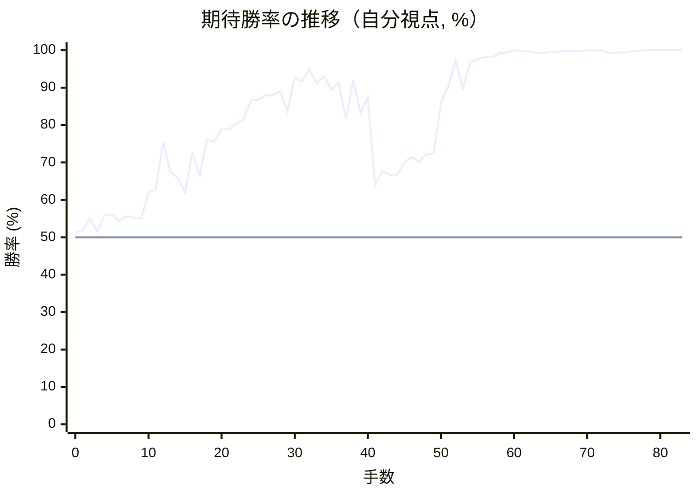
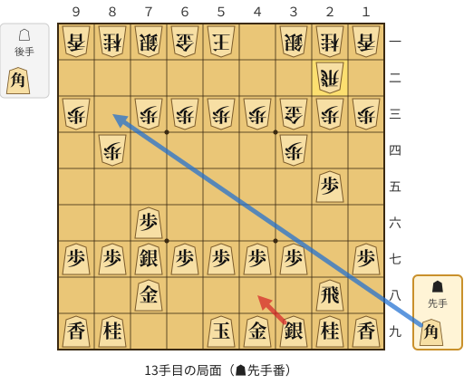
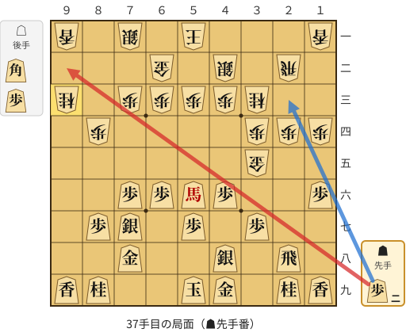
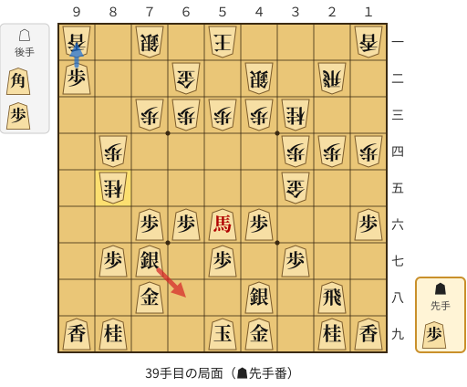
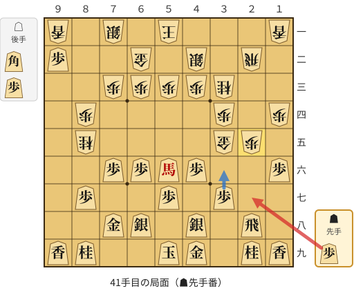
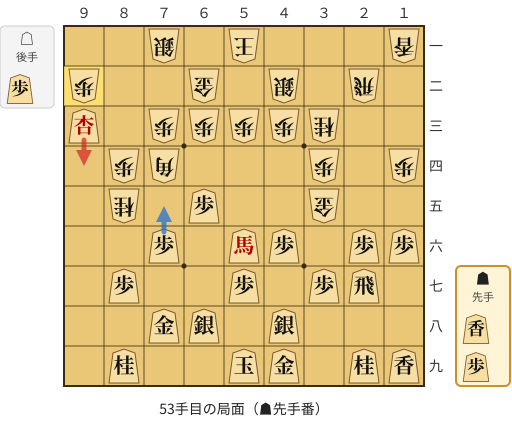
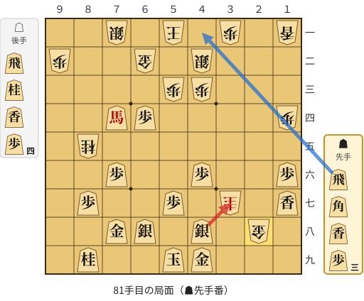

# 解析レポート lmxlq3gzlo1k

[README に戻る](../../../README.md)　/　棋譜: [CSA](../../../data/csa/shogi5/lmxlq3gzlo1k.csa)　/　解析の見方: [docs/mistake_analysis.md](../../../docs/mistake_analysis.md)

## 対局情報

| 項目 | 内容 |
|---|---|
| 日時 | 2026-11-18 01:12:03 |
| 持ち時間 | 5分 |
| 自分 | 先手（▲）（1668） |
| 相手 | 相手（1539） |
| 結果 | 勝ち（詰み, 83手） |

## 解析環境

| 項目 | 内容 |
|---|---|
| エンジン | YaneuraOu NNUE 9.00git 64AVX2（V9.00/YANEURAOU_ENGINE_NNUE/AVX2） |
| 評価関数 | **水匠5**（`suisho5`） |
| nn.bin SHA-256 | `768068f0d534a0603a5d38bcd143de6bbca820d5f1c95a14d40863e5b7892d76` |
| 第1パス | movetime=150ms, MultiPV 1 |
| 第2パス | movetime=2000ms, MultiPV 3 |
| Threads / Hash | 8 / 512MB |
| 判定基準 | 疑問手 ≥5pt, 悪手 ≥10pt, 大悪手 ≥20pt（期待勝率 W(E)=1/(1+exp(-E/600))） |
| 解析日時 | 2026-11-20T20:10:52+09:00（解析バージョン 1, 41秒） |

## サマリー

| 自分の手数 | 深掘りした手 | 詰み逃し | 大悪手 | 悪手 | 疑問手 |
|--:|--:|--:|--:|--:|--:|
| 42 | 7 | 1 | 1 | 1 | 3 |

## 期待勝率の推移



<details><summary>1手ごとの数値（第1パス）</summary>

| 手数 | 指し手 | 評価値 | 勝率 | 低下 | 判定 |
|--:|---|--:|--:|--:|---|
| 1 | ▲７六歩(77) | +46 | 51.9% | -0.6pt |  |
| 2 | △８四歩(83) | +117 | 54.9% |  |  |
| 3 | ▲２六歩(27) | +35 | 51.5% | +3.4pt |  |
| 4 | △３四歩(33) | +145 | 56.0% |  |  |
| 5 | ▲２五歩(26) | +146 | 56.1% | -0.0pt |  |
| 6 | △３二金(41) | +105 | 54.4% |  |  |
| 7 | ▲７八金(69) | +135 | 55.6% | -1.2pt |  |
| 8 | △８八角成(22) | +128 | 55.3% |  |  |
| 9 | ▲同銀(79) | +124 | 55.1% | +0.2pt |  |
| 10 | △３三金(32) | +291 | 61.9% |  |  |
| 11 | ▲７七銀(88) | +317 | 62.9% | -1.0pt |  |
| 12 | △２二飛(82) | +675 | 75.5% |  |  |
| 13 | ▲４八銀(39) | +436 | 67.4% | +8.1pt | [悪手](#ply-13) |
| 14 | △４二銀(31) | +395 | 65.9% |  |  |
| 15 | ▲１六歩(17) | +294 | 62.0% | +3.9pt |  |
| 16 | △１四歩(13) | +585 | 72.6% |  |  |
| 17 | ▲８三角打 | +407 | 66.3% | +6.3pt |  |
| 18 | △６二金(61) | +703 | 76.3% |  |  |
| 19 | ▲５六角成(83) | +675 | 75.5% | +0.9pt |  |
| 20 | △４四金(33) | +792 | 78.9% |  |  |
| 21 | ▲４六歩(47) | +787 | 78.8% | +0.1pt |  |
| 22 | △３三桂(21) | +842 | 80.3% |  |  |
| 23 | ▲６六歩(67) | +895 | 81.6% | -1.4pt |  |
| 24 | △３五金(44) | +1117 | 86.5% |  |  |
| 25 | ▲９六歩(97) | +1130 | 86.8% | -0.3pt |  |
| 26 | △２五金(35) | +1190 | 87.9% |  |  |
| 27 | ▲３四馬(56) | +1195 | 88.0% | -0.1pt |  |
| 28 | △２四金(25) | +1255 | 89.0% |  |  |
| 29 | ▲５六馬(34) | +983 | 83.7% | +5.3pt |  |
| 30 | △３四歩打 | +1517 | 92.6% |  |  |
| 31 | ▲９五歩(96) | +1441 | 91.7% | +0.9pt |  |
| 32 | △３五金(24) | +1772 | 95.0% |  |  |
| 33 | ▲９四歩(95) | +1400 | 91.2% | +3.9pt |  |
| 34 | △２四歩(23) | +1548 | 93.0% |  |  |
| 35 | ▲９三歩成(94) | +1284 | 89.5% | +3.5pt |  |
| 36 | △同桂(81) | +1407 | 91.3% |  |  |
| 37 | ▲９二歩打 | +898 | 81.7% | +9.5pt | [疑問手](#ply-37) |
| 38 | △８五桂(93) | +1460 | 91.9% |  |  |
| 39 | ▲６八銀(77) | +967 | 83.4% | +8.6pt | [疑問手](#ply-39) |
| 40 | △２五歩(24) | +1155 | 87.3% |  |  |
| 41 | ▲２七歩打 | +345 | 64.0% | +23.3pt | [大悪手](#ply-41) |
| 42 | △２六歩(25) | +446 | 67.8% |  |  |
| 43 | ▲同歩(27) | +418 | 66.7% | +1.0pt |  |
| 44 | △２七歩打 | +415 | 66.6% |  |  |
| 45 | ▲同飛(28) | +511 | 70.1% | -3.5pt |  |
| 46 | △７四角打 | +550 | 71.4% |  |  |
| 47 | ▲６五歩(66) | +514 | 70.2% | +1.2pt |  |
| 48 | △９二香(91) | +572 | 72.2% |  |  |
| 49 | ▲９三歩打 | +580 | 72.4% | -0.3pt |  |
| 50 | △同香(92) | +1088 | 86.0% |  |  |
| 51 | ▲同香成(99) | +1342 | 90.3% | -4.4pt |  |
| 52 | △９二歩打 | +2158 | 97.3% |  |  |
| 53 | ▲９四成香(93) | +1303 | 89.8% | +7.6pt | [疑問手](#ply-53) |
| 54 | △２六金(35) | +2040 | 96.8% |  |  |
| 55 | ▲２三歩打 | +2218 | 97.6% | -0.8pt |  |
| 56 | △同飛(22) | +2368 | 98.1% |  |  |
| 57 | ▲３四馬(56) | +2354 | 98.1% | +0.0pt |  |
| 58 | △２七金(26) | +2893 | 99.2% |  |  |
| 59 | ▲２三馬(34) | +3020 | 99.4% | -0.2pt |  |
| 60 | △２六飛打 | +7381 | 100.0% |  |  |
| 61 | ▲５六馬(23) | +3325 | 99.6% | +0.4pt |  |
| 62 | △２八金(27) | +3628 | 99.8% |  |  |
| 63 | ▲１七香(19) | +2892 | 99.2% | +0.6pt |  |
| 64 | △２九金(28) | +2977 | 99.3% |  |  |
| 65 | ▲８四成香(94) | +3148 | 99.5% | -0.2pt |  |
| 66 | △２八飛成(26) | +3373 | 99.6% |  |  |
| 67 | ▲７四成香(84) | +3707 | 99.8% | -0.2pt |  |
| 68 | △同歩(73) | +3752 | 99.8% |  |  |
| 69 | ▲６四歩(65) | +3476 | 99.7% | +0.1pt |  |
| 70 | △２五桂(33) | +5036 | 100.0% |  |  |
| 71 | ▲６三歩成(64) | +4488 | 99.9% | +0.0pt |  |
| 72 | △同金(62) | +4261 | 99.9% |  |  |
| 73 | ▲２一飛打 | +3007 | 99.3% | +0.6pt |  |
| 74 | △３一歩打 | +2972 | 99.3% |  |  |
| 75 | ▲６四歩打 | +3093 | 99.4% | -0.1pt |  |
| 76 | △６二金(63) | +3417 | 99.7% |  |  |
| 77 | ▲７四馬(56) | +4117 | 99.9% | -0.2pt |  |
| 78 | △３七桂成(25) | +6393 | 100.0% |  |  |
| 79 | ▲２八飛成(21) | +6481 | 100.0% | -0.0pt |  |
| 80 | △同金(29) | #+1 | 100.0% |  |  |
| 81 | ▲３七銀(48) | +5936 | 100.0% | +0.0pt | [詰み逃し](#ply-81) |
| 82 | △２七金(28) | #+1 | 100.0% |  |  |
| 83 | ▲４一飛打 | #+ | 100.0% | +0.0pt |  |

</details>

## 課題局面

<a id="ply-13"></a>
### 13手目 ▲４八銀(39) — 悪手

| | 着手前 | 着手後 | 差 |
|---|--:|--:|--:|
| 期待勝率 | 73.0% | 62.9% | -10.1pt |
| 評価値 | +596 | +316 | |

着手前の局面:



🔴 実戦 ▲４八銀(39)　🔵 AI推奨 ▲８三角打　🟨 直前の相手の指し手

<details><summary>テキストの盤面図（BOD・将棋ソフトに貼り付け可）</summary>

```text
後手の持駒：角
  ９ ８ ７ ６ ５ ４ ３ ２ １
+---------------------------+
|v香v桂v銀v金v玉 ・v銀v桂v香|一
| ・ ・ ・ ・ ・ ・ ・v飛 ・|二
|v歩 ・v歩v歩v歩v歩v金v歩v歩|三
| ・v歩 ・ ・ ・ ・v歩 ・ ・|四
| ・ ・ ・ ・ ・ ・ ・ 歩 ・|五
| ・ ・ 歩 ・ ・ ・ ・ ・ ・|六
| 歩 歩 銀 歩 歩 歩 歩 ・ 歩|七
| ・ ・ 金 ・ ・ ・ ・ 飛 ・|八
| 香 桂 ・ ・ 玉 金 銀 桂 香|九
+---------------------------+
先手の持駒：角
手数＝12　△２二飛　まで
```

</details>

| | 指し手 | 評価値 | 読み筋 |
|---|---|--:|---|
| 実戦 | ▲４八銀(39) | +316 | △７二金(61) ▲３六歩(37) △６二銀(71) ▲９六歩(97) △９四歩(93) ▲３七桂(29) |
| AI 1位 | ▲８三角打 | +596 | ▲８三角打 △７四角打 ▲同角成(83) △同歩(73) ▲８三角打 △６五角打 |
| AI 2位 | ▲９六歩(97) | +365 | ▲９六歩(97) △７二金(61) ▲３八銀(39) △９四歩(93) ▲６六銀(77) △６二銀(71) |
| AI 3位 | ▲６八玉(59) | +361 | ▲６八玉(59) △７二金(61) ▲９六歩(97) △９四歩(93) ▲６六銀(77) △６二銀(71) |

SFEN: `lnsgk1snl/7r1/p1ppppgpp/1p4p2/7P1/2P6/PPSPPPP1P/2G4R1/LN2KGSNL b Bb 13`

<a id="ply-37"></a>
### 37手目 ▲９二歩打 — 疑問手

| | 着手前 | 着手後 | 差 |
|---|--:|--:|--:|
| 期待勝率 | 94.8% | 86.2% | -8.7pt |
| 評価値 | +1746 | +1097 | |

着手前の局面:



🔴 実戦 ▲９二歩打　🔵 AI推奨 ▲２三歩打　🟨 直前の相手の指し手

<details><summary>テキストの盤面図（BOD・将棋ソフトに貼り付け可）</summary>

```text
後手の持駒：角　歩
  ９ ８ ７ ６ ５ ４ ３ ２ １
+---------------------------+
|v香 ・v銀 ・v玉 ・ ・ ・v香|一
| ・ ・ ・v金 ・v銀 ・v飛 ・|二
|v桂 ・v歩v歩v歩v歩v桂 ・ ・|三
| ・v歩 ・ ・ ・ ・v歩v歩v歩|四
| ・ ・ ・ ・ ・ ・v金 ・ ・|五
| ・ ・ 歩 歩 馬 歩 ・ ・ 歩|六
| ・ 歩 銀 ・ 歩 ・ 歩 ・ ・|七
| ・ ・ 金 ・ ・ 銀 ・ 飛 ・|八
| 香 桂 ・ ・ 玉 金 ・ 桂 香|九
+---------------------------+
先手の持駒：歩二
手数＝36　△９三同桂　まで
```

</details>

| | 指し手 | 評価値 | 読み筋 |
|---|---|--:|---|
| 実戦 | ▲９二歩打 | +1097 | △同香(91) ▲４七銀(48) △７四角打 ▲同馬(56) △同歩(73) ▲３六歩(37) |
| AI 1位 | ▲２三歩打 | +1746 | ▲２三歩打 △同飛(22) ▲３六歩(37) △２五金(35) ▲４七銀(48) △５四角打 |
| AI 2位 | ▲３六歩(37) | +1642 | ▲３六歩(37) △同金(35) ▲２三歩打 △同飛(22) ▲３四馬(56) △２一飛(23) |
| AI 3位 | ▲４七銀(48) | +1237 | ▲４七銀(48) △２五歩(24) ▲２三歩打 △同飛(22) ▲３六歩(37) △２六金(35) |

SFEN: `l1s1k3l/3g1s1r1/n1ppppn2/1p4ppp/6g2/2PP+BP2P/1PS1P1P2/2G2S1R1/LN2KG1NL b 2Pbp 37`

<a id="ply-39"></a>
### 39手目 ▲６八銀(77) — 疑問手

| | 着手前 | 着手後 | 差 |
|---|--:|--:|--:|
| 期待勝率 | 92.8% | 85.3% | -7.4pt |
| 評価値 | +1532 | +1057 | |

着手前の局面:



🔴 実戦 ▲６八銀(77)　🔵 AI推奨 ▲９一歩成(92)　🟨 直前の相手の指し手

<details><summary>テキストの盤面図（BOD・将棋ソフトに貼り付け可）</summary>

```text
後手の持駒：角　歩
  ９ ８ ７ ６ ５ ４ ３ ２ １
+---------------------------+
|v香 ・v銀 ・v玉 ・ ・ ・v香|一
| 歩 ・ ・v金 ・v銀 ・v飛 ・|二
| ・ ・v歩v歩v歩v歩v桂 ・ ・|三
| ・v歩 ・ ・ ・ ・v歩v歩v歩|四
| ・v桂 ・ ・ ・ ・v金 ・ ・|五
| ・ ・ 歩 歩 馬 歩 ・ ・ 歩|六
| ・ 歩 銀 ・ 歩 ・ 歩 ・ ・|七
| ・ ・ 金 ・ ・ 銀 ・ 飛 ・|八
| 香 桂 ・ ・ 玉 金 ・ 桂 香|九
+---------------------------+
先手の持駒：歩
手数＝38　△８五桂　まで
```

</details>

| | 指し手 | 評価値 | 読み筋 |
|---|---|--:|---|
| 実戦 | ▲６八銀(77) | +1057 | △７四角打 ▲６五歩(66) |
| AI 1位 | ▲９一歩成(92) | +1532 | ▲９一歩成(92) △９八歩打 ▲同香(99) △７七桂成(85) ▲同金(78) △７四角打 |
| AI 2位 | ▲４七銀(48) | +1433 | ▲４七銀(48) △７四角打 ▲同馬(56) △同歩(73) ▲９一歩成(92) △７七桂不成(85) |
| AI 3位 | ▲２三歩打 | +1321 | ▲２三歩打 △同飛(22) ▲９一歩成(92) △２五歩(24) ▲３六歩(37) △２六歩(25) |

SFEN: `l1s1k3l/P2g1s1r1/2ppppn2/1p4ppp/1n4g2/2PP+BP2P/1PS1P1P2/2G2S1R1/LN2KG1NL b Pbp 39`

<a id="ply-41"></a>
### 41手目 ▲２七歩打 — 大悪手

| | 着手前 | 着手後 | 差 |
|---|--:|--:|--:|
| 期待勝率 | 93.9% | 69.4% | -24.5pt |
| 評価値 | +1644 | +491 | |

着手前の局面:



🔴 実戦 ▲２七歩打　🔵 AI推奨 ▲３六歩(37)　🟨 直前の相手の指し手

<details><summary>テキストの盤面図（BOD・将棋ソフトに貼り付け可）</summary>

```text
後手の持駒：角　歩
  ９ ８ ７ ６ ５ ４ ３ ２ １
+---------------------------+
|v香 ・v銀 ・v玉 ・ ・ ・v香|一
| 歩 ・ ・v金 ・v銀 ・v飛 ・|二
| ・ ・v歩v歩v歩v歩v桂 ・ ・|三
| ・v歩 ・ ・ ・ ・v歩 ・v歩|四
| ・v桂 ・ ・ ・ ・v金v歩 ・|五
| ・ ・ 歩 歩 馬 歩 ・ ・ 歩|六
| ・ 歩 ・ ・ 歩 ・ 歩 ・ ・|七
| ・ ・ 金 銀 ・ 銀 ・ 飛 ・|八
| 香 桂 ・ ・ 玉 金 ・ 桂 香|九
+---------------------------+
先手の持駒：歩
手数＝40　△２五歩　まで
```

</details>

| | 指し手 | 評価値 | 読み筋 |
|---|---|--:|---|
| 実戦 | ▲２七歩打 | +491 | △２六歩(25) ▲同歩(27) |
| AI 1位 | ▲３六歩(37) | +1644 | ▲３六歩(37) △同金(35) ▲９一歩成(92) △２六歩(25) ▲３八飛(28) △２五角打 |
| AI 2位 | ▲２三歩打 | +1057 | ▲２三歩打 △同飛(22) ▲３六歩(37) △２六歩(25) ▲３五歩(36) △２七歩成(26) |
| AI 3位 | ▲３八金(49) | +732 | ▲３八金(49) △５四角打 ▲９一歩成(92) △２六歩(25) ▲３六香打 △同金(35) |

SFEN: `l1s1k3l/P2g1s1r1/2ppppn2/1p4p1p/1n4gp1/2PP+BP2P/1P2P1P2/2GS1S1R1/LN2KG1NL b Pbp 41`

<a id="ply-53"></a>
### 53手目 ▲９四成香(93) — 疑問手

| | 着手前 | 着手後 | 差 |
|---|--:|--:|--:|
| 期待勝率 | 98.1% | 88.5% | -9.6pt |
| 評価値 | +2375 | +1224 | |

着手前の局面:



🔴 実戦 ▲９四成香(93)　🔵 AI推奨 ▲７五歩(76)　🟨 直前の相手の指し手

<details><summary>テキストの盤面図（BOD・将棋ソフトに貼り付け可）</summary>

```text
後手の持駒：歩
  ９ ８ ７ ６ ５ ４ ３ ２ １
+---------------------------+
| ・ ・v銀 ・v玉 ・ ・ ・v香|一
|v歩 ・ ・v金 ・v銀 ・v飛 ・|二
| 杏 ・v歩v歩v歩v歩v桂 ・ ・|三
| ・v歩v角 ・ ・ ・v歩 ・v歩|四
| ・v桂 ・ 歩 ・ ・v金 ・ ・|五
| ・ ・ 歩 ・ 馬 歩 ・ 歩 歩|六
| ・ 歩 ・ ・ 歩 ・ 歩 飛 ・|七
| ・ ・ 金 銀 ・ 銀 ・ ・ ・|八
| ・ 桂 ・ ・ 玉 金 ・ 桂 香|九
+---------------------------+
先手の持駒：香　歩
手数＝52　△９二歩　まで
```

</details>

| | 指し手 | 評価値 | 読み筋 |
|---|---|--:|---|
| 実戦 | ▲９四成香(93) | +1224 | △６四歩(63) ▲８四成香(94) △６五角(74) ▲６三歩打 △５二金(62) ▲６五馬(56) |
| AI 1位 | ▲７五歩(76) | +2375 | ▲７五歩(76) △６五角(74) ▲同馬(56) △９三歩(92) ▲５六馬(65) △５四香打 |
| AI 2位 | ▲９四成香(93) | +1243 | ▲９四成香(93) △６四歩(63) ▲８四成香(94) △６五角(74) ▲６三歩打 △５二金(62) |
| AI 3位 | ▲３六香打 | +1024 | ▲３六香打 △２六金(35) ▲同飛(27) △同飛(22) ▲７五歩(76) △９三歩(92) |

SFEN: `2s1k3l/p2g1s1r1/+L1ppppn2/1pb3p1p/1n1P2g2/2P1+BP1PP/1P2P1PR1/2GS1S3/1N2KG1NL b LPp 53`

<a id="ply-81"></a>
### 81手目 ▲３七銀(48) — 詰み逃し

| | 着手前 | 着手後 | 差 |
|---|--:|--:|--:|
| 期待勝率 | 100.0% | 100.0% | -0.0pt |
| 評価値 | 1手詰め | +6100 | |

着手前の局面:



🔴 実戦 ▲３七銀(48)　🔵 AI推奨 ▲４一飛打　🟨 直前の相手の指し手

<details><summary>テキストの盤面図（BOD・将棋ソフトに貼り付け可）</summary>

```text
後手の持駒：飛　桂　香　歩四
  ９ ８ ７ ６ ５ ４ ３ ２ １
+---------------------------+
| ・ ・v銀 ・v玉 ・v歩 ・v香|一
|v歩 ・ ・v金 ・v銀 ・ ・ ・|二
| ・ ・ ・ ・v歩v歩 ・ ・ ・|三
| ・ ・ 馬 歩 ・ ・ ・ ・v歩|四
| ・v桂 ・ ・ ・ ・ ・ ・ ・|五
| ・ ・ 歩 ・ ・ 歩 ・ ・ 歩|六
| ・ 歩 ・ ・ 歩 ・v圭 ・ 香|七
| ・ ・ 金 銀 ・ 銀 ・v金 ・|八
| ・ 桂 ・ ・ 玉 金 ・ ・ ・|九
+---------------------------+
先手の持駒：飛　角　香　歩三
手数＝80　△２八同金　まで
```

</details>

| | 指し手 | 評価値 | 読み筋 |
|---|---|--:|---|
| 実戦 | ▲３七銀(48) | +6100 | △５二桂打 ▲２三角打 △３二香打 ▲２八銀(37) △６七歩打 ▲同角成(23) |
| AI 1位 | ▲４一飛打 | 1手詰め | ▲４一飛打 |
| AI 2位 | ▲３七銀(48) | +5904 | ▲３七銀(48) △５二桂打 ▲２八銀(37) △６七歩打 ▲同銀(68) △９九飛打 |
| AI 3位 | ▲６三歩成(64) | +4852 | ▲６三歩成(64) △４八成桂(37) ▲同玉(59) △５二香打 ▲６二と(63) △同銀(71) |

SFEN: `2s1k1p1l/p2g1s3/4pp3/2+BP4p/1n7/2P2P2P/1P2P1+n1L/2GS1S1g1/1N2KG3 b RBL3Prnl4p 81`

