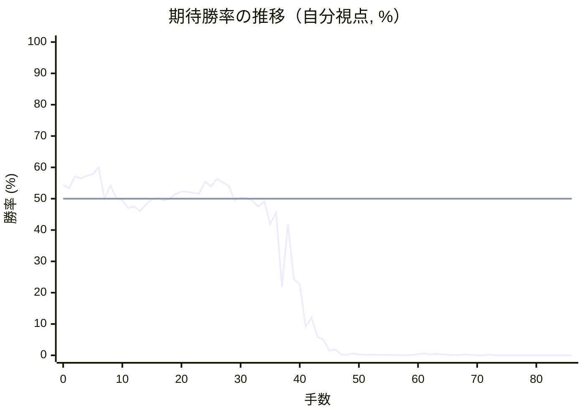
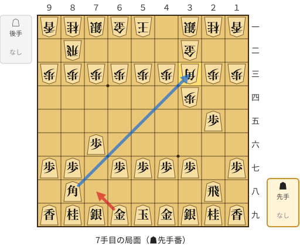
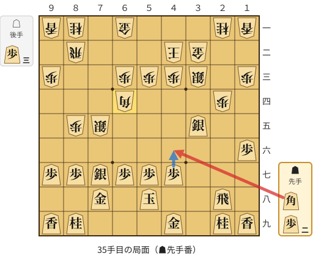
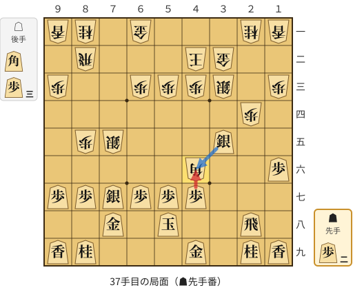
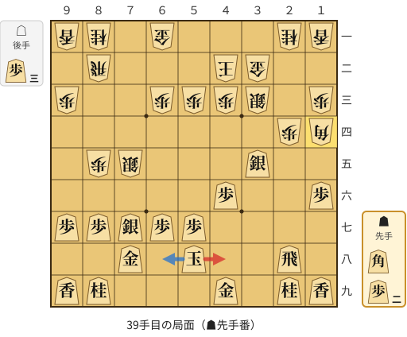
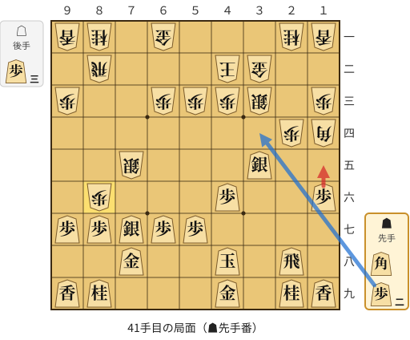

# 解析レポート m1joexmbyxjs

[README に戻る](../../../README.md)　/　棋譜: [CSA](../../../data/csa/shogi5/m1joexmbyxjs.csa)　/　解析の見方: [docs/mistake_analysis.md](../../../docs/mistake_analysis.md)

## 対局情報

| 項目 | 内容 |
|---|---|
| 日時 | 2026-11-16 01:56:10 |
| 持ち時間 | 5分 |
| 自分 | 先手（▲）（1653） |
| 相手 | 相手（2085） |
| 結果 | 負け（詰み, 86手） |

## 解析環境

| 項目 | 内容 |
|---|---|
| エンジン | YaneuraOu NNUE 9.00git 64AVX2（V9.00/YANEURAOU_ENGINE_NNUE/AVX2） |
| 評価関数 | **水匠5**（`suisho5`） |
| nn.bin SHA-256 | `768068f0d534a0603a5d38bcd143de6bbca820d5f1c95a14d40863e5b7892d76` |
| 第1パス | movetime=150ms, MultiPV 1 |
| 第2パス | movetime=2000ms, MultiPV 3 |
| Threads / Hash | 8 / 512MB |
| 判定基準 | 疑問手 ≥5pt, 悪手 ≥10pt, 大悪手 ≥20pt（期待勝率 W(E)=1/(1+exp(-E/600))） |
| 解析日時 | 2026-11-20T20:20:15+09:00（解析バージョン 1, 37秒） |

## サマリー

| 自分の手数 | 深掘りした手 | 詰み逃し | 大悪手 | 悪手 | 疑問手 |
|--:|--:|--:|--:|--:|--:|
| 43 | 6 | 0 | 1 | 2 | 2 |

## 期待勝率の推移



<details><summary>1手ごとの数値（第1パス）</summary>

| 手数 | 指し手 | 評価値 | 勝率 | 低下 | 判定 |
|--:|---|--:|--:|--:|---|
| 1 | ▲７六歩(77) | +80 | 53.3% | +1.0pt |  |
| 2 | △３四歩(33) | +172 | 57.1% |  |  |
| 3 | ▲２六歩(27) | +158 | 56.5% | +0.6pt |  |
| 4 | △３二金(41) | +176 | 57.3% |  |  |
| 5 | ▲２五歩(26) | +188 | 57.8% | -0.5pt |  |
| 6 | △３三角(22) | +243 | 60.0% |  |  |
| 7 | ▲７八金(69) | +1 | 50.0% | +9.9pt | [疑問手](#ply-7) |
| 8 | △２二銀(31) | +101 | 54.2% |  |  |
| 9 | ▲５八玉(59) | +2 | 50.1% | +4.1pt |  |
| 10 | △６二銀(71) | -13 | 49.5% |  |  |
| 11 | ▲１六歩(17) | -72 | 47.0% | +2.5pt |  |
| 12 | △７四歩(73) | -61 | 47.5% |  |  |
| 13 | ▲３八銀(39) | -96 | 46.0% | +1.5pt |  |
| 14 | △７三銀(62) | -43 | 48.2% |  |  |
| 15 | ▲３六歩(37) | -4 | 49.8% | -1.6pt |  |
| 16 | △６四銀(73) | +6 | 50.2% |  |  |
| 17 | ▲３七銀(38) | -15 | 49.4% | +0.9pt |  |
| 18 | △８四歩(83) | -1 | 50.0% |  |  |
| 19 | ▲４六銀(37) | +37 | 51.5% | -1.6pt |  |
| 20 | △８五歩(84) | +56 | 52.3% |  |  |
| 21 | ▲３三角成(88) | +53 | 52.2% | +0.1pt |  |
| 22 | △同銀(22) | +43 | 51.8% |  |  |
| 23 | ▲８八銀(79) | +38 | 51.6% | +0.2pt |  |
| 24 | △４二玉(51) | +132 | 55.5% |  |  |
| 25 | ▲７七銀(88) | +93 | 53.9% | +1.6pt |  |
| 26 | △７五歩(74) | +153 | 56.3% |  |  |
| 27 | ▲同歩(76) | +126 | 55.2% | +1.1pt |  |
| 28 | △同銀(64) | +98 | 54.1% |  |  |
| 29 | ▲３五歩(36) | -15 | 49.4% | +4.7pt |  |
| 30 | △同歩(34) | +10 | 50.4% |  |  |
| 31 | ▲２四歩(25) | +5 | 50.2% | +0.2pt |  |
| 32 | △同歩(23) | -16 | 49.3% |  |  |
| 33 | ▲３五銀(46) | -60 | 47.5% | +1.8pt |  |
| 34 | △６四角打 | -20 | 49.2% |  |  |
| 35 | ▲４六角打 | -196 | 41.9% | +7.3pt | [疑問手](#ply-35) |
| 36 | △同角(64) | -107 | 45.6% |  |  |
| 37 | ▲同歩(47) | -762 | 21.9% | +23.6pt | [悪手](#ply-37) |
| 38 | △１四角打 | -196 | 41.9% |  |  |
| 39 | ▲４八玉(58) | -683 | 24.3% | +17.6pt | [大悪手](#ply-39) |
| 40 | △８六歩(85) | -736 | 22.7% |  |  |
| 41 | ▲１五歩(16) | -1384 | 9.1% | +13.6pt | [悪手](#ply-41) |
| 42 | △６九角成(14) | -1188 | 12.1% |  |  |
| 43 | ▲６八金(78) | -1657 | 5.9% | +6.2pt |  |
| 44 | △３六馬(69) | -1761 | 5.0% |  |  |
| 45 | ▲２四銀(35) | -2508 | 1.5% | +3.5pt |  |
| 46 | △２七歩打 | -2362 | 1.9% |  |  |
| 47 | ▲３三銀成(24) | -3402 | 0.3% | +1.6pt |  |
| 48 | △同桂(21) | -3685 | 0.2% |  |  |
| 49 | ▲１八飛(28) | -3032 | 0.6% | -0.4pt |  |
| 50 | △８七歩成(86) | -3502 | 0.3% |  |  |
| 51 | ▲４七銀打 | -3773 | 0.2% | +0.1pt |  |
| 52 | △２六馬(36) | -3776 | 0.2% |  |  |
| 53 | ▲３七角打 | -3868 | 0.2% | +0.0pt |  |
| 54 | △同馬(26) | -4050 | 0.1% |  |  |
| 55 | ▲同桂(29) | -3878 | 0.2% | -0.0pt |  |
| 56 | △７七と(87) | -4164 | 0.1% |  |  |
| 57 | ▲同桂(89) | -4121 | 0.1% | -0.0pt |  |
| 58 | △８八飛成(82) | -4334 | 0.1% |  |  |
| 59 | ▲５八金(68) | -4201 | 0.1% | -0.0pt |  |
| 60 | △２九銀打 | -3276 | 0.4% |  |  |
| 61 | ▲３四歩打 | -3034 | 0.6% | -0.2pt |  |
| 62 | △１八銀成(29) | -3441 | 0.3% |  |  |
| 63 | ▲３三歩成(34) | -3223 | 0.5% | -0.1pt |  |
| 64 | △同金(32) | -3561 | 0.3% |  |  |
| 65 | ▲４五桂(37) | -3605 | 0.2% | +0.0pt |  |
| 66 | △３四金(33) | -4224 | 0.1% |  |  |
| 67 | ▲２六桂打 | -4336 | 0.1% | +0.0pt |  |
| 68 | △４四金(34) | -3514 | 0.3% |  |  |
| 69 | ▲３三角打 | -3913 | 0.1% | +0.1pt |  |
| 70 | △５二玉(42) | -4110 | 0.1% |  |  |
| 71 | ▲３四桂(26) | -5558 | 0.0% | +0.1pt |  |
| 72 | △同金(44) | -3393 | 0.3% |  |  |
| 73 | ▲６五桂(77) | #-9 | 0.0% | +0.3pt |  |
| 74 | △２六角打 | -5872 | 0.0% |  |  |
| 75 | ▲３七歩打 | -6033 | 0.0% | +0.0pt |  |
| 76 | △３三金(34) | -5632 | 0.0% |  |  |
| 77 | ▲５三桂成(65) | -6202 | 0.0% | +0.0pt |  |
| 78 | △同角(26) | -6338 | 0.0% |  |  |
| 79 | ▲同桂成(45) | -6335 | 0.0% | -0.0pt |  |
| 80 | △同玉(52) | -6557 | 0.0% |  |  |
| 81 | ▲５五角打 | -7324 | 0.0% | +0.0pt |  |
| 82 | △８九龍(88) | -7208 | 0.0% |  |  |
| 83 | ▲３三角成(55) | #-9 | 0.0% | +0.0pt |  |
| 84 | △２九飛打 | -5904 | 0.0% |  |  |
| 85 | ▲５六銀(47) | #-1 | 0.0% | +0.0pt |  |
| 86 | △４九飛成(29) | #- | 0.0% |  |  |

</details>

## 課題局面

<a id="ply-7"></a>
### 7手目 ▲７八金(69) — 疑問手

| | 着手前 | 着手後 | 差 |
|---|--:|--:|--:|
| 期待勝率 | 58.1% | 49.9% | -8.2pt |
| 評価値 | +196 | -3 | |

着手前の局面:



🔴 実戦 ▲７八金(69)　🔵 AI推奨 ▲同角成(88)　🟨 直前の相手の指し手

<details><summary>テキストの盤面図（BOD・将棋ソフトに貼り付け可）</summary>

```text
後手の持駒：なし
  ９ ８ ７ ６ ５ ４ ３ ２ １
+---------------------------+
|v香v桂v銀v金v玉 ・v銀v桂v香|一
| ・v飛 ・ ・ ・ ・v金 ・ ・|二
|v歩v歩v歩v歩v歩v歩v角v歩v歩|三
| ・ ・ ・ ・ ・ ・v歩 ・ ・|四
| ・ ・ ・ ・ ・ ・ ・ 歩 ・|五
| ・ ・ 歩 ・ ・ ・ ・ ・ ・|六
| 歩 歩 ・ 歩 歩 歩 歩 ・ 歩|七
| ・ 角 ・ ・ ・ ・ ・ 飛 ・|八
| 香 桂 銀 金 玉 金 銀 桂 香|九
+---------------------------+
先手の持駒：なし
手数＝6　△３三角　まで
```

</details>

| | 指し手 | 評価値 | 読み筋 |
|---|---|--:|---|
| 実戦 | ▲７八金(69) | -3 | △４二銀(31) ▲３八銀(39) △８四歩(83) ▲３六歩(37) △８五歩(84) ▲７七角(88) |
| AI 1位 | ▲同角成(88) | +196 | ▲同角成(88) △同金(32) ▲３八銀(39) △４四角打 ▲８八角打 △８四歩(83) |
| AI 2位 | ▲３八銀(39) | +56 | ▲３八銀(39) △４二銀(31) ▲３三角成(88) △同銀(42) ▲７八銀(79) △７四歩(73) |
| AI 3位 | ▲３六歩(37) | +37 | ▲３六歩(37) △４二銀(31) ▲３三角成(88) △同桂(21) ▲８八銀(79) △６四角打 |

SFEN: `lnsgk1snl/1r4g2/ppppppbpp/6p2/7P1/2P6/PP1PPPP1P/1B5R1/LNSGKGSNL b - 7`

<a id="ply-35"></a>
### 35手目 ▲４六角打 — 疑問手

| | 着手前 | 着手後 | 差 |
|---|--:|--:|--:|
| 期待勝率 | 51.6% | 45.0% | -6.6pt |
| 評価値 | +38 | -121 | |

着手前の局面:



🔴 実戦 ▲４六角打　🔵 AI推奨 ▲４六歩(47)　🟨 直前の相手の指し手

<details><summary>テキストの盤面図（BOD・将棋ソフトに貼り付け可）</summary>

```text
後手の持駒：歩三
  ９ ８ ７ ６ ５ ４ ３ ２ １
+---------------------------+
|v香v桂 ・v金 ・ ・ ・v桂v香|一
| ・v飛 ・ ・ ・v玉v金 ・ ・|二
|v歩 ・ ・v歩v歩v歩v銀 ・v歩|三
| ・ ・ ・v角 ・ ・ ・v歩 ・|四
| ・v歩v銀 ・ ・ ・ 銀 ・ ・|五
| ・ ・ ・ ・ ・ ・ ・ ・ 歩|六
| 歩 歩 銀 歩 歩 歩 ・ ・ ・|七
| ・ ・ 金 ・ 玉 ・ ・ 飛 ・|八
| 香 桂 ・ ・ ・ 金 ・ 桂 香|九
+---------------------------+
先手の持駒：角　歩二
手数＝34　△６四角　まで
```

</details>

| | 指し手 | 評価値 | 読み筋 |
|---|---|--:|---|
| 実戦 | ▲４六角打 | -121 | △同角(64) ▲同銀(35) △８六歩(85) ▲同銀(77) △同銀(75) ▲同歩(87) |
| AI 1位 | ▲４六歩(47) | +38 | ▲４六歩(47) △８六歩(85) ▲同歩(87) △同銀(75) ▲３四歩打 △２二銀(33) |
| AI 2位 | ▲４六銀(35) | +26 | ▲４六銀(35) △５二金(61) ▲３四歩打 △同銀(33) ▲２四飛(28) △２三金(32) |
| AI 3位 | ▲４六角打 | -88 | ▲４六角打 △同角(64) ▲同銀(35) △７六歩打 ▲８八銀(77) △６四銀(75) |

SFEN: `ln1g3nl/1r3kg2/p2ppps1p/3b3p1/1ps3S2/8P/PPSPPP3/2G1K2R1/LN3G1NL b B2P3p 35`

<a id="ply-37"></a>
### 37手目 ▲同歩(47) — 悪手

| | 着手前 | 着手後 | 差 |
|---|--:|--:|--:|
| 期待勝率 | 44.2% | 25.6% | -18.6pt |
| 評価値 | -140 | -640 | |

着手前の局面:



🔴 実戦 ▲同歩(47)　🔵 AI推奨 ▲同銀(35)　🟨 直前の相手の指し手

<details><summary>テキストの盤面図（BOD・将棋ソフトに貼り付け可）</summary>

```text
後手の持駒：角　歩三
  ９ ８ ７ ６ ５ ４ ３ ２ １
+---------------------------+
|v香v桂 ・v金 ・ ・ ・v桂v香|一
| ・v飛 ・ ・ ・v玉v金 ・ ・|二
|v歩 ・ ・v歩v歩v歩v銀 ・v歩|三
| ・ ・ ・ ・ ・ ・ ・v歩 ・|四
| ・v歩v銀 ・ ・ ・ 銀 ・ ・|五
| ・ ・ ・ ・ ・v角 ・ ・ 歩|六
| 歩 歩 銀 歩 歩 歩 ・ ・ ・|七
| ・ ・ 金 ・ 玉 ・ ・ 飛 ・|八
| 香 桂 ・ ・ ・ 金 ・ 桂 香|九
+---------------------------+
先手の持駒：歩二
手数＝36　△４六同角　まで
```

</details>

| | 指し手 | 評価値 | 読み筋 |
|---|---|--:|---|
| 実戦 | ▲同歩(47) | -640 | △３四歩打 ▲２四銀(35) △２七歩打 ▲３三銀成(24) △同桂(21) ▲３八飛(28) |
| AI 1位 | ▲同銀(35) | -140 | ▲同銀(35) △８六歩(85) ▲同歩(87) △同銀(75) ▲同銀(77) △同飛(82) |
| AI 2位 | ▲同歩(47) | -570 | ▲同歩(47) △３四歩打 ▲２四銀(35) △２七歩打 ▲３三銀成(24) △同桂(21) |
| AI 3位 | ▲３八飛(28) | -3921 | ▲３八飛(28) △１九角成(46) ▲３四歩打 △２二銀(33) ▲２四銀(35) △２九馬(19) |

SFEN: `ln1g3nl/1r3kg2/p2ppps1p/7p1/1ps3S2/5b2P/PPSPPP3/2G1K2R1/LN3G1NL b 2Pb3p 37`

<a id="ply-39"></a>
### 39手目 ▲４八玉(58) — 大悪手

| | 着手前 | 着手後 | 差 |
|---|--:|--:|--:|
| 期待勝率 | 39.5% | 19.3% | -20.1pt |
| 評価値 | -257 | -857 | |

着手前の局面:



🔴 実戦 ▲４八玉(58)　🔵 AI推奨 ▲６八玉(58)　🟨 直前の相手の指し手

<details><summary>テキストの盤面図（BOD・将棋ソフトに貼り付け可）</summary>

```text
後手の持駒：歩三
  ９ ８ ７ ６ ５ ４ ３ ２ １
+---------------------------+
|v香v桂 ・v金 ・ ・ ・v桂v香|一
| ・v飛 ・ ・ ・v玉v金 ・ ・|二
|v歩 ・ ・v歩v歩v歩v銀 ・v歩|三
| ・ ・ ・ ・ ・ ・ ・v歩v角|四
| ・v歩v銀 ・ ・ ・ 銀 ・ ・|五
| ・ ・ ・ ・ ・ 歩 ・ ・ 歩|六
| 歩 歩 銀 歩 歩 ・ ・ ・ ・|七
| ・ ・ 金 ・ 玉 ・ ・ 飛 ・|八
| 香 桂 ・ ・ ・ 金 ・ 桂 香|九
+---------------------------+
先手の持駒：角　歩二
手数＝38　△１四角　まで
```

</details>

| | 指し手 | 評価値 | 読み筋 |
|---|---|--:|---|
| 実戦 | ▲４八玉(58) | -857 | △６九角成(14) ▲３四歩打 △２二銀(33) ▲６八金(78) △３六馬(69) ▲３八飛(28) |
| AI 1位 | ▲６八玉(58) | -257 | ▲６八玉(58) △４七角成(14) ▲３四歩打 △２二銀(33) ▲２三歩打 △同金(32) |
| AI 2位 | ▲５九玉(58) | -221 | ▲５九玉(58) △４七角成(14) ▲３四歩打 △２二銀(33) ▲２三歩打 △同金(32) |
| AI 3位 | ▲２五歩打 | -691 | ▲２五歩打 △同角(14) ▲６八玉(58) △７六歩打 ▲８八銀(77) △４七角成(25) |

SFEN: `ln1g3nl/1r3kg2/p2ppps1p/7pb/1ps3S2/5P2P/PPSPP4/2G1K2R1/LN3G1NL b B2P3p 39`

<a id="ply-41"></a>
### 41手目 ▲１五歩(16) — 悪手

| | 着手前 | 着手後 | 差 |
|---|--:|--:|--:|
| 期待勝率 | 17.6% | 5.0% | -12.6pt |
| 評価値 | -927 | -1773 | |

着手前の局面:



🔴 実戦 ▲１五歩(16)　🔵 AI推奨 ▲３四歩打　🟨 直前の相手の指し手

<details><summary>テキストの盤面図（BOD・将棋ソフトに貼り付け可）</summary>

```text
後手の持駒：歩三
  ９ ８ ７ ６ ５ ４ ３ ２ １
+---------------------------+
|v香v桂 ・v金 ・ ・ ・v桂v香|一
| ・v飛 ・ ・ ・v玉v金 ・ ・|二
|v歩 ・ ・v歩v歩v歩v銀 ・v歩|三
| ・ ・ ・ ・ ・ ・ ・v歩v角|四
| ・ ・v銀 ・ ・ ・ 銀 ・ ・|五
| ・v歩 ・ ・ ・ 歩 ・ ・ 歩|六
| 歩 歩 銀 歩 歩 ・ ・ ・ ・|七
| ・ ・ 金 ・ ・ 玉 ・ 飛 ・|八
| 香 桂 ・ ・ ・ 金 ・ 桂 香|九
+---------------------------+
先手の持駒：角　歩二
手数＝40　△８六歩　まで
```

</details>

| | 指し手 | 評価値 | 読み筋 |
|---|---|--:|---|
| 実戦 | ▲１五歩(16) | -1773 | △６九角成(14) ▲３四歩打 △２二銀(33) ▲２三歩打 △同金(32) ▲２四銀(35) |
| AI 1位 | ▲３四歩打 | -927 | ▲３四歩打 △４四銀(33) ▲２四銀(35) △８七歩成(86) ▲８三歩打 △同飛(82) |
| AI 2位 | ▲同歩(87) | -993 | ▲同歩(87) △６九角成(14) ▲３四歩打 △２二銀(33) ▲７九歩打 △７六歩打 |
| AI 3位 | ▲５六角打 | -1117 | ▲５六角打 △８七歩成(86) ▲８三歩打 △７二飛(82) ▲８七金(78) △６九角成(14) |

SFEN: `ln1g3nl/1r3kg2/p2ppps1p/7pb/2s3S2/1p3P2P/PPSPP4/2G2K1R1/LN3G1NL b B2P3p 41`

