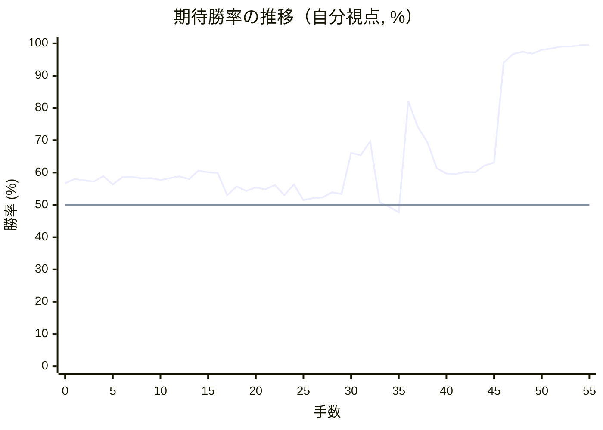

# 解析レポート mdbd5x48ko53

[README に戻る](../../../README.md)　/　棋譜: [CSA](../../../data/csa/shogi5/mdbd5x48ko53.csa)　/　解析の見方: [docs/mistake_analysis.md](../../../docs/mistake_analysis.md)

## 対局情報

| 項目 | 内容 |
|---|---|
| 日時 | 2026-10-31 17:30:38 |
| 持ち時間 | 5分 |
| 自分 | 先手（▲）（1714） |
| 相手 | 相手（1651） |
| 結果 | 勝ち（投了, 55手） |

## 解析環境

| 項目 | 内容 |
|---|---|
| エンジン | YaneuraOu NNUE 9.00git 64AVX2（V9.00/YANEURAOU_ENGINE_NNUE/AVX2） |
| 評価関数 | **水匠5**（`suisho5`） |
| nn.bin SHA-256 | `768068f0d534a0603a5d38bcd143de6bbca820d5f1c95a14d40863e5b7892d76` |
| 第1パス | movetime=150ms, MultiPV 1 |
| 第2パス | movetime=2000ms, MultiPV 3 |
| Threads / Hash | 8 / 512MB |
| 判定基準 | 疑問手 ≥5pt, 悪手 ≥10pt, 大悪手 ≥20pt（期待勝率 W(E)=1/(1+exp(-E/600))） |
| 解析日時 | 2026-11-03T04:06:48+09:00（解析バージョン 1, 24秒） |

## サマリー

| 自分の手数 | 深掘りした手 | 詰み逃し | 大悪手 | 悪手 | 疑問手 |
|--:|--:|--:|--:|--:|--:|
| 28 | 4 | 0 | 1 | 1 | 2 |

## 期待勝率の推移



<details><summary>1手ごとの数値（第1パス）</summary>

| 手数 | 指し手 | 評価値 | 勝率 | 低下 | 判定 |
|--:|---|--:|--:|--:|---|
| 1 | ▲７六歩(77) | +194 | 58.0% | -1.3pt |  |
| 2 | △８四歩(83) | +184 | 57.6% |  |  |
| 3 | ▲２六歩(27) | +175 | 57.2% | +0.4pt |  |
| 4 | △８五歩(84) | +217 | 58.9% |  |  |
| 5 | ▲７七角(88) | +151 | 56.3% | +2.7pt |  |
| 6 | △６二銀(71) | +208 | 58.6% |  |  |
| 7 | ▲２五歩(26) | +210 | 58.7% | -0.1pt |  |
| 8 | △３二金(41) | +198 | 58.2% |  |  |
| 9 | ▲６八銀(79) | +200 | 58.3% | -0.1pt |  |
| 10 | △１四歩(13) | +187 | 57.7% |  |  |
| 11 | ▲７八金(69) | +201 | 58.3% | -0.6pt |  |
| 12 | △９四歩(93) | +214 | 58.8% |  |  |
| 13 | ▲４八銀(39) | +193 | 58.0% | +0.9pt |  |
| 14 | △４二玉(51) | +258 | 60.6% |  |  |
| 15 | ▲１六歩(17) | +246 | 60.1% | +0.5pt |  |
| 16 | △３四歩(33) | +242 | 59.9% |  |  |
| 17 | ▲６九玉(59) | +73 | 53.0% | +6.9pt | [疑問手](#ply-17) |
| 18 | △９五歩(94) | +137 | 55.7% |  |  |
| 19 | ▲２四歩(25) | +103 | 54.3% | +1.4pt |  |
| 20 | △同歩(23) | +130 | 55.4% |  |  |
| 21 | ▲同飛(28) | +116 | 54.8% | +0.6pt |  |
| 22 | △２三歩打 | +147 | 56.1% |  |  |
| 23 | ▲２八飛(24) | +71 | 53.0% | +3.1pt |  |
| 24 | △６四歩(63) | +153 | 56.3% |  |  |
| 25 | ▲５九金(49) | +35 | 51.5% | +4.9pt |  |
| 26 | △６三銀(62) | +50 | 52.1% |  |  |
| 27 | ▲７九玉(69) | +55 | 52.3% | -0.2pt |  |
| 28 | △５四銀(63) | +93 | 53.9% |  |  |
| 29 | ▲３六歩(37) | +81 | 53.4% | +0.5pt |  |
| 30 | △５五銀(54) | +401 | 66.1% |  |  |
| 31 | ▲３七銀(48) | +382 | 65.4% | +0.7pt |  |
| 32 | △５二金(61) | +496 | 69.6% |  |  |
| 33 | ▲４六銀(37) | +20 | 50.8% | +18.7pt | [大悪手](#ply-33) |
| 34 | △同銀(55) | -14 | 49.4% |  |  |
| 35 | ▲同歩(47) | -56 | 47.7% | +1.7pt |  |
| 36 | △５五銀打 | +913 | 82.1% |  |  |
| 37 | ▲４五歩(46) | +632 | 74.1% | +7.9pt | [悪手](#ply-37) |
| 38 | △６五歩(64) | +490 | 69.4% |  |  |
| 39 | ▲２五銀打 | +277 | 61.3% | +8.0pt | [疑問手](#ply-39) |
| 40 | △６六歩(65) | +235 | 59.7% |  |  |
| 41 | ▲３四銀(25) | +233 | 59.6% | +0.1pt |  |
| 42 | △６七歩成(66) | +248 | 60.2% |  |  |
| 43 | ▲同銀(68) | +246 | 60.1% | +0.1pt |  |
| 44 | △６六歩打 | +300 | 62.2% |  |  |
| 45 | ▲５八銀(67) | +321 | 63.1% | -0.8pt |  |
| 46 | △４六銀(55) | +1654 | 94.0% |  |  |
| 47 | ▲２三銀成(34) | +2021 | 96.7% | -2.6pt |  |
| 48 | △同金(32) | +2172 | 97.4% |  |  |
| 49 | ▲同飛成(28) | +2045 | 96.8% | +0.6pt |  |
| 50 | △３二銀打 | +2346 | 98.0% |  |  |
| 51 | ▲２六龍(23) | +2467 | 98.4% | -0.4pt |  |
| 52 | △１三角(22) | +2785 | 99.0% |  |  |
| 53 | ▲２四歩打 | +2758 | 99.0% | +0.0pt |  |
| 54 | △５五銀(46) | +3118 | 99.4% |  |  |
| 55 | ▲１五歩(16) | +3143 | 99.5% | -0.0pt |  |

</details>

## 課題局面

<a id="ply-17"></a>
### 17手目 ▲６九玉(59) — 疑問手

| | 着手前 | 着手後 | 差 |
|---|--:|--:|--:|
| 期待勝率 | 60.5% | 54.6% | -5.9pt |
| 評価値 | +256 | +110 | |

着手前の局面:

```text
後手の持駒：なし
  ９ ８ ７ ６ ５ ４ ３ ２ １
+---------------------------+
|v香v桂 ・v金 ・ ・v銀v桂v香|一
| ・v飛 ・v銀 ・v玉v金v角 ・|二
| ・ ・v歩v歩v歩v歩 ・v歩 ・|三
|v歩 ・ ・ ・ ・ ・v歩 ・v歩|四
| ・v歩 ・ ・ ・ ・ ・ 歩 ・|五
| ・ ・ 歩 ・ ・ ・ ・ ・ 歩|六
| 歩 歩 角 歩 歩 歩 歩 ・ ・|七
| ・ ・ 金 銀 ・ 銀 ・ 飛 ・|八
| 香 桂 ・ ・ 玉 金 ・ 桂 香|九
+---------------------------+
先手の持駒：なし
手数＝16　△３四歩　まで
```

| | 指し手 | 評価値 | 読み筋 |
|---|---|--:|---|
| 実戦 | ▲６九玉(59) | +110 | △７四歩(73) ▲３六歩(37) △７三銀(62) ▲２四歩(25) △同歩(23) ▲同飛(28) |
| AI 1位 | ▲２四歩(25) | +256 | ▲２四歩(25) △同歩(23) ▲同飛(28) △２三歩打 ▲２八飛(24) △７四歩(73) |
| AI 2位 | ▲６六歩(67) | +225 | ▲６六歩(67) △７四歩(73) ▲６七銀(68) △６四歩(63) ▲３六歩(37) △５二金(61) |
| AI 3位 | ▲３六歩(37) | +217 | ▲３六歩(37) △７四歩(73) ▲２四歩(25) △同歩(23) ▲同飛(28) △７三銀(62) |

SFEN: `ln1g2snl/1r1s1kgb1/2pppp1p1/p5p1p/1p5P1/2P5P/PPBPPPP2/2GS1S1R1/LN2KG1NL b - 17`

<a id="ply-33"></a>
### 33手目 ▲４六銀(37) — 大悪手

| | 着手前 | 着手後 | 差 |
|---|--:|--:|--:|
| 期待勝率 | 73.9% | 47.9% | -26.0pt |
| 評価値 | +624 | -51 | |

着手前の局面:

```text
後手の持駒：なし
  ９ ８ ７ ６ ５ ４ ３ ２ １
+---------------------------+
|v香v桂 ・ ・ ・ ・v銀v桂v香|一
| ・v飛 ・ ・v金v玉v金v角 ・|二
| ・ ・v歩 ・v歩v歩 ・v歩 ・|三
| ・ ・ ・v歩 ・ ・v歩 ・v歩|四
|v歩v歩 ・ ・v銀 ・ ・ ・ ・|五
| ・ ・ 歩 ・ ・ ・ 歩 ・ 歩|六
| 歩 歩 角 歩 歩 歩 銀 ・ ・|七
| ・ ・ 金 銀 ・ ・ ・ 飛 ・|八
| 香 桂 玉 ・ 金 ・ ・ 桂 香|九
+---------------------------+
先手の持駒：歩
手数＝32　△５二金　まで
```

| | 指し手 | 評価値 | 読み筋 |
|---|---|--:|---|
| 実戦 | ▲４六銀(37) | -51 | △同銀(55) ▲同歩(47) △７七角成(22) ▲同桂(89) △４七角打 ▲２六飛(28) |
| AI 1位 | ▲２六銀(37) | +624 | ▲２六銀(37) △６五歩(64) ▲２五銀(26) △６四銀(55) ▲３四銀(25) △７七角成(22) |
| AI 2位 | ▲１五歩(16) | +360 | ▲１五歩(16) △同歩(14) ▲２六銀(37) △４四角(22) ▲２五銀(26) △６五歩(64) |
| AI 3位 | ▲３五歩(36) | +350 | ▲３五歩(36) △同歩(34) ▲２六銀(37) △６五歩(64) ▲３五銀(26) △６六歩(65) |

SFEN: `ln4snl/1r2gkgb1/2p1pp1p1/3p2p1p/pp2s4/2P3P1P/PPBPPPS2/2GS3R1/LNK1G2NL b P 33`

<a id="ply-37"></a>
### 37手目 ▲４五歩(46) — 悪手

| | 着手前 | 着手後 | 差 |
|---|--:|--:|--:|
| 期待勝率 | 85.6% | 69.3% | -16.3pt |
| 評価値 | +1068 | +488 | |

着手前の局面:

```text
後手の持駒：なし
  ９ ８ ７ ６ ５ ４ ３ ２ １
+---------------------------+
|v香v桂 ・ ・ ・ ・v銀v桂v香|一
| ・v飛 ・ ・v金v玉v金v角 ・|二
| ・ ・v歩 ・v歩v歩 ・v歩 ・|三
| ・ ・ ・v歩 ・ ・v歩 ・v歩|四
|v歩v歩 ・ ・v銀 ・ ・ ・ ・|五
| ・ ・ 歩 ・ ・ 歩 歩 ・ 歩|六
| 歩 歩 角 歩 歩 ・ ・ ・ ・|七
| ・ ・ 金 銀 ・ ・ ・ 飛 ・|八
| 香 桂 玉 ・ 金 ・ ・ 桂 香|九
+---------------------------+
先手の持駒：銀　歩
手数＝36　△５五銀　まで
```

| | 指し手 | 評価値 | 読み筋 |
|---|---|--:|---|
| 実戦 | ▲４五歩(46) | +488 | △６五歩(64) ▲４四歩(45) △６六歩(65) ▲４五銀打 △４四銀(55) ▲３四銀(45) |
| AI 1位 | ▲１五歩(16) | +1068 | ▲１五歩(16) △同歩(14) ▲１三歩打 △４六銀(55) ▲１五香(19) △１三桂(21) |
| AI 2位 | ▲３五歩(36) | +810 | ▲３五歩(36) △６五歩(64) ▲３四歩(35) △６六歩(65) ▲同歩(67) △８六歩(85) |
| AI 3位 | ▲２四歩打 | +804 | ▲２四歩打 △同歩(23) ▲同飛(28) △２三歩打 ▲３四飛(24) △７四歩(73) |

SFEN: `ln4snl/1r2gkgb1/2p1pp1p1/3p2p1p/pp2s4/2P2PP1P/PPBPP4/2GS3R1/LNK1G2NL b SP 37`

<a id="ply-39"></a>
### 39手目 ▲２五銀打 — 疑問手

| | 着手前 | 着手後 | 差 |
|---|--:|--:|--:|
| 期待勝率 | 70.9% | 64.5% | -6.4pt |
| 評価値 | +535 | +358 | |

着手前の局面:

```text
後手の持駒：なし
  ９ ８ ７ ６ ５ ４ ３ ２ １
+---------------------------+
|v香v桂 ・ ・ ・ ・v銀v桂v香|一
| ・v飛 ・ ・v金v玉v金v角 ・|二
| ・ ・v歩 ・v歩v歩 ・v歩 ・|三
| ・ ・ ・ ・ ・ ・v歩 ・v歩|四
|v歩v歩 ・v歩v銀 歩 ・ ・ ・|五
| ・ ・ 歩 ・ ・ ・ 歩 ・ 歩|六
| 歩 歩 角 歩 歩 ・ ・ ・ ・|七
| ・ ・ 金 銀 ・ ・ ・ 飛 ・|八
| 香 桂 玉 ・ 金 ・ ・ 桂 香|九
+---------------------------+
先手の持駒：銀　歩
手数＝38　△６五歩　まで
```

| | 指し手 | 評価値 | 読み筋 |
|---|---|--:|---|
| 実戦 | ▲２五銀打 | +358 | △６六歩(65) ▲３四銀(25) △６七歩成(66) ▲同銀(68) △６六歩打 ▲５八銀(67) |
| AI 1位 | ▲４四歩(45) | +535 | ▲４四歩(45) △６六歩(65) ▲同歩(67) △４四銀(55) ▲１五歩(16) △５五銀(44) |
| AI 2位 | ▲１五歩(16) | +524 | ▲１五歩(16) △同歩(14) ▲同香(19) △同香(11) ▲１二銀打 △６六歩(65) |
| AI 3位 | ▲３五歩(36) | +464 | ▲３五歩(36) △６六歩(65) ▲３四歩(35) △６七歩成(66) ▲同銀(68) △８六歩(85) |

SFEN: `ln4snl/1r2gkgb1/2p1pp1p1/6p1p/pp1psP3/2P3P1P/PPBPP4/2GS3R1/LNK1G2NL b SP 39`

