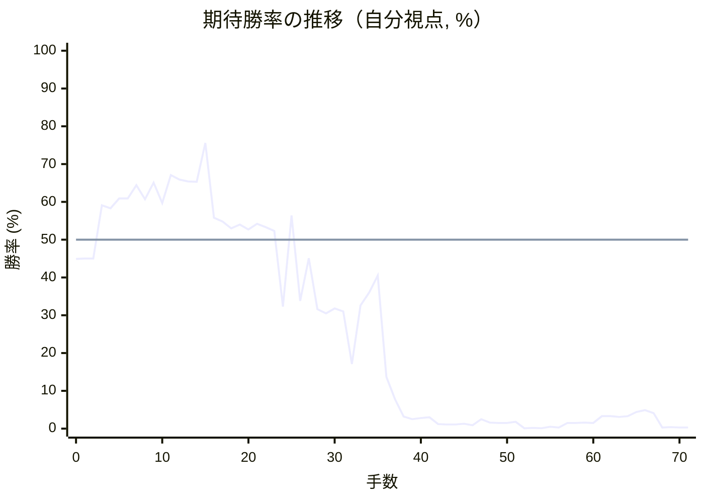
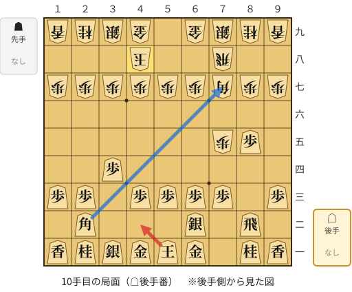
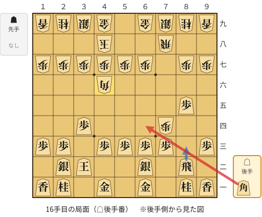
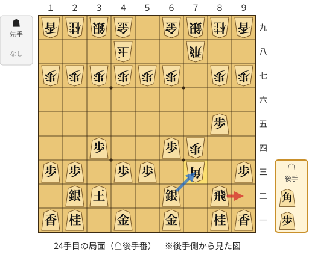
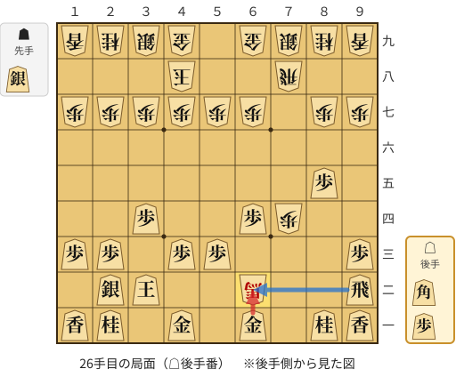
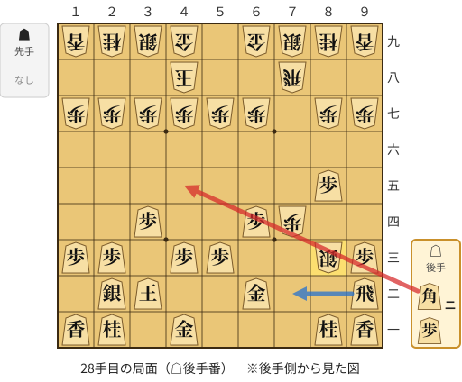
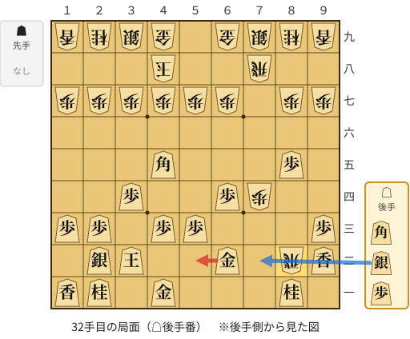
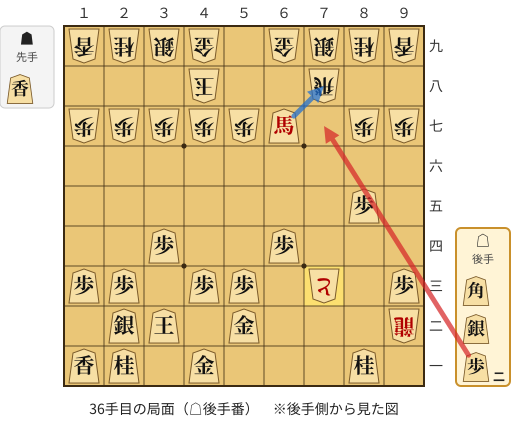

# 解析レポート mu18rwlbk7py

[README に戻る](../../../README.md)　/　棋譜: [CSA](../../../data/csa/shogi5/mu18rwlbk7py.csa)　/　解析の見方: [docs/mistake_analysis.md](../../../docs/mistake_analysis.md)

## 対局情報

| 項目 | 内容 |
|---|---|
| 日時 | 2026-11-14 16:41:54 |
| 持ち時間 | 5分 |
| 自分 | 後手（△）（1648） |
| 相手 | 相手（1953） |
| 結果 | 負け（切断, 71手） |

## 解析環境

| 項目 | 内容 |
|---|---|
| エンジン | YaneuraOu NNUE 9.00git 64AVX2（V9.00/YANEURAOU_ENGINE_NNUE/AVX2） |
| 評価関数 | **水匠5**（`suisho5`） |
| nn.bin SHA-256 | `768068f0d534a0603a5d38bcd143de6bbca820d5f1c95a14d40863e5b7892d76` |
| 第1パス | movetime=150ms, MultiPV 1 |
| 第2パス | movetime=2000ms, MultiPV 3 |
| Threads / Hash | 8 / 512MB |
| 判定基準 | 疑問手 ≥5pt, 悪手 ≥10pt, 大悪手 ≥20pt（期待勝率 W(E)=1/(1+exp(-E/600))） |
| 解析日時 | 2026-11-20T20:27:59+09:00（解析バージョン 1, 39秒） |

## サマリー

| 自分の手数 | 深掘りした手 | 詰み逃し | 大悪手 | 悪手 | 疑問手 |
|--:|--:|--:|--:|--:|--:|
| 35 | 7 | 0 | 1 | 4 | 2 |

## 期待勝率の推移



<details><summary>1手ごとの数値（第1パス）</summary>

| 手数 | 指し手 | 評価値 | 勝率 | 低下 | 判定 |
|--:|---|--:|--:|--:|---|
| 1 | ▲７六歩(77) | -120 | 45.0% |  |  |
| 2 | △８四歩(83) | -120 | 45.0% | +0.0pt |  |
| 3 | ▲７五歩(76) | +220 | 59.1% |  |  |
| 4 | △８五歩(84) | +201 | 58.3% | +0.8pt |  |
| 5 | ▲７七角(88) | +266 | 60.9% |  |  |
| 6 | △３四歩(33) | +266 | 60.9% | +0.0pt |  |
| 7 | ▲７八飛(28) | +356 | 64.4% |  |  |
| 8 | △６二銀(71) | +260 | 60.7% | +3.7pt |  |
| 9 | ▲４八玉(59) | +373 | 65.1% |  |  |
| 10 | △４二玉(51) | +236 | 59.7% | +5.4pt | [疑問手](#ply-10) |
| 11 | ▲７四歩(75) | +428 | 67.1% |  |  |
| 12 | △３二玉(42) | +396 | 65.9% | +1.2pt |  |
| 13 | ▲２二角成(77) | +382 | 65.4% |  |  |
| 14 | △同銀(31) | +380 | 65.3% | +0.1pt |  |
| 15 | ▲４六角打 | +678 | 75.6% |  |  |
| 16 | △６四角打 | +140 | 55.8% | +19.8pt | [悪手](#ply-16) |
| 17 | ▲同角(46) | +116 | 54.8% |  |  |
| 18 | △同歩(63) | +71 | 53.0% | +1.9pt |  |
| 19 | ▲７三歩成(74) | +97 | 54.0% |  |  |
| 20 | △同銀(62) | +66 | 52.7% | +1.3pt |  |
| 21 | ▲７四歩打 | +101 | 54.2% |  |  |
| 22 | △６二銀(73) | +80 | 53.3% | +0.9pt |  |
| 23 | ▲７三角打 | +56 | 52.3% |  |  |
| 24 | △９二飛(82) | -444 | 32.3% | +20.0pt | [悪手](#ply-24) |
| 25 | ▲６二角成(73) | +154 | 56.4% |  |  |
| 26 | △同金(61) | -404 | 33.8% | +22.6pt | [疑問手](#ply-26) |
| 27 | ▲８三銀打 | -118 | 45.1% |  |  |
| 28 | △４五角打 | -463 | 31.6% | +13.5pt | [悪手](#ply-28) |
| 29 | ▲９二銀成(83) | -495 | 30.5% |  |  |
| 30 | △同香(91) | -458 | 31.8% | -1.3pt |  |
| 31 | ▲８二飛打 | -480 | 31.0% |  |  |
| 32 | △５二金(62) | -947 | 17.1% | +13.9pt | [悪手](#ply-32) |
| 33 | ▲９二飛成(82) | -437 | 32.6% |  |  |
| 34 | △６七角成(45) | -345 | 36.0% | -3.5pt |  |
| 35 | ▲７三歩成(74) | -232 | 40.5% |  |  |
| 36 | △７七歩打 | -1102 | 13.7% | +26.7pt | [大悪手](#ply-36) |
| 37 | ▲同飛(78) | -1480 | 7.8% |  |  |
| 38 | △８九馬(67) | -2052 | 3.2% | +4.7pt |  |
| 39 | ▲６三と(73) | -2193 | 2.5% |  |  |
| 40 | △４二金(52) | -2137 | 2.8% | -0.2pt |  |
| 41 | ▲５三と(63) | -2092 | 3.0% |  |  |
| 42 | △９九馬(89) | -2628 | 1.2% | +1.7pt |  |
| 43 | ▲４二と(53) | -2718 | 1.1% |  |  |
| 44 | △同金(41) | -2721 | 1.1% | +0.0pt |  |
| 45 | ▲７二飛成(77) | -2618 | 1.3% |  |  |
| 46 | △３一銀(22) | -2807 | 0.9% | +0.3pt |  |
| 47 | ▲７七歩打 | -2188 | 2.5% |  |  |
| 48 | △５二香打 | -2464 | 1.6% | +0.9pt |  |
| 49 | ▲同龍(72) | -2523 | 1.5% |  |  |
| 50 | △同金(42) | -2491 | 1.5% | -0.1pt |  |
| 51 | ▲同龍(92) | -2413 | 1.8% |  |  |
| 52 | △４二銀打 | -3958 | 0.1% | +1.6pt |  |
| 53 | ▲４一金打 | -3867 | 0.2% |  |  |
| 54 | △７一飛打 | -4116 | 0.1% | +0.1pt |  |
| 55 | ▲３一金(41) | -3137 | 0.5% |  |  |
| 56 | △同飛(71) | -3564 | 0.3% | +0.3pt |  |
| 57 | ▲５三銀打 | -2516 | 1.5% |  |  |
| 58 | △５一金打 | -2511 | 1.5% | -0.0pt |  |
| 59 | ▲４二銀成(53) | -2472 | 1.6% |  |  |
| 60 | △同金(51) | -2504 | 1.5% | +0.1pt |  |
| 61 | ▲２二金打 | -2021 | 3.3% |  |  |
| 62 | △同玉(32) | -2030 | 3.3% | +0.0pt |  |
| 63 | ▲４二龍(52) | -2067 | 3.1% |  |  |
| 64 | △３二金打 | -2034 | 3.3% | -0.2pt |  |
| 65 | ▲３一龍(42) | -1844 | 4.4% |  |  |
| 66 | △同金(32) | -1781 | 4.9% | -0.5pt |  |
| 67 | ▲２六香打 | -1896 | 4.1% |  |  |
| 68 | △７七馬(99) | -3481 | 0.3% | +3.8pt |  |
| 69 | ▲７二飛打 | -3283 | 0.4% |  |  |
| 70 | △３二銀打 | -3585 | 0.3% | +0.2pt |  |
| 71 | ▲７七飛成(72) | -3563 | 0.3% |  |  |

</details>

## 課題局面

<a id="ply-10"></a>
### 10手目 △４二玉(51) — 疑問手

| | 着手前 | 着手後 | 差 |
|---|--:|--:|--:|
| 期待勝率 | 65.1% | 59.6% | -5.5pt |
| 評価値 | +374 | +233 | |

着手前の局面:



🔴 実戦 △４二玉(51)　🔵 AI推奨 △７七角成(22)　🟨 直前の相手の指し手

<details><summary>テキストの盤面図（BOD・将棋ソフトに貼り付け可）</summary>

```text
後手の持駒：なし
  ９ ８ ７ ６ ５ ４ ３ ２ １
+---------------------------+
|v香v桂 ・v金v玉v金v銀v桂v香|一
| ・v飛 ・v銀 ・ ・ ・v角 ・|二
|v歩 ・v歩v歩v歩v歩 ・v歩v歩|三
| ・ ・ ・ ・ ・ ・v歩 ・ ・|四
| ・v歩 歩 ・ ・ ・ ・ ・ ・|五
| ・ ・ ・ ・ ・ ・ ・ ・ ・|六
| 歩 歩 角 歩 歩 歩 歩 歩 歩|七
| ・ ・ 飛 ・ ・ 玉 ・ ・ ・|八
| 香 桂 銀 金 ・ 金 銀 桂 香|九
+---------------------------+
先手の持駒：なし
後手番
手数＝9　▲４八玉　まで
```

</details>

| | 指し手 | 評価値 | 読み筋 |
|---|---|--:|---|
| 実戦 | △４二玉(51) | +233 | ▲６六歩(67) △６四歩(63) ▲６八銀(79) △３二玉(42) ▲１六歩(17) △６三銀(62) |
| AI 1位 | △７七角成(22) | +374 | △７七角成(22) ▲同桂(89) △４二玉(51) ▲７四歩(75) △３三桂(21) ▲６五桂(77) |
| AI 2位 | △１四歩(13) | +343 | △１四歩(13) ▲６八銀(79) △４二玉(51) ▲３八玉(48) △１五歩(14) ▲７四歩(75) |
| AI 3位 | △６四歩(63) | +281 | △６四歩(63) ▲６六歩(67) △１四歩(13) ▲１六歩(17) △４二玉(51) ▲３八銀(39) |

SFEN: `ln1gkgsnl/1r1s3b1/p1pppp1pp/6p2/1pP6/9/PPBPPPPPP/2R2K3/LNSG1GSNL w - 10`

<a id="ply-16"></a>
### 16手目 △６四角打 — 悪手

| | 着手前 | 着手後 | 差 |
|---|--:|--:|--:|
| 期待勝率 | 68.4% | 52.3% | -16.1pt |
| 評価値 | +462 | +55 | |

着手前の局面:



🔴 実戦 △６四角打　🔵 AI推奨 △８三飛(82)　🟨 直前の相手の指し手

<details><summary>テキストの盤面図（BOD・将棋ソフトに貼り付け可）</summary>

```text
後手の持駒：角
  ９ ８ ７ ６ ５ ４ ３ ２ １
+---------------------------+
|v香v桂 ・v金 ・v金 ・v桂v香|一
| ・v飛 ・v銀 ・ ・v玉v銀 ・|二
|v歩 ・v歩v歩v歩v歩 ・v歩v歩|三
| ・ ・ 歩 ・ ・ ・v歩 ・ ・|四
| ・v歩 ・ ・ ・ ・ ・ ・ ・|五
| ・ ・ ・ ・ ・ 角 ・ ・ ・|六
| 歩 歩 ・ 歩 歩 歩 歩 歩 歩|七
| ・ ・ 飛 ・ ・ 玉 ・ ・ ・|八
| 香 桂 銀 金 ・ 金 銀 桂 香|九
+---------------------------+
先手の持駒：なし
後手番
手数＝15　▲４六角　まで
```

</details>

| | 指し手 | 評価値 | 読み筋 |
|---|---|--:|---|
| 実戦 | △６四角打 | +55 | ▲同角(46) △同歩(63) ▲７三歩成(74) △同銀(62) ▲７四歩打 △８四銀(73) |
| AI 1位 | △８三飛(82) | +462 | △８三飛(82) ▲７三歩成(74) △同銀(62) ▲同飛成(78) △同飛(83) ▲７四歩打 |
| AI 2位 | △７二金(61) | +286 | △７二金(61) ▲７三歩成(74) △同銀(62) ▲７四歩打 △６四銀(73) ▲同角(46) |
| AI 3位 | △７二飛(82) | +223 | △７二飛(82) ▲７五飛(78) △４四角打 ▲７七桂(89) △７四歩(73) ▲８五飛(75) |

SFEN: `ln1g1g1nl/1r1s2ks1/p1pppp1pp/2P3p2/1p7/5B3/PP1PPPPPP/2R2K3/LNSG1GSNL w b 16`

<a id="ply-24"></a>
### 24手目 △９二飛(82) — 悪手

| | 着手前 | 着手後 | 差 |
|---|--:|--:|--:|
| 期待勝率 | 53.6% | 36.7% | -16.9pt |
| 評価値 | +87 | -327 | |

着手前の局面:



🔴 実戦 △９二飛(82)　🔵 AI推奨 △同銀(62)　🟨 直前の相手の指し手

<details><summary>テキストの盤面図（BOD・将棋ソフトに貼り付け可）</summary>

```text
後手の持駒：角　歩
  ９ ８ ７ ６ ５ ４ ３ ２ １
+---------------------------+
|v香v桂 ・v金 ・v金 ・v桂v香|一
| ・v飛 ・v銀 ・ ・v玉v銀 ・|二
|v歩 ・ 角 ・v歩v歩 ・v歩v歩|三
| ・ ・ 歩v歩 ・ ・v歩 ・ ・|四
| ・v歩 ・ ・ ・ ・ ・ ・ ・|五
| ・ ・ ・ ・ ・ ・ ・ ・ ・|六
| 歩 歩 ・ 歩 歩 歩 歩 歩 歩|七
| ・ ・ 飛 ・ ・ 玉 ・ ・ ・|八
| 香 桂 銀 金 ・ 金 銀 桂 香|九
+---------------------------+
先手の持駒：なし
後手番
手数＝23　▲７三角　まで
```

</details>

| | 指し手 | 評価値 | 読み筋 |
|---|---|--:|---|
| 実戦 | △９二飛(82) | -327 | ▲６四角成(73) △４五角打 ▲３八玉(48) △６七角成(45) ▲６三歩打 △５二金(61) |
| AI 1位 | △同銀(62) | +87 | △同銀(62) ▲同歩成(74) △４二飛(82) ▲６三と(73) △４四角打 ▲７四飛(78) |
| AI 2位 | △同桂(81) | -218 | △同桂(81) ▲同歩成(74) △同銀(62) ▲同飛成(78) △６二飛(82) ▲７五龍(73) |
| AI 3位 | △９二飛(82) | -221 | △９二飛(82) ▲６四角成(73) △４五角打 ▲３八玉(48) △６七角成(45) ▲５五馬(64) |

SFEN: `ln1g1g1nl/1r1s2ks1/p1B1pp1pp/2Pp2p2/1p7/9/PP1PPPPPP/2R2K3/LNSG1GSNL w bp 24`

<a id="ply-26"></a>
### 26手目 △同金(61) — 疑問手

| | 着手前 | 着手後 | 差 |
|---|--:|--:|--:|
| 期待勝率 | 52.6% | 43.1% | -9.5pt |
| 評価値 | +62 | -166 | |

着手前の局面:



🔴 実戦 △同金(61)　🔵 AI推奨 △同飛(92)　🟨 直前の相手の指し手

<details><summary>テキストの盤面図（BOD・将棋ソフトに貼り付け可）</summary>

```text
後手の持駒：角　歩
  ９ ８ ７ ６ ５ ４ ３ ２ １
+---------------------------+
|v香v桂 ・v金 ・v金 ・v桂v香|一
|v飛 ・ ・ 馬 ・ ・v玉v銀 ・|二
|v歩 ・ ・ ・v歩v歩 ・v歩v歩|三
| ・ ・ 歩v歩 ・ ・v歩 ・ ・|四
| ・v歩 ・ ・ ・ ・ ・ ・ ・|五
| ・ ・ ・ ・ ・ ・ ・ ・ ・|六
| 歩 歩 ・ 歩 歩 歩 歩 歩 歩|七
| ・ ・ 飛 ・ ・ 玉 ・ ・ ・|八
| 香 桂 銀 金 ・ 金 銀 桂 香|九
+---------------------------+
先手の持駒：銀
後手番
手数＝25　▲６二角成　まで
```

</details>

| | 指し手 | 評価値 | 読み筋 |
|---|---|--:|---|
| 実戦 | △同金(61) | -166 | ▲８三銀打 △７二飛(92) ▲同銀成(83) △同金(62) ▲６一飛打 △７一歩打 |
| AI 1位 | △同飛(92) | +62 | △同飛(92) ▲７三歩成(74) △同桂(81) ▲同飛成(78) △４四角打 ▲７七桂(89) |
| AI 2位 | △同金(61) | -211 | △同金(61) ▲８三銀打 △７二飛(92) ▲同銀成(83) △同金(62) ▲６一飛打 |
| AI 3位 | △７七歩打 | -2036 | △７七歩打 ▲６一馬(62) △７八歩成(77) ▲同銀(79) △２四歩(23) ▲７一馬(61) |

SFEN: `ln1g1g1nl/r2+B2ks1/p3pp1pp/2Pp2p2/1p7/9/PP1PPPPPP/2R2K3/LNSG1GSNL w Sbp 26`

<a id="ply-28"></a>
### 28手目 △４五角打 — 悪手

| | 着手前 | 着手後 | 差 |
|---|--:|--:|--:|
| 期待勝率 | 42.7% | 28.1% | -14.6pt |
| 評価値 | -177 | -565 | |

着手前の局面:



🔴 実戦 △４五角打　🔵 AI推奨 △７二飛(92)　🟨 直前の相手の指し手

<details><summary>テキストの盤面図（BOD・将棋ソフトに貼り付け可）</summary>

```text
後手の持駒：角二　歩
  ９ ８ ７ ６ ５ ４ ３ ２ １
+---------------------------+
|v香v桂 ・ ・ ・v金 ・v桂v香|一
|v飛 ・ ・v金 ・ ・v玉v銀 ・|二
|v歩 銀 ・ ・v歩v歩 ・v歩v歩|三
| ・ ・ 歩v歩 ・ ・v歩 ・ ・|四
| ・v歩 ・ ・ ・ ・ ・ ・ ・|五
| ・ ・ ・ ・ ・ ・ ・ ・ ・|六
| 歩 歩 ・ 歩 歩 歩 歩 歩 歩|七
| ・ ・ 飛 ・ ・ 玉 ・ ・ ・|八
| 香 桂 銀 金 ・ 金 銀 桂 香|九
+---------------------------+
先手の持駒：なし
後手番
手数＝27　▲８三銀　まで
```

</details>

| | 指し手 | 評価値 | 読み筋 |
|---|---|--:|---|
| 実戦 | △４五角打 | -565 | ▲９二銀不成(83) △同香(91) |
| AI 1位 | △７二飛(92) | -177 | △７二飛(92) ▲同銀不成(83) △同金(62) ▲６一飛打 △７一歩打 ▲７三歩成(74) |
| AI 2位 | △７二角打 | -210 | △７二角打 ▲９二銀不成(83) △同香(91) ▲３八銀(39) △５五角打 ▲８八銀(79) |
| AI 3位 | △４五角打 | -535 | △４五角打 ▲９二銀不成(83) △同香(91) ▲８二飛打 △７二銀打 ▲９二飛成(82) |

SFEN: `ln3g1nl/r2g2ks1/pS2pp1pp/2Pp2p2/1p7/9/PP1PPPPPP/2R2K3/LNSG1GSNL w 2bp 28`

<a id="ply-32"></a>
### 32手目 △５二金(62) — 悪手

| | 着手前 | 着手後 | 差 |
|---|--:|--:|--:|
| 期待勝率 | 30.1% | 13.1% | -17.0pt |
| 評価値 | -506 | -1137 | |

着手前の局面:



🔴 実戦 △５二金(62)　🔵 AI推奨 △７二銀打　🟨 直前の相手の指し手

<details><summary>テキストの盤面図（BOD・将棋ソフトに貼り付け可）</summary>

```text
後手の持駒：角　銀　歩
  ９ ８ ７ ６ ５ ４ ３ ２ １
+---------------------------+
| ・v桂 ・ ・ ・v金 ・v桂v香|一
|v香 飛 ・v金 ・ ・v玉v銀 ・|二
|v歩 ・ ・ ・v歩v歩 ・v歩v歩|三
| ・ ・ 歩v歩 ・ ・v歩 ・ ・|四
| ・v歩 ・ ・ ・v角 ・ ・ ・|五
| ・ ・ ・ ・ ・ ・ ・ ・ ・|六
| 歩 歩 ・ 歩 歩 歩 歩 歩 歩|七
| ・ ・ 飛 ・ ・ 玉 ・ ・ ・|八
| 香 桂 銀 金 ・ 金 銀 桂 香|九
+---------------------------+
先手の持駒：なし
後手番
手数＝31　▲８二飛　まで
```

</details>

| | 指し手 | 評価値 | 読み筋 |
|---|---|--:|---|
| 実戦 | △５二金(62) | -1137 | ▲７三歩成(74) △同桂(81) ▲同飛成(78) △６七角成(45) ▲７八銀(79) △４五馬(67) |
| AI 1位 | △７二銀打 | -506 | △７二銀打 ▲９二飛成(82) △８六歩(85) ▲同歩(87) △２七角成(45) ▲８四香打 |
| AI 2位 | △７二角打 | -884 | △７二角打 ▲９二飛成(82) △６七角成(45) ▲６三香打 △同角(72) ▲６二龍(92) |
| AI 3位 | △７二歩打 | -896 | △７二歩打 ▲８一飛成(82) △２七角成(45) ▲７五飛(78) △６三馬(27) ▲９二龍(81) |

SFEN: `1n3g1nl/lR1g2ks1/p3pp1pp/2Pp2p2/1p3b3/9/PP1PPPPPP/2R2K3/LNSG1GSNL w bsp 32`

<a id="ply-36"></a>
### 36手目 △７七歩打 — 大悪手

| | 着手前 | 着手後 | 差 |
|---|--:|--:|--:|
| 期待勝率 | 43.7% | 9.0% | -34.7pt |
| 評価値 | -152 | -1391 | |

着手前の局面:



🔴 実戦 △７七歩打　🔵 AI推奨 △７八馬(67)　🟨 直前の相手の指し手

<details><summary>テキストの盤面図（BOD・将棋ソフトに貼り付け可）</summary>

```text
後手の持駒：角　銀　歩二
  ９ ８ ７ ６ ５ ４ ３ ２ １
+---------------------------+
| ・v桂 ・ ・ ・v金 ・v桂v香|一
| 龍 ・ ・ ・v金 ・v玉v銀 ・|二
|v歩 ・ と ・v歩v歩 ・v歩v歩|三
| ・ ・ ・v歩 ・ ・v歩 ・ ・|四
| ・v歩 ・ ・ ・ ・ ・ ・ ・|五
| ・ ・ ・ ・ ・ ・ ・ ・ ・|六
| 歩 歩 ・v馬 歩 歩 歩 歩 歩|七
| ・ ・ 飛 ・ ・ 玉 ・ ・ ・|八
| 香 桂 銀 金 ・ 金 銀 桂 香|九
+---------------------------+
先手の持駒：香
後手番
手数＝35　▲７三歩成　まで
```

</details>

| | 指し手 | 評価値 | 読み筋 |
|---|---|--:|---|
| 実戦 | △７七歩打 | -1391 | ▲同飛(78) △同馬(67) ▲同桂(89) △７三桂(81) ▲７四歩打 △６六飛打 |
| AI 1位 | △７八馬(67) | -152 | △７八馬(67) ▲同銀(79) △７三桂(81) ▲９一角打 △６二銀打 ▲８二角成(91) |
| AI 2位 | △４九馬(67) | -756 | △４九馬(67) ▲同玉(48) △６七角打 ▲３八玉(49) △７八角成(67) ▲同銀(79) |
| AI 3位 | △同桂(81) | -791 | △同桂(81) ▲同飛成(78) △６五角打 ▲７二龍(92) △５四角(65) ▲６一龍(72) |

SFEN: `1n3g1nl/+R3g1ks1/p1+P1pp1pp/3p2p2/1p7/9/PP1+bPPPPP/2R2K3/LNSG1GSNL w Lbs2p 36`

