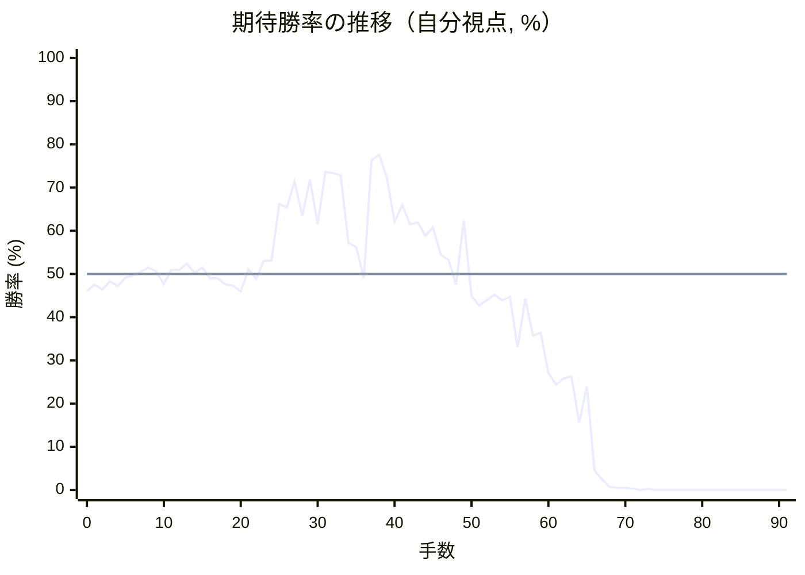

# 解析レポート ng7uaordy1sh

[README に戻る](../../../README.md)　/　棋譜: [CSA](../../../data/csa/shogi5/ng7uaordy1sh.csa)　/　解析の見方: [docs/mistake_analysis.md](../../../docs/mistake_analysis.md)

## 対局情報

| 項目 | 内容 |
|---|---|
| 日時 | 2026-11-04 07:48:36 |
| 持ち時間 | 5分 |
| 自分 | 後手（△）（1729） |
| 相手 | 相手（1800） |
| 結果 | 負け（時間切れ, 91手） |

## 解析環境

| 項目 | 内容 |
|---|---|
| エンジン | YaneuraOu NNUE 9.00git 64AVX2（V9.00/YANEURAOU_ENGINE_NNUE/AVX2） |
| 評価関数 | **水匠5**（`suisho5`） |
| nn.bin SHA-256 | `768068f0d534a0603a5d38bcd143de6bbca820d5f1c95a14d40863e5b7892d76` |
| 第1パス | movetime=150ms, MultiPV 1 |
| 第2パス | movetime=2000ms, MultiPV 3 |
| Threads / Hash | 8 / 512MB |
| 判定基準 | 疑問手 ≥5pt, 悪手 ≥10pt, 大悪手 ≥20pt（期待勝率 W(E)=1/(1+exp(-E/600))） |
| 解析日時 | 2026-11-11T20:39:18+09:00（解析バージョン 1, 62秒） |

## サマリー

| 自分の手数 | 深掘りした手 | 詰み逃し | 大悪手 | 悪手 | 疑問手 |
|--:|--:|--:|--:|--:|--:|
| 45 | 12 | 0 | 1 | 5 | 3 |

## 期待勝率の推移



<details><summary>1手ごとの数値（第1パス）</summary>

| 手数 | 指し手 | 評価値 | 勝率 | 低下 | 判定 |
|--:|---|--:|--:|--:|---|
| 1 | ▲２六歩(27) | -61 | 47.5% |  |  |
| 2 | △８四歩(83) | -86 | 46.4% | +1.0pt |  |
| 3 | ▲２五歩(26) | -41 | 48.3% |  |  |
| 4 | △８五歩(84) | -67 | 47.2% | +1.1pt |  |
| 5 | ▲７八金(69) | -22 | 49.1% |  |  |
| 6 | △３二金(41) | -8 | 49.7% | -0.6pt |  |
| 7 | ▲２四歩(25) | +12 | 50.5% |  |  |
| 8 | △同歩(23) | +36 | 51.5% | -1.0pt |  |
| 9 | ▲同飛(28) | +14 | 50.6% |  |  |
| 10 | △１四歩(13) | -56 | 47.7% | +2.9pt |  |
| 11 | ▲５八金(49) | +24 | 51.0% |  |  |
| 12 | △２三歩打 | +21 | 50.9% | +0.1pt |  |
| 13 | ▲２八飛(24) | +58 | 52.4% |  |  |
| 14 | △５二玉(51) | +5 | 50.2% | +2.2pt |  |
| 15 | ▲３八銀(39) | +35 | 51.5% |  |  |
| 16 | △８六歩(85) | -23 | 49.0% | +2.4pt |  |
| 17 | ▲同歩(87) | -25 | 49.0% |  |  |
| 18 | △同飛(82) | -58 | 47.6% | +1.4pt |  |
| 19 | ▲８七歩打 | -65 | 47.3% |  |  |
| 20 | △８四飛(86) | -97 | 46.0% | +1.3pt |  |
| 21 | ▲２七銀(38) | +26 | 51.1% |  |  |
| 22 | △３四歩(33) | -27 | 48.9% | +2.2pt |  |
| 23 | ▲２六銀(27) | +71 | 53.0% |  |  |
| 24 | △３三角(22) | +74 | 53.1% | -0.1pt |  |
| 25 | ▲２五銀(26) | +404 | 66.2% |  |  |
| 26 | △３五歩(34) | +381 | 65.4% | +0.9pt |  |
| 27 | ▲７六歩(77) | +550 | 71.4% |  |  |
| 28 | △２二銀(31) | +332 | 63.5% | +7.9pt | [疑問手](#ply-28) |
| 29 | ▲１六銀(25) | +560 | 71.8% |  |  |
| 30 | △３六歩(35) | +280 | 61.5% | +10.3pt |  |
| 31 | ▲４八金(58) | +614 | 73.6% |  |  |
| 32 | △３七歩成(36) | +610 | 73.4% | +0.1pt |  |
| 33 | ▲同金(48) | +591 | 72.8% |  |  |
| 34 | △３六歩打 | +175 | 57.2% | +15.6pt | [悪手](#ply-34) |
| 35 | ▲同金(37) | +150 | 56.2% |  |  |
| 36 | △８六歩打 | -22 | 49.1% | +7.1pt |  |
| 37 | ▲３三角成(88) | +703 | 76.3% |  |  |
| 38 | △同銀(22) | +746 | 77.6% | -1.3pt |  |
| 39 | ▲６六角打 | +576 | 72.3% |  |  |
| 40 | △７四飛(84) | +297 | 62.1% | +10.2pt | [悪手](#ply-40) |
| 41 | ▲８六歩(87) | +394 | 65.9% |  |  |
| 42 | △７六飛(74) | +282 | 61.5% | +4.3pt |  |
| 43 | ▲７七金(78) | +291 | 61.9% |  |  |
| 44 | △７四飛(76) | +215 | 58.9% | +3.0pt |  |
| 45 | ▲７五歩打 | +263 | 60.8% |  |  |
| 46 | △３四飛(74) | +108 | 54.5% | +6.3pt | [疑問手](#ply-46) |
| 47 | ▲２五銀(16) | +80 | 53.3% |  |  |
| 48 | △８四飛(34) | -57 | 47.6% | +5.7pt | [疑問手](#ply-48) |
| 49 | ▲６八玉(59) | +304 | 62.4% |  |  |
| 50 | △９四歩(93) | -122 | 44.9% | +17.5pt | [悪手](#ply-50) |
| 51 | ▲３四歩打 | -176 | 42.7% |  |  |
| 52 | △２二銀(33) | -145 | 44.0% | -1.3pt |  |
| 53 | ▲２四歩打 | -115 | 45.2% |  |  |
| 54 | △同歩(23) | -146 | 43.9% | +1.3pt |  |
| 55 | ▲同銀(25) | -128 | 44.7% |  |  |
| 56 | △３四飛(84) | -426 | 33.0% | +11.7pt | [大悪手](#ply-56) |
| 57 | ▲３五金(36) | -137 | 44.3% |  |  |
| 58 | △６四飛(34) | -352 | 35.7% | +8.6pt |  |
| 59 | ▲２三歩打 | -335 | 36.4% |  |  |
| 60 | △６六飛(64) | -594 | 27.1% | +9.3pt |  |
| 61 | ▲同金(77) | -680 | 24.4% |  |  |
| 62 | △３一銀(22) | -633 | 25.8% | -1.5pt |  |
| 63 | ▲３三歩打 | -617 | 26.3% |  |  |
| 64 | △６四角打 | -1014 | 15.6% | +10.8pt | [悪手](#ply-64) |
| 65 | ▲２五飛(28) | -691 | 24.0% |  |  |
| 66 | △３三金(32) | -1828 | 4.5% | +19.5pt | [悪手](#ply-66) |
| 67 | ▲２二歩成(23) | -2217 | 2.4% |  |  |
| 68 | △同銀(31) | -2957 | 0.7% | +1.7pt |  |
| 69 | ▲３三銀成(24) | -3183 | 0.5% |  |  |
| 70 | △同銀(22) | -3204 | 0.5% | +0.0pt |  |
| 71 | ▲２一飛成(25) | -3434 | 0.3% |  |  |
| 72 | △７二銀(71) | -5171 | 0.0% | +0.3pt |  |
| 73 | ▲３二龍(21) | -3417 | 0.3% |  |  |
| 74 | △４二銀(33) | -5390 | 0.0% | +0.3pt |  |
| 75 | ▲３四桂打 | -5191 | 0.0% |  |  |
| 76 | △５一銀打 | -6314 | 0.0% | +0.0pt |  |
| 77 | ▲３三金打 | -5160 | 0.0% |  |  |
| 78 | △５四歩(53) | -5925 | 0.0% | +0.0pt |  |
| 79 | ▲４二桂成(34) | -6325 | 0.0% |  |  |
| 80 | △同銀(51) | -6384 | 0.0% | +0.0pt |  |
| 81 | ▲同金(33) | -5484 | 0.0% |  |  |
| 82 | △同角(64) | -5610 | 0.0% | +0.0pt |  |
| 83 | ▲３三銀打 | -5794 | 0.0% |  |  |
| 84 | △６二玉(52) | -6198 | 0.0% | +0.0pt |  |
| 85 | ▲４二銀成(33) | -6043 | 0.0% |  |  |
| 86 | △６四桂打 | #-3 | 0.0% | +0.0pt |  |
| 87 | ▲５二銀打 | -6220 | 0.0% |  |  |
| 88 | △７一玉(62) | -6580 | 0.0% | +0.0pt |  |
| 89 | ▲６一銀成(52) | -6411 | 0.0% |  |  |
| 90 | △同銀(72) | -6792 | 0.0% | +0.0pt |  |
| 91 | ▲５一成銀(42) | -7514 | 0.0% |  |  |

</details>

## 課題局面

<a id="ply-28"></a>
### 28手目 △２二銀(31) — 疑問手

| | 着手前 | 着手後 | 差 |
|---|--:|--:|--:|
| 期待勝率 | 75.2% | 68.5% | -6.6pt |
| 評価値 | +665 | +467 | |

着手前の局面:

```text
後手の持駒：歩
  ９ ８ ７ ６ ５ ４ ３ ２ １
+---------------------------+
|v香v桂v銀v金 ・ ・v銀v桂v香|一
| ・ ・ ・ ・v玉 ・v金 ・ ・|二
|v歩 ・v歩v歩v歩v歩v角v歩 ・|三
| ・v飛 ・ ・ ・ ・ ・ ・v歩|四
| ・ ・ ・ ・ ・ ・v歩 銀 ・|五
| ・ ・ 歩 ・ ・ ・ ・ ・ ・|六
| 歩 歩 ・ 歩 歩 歩 歩 ・ 歩|七
| ・ 角 金 ・ 金 ・ ・ 飛 ・|八
| 香 桂 銀 ・ 玉 ・ ・ 桂 香|九
+---------------------------+
先手の持駒：歩
後手番
手数＝27　▲７六歩　まで
```

| | 指し手 | 評価値 | 読み筋 |
|---|---|--:|---|
| 実戦 | △２二銀(31) | +467 | ▲１六銀(25) △２四飛(84) ▲２五歩打 △８八角成(33) ▲同銀(79) △３四飛(24) |
| AI 1位 | △１五歩(14) | +665 | △１五歩(14) ▲９六歩(97) △２二銀(31) ▲６九玉(59) △１三桂(21) ▲３三角成(88) |
| AI 2位 | △５四飛(84) | +648 | △５四飛(84) ▲６九玉(59) △８八角成(33) ▲同銀(79) △３三桂(21) ▲６六角打 |
| AI 3位 | △２二銀(31) | +485 | △２二銀(31) ▲１六銀(25) △２四飛(84) ▲２五歩打 △３四飛(24) ▲２七銀(16) |

SFEN: `lnsg2snl/4k1g2/p1ppppbp1/1r6p/6pS1/2P6/PP1PPPP1P/1BG1G2R1/LNS1K2NL w Pp 28`

<a id="ply-34"></a>
### 34手目 △３六歩打 — 悪手

| | 着手前 | 着手後 | 差 |
|---|--:|--:|--:|
| 期待勝率 | 67.6% | 52.3% | -15.3pt |
| 評価値 | +441 | +56 | |

着手前の局面:

```text
後手の持駒：歩二
  ９ ８ ７ ６ ５ ４ ３ ２ １
+---------------------------+
|v香v桂v銀v金 ・ ・ ・v桂v香|一
| ・ ・ ・ ・v玉 ・v金v銀 ・|二
|v歩 ・v歩v歩v歩v歩v角v歩 ・|三
| ・v飛 ・ ・ ・ ・ ・ ・v歩|四
| ・ ・ ・ ・ ・ ・ ・ ・ ・|五
| ・ ・ 歩 ・ ・ ・ ・ ・ 銀|六
| 歩 歩 ・ 歩 歩 歩 金 ・ 歩|七
| ・ 角 金 ・ ・ ・ ・ 飛 ・|八
| 香 桂 銀 ・ 玉 ・ ・ 桂 香|九
+---------------------------+
先手の持駒：歩二
後手番
手数＝33　▲３七同金　まで
```

| | 指し手 | 評価値 | 読み筋 |
|---|---|--:|---|
| 実戦 | △３六歩打 | +56 | ▲同金(37) △２四飛(84) ▲２五銀(16) △５四飛(24) ▲４八玉(59) △８八角成(33) |
| AI 1位 | △３四飛(84) | +441 | △３四飛(84) ▲３六歩打 △８八角成(33) ▲同銀(79) △５四飛(34) ▲６八玉(59) |
| AI 2位 | △５四飛(84) | +416 | △５四飛(84) ▲６八玉(59) △８八角成(33) ▲同銀(79) △３六歩打 ▲同金(37) |
| AI 3位 | △８八角成(33) | +408 | △８八角成(33) ▲同銀(79) △３三桂(21) ▲４六歩(47) △２四飛(84) ▲２六歩打 |

SFEN: `lnsg3nl/4k1gs1/p1ppppbp1/1r6p/9/2P5S/PP1PPPG1P/1BG4R1/LNS1K2NL w 2P2p 34`

<a id="ply-40"></a>
### 40手目 △７四飛(84) — 悪手

| | 着手前 | 着手後 | 差 |
|---|--:|--:|--:|
| 期待勝率 | 72.2% | 59.5% | -12.7pt |
| 評価値 | +574 | +232 | |

着手前の局面:

```text
後手の持駒：角
  ９ ８ ７ ６ ５ ４ ３ ２ １
+---------------------------+
|v香v桂v銀v金 ・ ・ ・v桂v香|一
| ・ ・ ・ ・v玉 ・v金 ・ ・|二
|v歩 ・v歩v歩v歩v歩v銀v歩 ・|三
| ・v飛 ・ ・ ・ ・ ・ ・v歩|四
| ・ ・ ・ ・ ・ ・ ・ ・ ・|五
| ・v歩 歩 角 ・ ・ 金 ・ 銀|六
| 歩 歩 ・ 歩 歩 歩 ・ ・ 歩|七
| ・ ・ 金 ・ ・ ・ ・ 飛 ・|八
| 香 桂 銀 ・ 玉 ・ ・ 桂 香|九
+---------------------------+
先手の持駒：歩三
後手番
手数＝39　▲６六角　まで
```

| | 指し手 | 評価値 | 読み筋 |
|---|---|--:|---|
| 実戦 | △７四飛(84) | +232 | ▲７七金(78) △８七歩成(86) ▲同金(77) △６四飛(74) ▲７七金(87) △７四歩(73) |
| AI 1位 | △６四飛(84) | +574 | △６四飛(84) ▲３四歩打 △同飛(64) ▲２七銀(16) △２四飛(34) ▲２六歩打 |
| AI 2位 | △８七歩成(86) | +386 | △８七歩成(86) ▲８四角(66) △７八と(87) ▲同銀(79) △５五角打 ▲３七桂(29) |
| AI 3位 | △２四飛(84) | +336 | △２四飛(84) ▲２五銀(16) △６四飛(24) ▲５八玉(59) △２四歩(23) ▲３四歩打 |

SFEN: `lnsg3nl/4k1g2/p1ppppsp1/1r6p/9/1pPB2G1S/PP1PPP2P/2G4R1/LNS1K2NL w 3Pb 40`

<a id="ply-46"></a>
### 46手目 △３四飛(74) — 疑問手

| | 着手前 | 着手後 | 差 |
|---|--:|--:|--:|
| 期待勝率 | 61.9% | 53.6% | -8.3pt |
| 評価値 | +291 | +87 | |

着手前の局面:

```text
後手の持駒：角　歩
  ９ ８ ７ ６ ５ ４ ３ ２ １
+---------------------------+
|v香v桂v銀v金 ・ ・ ・v桂v香|一
| ・ ・ ・ ・v玉 ・v金 ・ ・|二
|v歩 ・v歩v歩v歩v歩v銀v歩 ・|三
| ・ ・v飛 ・ ・ ・ ・ ・v歩|四
| ・ ・ 歩 ・ ・ ・ ・ ・ ・|五
| ・ 歩 ・ 角 ・ ・ 金 ・ 銀|六
| 歩 ・ 金 歩 歩 歩 ・ ・ 歩|七
| ・ ・ ・ ・ ・ ・ ・ 飛 ・|八
| 香 桂 銀 ・ 玉 ・ ・ 桂 香|九
+---------------------------+
先手の持駒：歩三
後手番
手数＝45　▲７五歩　まで
```

| | 指し手 | 評価値 | 読み筋 |
|---|---|--:|---|
| 実戦 | △３四飛(74) | +87 | ▲２五銀(16) △６四飛(34) ▲３七金(36) △７二銀(71) ▲６八玉(59) △２四歩(23) |
| AI 1位 | △６四飛(74) | +291 | △６四飛(74) ▲２七銀(16) △４四銀(33) ▲４六金(36) △７四歩(73) ▲同歩(75) |
| AI 2位 | △５四飛(74) | +264 | △５四飛(74) ▲４五金(36) △６四飛(54) ▲６八玉(59) △７二銀(71) ▲４六金(45) |
| AI 3位 | △８四飛(74) | +245 | △８四飛(74) ▲４六金(36) △６四歩(63) ▲３三角成(66) △同金(32) ▲２二歩打 |

SFEN: `lnsg3nl/4k1g2/p1ppppsp1/2r5p/2P6/1P1B2G1S/P1GPPP2P/7R1/LNS1K2NL w 3Pbp 46`

<a id="ply-48"></a>
### 48手目 △８四飛(34) — 疑問手

| | 着手前 | 着手後 | 差 |
|---|--:|--:|--:|
| 期待勝率 | 53.4% | 48.0% | -5.4pt |
| 評価値 | +82 | -48 | |

着手前の局面:

```text
後手の持駒：角　歩
  ９ ８ ７ ６ ５ ４ ３ ２ １
+---------------------------+
|v香v桂v銀v金 ・ ・ ・v桂v香|一
| ・ ・ ・ ・v玉 ・v金 ・ ・|二
|v歩 ・v歩v歩v歩v歩v銀v歩 ・|三
| ・ ・ ・ ・ ・ ・v飛 ・v歩|四
| ・ ・ 歩 ・ ・ ・ ・ 銀 ・|五
| ・ 歩 ・ 角 ・ ・ 金 ・ ・|六
| 歩 ・ 金 歩 歩 歩 ・ ・ 歩|七
| ・ ・ ・ ・ ・ ・ ・ 飛 ・|八
| 香 桂 銀 ・ 玉 ・ ・ 桂 香|九
+---------------------------+
先手の持駒：歩三
後手番
手数＝47　▲２五銀　まで
```

| | 指し手 | 評価値 | 読み筋 |
|---|---|--:|---|
| 実戦 | △８四飛(34) | -48 | ▲４六金(36) △６四飛(84) ▲３四歩打 △２二銀(33) ▲５八玉(59) △７二銀(71) |
| AI 1位 | △６四飛(34) | +82 | △６四飛(34) ▲３七金(36) △７二銀(71) ▲６八玉(59) △７四歩(73) ▲３四歩打 |
| AI 2位 | △５四飛(34) | +31 | △５四飛(34) ▲４六金(36) △７四歩(73) ▲３四歩打 △４四銀(33) ▲３六銀(25) |
| AI 3位 | △８四飛(34) | -46 | △８四飛(34) ▲４六金(36) △６四飛(84) ▲６八玉(59) △３八歩打 ▲同飛(28) |

SFEN: `lnsg3nl/4k1g2/p1ppppsp1/6r1p/2P4S1/1P1B2G2/P1GPPP2P/7R1/LNS1K2NL w 3Pbp 48`

<a id="ply-50"></a>
### 50手目 △９四歩(93) — 悪手

| | 着手前 | 着手後 | 差 |
|---|--:|--:|--:|
| 期待勝率 | 57.5% | 44.1% | -13.4pt |
| 評価値 | +182 | -142 | |

着手前の局面:

```text
後手の持駒：角　歩
  ９ ８ ７ ６ ５ ４ ３ ２ １
+---------------------------+
|v香v桂v銀v金 ・ ・ ・v桂v香|一
| ・ ・ ・ ・v玉 ・v金 ・ ・|二
|v歩 ・v歩v歩v歩v歩v銀v歩 ・|三
| ・v飛 ・ ・ ・ ・ ・ ・v歩|四
| ・ ・ 歩 ・ ・ ・ ・ 銀 ・|五
| ・ 歩 ・ 角 ・ ・ 金 ・ ・|六
| 歩 ・ 金 歩 歩 歩 ・ ・ 歩|七
| ・ ・ ・ 玉 ・ ・ ・ 飛 ・|八
| 香 桂 銀 ・ ・ ・ ・ 桂 香|九
+---------------------------+
先手の持駒：歩三
後手番
手数＝49　▲６八玉　まで
```

| | 指し手 | 評価値 | 読み筋 |
|---|---|--:|---|
| 実戦 | △９四歩(93) | -142 | ▲３四歩打 △２二銀(33) ▲２四歩打 △同歩(23) ▲同銀(25) △２七歩打 |
| AI 1位 | △１三桂(21) | +182 | △１三桂(21) ▲１六銀(25) △２四飛(84) ▲２五歩打 △３四飛(24) ▲３五歩打 |
| AI 2位 | △２四歩(23) | -2 | △２四歩(23) ▲３四歩打 △２五歩(24) ▲３三歩成(34) △同桂(21) ▲３五金(36) |
| AI 3位 | △６四飛(84) | -38 | △６四飛(84) ▲３七金(36) △７二銀(71) ▲３四歩打 △２二銀(33) ▲７八玉(68) |

SFEN: `lnsg3nl/4k1g2/p1ppppsp1/1r6p/2P4S1/1P1B2G2/P1GPPP2P/3K3R1/LNS4NL w 3Pbp 50`

<a id="ply-56"></a>
### 56手目 △３四飛(84) — 大悪手

| | 着手前 | 着手後 | 差 |
|---|--:|--:|--:|
| 期待勝率 | 46.5% | 25.6% | -20.9pt |
| 評価値 | -84 | -641 | |

着手前の局面:

```text
後手の持駒：角　歩二
  ９ ８ ７ ６ ５ ４ ３ ２ １
+---------------------------+
|v香v桂v銀v金 ・ ・ ・v桂v香|一
| ・ ・ ・ ・v玉 ・v金v銀 ・|二
| ・ ・v歩v歩v歩v歩 ・ ・ ・|三
|v歩v飛 ・ ・ ・ ・ 歩 銀v歩|四
| ・ ・ 歩 ・ ・ ・ ・ ・ ・|五
| ・ 歩 ・ 角 ・ ・ 金 ・ ・|六
| 歩 ・ 金 歩 歩 歩 ・ ・ 歩|七
| ・ ・ ・ 玉 ・ ・ ・ 飛 ・|八
| 香 桂 銀 ・ ・ ・ ・ 桂 香|九
+---------------------------+
先手の持駒：歩二
後手番
手数＝55　▲２四同銀　まで
```

| | 指し手 | 評価値 | 読み筋 |
|---|---|--:|---|
| 実戦 | △３四飛(84) | -641 | ▲３五銀(24) △５四飛(34) ▲２三歩打 △３三銀(22) ▲３四歩打 △２七歩打 |
| AI 1位 | △２七歩打 | -84 | △２七歩打 ▲３八飛(28) △２八角打 ▲２三歩打 △同銀(22) ▲同銀成(24) |
| AI 2位 | △２三歩打 | -120 | △２三歩打 ▲３五銀(24) △６四飛(84) ▲４六金(36) △７二銀(71) ▲９六歩(97) |
| AI 3位 | △４四角打 | -278 | △４四角打 ▲２三歩打 △３一銀(22) ▲３五銀(24) △６六角(44) ▲同歩(67) |

SFEN: `lnsg3nl/4k1gs1/2pppp3/pr4PSp/2P6/1P1B2G2/P1GPPP2P/3K3R1/LNS4NL w 2Pb2p 56`

<a id="ply-64"></a>
### 64手目 △６四角打 — 悪手

| | 着手前 | 着手後 | 差 |
|---|--:|--:|--:|
| 期待勝率 | 24.4% | 5.4% | -19.0pt |
| 評価値 | -680 | -1720 | |

着手前の局面:

```text
後手の持駒：角二　歩三
  ９ ８ ７ ６ ５ ４ ３ ２ １
+---------------------------+
|v香v桂v銀v金 ・ ・v銀v桂v香|一
| ・ ・ ・ ・v玉 ・v金 ・ ・|二
| ・ ・v歩v歩v歩v歩 歩 歩 ・|三
|v歩 ・ ・ ・ ・ ・ ・ 銀v歩|四
| ・ ・ 歩 ・ ・ ・ 金 ・ ・|五
| ・ 歩 ・ 金 ・ ・ ・ ・ ・|六
| 歩 ・ ・ 歩 歩 歩 ・ ・ 歩|七
| ・ ・ ・ 玉 ・ ・ ・ 飛 ・|八
| 香 桂 銀 ・ ・ ・ ・ 桂 香|九
+---------------------------+
先手の持駒：飛
後手番
手数＝63　▲３三歩　まで
```

| | 指し手 | 評価値 | 読み筋 |
|---|---|--:|---|
| 実戦 | △６四角打 | -1720 | ▲３二歩成(33) △２八角成(64) ▲３一と(32) △６四歩(63) ▲３二飛打 △６三玉(52) |
| AI 1位 | △同桂(21) | -680 | △同桂(21) ▲同銀不成(24) △同金(32) ▲２二歩成(23) △２七歩打 ▲同飛(28) |
| AI 2位 | △２七歩打 | -885 | △２七歩打 ▲同飛(28) △８八歩打 ▲３二歩成(33) △８九歩成(88) ▲３一と(32) |
| AI 3位 | △４二金(32) | -963 | △４二金(32) ▲２二歩成(23) △２七歩打 ▲同飛(28) △２六歩打 ▲同飛(27) |

SFEN: `lnsg2snl/4k1g2/2ppppPP1/p6Sp/2P3G2/1P1G5/P2PPP2P/3K3R1/LNS4NL w R2b3p 64`

<a id="ply-66"></a>
### 66手目 △３三金(32) — 悪手

| | 着手前 | 着手後 | 差 |
|---|--:|--:|--:|
| 期待勝率 | 20.3% | 2.3% | -17.9pt |
| 評価値 | -822 | -2240 | |

着手前の局面:

```text
後手の持駒：角　歩三
  ９ ８ ７ ６ ５ ４ ３ ２ １
+---------------------------+
|v香v桂v銀v金 ・ ・v銀v桂v香|一
| ・ ・ ・ ・v玉 ・v金 ・ ・|二
| ・ ・v歩v歩v歩v歩 歩 歩 ・|三
|v歩 ・ ・v角 ・ ・ ・ 銀v歩|四
| ・ ・ 歩 ・ ・ ・ 金 飛 ・|五
| ・ 歩 ・ 金 ・ ・ ・ ・ ・|六
| 歩 ・ ・ 歩 歩 歩 ・ ・ 歩|七
| ・ ・ ・ 玉 ・ ・ ・ ・ ・|八
| 香 桂 銀 ・ ・ ・ ・ 桂 香|九
+---------------------------+
先手の持駒：飛
後手番
手数＝65　▲２五飛　まで
```

| | 指し手 | 評価値 | 読み筋 |
|---|---|--:|---|
| 実戦 | △３三金(32) | -2240 | ▲２二歩成(23) △３二銀(31) ▲３三銀成(24) △同桂(21) ▲２六飛(25) △４一銀(32) |
| AI 1位 | △４二金(32) | -822 | △４二金(32) ▲２二歩成(23) △同銀(31) ▲１三銀成(24) △３三銀(22) ▲２一飛成(25) |
| AI 2位 | △３三桂(21) | -1188 | △３三桂(21) ▲同銀不成(24) △同金(32) ▲２二歩成(23) △４二銀(31) ▲２三と(22) |
| AI 3位 | △８八歩打 | -1545 | △８八歩打 ▲３二歩成(33) △８九歩成(88) ▲３一と(32) △６二玉(52) ▲３二飛打 |

SFEN: `lnsg2snl/4k1g2/2ppppPP1/p2b3Sp/2P3GR1/1P1G5/P2PPP2P/3K5/LNS4NL w Rb3p 66`

