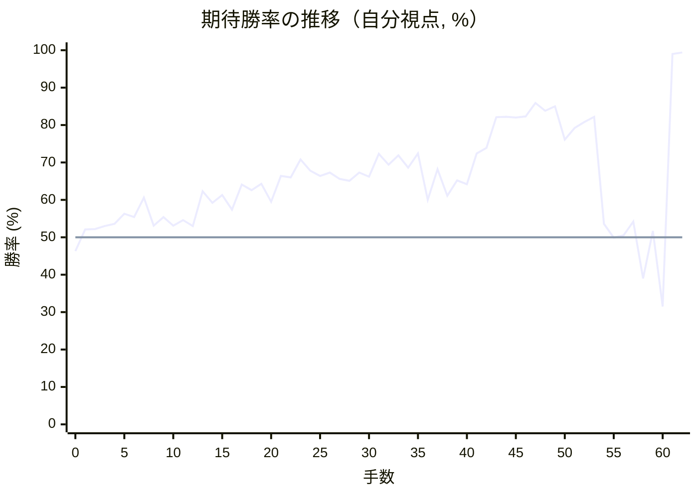
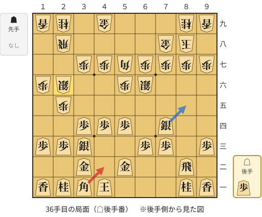
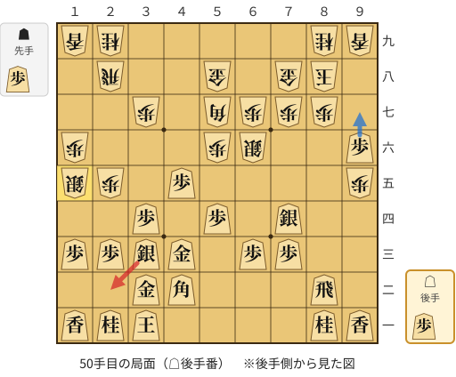
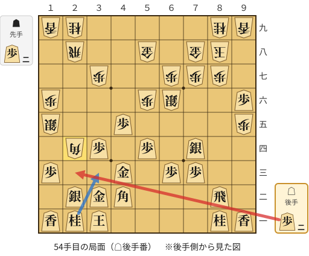
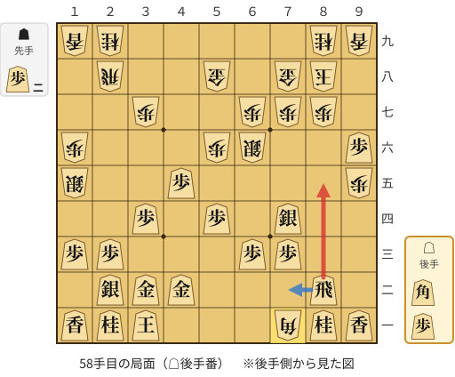
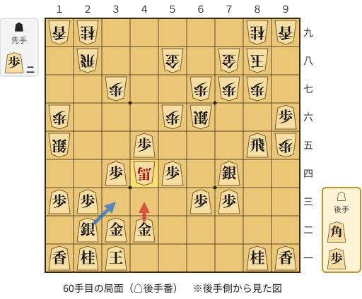

# 解析レポート nyrkl8frg18k

[README に戻る](../../../README.md)　/　棋譜: [CSA](../../../data/csa/shogi5/nyrkl8frg18k.csa)　/　解析の見方: [docs/mistake_analysis.md](../../../docs/mistake_analysis.md)

## 対局情報

| 項目 | 内容 |
|---|---|
| 日時 | 2026-11-11 07:44:24 |
| 持ち時間 | 5分 |
| 自分 | 後手（△）（1661） |
| 相手 | 相手（1590） |
| 結果 | 勝ち（投了, 62手） |

## 解析環境

| 項目 | 内容 |
|---|---|
| エンジン | YaneuraOu NNUE 9.00git 64AVX2（V9.00/YANEURAOU_ENGINE_NNUE/AVX2） |
| 評価関数 | **水匠5**（`suisho5`） |
| nn.bin SHA-256 | `768068f0d534a0603a5d38bcd143de6bbca820d5f1c95a14d40863e5b7892d76` |
| 第1パス | movetime=150ms, MultiPV 1 |
| 第2パス | movetime=2000ms, MultiPV 3 |
| Threads / Hash | 8 / 512MB |
| 判定基準 | 疑問手 ≥5pt, 悪手 ≥10pt, 大悪手 ≥20pt（期待勝率 W(E)=1/(1+exp(-E/600))） |
| 解析日時 | 2026-11-14T10:38:17+09:00（解析バージョン 1, 38秒） |

## サマリー

| 自分の手数 | 深掘りした手 | 詰み逃し | 大悪手 | 悪手 | 疑問手 |
|--:|--:|--:|--:|--:|--:|
| 31 | 7 | 0 | 1 | 1 | 3 |

## 期待勝率の推移



<details><summary>1手ごとの数値（第1パス）</summary>

| 手数 | 指し手 | 評価値 | 勝率 | 低下 | 判定 |
|--:|---|--:|--:|--:|---|
| 1 | ▲５六歩(57) | +50 | 52.1% |  |  |
| 2 | △８四歩(83) | +53 | 52.2% | -0.1pt |  |
| 3 | ▲７八金(69) | +72 | 53.0% |  |  |
| 4 | △８五歩(84) | +86 | 53.6% | -0.6pt |  |
| 5 | ▲６八銀(79) | +152 | 56.3% |  |  |
| 6 | △３四歩(33) | +130 | 55.4% | +0.9pt |  |
| 7 | ▲５七銀(68) | +258 | 60.6% |  |  |
| 8 | △８六歩(85) | +74 | 53.1% | +7.5pt |  |
| 9 | ▲同歩(87) | +131 | 55.4% |  |  |
| 10 | △同飛(82) | +74 | 53.1% | +2.4pt |  |
| 11 | ▲８七歩打 | +110 | 54.6% |  |  |
| 12 | △８二飛(86) | +72 | 53.0% | +1.6pt |  |
| 13 | ▲６六銀(57) | +301 | 62.3% |  |  |
| 14 | △７二銀(71) | +223 | 59.2% | +3.1pt |  |
| 15 | ▲７九角(88) | +275 | 61.3% |  |  |
| 16 | △８三銀(72) | +180 | 57.4% | +3.8pt |  |
| 17 | ▲５七角(79) | +348 | 64.1% |  |  |
| 18 | △７四銀(83) | +310 | 62.6% | +1.5pt |  |
| 19 | ▲６九玉(59) | +352 | 64.3% |  |  |
| 20 | △４二銀(31) | +230 | 59.5% | +4.8pt |  |
| 21 | ▲７九玉(69) | +408 | 66.4% |  |  |
| 22 | △３二金(41) | +397 | 66.0% | +0.4pt |  |
| 23 | ▲８八玉(79) | +531 | 70.8% |  |  |
| 24 | △４一玉(51) | +448 | 67.8% | +2.9pt |  |
| 25 | ▲２六歩(27) | +408 | 66.4% |  |  |
| 26 | △３三銀(42) | +432 | 67.3% | -0.9pt |  |
| 27 | ▲２五歩(26) | +387 | 65.6% |  |  |
| 28 | △５四歩(53) | +374 | 65.1% | +0.5pt |  |
| 29 | ▲１六歩(17) | +432 | 67.3% |  |  |
| 30 | △３一角(22) | +403 | 66.2% | +1.1pt |  |
| 31 | ▲３八銀(39) | +575 | 72.3% |  |  |
| 32 | △５二金(61) | +491 | 69.4% | +2.9pt |  |
| 33 | ▲２七銀(38) | +565 | 71.9% |  |  |
| 34 | △４四歩(43) | +470 | 68.6% | +3.3pt |  |
| 35 | ▲２六銀(27) | +578 | 72.4% |  |  |
| 36 | △４二角(31) | +244 | 60.0% | +12.4pt | [疑問手](#ply-36) |
| 37 | ▲５九金(49) | +457 | 68.2% |  |  |
| 38 | △４三金(52) | +272 | 61.1% | +7.0pt |  |
| 39 | ▲９六歩(97) | +377 | 65.2% |  |  |
| 40 | △９四歩(93) | +350 | 64.2% | +1.0pt |  |
| 41 | ▲５八金(59) | +578 | 72.4% |  |  |
| 42 | △３一玉(41) | +626 | 73.9% | -1.6pt |  |
| 43 | ▲４六歩(47) | +912 | 82.1% |  |  |
| 44 | △９五歩(94) | +917 | 82.2% | -0.1pt |  |
| 45 | ▲同歩(96) | +911 | 82.0% |  |  |
| 46 | △９六歩打 | +923 | 82.3% | -0.3pt |  |
| 47 | ▲４五歩(46) | +1084 | 85.9% |  |  |
| 48 | △同歩(44) | +985 | 83.8% | +2.1pt |  |
| 49 | ▲１五銀(26) | +1040 | 85.0% |  |  |
| 50 | △２二銀(33) | +695 | 76.1% | +8.9pt | [疑問手](#ply-50) |
| 51 | ▲２四歩(25) | +803 | 79.2% |  |  |
| 52 | △同歩(23) | +862 | 80.8% | -1.6pt |  |
| 53 | ▲同角(57) | +916 | 82.2% |  |  |
| 54 | △２三歩打 | +86 | 53.6% | +28.6pt | [大悪手](#ply-54) |
| 55 | ▲４二角成(24) | -2 | 49.9% |  |  |
| 56 | △同金(43) | +13 | 50.5% | -0.6pt |  |
| 57 | ▲７一角打 | +101 | 54.2% |  |  |
| 58 | △８五飛(82) | -268 | 39.0% | +15.2pt | [悪手](#ply-58) |
| 59 | ▲４四角成(71) | +40 | 51.7% |  |  |
| 60 | △４三金(42) | -466 | 31.5% | +20.2pt | [疑問手](#ply-60) |
| 61 | ▲４五馬(44) | +2758 | 99.0% |  |  |
| 62 | △同飛(85) | +3108 | 99.4% | -0.4pt |  |

</details>

## 課題局面

<a id="ply-36"></a>
### 36手目 △４二角(31) — 疑問手

| | 着手前 | 着手後 | 差 |
|---|--:|--:|--:|
| 期待勝率 | 72.6% | 65.5% | -7.2pt |
| 評価値 | +586 | +384 | |

着手前の局面:



🔴 実戦 △４二角(31)　🔵 AI推奨 △８五銀(74)　🟨 直前の相手の指し手

<details><summary>テキストの盤面図（BOD・将棋ソフトに貼り付け可）</summary>

```text
後手の持駒：歩
  ９ ８ ７ ６ ５ ４ ３ ２ １
+---------------------------+
|v香v桂 ・ ・ ・v玉v角v桂v香|一
| ・v飛 ・ ・v金 ・v金 ・ ・|二
|v歩 ・v歩v歩 ・ ・v銀v歩v歩|三
| ・ ・v銀 ・v歩v歩v歩 ・ ・|四
| ・ ・ ・ ・ ・ ・ ・ 歩 ・|五
| ・ ・ ・ 銀 歩 ・ ・ 銀 歩|六
| 歩 歩 歩 歩 角 歩 歩 ・ ・|七
| ・ 玉 金 ・ ・ ・ ・ 飛 ・|八
| 香 桂 ・ ・ ・ 金 ・ 桂 香|九
+---------------------------+
先手の持駒：なし
後手番
手数＝35　▲２六銀　まで
```

</details>

| | 指し手 | 評価値 | 読み筋 |
|---|---|--:|---|
| 実戦 | △４二角(31) | +384 | ▲１五銀(26) △２二銀(33) ▲７六歩(77) △１四歩(13) ▲２六銀(15) △８五銀(74) |
| AI 1位 | △８五銀(74) | +586 | △８五銀(74) ▲９六歩(97) △９四歩(93) ▲１五銀(26) △９五歩(94) ▲同歩(96) |
| AI 2位 | △９四歩(93) | +460 | △９四歩(93) ▲７六歩(77) △８五銀(74) ▲７七銀(66) △８六歩打 ▲同歩(87) |
| AI 3位 | △６四歩(63) | +394 | △６四歩(63) ▲７六歩(77) △８五銀(74) ▲７七銀(66) △７四歩(73) ▲６八角(57) |

SFEN: `ln3kbnl/1r2g1g2/p1pp2spp/2s1ppp2/7P1/3SP2SP/PPPPBPP2/1KG4R1/LN3G1NL w p 36`

<a id="ply-50"></a>
### 50手目 △２二銀(33) — 疑問手

| | 着手前 | 着手後 | 差 |
|---|--:|--:|--:|
| 期待勝率 | 87.7% | 81.6% | -6.0pt |
| 評価値 | +1176 | +895 | |

着手前の局面:



🔴 実戦 △２二銀(33)　🔵 AI推奨 △９七歩成(96)　🟨 直前の相手の指し手

<details><summary>テキストの盤面図（BOD・将棋ソフトに貼り付け可）</summary>

```text
後手の持駒：歩
  ９ ８ ７ ６ ５ ４ ３ ２ １
+---------------------------+
|v香v桂 ・ ・ ・ ・v玉v桂v香|一
| ・v飛 ・ ・ ・v角v金 ・ ・|二
| ・ ・v歩v歩 ・v金v銀v歩v歩|三
| ・ ・v銀 ・v歩 ・v歩 ・ ・|四
| 歩 ・ ・ ・ ・v歩 ・ 歩 銀|五
|v歩 ・ ・ 銀 歩 ・ ・ ・ 歩|六
| ・ 歩 歩 歩 角 ・ 歩 ・ ・|七
| ・ 玉 金 ・ 金 ・ ・ 飛 ・|八
| 香 桂 ・ ・ ・ ・ ・ 桂 香|九
+---------------------------+
先手の持駒：歩
後手番
手数＝49　▲１五銀　まで
```

</details>

| | 指し手 | 評価値 | 読み筋 |
|---|---|--:|---|
| 実戦 | △２二銀(33) | +895 | ▲２四歩(25) △同歩(23) ▲７六歩(77) △９七歩成(96) ▲同香(99) △９六歩打 |
| AI 1位 | △９七歩成(96) | +1176 | △９七歩成(96) ▲同香(99) △９六歩打 ▲同香(97) △８五銀(74) ▲２四歩(25) |
| AI 2位 | △９五香(91) | +1011 | △９五香(91) ▲９八歩打 △８五銀(74) ▲７五銀(66) △１四歩(13) ▲２六銀(15) |
| AI 3位 | △８六歩打 | +737 | △８六歩打 ▲同歩(87) △９五香(91) ▲９八歩打 △８五歩打 ▲同歩(86) |

SFEN: `ln4knl/1r3bg2/2pp1gspp/2s1p1p2/P4p1PS/p2SP3P/1PPPB1P2/1KG1G2R1/LN5NL w Pp 50`

<a id="ply-54"></a>
### 54手目 △２三歩打 — 大悪手

| | 着手前 | 着手後 | 差 |
|---|--:|--:|--:|
| 期待勝率 | 86.0% | 48.9% | -37.0pt |
| 評価値 | +1087 | -26 | |

着手前の局面:



🔴 実戦 △２三歩打　🔵 AI推奨 △３三桂(21)　🟨 直前の相手の指し手

<details><summary>テキストの盤面図（BOD・将棋ソフトに貼り付け可）</summary>

```text
後手の持駒：歩二
  ９ ８ ７ ６ ５ ４ ３ ２ １
+---------------------------+
|v香v桂 ・ ・ ・ ・v玉v桂v香|一
| ・v飛 ・ ・ ・v角v金v銀 ・|二
| ・ ・v歩v歩 ・v金 ・ ・v歩|三
| ・ ・v銀 ・v歩 ・v歩 角 ・|四
| 歩 ・ ・ ・ ・v歩 ・ ・ 銀|五
|v歩 ・ ・ 銀 歩 ・ ・ ・ 歩|六
| ・ 歩 歩 歩 ・ ・ 歩 ・ ・|七
| ・ 玉 金 ・ 金 ・ ・ 飛 ・|八
| 香 桂 ・ ・ ・ ・ ・ 桂 香|九
+---------------------------+
先手の持駒：歩二
後手番
手数＝53　▲２四同角　まで
```

</details>

| | 指し手 | 評価値 | 読み筋 |
|---|---|--:|---|
| 実戦 | △２三歩打 | -26 | ▲４二角成(24) △同金(43) ▲２四歩打 △同歩(23) ▲７一角打 △８四飛(82) |
| AI 1位 | △３三桂(21) | +1087 | △３三桂(21) ▲９四歩(95) △同香(91) ▲９八歩打 △１四歩(13) ▲同銀(15) |
| AI 2位 | △３三銀(22) | +783 | △３三銀(22) ▲同角成(24) △同桂(21) ▲２三銀打 △９五香(91) ▲９八歩打 |
| AI 3位 | △９七歩成(96) | +394 | △９七歩成(96) ▲同香(99) △３三桂(21) ▲９四歩(95) △２三歩打 ▲５七角(24) |

SFEN: `ln4knl/1r3bgs1/2pp1g2p/2s1p1pB1/P4p2S/p2SP3P/1PPP2P2/1KG1G2R1/LN5NL w 2P2p 54`

<a id="ply-58"></a>
### 58手目 △８五飛(82) — 悪手

| | 着手前 | 着手後 | 差 |
|---|--:|--:|--:|
| 期待勝率 | 51.7% | 37.6% | -14.1pt |
| 評価値 | +40 | -304 | |

着手前の局面:



🔴 実戦 △８五飛(82)　🔵 AI推奨 △７二飛(82)　🟨 直前の相手の指し手

<details><summary>テキストの盤面図（BOD・将棋ソフトに貼り付け可）</summary>

```text
後手の持駒：角　歩
  ９ ８ ７ ６ ５ ４ ３ ２ １
+---------------------------+
|v香v桂 角 ・ ・ ・v玉v桂v香|一
| ・v飛 ・ ・ ・v金v金v銀 ・|二
| ・ ・v歩v歩 ・ ・ ・v歩v歩|三
| ・ ・v銀 ・v歩 ・v歩 ・ ・|四
| 歩 ・ ・ ・ ・v歩 ・ ・ 銀|五
|v歩 ・ ・ 銀 歩 ・ ・ ・ 歩|六
| ・ 歩 歩 歩 ・ ・ 歩 ・ ・|七
| ・ 玉 金 ・ 金 ・ ・ 飛 ・|八
| 香 桂 ・ ・ ・ ・ ・ 桂 香|九
+---------------------------+
先手の持駒：歩二
後手番
手数＝57　▲７一角　まで
```

</details>

| | 指し手 | 評価値 | 読み筋 |
|---|---|--:|---|
| 実戦 | △８五飛(82) | -304 | ▲５五歩(56) △９五香(91) ▲９八歩打 △１四歩(13) ▲同銀(15) △同香(11) |
| AI 1位 | △７二飛(82) | +40 | △７二飛(82) ▲４四角成(71) △９五香(91) ▲９八歩打 △１四歩(13) ▲２六銀(15) |
| AI 2位 | △８四飛(82) | -43 | △８四飛(82) ▲６二角成(71) △１四歩(13) ▲４三歩打 △同金(42) ▲４四歩打 |
| AI 3位 | △５二飛(82) | -126 | △５二飛(82) ▲４四角成(71) △１四歩(13) ▲２六銀(15) △３三銀(22) ▲７一馬(44) |

SFEN: `lnB3knl/1r3ggs1/2pp3pp/2s1p1p2/P4p2S/p2SP3P/1PPP2P2/1KG1G2R1/LN5NL w 2Pbp 58`

<a id="ply-60"></a>
### 60手目 △４三金(42) — 疑問手

| | 着手前 | 着手後 | 差 |
|---|--:|--:|--:|
| 期待勝率 | 42.4% | 36.1% | -6.3pt |
| 評価値 | -183 | -343 | |

着手前の局面:



🔴 実戦 △４三金(42)　🔵 AI推奨 △３三銀(22)　🟨 直前の相手の指し手

<details><summary>テキストの盤面図（BOD・将棋ソフトに貼り付け可）</summary>

```text
後手の持駒：角　歩
  ９ ８ ７ ６ ５ ４ ３ ２ １
+---------------------------+
|v香v桂 ・ ・ ・ ・v玉v桂v香|一
| ・ ・ ・ ・ ・v金v金v銀 ・|二
| ・ ・v歩v歩 ・ ・ ・v歩v歩|三
| ・ ・v銀 ・v歩 馬v歩 ・ ・|四
| 歩v飛 ・ ・ ・v歩 ・ ・ 銀|五
|v歩 ・ ・ 銀 歩 ・ ・ ・ 歩|六
| ・ 歩 歩 歩 ・ ・ 歩 ・ ・|七
| ・ 玉 金 ・ 金 ・ ・ 飛 ・|八
| 香 桂 ・ ・ ・ ・ ・ 桂 香|九
+---------------------------+
先手の持駒：歩二
後手番
手数＝59　▲４四角成　まで
```

</details>

| | 指し手 | 評価値 | 読み筋 |
|---|---|--:|---|
| 実戦 | △４三金(42) | -343 | ▲６二馬(44) △９五飛(85) ▲９八歩打 △８五飛(95) ▲５五歩(56) △同歩(54) |
| AI 1位 | △３三銀(22) | -183 | △３三銀(22) ▲５四馬(44) △５三歩打 ▲５五馬(54) △４六角打 ▲４四歩打 |
| AI 2位 | △９五飛(85) | -140 | △９五飛(85) ▲２四歩打 △同歩(23) ▲９八歩打 △８六歩打 ▲同歩(87) |
| AI 3位 | △９五香(91) | -243 | △９五香(91) ▲２四歩打 △９七歩成(96) ▲同桂(89) △同香成(95) ▲同玉(88) |

SFEN: `ln4knl/5ggs1/2pp3pp/2s1p+Bp2/Pr3p2S/p2SP3P/1PPP2P2/1KG1G2R1/LN5NL w 2Pbp 60`

