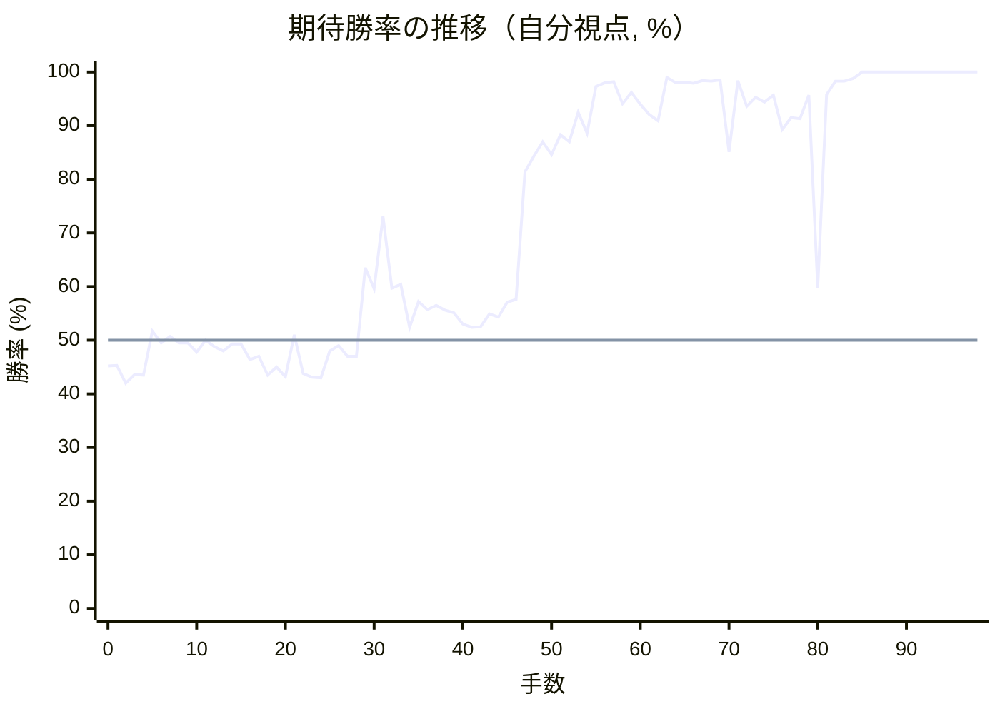
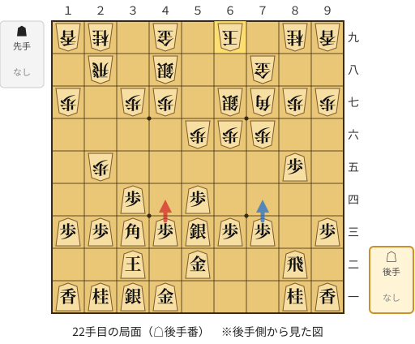
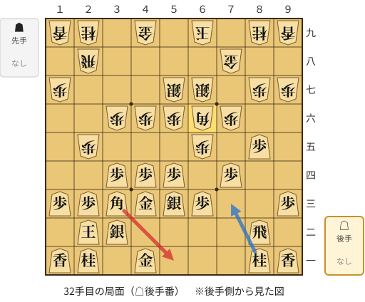
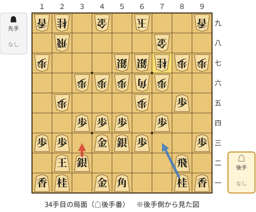
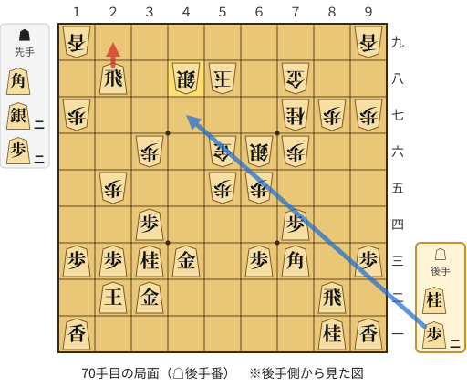
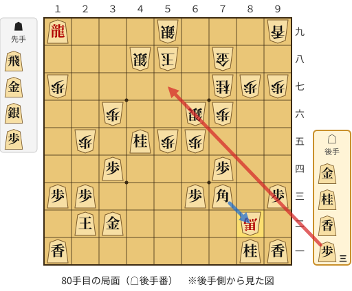

# 解析レポート o402dz30yh03

[README に戻る](../../../README.md)　/　棋譜: [CSA](../../../data/csa/shogi5/o402dz30yh03.csa)　/　解析の見方: [docs/mistake_analysis.md](../../../docs/mistake_analysis.md)

## 対局情報

| 項目 | 内容 |
|---|---|
| 日時 | 2026-11-14 18:50:28 |
| 持ち時間 | 5分 |
| 自分 | 後手（△）（1644） |
| 相手 | 相手（1619） |
| 結果 | 勝ち（詰み, 98手） |

## 解析環境

| 項目 | 内容 |
|---|---|
| エンジン | YaneuraOu NNUE 9.00git 64AVX2（V9.00/YANEURAOU_ENGINE_NNUE/AVX2） |
| 評価関数 | **水匠5**（`suisho5`） |
| nn.bin SHA-256 | `768068f0d534a0603a5d38bcd143de6bbca820d5f1c95a14d40863e5b7892d76` |
| 第1パス | movetime=150ms, MultiPV 1 |
| 第2パス | movetime=2000ms, MultiPV 3 |
| Threads / Hash | 8 / 512MB |
| 判定基準 | 疑問手 ≥5pt, 悪手 ≥10pt, 大悪手 ≥20pt（期待勝率 W(E)=1/(1+exp(-E/600))） |
| 解析日時 | 2026-11-20T20:22:20+09:00（解析バージョン 1, 38秒） |

## サマリー

| 自分の手数 | 深掘りした手 | 詰み逃し | 大悪手 | 悪手 | 疑問手 |
|--:|--:|--:|--:|--:|--:|
| 49 | 6 | 0 | 1 | 1 | 3 |

## 期待勝率の推移



<details><summary>1手ごとの数値（第1パス）</summary>

| 手数 | 指し手 | 評価値 | 勝率 | 低下 | 判定 |
|--:|---|--:|--:|--:|---|
| 1 | ▲７六歩(77) | -114 | 45.3% |  |  |
| 2 | △３四歩(33) | -194 | 42.0% | +3.3pt |  |
| 3 | ▲２六歩(27) | -154 | 43.6% |  |  |
| 4 | △８四歩(83) | -156 | 43.5% | +0.1pt |  |
| 5 | ▲６六歩(67) | +40 | 51.7% |  |  |
| 6 | △８五歩(84) | -13 | 49.5% | +2.2pt |  |
| 7 | ▲７七角(88) | +17 | 50.7% |  |  |
| 8 | △６二銀(71) | -13 | 49.5% | +1.2pt |  |
| 9 | ▲７八銀(79) | -11 | 49.5% |  |  |
| 10 | △４二玉(51) | -52 | 47.8% | +1.7pt |  |
| 11 | ▲６七銀(78) | +0 | 50.0% |  |  |
| 12 | △３二玉(42) | -28 | 48.8% | +1.2pt |  |
| 13 | ▲２五歩(26) | -48 | 48.0% |  |  |
| 14 | △３三角(22) | -18 | 49.3% | -1.2pt |  |
| 15 | ▲４八銀(39) | -16 | 49.3% |  |  |
| 16 | △５四歩(53) | -87 | 46.4% | +3.0pt |  |
| 17 | ▲５六歩(57) | -73 | 47.0% |  |  |
| 18 | △５三銀(62) | -156 | 43.5% | +3.4pt |  |
| 19 | ▲７八金(69) | -120 | 45.0% |  |  |
| 20 | △５二金(61) | -164 | 43.2% | +1.8pt |  |
| 21 | ▲６九玉(59) | +24 | 51.0% |  |  |
| 22 | △４四歩(43) | -150 | 43.8% | +7.2pt | [疑問手](#ply-22) |
| 23 | ▲３六歩(37) | -167 | 43.1% |  |  |
| 24 | △４三金(52) | -170 | 43.0% | +0.1pt |  |
| 25 | ▲５七銀(48) | -48 | 48.0% |  |  |
| 26 | △２二玉(32) | -23 | 49.0% | -1.0pt |  |
| 27 | ▲４六歩(47) | -71 | 47.0% |  |  |
| 28 | △７四歩(73) | -71 | 47.0% | +0.0pt |  |
| 29 | ▲６五歩(66) | +331 | 63.5% |  |  |
| 30 | △３二銀(31) | +234 | 59.6% | +3.8pt |  |
| 31 | ▲６六角(77) | +601 | 73.1% |  |  |
| 32 | △５一角(33) | +235 | 59.7% | +13.5pt | [悪手](#ply-32) |
| 33 | ▲７七桂(89) | +254 | 60.4% |  |  |
| 34 | △３三銀(32) | +57 | 52.4% | +8.1pt | [疑問手](#ply-34) |
| 35 | ▲５八金(49) | +174 | 57.2% |  |  |
| 36 | △３二金(41) | +137 | 55.7% | +1.5pt |  |
| 37 | ▲３七桂(29) | +158 | 56.5% |  |  |
| 38 | △８六歩(85) | +135 | 55.6% | +0.9pt |  |
| 39 | ▲同歩(87) | +122 | 55.1% |  |  |
| 40 | △同飛(82) | +73 | 53.0% | +2.0pt |  |
| 41 | ▲８七歩打 | +57 | 52.4% |  |  |
| 42 | △８二飛(86) | +60 | 52.5% | -0.1pt |  |
| 43 | ▲４五歩(46) | +117 | 54.9% |  |  |
| 44 | △７三角(51) | +103 | 54.3% | +0.6pt |  |
| 45 | ▲４七金(58) | +171 | 57.1% |  |  |
| 46 | △４五歩(44) | +183 | 57.6% | -0.5pt |  |
| 47 | ▲５五歩(56) | +886 | 81.4% |  |  |
| 48 | △４四銀(53) | +1010 | 84.3% | -2.9pt |  |
| 49 | ▲５六銀(57) | +1138 | 87.0% |  |  |
| 50 | △５五歩(54) | +1023 | 84.6% | +2.3pt |  |
| 51 | ▲４五銀(56) | +1212 | 88.3% |  |  |
| 52 | △４六歩打 | +1141 | 87.0% | +1.3pt |  |
| 53 | ▲同金(47) | +1505 | 92.5% |  |  |
| 54 | △５六歩(55) | +1232 | 88.6% | +3.8pt |  |
| 55 | ▲５五歩打 | +2154 | 97.3% |  |  |
| 56 | △４五銀(44) | +2327 | 98.0% | -0.7pt |  |
| 57 | ▲同桂(37) | +2413 | 98.2% |  |  |
| 58 | △５七銀打 | +1660 | 94.1% | +4.2pt |  |
| 59 | ▲３三桂成(45) | +1936 | 96.2% |  |  |
| 60 | △同桂(21) | +1651 | 94.0% | +2.2pt |  |
| 61 | ▲５六金(46) | +1470 | 92.1% |  |  |
| 62 | △６六銀成(57) | +1378 | 90.9% | +1.2pt |  |
| 63 | ▲同銀(67) | +2764 | 99.0% |  |  |
| 64 | △４七角打 | +2343 | 98.0% | +1.0pt |  |
| 65 | ▲５八飛(28) | +2353 | 98.1% |  |  |
| 66 | △同角成(47) | +2298 | 97.9% | +0.2pt |  |
| 67 | ▲同玉(69) | +2468 | 98.4% |  |  |
| 68 | △２八飛打 | +2420 | 98.3% | +0.1pt |  |
| 69 | ▲４八銀打 | +2492 | 98.5% |  |  |
| 70 | △２九飛成(28) | +1044 | 85.1% | +13.4pt | [疑問手](#ply-70) |
| 71 | ▲５九銀打 | +2474 | 98.4% |  |  |
| 72 | △１九龍(29) | +1613 | 93.6% | +4.8pt |  |
| 73 | ▲４四歩打 | +1802 | 95.3% |  |  |
| 74 | △同金(43) | +1697 | 94.4% | +0.9pt |  |
| 75 | ▲７一角打 | +1862 | 95.7% |  |  |
| 76 | △４五金(44) | +1272 | 89.3% | +6.4pt |  |
| 77 | ▲同金(56) | +1426 | 91.5% |  |  |
| 78 | △同桂(33) | +1412 | 91.3% | +0.2pt |  |
| 79 | ▲８二角成(71) | +1861 | 95.7% |  |  |
| 80 | △５七歩打 | +238 | 59.8% | +35.9pt | [大悪手](#ply-80) |
| 81 | ▲同銀(66) | +1872 | 95.8% |  |  |
| 82 | △同桂成(45) | +2448 | 98.3% | -2.6pt |  |
| 83 | ▲同玉(58) | +2443 | 98.3% |  |  |
| 84 | △５六歩打 | +2623 | 98.8% | -0.4pt |  |
| 85 | ▲６六玉(57) | #+9 | 100.0% |  |  |
| 86 | △５四桂打 | #+8 | 100.0% | +0.0pt |  |
| 87 | ▲同歩(55) | #+7 | 100.0% |  |  |
| 88 | △５五銀打 | #+10 | 100.0% | +0.0pt |  |
| 89 | ▲６七玉(66) | #+9 | 100.0% |  |  |
| 90 | △６六香打 | #+10 | 100.0% | +0.0pt |  |
| 91 | ▲５八玉(67) | #+9 | 100.0% |  |  |
| 92 | △５七金打 | #+8 | 100.0% | +0.0pt |  |
| 93 | ▲同銀(48) | #+7 | 100.0% |  |  |
| 94 | △同歩成(56) | #+6 | 100.0% | +0.0pt |  |
| 95 | ▲同玉(58) | #+5 | 100.0% |  |  |
| 96 | △５九龍(19) | #+4 | 100.0% | +0.0pt |  |
| 97 | ▲５八銀打 | #+1 | 100.0% |  |  |
| 98 | △５六銀打 | #+ | 100.0% | +0.0pt |  |

</details>

## 課題局面

<a id="ply-22"></a>
### 22手目 △４四歩(43) — 疑問手

| | 着手前 | 着手後 | 差 |
|---|--:|--:|--:|
| 期待勝率 | 51.4% | 43.0% | -8.3pt |
| 評価値 | +33 | -168 | |

着手前の局面:



🔴 実戦 △４四歩(43)　🔵 AI推奨 △７四歩(73)　🟨 直前の相手の指し手

<details><summary>テキストの盤面図（BOD・将棋ソフトに貼り付け可）</summary>

```text
後手の持駒：なし
  ９ ８ ７ ６ ５ ４ ３ ２ １
+---------------------------+
|v香v桂 ・ ・ ・v金v銀v桂v香|一
| ・v飛 ・ ・v金 ・v玉 ・ ・|二
|v歩 ・v歩v歩v銀v歩v角v歩v歩|三
| ・ ・ ・ ・v歩 ・v歩 ・ ・|四
| ・v歩 ・ ・ ・ ・ ・ 歩 ・|五
| ・ ・ 歩 歩 歩 ・ ・ ・ ・|六
| 歩 歩 角 銀 ・ 歩 歩 ・ 歩|七
| ・ ・ 金 ・ ・ 銀 ・ 飛 ・|八
| 香 桂 ・ 玉 ・ 金 ・ 桂 香|九
+---------------------------+
先手の持駒：なし
後手番
手数＝21　▲６九玉　まで
```

</details>

| | 指し手 | 評価値 | 読み筋 |
|---|---|--:|---|
| 実戦 | △４四歩(43) | -168 | ▲５八金(49) △４三金(52) |
| AI 1位 | △７四歩(73) | +33 | △７四歩(73) ▲３六歩(37) △７五歩(74) ▲３七桂(29) △７六歩(75) ▲同銀(67) |
| AI 2位 | △２二銀(31) | -20 | △２二銀(31) ▲３六歩(37) △７四歩(73) ▲３七桂(29) △４二角(33) ▲６八角(77) |
| AI 3位 | △４二角(33) | -71 | △４二角(33) ▲３六歩(37) △７四歩(73) ▲５八金(49) △２二銀(31) ▲６八角(77) |

SFEN: `ln3gsnl/1r2g1k2/p1ppspbpp/4p1p2/1p5P1/2PPP4/PPBS1PP1P/2G2S1R1/LN1K1G1NL w - 22`

<a id="ply-32"></a>
### 32手目 △５一角(33) — 悪手

| | 着手前 | 着手後 | 差 |
|---|--:|--:|--:|
| 期待勝率 | 73.1% | 62.3% | -10.8pt |
| 評価値 | +600 | +301 | |

着手前の局面:



🔴 実戦 △５一角(33)　🔵 AI推奨 △７三桂(81)　🟨 直前の相手の指し手

<details><summary>テキストの盤面図（BOD・将棋ソフトに貼り付け可）</summary>

```text
後手の持駒：なし
  ９ ８ ７ ６ ５ ４ ３ ２ １
+---------------------------+
|v香v桂 ・ ・ ・v金 ・v桂v香|一
| ・v飛 ・ ・ ・ ・v銀v玉 ・|二
|v歩 ・ ・v歩v銀v金v角v歩v歩|三
| ・ ・v歩 ・v歩v歩v歩 ・ ・|四
| ・v歩 ・ 歩 ・ ・ ・ 歩 ・|五
| ・ ・ 歩 角 歩 歩 歩 ・ ・|六
| 歩 歩 ・ 銀 銀 ・ ・ ・ 歩|七
| ・ ・ 金 ・ ・ ・ ・ 飛 ・|八
| 香 桂 ・ 玉 ・ 金 ・ 桂 香|九
+---------------------------+
先手の持駒：なし
後手番
手数＝31　▲６六角　まで
```

</details>

| | 指し手 | 評価値 | 読み筋 |
|---|---|--:|---|
| 実戦 | △５一角(33) | +301 | ▲５八金(49) △７三桂(81) |
| AI 1位 | △７三桂(81) | +600 | △７三桂(81) ▲５八金(49) △６五桂(73) ▲６八銀(57) △６四銀(53) ▲７七桂(89) |
| AI 2位 | △１四歩(13) | +546 | △１四歩(13) ▲５八金(49) △７三桂(81) ▲１六歩(17) △６五桂(73) ▲６八銀(57) |
| AI 3位 | △８六歩(85) | +486 | △８六歩(85) ▲同歩(87) △７三桂(81) ▲５八金(49) △６五桂(73) ▲６八銀(57) |

SFEN: `ln3g1nl/1r4sk1/p2psgbpp/2p1ppp2/1p1P3P1/2PBPPP2/PP1SS3P/2G4R1/LN1K1G1NL w - 32`

<a id="ply-34"></a>
### 34手目 △３三銀(32) — 疑問手

| | 着手前 | 着手後 | 差 |
|---|--:|--:|--:|
| 期待勝率 | 64.2% | 56.1% | -8.1pt |
| 評価値 | +351 | +147 | |

着手前の局面:



🔴 実戦 △３三銀(32)　🔵 AI推奨 △７三桂(81)　🟨 直前の相手の指し手

<details><summary>テキストの盤面図（BOD・将棋ソフトに貼り付け可）</summary>

```text
後手の持駒：なし
  ９ ８ ７ ６ ５ ４ ３ ２ １
+---------------------------+
|v香v桂 ・ ・v角v金 ・v桂v香|一
| ・v飛 ・ ・ ・ ・v銀v玉 ・|二
|v歩 ・ ・v歩v銀v金 ・v歩v歩|三
| ・ ・v歩 ・v歩v歩v歩 ・ ・|四
| ・v歩 ・ 歩 ・ ・ ・ 歩 ・|五
| ・ ・ 歩 角 歩 歩 歩 ・ ・|六
| 歩 歩 桂 銀 銀 ・ ・ ・ 歩|七
| ・ ・ 金 ・ ・ ・ ・ 飛 ・|八
| 香 ・ ・ 玉 ・ 金 ・ 桂 香|九
+---------------------------+
先手の持駒：なし
後手番
手数＝33　▲７七桂　まで
```

</details>

| | 指し手 | 評価値 | 読み筋 |
|---|---|--:|---|
| 実戦 | △３三銀(32) | +147 | ▲３七桂(29) △３二金(41) ▲４八金(49) △７三桂(81) ▲４五歩(46) △６四歩(63) |
| AI 1位 | △７三桂(81) | +351 | △７三桂(81) ▲４五歩(46) △３三角(51) ▲２四歩(25) △同角(33) ▲５八金(49) |
| AI 2位 | △３三角(51) | +351 | △３三角(51) ▲５八金(49) △８六歩(85) ▲同歩(87) △同飛(82) ▲８七歩打 |
| AI 3位 | △８六歩(85) | +327 | △８六歩(85) ▲同歩(87) △同飛(82) ▲８七歩打 △８二飛(86) ▲３七桂(29) |

SFEN: `ln2bg1nl/1r4sk1/p2psg1pp/2p1ppp2/1p1P3P1/2PBPPP2/PPNSS3P/2G4R1/L2K1G1NL w - 34`

<a id="ply-70"></a>
### 70手目 △２九飛成(28) — 疑問手

| | 着手前 | 着手後 | 差 |
|---|--:|--:|--:|
| 期待勝率 | 98.7% | 91.6% | -7.1pt |
| 評価値 | +2616 | +1436 | |

着手前の局面:



🔴 実戦 △２九飛成(28)　🔵 AI推奨 △４七歩打　🟨 直前の相手の指し手

<details><summary>テキストの盤面図（BOD・将棋ソフトに貼り付け可）</summary>

```text
後手の持駒：桂　歩二
  ９ ８ ７ ６ ５ ４ ３ ２ １
+---------------------------+
|v香v桂 ・ ・ ・ ・ ・ ・v香|一
| ・v飛 ・ ・ ・ ・v金v玉 ・|二
|v歩 ・v角v歩 ・v金v桂v歩v歩|三
| ・ ・v歩 ・ ・ ・v歩 ・ ・|四
| ・ ・ ・ 歩 歩 ・ ・ 歩 ・|五
| ・ ・ 歩 銀 金 ・ 歩 ・ ・|六
| 歩 歩 桂 ・ ・ ・ ・ ・ 歩|七
| ・ ・ 金 ・ 玉 銀 ・v飛 ・|八
| 香 ・ ・ ・ ・ ・ ・ ・ 香|九
+---------------------------+
先手の持駒：角　銀二　歩二
後手番
手数＝69　▲４八銀　まで
```

</details>

| | 指し手 | 評価値 | 読み筋 |
|---|---|--:|---|
| 実戦 | △２九飛成(28) | +1436 | ▲４四歩打 △同金(43) ▲７一角打 △４二飛(82) ▲５三銀打 △４七歩打 |
| AI 1位 | △４七歩打 | +2616 | △４七歩打 ▲同玉(58) △４四桂打 ▲３七銀打 △２九飛成(28) ▲２四歩(25) |
| AI 2位 | △４四桂打 | +2194 | △４四桂打 ▲４六金(56) △４五歩打 ▲４七金(46) △８四角(73) ▲７五歩(76) |
| AI 3位 | △８六歩打 | +1671 | △８六歩打 ▲３九銀打 △２九飛成(28) ▲８六歩(87) △１九龍(29) ▲４四歩打 |

SFEN: `ln6l/1r4gk1/p1bp1gnpp/2p3p2/3PP2P1/2PSG1P2/PPN5P/2G1KS1r1/L7L w B2S2Pn2p 70`

<a id="ply-80"></a>
### 80手目 △５七歩打 — 大悪手

| | 着手前 | 着手後 | 差 |
|---|--:|--:|--:|
| 期待勝率 | 97.9% | 54.5% | -43.4pt |
| 評価値 | +2295 | +108 | |

着手前の局面:



🔴 実戦 △５七歩打　🔵 AI推奨 △同角(73)　🟨 直前の相手の指し手

<details><summary>テキストの盤面図（BOD・将棋ソフトに貼り付け可）</summary>

```text
後手の持駒：金　桂　香　歩三
  ９ ８ ７ ６ ５ ４ ３ ２ １
+---------------------------+
|v香v桂 ・ ・ ・ ・ ・ ・v香|一
| ・ 馬 ・ ・ ・ ・v金v玉 ・|二
|v歩 ・v角v歩 ・ ・ ・v歩v歩|三
| ・ ・v歩 ・ ・ ・v歩 ・ ・|四
| ・ ・ ・ 歩 歩v桂 ・ 歩 ・|五
| ・ ・ 歩 銀 ・ ・ 歩 ・ ・|六
| 歩 歩 桂 ・ ・ ・ ・ ・ 歩|七
| ・ ・ 金 ・ 玉 銀 ・ ・ ・|八
| 香 ・ ・ ・ 銀 ・ ・ ・v龍|九
+---------------------------+
先手の持駒：飛　金　銀　歩
後手番
手数＝79　▲８二角成　まで
```

</details>

| | 指し手 | 評価値 | 読み筋 |
|---|---|--:|---|
| 実戦 | △５七歩打 | +108 | ▲６七玉(58) △８二角(73) ▲５二飛打 △４九角打 ▲５六玉(67) △３八角成(49) |
| AI 1位 | △同角(73) | +2295 | △同角(73) ▲５二飛打 △４七歩打 ▲同銀(48) △５七金打 ▲同銀(66) |
| AI 2位 | △５六香打 | +1325 | △５六香打 ▲４七玉(58) △８二角(73) ▲４一銀打 △４二金(32) ▲５二飛打 |
| AI 3位 | △４七歩打 | +838 | △４七歩打 ▲４一銀打 △４八歩成(47) ▲同銀(59) △２一銀打 ▲８一馬(82) |

SFEN: `ln6l/1+B4gk1/p1bp3pp/2p3p2/3PPn1P1/2PS2P2/PPN5P/2G1KS3/L3S3+r w RGSPgnl3p 80`

