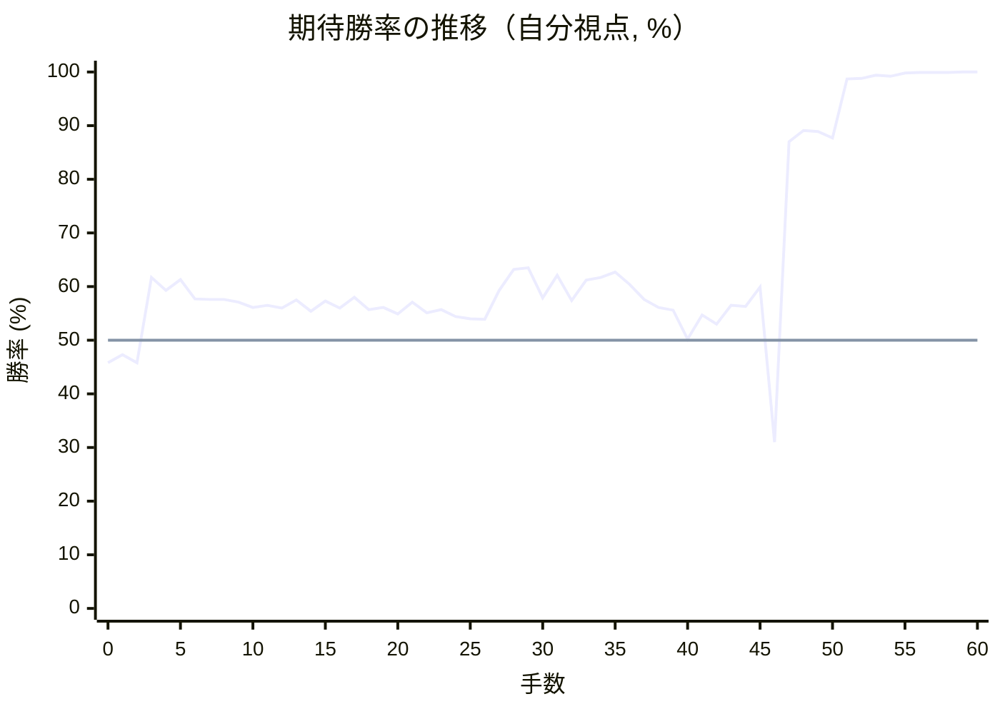
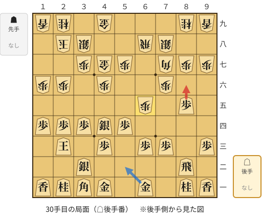
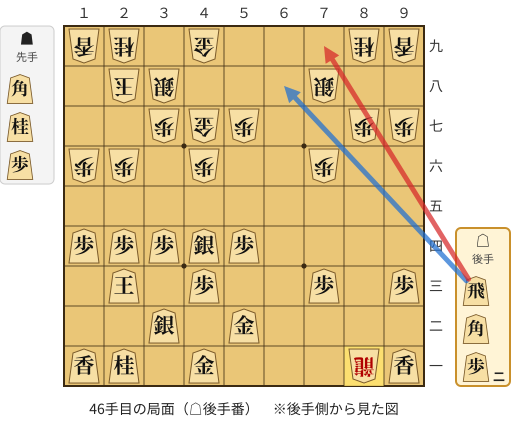

# 解析レポート olz4qltehr45

[README に戻る](../../../README.md)　/　棋譜: [CSA](../../../data/csa/shogi5/olz4qltehr45.csa)　/　解析の見方: [docs/mistake_analysis.md](../../../docs/mistake_analysis.md)

## 対局情報

| 項目 | 内容 |
|---|---|
| 日時 | 2026-11-16 20:12:40 |
| 持ち時間 | 5分 |
| 自分 | 後手（△）（1652） |
| 相手 | 相手（1588） |
| 結果 | 勝ち（投了, 60手） |

## 解析環境

| 項目 | 内容 |
|---|---|
| エンジン | YaneuraOu NNUE 9.00git 64AVX2（V9.00/YANEURAOU_ENGINE_NNUE/AVX2） |
| 評価関数 | **水匠5**（`suisho5`） |
| nn.bin SHA-256 | `768068f0d534a0603a5d38bcd143de6bbca820d5f1c95a14d40863e5b7892d76` |
| 第1パス | movetime=150ms, MultiPV 1 |
| 第2パス | movetime=2000ms, MultiPV 3 |
| Threads / Hash | 8 / 512MB |
| 判定基準 | 疑問手 ≥5pt, 悪手 ≥10pt, 大悪手 ≥20pt（期待勝率 W(E)=1/(1+exp(-E/600))） |
| 解析日時 | 2026-11-20T20:19:38+09:00（解析バージョン 1, 22秒） |

## サマリー

| 自分の手数 | 深掘りした手 | 詰み逃し | 大悪手 | 悪手 | 疑問手 |
|--:|--:|--:|--:|--:|--:|
| 30 | 3 | 0 | 1 | 0 | 1 |

## 期待勝率の推移



<details><summary>1手ごとの数値（第1パス）</summary>

| 手数 | 指し手 | 評価値 | 勝率 | 低下 | 判定 |
|--:|---|--:|--:|--:|---|
| 1 | ▲７六歩(77) | -65 | 47.3% |  |  |
| 2 | △８四歩(83) | -101 | 45.8% | +1.5pt |  |
| 3 | ▲６八飛(28) | +285 | 61.7% |  |  |
| 4 | △３四歩(33) | +226 | 59.3% | +2.3pt |  |
| 5 | ▲６六歩(67) | +275 | 61.3% |  |  |
| 6 | △８五歩(84) | +187 | 57.7% | +3.5pt |  |
| 7 | ▲７七角(88) | +184 | 57.6% |  |  |
| 8 | △６二銀(71) | +183 | 57.6% | +0.0pt |  |
| 9 | ▲７八銀(79) | +172 | 57.1% |  |  |
| 10 | △５四歩(53) | +146 | 56.1% | +1.1pt |  |
| 11 | ▲４八玉(59) | +157 | 56.5% |  |  |
| 12 | △４二玉(51) | +145 | 56.0% | +0.5pt |  |
| 13 | ▲５八金(69) | +182 | 57.5% |  |  |
| 14 | △３二玉(42) | +131 | 55.4% | +2.1pt |  |
| 15 | ▲３八玉(48) | +176 | 57.3% |  |  |
| 16 | △１四歩(13) | +145 | 56.0% | +1.3pt |  |
| 17 | ▲１六歩(17) | +193 | 58.0% |  |  |
| 18 | △２四歩(23) | +137 | 55.7% | +2.3pt |  |
| 19 | ▲２八玉(38) | +146 | 56.1% |  |  |
| 20 | △２三玉(32) | +117 | 54.9% | +1.2pt |  |
| 21 | ▲３八銀(39) | +171 | 57.1% |  |  |
| 22 | △５三銀(62) | +124 | 55.1% | +1.9pt |  |
| 23 | ▲４六歩(47) | +138 | 55.7% |  |  |
| 24 | △３二銀(31) | +105 | 54.4% | +1.4pt |  |
| 25 | ▲２六歩(27) | +95 | 54.0% |  |  |
| 26 | △４四銀(53) | +94 | 53.9% | +0.0pt |  |
| 27 | ▲４七金(58) | +226 | 59.3% |  |  |
| 28 | △３一角(22) | +325 | 63.2% | -3.9pt |  |
| 29 | ▲６五歩(66) | +332 | 63.5% |  |  |
| 30 | △８六歩(85) | +191 | 57.9% | +5.6pt | [疑問手](#ply-30) |
| 31 | ▲同歩(87) | +296 | 62.1% |  |  |
| 32 | △同角(31) | +178 | 57.4% | +4.7pt |  |
| 33 | ▲同角(77) | +274 | 61.2% |  |  |
| 34 | △同飛(82) | +287 | 61.7% | -0.5pt |  |
| 35 | ▲８七歩打 | +312 | 62.7% |  |  |
| 36 | △８二飛(86) | +253 | 60.4% | +2.3pt |  |
| 37 | ▲６四歩(65) | +185 | 57.6% |  |  |
| 38 | △同歩(63) | +148 | 56.1% | +1.5pt |  |
| 39 | ▲同飛(68) | +136 | 55.6% |  |  |
| 40 | △６二飛(82) | +5 | 50.2% | +5.4pt |  |
| 41 | ▲同飛成(64) | +112 | 54.7% |  |  |
| 42 | △同金(61) | +72 | 53.0% | +1.7pt |  |
| 43 | ▲８二飛打 | +156 | 56.5% |  |  |
| 44 | △５二金(62) | +151 | 56.3% | +0.2pt |  |
| 45 | ▲８一飛成(82) | +241 | 59.9% |  |  |
| 46 | △７九飛打 | -481 | 31.0% | +28.9pt | [大悪手](#ply-46) |
| 47 | ▲６七角打 | +1138 | 87.0% |  |  |
| 48 | △６六歩打 | +1263 | 89.1% | -2.2pt |  |
| 49 | ▲５六角(67) | +1251 | 88.9% |  |  |
| 50 | △５五歩(54) | +1180 | 87.7% | +1.2pt |  |
| 51 | ▲２五歩(26) | +2601 | 98.7% |  |  |
| 52 | △５六歩(55) | +2666 | 98.8% | -0.1pt |  |
| 53 | ▲２四歩(25) | +3032 | 99.4% |  |  |
| 54 | △同玉(23) | +2897 | 99.2% | +0.2pt |  |
| 55 | ▲３六桂打 | +3697 | 99.8% |  |  |
| 56 | △３三玉(24) | +3944 | 99.9% | -0.1pt |  |
| 57 | ▲４四桂(36) | +4101 | 99.9% |  |  |
| 58 | △同歩(43) | +4215 | 99.9% | -0.0pt |  |
| 59 | ▲５六歩(57) | +5366 | 100.0% |  |  |
| 60 | △２七歩打 | +5637 | 100.0% | -0.0pt |  |

</details>

## 課題局面

<a id="ply-30"></a>
### 30手目 △８六歩(85) — 疑問手

| | 着手前 | 着手後 | 差 |
|---|--:|--:|--:|
| 期待勝率 | 64.5% | 56.5% | -7.9pt |
| 評価値 | +357 | +158 | |

着手前の局面:



🔴 実戦 △８六歩(85)　🔵 AI推奨 △５二金(61)　🟨 直前の相手の指し手

<details><summary>テキストの盤面図（BOD・将棋ソフトに貼り付け可）</summary>

```text
後手の持駒：なし
  ９ ８ ７ ６ ５ ４ ３ ２ １
+---------------------------+
|v香v桂 ・v金 ・v金v角v桂v香|一
| ・v飛 ・ ・ ・ ・v銀 ・ ・|二
|v歩 ・v歩v歩 ・v歩 ・v玉 ・|三
| ・ ・ ・ ・v歩v銀v歩v歩v歩|四
| ・v歩 ・ 歩 ・ ・ ・ ・ ・|五
| ・ ・ 歩 ・ ・ 歩 ・ 歩 歩|六
| 歩 歩 角 ・ 歩 金 歩 ・ ・|七
| ・ ・ 銀 飛 ・ ・ 銀 玉 ・|八
| 香 桂 ・ ・ ・ 金 ・ 桂 香|九
+---------------------------+
先手の持駒：なし
後手番
手数＝29　▲６五歩　まで
```

</details>

| | 指し手 | 評価値 | 読み筋 |
|---|---|--:|---|
| 実戦 | △８六歩(85) | +158 | ▲同歩(87) △同角(31) ▲同角(77) △同飛(82) ▲６四歩(65) △７九角打 |
| AI 1位 | △５二金(61) | +357 | △５二金(61) ▲３六歩(37) △８六歩(85) ▲同歩(87) △同角(31) ▲同角(77) |
| AI 2位 | △３三銀(44) | +263 | △３三銀(44) ▲３六歩(37) △５二金(61) ▲３七桂(29) △８六歩(85) ▲同歩(87) |
| AI 3位 | △７四歩(73) | +184 | △７四歩(73) ▲３六歩(37) △８六歩(85) ▲同歩(87) △同角(31) ▲同角(77) |

SFEN: `ln1g1gbnl/1r4s2/p1pp1p1k1/4psppp/1p1P5/2P2P1PP/PPB1PGP2/2SR2SK1/LN3G1NL w - 30`

<a id="ply-46"></a>
### 46手目 △７九飛打 — 大悪手

| | 着手前 | 着手後 | 差 |
|---|--:|--:|--:|
| 期待勝率 | 64.5% | 36.9% | -27.6pt |
| 評価値 | +358 | -323 | |

着手前の局面:



🔴 実戦 △７九飛打　🔵 AI推奨 △６八飛打　🟨 直前の相手の指し手

<details><summary>テキストの盤面図（BOD・将棋ソフトに貼り付け可）</summary>

```text
後手の持駒：飛　角　歩二
  ９ ８ ７ ６ ５ ４ ３ ２ １
+---------------------------+
|v香 龍 ・ ・ ・v金 ・v桂v香|一
| ・ ・ ・ ・v金 ・v銀 ・ ・|二
|v歩 ・v歩 ・ ・v歩 ・v玉 ・|三
| ・ ・ ・ ・v歩v銀v歩v歩v歩|四
| ・ ・ ・ ・ ・ ・ ・ ・ ・|五
| ・ ・ 歩 ・ ・ 歩 ・ 歩 歩|六
| 歩 歩 ・ ・ 歩 金 歩 ・ ・|七
| ・ ・ 銀 ・ ・ ・ 銀 玉 ・|八
| 香 桂 ・ ・ ・ 金 ・ 桂 香|九
+---------------------------+
先手の持駒：角　桂　歩
後手番
手数＝45　▲８一飛成　まで
```

</details>

| | 指し手 | 評価値 | 読み筋 |
|---|---|--:|---|
| 実戦 | △７九飛打 | -323 | ▲４一龍(81) △同銀(32) ▲６九金打 △７八飛成(79) ▲同金(69) △６九飛打 |
| AI 1位 | △６八飛打 | +358 | △６八飛打 ▲７七銀(78) △６九飛成(68) ▲９一龍(81) △８九龍(69) ▲２五歩(26) |
| AI 2位 | △８八歩打 | -77 | △８八歩打 ▲９一龍(81) △８九歩成(88) ▲２五歩(26) △３三銀(44) ▲４五桂打 |
| AI 3位 | △７四角打 | -235 | △７四角打 ▲４八金(47) △６八飛打 ▲６九角打 △８八歩打 ▲５九金(49) |

SFEN: `l+R3g1nl/4g1s2/p1p2p1k1/4psppp/9/2P2P1PP/PP2PGP2/2S3SK1/LN3G1NL w BNPrb2p 46`

