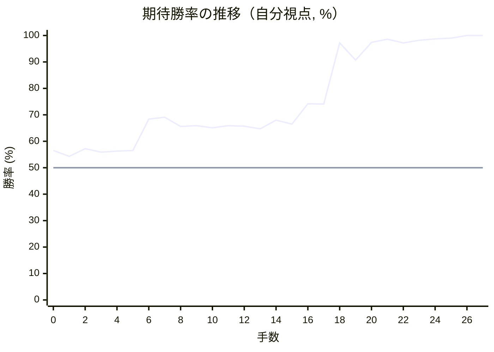

# 解析レポート ozs25ba1ufp0

[README に戻る](../../../README.md)　/　棋譜: [CSA](../../../data/csa/shogi5/ozs25ba1ufp0.csa)　/　解析の見方: [docs/mistake_analysis.md](../../../docs/mistake_analysis.md)

## 対局情報

| 項目 | 内容 |
|---|---|
| 日時 | 2026-11-01 19:44:32 |
| 持ち時間 | 5分 |
| 自分 | 先手（▲）（1712） |
| 相手 | 相手（1593） |
| 結果 | 勝ち（投了, 27手） |

## 解析環境

| 項目 | 内容 |
|---|---|
| エンジン | YaneuraOu NNUE 9.00git 64AVX2（V9.00/YANEURAOU_ENGINE_NNUE/AVX2） |
| 評価関数 | **水匠5**（`suisho5`） |
| nn.bin SHA-256 | `768068f0d534a0603a5d38bcd143de6bbca820d5f1c95a14d40863e5b7892d76` |
| 第1パス | movetime=150ms, MultiPV 1 |
| 第2パス | movetime=2000ms, MultiPV 3 |
| Threads / Hash | 8 / 512MB |
| 判定基準 | 疑問手 ≥5pt, 悪手 ≥10pt, 大悪手 ≥20pt（期待勝率 W(E)=1/(1+exp(-E/600))） |
| 解析日時 | 2026-11-03T04:03:09+09:00（解析バージョン 1, 8秒） |

## サマリー

| 自分の手数 | 深掘りした手 | 詰み逃し | 大悪手 | 悪手 | 疑問手 |
|--:|--:|--:|--:|--:|--:|
| 14 | 1 | 0 | 0 | 0 | 0 |

## 期待勝率の推移

1手ごとの数値（第1パス）

| 手数 | 指し手 | 評価値 | 勝率 | 低下 | 判定 |
|--:|---|--:|--:|--:|---|
| 1 | ▲７六歩(77) | +103 | 54.3% | +2.2pt |  |
| 2 | △６二銀(71) | +175 | 57.2% |  |  |
| 3 | ▲２六歩(27) | +142 | 55.9% | +1.4pt |  |
| 4 | △４二玉(51) | +152 | 56.3% |  |  |
| 5 | ▲２五歩(26) | +157 | 56.5% | -0.2pt |  |
| 6 | △３二玉(42) | +463 | 68.4% |  |  |
| 7 | ▲２四歩(25) | +484 | 69.1% | -0.8pt |  |
| 8 | △同歩(23) | +386 | 65.6% |  |  |
| 9 | ▲同飛(28) | +396 | 65.9% | -0.4pt |  |
| 10 | △２三歩打 | +374 | 65.1% |  |  |
| 11 | ▲２八飛(24) | +395 | 65.9% | -0.8pt |  |
| 12 | △５二金(61) | +390 | 65.7% |  |  |
| 13 | ▲３八銀(39) | +364 | 64.7% | +1.0pt |  |
| 14 | △６四歩(63) | +452 | 68.0% |  |  |
| 15 | ▲２七銀(38) | +411 | 66.5% | +1.5pt |  |
| 16 | △６三銀(62) | +633 | 74.2% |  |  |
| 17 | ▲３六銀(27) | +630 | 74.1% | +0.1pt |  |
| 18 | △５四銀(63) | +2125 | 97.2% |  |  |
| 19 | ▲２五銀(36) | +1366 | 90.7% | +6.5pt |  |
| 20 | △３四歩(33) | +2185 | 97.4% |  |  |
| 21 | ▲同銀(25) | +2551 | 98.6% | -1.1pt |  |
| 22 | △８八角成(22) | +2137 | 97.2% |  |  |
| 23 | ▲２三銀成(34) | +2385 | 98.2% | -0.9pt |  |
| 24 | △４二玉(32) | +2591 | 98.7% |  |  |
| 25 | ▲８八銀(79) | +2746 | 99.0% | -0.3pt |  |
| 26 | △４五角打 | #+3 | 100.0% |  |  |
| 27 | ▲１五角打 | #+2 | 100.0% | +0.0pt |  |

## 課題局面

判定基準に該当する手はありませんでした。
