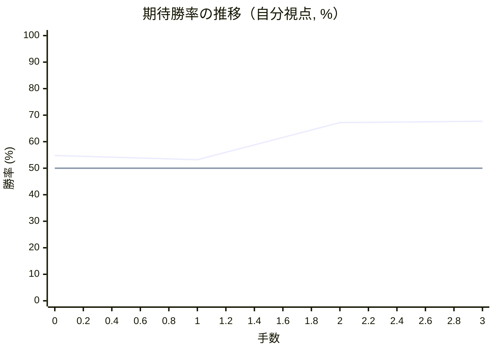

# 解析レポート ph4tcdbgsa22

[README に戻る](../../../README.md)　/　棋譜: [CSA](../../../data/csa/shogi5/ph4tcdbgsa22.csa)　/　解析の見方: [docs/mistake_analysis.md](../../../docs/mistake_analysis.md)

## 対局情報

| 項目 | 内容 |
|---|---|
| 日時 | 2026-11-03 03:02:27 |
| 持ち時間 | 5分 |
| 自分 | 先手（▲）（1714） |
| 相手 | 相手（1580） |
| 結果 | 勝ち（投了, 3手） |

## 解析環境

| 項目 | 内容 |
|---|---|
| エンジン | YaneuraOu NNUE 9.00git 64AVX2（V9.00/YANEURAOU_ENGINE_NNUE/AVX2） |
| 評価関数 | **水匠5**（`suisho5`） |
| nn.bin SHA-256 | `768068f0d534a0603a5d38bcd143de6bbca820d5f1c95a14d40863e5b7892d76` |
| 第1パス | movetime=150ms, MultiPV 1 |
| 第2パス | movetime=2000ms, MultiPV 3 |
| Threads / Hash | 8 / 512MB |
| 判定基準 | 疑問手 ≥5pt, 悪手 ≥10pt, 大悪手 ≥20pt（期待勝率 W(E)=1/(1+exp(-E/600))） |
| 解析日時 | 2026-11-03T05:25:10+09:00（解析バージョン 1, 1秒） |

## サマリー

| 自分の手数 | 深掘りした手 | 詰み逃し | 大悪手 | 悪手 | 疑問手 |
|--:|--:|--:|--:|--:|--:|
| 2 | 0 | 0 | 0 | 0 | 0 |

## 期待勝率の推移

1手ごとの数値（第1パス）

| 手数 | 指し手 | 評価値 | 勝率 | 低下 | 判定 |
|--:|---|--:|--:|--:|---|
| 1 | ▲７六歩(77) | +77 | 53.2% | +1.6pt |  |
| 2 | △２四歩(23) | +430 | 67.2% |  |  |
| 3 | ▲２六歩(27) | +445 | 67.7% | -0.5pt |  |

## 課題局面

判定基準に該当する手はありませんでした。
