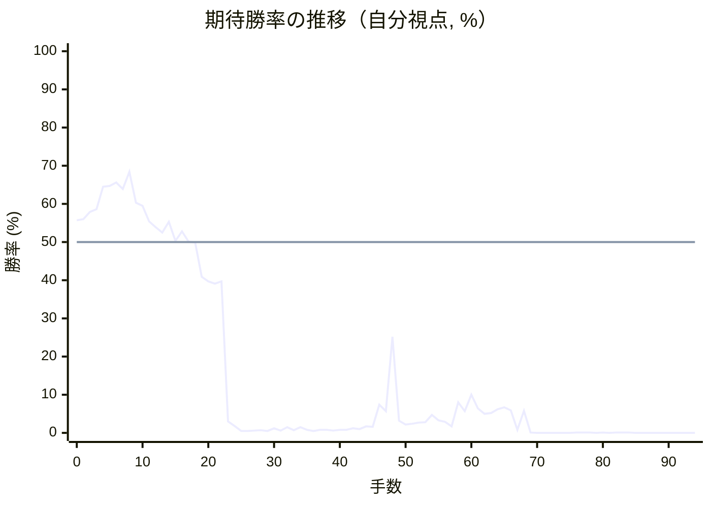
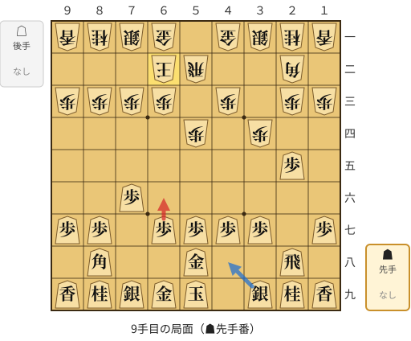
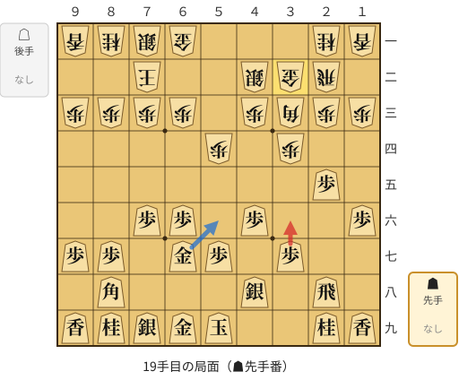
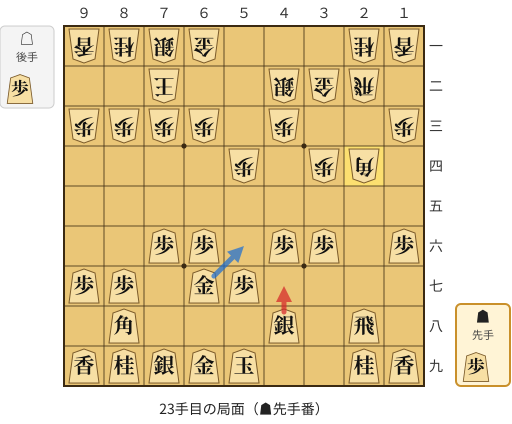
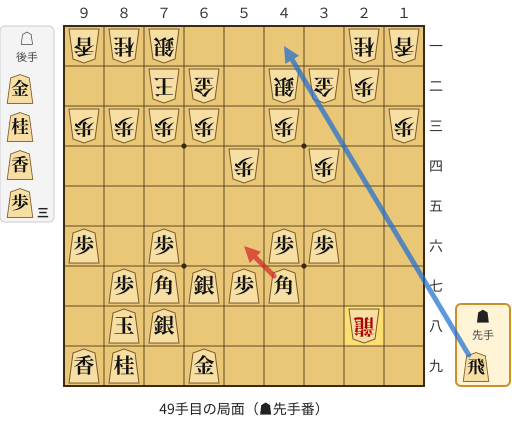

# 解析レポート qpotmwxwtm8n

[README に戻る](../../../README.md)　/　棋譜: [CSA](../../../data/csa/shogi5/qpotmwxwtm8n.csa)　/　解析の見方: [docs/mistake_analysis.md](../../../docs/mistake_analysis.md)

## 対局情報

| 項目 | 内容 |
|---|---|
| 日時 | 2026-11-07 09:36:49 |
| 持ち時間 | 5分 |
| 自分 | 先手（▲）（1731） |
| 相手 | 相手（1975） |
| 結果 | 負け（時間切れ, 94手） |

## 解析環境

| 項目 | 内容 |
|---|---|
| エンジン | YaneuraOu NNUE 9.00git 64AVX2（V9.00/YANEURAOU_ENGINE_NNUE/AVX2） |
| 評価関数 | **水匠5**（`suisho5`） |
| nn.bin SHA-256 | `768068f0d534a0603a5d38bcd143de6bbca820d5f1c95a14d40863e5b7892d76` |
| 第1パス | movetime=150ms, MultiPV 1 |
| 第2パス | movetime=2000ms, MultiPV 3 |
| Threads / Hash | 8 / 512MB |
| 判定基準 | 疑問手 ≥5pt, 悪手 ≥10pt, 大悪手 ≥20pt（期待勝率 W(E)=1/(1+exp(-E/600))） |
| 解析日時 | 2026-11-11T20:30:30+09:00（解析バージョン 1, 38秒） |

## サマリー

| 自分の手数 | 深掘りした手 | 詰み逃し | 大悪手 | 悪手 | 疑問手 |
|--:|--:|--:|--:|--:|--:|
| 47 | 6 | 0 | 2 | 1 | 1 |

## 期待勝率の推移



<details><summary>1手ごとの数値（第1パス）</summary>

| 手数 | 指し手 | 評価値 | 勝率 | 低下 | 判定 |
|--:|---|--:|--:|--:|---|
| 1 | ▲７六歩(77) | +144 | 56.0% | -0.2pt |  |
| 2 | △３四歩(33) | +190 | 57.9% |  |  |
| 3 | ▲２六歩(27) | +208 | 58.6% | -0.7pt |  |
| 4 | △５四歩(53) | +358 | 64.5% |  |  |
| 5 | ▲２五歩(26) | +364 | 64.7% | -0.2pt |  |
| 6 | △５二飛(82) | +388 | 65.6% |  |  |
| 7 | ▲５八金(49) | +342 | 63.9% | +1.7pt |  |
| 8 | △６二玉(51) | +462 | 68.4% |  |  |
| 9 | ▲６六歩(67) | +250 | 60.3% | +8.1pt | [疑問手](#ply-9) |
| 10 | △３三角(22) | +231 | 59.5% |  |  |
| 11 | ▲６七金(58) | +131 | 55.4% | +4.1pt |  |
| 12 | △７二玉(62) | +93 | 53.9% |  |  |
| 13 | ▲１六歩(17) | +61 | 52.5% | +1.3pt |  |
| 14 | △２二飛(52) | +127 | 55.3% |  |  |
| 15 | ▲４八銀(39) | +7 | 50.3% | +5.0pt |  |
| 16 | △４二銀(31) | +68 | 52.8% |  |  |
| 17 | ▲４六歩(47) | +2 | 50.1% | +2.7pt |  |
| 18 | △３二金(41) | -3 | 49.9% |  |  |
| 19 | ▲３六歩(37) | -220 | 40.9% | +8.9pt | [悪手](#ply-19) |
| 20 | △２四歩(23) | -250 | 39.7% |  |  |
| 21 | ▲同歩(25) | -266 | 39.1% | +0.6pt |  |
| 22 | △同角(33) | -251 | 39.7% |  |  |
| 23 | ▲４七銀(48) | -2092 | 3.0% | +36.7pt | [大悪手](#ply-23) |
| 24 | △１五角(24) | -2388 | 1.8% |  |  |
| 25 | ▲同歩(16) | -3166 | 0.5% | +1.3pt |  |
| 26 | △２八飛成(22) | -3147 | 0.5% |  |  |
| 27 | ▲５八銀(47) | -3107 | 0.6% | -0.0pt |  |
| 28 | △２九龍(28) | -3008 | 0.7% |  |  |
| 29 | ▲６八玉(59) | -3166 | 0.5% | +0.2pt |  |
| 30 | △１九龍(29) | -2658 | 1.2% |  |  |
| 31 | ▲６五歩(66) | -3091 | 0.6% | +0.6pt |  |
| 32 | △２二歩打 | -2498 | 1.5% |  |  |
| 33 | ▲２三歩打 | -2987 | 0.7% | +0.8pt |  |
| 34 | △２九飛打 | -2524 | 1.5% |  |  |
| 35 | ▲７八銀(79) | -2931 | 0.8% | +0.7pt |  |
| 36 | △２三飛成(29) | -3184 | 0.5% |  |  |
| 37 | ▲９六歩(97) | -2915 | 0.8% | -0.3pt |  |
| 38 | △６二金(61) | -2891 | 0.8% |  |  |
| 39 | ▲７九玉(68) | -3034 | 0.6% | +0.2pt |  |
| 40 | △２九龍(23) | -2865 | 0.8% |  |  |
| 41 | ▲７七角(88) | -2910 | 0.8% | +0.1pt |  |
| 42 | △１五龍(19) | -2661 | 1.2% |  |  |
| 43 | ▲８八玉(79) | -2768 | 1.0% | +0.2pt |  |
| 44 | △６五龍(15) | -2435 | 1.7% |  |  |
| 45 | ▲４七角打 | -2468 | 1.6% | +0.1pt |  |
| 46 | △６七龍(65) | -1513 | 7.4% |  |  |
| 47 | ▲同銀(58) | -1683 | 5.7% | +1.7pt |  |
| 48 | △２八龍(29) | -652 | 25.2% |  |  |
| 49 | ▲５六角(47) | -2050 | 3.2% | +22.0pt | [大悪手](#ply-49) |
| 50 | △６四香打 | -2270 | 2.2% |  |  |
| 51 | ▲３四角(56) | -2217 | 2.4% | -0.2pt |  |
| 52 | △６七香成(64) | -2140 | 2.7% |  |  |
| 53 | ▲同角(34) | -2135 | 2.8% | -0.0pt |  |
| 54 | △５五桂打 | -1807 | 4.7% |  |  |
| 55 | ▲同角(77) | -2027 | 3.3% | +1.4pt |  |
| 56 | △同歩(54) | -2104 | 2.9% |  |  |
| 57 | ▲５四桂打 | -2438 | 1.7% | +1.2pt |  |
| 58 | △５三銀打 | -1467 | 8.0% |  |  |
| 59 | ▲６二桂成(54) | -1688 | 5.7% | +2.3pt |  |
| 60 | △同銀(53) | -1316 | 10.0% |  |  |
| 61 | ▲６四歩打 | -1614 | 6.4% | +3.7pt |  |
| 62 | △同歩(63) | -1767 | 5.0% |  |  |
| 63 | ▲４五角(67) | -1740 | 5.2% | -0.2pt |  |
| 64 | △６三桂打 | -1635 | 6.2% |  |  |
| 65 | ▲６八香打 | -1583 | 6.7% | -0.5pt |  |
| 66 | △５三金打 | -1666 | 5.9% |  |  |
| 67 | ▲７五金打 | -2880 | 0.8% | +5.0pt |  |
| 68 | △４七角打 | -1674 | 5.8% |  |  |
| 69 | ▲６四香(68) | -4257 | 0.1% | +5.7pt |  |
| 70 | △６九角成(47) | -4748 | 0.0% |  |  |
| 71 | ▲６三香成(64) | -4962 | 0.0% | +0.0pt |  |
| 72 | △同銀(62) | -5362 | 0.0% |  |  |
| 73 | ▲６四歩打 | -5377 | 0.0% | +0.0pt |  |
| 74 | △７八馬(69) | -4675 | 0.0% |  |  |
| 75 | ▲同角(45) | -4975 | 0.0% | +0.0pt |  |
| 76 | △６四銀(63) | -4108 | 0.1% |  |  |
| 77 | ▲同金(75) | -4154 | 0.1% | +0.0pt |  |
| 78 | △同金(53) | -4282 | 0.1% |  |  |
| 79 | ▲７五桂打 | -5548 | 0.0% | +0.1pt |  |
| 80 | △７四銀打 | -4237 | 0.1% |  |  |
| 81 | ▲４一飛打 | -4716 | 0.0% | +0.0pt |  |
| 82 | △５一香打 | -4306 | 0.1% |  |  |
| 83 | ▲２一飛成(41) | -4258 | 0.1% | -0.0pt |  |
| 84 | △３一金(32) | -4495 | 0.1% |  |  |
| 85 | ▲１一龍(21) | -4615 | 0.0% | +0.0pt |  |
| 86 | △７五銀(74) | -4694 | 0.0% |  |  |
| 87 | ▲同歩(76) | -5562 | 0.0% | +0.0pt |  |
| 88 | △７六桂打 | -5975 | 0.0% |  |  |
| 89 | ▲９七玉(88) | -6974 | 0.0% | +0.0pt |  |
| 90 | △７八龍(28) | -6991 | 0.0% |  |  |
| 91 | ▲４五角打 | -7944 | 0.0% | +0.0pt |  |
| 92 | △６三歩打 | -8166 | 0.0% |  |  |
| 93 | ▲７八角(45) | #-11 | 0.0% | +0.0pt |  |
| 94 | △７九角打 | -6264 | 0.0% |  |  |

</details>

## 課題局面

<a id="ply-9"></a>
### 9手目 ▲６六歩(67) — 疑問手

| | 着手前 | 着手後 | 差 |
|---|--:|--:|--:|
| 期待勝率 | 64.3% | 56.1% | -8.2pt |
| 評価値 | +354 | +148 | |

着手前の局面:



🔴 実戦 ▲６六歩(67)　🔵 AI推奨 ▲４八銀(39)　🟨 直前の相手の指し手

<details><summary>テキストの盤面図（BOD・将棋ソフトに貼り付け可）</summary>

```text
後手の持駒：なし
  ９ ８ ７ ６ ５ ４ ３ ２ １
+---------------------------+
|v香v桂v銀v金 ・v金v銀v桂v香|一
| ・ ・ ・v玉v飛 ・ ・v角 ・|二
|v歩v歩v歩v歩 ・v歩 ・v歩v歩|三
| ・ ・ ・ ・v歩 ・v歩 ・ ・|四
| ・ ・ ・ ・ ・ ・ ・ 歩 ・|五
| ・ ・ 歩 ・ ・ ・ ・ ・ ・|六
| 歩 歩 ・ 歩 歩 歩 歩 ・ 歩|七
| ・ 角 ・ ・ 金 ・ ・ 飛 ・|八
| 香 桂 銀 金 玉 ・ 銀 桂 香|九
+---------------------------+
先手の持駒：なし
手数＝8　△６二玉　まで
```

</details>

| | 指し手 | 評価値 | 読み筋 |
|---|---|--:|---|
| 実戦 | ▲６六歩(67) | +148 | △３三角(22) ▲９六歩(97) △９四歩(93) ▲４八銀(39) △４二銀(31) ▲７八銀(79) |
| AI 1位 | ▲４八銀(39) | +354 | ▲４八銀(39) △９四歩(93) ▲９六歩(97) △３三角(22) ▲同角成(88) △同桂(21) |
| AI 2位 | ▲６八金(69) | +372 | ▲６八金(69) △８八角成(22) ▲同銀(79) △３二銀(31) ▲９六歩(97) △３三銀(32) |
| AI 3位 | ▲９六歩(97) | +304 | ▲９六歩(97) △５五歩(54) ▲９五歩(96) △３三角(22) ▲６八玉(59) △４二銀(31) |

SFEN: `lnsg1gsnl/3kr2b1/pppp1p1pp/4p1p2/7P1/2P6/PP1PPPP1P/1B2G2R1/LNSGK1SNL b - 9`

<a id="ply-19"></a>
### 19手目 ▲３六歩(37) — 悪手

| | 着手前 | 着手後 | 差 |
|---|--:|--:|--:|
| 期待勝率 | 51.5% | 38.1% | -13.5pt |
| 評価値 | +37 | -292 | |

着手前の局面:



🔴 実戦 ▲３六歩(37)　🔵 AI推奨 ▲５六金(67)　🟨 直前の相手の指し手

<details><summary>テキストの盤面図（BOD・将棋ソフトに貼り付け可）</summary>

```text
後手の持駒：なし
  ９ ８ ７ ６ ５ ４ ３ ２ １
+---------------------------+
|v香v桂v銀v金 ・ ・ ・v桂v香|一
| ・ ・v玉 ・ ・v銀v金v飛 ・|二
|v歩v歩v歩v歩 ・v歩v角v歩v歩|三
| ・ ・ ・ ・v歩 ・v歩 ・ ・|四
| ・ ・ ・ ・ ・ ・ ・ 歩 ・|五
| ・ ・ 歩 歩 ・ 歩 ・ ・ 歩|六
| 歩 歩 ・ 金 歩 ・ 歩 ・ ・|七
| ・ 角 ・ ・ ・ 銀 ・ 飛 ・|八
| 香 桂 銀 金 玉 ・ ・ 桂 香|九
+---------------------------+
先手の持駒：なし
手数＝18　△３二金　まで
```

</details>

| | 指し手 | 評価値 | 読み筋 |
|---|---|--:|---|
| 実戦 | ▲３六歩(37) | -292 | △２四歩(23) ▲同歩(25) △同角(33) ▲５六金(67) △３三角(24) ▲２五歩打 |
| AI 1位 | ▲５六金(67) | +37 | ▲５六金(67) △２四歩(23) ▲同歩(25) △同角(33) ▲４五金(56) △３三桂(21) |
| AI 2位 | ▲６五歩(66) | -86 | ▲６五歩(66) △８八角成(33) ▲同銀(79) △３三銀(42) ▲７七銀(88) △６二銀(71) |
| AI 3位 | ▲６八玉(59) | -81 | ▲６八玉(59) △２四歩(23) ▲同歩(25) △同角(33) ▲９六歩(97) △３五角(24) |

SFEN: `lnsg3nl/2k2sgr1/pppp1pbpp/4p1p2/7P1/2PP1P2P/PP1GP1P2/1B3S1R1/LNSGK2NL b - 19`

<a id="ply-23"></a>
### 23手目 ▲４七銀(48) — 大悪手

| | 着手前 | 着手後 | 差 |
|---|--:|--:|--:|
| 期待勝率 | 39.3% | 0.6% | -38.7pt |
| 評価値 | -262 | -3064 | |

着手前の局面:



🔴 実戦 ▲４七銀(48)　🔵 AI推奨 ▲５六金(67)　🟨 直前の相手の指し手

<details><summary>テキストの盤面図（BOD・将棋ソフトに貼り付け可）</summary>

```text
後手の持駒：歩
  ９ ８ ７ ６ ５ ４ ３ ２ １
+---------------------------+
|v香v桂v銀v金 ・ ・ ・v桂v香|一
| ・ ・v玉 ・ ・v銀v金v飛 ・|二
|v歩v歩v歩v歩 ・v歩 ・ ・v歩|三
| ・ ・ ・ ・v歩 ・v歩v角 ・|四
| ・ ・ ・ ・ ・ ・ ・ ・ ・|五
| ・ ・ 歩 歩 ・ 歩 歩 ・ 歩|六
| 歩 歩 ・ 金 歩 ・ ・ ・ ・|七
| ・ 角 ・ ・ ・ 銀 ・ 飛 ・|八
| 香 桂 銀 金 玉 ・ ・ 桂 香|九
+---------------------------+
先手の持駒：歩
手数＝22　△２四同角　まで
```

</details>

| | 指し手 | 評価値 | 読み筋 |
|---|---|--:|---|
| 実戦 | ▲４七銀(48) | -3064 | △１五角(24) ▲２六歩打 △同角(15) ▲同飛(28) △同飛(22) ▲３七桂(29) |
| AI 1位 | ▲５六金(67) | -262 | ▲５六金(67) △３三角(24) ▲２二飛成(28) △同角(33) ▲２八飛打 △１四歩(13) |
| AI 2位 | ▲３七銀(48) | -383 | ▲３七銀(48) △３五歩(34) ▲２五歩打 △３六歩(35) ▲２四歩(25) △３七歩成(36) |
| AI 3位 | ▲２五歩打 | -483 | ▲２五歩打 △４六角(24) ▲３七銀(48) △５五角(46) ▲５六金(67) △４四角(55) |

SFEN: `lnsg3nl/2k2sgr1/pppp1p2p/4p1pb1/9/2PP1PP1P/PP1GP4/1B3S1R1/LNSGK2NL b Pp 23`

<a id="ply-49"></a>
### 49手目 ▲５六角(47) — 大悪手

| | 着手前 | 着手後 | 差 |
|---|--:|--:|--:|
| 期待勝率 | 24.0% | 2.2% | -21.8pt |
| 評価値 | -690 | -2272 | |

着手前の局面:



🔴 実戦 ▲５六角(47)　🔵 AI推奨 ▲４一飛打　🟨 直前の相手の指し手

<details><summary>テキストの盤面図（BOD・将棋ソフトに貼り付け可）</summary>

```text
後手の持駒：金　桂　香　歩三
  ９ ８ ７ ６ ５ ４ ３ ２ １
+---------------------------+
|v香v桂v銀 ・ ・ ・ ・v桂v香|一
| ・ ・v玉v金 ・v銀v金v歩 ・|二
|v歩v歩v歩v歩 ・v歩 ・ ・v歩|三
| ・ ・ ・ ・v歩 ・v歩 ・ ・|四
| ・ ・ ・ ・ ・ ・ ・ ・ ・|五
| 歩 ・ 歩 ・ ・ 歩 歩 ・ ・|六
| ・ 歩 角 銀 歩 角 ・ ・ ・|七
| ・ 玉 銀 ・ ・ ・ ・v龍 ・|八
| 香 桂 ・ 金 ・ ・ ・ ・ ・|九
+---------------------------+
先手の持駒：飛
手数＝48　△２八龍　まで
```

</details>

| | 指し手 | 評価値 | 読み筋 |
|---|---|--:|---|
| 実戦 | ▲５六角(47) | -2272 | △６四香打 ▲３四角(56) △６七香不成(64) ▲同角(34) △６五桂打 ▲６六角(77) |
| AI 1位 | ▲４一飛打 | -690 | ▲４一飛打 △７四歩(73) ▲２一飛成(41) △３一金(32) ▲１一龍(21) △６四香打 |
| AI 2位 | ▲５六銀(67) | -2284 | ▲５六銀(67) △３一金(32) ▲６八飛打 △同龍(28) ▲同金(69) △２八飛打 |
| AI 3位 | ▲６八飛打 | -2150 | ▲６八飛打 △２五龍(28) ▲３五歩(36) △同龍(25) ▲３八飛(68) △２四龍(35) |

SFEN: `lns4nl/2kg1sgp1/pppp1p2p/4p1p2/9/P1P2PP2/1PBSPB3/1KS4+r1/LN1G5 b Rgnl3p 49`

