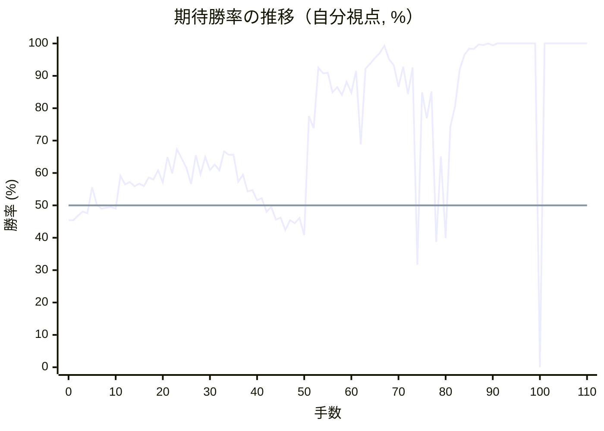
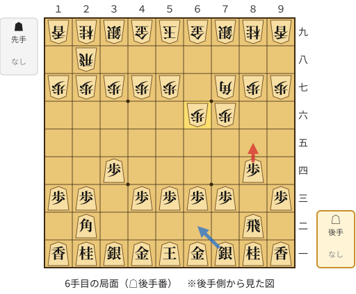
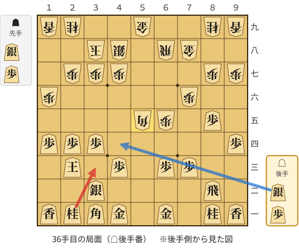
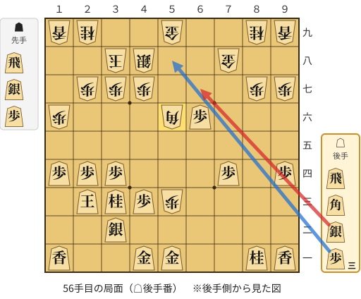
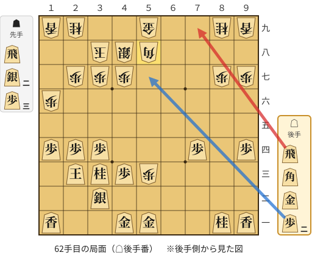
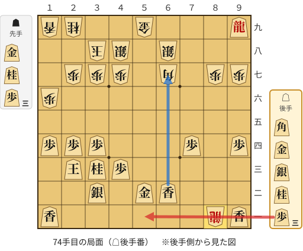
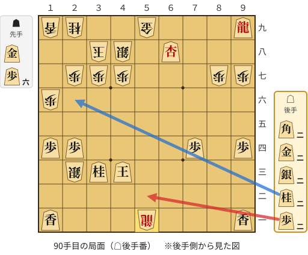
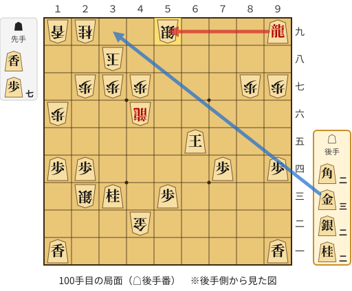

# 解析レポート qxiged1ahfsn

[README に戻る](../../../README.md)　/　棋譜: [CSA](../../../data/csa/shogi5/qxiged1ahfsn.csa)　/　解析の見方: [docs/mistake_analysis.md](../../../docs/mistake_analysis.md)

## 対局情報

| 項目 | 内容 |
|---|---|
| 日時 | 2026-11-08 15:08:47 |
| 持ち時間 | 5分 |
| 自分 | 後手（△）（1666） |
| 相手 | 相手（1745） |
| 結果 | 勝ち（詰み, 110手） |

## 解析環境

| 項目 | 内容 |
|---|---|
| エンジン | YaneuraOu NNUE 9.00git 64AVX2（V9.00/YANEURAOU_ENGINE_NNUE/AVX2） |
| 評価関数 | **水匠5**（`suisho5`） |
| nn.bin SHA-256 | `768068f0d534a0603a5d38bcd143de6bbca820d5f1c95a14d40863e5b7892d76` |
| 第1パス | movetime=150ms, MultiPV 1 |
| 第2パス | movetime=2000ms, MultiPV 3 |
| Threads / Hash | 8 / 512MB |
| 判定基準 | 疑問手 ≥5pt, 悪手 ≥10pt, 大悪手 ≥20pt（期待勝率 W(E)=1/(1+exp(-E/600))） |
| 解析日時 | 2026-11-11T20:16:21+09:00（解析バージョン 1, 66秒） |

## サマリー

| 自分の手数 | 深掘りした手 | 詰み逃し | 大悪手 | 悪手 | 疑問手 |
|--:|--:|--:|--:|--:|--:|
| 55 | 13 | 2 | 0 | 3 | 2 |

## 期待勝率の推移



<details><summary>1手ごとの数値（第1パス）</summary>

| 手数 | 指し手 | 評価値 | 勝率 | 低下 | 判定 |
|--:|---|--:|--:|--:|---|
| 1 | ▲７六歩(77) | -111 | 45.4% |  |  |
| 2 | △８四歩(83) | -76 | 46.8% | -1.4pt |  |
| 3 | ▲７七角(88) | -45 | 48.1% |  |  |
| 4 | △３四歩(33) | -58 | 47.6% | +0.5pt |  |
| 5 | ▲６六歩(67) | +135 | 55.6% |  |  |
| 6 | △８五歩(84) | +4 | 50.2% | +5.4pt | [疑問手](#ply-6) |
| 7 | ▲７八銀(79) | -23 | 49.0% |  |  |
| 8 | △６二銀(71) | -17 | 49.3% | -0.2pt |  |
| 9 | ▲６七銀(78) | -11 | 49.5% |  |  |
| 10 | △４二玉(51) | -25 | 49.0% | +0.6pt |  |
| 11 | ▲６八飛(28) | +222 | 59.1% |  |  |
| 12 | △３二玉(42) | +156 | 56.5% | +2.7pt |  |
| 13 | ▲４八玉(59) | +173 | 57.2% |  |  |
| 14 | △１四歩(13) | +143 | 55.9% | +1.2pt |  |
| 15 | ▲１六歩(17) | +162 | 56.7% |  |  |
| 16 | △５四歩(53) | +145 | 56.0% | +0.7pt |  |
| 17 | ▲３八玉(48) | +208 | 58.6% |  |  |
| 18 | △２四歩(23) | +194 | 58.0% | +0.6pt |  |
| 19 | ▲４八銀(39) | +263 | 60.8% |  |  |
| 20 | △２三玉(32) | +172 | 57.1% | +3.7pt |  |
| 21 | ▲５九金(49) | +368 | 64.9% |  |  |
| 22 | △５三銀(62) | +240 | 59.9% | +5.0pt |  |
| 23 | ▲７八金(69) | +432 | 67.3% |  |  |
| 24 | △３二銀(31) | +358 | 64.5% | +2.8pt |  |
| 25 | ▲５六歩(57) | +283 | 61.6% |  |  |
| 26 | △４四銀(53) | +160 | 56.6% | +5.0pt |  |
| 27 | ▲６五歩(66) | +384 | 65.5% |  |  |
| 28 | △３一角(22) | +234 | 59.6% | +5.8pt |  |
| 29 | ▲６六銀(67) | +368 | 64.9% |  |  |
| 30 | △９四歩(93) | +267 | 60.9% | +3.9pt |  |
| 31 | ▲５五歩(56) | +308 | 62.6% |  |  |
| 32 | △同歩(54) | +264 | 60.8% | +1.7pt |  |
| 33 | ▲同銀(66) | +418 | 66.7% |  |  |
| 34 | △同銀(44) | +387 | 65.6% | +1.2pt |  |
| 35 | ▲同角(77) | +386 | 65.6% |  |  |
| 36 | △３三桂(21) | +176 | 57.3% | +8.3pt | [悪手](#ply-36) |
| 37 | ▲６四歩(65) | +232 | 59.5% |  |  |
| 38 | △同歩(63) | +103 | 54.3% | +5.3pt |  |
| 39 | ▲同角(55) | +112 | 54.7% |  |  |
| 40 | △同角(31) | +38 | 51.6% | +3.1pt |  |
| 41 | ▲同飛(68) | +54 | 52.2% |  |  |
| 42 | △５一金(61) | -48 | 48.0% | +4.2pt |  |
| 43 | ▲６三飛成(64) | -13 | 49.5% |  |  |
| 44 | △８六歩(85) | -105 | 45.6% | +3.8pt |  |
| 45 | ▲同歩(87) | -91 | 46.2% |  |  |
| 46 | △同飛(82) | -184 | 42.4% | +3.8pt |  |
| 47 | ▲８七歩打 | -110 | 45.4% |  |  |
| 48 | △７六飛(86) | -132 | 44.5% | +0.9pt |  |
| 49 | ▲６七角打 | -93 | 46.1% |  |  |
| 50 | △７四飛(76) | -224 | 40.8% | +5.4pt |  |
| 51 | ▲同龍(63) | +746 | 77.6% |  |  |
| 52 | △同歩(73) | +621 | 73.8% | +3.8pt |  |
| 53 | ▲５三歩打 | +1505 | 92.5% |  |  |
| 54 | △６六歩打 | +1374 | 90.8% | +1.7pt |  |
| 55 | ▲５六角(67) | +1380 | 90.9% |  |  |
| 56 | △６七銀打 | +1035 | 84.9% | +6.0pt | [疑問手](#ply-56) |
| 57 | ▲同金(78) | +1112 | 86.5% |  |  |
| 58 | △同歩成(66) | +1000 | 84.1% | +2.3pt |  |
| 59 | ▲同角(56) | +1202 | 88.1% |  |  |
| 60 | △５八歩打 | +1031 | 84.8% | +3.3pt |  |
| 61 | ▲同角(67) | +1423 | 91.5% |  |  |
| 62 | △７九飛打 | +474 | 68.8% | +22.7pt | [悪手](#ply-62) |
| 63 | ▲６八銀打 | +1478 | 92.2% |  |  |
| 64 | △８九飛成(79) | +1631 | 93.8% | -1.7pt |  |
| 65 | ▲６七角(58) | +1827 | 95.5% |  |  |
| 66 | △９九龍(89) | +2080 | 97.0% | -1.5pt |  |
| 67 | ▲５二銀打 | +2943 | 99.3% |  |  |
| 68 | △同金(51) | +1778 | 95.1% | +4.2pt |  |
| 69 | ▲同歩成(53) | +1582 | 93.3% |  |  |
| 70 | △同金(41) | +1122 | 86.6% | +6.7pt |  |
| 71 | ▲８二飛打 | +1533 | 92.8% |  |  |
| 72 | △６二香打 | +1011 | 84.4% | +8.4pt |  |
| 73 | ▲８一飛成(82) | +1515 | 92.6% |  |  |
| 74 | △５一歩打 | -461 | 31.7% | +60.9pt | [悪手](#ply-74) |
| 75 | ▲３五桂打 | +1037 | 84.9% |  |  |
| 76 | △２二玉(23) | +722 | 76.9% | +8.0pt |  |
| 77 | ▲３四角(67) | +1048 | 85.2% |  |  |
| 78 | △６八香成(62) | -277 | 38.7% | +46.5pt |  |
| 79 | ▲２三金打 | +373 | 65.1% |  |  |
| 80 | △３一玉(22) | -247 | 39.9% | +25.2pt |  |
| 81 | ▲３二金(23) | +638 | 74.3% |  |  |
| 82 | △同玉(31) | +853 | 80.6% | -6.2pt |  |
| 83 | ▲２三銀打 | +1477 | 92.1% |  |  |
| 84 | △４二玉(32) | +1986 | 96.5% | -4.3pt |  |
| 85 | ▲４三桂成(35) | +2464 | 98.4% |  |  |
| 86 | △同金(52) | +2428 | 98.3% | +0.1pt |  |
| 87 | ▲同角成(34) | +3576 | 99.7% |  |  |
| 88 | △同玉(42) | +3227 | 99.5% | +0.2pt |  |
| 89 | ▲５一龍(81) | #+9 | 100.0% |  |  |
| 90 | △５二歩打 | +3064 | 99.4% | +0.6pt | [詰み逃し](#ply-90) |
| 91 | ▲４二金打 | +5377 | 100.0% |  |  |
| 92 | △５四玉(43) | +5357 | 100.0% | +0.0pt |  |
| 93 | ▲５二龍(51) | +5714 | 100.0% |  |  |
| 94 | △５三歩打 | +5611 | 100.0% | +0.0pt |  |
| 95 | ▲４三龍(52) | +5910 | 100.0% |  |  |
| 96 | △６五玉(54) | +6058 | 100.0% | -0.0pt |  |
| 97 | ▲４六龍(43) | +6572 | 100.0% |  |  |
| 98 | △５九成香(68) | +6630 | 100.0% | -0.0pt |  |
| 99 | ▲同銀(48) | #+13 | 100.0% |  |  |
| 100 | △同龍(99) | #-7 | 0.0% | +100.0pt | [詰み逃し](#ply-100) |
| 101 | ▲４九香打 | #+7 | 100.0% |  |  |
| 102 | △４八金打 | #+8 | 100.0% | +0.0pt |  |
| 103 | ▲同香(49) | #+7 | 100.0% |  |  |
| 104 | △３九金打 | #+8 | 100.0% | +0.0pt |  |
| 105 | ▲２八玉(38) | #+7 | 100.0% |  |  |
| 106 | △２九金(39) | #+6 | 100.0% | +0.0pt |  |
| 107 | ▲１七玉(28) | #+3 | 100.0% |  |  |
| 108 | △３九角打 | #+4 | 100.0% | +0.0pt |  |
| 109 | ▲２六玉(17) | #+1 | 100.0% |  |  |
| 110 | △２五金打 | #+ | 100.0% | +0.0pt |  |

</details>

## 課題局面

<a id="ply-6"></a>
### 6手目 △８五歩(84) — 疑問手

| | 着手前 | 着手後 | 差 |
|---|--:|--:|--:|
| 期待勝率 | 54.8% | 48.9% | -5.9pt |
| 評価値 | +116 | -26 | |

着手前の局面:



🔴 実戦 △８五歩(84)　🔵 AI推奨 △６二銀(71)　🟨 直前の相手の指し手

<details><summary>テキストの盤面図（BOD・将棋ソフトに貼り付け可）</summary>

```text
後手の持駒：なし
  ９ ８ ７ ６ ５ ４ ３ ２ １
+---------------------------+
|v香v桂v銀v金v玉v金v銀v桂v香|一
| ・v飛 ・ ・ ・ ・ ・v角 ・|二
|v歩 ・v歩v歩v歩v歩 ・v歩v歩|三
| ・v歩 ・ ・ ・ ・v歩 ・ ・|四
| ・ ・ ・ ・ ・ ・ ・ ・ ・|五
| ・ ・ 歩 歩 ・ ・ ・ ・ ・|六
| 歩 歩 角 ・ 歩 歩 歩 歩 歩|七
| ・ ・ ・ ・ ・ ・ ・ 飛 ・|八
| 香 桂 銀 金 玉 金 銀 桂 香|九
+---------------------------+
先手の持駒：なし
後手番
手数＝5　▲６六歩　まで
```

</details>

| | 指し手 | 評価値 | 読み筋 |
|---|---|--:|---|
| 実戦 | △８五歩(84) | -26 | ▲２六歩(27) △６二銀(71) ▲７八銀(79) △７四歩(73) ▲６七銀(78) △７三銀(62) |
| AI 1位 | △６二銀(71) | +116 | △６二銀(71) ▲２六歩(27) △６四歩(63) ▲２五歩(26) △３三角(22) ▲４八銀(39) |
| AI 2位 | △６二飛(82) | +97 | △６二飛(82) ▲２六歩(27) △６四歩(63) ▲２五歩(26) △７二銀(71) ▲６八銀(79) |
| AI 3位 | △６四歩(63) | +96 | △６四歩(63) ▲２六歩(27) △６二銀(71) ▲２五歩(26) △３三角(22) ▲４八銀(39) |

SFEN: `lnsgkgsnl/1r5b1/p1pppp1pp/1p4p2/9/2PP5/PPB1PPPPP/7R1/LNSGKGSNL w - 6`

<a id="ply-36"></a>
### 36手目 △３三桂(21) — 悪手

| | 着手前 | 着手後 | 差 |
|---|--:|--:|--:|
| 期待勝率 | 65.2% | 52.6% | -12.6pt |
| 評価値 | +376 | +63 | |

着手前の局面:



🔴 実戦 △３三桂(21)　🔵 AI推奨 △４四銀打　🟨 直前の相手の指し手

<details><summary>テキストの盤面図（BOD・将棋ソフトに貼り付け可）</summary>

```text
後手の持駒：銀　歩
  ９ ８ ７ ６ ５ ４ ３ ２ １
+---------------------------+
|v香v桂 ・v金 ・v金v角v桂v香|一
| ・v飛 ・ ・ ・ ・v銀 ・ ・|二
| ・ ・v歩v歩 ・v歩 ・v玉 ・|三
|v歩 ・ ・ ・ ・ ・v歩v歩v歩|四
| ・v歩 ・ 歩 角 ・ ・ ・ ・|五
| ・ ・ 歩 ・ ・ ・ ・ ・ 歩|六
| 歩 歩 ・ ・ ・ 歩 歩 歩 ・|七
| ・ ・ 金 飛 ・ 銀 玉 ・ ・|八
| 香 桂 ・ ・ 金 ・ ・ 桂 香|九
+---------------------------+
先手の持駒：銀　歩
後手番
手数＝35　▲５五同角　まで
```

</details>

| | 指し手 | 評価値 | 読み筋 |
|---|---|--:|---|
| 実戦 | △３三桂(21) | +63 | ▲６四歩(65) △８六歩(85) ▲同歩(87) △６四歩(63) ▲同角(55) △同角(31) |
| AI 1位 | △４四銀打 | +376 | △４四銀打 ▲７七角(55) △５二金(61) ▲６九飛(68) △５三金(52) ▲４六歩(47) |
| AI 2位 | △３三銀(32) | +55 | △３三銀(32) ▲６四歩(65) △同歩(63) ▲同角(55) △同角(31) ▲同飛(68) |
| AI 3位 | △３三桂(21) | +52 | △３三桂(21) ▲６四歩(65) △８六歩(85) ▲同歩(87) △６四歩(63) ▲同角(55) |

SFEN: `ln1g1gbnl/1r4s2/2pp1p1k1/p5ppp/1p1PB4/2P5P/PP3PPP1/2GR1SK2/LN2G2NL w SPsp 36`

<a id="ply-56"></a>
### 56手目 △６七銀打 — 疑問手

| | 着手前 | 着手後 | 差 |
|---|--:|--:|--:|
| 期待勝率 | 93.7% | 86.2% | -7.5pt |
| 評価値 | +1621 | +1100 | |

着手前の局面:



🔴 実戦 △６七銀打　🔵 AI推奨 △５八歩打　🟨 直前の相手の指し手

<details><summary>テキストの盤面図（BOD・将棋ソフトに貼り付け可）</summary>

```text
後手の持駒：飛　角　銀　歩三
  ９ ８ ７ ６ ５ ４ ３ ２ １
+---------------------------+
|v香v桂 ・ ・v金v金 ・ ・v香|一
| ・ ・ ・ ・ ・ ・v銀 ・ ・|二
| ・ ・ ・ ・ 歩v歩v桂v玉 ・|三
|v歩 ・v歩 ・ ・ ・v歩v歩v歩|四
| ・ ・ ・ ・ ・ ・ ・ ・ ・|五
| ・ ・ ・v歩 角 ・ ・ ・ 歩|六
| 歩 歩 ・ ・ ・ 歩 歩 歩 ・|七
| ・ ・ 金 ・ ・ 銀 玉 ・ ・|八
| 香 桂 ・ ・ 金 ・ ・ 桂 香|九
+---------------------------+
先手の持駒：飛　銀　歩
後手番
手数＝55　▲５六角　まで
```

</details>

| | 指し手 | 評価値 | 読み筋 |
|---|---|--:|---|
| 実戦 | △６七銀打 | +1100 | ▲同金(78) △同歩成(66) ▲１五歩(16) △５八歩打 ▲４九金(59) △６九飛打 |
| AI 1位 | △５八歩打 | +1621 | △５八歩打 ▲６九金(59) △６七銀打 ▲５二歩成(53) △同金(51) ▲６七金(78) |
| AI 2位 | △５五飛打 | +1393 | △５五飛打 ▲５七銀打 △４五桂(33) ▲６三飛打 △７五角打 ▲７六歩打 |
| AI 3位 | △５七歩打 | +1207 | △５七歩打 ▲８三飛打 △５八銀打 ▲８一飛成(83) △５九銀成(58) ▲同銀(48) |

SFEN: `ln2gg2l/6s2/4Ppnk1/p1p3ppp/9/3pB3P/PP3PPP1/2G2SK2/LN2G2NL w RSPrbs3p 56`

<a id="ply-62"></a>
### 62手目 △７九飛打 — 悪手

| | 着手前 | 着手後 | 差 |
|---|--:|--:|--:|
| 期待勝率 | 92.8% | 77.5% | -15.3pt |
| 評価値 | +1531 | +741 | |

着手前の局面:



🔴 実戦 △７九飛打　🔵 AI推奨 △５七歩打　🟨 直前の相手の指し手

<details><summary>テキストの盤面図（BOD・将棋ソフトに貼り付け可）</summary>

```text
後手の持駒：飛　角　金　歩二
  ９ ８ ７ ６ ５ ４ ３ ２ １
+---------------------------+
|v香v桂 ・ ・v金v金 ・ ・v香|一
| ・ ・ ・ ・ ・ ・v銀 ・ ・|二
| ・ ・ ・ ・ 歩v歩v桂v玉 ・|三
|v歩 ・v歩 ・ ・ ・v歩v歩v歩|四
| ・ ・ ・ ・ ・ ・ ・ ・ ・|五
| ・ ・ ・ ・ ・ ・ ・ ・ 歩|六
| 歩 歩 ・ ・ ・ 歩 歩 歩 ・|七
| ・ ・ ・ ・ 角 銀 玉 ・ ・|八
| 香 桂 ・ ・ 金 ・ ・ 桂 香|九
+---------------------------+
先手の持駒：飛　銀二　歩三
後手番
手数＝61　▲５八同角　まで
```

</details>

| | 指し手 | 評価値 | 読み筋 |
|---|---|--:|---|
| 実戦 | △７九飛打 | +741 | ▲１五歩(16) △５六歩打 ▲１四歩(15) △１二歩打 ▲６九歩打 △４五桂(33) |
| AI 1位 | △５七歩打 | +1531 | △５七歩打 ▲４九角(58) △５八金打 ▲同角(49) △同歩成(57) ▲同金(59) |
| AI 2位 | △５六歩打 | +1138 | △５六歩打 ▲４六銀打 △６六角打 ▲１五歩(16) △９九角成(66) ▲５二銀打 |
| AI 3位 | △６六角打 | +1114 | △６六角打 ▲１五歩(16) △５六歩打 ▲１四歩(15) △４五桂(33) ▲７七銀打 |

SFEN: `ln2gg2l/6s2/4Ppnk1/p1p3ppp/9/8P/PP3PPP1/4BSK2/LN2G2NL w R2S3Prbg2p 62`

<a id="ply-74"></a>
### 74手目 △５一歩打 — 悪手

| | 着手前 | 着手後 | 差 |
|---|--:|--:|--:|
| 期待勝率 | 96.0% | 83.6% | -12.4pt |
| 評価値 | +1906 | +978 | |

着手前の局面:



🔴 実戦 △５一歩打　🔵 AI推奨 △６七香成(62)　🟨 直前の相手の指し手

<details><summary>テキストの盤面図（BOD・将棋ソフトに貼り付け可）</summary>

```text
後手の持駒：角　金　銀　桂　歩三
  ９ ８ ７ ６ ５ ４ ３ ２ １
+---------------------------+
|v香 龍 ・ ・ ・ ・ ・ ・v香|一
| ・ ・ ・v香v金 ・v銀 ・ ・|二
| ・ ・ ・ ・ ・v歩v桂v玉 ・|三
|v歩 ・v歩 ・ ・ ・v歩v歩v歩|四
| ・ ・ ・ ・ ・ ・ ・ ・ ・|五
| ・ ・ ・ ・ ・ ・ ・ ・ 歩|六
| 歩 歩 ・ 角 ・ 歩 歩 歩 ・|七
| ・ ・ ・ 銀 ・ 銀 玉 ・ ・|八
|v龍 ・ ・ ・ 金 ・ ・ 桂 香|九
+---------------------------+
先手の持駒：金　桂　歩三
後手番
手数＝73　▲８一飛成　まで
```

</details>

| | 指し手 | 評価値 | 読み筋 |
|---|---|--:|---|
| 実戦 | △５一歩打 | +978 | ▲３五桂打 △２二玉(23) ▲６三歩打 △同香(62) ▲３四角(67) △３一桂打 |
| AI 1位 | △６七香成(62) | +1906 | △６七香成(62) ▲１一龍(81) △１二金打 ▲１五桂打 △１三玉(23) ▲２三金打 |
| AI 2位 | △６七香不成(62) | +1445 | △６七香不成(62) ▲１一龍(81) △１二金打 ▲１五桂打 △１三玉(23) ▲３一龍(11) |
| AI 3位 | △５一歩打 | +881 | △５一歩打 ▲３五桂打 △２二玉(23) ▲３四角(67) △３一桂打 ▲６七歩打 |

SFEN: `l+R6l/3lg1s2/5pnk1/p1p3ppp/9/8P/PP1B1PPP1/3S1SK2/+r3G2NL w GN3Pbgsn3p 74`

<a id="ply-90"></a>
### 90手目 △５二歩打 — 詰み逃し

| | 着手前 | 着手後 | 差 |
|---|--:|--:|--:|
| 期待勝率 | 100.0% | 100.0% | -0.0pt |
| 評価値 | 9手詰め | +4706 | |

着手前の局面:



🔴 実戦 △５二歩打　🔵 AI推奨 △２六桂打　🟨 直前の相手の指し手

<details><summary>テキストの盤面図（BOD・将棋ソフトに貼り付け可）</summary>

```text
後手の持駒：角二　金二　銀二　桂二　歩二
  ９ ８ ７ ６ ５ ４ ３ ２ １
+---------------------------+
|v香 ・ ・ ・ 龍 ・ ・ ・v香|一
| ・ ・ ・ ・ ・ ・ ・ ・ ・|二
| ・ ・ ・ ・ ・v玉v桂 銀 ・|三
|v歩 ・v歩 ・ ・ ・ ・v歩v歩|四
| ・ ・ ・ ・ ・ ・ ・ ・ ・|五
| ・ ・ ・ ・ ・ ・ ・ ・ 歩|六
| 歩 歩 ・ ・ ・ 歩 歩 歩 ・|七
| ・ ・ ・v杏 ・ 銀 玉 ・ ・|八
|v龍 ・ ・ ・ 金 ・ ・ 桂 香|九
+---------------------------+
先手の持駒：金　歩六
後手番
手数＝89　▲５一龍　まで
```

</details>

| | 指し手 | 評価値 | 読み筋 |
|---|---|--:|---|
| 実戦 | △５二歩打 | +4706 | ▲３六歩(37) △５三玉(43) |
| AI 1位 | △２六桂打 | 9手詰め | △２六桂打 ▲同歩(27) △２七銀打 ▲同玉(38) △３五桂打 ▲３八玉(27) |
| AI 2位 | △４九角打 | 13手詰め | △４九角打 ▲同金(59) △２六桂打 ▲２八玉(38) △１七銀打 ▲同玉(28) |
| AI 3位 | △４九銀打 | 15手詰め | △４九銀打 ▲同玉(38) △３八銀打 ▲同玉(49) △２六桂打 ▲同歩(27) |

SFEN: `l3+R3l/9/5knS1/p1p4pp/9/8P/PP3PPP1/3+l1SK2/+r3G2NL w G6P2b2g2s2n2p 90`

<a id="ply-100"></a>
### 100手目 △同龍(99) — 詰み逃し

| | 着手前 | 着手後 | 差 |
|---|--:|--:|--:|
| 期待勝率 | 100.0% | 0.0% | -100.0pt |
| 評価値 | 13手詰め | 7手で詰まされる | |

着手前の局面:



🔴 実戦 △同龍(99)　🔵 AI推奨 △３九金打　🟨 直前の相手の指し手

<details><summary>テキストの盤面図（BOD・将棋ソフトに貼り付け可）</summary>

```text
後手の持駒：角二　金三　銀二　桂二
  ９ ８ ７ ６ ５ ４ ３ ２ １
+---------------------------+
|v香 ・ ・ ・ ・ ・ ・ ・v香|一
| ・ ・ ・ ・ ・ 金 ・ ・ ・|二
| ・ ・ ・ ・v歩 ・v桂 銀 ・|三
|v歩 ・v歩 ・ ・ ・ ・v歩v歩|四
| ・ ・ ・v玉 ・ ・ ・ ・ ・|五
| ・ ・ ・ ・ ・ 龍 ・ ・ 歩|六
| 歩 歩 ・ ・ ・ 歩 歩 歩 ・|七
| ・ ・ ・ ・ ・ ・ 玉 ・ ・|八
|v龍 ・ ・ ・ 銀 ・ ・ 桂 香|九
+---------------------------+
先手の持駒：香　歩七
後手番
手数＝99　▲５九同銀　まで
```

</details>

| | 指し手 | 評価値 | 読み筋 |
|---|---|--:|---|
| 実戦 | △同龍(99) | 7手で詰まされる | ▲６七香打 △６六角打 ▲同龍(46) △５四玉(65) ▲６五龍(66) △４四玉(54) |
| AI 1位 | △３九金打 | 13手詰め | △３九金打 ▲同玉(38) △５九龍(99) ▲４九金打 △１七角打 ▲同桂(29) |
| AI 2位 | △４九角打 | 15手詰め | △４九角打 ▲同玉(38) △３九金打 ▲同玉(49) △５九龍(99) ▲４九金打 |
| AI 3位 | △２八金打 | 15手詰め | △２八金打 ▲同玉(38) △３九角打 ▲同玉(28) △５九龍(99) ▲４九金打 |

SFEN: `l7l/5G3/4p1nS1/p1p4pp/3k5/5+R2P/PP3PPP1/6K2/+r3S2NL w L7P2b3g2s2n 100`

