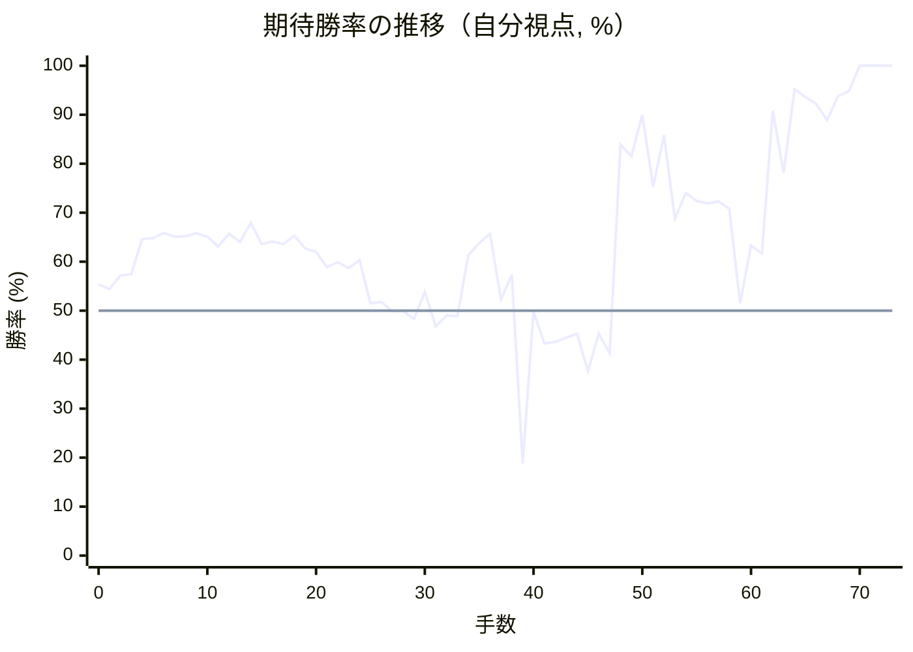
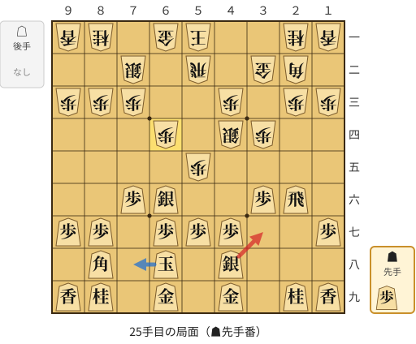
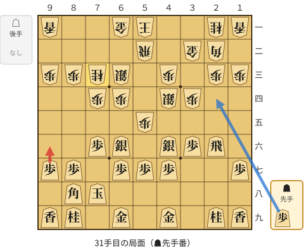
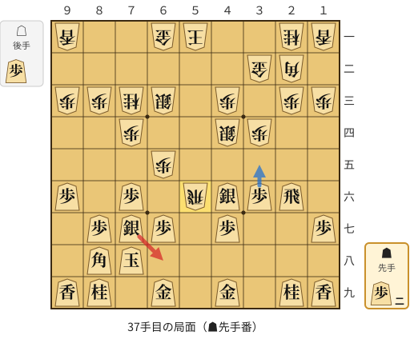
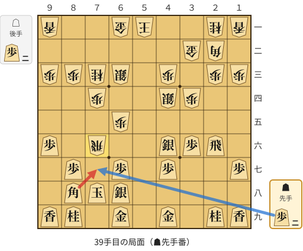
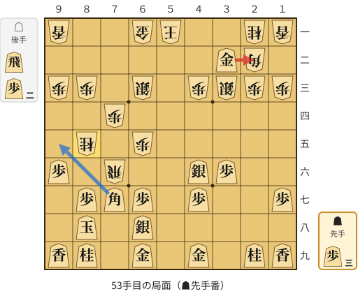
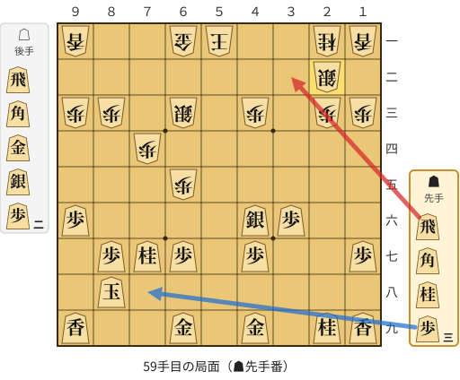
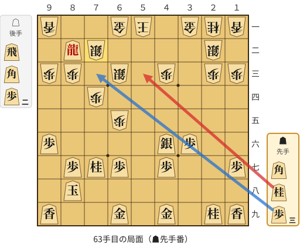

# 解析レポート r763s5zssr2p

[README に戻る](../../../README.md)　/　棋譜: [CSA](../../../data/csa/shogi5/r763s5zssr2p.csa)　/　解析の見方: [docs/mistake_analysis.md](../../../docs/mistake_analysis.md)

## 対局情報

| 項目 | 内容 |
|---|---|
| 日時 | 2026-11-18 12:54:54 |
| 持ち時間 | 5分 |
| 自分 | 先手（▲）（1672） |
| 相手 | 相手（1628） |
| 結果 | 勝ち（詰み, 73手） |

## 解析環境

| 項目 | 内容 |
|---|---|
| エンジン | YaneuraOu NNUE 9.00git 64AVX2（V9.00/YANEURAOU_ENGINE_NNUE/AVX2） |
| 評価関数 | **水匠5**（`suisho5`） |
| nn.bin SHA-256 | `768068f0d534a0603a5d38bcd143de6bbca820d5f1c95a14d40863e5b7892d76` |
| 第1パス | movetime=150ms, MultiPV 1 |
| 第2パス | movetime=2000ms, MultiPV 3 |
| Threads / Hash | 8 / 512MB |
| 判定基準 | 疑問手 ≥5pt, 悪手 ≥10pt, 大悪手 ≥20pt（期待勝率 W(E)=1/(1+exp(-E/600))） |
| 解析日時 | 2026-11-20T20:10:11+09:00（解析バージョン 1, 51秒） |

## サマリー

| 自分の手数 | 深掘りした手 | 詰み逃し | 大悪手 | 悪手 | 疑問手 |
|--:|--:|--:|--:|--:|--:|
| 37 | 10 | 0 | 3 | 2 | 3 |

## 期待勝率の推移



<details><summary>1手ごとの数値（第1パス）</summary>

| 手数 | 指し手 | 評価値 | 勝率 | 低下 | 判定 |
|--:|---|--:|--:|--:|---|
| 1 | ▲７六歩(77) | +105 | 54.4% | +1.0pt |  |
| 2 | △５四歩(53) | +174 | 57.2% |  |  |
| 3 | ▲２六歩(27) | +180 | 57.4% | -0.2pt |  |
| 4 | △５二飛(82) | +360 | 64.6% |  |  |
| 5 | ▲２五歩(26) | +367 | 64.8% | -0.3pt |  |
| 6 | △３二金(41) | +395 | 65.9% |  |  |
| 7 | ▲２四歩(25) | +374 | 65.1% | +0.8pt |  |
| 8 | △同歩(23) | +378 | 65.2% |  |  |
| 9 | ▲同飛(28) | +392 | 65.8% | -0.5pt |  |
| 10 | △２三歩打 | +373 | 65.1% |  |  |
| 11 | ▲２六飛(24) | +321 | 63.1% | +2.0pt |  |
| 12 | △４二銀(31) | +391 | 65.7% |  |  |
| 13 | ▲４八銀(39) | +345 | 64.0% | +1.7pt |  |
| 14 | △５三銀(42) | +450 | 67.9% |  |  |
| 15 | ▲６八銀(79) | +335 | 63.6% | +4.3pt |  |
| 16 | △４四銀(53) | +347 | 64.1% |  |  |
| 17 | ▲７七銀(68) | +334 | 63.6% | +0.5pt |  |
| 18 | △５五歩(54) | +380 | 65.3% |  |  |
| 19 | ▲６六銀(77) | +312 | 62.7% | +2.6pt |  |
| 20 | △３四歩(33) | +294 | 62.0% |  |  |
| 21 | ▲６八玉(59) | +215 | 58.9% | +3.1pt |  |
| 22 | △７二銀(71) | +242 | 59.9% |  |  |
| 23 | ▲３六歩(37) | +210 | 58.7% | +1.3pt |  |
| 24 | △６四歩(63) | +252 | 60.3% |  |  |
| 25 | ▲３七銀(48) | +36 | 51.5% | +8.8pt | [悪手](#ply-25) |
| 26 | △６三銀(72) | +44 | 51.8% |  |  |
| 27 | ▲４六銀(37) | -3 | 49.9% | +2.0pt |  |
| 28 | △７四歩(73) | -2 | 49.9% |  |  |
| 29 | ▲７八玉(68) | -42 | 48.3% | +1.7pt |  |
| 30 | △７三桂(81) | +92 | 53.8% |  |  |
| 31 | ▲９六歩(97) | -77 | 46.8% | +7.0pt | [疑問手](#ply-31) |
| 32 | △６五歩(64) | -25 | 49.0% |  |  |
| 33 | ▲７七銀(66) | -27 | 48.9% | +0.1pt |  |
| 34 | △５六歩(55) | +275 | 61.3% |  |  |
| 35 | ▲同歩(57) | +341 | 63.8% | -2.6pt |  |
| 36 | △同飛(52) | +391 | 65.7% |  |  |
| 37 | ▲６八銀(77) | +55 | 52.3% | +13.4pt | [疑問手](#ply-37) |
| 38 | △７六飛(56) | +177 | 57.3% |  |  |
| 39 | ▲７七角(88) | -876 | 18.8% | +38.5pt | [大悪手](#ply-39) |
| 40 | △５六飛(76) | -5 | 49.8% |  |  |
| 41 | ▲２四歩打 | -161 | 43.3% | +6.5pt |  |
| 42 | △同歩(23) | -154 | 43.6% |  |  |
| 43 | ▲同飛(26) | -132 | 44.5% | -0.9pt |  |
| 44 | △２三歩打 | -113 | 45.3% |  |  |
| 45 | ▲３四飛(24) | -303 | 37.6% | +7.7pt |  |
| 46 | △３三金(32) | -112 | 45.3% |  |  |
| 47 | ▲同飛成(34) | -212 | 41.3% | +4.1pt |  |
| 48 | △同銀(44) | +992 | 83.9% |  |  |
| 49 | ▲３二金打 | +888 | 81.5% | +2.5pt |  |
| 50 | △７六飛(56) | +1320 | 90.0% |  |  |
| 51 | ▲８八玉(78) | +668 | 75.3% | +14.7pt | [疑問手](#ply-51) |
| 52 | △８五桂(73) | +1077 | 85.8% |  |  |
| 53 | ▲２二金(32) | +475 | 68.8% | +16.9pt | [悪手](#ply-53) |
| 54 | △７七桂成(85) | +627 | 74.0% |  |  |
| 55 | ▲同銀(68) | +578 | 72.4% | +1.6pt |  |
| 56 | △同飛成(76) | +563 | 71.9% |  |  |
| 57 | ▲同桂(89) | +576 | 72.3% | -0.4pt |  |
| 58 | △２二銀(33) | +531 | 70.8% |  |  |
| 59 | ▲３二飛打 | +35 | 51.5% | +19.3pt | [大悪手](#ply-59) |
| 60 | △３一金打 | +326 | 63.3% |  |  |
| 61 | ▲８二飛成(32) | +287 | 61.7% | +1.5pt |  |
| 62 | △７二銀打 | +1377 | 90.8% |  |  |
| 63 | ▲５三桂打 | +767 | 78.2% | +12.6pt | [大悪手](#ply-63) |
| 64 | △６二金(61) | +1790 | 95.2% |  |  |
| 65 | ▲９一龍(82) | +1611 | 93.6% | +1.6pt |  |
| 66 | △５二玉(51) | +1480 | 92.2% |  |  |
| 67 | ▲５九香打 | +1250 | 88.9% | +3.2pt |  |
| 68 | △２八飛打 | +1633 | 93.8% |  |  |
| 69 | ▲７八金(69) | +1737 | 94.8% | -0.9pt |  |
| 70 | △６九角打 | #+9 | 100.0% |  |  |
| 71 | ▲４一桂成(53) | #+8 | 100.0% | +0.0pt |  |
| 72 | △５八歩打 | #+1 | 100.0% |  |  |
| 73 | ▲５一龍(91) | #+ | 100.0% | +0.0pt |  |

</details>

## 課題局面

<a id="ply-25"></a>
### 25手目 ▲３七銀(48) — 悪手

| | 着手前 | 着手後 | 差 |
|---|--:|--:|--:|
| 期待勝率 | 58.4% | 47.9% | -10.5pt |
| 評価値 | +203 | -50 | |

着手前の局面:



🔴 実戦 ▲３七銀(48)　🔵 AI推奨 ▲７八玉(68)　🟨 直前の相手の指し手

<details><summary>テキストの盤面図（BOD・将棋ソフトに貼り付け可）</summary>

```text
後手の持駒：なし
  ９ ８ ７ ６ ５ ４ ３ ２ １
+---------------------------+
|v香v桂 ・v金v玉 ・ ・v桂v香|一
| ・ ・v銀 ・v飛 ・v金v角 ・|二
|v歩v歩v歩 ・ ・v歩 ・v歩v歩|三
| ・ ・ ・v歩 ・v銀v歩 ・ ・|四
| ・ ・ ・ ・v歩 ・ ・ ・ ・|五
| ・ ・ 歩 銀 ・ ・ 歩 飛 ・|六
| 歩 歩 ・ 歩 歩 歩 ・ ・ 歩|七
| ・ 角 ・ 玉 ・ 銀 ・ ・ ・|八
| 香 桂 ・ 金 ・ 金 ・ 桂 香|九
+---------------------------+
先手の持駒：歩
手数＝24　△６四歩　まで
```

</details>

| | 指し手 | 評価値 | 読み筋 |
|---|---|--:|---|
| 実戦 | ▲３七銀(48) | -50 | △６三銀(72) ▲４六銀(37) △７四歩(73) ▲９六歩(97) △５四銀(63) ▲５八金(49) |
| AI 1位 | ▲７八玉(68) | +203 | ▲７八玉(68) △７四歩(73) ▲７七銀(66) △６三銀(72) ▲３七桂(29) △６五歩(64) |
| AI 2位 | ▲５八金(49) | +197 | ▲５八金(49) △６三銀(72) ▲７七銀(66) △７四歩(73) ▲４六歩(47) △７三桂(81) |
| AI 3位 | ▲９六歩(97) | +187 | ▲９六歩(97) △６三銀(72) ▲５八金(49) △７四歩(73) ▲７七銀(66) △６五歩(64) |

SFEN: `ln1gk2nl/2s1r1gb1/ppp2p1pp/3p1sp2/4p4/2PS2PR1/PP1PPP2P/1B1K1S3/LN1G1G1NL b P 25`

<a id="ply-31"></a>
### 31手目 ▲９六歩(97) — 疑問手

| | 着手前 | 着手後 | 差 |
|---|--:|--:|--:|
| 期待勝率 | 52.3% | 46.5% | -5.8pt |
| 評価値 | +55 | -84 | |

着手前の局面:



🔴 実戦 ▲９六歩(97)　🔵 AI推奨 ▲２四歩打　🟨 直前の相手の指し手

<details><summary>テキストの盤面図（BOD・将棋ソフトに貼り付け可）</summary>

```text
後手の持駒：なし
  ９ ８ ７ ６ ５ ４ ３ ２ １
+---------------------------+
|v香 ・ ・v金v玉 ・ ・v桂v香|一
| ・ ・ ・ ・v飛 ・v金v角 ・|二
|v歩v歩v桂v銀 ・v歩 ・v歩v歩|三
| ・ ・v歩v歩 ・v銀v歩 ・ ・|四
| ・ ・ ・ ・v歩 ・ ・ ・ ・|五
| ・ ・ 歩 銀 ・ 銀 歩 飛 ・|六
| 歩 歩 ・ 歩 歩 歩 ・ ・ 歩|七
| ・ 角 玉 ・ ・ ・ ・ ・ ・|八
| 香 桂 ・ 金 ・ 金 ・ 桂 香|九
+---------------------------+
先手の持駒：歩
手数＝30　△７三桂　まで
```

</details>

| | 指し手 | 評価値 | 読み筋 |
|---|---|--:|---|
| 実戦 | ▲９六歩(97) | -84 | △６二金(61) ▲５八金(49) △８四歩(83) ▲３五歩(36) △同歩(34) ▲３七桂(29) |
| AI 1位 | ▲２四歩打 | +55 | ▲２四歩打 △同歩(23) ▲同飛(26) △５四銀(63) ▲７五歩(76) △２三歩打 |
| AI 2位 | ▲２五飛(26) | +52 | ▲２五飛(26) △５四銀(63) ▲７五歩(76) △６三銀(54) ▲５五銀(66) △同銀(44) |
| AI 3位 | ▲５八金(49) | -12 | ▲５八金(49) △６二金(61) ▲３七桂(29) △８四歩(83) ▲２四歩打 △同歩(23) |

SFEN: `l2gk2nl/4r1gb1/ppns1p1pp/2pp1sp2/4p4/2PS1SPR1/PP1PPP2P/1BK6/LN1G1G1NL b P 31`

<a id="ply-37"></a>
### 37手目 ▲６八銀(77) — 疑問手

| | 着手前 | 着手後 | 差 |
|---|--:|--:|--:|
| 期待勝率 | 61.1% | 54.0% | -7.1pt |
| 評価値 | +270 | +96 | |

着手前の局面:



🔴 実戦 ▲６八銀(77)　🔵 AI推奨 ▲３五歩(36)　🟨 直前の相手の指し手

<details><summary>テキストの盤面図（BOD・将棋ソフトに貼り付け可）</summary>

```text
後手の持駒：歩
  ９ ８ ７ ６ ５ ４ ３ ２ １
+---------------------------+
|v香 ・ ・v金v玉 ・ ・v桂v香|一
| ・ ・ ・ ・ ・ ・v金v角 ・|二
|v歩v歩v桂v銀 ・v歩 ・v歩v歩|三
| ・ ・v歩 ・ ・v銀v歩 ・ ・|四
| ・ ・ ・v歩 ・ ・ ・ ・ ・|五
| 歩 ・ 歩 ・v飛 銀 歩 飛 ・|六
| ・ 歩 銀 歩 ・ 歩 ・ ・ 歩|七
| ・ 角 玉 ・ ・ ・ ・ ・ ・|八
| 香 桂 ・ 金 ・ 金 ・ 桂 香|九
+---------------------------+
先手の持駒：歩二
手数＝36　△５六同飛　まで
```

</details>

| | 指し手 | 評価値 | 読み筋 |
|---|---|--:|---|
| 実戦 | ▲６八銀(77) | +96 | △７五歩(74) ▲５七歩打 △５四飛(56) ▲７五歩(76) △９四歩(93) ▲５八金(49) |
| AI 1位 | ▲３五歩(36) | +270 | ▲３五歩(36) △７五歩(74) ▲５七歩打 △５二飛(56) ▲５八金(49) △５三銀(44) |
| AI 2位 | ▲５八金(49) | +263 | ▲５八金(49) △７五歩(74) ▲５七歩打 △５二飛(56) ▲３五歩(36) △５三銀(44) |
| AI 3位 | ▲６八金(69) | +197 | ▲６八金(69) △８四歩(83) ▲３五歩(36) △同歩(34) ▲３七桂(29) △８五桂(73) |

SFEN: `l2gk2nl/6gb1/ppns1p1pp/2p2sp2/3p5/P1P1rSPR1/1PSP1P2P/1BK6/LN1G1G1NL b 2Pp 37`

<a id="ply-39"></a>
### 39手目 ▲７七角(88) — 大悪手

| | 着手前 | 着手後 | 差 |
|---|--:|--:|--:|
| 期待勝率 | 57.0% | 18.4% | -38.6pt |
| 評価値 | +170 | -894 | |

着手前の局面:



🔴 実戦 ▲７七角(88)　🔵 AI推奨 ▲７七歩打　🟨 直前の相手の指し手

<details><summary>テキストの盤面図（BOD・将棋ソフトに貼り付け可）</summary>

```text
後手の持駒：歩二
  ９ ８ ７ ６ ５ ４ ３ ２ １
+---------------------------+
|v香 ・ ・v金v玉 ・ ・v桂v香|一
| ・ ・ ・ ・ ・ ・v金v角 ・|二
|v歩v歩v桂v銀 ・v歩 ・v歩v歩|三
| ・ ・v歩 ・ ・v銀v歩 ・ ・|四
| ・ ・ ・v歩 ・ ・ ・ ・ ・|五
| 歩 ・v飛 ・ ・ 銀 歩 飛 ・|六
| ・ 歩 ・ 歩 ・ 歩 ・ ・ 歩|七
| ・ 角 玉 銀 ・ ・ ・ ・ ・|八
| 香 桂 ・ 金 ・ 金 ・ 桂 香|九
+---------------------------+
先手の持駒：歩二
手数＝38　△７六飛　まで
```

</details>

| | 指し手 | 評価値 | 読み筋 |
|---|---|--:|---|
| 実戦 | ▲７七角(88) | -894 | △８五桂(73) ▲２四歩打 △同歩(23) ▲同飛(26) △２三歩打 ▲２五飛(24) |
| AI 1位 | ▲７七歩打 | +170 | ▲７七歩打 △５六飛(76) ▲５八金(49) △５二飛(56) ▲３七桂(29) △９四歩(93) |
| AI 2位 | ▲７七銀(68) | +10 | ▲７七銀(68) △５六飛(76) ▲５八金(49) △７五歩(74) ▲３五歩(36) △７六歩(75) |
| AI 3位 | ▲７七桂(89) | -741 | ▲７七桂(89) △７五歩(74) ▲２四歩打 △同歩(23) ▲同飛(26) △２三歩打 |

SFEN: `l2gk2nl/6gb1/ppns1p1pp/2p2sp2/3p5/P1r2SPR1/1P1P1P2P/1BKS5/LN1G1G1NL b 2P2p 39`

<a id="ply-51"></a>
### 51手目 ▲８八玉(78) — 疑問手

| | 着手前 | 着手後 | 差 |
|---|--:|--:|--:|
| 期待勝率 | 91.2% | 82.3% | -9.0pt |
| 評価値 | +1406 | +921 | |

着手前の局面:


🔴 実戦 ▲８八玉(78)　🔵 AI推奨 ▲２二金(32)　🟨 直前の相手の指し手

<details><summary>テキストの盤面図（BOD・将棋ソフトに貼り付け可）</summary>

```text
後手の持駒：飛　歩二
  ９ ８ ７ ６ ５ ４ ３ ２ １
+---------------------------+
|v香 ・ ・v金v玉 ・ ・v桂v香|一
| ・ ・ ・ ・ ・ ・ 金v角 ・|二
|v歩v歩v桂v銀 ・v歩v銀v歩v歩|三
| ・ ・v歩 ・ ・ ・ ・ ・ ・|四
| ・ ・ ・v歩 ・ ・ ・ ・ ・|五
| 歩 ・v飛 ・ ・ 銀 歩 ・ ・|六
| ・ 歩 角 歩 ・ 歩 ・ ・ 歩|七
| ・ ・ 玉 銀 ・ ・ ・ ・ ・|八
| 香 桂 ・ 金 ・ 金 ・ 桂 香|九
+---------------------------+
先手の持駒：歩三
手数＝50　△７六飛　まで
```

</details>

| | 指し手 | 評価値 | 読み筋 |
|---|---|--:|---|
| 実戦 | ▲８八玉(78) | +921 | △２七飛打 ▲３七桂(29) △２九飛成(27) ▲５九金(69) △５八歩打 ▲同金(49) |
| AI 1位 | ▲２二金(32) | +1406 | ▲２二金(32) △同銀(33) ▲５五角打 △２七飛打 ▲７三角成(55) △６二金(61) |
| AI 2位 | ▲２一金(32) | +925 | ▲２一金(32) △８五桂(73) ▲２二金(21) △同銀(33) ▲７三角打 △６二金(61) |
| AI 3位 | ▲８八玉(78) | +807 | ▲８八玉(78) △２七飛打 ▲３七桂(29) △２九飛成(27) ▲５九金(49) △６二玉(51) |

SFEN: `l2gk2nl/6Gb1/ppns1pspp/2p6/3p5/P1r2SP2/1PBP1P2P/2KS5/LN1G1G1NL b 3Pr2p 51`

<a id="ply-53"></a>
### 53手目 ▲２二金(32) — 悪手

| | 着手前 | 着手後 | 差 |
|---|--:|--:|--:|
| 期待勝率 | 90.9% | 73.0% | -17.9pt |
| 評価値 | +1380 | +596 | |

着手前の局面:



🔴 実戦 ▲２二金(32)　🔵 AI推奨 ▲９五角(77)　🟨 直前の相手の指し手

<details><summary>テキストの盤面図（BOD・将棋ソフトに貼り付け可）</summary>

```text
後手の持駒：飛　歩二
  ９ ８ ７ ６ ５ ４ ３ ２ １
+---------------------------+
|v香 ・ ・v金v玉 ・ ・v桂v香|一
| ・ ・ ・ ・ ・ ・ 金v角 ・|二
|v歩v歩 ・v銀 ・v歩v銀v歩v歩|三
| ・ ・v歩 ・ ・ ・ ・ ・ ・|四
| ・v桂 ・v歩 ・ ・ ・ ・ ・|五
| 歩 ・v飛 ・ ・ 銀 歩 ・ ・|六
| ・ 歩 角 歩 ・ 歩 ・ ・ 歩|七
| ・ 玉 ・ 銀 ・ ・ ・ ・ ・|八
| 香 桂 ・ 金 ・ 金 ・ 桂 香|九
+---------------------------+
先手の持駒：歩三
手数＝52　△８五桂　まで
```

</details>

| | 指し手 | 評価値 | 読み筋 |
|---|---|--:|---|
| 実戦 | ▲２二金(32) | +596 | △７七桂成(85) ▲同銀(68) △同飛成(76) ▲同桂(89) △２二銀(33) ▲５三桂打 |
| AI 1位 | ▲９五角(77) | +1380 | ▲９五角(77) △８四歩(83) ▲７七歩打 △５六飛(76) ▲２二金(32) △同銀(33) |
| AI 2位 | ▲５五角(77) | +890 | ▲５五角(77) △２八飛打 ▲７七歩打 △同桂成(85) ▲同桂(89) △２九飛成(28) |
| AI 3位 | ▲５二歩打 | +693 | ▲５二歩打 △６二玉(51) ▲５五角(77) △２八飛打 ▲２二金(32) △２九飛成(28) |

SFEN: `l2gk2nl/6Gb1/pp1s1pspp/2p6/1n1p5/P1r2SP2/1PBP1P2P/1K1S5/LN1G1G1NL b 3Pr2p 53`

<a id="ply-59"></a>
### 59手目 ▲３二飛打 — 大悪手

| | 着手前 | 着手後 | 差 |
|---|--:|--:|--:|
| 期待勝率 | 70.3% | 45.2% | -25.0pt |
| 評価値 | +516 | -115 | |

着手前の局面:



🔴 実戦 ▲３二飛打　🔵 AI推奨 ▲７八歩打　🟨 直前の相手の指し手

<details><summary>テキストの盤面図（BOD・将棋ソフトに貼り付け可）</summary>

```text
後手の持駒：飛　角　金　銀　歩二
  ９ ８ ７ ６ ５ ４ ３ ２ １
+---------------------------+
|v香 ・ ・v金v玉 ・ ・v桂v香|一
| ・ ・ ・ ・ ・ ・ ・v銀 ・|二
|v歩v歩 ・v銀 ・v歩 ・v歩v歩|三
| ・ ・v歩 ・ ・ ・ ・ ・ ・|四
| ・ ・ ・v歩 ・ ・ ・ ・ ・|五
| 歩 ・ ・ ・ ・ 銀 歩 ・ ・|六
| ・ 歩 桂 歩 ・ 歩 ・ ・ 歩|七
| ・ 玉 ・ ・ ・ ・ ・ ・ ・|八
| 香 ・ ・ 金 ・ 金 ・ 桂 香|九
+---------------------------+
先手の持駒：飛　角　桂　歩三
手数＝58　△２二銀　まで
```

</details>

| | 指し手 | 評価値 | 読み筋 |
|---|---|--:|---|
| 実戦 | ▲３二飛打 | -115 | △２八飛打 ▲７八歩打 △２九飛成(28) ▲４二角打 △６二玉(51) ▲６五桂(77) |
| AI 1位 | ▲７八歩打 | +516 | ▲７八歩打 △６六歩(65) ▲同歩(67) △７六銀打 ▲７三角打 △６二金打 |
| AI 2位 | ▲５三桂打 | +445 | ▲５三桂打 △５二銀打 ▲６一桂成(53) △同銀(52) ▲７六歩打 △８四桂打 |
| AI 3位 | ▲７八金(69) | +338 | ▲７八金(69) △５二歩打 ▲５三歩打 △６六歩(65) ▲５五桂打 △５四銀(63) |

SFEN: `l2gk2nl/7s1/pp1s1p1pp/2p6/3p5/P4SP2/1PNP1P2P/1K7/L2G1G1NL b RBN3Prbgs2p 59`

<a id="ply-63"></a>
### 63手目 ▲５三桂打 — 大悪手

| | 着手前 | 着手後 | 差 |
|---|--:|--:|--:|
| 期待勝率 | 92.6% | 68.2% | -24.4pt |
| 評価値 | +1513 | +457 | |

着手前の局面:



🔴 実戦 ▲５三桂打　🔵 AI推奨 ▲７三歩打　🟨 直前の相手の指し手

<details><summary>テキストの盤面図（BOD・将棋ソフトに貼り付け可）</summary>

```text
後手の持駒：飛　角　歩二
  ９ ８ ７ ６ ５ ４ ３ ２ １
+---------------------------+
|v香 ・ ・v金v玉 ・v金v桂v香|一
| ・ 龍v銀 ・ ・ ・ ・v銀 ・|二
|v歩v歩 ・v銀 ・v歩 ・v歩v歩|三
| ・ ・v歩 ・ ・ ・ ・ ・ ・|四
| ・ ・ ・v歩 ・ ・ ・ ・ ・|五
| 歩 ・ ・ ・ ・ 銀 歩 ・ ・|六
| ・ 歩 桂 歩 ・ 歩 ・ ・ 歩|七
| ・ 玉 ・ ・ ・ ・ ・ ・ ・|八
| 香 ・ ・ 金 ・ 金 ・ 桂 香|九
+---------------------------+
先手の持駒：角　桂　歩三
手数＝62　△７二銀打　まで
```

</details>

| | 指し手 | 評価値 | 読み筋 |
|---|---|--:|---|
| 実戦 | ▲５三桂打 | +457 | △５二金(61) ▲９一龍(82) △４二玉(51) ▲５八香打 △５七歩打 ▲同香(58) |
| AI 1位 | ▲７三歩打 | +1513 | ▲７三歩打 △２八飛打 ▲６八桂打 △７三銀(72) ▲同龍(82) △７二金(61) |
| AI 2位 | ▲９一龍(82) | +970 | ▲９一龍(82) △２八飛打 ▲３八角打 △６四角打 ▲９三龍(91) △４二玉(51) |
| AI 3位 | ▲５二歩打 | +760 | ▲５二歩打 △４一玉(51) ▲７三歩打 △２八飛打 ▲３八角打 △２七角打 |

SFEN: `l2gk1gnl/1+Rs4s1/pp1s1p1pp/2p6/3p5/P4SP2/1PNP1P2P/1K7/L2G1G1NL b BN3Prb2p 63`

