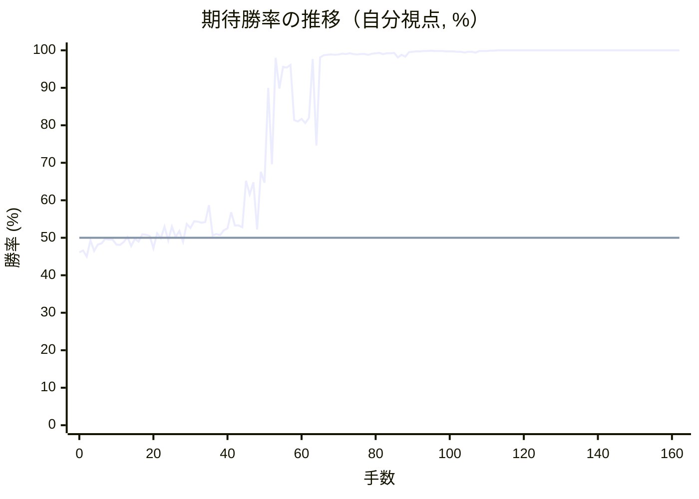
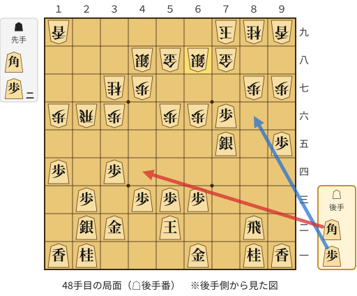
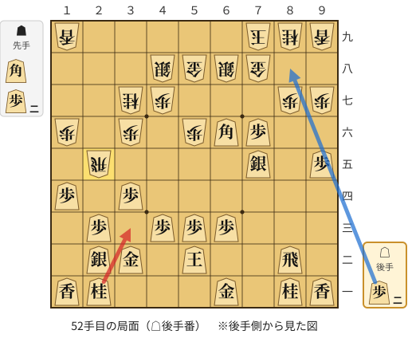
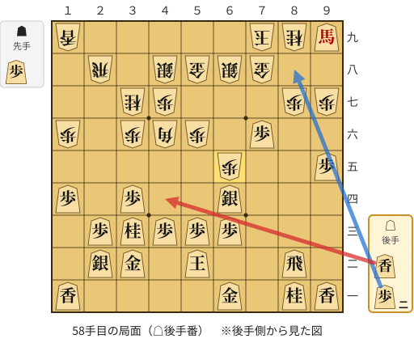
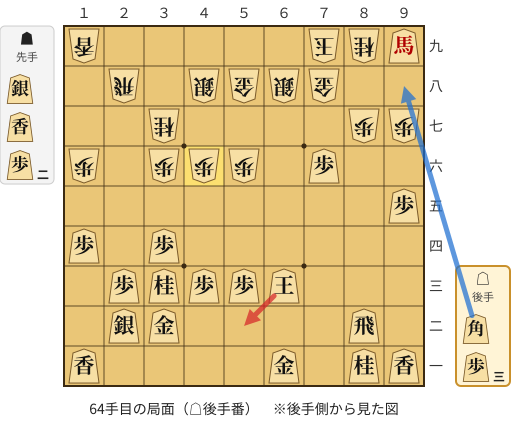
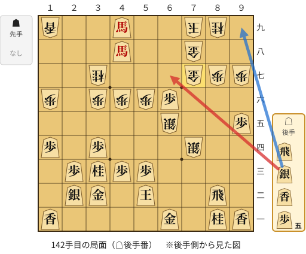
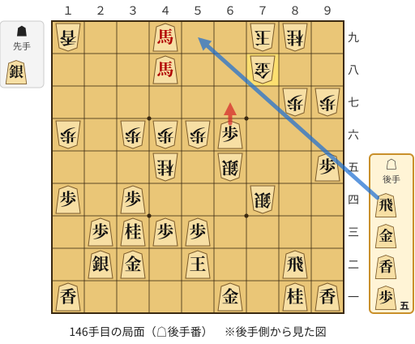

# 解析レポート ragnhrrj7knc

[README に戻る](../../../README.md)　/　棋譜: [CSA](../../../data/csa/shogi5/ragnhrrj7knc.csa)　/　解析の見方: [docs/mistake_analysis.md](../../../docs/mistake_analysis.md)

## 対局情報

| 項目 | 内容 |
|---|---|
| 日時 | 2026-11-07 04:00:19 |
| 持ち時間 | 5分 |
| 自分 | 後手（△）（1717） |
| 相手 | 相手（1709） |
| 結果 | 勝ち（詰み, 162手） |

## 解析環境

| 項目 | 内容 |
|---|---|
| エンジン | YaneuraOu NNUE 9.00git 64AVX2（V9.00/YANEURAOU_ENGINE_NNUE/AVX2） |
| 評価関数 | **水匠5**（`suisho5`） |
| nn.bin SHA-256 | `768068f0d534a0603a5d38bcd143de6bbca820d5f1c95a14d40863e5b7892d76` |
| 第1パス | movetime=150ms, MultiPV 1 |
| 第2パス | movetime=2000ms, MultiPV 3 |
| Threads / Hash | 8 / 512MB |
| 判定基準 | 疑問手 ≥5pt, 悪手 ≥10pt, 大悪手 ≥20pt（期待勝率 W(E)=1/(1+exp(-E/600))） |
| 解析日時 | 2026-11-11T20:33:27+09:00（解析バージョン 1, 59秒） |

## サマリー

| 自分の手数 | 深掘りした手 | 詰み逃し | 大悪手 | 悪手 | 疑問手 |
|--:|--:|--:|--:|--:|--:|
| 81 | 9 | 2 | 1 | 3 | 0 |

## 期待勝率の推移



<details><summary>1手ごとの数値（第1パス）</summary>

| 手数 | 指し手 | 評価値 | 勝率 | 低下 | 判定 |
|--:|---|--:|--:|--:|---|
| 1 | ▲２六歩(27) | -82 | 46.6% |  |  |
| 2 | △８四歩(83) | -120 | 45.0% | +1.6pt |  |
| 3 | ▲２五歩(26) | -17 | 49.3% |  |  |
| 4 | △８五歩(84) | -84 | 46.5% | +2.8pt |  |
| 5 | ▲７八金(69) | -44 | 48.2% |  |  |
| 6 | △３二金(41) | -35 | 48.5% | -0.4pt |  |
| 7 | ▲２四歩(25) | -8 | 49.7% |  |  |
| 8 | △同歩(23) | -13 | 49.5% | +0.2pt |  |
| 9 | ▲同飛(28) | -12 | 49.5% |  |  |
| 10 | △１四歩(13) | -43 | 48.2% | +1.3pt |  |
| 11 | ▲２六飛(24) | -46 | 48.1% |  |  |
| 12 | △２三歩打 | -26 | 48.9% | -0.8pt |  |
| 13 | ▲１六歩(17) | +5 | 50.2% |  |  |
| 14 | △５二玉(51) | -52 | 47.8% | +2.4pt |  |
| 15 | ▲７六歩(77) | -7 | 49.7% |  |  |
| 16 | △８六歩(85) | -25 | 49.0% | +0.7pt |  |
| 17 | ▲同歩(87) | +22 | 50.9% |  |  |
| 18 | △同飛(82) | +20 | 50.8% | +0.1pt |  |
| 19 | ▲８七歩打 | +13 | 50.5% |  |  |
| 20 | △８四飛(86) | -67 | 47.2% | +3.3pt |  |
| 21 | ▲４八銀(39) | +28 | 51.2% |  |  |
| 22 | △７二銀(71) | -2 | 49.9% | +1.2pt |  |
| 23 | ▲６六角(88) | +72 | 53.0% |  |  |
| 24 | △８二飛(84) | -16 | 49.3% | +3.7pt |  |
| 25 | ▲７七角(66) | +73 | 53.0% |  |  |
| 26 | △９四歩(93) | +5 | 50.2% | +2.8pt |  |
| 27 | ▲８八銀(79) | +44 | 51.8% |  |  |
| 28 | △３四歩(33) | -27 | 48.9% | +3.0pt |  |
| 29 | ▲６九玉(59) | +88 | 53.7% |  |  |
| 30 | △７七角成(22) | +62 | 52.6% | +1.1pt |  |
| 31 | ▲同銀(88) | +106 | 54.4% |  |  |
| 32 | △２二銀(31) | +103 | 54.3% | +0.1pt |  |
| 33 | ▲５八金(49) | +95 | 54.0% |  |  |
| 34 | △７四歩(73) | +100 | 54.2% | -0.2pt |  |
| 35 | ▲７九玉(69) | +211 | 58.7% |  |  |
| 36 | △７三銀(72) | +15 | 50.6% | +8.1pt |  |
| 37 | ▲６六歩(67) | +23 | 51.0% |  |  |
| 38 | △６四銀(73) | +16 | 50.7% | +0.3pt |  |
| 39 | ▲３六歩(37) | +48 | 52.0% |  |  |
| 40 | △９五歩(94) | +60 | 52.5% | -0.5pt |  |
| 41 | ▲５六歩(57) | +164 | 56.8% |  |  |
| 42 | △７五歩(74) | +80 | 53.3% | +3.5pt |  |
| 43 | ▲同歩(76) | +80 | 53.3% |  |  |
| 44 | △同銀(64) | +67 | 52.8% | +0.5pt |  |
| 45 | ▲３七桂(29) | +378 | 65.2% |  |  |
| 46 | △７六歩打 | +283 | 61.6% | +3.7pt |  |
| 47 | ▲６八銀(77) | +367 | 64.8% |  |  |
| 48 | △４四角打 | +53 | 52.2% | +12.6pt | [悪手](#ply-48) |
| 49 | ▲２九飛(26) | +442 | 67.6% |  |  |
| 50 | △６六角(44) | +363 | 64.7% | +2.9pt |  |
| 51 | ▲２五飛(29) | +1320 | 90.0% |  |  |
| 52 | △３三桂(21) | +497 | 69.6% | +20.4pt | [悪手](#ply-52) |
| 53 | ▲４六角打 | +2340 | 98.0% |  |  |
| 54 | △６四銀(75) | +1308 | 89.8% | +8.2pt |  |
| 55 | ▲２八飛(25) | +1851 | 95.6% |  |  |
| 56 | △９九角成(66) | +1816 | 95.4% | +0.3pt |  |
| 57 | ▲６五歩打 | +1928 | 96.1% |  |  |
| 58 | △４四香打 | +886 | 81.4% | +14.7pt | [悪手](#ply-58) |
| 59 | ▲６四歩(65) | +871 | 81.0% |  |  |
| 60 | △４六香(44) | +896 | 81.7% | -0.6pt |  |
| 61 | ▲６三歩成(64) | +853 | 80.6% |  |  |
| 62 | △同玉(52) | +908 | 82.0% | -1.4pt |  |
| 63 | ▲４六歩(47) | +2252 | 97.7% |  |  |
| 64 | △５二玉(63) | +647 | 74.6% | +23.1pt | [大悪手](#ply-64) |
| 65 | ▲８六香打 | +2370 | 98.1% |  |  |
| 66 | △８五歩打 | +2585 | 98.7% | -0.6pt |  |
| 67 | ▲８八銀打 | +2664 | 98.8% |  |  |
| 68 | △９八馬(99) | +2714 | 98.9% | -0.1pt |  |
| 69 | ▲８五香(86) | +2632 | 98.8% |  |  |
| 70 | △同飛(82) | +2716 | 98.9% | -0.2pt |  |
| 71 | ▲６四歩打 | +2808 | 99.1% |  |  |
| 72 | △８六歩打 | +2782 | 99.0% | +0.0pt |  |
| 73 | ▲同歩(87) | +2882 | 99.2% |  |  |
| 74 | △６五飛(85) | +2730 | 99.0% | +0.2pt |  |
| 75 | ▲８七銀(88) | +2674 | 98.9% |  |  |
| 76 | △９九馬(98) | +2761 | 99.0% | -0.2pt |  |
| 77 | ▲７六銀(87) | +2744 | 99.0% |  |  |
| 78 | △６四飛(65) | +2650 | 98.8% | +0.2pt |  |
| 79 | ▲６五歩打 | +2843 | 99.1% |  |  |
| 80 | △８四飛(64) | +2911 | 99.2% | -0.1pt |  |
| 81 | ▲７五銀(76) | +2996 | 99.3% |  |  |
| 82 | △８二飛(84) | +2734 | 99.0% | +0.4pt |  |
| 83 | ▲６四歩(65) | +2896 | 99.2% |  |  |
| 84 | △８七歩打 | +2882 | 99.2% | +0.0pt |  |
| 85 | ▲同金(78) | +2934 | 99.3% |  |  |
| 86 | △７二飛(82) | +2382 | 98.1% | +1.1pt |  |
| 87 | ▲７四歩打 | +2665 | 98.8% |  |  |
| 88 | △９八馬(99) | +2424 | 98.3% | +0.6pt |  |
| 89 | ▲８八金(87) | +3180 | 99.5% |  |  |
| 90 | △７六馬(98) | +3313 | 99.6% | -0.1pt |  |
| 91 | ▲５七銀(48) | +3441 | 99.7% |  |  |
| 92 | △７五馬(76) | +3533 | 99.7% | -0.0pt |  |
| 93 | ▲６三歩成(64) | +3740 | 99.8% |  |  |
| 94 | △同玉(52) | +3765 | 99.8% | -0.0pt |  |
| 95 | ▲７八金(88) | +4068 | 99.9% |  |  |
| 96 | △７四飛(72) | +3613 | 99.8% | +0.1pt |  |
| 97 | ▲６七銀(68) | +3761 | 99.8% |  |  |
| 98 | △７六歩打 | +3658 | 99.8% | +0.0pt |  |
| 99 | ▲６六銀(57) | +3530 | 99.7% |  |  |
| 100 | △８六馬(75) | +3538 | 99.7% | -0.0pt |  |
| 101 | ▲８七歩打 | +3505 | 99.7% |  |  |
| 102 | △８五馬(86) | +3384 | 99.6% | +0.1pt |  |
| 103 | ▲６五銀(66) | +3260 | 99.6% |  |  |
| 104 | △８四飛(74) | +3063 | 99.4% | +0.2pt |  |
| 105 | ▲７六銀(67) | +3271 | 99.6% |  |  |
| 106 | △９四馬(85) | +3375 | 99.6% | -0.1pt |  |
| 107 | ▲７五銀(76) | +3033 | 99.4% |  |  |
| 108 | △８二飛(84) | +3726 | 99.8% | -0.4pt |  |
| 109 | ▲６四歩打 | +3853 | 99.8% |  |  |
| 110 | △５二玉(63) | +3806 | 99.8% | +0.0pt |  |
| 111 | ▲７四銀(75) | +4053 | 99.9% |  |  |
| 112 | △６二歩打 | +4420 | 99.9% | -0.1pt |  |
| 113 | ▲５七金(58) | +5447 | 100.0% |  |  |
| 114 | △３九角打 | +5961 | 100.0% | -0.0pt |  |
| 115 | ▲５八飛(28) | +6118 | 100.0% |  |  |
| 116 | △４九銀打 | +6145 | 100.0% | -0.0pt |  |
| 117 | ▲６三歩成(64) | +6173 | 100.0% |  |  |
| 118 | △同歩(62) | +6242 | 100.0% | -0.0pt |  |
| 119 | ▲同銀成(74) | +6390 | 100.0% |  |  |
| 120 | △同玉(52) | +6381 | 100.0% | +0.0pt |  |
| 121 | ▲６四歩打 | +6563 | 100.0% |  |  |
| 122 | △５二玉(63) | +6560 | 100.0% | +0.0pt |  |
| 123 | ▲６三歩成(64) | +6482 | 100.0% |  |  |
| 124 | △同玉(52) | +6532 | 100.0% | -0.0pt |  |
| 125 | ▲６四歩打 | +6593 | 100.0% |  |  |
| 126 | △５二玉(63) | +6698 | 100.0% | -0.0pt |  |
| 127 | ▲６三歩成(64) | +6540 | 100.0% |  |  |
| 128 | △同玉(52) | +6573 | 100.0% | -0.0pt |  |
| 129 | ▲６四歩打 | +6725 | 100.0% |  |  |
| 130 | △５二玉(63) | +6656 | 100.0% | +0.0pt |  |
| 131 | ▲５九飛(58) | +6985 | 100.0% |  |  |
| 132 | △４八角成(39) | +7072 | 100.0% | -0.0pt |  |
| 133 | ▲６三歩成(64) | +6922 | 100.0% |  |  |
| 134 | △同玉(52) | +6857 | 100.0% | +0.0pt |  |
| 135 | ▲４九飛(59) | +7128 | 100.0% |  |  |
| 136 | △同馬(94) | +7178 | 100.0% | -0.0pt |  |
| 137 | ▲７四銀打 | +7788 | 100.0% |  |  |
| 138 | △５二玉(63) | +7875 | 100.0% | -0.0pt |  |
| 139 | ▲６七金(57) | #+15 | 100.0% |  |  |
| 140 | △６六歩打 | +7183 | 100.0% | +0.0pt |  |
| 141 | ▲７七金(67) | #+15 | 100.0% |  |  |
| 142 | △６七銀打 | +7321 | 100.0% | +0.0pt | [詰み逃し](#ply-142) |
| 143 | ▲４五桂(37) | #+19 | 100.0% |  |  |
| 144 | △７八銀成(67) | #+28 | 100.0% | +0.0pt |  |
| 145 | ▲同金(77) | #+27 | 100.0% |  |  |
| 146 | △６七歩成(66) | +7724 | 100.0% | +0.0pt | [詰み逃し](#ply-146) |
| 147 | ▲６三銀打 | #+11 | 100.0% |  |  |
| 148 | △４一玉(52) | #+12 | 100.0% | +0.0pt |  |
| 149 | ▲５三桂不成(45) | #+11 | 100.0% |  |  |
| 150 | △３一玉(41) | #+10 | 100.0% | +0.0pt |  |
| 151 | ▲４一桂成(53) | #+9 | 100.0% |  |  |
| 152 | △同玉(31) | #+8 | 100.0% | +0.0pt |  |
| 153 | ▲５二銀成(63) | #+7 | 100.0% |  |  |
| 154 | △同金(61) | #+6 | 100.0% | +0.0pt |  |
| 155 | ▲６七金(78) | #+5 | 100.0% |  |  |
| 156 | △８七飛成(82) | #+4 | 100.0% | +0.0pt |  |
| 157 | ▲７七金(67) | #+3 | 100.0% |  |  |
| 158 | △６八銀打 | #+4 | 100.0% | +0.0pt |  |
| 159 | ▲同玉(79) | #+3 | 100.0% |  |  |
| 160 | △５八馬(48) | #+2 | 100.0% | +0.0pt |  |
| 161 | ▲７九玉(68) | #+1 | 100.0% |  |  |
| 162 | △６八金打 | #+ | 100.0% | +0.0pt |  |

</details>

## 課題局面

<a id="ply-48"></a>
### 48手目 △４四角打 — 悪手

| | 着手前 | 着手後 | 差 |
|---|--:|--:|--:|
| 期待勝率 | 67.7% | 53.2% | -14.5pt |
| 評価値 | +444 | +76 | |

着手前の局面:



🔴 実戦 △４四角打　🔵 AI推奨 △８六歩打　🟨 直前の相手の指し手

<details><summary>テキストの盤面図（BOD・将棋ソフトに貼り付け可）</summary>

```text
後手の持駒：角　歩
  ９ ８ ７ ６ ５ ４ ３ ２ １
+---------------------------+
|v香v桂 ・v金 ・ ・ ・v桂v香|一
| ・v飛 ・ ・v玉 ・v金v銀 ・|二
| ・ ・ ・v歩v歩v歩 ・v歩 ・|三
| ・ ・ ・ ・ ・ ・v歩 ・v歩|四
|v歩 ・v銀 ・ ・ ・ ・ ・ ・|五
| ・ ・v歩 歩 歩 ・ 歩 飛 歩|六
| 歩 歩 ・ ・ ・ 歩 桂 ・ ・|七
| ・ ・ 金 銀 金 銀 ・ ・ ・|八
| 香 桂 玉 ・ ・ ・ ・ ・ 香|九
+---------------------------+
先手の持駒：角　歩二
後手番
手数＝47　▲６八銀　まで
```

</details>

| | 指し手 | 評価値 | 読み筋 |
|---|---|--:|---|
| 実戦 | △４四角打 | +76 | ▲２五飛(26) △３五歩(34) ▲５五角打 △同角(44) ▲同歩(56) △８六歩打 |
| AI 1位 | △８六歩打 | +444 | △８六歩打 ▲４六角打 △７三角打 ▲８六歩(87) △４六角(73) ▲同歩(47) |
| AI 2位 | △６六銀(75) | +323 | △６六銀(75) ▲４六角打 △６四角打 ▲同角(46) △同歩(63) ▲５五歩(56) |
| AI 3位 | △６六銀(75) | +247 | △６六銀(75) ▲２五飛(26) △７七歩成(76) ▲同銀(68) △同銀成(66) ▲同金(78) |

SFEN: `ln1g3nl/1r2k1gs1/3ppp1p1/6p1p/p1s6/2pPP1PRP/PP3PN2/2GSGS3/LNK5L w B2Pbp 48`

<a id="ply-52"></a>
### 52手目 △３三桂(21) — 悪手

| | 着手前 | 着手後 | 差 |
|---|--:|--:|--:|
| 期待勝率 | 93.5% | 83.3% | -10.2pt |
| 評価値 | +1602 | +965 | |

着手前の局面:



🔴 実戦 △３三桂(21)　🔵 AI推奨 △８八歩打　🟨 直前の相手の指し手

<details><summary>テキストの盤面図（BOD・将棋ソフトに貼り付け可）</summary>

```text
後手の持駒：歩二
  ９ ８ ７ ６ ５ ４ ３ ２ １
+---------------------------+
|v香v桂 ・v金 ・ ・ ・v桂v香|一
| ・v飛 ・ ・v玉 ・v金v銀 ・|二
| ・ ・ ・v歩v歩v歩 ・v歩 ・|三
| ・ ・ ・ ・ ・ ・v歩 ・v歩|四
|v歩 ・v銀 ・ ・ ・ ・ 飛 ・|五
| ・ ・v歩v角 歩 ・ 歩 ・ 歩|六
| 歩 歩 ・ ・ ・ 歩 桂 ・ ・|七
| ・ ・ 金 銀 金 銀 ・ ・ ・|八
| 香 桂 玉 ・ ・ ・ ・ ・ 香|九
+---------------------------+
先手の持駒：角　歩二
後手番
手数＝51　▲２五飛　まで
```

</details>

| | 指し手 | 評価値 | 読み筋 |
|---|---|--:|---|
| 実戦 | △３三桂(21) | +965 | ▲６五飛(25) △８八歩打 ▲同金(78) △８六歩打 ▲同歩(87) △８八角成(66) |
| AI 1位 | △８八歩打 | +1602 | △８八歩打 ▲同金(78) △８六歩打 ▲同歩(87) △同銀(75) ▲８四歩打 |
| AI 2位 | △８六歩打 | +1051 | △８六歩打 ▲４六角打 △８三飛(82) ▲７五飛(25) △同角(66) ▲８六歩(87) |
| AI 3位 | △３三桂(21) | +1001 | △３三桂(21) ▲６五飛(25) △８八歩打 ▲同金(78) △同角成(66) ▲同玉(79) |

SFEN: `ln1g3nl/1r2k1gs1/3ppp1p1/6p1p/p1s4R1/2pbP1P1P/PP3PN2/2GSGS3/LNK5L w B2P2p 52`

<a id="ply-58"></a>
### 58手目 △４四香打 — 悪手

| | 着手前 | 着手後 | 差 |
|---|--:|--:|--:|
| 期待勝率 | 96.6% | 83.0% | -13.6pt |
| 評価値 | +2011 | +950 | |

着手前の局面:



🔴 実戦 △４四香打　🔵 AI推奨 △８八歩打　🟨 直前の相手の指し手

<details><summary>テキストの盤面図（BOD・将棋ソフトに貼り付け可）</summary>

```text
後手の持駒：香　歩二
  ９ ８ ７ ６ ５ ４ ３ ２ １
+---------------------------+
|v香v桂 ・v金 ・ ・ ・ ・v香|一
| ・v飛 ・ ・v玉 ・v金v銀 ・|二
| ・ ・ ・v歩v歩v歩v桂v歩 ・|三
| ・ ・ ・v銀 ・ ・v歩 ・v歩|四
|v歩 ・ ・ 歩 ・ ・ ・ ・ ・|五
| ・ ・v歩 ・ 歩 角 歩 ・ 歩|六
| 歩 歩 ・ ・ ・ 歩 桂 ・ ・|七
| ・ ・ 金 銀 金 銀 ・ 飛 ・|八
|v馬 桂 玉 ・ ・ ・ ・ ・ 香|九
+---------------------------+
先手の持駒：歩
後手番
手数＝57　▲６五歩　まで
```

</details>

| | 指し手 | 評価値 | 読み筋 |
|---|---|--:|---|
| 実戦 | △４四香打 | +950 | ▲６四歩(65) △４六香(44) ▲８八銀打 △９八馬(99) ▲６三歩成(64) △同玉(52) |
| AI 1位 | △８八歩打 | +2011 | △８八歩打 ▲同金(78) △８三香打 ▲６四歩(65) △８八馬(99) ▲６九玉(79) |
| AI 2位 | △７三銀(64) | +1036 | △７三銀(64) ▲７四歩打 △７二金(61) ▲７三歩成(74) △同桂(81) ▲６七銀(68) |
| AI 3位 | △４四香打 | +902 | △４四香打 ▲６四歩(65) △４六香(44) ▲８八銀打 △９八馬(99) ▲４六歩(47) |

SFEN: `ln1g4l/1r2k1gs1/3pppnp1/3s2p1p/p2P5/2p1PBP1P/PP3PN2/2GSGS1R1/+bNK5L w Pl2p 58`

<a id="ply-64"></a>
### 64手目 △５二玉(63) — 大悪手

| | 着手前 | 着手後 | 差 |
|---|--:|--:|--:|
| 期待勝率 | 98.4% | 75.8% | -22.7pt |
| 評価値 | +2485 | +684 | |

着手前の局面:



🔴 実戦 △５二玉(63)　🔵 AI推奨 △９八角打　🟨 直前の相手の指し手

<details><summary>テキストの盤面図（BOD・将棋ソフトに貼り付け可）</summary>

```text
後手の持駒：角　歩三
  ９ ８ ７ ６ ５ ４ ３ ２ １
+---------------------------+
|v香v桂 ・v金 ・ ・ ・ ・v香|一
| ・v飛 ・ ・ ・ ・v金v銀 ・|二
| ・ ・ ・v玉v歩v歩v桂v歩 ・|三
| ・ ・ ・ ・ ・ ・v歩 ・v歩|四
|v歩 ・ ・ ・ ・ ・ ・ ・ ・|五
| ・ ・v歩 ・ 歩 歩 歩 ・ 歩|六
| 歩 歩 ・ ・ ・ ・ 桂 ・ ・|七
| ・ ・ 金 銀 金 銀 ・ 飛 ・|八
|v馬 桂 玉 ・ ・ ・ ・ ・ 香|九
+---------------------------+
先手の持駒：銀　香　歩二
後手番
手数＝63　▲４六歩　まで
```

</details>

| | 指し手 | 評価値 | 読み筋 |
|---|---|--:|---|
| 実戦 | △５二玉(63) | +684 | ▲８八銀打 △９八馬(99) ▲９九香打 △８八馬(98) ▲同玉(79) △７五銀打 |
| AI 1位 | △９八角打 | +2485 | △９八角打 ▲６九玉(79) △８九角成(98) ▲７九歩打 △５二玉(63) ▲６七銀打 |
| AI 2位 | △８六歩打 | +1986 | △８六歩打 ▲６七香打 △６四歩打 ▲８八銀打 △同馬(99) ▲同玉(79) |
| AI 3位 | △６七歩打 | +1626 | △６七歩打 ▲６五香打 △５二玉(63) ▲６七銀(68) △９八角打 ▲６一香成(65) |

SFEN: `ln1g4l/1r4gs1/3kppnp1/6p1p/p8/2p1PPP1P/PP4N2/2GSGS1R1/+bNK5L w SL2Pb3p 64`

<a id="ply-142"></a>
### 142手目 △６七銀打 — 詰み逃し

| | 着手前 | 着手後 | 差 |
|---|--:|--:|--:|
| 期待勝率 | 100.0% | 100.0% | -0.0pt |
| 評価値 | 13手詰め | +35281 | |

着手前の局面:



🔴 実戦 △６七銀打　🔵 AI推奨 △９九銀打　🟨 直前の相手の指し手

<details><summary>テキストの盤面図（BOD・将棋ソフトに貼り付け可）</summary>

```text
後手の持駒：飛　銀　香　歩五
  ９ ８ ７ ６ ５ ４ ３ ２ １
+---------------------------+
|v香v桂 ・v金 ・ ・ ・ ・v香|一
| ・v飛 ・ ・v玉 ・v金v銀 ・|二
| ・ ・ ・ ・v歩v歩v桂v歩 ・|三
| ・ ・ 銀 ・ ・ ・v歩 ・v歩|四
|v歩 ・ ・ 銀 ・ ・ ・ ・ ・|五
| ・ ・ ・v歩 歩 歩 歩 ・ 歩|六
| 歩 歩 金 ・ ・ ・ 桂 ・ ・|七
| ・ ・ 金 ・ ・v馬 ・ ・ ・|八
| ・ 桂 玉 ・ ・v馬 ・ ・ 香|九
+---------------------------+
先手の持駒：なし
後手番
手数＝141　▲７七金寄　まで
```

</details>

| | 指し手 | 評価値 | 読み筋 |
|---|---|--:|---|
| 実戦 | △６七銀打 | +35281 | ▲６三銀不成(74) △同玉(52) ▲７四銀(65) △同玉(63) ▲６七金(77) △５九飛打 |
| AI 1位 | △９九銀打 | 13手詰め | △９九銀打 ▲６八金(78) △５九飛打 ▲７八玉(79) △６七歩成(66) ▲同金(68) |
| AI 2位 | △９八飛打 | 13手詰め | △９八飛打 ▲６三銀不成(74) △４一玉(52) ▲５二銀成(63) △同金(61) ▲６八金(78) |
| AI 3位 | △９八銀打 | 15手詰め | △９八銀打 ▲６三銀不成(74) △同玉(52) ▲７四銀(65) △同玉(63) ▲８八玉(79) |

SFEN: `ln1g4l/1r2k1gs1/4ppnp1/2S3p1p/p2S5/3pPPP1P/PPG3N2/2G2+b3/1NK2+b2L w rsl5p 142`

<a id="ply-146"></a>
### 146手目 △６七歩成(66) — 詰み逃し

| | 着手前 | 着手後 | 差 |
|---|--:|--:|--:|
| 期待勝率 | 100.0% | 100.0% | -0.0pt |
| 評価値 | 27手詰め | +35281 | |

着手前の局面:



🔴 実戦 △６七歩成(66)　🔵 AI推奨 △５九飛打　🟨 直前の相手の指し手

<details><summary>テキストの盤面図（BOD・将棋ソフトに貼り付け可）</summary>

```text
後手の持駒：飛　金　香　歩五
  ９ ８ ７ ６ ５ ４ ３ ２ １
+---------------------------+
|v香v桂 ・v金 ・ ・ ・ ・v香|一
| ・v飛 ・ ・v玉 ・v金v銀 ・|二
| ・ ・ ・ ・v歩v歩v桂v歩 ・|三
| ・ ・ 銀 ・ ・ ・v歩 ・v歩|四
|v歩 ・ ・ 銀 ・ 桂 ・ ・ ・|五
| ・ ・ ・v歩 歩 歩 歩 ・ 歩|六
| 歩 歩 ・ ・ ・ ・ ・ ・ ・|七
| ・ ・ 金 ・ ・v馬 ・ ・ ・|八
| ・ 桂 玉 ・ ・v馬 ・ ・ 香|九
+---------------------------+
先手の持駒：銀
後手番
手数＝145　▲７八同金　まで
```

</details>

| | 指し手 | 評価値 | 読み筋 |
|---|---|--:|---|
| 実戦 | △６七歩成(66) | +35281 | ▲６三銀不成(74) △同玉(52) ▲７四銀打 △５二玉(63) ▲６三銀不成(74) |
| AI 1位 | △５九飛打 | 27手詰め | △５九飛打 ▲８八玉(79) △８七飛成(82) ▲同玉(88) △８九飛成(59) ▲８八飛打 |
| AI 2位 | △６九飛打 | 27手詰め | △６九飛打 ▲８八玉(79) △８七飛成(82) ▲同玉(88) △８四香打 ▲８五銀打 |
| AI 3位 | △６七歩成(66) | +35281 | △６七歩成(66) ▲５三桂成(45) △４一玉(52) ▲５二銀打 △３一玉(41) ▲４一銀成(52) |

SFEN: `ln1g4l/1r2k1gs1/4ppnp1/2S3p1p/p2S1N3/3pPPP1P/PP7/2G2+b3/1NK2+b2L w Srgl5p 146`

