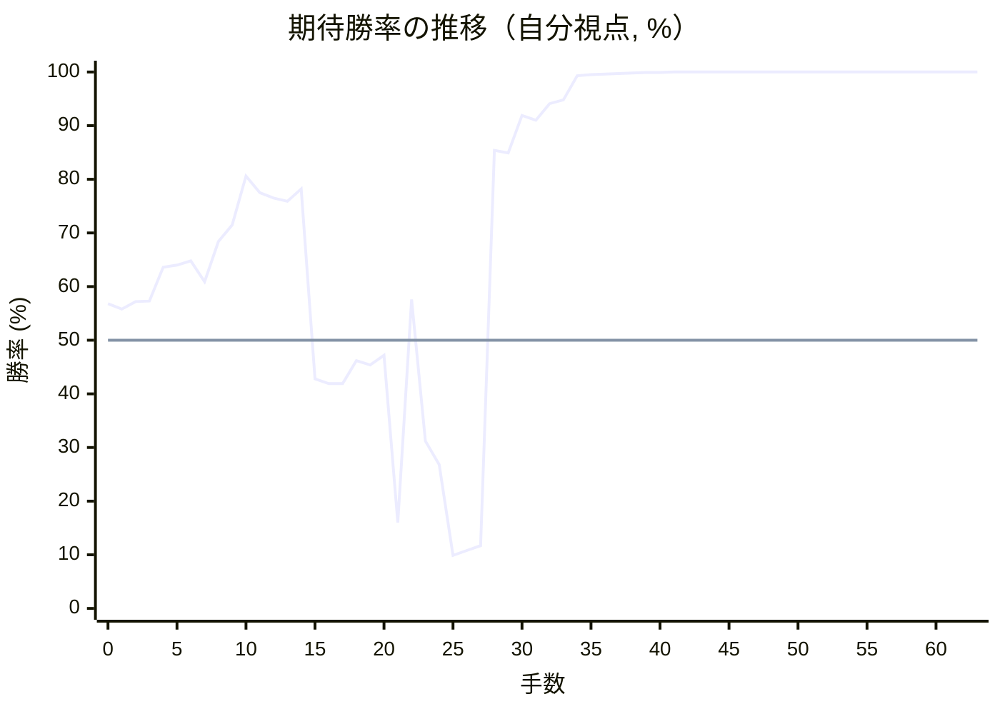
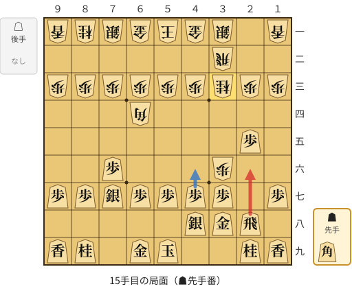
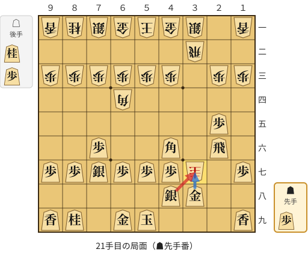
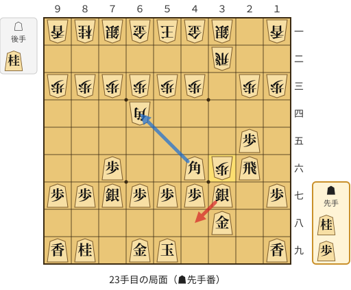
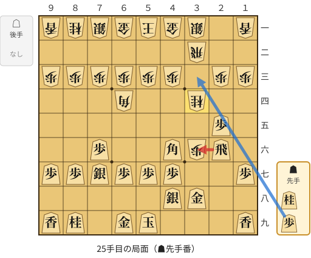

# 解析レポート reqzp6yoh1d4

[README に戻る](../../../README.md)　/　棋譜: [CSA](../../../data/csa/shogi5/reqzp6yoh1d4.csa)　/　解析の見方: [docs/mistake_analysis.md](../../../docs/mistake_analysis.md)

## 対局情報

| 項目 | 内容 |
|---|---|
| 日時 | 2026-10-30 22:50:50 |
| 持ち時間 | 5分 |
| 自分 | 先手（▲）（1710） |
| 相手 | 相手（1677） |
| 結果 | 勝ち（詰み, 63手） |

## 解析環境

| 項目 | 内容 |
|---|---|
| エンジン | YaneuraOu NNUE 9.00git 64AVX2（V9.00/YANEURAOU_ENGINE_NNUE/AVX2） |
| 評価関数 | **水匠5**（`suisho5`） |
| nn.bin SHA-256 | `768068f0d534a0603a5d38bcd143de6bbca820d5f1c95a14d40863e5b7892d76` |
| 第1パス | movetime=150ms, MultiPV 1 |
| 第2パス | movetime=2000ms, MultiPV 3 |
| Threads / Hash | 8 / 512MB |
| 判定基準 | 疑問手 ≥5pt, 悪手 ≥10pt, 大悪手 ≥20pt（期待勝率 W(E)=1/(1+exp(-E/600))） |
| 解析日時 | 2026-11-03T04:11:18+09:00（解析バージョン 1, 25秒） |

## サマリー

| 自分の手数 | 深掘りした手 | 詰み逃し | 大悪手 | 悪手 | 疑問手 |
|--:|--:|--:|--:|--:|--:|
| 32 | 4 | 0 | 3 | 0 | 1 |

## 期待勝率の推移



<details><summary>1手ごとの数値（第1パス）</summary>

| 手数 | 指し手 | 評価値 | 勝率 | 低下 | 判定 |
|--:|---|--:|--:|--:|---|
| 1 | ▲７六歩(77) | +140 | 55.8% | +1.0pt |  |
| 2 | △３四歩(33) | +175 | 57.2% |  |  |
| 3 | ▲２六歩(27) | +176 | 57.3% | -0.0pt |  |
| 4 | △３五歩(34) | +334 | 63.6% |  |  |
| 5 | ▲２五歩(26) | +346 | 64.0% | -0.5pt |  |
| 6 | △３二飛(82) | +367 | 64.8% |  |  |
| 7 | ▲４八銀(39) | +267 | 60.9% | +3.9pt |  |
| 8 | △８八角成(22) | +463 | 68.4% |  |  |
| 9 | ▲同銀(79) | +552 | 71.5% | -3.1pt |  |
| 10 | △６四角打 | +853 | 80.6% |  |  |
| 11 | ▲７七銀(88) | +743 | 77.5% | +3.0pt |  |
| 12 | △３六歩(35) | +708 | 76.5% |  |  |
| 13 | ▲３八金(49) | +687 | 75.9% | +0.6pt |  |
| 14 | △３三桂(21) | +768 | 78.2% |  |  |
| 15 | ▲２六飛(28) | -173 | 42.8% | +35.4pt | [大悪手](#ply-15) |
| 16 | △４五桂(33) | -196 | 41.9% |  |  |
| 17 | ▲４六角打 | -195 | 41.9% | -0.0pt |  |
| 18 | △３七歩成(36) | -92 | 46.2% |  |  |
| 19 | ▲同桂(29) | -110 | 45.4% | +0.7pt |  |
| 20 | △同桂成(45) | -67 | 47.2% |  |  |
| 21 | ▲同銀(48) | -996 | 16.0% | +31.2pt | [大悪手](#ply-21) |
| 22 | △３六歩打 | +183 | 57.6% |  |  |
| 23 | ▲４八銀(37) | -475 | 31.2% | +26.4pt | [大悪手](#ply-23) |
| 24 | △３四桂打 | -604 | 26.8% |  |  |
| 25 | ▲３六飛(26) | -1325 | 9.9% | +16.9pt | [疑問手](#ply-25) |
| 26 | △４六桂(34) | -1266 | 10.8% |  |  |
| 27 | ▲３二飛成(36) | -1215 | 11.7% | -0.8pt |  |
| 28 | △３八桂成(46) | +1061 | 85.4% |  |  |
| 29 | ▲同龍(32) | +1036 | 84.9% | +0.5pt |  |
| 30 | △１五角打 | +1454 | 91.9% |  |  |
| 31 | ▲３七歩打 | +1385 | 91.0% | +0.9pt |  |
| 32 | △２六金打 | +1657 | 94.1% |  |  |
| 33 | ▲４六桂打 | +1747 | 94.8% | -0.8pt |  |
| 34 | △３七金(26) | +2944 | 99.3% |  |  |
| 35 | ▲同銀(48) | +3143 | 99.5% | -0.2pt |  |
| 36 | △３六歩打 | +3375 | 99.6% |  |  |
| 37 | ▲４八銀(37) | +3465 | 99.7% | -0.0pt |  |
| 38 | △４四歩(43) | +3711 | 99.8% |  |  |
| 39 | ▲３六龍(38) | +4130 | 99.9% | -0.1pt |  |
| 40 | △４八角成(15) | +4453 | 99.9% |  |  |
| 41 | ▲同玉(59) | +4636 | 100.0% | -0.0pt |  |
| 42 | △４五銀打 | +4885 | 100.0% |  |  |
| 43 | ▲３五龍(36) | +5320 | 100.0% | -0.0pt |  |
| 44 | △４六銀(45) | +5472 | 100.0% |  |  |
| 45 | ▲同歩(47) | +5384 | 100.0% | +0.0pt |  |
| 46 | △５四桂打 | +6081 | 100.0% |  |  |
| 47 | ▲５五銀打 | +5456 | 100.0% | +0.0pt |  |
| 48 | △同角(64) | +5463 | 100.0% |  |  |
| 49 | ▲同龍(35) | +5437 | 100.0% | +0.0pt |  |
| 50 | △５二金(61) | +5682 | 100.0% |  |  |
| 51 | ▲２一飛打 | +5738 | 100.0% | -0.0pt |  |
| 52 | △２二銀打 | +6273 | 100.0% |  |  |
| 53 | ▲３四桂打 | +5922 | 100.0% | +0.0pt |  |
| 54 | △３二銀(31) | +6648 | 100.0% |  |  |
| 55 | ▲２二飛成(21) | +6548 | 100.0% | +0.0pt |  |
| 56 | △３一金(41) | #+11 | 100.0% |  |  |
| 57 | ▲同龍(22) | #+10 | 100.0% | +0.0pt |  |
| 58 | △４一銀(32) | #+9 | 100.0% |  |  |
| 59 | ▲４四龍(55) | #+8 | 100.0% | +0.0pt |  |
| 60 | △７四歩(73) | #+3 | 100.0% |  |  |
| 61 | ▲４一龍(44) | #+2 | 100.0% | +0.0pt |  |
| 62 | △６二玉(51) | #+1 | 100.0% |  |  |
| 63 | ▲７一龍(41) | #+ | 100.0% | +0.0pt |  |

</details>

## 課題局面

<a id="ply-15"></a>
### 15手目 ▲２六飛(28) — 大悪手

| | 着手前 | 着手後 | 差 |
|---|--:|--:|--:|
| 期待勝率 | 83.0% | 43.0% | -39.9pt |
| 評価値 | +951 | -168 | |

着手前の局面:



🔴 実戦 ▲２六飛(28)　🔵 AI推奨 ▲４六歩(47)　🟨 直前の相手の指し手

<details><summary>テキストの盤面図（BOD・将棋ソフトに貼り付け可）</summary>

```text
後手の持駒：なし
  ９ ８ ７ ６ ５ ４ ３ ２ １
+---------------------------+
|v香v桂v銀v金v玉v金v銀 ・v香|一
| ・ ・ ・ ・ ・ ・v飛 ・ ・|二
|v歩v歩v歩v歩v歩v歩v桂v歩v歩|三
| ・ ・ ・v角 ・ ・ ・ ・ ・|四
| ・ ・ ・ ・ ・ ・ ・ 歩 ・|五
| ・ ・ 歩 ・ ・ ・v歩 ・ ・|六
| 歩 歩 銀 歩 歩 歩 歩 ・ 歩|七
| ・ ・ ・ ・ ・ 銀 金 飛 ・|八
| 香 桂 ・ 金 玉 ・ ・ 桂 香|九
+---------------------------+
先手の持駒：角
手数＝14　△３三桂　まで
```

</details>

| | 指し手 | 評価値 | 読み筋 |
|---|---|--:|---|
| 実戦 | ▲２六飛(28) | -168 | △４五桂(33) ▲２八角打 △３七歩成(36) ▲同桂(29) △同桂不成(45) ▲同金(38) |
| AI 1位 | ▲４六歩(47) | +951 | ▲４六歩(47) △同角(64) ▲４七金(38) △６四角(46) ▲３六金(47) △７二銀(71) |
| AI 2位 | ▲５六角打 | +623 | ▲５六角打 △２二銀(31) ▲４六歩(47) △同角(64) ▲４七金(38) △６四角(46) |
| AI 3位 | ▲５八玉(59) | +542 | ▲５八玉(59) △３七歩成(36) ▲同銀(48) △４五桂(33) ▲４六銀(37) △３七歩打 |

SFEN: `lnsgkgs1l/6r2/ppppppnpp/3b5/7P1/2P3p2/PPSPPPP1P/5SGR1/LN1GK2NL b B 15`

<a id="ply-21"></a>
### 21手目 ▲同銀(48) — 大悪手

| | 着手前 | 着手後 | 差 |
|---|--:|--:|--:|
| 期待勝率 | 43.3% | 13.5% | -29.8pt |
| 評価値 | -162 | -1115 | |

着手前の局面:



🔴 実戦 ▲同銀(48)　🔵 AI推奨 ▲同金(38)　🟨 直前の相手の指し手

<details><summary>テキストの盤面図（BOD・将棋ソフトに貼り付け可）</summary>

```text
後手の持駒：桂　歩
  ９ ８ ７ ６ ５ ４ ３ ２ １
+---------------------------+
|v香v桂v銀v金v玉v金v銀 ・v香|一
| ・ ・ ・ ・ ・ ・v飛 ・ ・|二
|v歩v歩v歩v歩v歩v歩 ・v歩v歩|三
| ・ ・ ・v角 ・ ・ ・ ・ ・|四
| ・ ・ ・ ・ ・ ・ ・ 歩 ・|五
| ・ ・ 歩 ・ ・ 角 ・ 飛 ・|六
| 歩 歩 銀 歩 歩 歩v圭 ・ 歩|七
| ・ ・ ・ ・ ・ 銀 金 ・ ・|八
| 香 桂 ・ 金 玉 ・ ・ ・ 香|九
+---------------------------+
先手の持駒：歩
手数＝20　△３七同成　まで
```

</details>

| | 指し手 | 評価値 | 読み筋 |
|---|---|--:|---|
| 実戦 | ▲同銀(48) | -1115 | △３四桂打 ▲１六飛(26) △４六桂(34) ▲同歩(47) △３六歩打 ▲３三歩打 |
| AI 1位 | ▲同金(38) | -162 | ▲同金(38) △４六角(64) ▲同飛(26) △４二銀(31) ▲５五角打 △３六歩打 |
| AI 2位 | ▲同角(46) | -796 | ▲同角(46) △同角成(64) ▲同金(38) △１五角打 ▲６六飛(26) △３七飛成(32) |
| AI 3位 | ▲同銀(48) | -1200 | ▲同銀(48) △３四桂打 ▲３三歩打 △同飛(32) ▲６四角(46) △２六桂(34) |

SFEN: `lnsgkgs1l/6r2/pppppp1pp/3b5/7P1/2P2B1R1/PPSPPP+n1P/5SG2/LN1GK3L b Pnp 21`

<a id="ply-23"></a>
### 23手目 ▲４八銀(37) — 大悪手

| | 着手前 | 着手後 | 差 |
|---|--:|--:|--:|
| 期待勝率 | 53.5% | 21.2% | -32.3pt |
| 評価値 | +85 | -786 | |

着手前の局面:



🔴 実戦 ▲４八銀(37)　🔵 AI推奨 ▲６四角(46)　🟨 直前の相手の指し手

<details><summary>テキストの盤面図（BOD・将棋ソフトに貼り付け可）</summary>

```text
後手の持駒：桂
  ９ ８ ７ ６ ５ ４ ３ ２ １
+---------------------------+
|v香v桂v銀v金v玉v金v銀 ・v香|一
| ・ ・ ・ ・ ・ ・v飛 ・ ・|二
|v歩v歩v歩v歩v歩v歩 ・v歩v歩|三
| ・ ・ ・v角 ・ ・ ・ ・ ・|四
| ・ ・ ・ ・ ・ ・ ・ 歩 ・|五
| ・ ・ 歩 ・ ・ 角v歩 飛 ・|六
| 歩 歩 銀 歩 歩 歩 銀 ・ 歩|七
| ・ ・ ・ ・ ・ ・ 金 ・ ・|八
| 香 桂 ・ 金 玉 ・ ・ ・ 香|九
+---------------------------+
先手の持駒：桂　歩
手数＝22　△３六歩　まで
```

</details>

| | 指し手 | 評価値 | 読み筋 |
|---|---|--:|---|
| 実戦 | ▲４八銀(37) | -786 | △３四桂打 ▲３三歩打 △２六桂(34) ▲３二歩成(33) △４六角(64) ▲３九金(38) |
| AI 1位 | ▲６四角(46) | +85 | ▲６四角(46) △同歩(63) ▲３六飛(26) △同飛(32) ▲同銀(37) △６二玉(51) |
| AI 2位 | ▲同飛(26) | +38 | ▲同飛(26) △同飛(32) ▲６四角(46) △２九飛打 ▲６八玉(59) △４九飛成(29) |
| AI 3位 | ▲３三歩打 | -174 | ▲３三歩打 △同飛(32) ▲６四角(46) △同歩(63) ▲１五角打 △３七歩成(36) |

SFEN: `lnsgkgs1l/6r2/pppppp1pp/3b5/7P1/2P2BpR1/PPSPPPS1P/6G2/LN1GK3L b NPn 23`

<a id="ply-25"></a>
### 25手目 ▲３六飛(26) — 疑問手

| | 着手前 | 着手後 | 差 |
|---|--:|--:|--:|
| 期待勝率 | 16.9% | 9.8% | -7.1pt |
| 評価値 | -957 | -1332 | |

着手前の局面:



🔴 実戦 ▲３六飛(26)　🔵 AI推奨 ▲３三歩打　🟨 直前の相手の指し手

<details><summary>テキストの盤面図（BOD・将棋ソフトに貼り付け可）</summary>

```text
後手の持駒：なし
  ９ ８ ７ ６ ５ ４ ３ ２ １
+---------------------------+
|v香v桂v銀v金v玉v金v銀 ・v香|一
| ・ ・ ・ ・ ・ ・v飛 ・ ・|二
|v歩v歩v歩v歩v歩v歩 ・v歩v歩|三
| ・ ・ ・v角 ・ ・v桂 ・ ・|四
| ・ ・ ・ ・ ・ ・ ・ 歩 ・|五
| ・ ・ 歩 ・ ・ 角v歩 飛 ・|六
| 歩 歩 銀 歩 歩 歩 ・ ・ 歩|七
| ・ ・ ・ ・ ・ 銀 金 ・ ・|八
| 香 桂 ・ 金 玉 ・ ・ ・ 香|九
+---------------------------+
先手の持駒：桂　歩
手数＝24　△３四桂　まで
```

</details>

| | 指し手 | 評価値 | 読み筋 |
|---|---|--:|---|
| 実戦 | ▲３六飛(26) | -1332 | △４六桂(34) ▲３二飛成(36) △同銀(31) ▲４六歩(47) △同角(64) ▲４五桂打 |
| AI 1位 | ▲３三歩打 | -957 | ▲３三歩打 △２六桂(34) ▲３二歩成(33) △４六角(64) ▲３九金(38) △１九角成(46) |
| AI 2位 | ▲３六飛(26) | -1400 | ▲３六飛(26) △４六桂(34) ▲３二飛成(36) △同銀(31) ▲４六歩(47) △同角(64) |
| AI 3位 | ▲２九飛(26) | -1576 | ▲２九飛(26) △４六桂(34) ▲同歩(47) △同角(64) ▲３三歩打 △同飛(32) |

SFEN: `lnsgkgs1l/6r2/pppppp1pp/3b2n2/7P1/2P2BpR1/PPSPPP2P/5SG2/LN1GK3L b NP 25`

