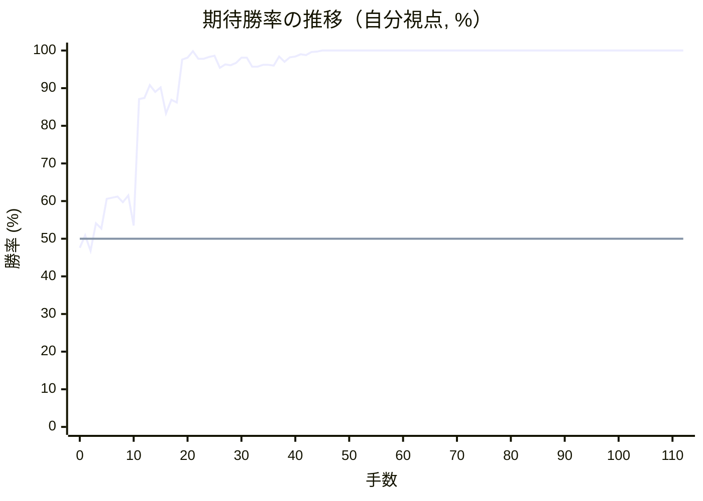
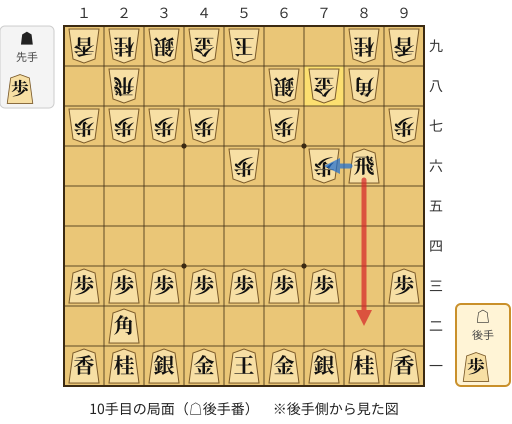
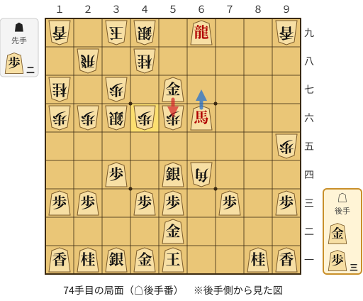
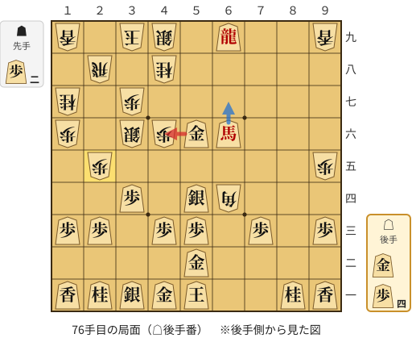
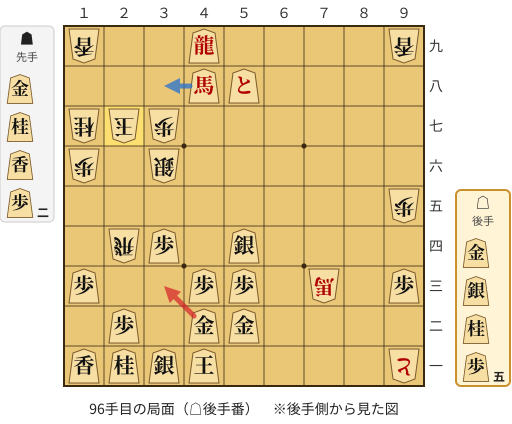
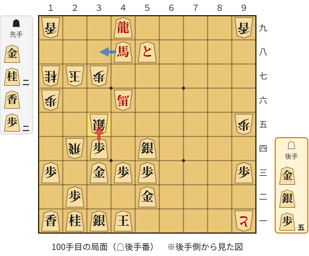

# 解析レポート rptz2tfjacoi

[README に戻る](../../../README.md)　/　棋譜: [CSA](../../../data/csa/shogi5/rptz2tfjacoi.csa)　/　解析の見方: [docs/mistake_analysis.md](../../../docs/mistake_analysis.md)

## 対局情報

| 項目 | 内容 |
|---|---|
| 日時 | 2026-11-17 03:32:29 |
| 持ち時間 | 5分 |
| 自分 | 後手（△）（1667） |
| 相手 | 相手（1371） |
| 結果 | 勝ち（詰み, 112手） |

## 解析環境

| 項目 | 内容 |
|---|---|
| エンジン | YaneuraOu NNUE 9.00git 64AVX2（V9.00/YANEURAOU_ENGINE_NNUE/AVX2） |
| 評価関数 | **水匠5**（`suisho5`） |
| nn.bin SHA-256 | `768068f0d534a0603a5d38bcd143de6bbca820d5f1c95a14d40863e5b7892d76` |
| 第1パス | movetime=150ms, MultiPV 1 |
| 第2パス | movetime=2000ms, MultiPV 3 |
| Threads / Hash | 8 / 512MB |
| 判定基準 | 疑問手 ≥5pt, 悪手 ≥10pt, 大悪手 ≥20pt（期待勝率 W(E)=1/(1+exp(-E/600))） |
| 解析日時 | 2026-11-20T20:15:17+09:00（解析バージョン 1, 48秒） |

## サマリー

| 自分の手数 | 深掘りした手 | 詰み逃し | 大悪手 | 悪手 | 疑問手 |
|--:|--:|--:|--:|--:|--:|
| 56 | 8 | 4 | 0 | 0 | 1 |

## 期待勝率の推移



<details><summary>1手ごとの数値（第1パス）</summary>

| 手数 | 指し手 | 評価値 | 勝率 | 低下 | 判定 |
|--:|---|--:|--:|--:|---|
| 1 | ▲６八銀(79) | +21 | 50.9% |  |  |
| 2 | △８四歩(83) | -78 | 46.8% | +4.1pt |  |
| 3 | ▲５六歩(57) | +98 | 54.1% |  |  |
| 4 | △８五歩(84) | +65 | 52.7% | +1.4pt |  |
| 5 | ▲７六歩(77) | +258 | 60.6% |  |  |
| 6 | △８六歩(85) | +265 | 60.9% | -0.3pt |  |
| 7 | ▲同歩(87) | +274 | 61.2% |  |  |
| 8 | △同飛(82) | +236 | 59.7% | +1.5pt |  |
| 9 | ▲７八金(69) | +280 | 61.5% |  |  |
| 10 | △８二飛(86) | +84 | 53.5% | +8.0pt | [疑問手](#ply-10) |
| 11 | ▲５七銀(68) | +1145 | 87.1% |  |  |
| 12 | △８六歩打 | +1162 | 87.4% | -0.3pt |  |
| 13 | ▲５五角(88) | +1371 | 90.8% |  |  |
| 14 | △８七歩成(86) | +1256 | 89.0% | +1.7pt |  |
| 15 | ▲７九金(78) | +1335 | 90.2% |  |  |
| 16 | △８四飛(82) | +963 | 83.3% | +7.0pt |  |
| 17 | ▲９六歩(97) | +1134 | 86.9% |  |  |
| 18 | △６二銀(71) | +1097 | 86.2% | +0.7pt |  |
| 19 | ▲３八銀(39) | +2233 | 97.6% |  |  |
| 20 | △７八と(87) | +2360 | 98.1% | -0.4pt |  |
| 21 | ▲６六角(55) | +3802 | 99.8% |  |  |
| 22 | △８五飛(84) | +2268 | 97.8% | +2.1pt |  |
| 23 | ▲７八金(79) | +2265 | 97.8% |  |  |
| 24 | △８九飛成(85) | +2441 | 98.3% | -0.6pt |  |
| 25 | ▲６八玉(59) | +2538 | 98.6% |  |  |
| 26 | △６四歩(63) | +1825 | 95.4% | +3.1pt |  |
| 27 | ▲７九金(78) | +1953 | 96.3% |  |  |
| 28 | △８七龍(89) | +1921 | 96.1% | +0.2pt |  |
| 29 | ▲２六歩(27) | +2023 | 96.7% |  |  |
| 30 | △６五歩(64) | +2374 | 98.1% | -1.4pt |  |
| 31 | ▲５五角(66) | +2371 | 98.1% |  |  |
| 32 | △６三銀(62) | +1865 | 95.7% | +2.4pt |  |
| 33 | ▲７八金(79) | +1865 | 95.7% |  |  |
| 34 | △８九龍(87) | +1935 | 96.2% | -0.5pt |  |
| 35 | ▲７九金(78) | +1947 | 96.2% |  |  |
| 36 | △８五龍(89) | +1913 | 96.0% | +0.2pt |  |
| 37 | ▲９五歩(96) | +2477 | 98.4% |  |  |
| 38 | △５四銀(63) | +2082 | 97.0% | +1.4pt |  |
| 39 | ▲６四角(55) | +2396 | 98.2% |  |  |
| 40 | △５二金(61) | +2480 | 98.4% | -0.2pt |  |
| 41 | ▲１六歩(17) | +2761 | 99.0% |  |  |
| 42 | △７六龍(85) | +2652 | 98.8% | +0.2pt |  |
| 43 | ▲１七桂(29) | +3273 | 99.6% |  |  |
| 44 | △３四歩(33) | +3550 | 99.7% | -0.2pt |  |
| 45 | ▲６六歩(67) | +4562 | 100.0% |  |  |
| 46 | △同歩(65) | +5647 | 100.0% | -0.0pt |  |
| 47 | ▲７八金(79) | +5724 | 100.0% |  |  |
| 48 | △６五桂打 | +5357 | 100.0% | +0.0pt |  |
| 49 | ▲５八金(49) | +6446 | 100.0% |  |  |
| 50 | △５七桂成(65) | +6693 | 100.0% | -0.0pt |  |
| 51 | ▲同金(58) | +6928 | 100.0% |  |  |
| 52 | △６七銀打 | +6985 | 100.0% | -0.0pt |  |
| 53 | ▲同金(78) | +7205 | 100.0% |  |  |
| 54 | △同歩成(66) | +7414 | 100.0% | -0.0pt |  |
| 55 | ▲同金(57) | +6927 | 100.0% |  |  |
| 56 | △７七金打 | +7490 | 100.0% | -0.0pt |  |
| 57 | ▲５九玉(68) | +7554 | 100.0% |  |  |
| 58 | △６七金(77) | +6444 | 100.0% | +0.0pt |  |
| 59 | ▲２七銀(38) | #+13 | 100.0% |  |  |
| 60 | △７九龍(76) | #+12 | 100.0% | +0.0pt |  |
| 61 | ▲６九歩打 | #+11 | 100.0% |  |  |
| 62 | △７七角成(22) | #+10 | 100.0% | +0.0pt |  |
| 63 | ▲４八玉(59) | #+9 | 100.0% |  |  |
| 64 | △６九龍(79) | +7500 | 100.0% | +0.0pt |  |
| 65 | ▲３六銀(27) | #+9 | 100.0% |  |  |
| 66 | △５八龍(69) | #+14 | 100.0% | +0.0pt |  |
| 67 | ▲３九玉(48) | #+13 | 100.0% |  |  |
| 68 | △６六馬(77) | #+12 | 100.0% | +0.0pt |  |
| 69 | ▲４八桂打 | #+9 | 100.0% |  |  |
| 70 | △５七金(67) | +7621 | 100.0% | +0.0pt |  |
| 71 | ▲４九銀打 | +7425 | 100.0% |  |  |
| 72 | △６九龍(58) | +6877 | 100.0% | +0.0pt |  |
| 73 | ▲４六歩(47) | #+15 | 100.0% |  |  |
| 74 | △５六金(57) | +6282 | 100.0% | +0.0pt | [詰み逃し](#ply-74) |
| 75 | ▲２五歩(26) | #+19 | 100.0% |  |  |
| 76 | △４六金(56) | +6396 | 100.0% | +0.0pt | [詰み逃し](#ply-76) |
| 77 | ▲４二歩打 | +6697 | 100.0% |  |  |
| 78 | △同金(41) | +6463 | 100.0% | +0.0pt |  |
| 79 | ▲４六角(64) | +6703 | 100.0% |  |  |
| 80 | △６七歩打 | +5465 | 100.0% | +0.0pt |  |
| 81 | ▲２四歩(25) | +6538 | 100.0% |  |  |
| 82 | △同歩(23) | +4940 | 100.0% | +0.0pt |  |
| 83 | ▲同飛(28) | +5354 | 100.0% |  |  |
| 84 | △２二歩打 | +5008 | 100.0% | +0.0pt |  |
| 85 | ▲８二歩打 | +5803 | 100.0% |  |  |
| 86 | △６八歩成(67) | +5456 | 100.0% | +0.0pt |  |
| 87 | ▲８一歩成(82) | +6133 | 100.0% |  |  |
| 88 | △５八と(68) | +6318 | 100.0% | -0.0pt |  |
| 89 | ▲７三角成(46) | +6297 | 100.0% |  |  |
| 90 | △４一玉(51) | +6342 | 100.0% | -0.0pt |  |
| 91 | ▲２八玉(39) | +6400 | 100.0% |  |  |
| 92 | △４九龍(69) | +6374 | 100.0% | +0.0pt |  |
| 93 | ▲９一と(81) | +7173 | 100.0% |  |  |
| 94 | △４八馬(66) | +7413 | 100.0% | -0.0pt |  |
| 95 | ▲２七玉(28) | #+11 | 100.0% |  |  |
| 96 | △３三金(42) | +6502 | 100.0% | +0.0pt | [詰み逃し](#ply-96) |
| 97 | ▲４六馬(73) | #+11 | 100.0% |  |  |
| 98 | △３五桂打 | #+14 | 100.0% | +0.0pt |  |
| 99 | ▲同銀(36) | #+11 | 100.0% |  |  |
| 100 | △同歩(34) | +7374 | 100.0% | +0.0pt | [詰み逃し](#ply-100) |
| 101 | ▲同馬(46) | #+9 | 100.0% |  |  |
| 102 | △２九龍(49) | #+12 | 100.0% | +0.0pt |  |
| 103 | ▲２八金打 | #+11 | 100.0% |  |  |
| 104 | △３八銀打 | #+10 | 100.0% | +0.0pt |  |
| 105 | ▲３六玉(27) | #+9 | 100.0% |  |  |
| 106 | △４七馬(48) | #+8 | 100.0% | +0.0pt |  |
| 107 | ▲２六玉(36) | #+7 | 100.0% |  |  |
| 108 | △２八龍(29) | #+6 | 100.0% | +0.0pt |  |
| 109 | ▲１五玉(26) | #+3 | 100.0% |  |  |
| 110 | △１四金打 | #+2 | 100.0% | +0.0pt |  |
| 111 | ▲同飛(24) | #+1 | 100.0% |  |  |
| 112 | △同馬(47) | #+ | 100.0% | +0.0pt |  |

</details>

## 課題局面

<a id="ply-10"></a>
### 10手目 △８二飛(86) — 疑問手

| | 着手前 | 着手後 | 差 |
|---|--:|--:|--:|
| 期待勝率 | 60.2% | 54.8% | -5.4pt |
| 評価値 | +248 | +115 | |

着手前の局面:



🔴 実戦 △８二飛(86)　🔵 AI推奨 △７六飛(86)　🟨 直前の相手の指し手

<details><summary>テキストの盤面図（BOD・将棋ソフトに貼り付け可）</summary>

```text
後手の持駒：歩
  ９ ８ ７ ６ ５ ４ ３ ２ １
+---------------------------+
|v香v桂v銀v金v玉v金v銀v桂v香|一
| ・ ・ ・ ・ ・ ・ ・v角 ・|二
|v歩 ・v歩v歩v歩v歩v歩v歩v歩|三
| ・ ・ ・ ・ ・ ・ ・ ・ ・|四
| ・ ・ ・ ・ ・ ・ ・ ・ ・|五
| ・v飛 歩 ・ 歩 ・ ・ ・ ・|六
| 歩 ・ ・ 歩 ・ 歩 歩 歩 歩|七
| ・ 角 金 銀 ・ ・ ・ 飛 ・|八
| 香 桂 ・ ・ 玉 金 銀 桂 香|九
+---------------------------+
先手の持駒：歩
後手番
手数＝9　▲７八金　まで
```

</details>

| | 指し手 | 評価値 | 読み筋 |
|---|---|--:|---|
| 実戦 | △８二飛(86) | +115 | ▲８七歩打 △３四歩(33) ▲７七銀(68) △７四歩(73) ▲２六歩(27) △３二金(41) |
| AI 1位 | △７六飛(86) | +248 | △７六飛(86) ▲６九玉(59) △３二金(41) ▲５五歩(56) △８六飛(76) ▲８七歩打 |
| AI 2位 | △３四歩(33) | +133 | △３四歩(33) ▲７七銀(68) △８三飛(86) ▲８七歩打 △７四歩(73) ▲４八銀(39) |
| AI 3位 | △７四歩(73) | +73 | △７四歩(73) ▲７七銀(68) △８三飛(86) ▲８七歩打 △７二銀(71) ▲２六歩(27) |

SFEN: `lnsgkgsnl/7b1/p1ppppppp/9/9/1rP1P4/P2P1PPPP/1BGS3R1/LN2KGSNL w Pp 10`

<a id="ply-74"></a>
### 74手目 △５六金(57) — 詰み逃し

| | 着手前 | 着手後 | 差 |
|---|--:|--:|--:|
| 期待勝率 | 100.0% | 100.0% | -0.0pt |
| 評価値 | 15手詰め | +6677 | |

着手前の局面:



🔴 実戦 △５六金(57)　🔵 AI推奨 △６七馬(66)　🟨 直前の相手の指し手

<details><summary>テキストの盤面図（BOD・将棋ソフトに貼り付け可）</summary>

```text
後手の持駒：金　歩三
  ９ ８ ７ ６ ５ ４ ３ ２ １
+---------------------------+
|v香v桂 ・ ・v玉v金v銀v桂v香|一
| ・ ・ ・ ・v金 ・ ・ ・ ・|二
|v歩 ・v歩 ・v歩v歩 ・v歩v歩|三
| ・ ・ ・ 角v銀 ・v歩 ・ ・|四
| 歩 ・ ・ ・ ・ ・ ・ ・ ・|五
| ・ ・ ・v馬 歩 歩 銀 歩 歩|六
| ・ ・ ・ ・v金 ・ 歩 ・ 桂|七
| ・ ・ ・ ・ ・ 桂 ・ 飛 ・|八
| 香 ・ ・v龍 ・ 銀 玉 ・ 香|九
+---------------------------+
先手の持駒：歩二
後手番
手数＝73　▲４六歩　まで
```

</details>

| | 指し手 | 評価値 | 読み筋 |
|---|---|--:|---|
| 実戦 | △５六金(57) | +6677 | ▲２九飛(28) △５七金(56) ▲２八玉(39) △６五馬(66) ▲５六歩打 △６四馬(65) |
| AI 1位 | △６七馬(66) | 15手詰め | △６七馬(66) ▲２九玉(39) △４九龍(69) ▲１八玉(29) △３九銀打 ▲７三角成(64) |
| AI 2位 | △７六馬(66) | 17手詰め | △７六馬(66) ▲６七歩打 △同馬(76) ▲２九玉(39) △４九龍(69) ▲１八玉(29) |
| AI 3位 | △５八金(57) | 17手詰め | △５八金(57) ▲３八玉(39) △４九龍(69) ▲２七玉(38) △３八銀打 ▲１八玉(27) |

SFEN: `ln2kgsnl/4g4/p1p1pp1pp/3Bs1p2/P8/3+bPPSPP/4g1P1N/5N1R1/L2+r1SK1L w 2Pg3p 74`

<a id="ply-76"></a>
### 76手目 △４六金(56) — 詰み逃し

| | 着手前 | 着手後 | 差 |
|---|--:|--:|--:|
| 期待勝率 | 100.0% | 100.0% | -0.0pt |
| 評価値 | 17手詰め | +6834 | |

着手前の局面:



🔴 実戦 △４六金(56)　🔵 AI推奨 △６七馬(66)　🟨 直前の相手の指し手

<details><summary>テキストの盤面図（BOD・将棋ソフトに貼り付け可）</summary>

```text
後手の持駒：金　歩四
  ９ ８ ７ ６ ５ ４ ３ ２ １
+---------------------------+
|v香v桂 ・ ・v玉v金v銀v桂v香|一
| ・ ・ ・ ・v金 ・ ・ ・ ・|二
|v歩 ・v歩 ・v歩v歩 ・v歩v歩|三
| ・ ・ ・ 角v銀 ・v歩 ・ ・|四
| 歩 ・ ・ ・ ・ ・ ・ 歩 ・|五
| ・ ・ ・v馬v金 歩 銀 ・ 歩|六
| ・ ・ ・ ・ ・ ・ 歩 ・ 桂|七
| ・ ・ ・ ・ ・ 桂 ・ 飛 ・|八
| 香 ・ ・v龍 ・ 銀 玉 ・ 香|九
+---------------------------+
先手の持駒：歩二
後手番
手数＝75　▲２五歩　まで
```

</details>

| | 指し手 | 評価値 | 読み筋 |
|---|---|--:|---|
| 実戦 | △４六金(56) | +6834 | ▲５九歩打 △５七金(46) |
| AI 1位 | △６七馬(66) | 17手詰め | △６七馬(66) ▲５八歩打 △同馬(67) ▲５九歩打 △同龍(69) ▲２九玉(39) |
| AI 2位 | △７六馬(66) | 19手詰め | △７六馬(66) ▲６七歩打 △同馬(76) ▲７三角成(64) △同桂(81) ▲５八歩打 |
| AI 3位 | △５八金打 | 21手詰め | △５八金打 ▲３八玉(39) △４九龍(69) ▲２七玉(38) △１九龍(49) ▲３五銀(36) |

SFEN: `ln2kgsnl/4g4/p1p1pp1pp/3Bs1p2/P6P1/3+bgPS1P/6P1N/5N1R1/L2+r1SK1L w 2Pg4p 76`

<a id="ply-96"></a>
### 96手目 △３三金(42) — 詰み逃し

| | 着手前 | 着手後 | 差 |
|---|--:|--:|--:|
| 期待勝率 | 100.0% | 100.0% | -0.0pt |
| 評価値 | 11手詰め | +7514 | |

着手前の局面:



🔴 実戦 △３三金(42)　🔵 AI推奨 △３八馬(48)　🟨 直前の相手の指し手

<details><summary>テキストの盤面図（BOD・将棋ソフトに貼り付け可）</summary>

```text
後手の持駒：金　銀　桂　歩五
  ９ ８ ７ ６ ５ ４ ３ ２ １
+---------------------------+
| と ・ ・ ・ ・v玉v銀v桂v香|一
| ・ ・ ・ ・v金v金 ・v歩 ・|二
|v歩 ・ 馬 ・v歩v歩 ・ ・v歩|三
| ・ ・ ・ ・v銀 ・v歩 飛 ・|四
| 歩 ・ ・ ・ ・ ・ ・ ・ ・|五
| ・ ・ ・ ・ ・ ・ 銀 ・ 歩|六
| ・ ・ ・ ・ ・ ・ 歩 玉 桂|七
| ・ ・ ・ ・vとv馬 ・ ・ ・|八
| 香 ・ ・ ・ ・v龍 ・ ・ 香|九
+---------------------------+
先手の持駒：金　桂　香　歩二
後手番
手数＝95　▲２七玉　まで
```

</details>

| | 指し手 | 評価値 | 読み筋 |
|---|---|--:|---|
| 実戦 | △３三金(42) | +7514 | ▲５一金打 △同金(52) ▲４二歩打 △同金(51) ▲７四馬(73) △６三歩打 |
| AI 1位 | △３八馬(48) | 11手詰め | △３八馬(48) ▲２六玉(27) △３五金打 ▲同銀(36) △２九龍(49) ▲２八香打 |
| AI 2位 | △２九龍(49) | 11手詰め | △２九龍(49) ▲２八桂打 △３八馬(48) ▲２六玉(27) △３五金打 ▲１五玉(26) |
| AI 3位 | △１五桂打 | 13手詰め | △１五桂打 ▲２六玉(27) △２九龍(49) ▲２八歩打 △同龍(29) ▲２七桂打 |

SFEN: `+P4ksnl/4gg1p1/p1+B1pp2p/4s1pR1/P8/6S1P/6PKN/4+p+b3/L4+r2L w GNL2Pgsn5p 96`

<a id="ply-100"></a>
### 100手目 △同歩(34) — 詰み逃し

| | 着手前 | 着手後 | 差 |
|---|--:|--:|--:|
| 期待勝率 | 100.0% | 100.0% | -0.0pt |
| 評価値 | 11手詰め | +35281 | |

着手前の局面:



🔴 実戦 △同歩(34)　🔵 AI推奨 △３八馬(48)　🟨 直前の相手の指し手

<details><summary>テキストの盤面図（BOD・将棋ソフトに貼り付け可）</summary>

```text
後手の持駒：金　銀　歩五
  ９ ８ ７ ６ ５ ４ ３ ２ １
+---------------------------+
| と ・ ・ ・ ・v玉v銀v桂v香|一
| ・ ・ ・ ・v金 ・ ・v歩 ・|二
|v歩 ・ ・ ・v歩v歩v金 ・v歩|三
| ・ ・ ・ ・v銀 ・v歩 飛 ・|四
| 歩 ・ ・ ・ ・ ・ 銀 ・ ・|五
| ・ ・ ・ ・ ・ 馬 ・ ・ 歩|六
| ・ ・ ・ ・ ・ ・ 歩 玉 桂|七
| ・ ・ ・ ・vとv馬 ・ ・ ・|八
| 香 ・ ・ ・ ・v龍 ・ ・ 香|九
+---------------------------+
先手の持駒：金　桂二　香　歩二
後手番
手数＝99　▲３五同銀　まで
```

</details>

| | 指し手 | 評価値 | 読み筋 |
|---|---|--:|---|
| 実戦 | △同歩(34) | +35281 | ▲４二歩打 △同銀(31) ▲３二金打 △同金(33) ▲３三桂打 △同金(32) |
| AI 1位 | △３八馬(48) | 11手詰め | △３八馬(48) ▲３六玉(27) △４五金打 ▲２六玉(36) △２九龍(49) ▲２八歩打 |
| AI 2位 | △３八銀打 | 13手詰め | △３八銀打 ▲３六玉(27) △３五歩(34) ▲２六玉(36) △２七銀成(38) ▲３五玉(26) |
| AI 3位 | △３八龍(49) | 15手詰め | △３八龍(49) ▲２六玉(27) △２七金打 ▲２五玉(26) △２四金(33) ▲同銀(35) |

SFEN: `+P4ksnl/4g2p1/p3ppg1p/4s1pR1/P5S2/5+B2P/6PKN/4+p+b3/L4+r2L w G2NL2Pgs5p 100`

