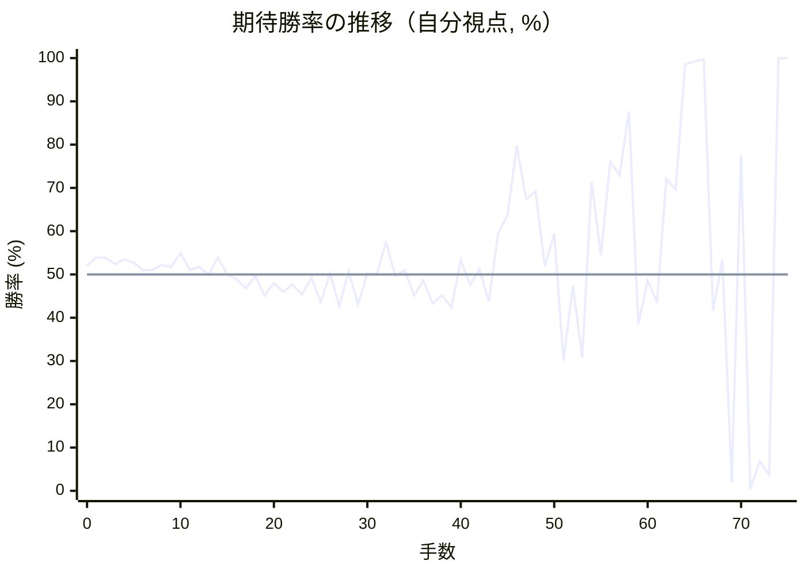

# 解析レポート s77bnu9186ip

[README に戻る](../../../README.md)　/　棋譜: [CSA](../../../data/csa/shogi5/s77bnu9186ip.csa)　/　解析の見方: [docs/mistake_analysis.md](../../../docs/mistake_analysis.md)

## 対局情報

| 項目 | 内容 |
|---|---|
| 日時 | 2026-11-07 03:12:06 |
| 持ち時間 | 5分 |
| 自分 | 先手（▲）（1711） |
| 相手 | 相手（1703） |
| 結果 | 勝ち（詰み, 75手） |

## 解析環境

| 項目 | 内容 |
|---|---|
| エンジン | YaneuraOu NNUE 9.00git 64AVX2（V9.00/YANEURAOU_ENGINE_NNUE/AVX2） |
| 評価関数 | **水匠5**（`suisho5`） |
| nn.bin SHA-256 | `768068f0d534a0603a5d38bcd143de6bbca820d5f1c95a14d40863e5b7892d76` |
| 第1パス | movetime=150ms, MultiPV 1 |
| 第2パス | movetime=2000ms, MultiPV 3 |
| Threads / Hash | 8 / 512MB |
| 判定基準 | 疑問手 ≥5pt, 悪手 ≥10pt, 大悪手 ≥20pt（期待勝率 W(E)=1/(1+exp(-E/600))） |
| 解析日時 | 2026-11-11T20:34:52+09:00（解析バージョン 1, 80秒） |

## サマリー

| 自分の手数 | 深掘りした手 | 詰み逃し | 大悪手 | 悪手 | 疑問手 |
|--:|--:|--:|--:|--:|--:|
| 38 | 17 | 0 | 6 | 0 | 6 |

## 期待勝率の推移



<details><summary>1手ごとの数値（第1パス）</summary>

| 手数 | 指し手 | 評価値 | 勝率 | 低下 | 判定 |
|--:|---|--:|--:|--:|---|
| 1 | ▲７六歩(77) | +96 | 54.0% | -2.0pt |  |
| 2 | △８四歩(83) | +92 | 53.8% |  |  |
| 3 | ▲２六歩(27) | +58 | 52.4% | +1.4pt |  |
| 4 | △８五歩(84) | +85 | 53.5% |  |  |
| 5 | ▲７七角(88) | +66 | 52.7% | +0.8pt |  |
| 6 | △３四歩(33) | +24 | 51.0% |  |  |
| 7 | ▲６八銀(79) | +25 | 51.0% | -0.0pt |  |
| 8 | △７七角成(22) | +53 | 52.2% |  |  |
| 9 | ▲同銀(68) | +41 | 51.7% | +0.5pt |  |
| 10 | △２二銀(31) | +120 | 55.0% |  |  |
| 11 | ▲２五歩(26) | +23 | 51.0% | +4.0pt |  |
| 12 | △３三銀(22) | +43 | 51.8% |  |  |
| 13 | ▲４八銀(39) | -5 | 49.8% | +2.0pt |  |
| 14 | △６二銀(71) | +97 | 54.0% |  |  |
| 15 | ▲７八金(69) | +0 | 50.0% | +4.0pt |  |
| 16 | △６四歩(63) | -27 | 48.9% |  |  |
| 17 | ▲４六歩(47) | -78 | 46.8% | +2.1pt |  |
| 18 | △７四歩(73) | -10 | 49.6% |  |  |
| 19 | ▲４七銀(48) | -117 | 45.1% | +4.4pt |  |
| 20 | △７三桂(81) | -47 | 48.0% |  |  |
| 21 | ▲６六歩(67) | -97 | 46.0% | +2.1pt |  |
| 22 | △９四歩(93) | -56 | 47.7% |  |  |
| 23 | ▲５六銀(47) | -114 | 45.3% | +2.4pt |  |
| 24 | △３二金(41) | -18 | 49.3% |  |  |
| 25 | ▲６八玉(59) | -155 | 43.6% | +5.7pt |  |
| 26 | △６三銀(62) | +6 | 50.2% |  |  |
| 27 | ▲３六歩(37) | -176 | 42.7% | +7.5pt | [疑問手](#ply-27) |
| 28 | △４二玉(51) | +17 | 50.7% |  |  |
| 29 | ▲３七桂(29) | -166 | 43.1% | +7.6pt | [疑問手](#ply-29) |
| 30 | △６二金(61) | +4 | 50.2% |  |  |
| 31 | ▲９六歩(97) | +1 | 50.0% | +0.1pt |  |
| 32 | △４四歩(43) | +182 | 57.5% |  |  |
| 33 | ▲１六歩(17) | -8 | 49.7% | +7.9pt | [疑問手](#ply-33) |
| 34 | △５四銀(63) | +25 | 51.0% |  |  |
| 35 | ▲５八金(49) | -117 | 45.1% | +5.9pt | [疑問手](#ply-35) |
| 36 | △８一飛(82) | -34 | 48.6% |  |  |
| 37 | ▲７九玉(68) | -162 | 43.3% | +5.3pt |  |
| 38 | △６五歩(64) | -115 | 45.2% |  |  |
| 39 | ▲同歩(66) | -185 | 42.4% | +2.9pt |  |
| 40 | △同銀(54) | +80 | 53.3% |  |  |
| 41 | ▲同銀(56) | -58 | 47.6% | +5.7pt |  |
| 42 | △同桂(73) | +30 | 51.2% |  |  |
| 43 | ▲６三銀打 | -152 | 43.7% | +7.5pt | [疑問手](#ply-43) |
| 44 | △７七桂成(65) | +232 | 59.5% |  |  |
| 45 | ▲同桂(89) | +338 | 63.7% | -4.2pt |  |
| 46 | △７三金(62) | +821 | 79.7% |  |  |
| 47 | ▲２四歩(25) | +435 | 67.4% | +12.3pt |  |
| 48 | △同歩(23) | +485 | 69.2% |  |  |
| 49 | ▲２二歩打 | +46 | 51.9% | +17.3pt | [大悪手](#ply-49) |
| 50 | △同銀(33) | +230 | 59.5% |  |  |
| 51 | ▲２四飛(28) | -506 | 30.1% | +29.4pt | [大悪手](#ply-51) |
| 52 | △３三銀(22) | -63 | 47.4% |  |  |
| 53 | ▲２八飛(24) | -485 | 30.8% | +16.6pt | [疑問手](#ply-53) |
| 54 | △２三歩打 | +548 | 71.4% |  |  |
| 55 | ▲２二歩打 | +107 | 54.4% | +16.9pt |  |
| 56 | △同銀(33) | +695 | 76.1% |  |  |
| 57 | ▲６五桂(77) | +594 | 72.9% | +3.2pt |  |
| 58 | △６四金(73) | +1180 | 87.7% |  |  |
| 59 | ▲６二銀成(63) | -284 | 38.4% | +49.3pt | [大悪手](#ply-59) |
| 60 | △８六歩(85) | -34 | 48.6% |  |  |
| 61 | ▲同歩(87) | -156 | 43.5% | +5.0pt |  |
| 62 | △６五金(64) | +571 | 72.1% |  |  |
| 63 | ▲６三角打 | +498 | 69.6% | +2.5pt |  |
| 64 | △８六飛(81) | +2531 | 98.5% |  |  |
| 65 | ▲５二角成(63) | +2925 | 99.2% | -0.7pt |  |
| 66 | △３三玉(42) | +3411 | 99.7% |  |  |
| 67 | ▲２五桂(37) | -204 | 41.6% | +58.1pt | [大悪手](#ply-67) |
| 68 | △２四玉(33) | +84 | 53.5% |  |  |
| 69 | ▲７四馬(52) | -2344 | 2.0% | +51.5pt | [大悪手](#ply-69) |
| 70 | △６六桂打 | +745 | 77.6% |  |  |
| 71 | ▲６八金(58) | -3373 | 0.4% | +77.2pt | [大悪手](#ply-71) |
| 72 | △３七角打 | -1574 | 6.8% |  |  |
| 73 | ▲６五馬(74) | -1960 | 3.7% | +3.1pt |  |
| 74 | △２八角成(37) | #+1 | 100.0% |  |  |
| 75 | ▲１五金打 | #+ | 100.0% | +0.0pt |  |

</details>

## 課題局面

<a id="ply-27"></a>
### 27手目 ▲３六歩(37) — 疑問手

| | 着手前 | 着手後 | 差 |
|---|--:|--:|--:|
| 期待勝率 | 48.1% | 42.2% | -5.9pt |
| 評価値 | -45 | -188 | |

着手前の局面:

```text
後手の持駒：角
  ９ ８ ７ ６ ５ ４ ３ ２ １
+---------------------------+
|v香 ・ ・v金v玉 ・ ・v桂v香|一
| ・v飛 ・ ・ ・ ・v金 ・ ・|二
| ・ ・v桂v銀v歩v歩v銀v歩v歩|三
|v歩 ・v歩v歩 ・ ・v歩 ・ ・|四
| ・v歩 ・ ・ ・ ・ ・ 歩 ・|五
| ・ ・ 歩 歩 銀 歩 ・ ・ ・|六
| 歩 歩 銀 ・ 歩 ・ 歩 ・ 歩|七
| ・ ・ 金 玉 ・ ・ ・ 飛 ・|八
| 香 桂 ・ ・ ・ 金 ・ 桂 香|九
+---------------------------+
先手の持駒：角
手数＝26　△６三銀　まで
```

| | 指し手 | 評価値 | 読み筋 |
|---|---|--:|---|
| 実戦 | ▲３六歩(37) | -188 | △９五歩(94) ▲３七桂(29) △４二玉(51) ▲４八金(49) △５二金(61) ▲１六歩(17) |
| AI 1位 | ▲９六歩(97) | -45 | ▲９六歩(97) △１四歩(13) ▲１六歩(17) △３五歩(34) ▲５八金(49) △４二玉(51) |
| AI 2位 | ▲１六歩(17) | -81 | ▲１六歩(17) △９五歩(94) ▲１五歩(16) △３五歩(34) ▲４七銀(56) △６二金(61) |
| AI 3位 | ▲３六歩(37) | -153 | ▲３六歩(37) △９五歩(94) ▲３七桂(29) △４二玉(51) ▲１六歩(17) △１四歩(13) |

SFEN: `l2gk2nl/1r4g2/2nsppspp/p1pp2p2/1p5P1/2PPSP3/PPS1P1P1P/2GK3R1/LN3G1NL b Bb 27`

<a id="ply-29"></a>
### 29手目 ▲３七桂(29) — 疑問手

| | 着手前 | 着手後 | 差 |
|---|--:|--:|--:|
| 期待勝率 | 48.8% | 41.3% | -7.4pt |
| 評価値 | -30 | -210 | |

着手前の局面:

```text
後手の持駒：角
  ９ ８ ７ ６ ５ ４ ３ ２ １
+---------------------------+
|v香 ・ ・v金 ・ ・ ・v桂v香|一
| ・v飛 ・ ・ ・v玉v金 ・ ・|二
| ・ ・v桂v銀v歩v歩v銀v歩v歩|三
|v歩 ・v歩v歩 ・ ・v歩 ・ ・|四
| ・v歩 ・ ・ ・ ・ ・ 歩 ・|五
| ・ ・ 歩 歩 銀 歩 歩 ・ ・|六
| 歩 歩 銀 ・ 歩 ・ ・ ・ 歩|七
| ・ ・ 金 玉 ・ ・ ・ 飛 ・|八
| 香 桂 ・ ・ ・ 金 ・ 桂 香|九
+---------------------------+
先手の持駒：角
手数＝28　△４二玉　まで
```

| | 指し手 | 評価値 | 読み筋 |
|---|---|--:|---|
| 実戦 | ▲３七桂(29) | -210 | △９五歩(94) ▲４五桂(37) △４四銀(33) ▲４八金(49) △８一飛(82) ▲２四歩(25) |
| AI 1位 | ▲９六歩(97) | -30 | ▲９六歩(97) △１四歩(13) ▲１六歩(17) △６二金(61) ▲４八金(49) △５四銀(63) |
| AI 2位 | ▲１六歩(17) | -46 | ▲１六歩(17) △１四歩(13) ▲９六歩(97) △５四銀(63) ▲３七桂(29) △６二金(61) |
| AI 3位 | ▲３七桂(29) | -175 | ▲３七桂(29) △９五歩(94) ▲３五歩(36) △同歩(34) ▲４五桂(37) △３四銀(33) |

SFEN: `l2g3nl/1r3kg2/2nsppspp/p1pp2p2/1p5P1/2PPSPP2/PPS1P3P/2GK3R1/LN3G1NL b Bb 29`

<a id="ply-33"></a>
### 33手目 ▲１六歩(17) — 疑問手

| | 着手前 | 着手後 | 差 |
|---|--:|--:|--:|
| 期待勝率 | 58.2% | 49.5% | -8.7pt |
| 評価値 | +198 | -12 | |

着手前の局面:

```text
後手の持駒：角
  ９ ８ ７ ６ ５ ４ ３ ２ １
+---------------------------+
|v香 ・ ・ ・ ・ ・ ・v桂v香|一
| ・v飛 ・v金 ・v玉v金 ・ ・|二
| ・ ・v桂v銀v歩 ・v銀v歩v歩|三
|v歩 ・v歩v歩 ・v歩v歩 ・ ・|四
| ・v歩 ・ ・ ・ ・ ・ 歩 ・|五
| 歩 ・ 歩 歩 銀 歩 歩 ・ ・|六
| ・ 歩 銀 ・ 歩 ・ 桂 ・ 歩|七
| ・ ・ 金 玉 ・ ・ ・ 飛 ・|八
| 香 桂 ・ ・ ・ 金 ・ ・ 香|九
+---------------------------+
先手の持駒：角
手数＝32　△４四歩　まで
```

| | 指し手 | 評価値 | 読み筋 |
|---|---|--:|---|
| 実戦 | ▲１六歩(17) | -12 | △５四銀(63) ▲４五歩(46) △同歩(44) ▲４八飛(28) △４六歩(45) ▲同飛(48) |
| AI 1位 | ▲４五歩(46) | +198 | ▲４五歩(46) △５四銀(63) ▲４八金(49) △４五歩(44) ▲２四歩(25) △同銀(33) |
| AI 2位 | ▲４八金(49) | +127 | ▲４八金(49) △８一飛(82) ▲４五歩(46) △同歩(44) ▲同銀(56) △４四歩打 |
| AI 3位 | ▲５八金(49) | +90 | ▲５八金(49) △８一飛(82) ▲４八飛(28) △３一玉(42) ▲７九玉(68) △１四歩(13) |

SFEN: `l6nl/1r1g1kg2/2nsp1spp/p1pp1pp2/1p5P1/P1PPSPP2/1PS1P1N1P/2GK3R1/LN3G2L b Bb 33`

<a id="ply-35"></a>
### 35手目 ▲５八金(49) — 疑問手

| | 着手前 | 着手後 | 差 |
|---|--:|--:|--:|
| 期待勝率 | 51.6% | 43.2% | -8.3pt |
| 評価値 | +38 | -163 | |

着手前の局面:

```text
後手の持駒：角
  ９ ８ ７ ６ ５ ４ ３ ２ １
+---------------------------+
|v香 ・ ・ ・ ・ ・ ・v桂v香|一
| ・v飛 ・v金 ・v玉v金 ・ ・|二
| ・ ・v桂 ・v歩 ・v銀v歩v歩|三
|v歩 ・v歩v歩v銀v歩v歩 ・ ・|四
| ・v歩 ・ ・ ・ ・ ・ 歩 ・|五
| 歩 ・ 歩 歩 銀 歩 歩 ・ 歩|六
| ・ 歩 銀 ・ 歩 ・ 桂 ・ ・|七
| ・ ・ 金 玉 ・ ・ ・ 飛 ・|八
| 香 桂 ・ ・ ・ 金 ・ ・ 香|九
+---------------------------+
先手の持駒：角
手数＝34　△５四銀　まで
```

| | 指し手 | 評価値 | 読み筋 |
|---|---|--:|---|
| 実戦 | ▲５八金(49) | -163 | △６五歩(64) ▲７九玉(68) △６六歩(65) ▲同銀(77) △８六歩(85) ▲同歩(87) |
| AI 1位 | ▲７九玉(68) | +38 | ▲７九玉(68) △８一飛(82) ▲１五歩(16) △３一玉(42) ▲６八飛(28) △２二玉(31) |
| AI 2位 | ▲３八金(49) | -7 | ▲３八金(49) △１四歩(13) ▲４五歩(46) △６五歩(64) ▲４四歩(45) △同銀(33) |
| AI 3位 | ▲４五歩(46) | -23 | ▲４五歩(46) △６五歩(64) ▲同歩(66) △同桂(73) ▲２四歩(25) △同歩(23) |

SFEN: `l6nl/1r1g1kg2/2n1p1spp/p1ppspp2/1p5P1/P1PPSPP1P/1PS1P1N2/2GK3R1/LN3G2L b Bb 35`

<a id="ply-43"></a>
### 43手目 ▲６三銀打 — 疑問手

| | 着手前 | 着手後 | 差 |
|---|--:|--:|--:|
| 期待勝率 | 56.1% | 47.3% | -8.8pt |
| 評価値 | +147 | -64 | |

着手前の局面:

```text
後手の持駒：角　銀　歩
  ９ ８ ７ ６ ５ ４ ３ ２ １
+---------------------------+
|v香v飛 ・ ・ ・ ・ ・v桂v香|一
| ・ ・ ・v金 ・v玉v金 ・ ・|二
| ・ ・ ・ ・v歩 ・v銀v歩v歩|三
|v歩 ・v歩 ・ ・v歩v歩 ・ ・|四
| ・v歩 ・v桂 ・ ・ ・ 歩 ・|五
| 歩 ・ 歩 ・ ・ 歩 歩 ・ 歩|六
| ・ 歩 銀 ・ 歩 ・ 桂 ・ ・|七
| ・ ・ 金 ・ 金 ・ ・ 飛 ・|八
| 香 桂 玉 ・ ・ ・ ・ ・ 香|九
+---------------------------+
先手の持駒：角　銀　歩
手数＝42　△６五同桂　まで
```

| | 指し手 | 評価値 | 読み筋 |
|---|---|--:|---|
| 実戦 | ▲６三銀打 | -64 | △７三金(62) ▲６六銀(77) △８六歩(85) ▲同歩(87) △８八歩打 ▲７七桂(89) |
| AI 1位 | ▲６六銀(77) | +147 | ▲６六銀(77) △８六歩(85) ▲同歩(87) △３五歩(34) ▲６三銀打 △６一金(62) |
| AI 2位 | ▲６四歩打 | -32 | ▲６四歩打 △７七桂成(65) ▲同桂(89) △７二銀打 ▲５五桂打 △５四銀打 |
| AI 3位 | ▲６三歩打 | -53 | ▲６三歩打 △７二金(62) ▲６六銀(77) △３五歩(34) ▲６二歩成(63) △同金(72) |

SFEN: `lr5nl/3g1kg2/4p1spp/p1p2pp2/1p1n3P1/P1P2PP1P/1PS1P1N2/2G1G2R1/LNK5L b BSPbsp 43`

<a id="ply-49"></a>
### 49手目 ▲２二歩打 — 大悪手

| | 着手前 | 着手後 | 差 |
|---|--:|--:|--:|
| 期待勝率 | 74.1% | 53.5% | -20.7pt |
| 評価値 | +631 | +83 | |

着手前の局面:

```text
後手の持駒：角　銀二　歩二
  ９ ８ ７ ６ ５ ４ ３ ２ １
+---------------------------+
|v香v飛 ・ ・ ・ ・ ・v桂v香|一
| ・ ・ ・ ・ ・v玉v金 ・ ・|二
| ・ ・v金 銀v歩 ・v銀 ・v歩|三
|v歩 ・v歩 ・ ・v歩v歩v歩 ・|四
| ・v歩 ・ ・ ・ ・ ・ ・ ・|五
| 歩 ・ 歩 ・ ・ 歩 歩 ・ 歩|六
| ・ 歩 桂 ・ 歩 ・ 桂 ・ ・|七
| ・ ・ 金 ・ 金 ・ ・ 飛 ・|八
| 香 ・ 玉 ・ ・ ・ ・ ・ 香|九
+---------------------------+
先手の持駒：角　桂　歩
手数＝48　△２四同歩　まで
```

| | 指し手 | 評価値 | 読み筋 |
|---|---|--:|---|
| 実戦 | ▲２二歩打 | +83 | △６一飛(81) ▲５二角打 △６三飛(61) ▲同角成(52) △同金(73) ▲２一歩成(22) |
| AI 1位 | ▲６五桂(77) | +631 | ▲６五桂(77) △６四金(73) ▲５四桂打 △同金(64) ▲同銀不成(63) △同歩(53) |
| AI 2位 | ▲６五桂打 | +371 | ▲６五桂打 △６四金(73) ▲７二銀不成(63) △４一飛(81) ▲７三角打 △６三歩打 |
| AI 3位 | ▲２二歩打 | +44 | ▲２二歩打 △同金(32) ▲６五桂打 △６四金(73) ▲７二銀不成(63) △４一飛(81) |

SFEN: `lr5nl/5kg2/2gSp1s1p/p1p2ppp1/1p7/P1P2PP1P/1PN1P1N2/2G1G2R1/L1K5L b BNPb2s2p 49`

<a id="ply-51"></a>
### 51手目 ▲２四飛(28) — 大悪手

| | 着手前 | 着手後 | 差 |
|---|--:|--:|--:|
| 期待勝率 | 55.3% | 24.4% | -30.8pt |
| 評価値 | +127 | -677 | |

着手前の局面:

```text
後手の持駒：角　銀二　歩三
  ９ ８ ７ ６ ５ ４ ３ ２ １
+---------------------------+
|v香v飛 ・ ・ ・ ・ ・v桂v香|一
| ・ ・ ・ ・ ・v玉v金v銀 ・|二
| ・ ・v金 銀v歩 ・ ・ ・v歩|三
|v歩 ・v歩 ・ ・v歩v歩v歩 ・|四
| ・v歩 ・ ・ ・ ・ ・ ・ ・|五
| 歩 ・ 歩 ・ ・ 歩 歩 ・ 歩|六
| ・ 歩 桂 ・ 歩 ・ 桂 ・ ・|七
| ・ ・ 金 ・ 金 ・ ・ 飛 ・|八
| 香 ・ 玉 ・ ・ ・ ・ ・ 香|九
+---------------------------+
先手の持駒：角　桂
手数＝50　△２二同銀　まで
```

| | 指し手 | 評価値 | 読み筋 |
|---|---|--:|---|
| 実戦 | ▲２四飛(28) | -677 | △８六歩(85) ▲同歩(87) △４九角打 ▲４八金(58) △３三銀(22) ▲２九飛(24) |
| AI 1位 | ▲６五桂(77) | +127 | ▲６五桂(77) △６四金(73) ▲５四桂打 △同金(64) ▲同銀成(63) △同歩(53) |
| AI 2位 | ▲６二銀成(63) | -73 | ▲６二銀成(63) △３三玉(42) ▲６五桂(77) △３九銀打 ▲１八飛(28) △８六歩(85) |
| AI 3位 | ▲６五桂打 | -82 | ▲６五桂打 △６四金(73) ▲６二銀不成(63) △５二銀打 ▲７二角打 △３一飛(81) |

SFEN: `lr5nl/5kgs1/2gSp3p/p1p2ppp1/1p7/P1P2PP1P/1PN1P1N2/2G1G2R1/L1K5L b BNb2s3p 51`

<a id="ply-53"></a>
### 53手目 ▲２八飛(24) — 疑問手

| | 着手前 | 着手後 | 差 |
|---|--:|--:|--:|
| 期待勝率 | 41.7% | 32.9% | -8.8pt |
| 評価値 | -202 | -428 | |

着手前の局面:

```text
後手の持駒：角　銀二　歩三
  ９ ８ ７ ６ ５ ４ ３ ２ １
+---------------------------+
|v香v飛 ・ ・ ・ ・ ・v桂v香|一
| ・ ・ ・ ・ ・v玉v金 ・ ・|二
| ・ ・v金 銀v歩 ・v銀 ・v歩|三
|v歩 ・v歩 ・ ・v歩v歩 飛 ・|四
| ・v歩 ・ ・ ・ ・ ・ ・ ・|五
| 歩 ・ 歩 ・ ・ 歩 歩 ・ 歩|六
| ・ 歩 桂 ・ 歩 ・ 桂 ・ ・|七
| ・ ・ 金 ・ 金 ・ ・ ・ ・|八
| 香 ・ 玉 ・ ・ ・ ・ ・ 香|九
+---------------------------+
先手の持駒：角　桂　歩
手数＝52　△３三銀　まで
```

| | 指し手 | 評価値 | 読み筋 |
|---|---|--:|---|
| 実戦 | ▲２八飛(24) | -428 | △２七歩打 ▲４八飛(28) |
| AI 1位 | ▲２九飛(24) | -202 | ▲２九飛(24) △３八銀打 ▲２五飛(29) △８六歩(85) ▲同歩(87) △８七歩打 |
| AI 2位 | ▲２八飛(24) | -354 | ▲２八飛(24) △２七歩打 ▲４八飛(28) △８六歩(85) ▲同歩(87) △８八歩打 |
| AI 3位 | ▲２五飛(24) | -667 | ▲２五飛(24) △４九角打 ▲５九金(58) △７六角成(49) ▲６五角打 △７五歩(74) |

SFEN: `lr5nl/5kg2/2gSp1s1p/p1p2ppR1/1p7/P1P2PP1P/1PN1P1N2/2G1G4/L1K5L b BNPb2s3p 53`

<a id="ply-59"></a>
### 59手目 ▲６二銀成(63) — 大悪手

| | 着手前 | 着手後 | 差 |
|---|--:|--:|--:|
| 期待勝率 | 93.1% | 43.9% | -49.1pt |
| 評価値 | +1558 | -146 | |

着手前の局面:

```text
後手の持駒：角　銀二　歩三
  ９ ８ ７ ６ ５ ４ ３ ２ １
+---------------------------+
|v香v飛 ・ ・ ・ ・ ・v桂v香|一
| ・ ・ ・ ・ ・v玉v金v銀 ・|二
| ・ ・ ・ 銀v歩 ・ ・v歩v歩|三
|v歩 ・v歩v金 ・v歩v歩 ・ ・|四
| ・v歩 ・ 桂 ・ ・ ・ ・ ・|五
| 歩 ・ 歩 ・ ・ 歩 歩 ・ 歩|六
| ・ 歩 ・ ・ 歩 ・ 桂 ・ ・|七
| ・ ・ 金 ・ 金 ・ ・ 飛 ・|八
| 香 ・ 玉 ・ ・ ・ ・ ・ 香|九
+---------------------------+
先手の持駒：角　桂
手数＝58　△６四金　まで
```

| | 指し手 | 評価値 | 読み筋 |
|---|---|--:|---|
| 実戦 | ▲６二銀成(63) | -146 | △２四歩(23) ▲５一角打 △４三玉(42) ▲４五歩(46) △５五角打 ▲４四歩(45) |
| AI 1位 | ▲５四桂打 | +1558 | ▲５四桂打 △４三玉(42) ▲５二角打 △３三玉(43) ▲５三桂成(65) △２四歩(23) |
| AI 2位 | ▲７二銀不成(63) | +144 | ▲７二銀不成(63) △３一飛(81) ▲７三桂成(65) △５五角打 ▲６三銀成(72) △５四金(64) |
| AI 3位 | ▲７三桂成(65) | -2 | ▲７三桂成(65) △３九銀打 ▲１八飛(28) △８六歩(85) ▲７二銀不成(63) △８五飛(81) |

SFEN: `lr5nl/5kgs1/3Sp2pp/p1pg1pp2/1p1N5/P1P2PP1P/1P2P1N2/2G1G2R1/L1K5L b BNb2s3p 59`

<a id="ply-67"></a>
### 67手目 ▲２五桂(37) — 大悪手

| | 着手前 | 着手後 | 差 |
|---|--:|--:|--:|
| 期待勝率 | 99.8% | 58.3% | -41.5pt |
| 評価値 | +3637 | +201 | |

着手前の局面:

```text
後手の持駒：角　銀二　桂　歩四
  ９ ８ ７ ６ ５ ４ ３ ２ １
+---------------------------+
|v香 ・ ・ ・ ・ ・ ・v桂v香|一
| ・ ・ ・ 全 馬 ・v金v銀 ・|二
| ・ ・ ・ ・v歩 ・v玉v歩v歩|三
|v歩 ・v歩 ・ ・v歩v歩 ・ ・|四
| ・ ・ ・v金 ・ ・ ・ ・ ・|五
| 歩v飛 歩 ・ ・ 歩 歩 ・ 歩|六
| ・ ・ ・ ・ 歩 ・ 桂 ・ ・|七
| ・ ・ 金 ・ 金 ・ ・ 飛 ・|八
| 香 ・ 玉 ・ ・ ・ ・ ・ 香|九
+---------------------------+
先手の持駒：桂　歩
手数＝66　△３三玉　まで
```

| | 指し手 | 評価値 | 読み筋 |
|---|---|--:|---|
| 実戦 | ▲２五桂(37) | +201 | △２四玉(33) ▲５一馬(52) △４二桂打 ▲４一馬(51) △８九銀打 ▲６八金(58) |
| AI 1位 | ▲４五桂打 | +3637 | ▲４五桂打 △同歩(44) ▲同桂(37) △４四玉(33) ▲５三馬(52) △５五玉(44) |
| AI 2位 | ▲５三馬(52) | +1808 | ▲５三馬(52) △３一銀(22) ▲８六馬(53) △６六桂打 ▲６三飛打 △５三歩打 |
| AI 3位 | ▲２五桂(37) | +267 | ▲２五桂(37) △２四玉(33) ▲５一馬(52) △４二桂打 ▲４一馬(51) △８九銀打 |

SFEN: `l6nl/3+S+B1gs1/4p1kpp/p1p2pp2/3g5/PrP2PP1P/4P1N2/2G1G2R1/L1K5L b NPb2sn4p 67`

<a id="ply-69"></a>
### 69手目 ▲７四馬(52) — 大悪手

| | 着手前 | 着手後 | 差 |
|---|--:|--:|--:|
| 期待勝率 | 66.9% | 1.6% | -65.3pt |
| 評価値 | +421 | -2481 | |

着手前の局面:

```text
後手の持駒：角　銀二　桂　歩四
  ９ ８ ７ ６ ５ ４ ３ ２ １
+---------------------------+
|v香 ・ ・ ・ ・ ・ ・v桂v香|一
| ・ ・ ・ 全 馬 ・v金v銀 ・|二
| ・ ・ ・ ・v歩 ・ ・v歩v歩|三
|v歩 ・v歩 ・ ・v歩v歩v玉 ・|四
| ・ ・ ・v金 ・ ・ ・ 桂 ・|五
| 歩v飛 歩 ・ ・ 歩 歩 ・ 歩|六
| ・ ・ ・ ・ 歩 ・ ・ ・ ・|七
| ・ ・ 金 ・ 金 ・ ・ 飛 ・|八
| 香 ・ 玉 ・ ・ ・ ・ ・ 香|九
+---------------------------+
先手の持駒：桂　歩
手数＝68　△２四玉　まで
```

| | 指し手 | 評価値 | 読み筋 |
|---|---|--:|---|
| 実戦 | ▲７四馬(52) | -2481 | △７六金(65) ▲７七歩打 △６六桂打 ▲７六歩(77) △１四歩(13) ▲６五馬(74) |
| AI 1位 | ▲５一馬(52) | +421 | ▲５一馬(52) △４二桂打 ▲４一馬(51) △８九銀打 ▲６八金(58) △６七歩打 |
| AI 2位 | ▲２六桂打 | -775 | ▲２六桂打 △４二桂打 ▲３四桂(26) △同桂(42) ▲５一馬(52) △４二桂打 |
| AI 3位 | ▲５三馬(52) | -916 | ▲５三馬(52) △３七銀打 ▲２九飛(28) △８七桂打 ▲８八玉(79) △６六角打 |

SFEN: `l6nl/3+S+B1gs1/4p2pp/p1p2ppk1/3g3N1/PrP2PP1P/4P4/2G1G2R1/L1K5L b NPb2sn4p 69`

<a id="ply-71"></a>
### 71手目 ▲６八金(58) — 大悪手

| | 着手前 | 着手後 | 差 |
|---|--:|--:|--:|
| 期待勝率 | 81.4% | 0.2% | -81.2pt |
| 評価値 | +887 | -3703 | |

着手前の局面:

```text
後手の持駒：角　銀二　歩四
  ９ ８ ７ ６ ５ ４ ３ ２ １
+---------------------------+
|v香 ・ ・ ・ ・ ・ ・v桂v香|一
| ・ ・ ・ 全 ・ ・v金v銀 ・|二
| ・ ・ ・ ・v歩 ・ ・v歩v歩|三
|v歩 ・ 馬 ・ ・v歩v歩v玉 ・|四
| ・ ・ ・v金 ・ ・ ・ 桂 ・|五
| 歩v飛 歩v桂 ・ 歩 歩 ・ 歩|六
| ・ ・ ・ ・ 歩 ・ ・ ・ ・|七
| ・ ・ 金 ・ 金 ・ ・ 飛 ・|八
| 香 ・ 玉 ・ ・ ・ ・ ・ 香|九
+---------------------------+
先手の持駒：桂　歩二
手数＝70　△６六桂　まで
```

| | 指し手 | 評価値 | 読み筋 |
|---|---|--:|---|
| 実戦 | ▲６八金(58) | -3703 | △７六金(65) ▲４一馬(74) △８八銀打 ▲６九玉(79) △４七角打 ▲５九玉(69) |
| AI 1位 | ▲６五馬(74) | +887 | ▲６五馬(74) △７八桂成(66) ▲同玉(79) △８八金打 ▲６八玉(78) △１四歩(13) |
| AI 2位 | ▲３三桂成(25) | -941 | ▲３三桂成(25) △同玉(24) ▲２五桂打 △４二玉(33) ▲５二成銀(62) △４三玉(42) |
| AI 3位 | ▲３三桂不成(25) | -1048 | ▲３三桂不成(25) △同玉(24) ▲２五桂打 △４二玉(33) ▲５二成銀(62) △４三玉(42) |

SFEN: `l6nl/3+S2gs1/4p2pp/p1+B2ppk1/3g3N1/PrPn1PP1P/4P4/2G1G2R1/L1K5L b N2Pb2s4p 71`

