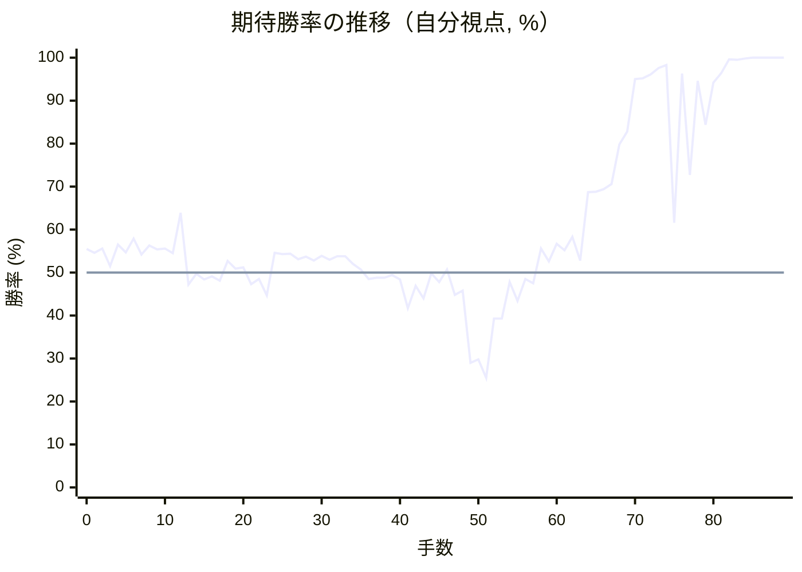

# 解析レポート sawpejzfp7r1

[README に戻る](../../../README.md)　/　棋譜: [CSA](../../../data/csa/shogi5/sawpejzfp7r1.csa)　/　解析の見方: [docs/mistake_analysis.md](../../../docs/mistake_analysis.md)

## 対局情報

| 項目 | 内容 |
|---|---|
| 日時 | 2026-11-10 12:20:18 |
| 持ち時間 | 5分 |
| 自分 | 先手（▲）（1657） |
| 相手 | 相手（1493） |
| 結果 | 勝ち（詰み, 89手） |

## 解析環境

| 項目 | 内容 |
|---|---|
| エンジン | YaneuraOu NNUE 9.00git 64AVX2（V9.00/YANEURAOU_ENGINE_NNUE/AVX2） |
| 評価関数 | **水匠5**（`suisho5`） |
| nn.bin SHA-256 | `768068f0d534a0603a5d38bcd143de6bbca820d5f1c95a14d40863e5b7892d76` |
| 第1パス | movetime=150ms, MultiPV 1 |
| 第2パス | movetime=2000ms, MultiPV 3 |
| Threads / Hash | 8 / 512MB |
| 判定基準 | 疑問手 ≥5pt, 悪手 ≥10pt, 大悪手 ≥20pt（期待勝率 W(E)=1/(1+exp(-E/600))） |
| 解析日時 | 2026-11-11T20:11:22+09:00（解析バージョン 1, 47秒） |

## サマリー

| 自分の手数 | 深掘りした手 | 詰み逃し | 大悪手 | 悪手 | 疑問手 |
|--:|--:|--:|--:|--:|--:|
| 45 | 8 | 0 | 0 | 3 | 1 |

## 期待勝率の推移



<details><summary>1手ごとの数値（第1パス）</summary>

| 手数 | 指し手 | 評価値 | 勝率 | 低下 | 判定 |
|--:|---|--:|--:|--:|---|
| 1 | ▲７六歩(77) | +111 | 54.6% | +0.9pt |  |
| 2 | △３四歩(33) | +136 | 55.6% |  |  |
| 3 | ▲２六歩(27) | +37 | 51.5% | +4.1pt |  |
| 4 | △３二金(41) | +157 | 56.5% |  |  |
| 5 | ▲２五歩(26) | +112 | 54.7% | +1.9pt |  |
| 6 | △８四歩(83) | +191 | 57.9% |  |  |
| 7 | ▲７八金(69) | +101 | 54.2% | +3.7pt |  |
| 8 | △８五歩(84) | +153 | 56.3% |  |  |
| 9 | ▲２四歩(25) | +130 | 55.4% | +0.9pt |  |
| 10 | △同歩(23) | +134 | 55.6% |  |  |
| 11 | ▲同飛(28) | +108 | 54.5% | +1.1pt |  |
| 12 | △２三歩打 | +342 | 63.9% |  |  |
| 13 | ▲２八飛(24) | -68 | 47.2% | +16.7pt | [悪手](#ply-13) |
| 14 | △８六歩(85) | -8 | 49.7% |  |  |
| 15 | ▲同歩(87) | -38 | 48.4% | +1.2pt |  |
| 16 | △同飛(82) | -22 | 49.1% |  |  |
| 17 | ▲８七歩打 | -46 | 48.1% | +1.0pt |  |
| 18 | △８二飛(86) | +65 | 52.7% |  |  |
| 19 | ▲５八玉(59) | +22 | 50.9% | +1.8pt |  |
| 20 | △６二銀(71) | +30 | 51.2% |  |  |
| 21 | ▲３八銀(39) | -66 | 47.3% | +4.0pt |  |
| 22 | △６四歩(63) | -37 | 48.5% |  |  |
| 23 | ▲２七銀(38) | -127 | 44.7% | +3.7pt |  |
| 24 | △４四歩(43) | +111 | 54.6% |  |  |
| 25 | ▲３六銀(27) | +104 | 54.3% | +0.3pt |  |
| 26 | △４二銀(31) | +106 | 54.4% |  |  |
| 27 | ▲２五銀(36) | +74 | 53.1% | +1.3pt |  |
| 28 | △３三銀(42) | +88 | 53.7% |  |  |
| 29 | ▲２四歩打 | +68 | 52.8% | +0.8pt |  |
| 30 | △同歩(23) | +94 | 53.9% |  |  |
| 31 | ▲同銀(25) | +72 | 53.0% | +0.9pt |  |
| 32 | △同銀(33) | +91 | 53.8% |  |  |
| 33 | ▲同飛(28) | +92 | 53.8% | -0.0pt |  |
| 34 | △２三銀打 | +47 | 52.0% |  |  |
| 35 | ▲２八飛(24) | +18 | 50.7% | +1.2pt |  |
| 36 | △２四歩打 | -35 | 48.5% |  |  |
| 37 | ▲１六歩(17) | -30 | 48.8% | -0.2pt |  |
| 38 | △１四歩(13) | -28 | 48.8% |  |  |
| 39 | ▲３六歩(37) | -15 | 49.4% | -0.5pt |  |
| 40 | △６三銀(62) | -38 | 48.4% |  |  |
| 41 | ▲３八金(49) | -201 | 41.7% | +6.7pt |  |
| 42 | △５四銀(63) | -74 | 46.9% |  |  |
| 43 | ▲３七桂(29) | -145 | 44.0% | +2.9pt |  |
| 44 | △３三角(22) | -5 | 49.8% |  |  |
| 45 | ▲６八銀(79) | -53 | 47.8% | +2.0pt |  |
| 46 | △５二金(61) | +16 | 50.7% |  |  |
| 47 | ▲５六歩(57) | -125 | 44.8% | +5.9pt |  |
| 48 | △６五銀(54) | -101 | 45.8% |  |  |
| 49 | ▲５七銀(68) | -536 | 29.0% | +16.8pt | [悪手](#ply-49) |
| 50 | △７六銀(65) | -515 | 29.8% |  |  |
| 51 | ▲６六角(88) | -643 | 25.5% | +4.3pt |  |
| 52 | △６五歩(64) | -261 | 39.3% |  |  |
| 53 | ▲７五角(66) | -262 | 39.3% | +0.0pt |  |
| 54 | △６三金(52) | -52 | 47.8% |  |  |
| 55 | ▲９六歩(97) | -160 | 43.4% | +4.5pt |  |
| 56 | △７四歩(73) | -37 | 48.5% |  |  |
| 57 | ▲８六角(75) | -61 | 47.5% | +1.0pt |  |
| 58 | △８五銀(76) | +135 | 55.6% |  |  |
| 59 | ▲９五角(86) | +63 | 52.6% | +3.0pt |  |
| 60 | △４二玉(51) | +162 | 56.7% |  |  |
| 61 | ▲７七角(95) | +125 | 55.2% | +1.5pt |  |
| 62 | △５四歩(53) | +200 | 58.3% |  |  |
| 63 | ▲４六歩(47) | +68 | 52.8% | +5.4pt | [疑問手](#ply-63) |
| 64 | △９四歩(93) | +471 | 68.7% |  |  |
| 65 | ▲４五歩(46) | +475 | 68.8% | -0.1pt |  |
| 66 | △７六銀(85) | +491 | 69.4% |  |  |
| 67 | ▲４四角(77) | +527 | 70.6% | -1.3pt |  |
| 68 | △同角(33) | +824 | 79.8% |  |  |
| 69 | ▲同歩(45) | +945 | 82.8% | -3.1pt |  |
| 70 | △８七銀成(76) | +1770 | 95.0% |  |  |
| 71 | ▲４三銀打 | +1792 | 95.2% | -0.2pt |  |
| 72 | △同金(32) | +1928 | 96.1% |  |  |
| 73 | ▲同歩成(44) | +2217 | 97.6% | -1.4pt |  |
| 74 | △同玉(42) | +2431 | 98.3% |  |  |
| 75 | ▲４四歩打 | +284 | 61.6% | +36.7pt |  |
| 76 | △３二玉(43) | +1958 | 96.3% |  |  |
| 77 | ▲６八金(78) | +588 | 72.7% | +23.6pt |  |
| 78 | △３五歩(34) | +1722 | 94.6% |  |  |
| 79 | ▲４五桂(37) | +1012 | 84.4% | +10.3pt | [悪手](#ply-79) |
| 80 | △３六歩(35) | +1676 | 94.2% |  |  |
| 81 | ▲３三歩打 | +1981 | 96.4% | -2.2pt |  |
| 82 | △２二玉(32) | +3293 | 99.6% |  |  |
| 83 | ▲４三歩成(44) | +3160 | 99.5% | +0.1pt |  |
| 84 | △３七銀打 | +3693 | 99.8% |  |  |
| 85 | ▲３二歩成(33) | +4597 | 100.0% | -0.2pt |  |
| 86 | △１三玉(22) | #+3 | 100.0% |  |  |
| 87 | ▲３一角打 | #+2 | 100.0% | +0.0pt |  |
| 88 | △１二玉(13) | #+1 | 100.0% |  |  |
| 89 | ▲２二角成(31) | #+ | 100.0% | +0.0pt |  |

</details>

## 課題局面

<a id="ply-13"></a>
### 13手目 ▲２八飛(24) — 悪手

| | 着手前 | 着手後 | 差 |
|---|--:|--:|--:|
| 期待勝率 | 59.1% | 48.5% | -10.6pt |
| 評価値 | +222 | -36 | |

着手前の局面:

```text
後手の持駒：なし
  ９ ８ ７ ６ ５ ４ ３ ２ １
+---------------------------+
|v香v桂v銀v金v玉 ・v銀v桂v香|一
| ・v飛 ・ ・ ・ ・v金v角 ・|二
|v歩 ・v歩v歩v歩v歩 ・v歩v歩|三
| ・ ・ ・ ・ ・ ・v歩 飛 ・|四
| ・v歩 ・ ・ ・ ・ ・ ・ ・|五
| ・ ・ 歩 ・ ・ ・ ・ ・ ・|六
| 歩 歩 ・ 歩 歩 歩 歩 ・ 歩|七
| ・ 角 金 ・ ・ ・ ・ ・ ・|八
| 香 桂 銀 ・ 玉 金 銀 桂 香|九
+---------------------------+
先手の持駒：歩
手数＝12　△２三歩　まで
```

| | 指し手 | 評価値 | 読み筋 |
|---|---|--:|---|
| 実戦 | ▲２八飛(24) | -36 | △８六歩(85) ▲同歩(87) △同飛(82) ▲３八銀(39) △５二玉(51) ▲９六歩(97) |
| AI 1位 | ▲３四飛(24) | +222 | ▲３四飛(24) △４二玉(51) ▲５八玉(59) △１四歩(13) ▲３六歩(37) △８六歩(85) |
| AI 2位 | ▲２二角成(88) | +44 | ▲２二角成(88) △同銀(31) ▲３四飛(24) △８六歩(85) ▲同歩(87) △３三銀(22) |
| AI 3位 | ▲２六飛(24) | +16 | ▲２六飛(24) △４二玉(51) ▲３六歩(37) △８六歩(85) ▲同歩(87) △同飛(82) |

SFEN: `lnsgk1snl/1r4gb1/p1pppp1pp/6pR1/1p7/2P6/PP1PPPP1P/1BG6/LNS1KGSNL b P 13`

<a id="ply-49"></a>
### 49手目 ▲５七銀(68) — 悪手

| | 着手前 | 着手後 | 差 |
|---|--:|--:|--:|
| 期待勝率 | 48.0% | 29.9% | -18.1pt |
| 評価値 | -48 | -512 | |

着手前の局面:

```text
後手の持駒：歩
  ９ ８ ７ ６ ５ ４ ３ ２ １
+---------------------------+
|v香v桂 ・ ・v玉 ・ ・v桂v香|一
| ・v飛 ・ ・v金 ・v金 ・ ・|二
|v歩 ・v歩 ・v歩 ・v角v銀 ・|三
| ・ ・ ・v歩 ・v歩v歩v歩v歩|四
| ・ ・ ・v銀 ・ ・ ・ ・ ・|五
| ・ ・ 歩 ・ 歩 ・ 歩 ・ 歩|六
| 歩 歩 ・ 歩 ・ 歩 桂 ・ ・|七
| ・ 角 金 銀 玉 ・ 金 飛 ・|八
| 香 桂 ・ ・ ・ ・ ・ ・ 香|九
+---------------------------+
先手の持駒：銀　歩
手数＝48　△６五銀　まで
```

| | 指し手 | 評価値 | 読み筋 |
|---|---|--:|---|
| 実戦 | ▲５七銀(68) | -512 | △７六銀(65) ▲８六銀打 △４一玉(51) ▲４六歩(47) △３一玉(41) ▲４七金(38) |
| AI 1位 | ▲７七銀(68) | -48 | ▲７七銀(68) △４一玉(51) ▲９六歩(97) △５六銀(65) ▲９七角(88) △３一玉(41) |
| AI 2位 | ▲７七角(88) | -118 | ▲７七角(88) △７六銀(65) ▲８六角(77) △６三金(52) ▲２六飛(28) △７四歩(73) |
| AI 3位 | ▲２五歩打 | -205 | ▲２五歩打 △同歩(24) ▲５五角(88) △７六銀(65) ▲２五桂(37) △２四角(33) |

SFEN: `ln2k2nl/1r2g1g2/p1p1p1bs1/3p1pppp/3s5/2P1P1P1P/PP1P1PN2/1BGSK1GR1/LN6L b SPp 49`

<a id="ply-63"></a>
### 63手目 ▲４六歩(47) — 疑問手

| | 着手前 | 着手後 | 差 |
|---|--:|--:|--:|
| 期待勝率 | 68.0% | 61.9% | -6.1pt |
| 評価値 | +451 | +291 | |

着手前の局面:

```text
後手の持駒：歩二
  ９ ８ ７ ６ ５ ４ ３ ２ １
+---------------------------+
|v香v桂 ・ ・ ・ ・ ・v桂v香|一
| ・v飛 ・ ・ ・v玉v金 ・ ・|二
|v歩 ・ ・v金 ・ ・v角v銀 ・|三
| ・ ・v歩 ・v歩v歩v歩v歩v歩|四
| ・v銀 ・v歩 ・ ・ ・ ・ ・|五
| 歩 ・ ・ ・ 歩 ・ 歩 ・ 歩|六
| ・ 歩 角 歩 銀 歩 桂 ・ ・|七
| ・ ・ 金 ・ 玉 ・ 金 飛 ・|八
| 香 桂 ・ ・ ・ ・ ・ ・ 香|九
+---------------------------+
先手の持駒：銀　歩
手数＝62　△５四歩　まで
```

| | 指し手 | 評価値 | 読み筋 |
|---|---|--:|---|
| 実戦 | ▲４六歩(47) | +291 | △７六銀(85) ▲８六角(77) △５二玉(42) ▲６四銀打 △同金(63) ▲同角(86) |
| AI 1位 | ▲２五歩打 | +451 | ▲２五歩打 △同歩(24) ▲同桂(37) △２二角(33) ▲１三桂成(25) △同桂(21) |
| AI 2位 | ▲４六歩(47) | +236 | ▲４六歩(47) △５二玉(42) ▲４五歩(46) △７六銀(85) ▲４四角(77) △８七銀成(76) |
| AI 3位 | ▲１五歩(16) | +143 | ▲１五歩(16) △同歩(14) ▲２五歩打 △１六歩(15) ▲２四歩(25) △同銀(23) |

SFEN: `ln5nl/1r3kg2/p2g2bs1/2p1ppppp/1s1p5/P3P1P1P/1PBPSPN2/2G1K1GR1/LN6L b SP2p 63`

<a id="ply-79"></a>
### 79手目 ▲４五桂(37) — 悪手

| | 着手前 | 着手後 | 差 |
|---|--:|--:|--:|
| 期待勝率 | 98.1% | 85.4% | -12.7pt |
| 評価値 | +2364 | +1058 | |

着手前の局面:

```text
後手の持駒：角　銀　歩四
  ９ ８ ７ ６ ５ ４ ３ ２ １
+---------------------------+
|v香v桂 ・ ・ ・ ・ ・v桂v香|一
| ・v飛 ・ ・ ・ ・v玉 ・ ・|二
| ・ ・ ・v金 ・ ・ ・v銀 ・|三
|v歩 ・v歩 ・v歩 歩 ・v歩v歩|四
| ・ ・ ・v歩 ・ ・v歩 ・ ・|五
| 歩 ・ ・ ・ 歩 ・ 歩 ・ 歩|六
| ・v全 ・ 歩 銀 ・ 桂 ・ ・|七
| ・ ・ ・ 金 玉 ・ 金 飛 ・|八
| 香 桂 ・ ・ ・ ・ ・ ・ 香|九
+---------------------------+
先手の持駒：角　金　歩
手数＝78　△３五歩　まで
```

| | 指し手 | 評価値 | 読み筋 |
|---|---|--:|---|
| 実戦 | ▲４五桂(37) | +1058 | △４二歩打 ▲８三歩打 △５二飛(82) ▲４六金打 △３六歩(35) ▲同金(46) |
| AI 1位 | ▲２五歩打 | +2364 | ▲２五歩打 △３四銀(23) ▲２四歩(25) △４二玉(32) ▲２三歩成(24) △２六歩打 |
| AI 2位 | ▲４三角打 | +2146 | ▲４三角打 △３一玉(32) ▲２五歩打 △同歩(24) ▲同角成(43) △２四歩打 |
| AI 3位 | ▲４三歩成(44) | +1962 | ▲４三歩成(44) △同玉(32) ▲４一角打 △５三玉(43) ▲２三角成(41) △７八成銀(87) |

SFEN: `ln5nl/1r4k2/3g3s1/p1p1pP1pp/3p2p2/P3P1P1P/1+s1PS1N2/3GK1GR1/LN6L b BGPbs4p 79`

