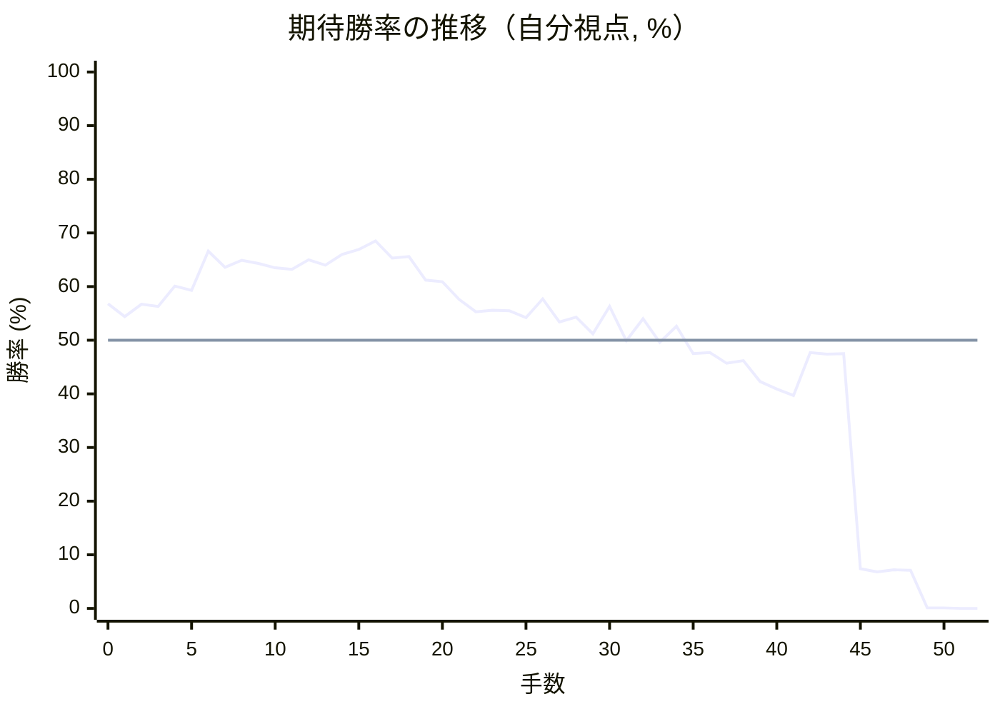
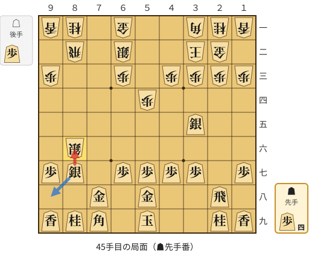
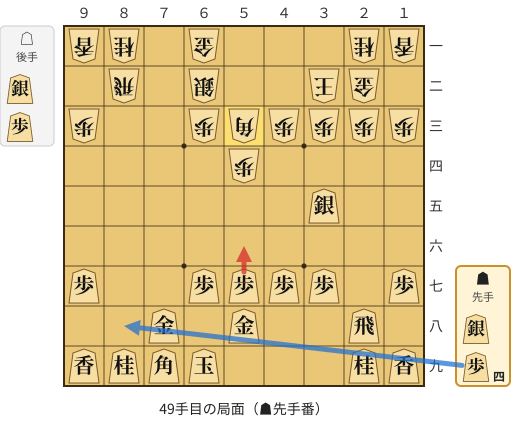

# 解析レポート sdqp1wly06ru

[README に戻る](../../../README.md)　/　棋譜: [CSA](../../../data/csa/shogi5/sdqp1wly06ru.csa)　/　解析の見方: [docs/mistake_analysis.md](../../../docs/mistake_analysis.md)

## 対局情報

| 項目 | 内容 |
|---|---|
| 日時 | 2026-11-06 00:50:21 |
| 持ち時間 | 5分 |
| 自分 | 先手（▲）（1727） |
| 相手 | 相手（1605） |
| 結果 | 負け（投了, 52手） |

## 解析環境

| 項目 | 内容 |
|---|---|
| エンジン | YaneuraOu NNUE 9.00git 64AVX2（V9.00/YANEURAOU_ENGINE_NNUE/AVX2） |
| 評価関数 | **水匠5**（`suisho5`） |
| nn.bin SHA-256 | `768068f0d534a0603a5d38bcd143de6bbca820d5f1c95a14d40863e5b7892d76` |
| 第1パス | movetime=150ms, MultiPV 1 |
| 第2パス | movetime=2000ms, MultiPV 3 |
| Threads / Hash | 8 / 512MB |
| 判定基準 | 疑問手 ≥5pt, 悪手 ≥10pt, 大悪手 ≥20pt（期待勝率 W(E)=1/(1+exp(-E/600))） |
| 解析日時 | 2026-11-11T20:36:22+09:00（解析バージョン 1, 24秒） |

## サマリー

| 自分の手数 | 深掘りした手 | 詰み逃し | 大悪手 | 悪手 | 疑問手 |
|--:|--:|--:|--:|--:|--:|
| 26 | 4 | 0 | 1 | 0 | 1 |

## 期待勝率の推移



<details><summary>1手ごとの数値（第1パス）</summary>

| 手数 | 指し手 | 評価値 | 勝率 | 低下 | 判定 |
|--:|---|--:|--:|--:|---|
| 1 | ▲７六歩(77) | +105 | 54.4% | +2.4pt |  |
| 2 | △４二銀(31) | +162 | 56.7% |  |  |
| 3 | ▲２六歩(27) | +151 | 56.3% | +0.5pt |  |
| 4 | △５四歩(53) | +247 | 60.1% |  |  |
| 5 | ▲２五歩(26) | +226 | 59.3% | +0.8pt |  |
| 6 | △５三銀(42) | +413 | 66.6% |  |  |
| 7 | ▲２四歩(25) | +334 | 63.6% | +3.0pt |  |
| 8 | △同歩(23) | +368 | 64.9% |  |  |
| 9 | ▲同飛(28) | +353 | 64.3% | +0.6pt |  |
| 10 | △３二金(41) | +331 | 63.5% |  |  |
| 11 | ▲２八飛(24) | +325 | 63.2% | +0.2pt |  |
| 12 | △２三歩打 | +372 | 65.0% |  |  |
| 13 | ▲３八銀(39) | +345 | 64.0% | +1.0pt |  |
| 14 | △４一玉(51) | +398 | 66.0% |  |  |
| 15 | ▲２七銀(38) | +422 | 66.9% | -0.9pt |  |
| 16 | △３一角(22) | +467 | 68.5% |  |  |
| 17 | ▲３六銀(27) | +380 | 65.3% | +3.2pt |  |
| 18 | △２二金(32) | +387 | 65.6% |  |  |
| 19 | ▲２五銀(36) | +273 | 61.2% | +4.4pt |  |
| 20 | △３二玉(41) | +267 | 60.9% |  |  |
| 21 | ▲２四歩打 | +184 | 57.6% | +3.3pt |  |
| 22 | △同歩(23) | +128 | 55.3% |  |  |
| 23 | ▲同銀(25) | +134 | 55.6% | -0.2pt |  |
| 24 | △２三歩打 | +133 | 55.5% |  |  |
| 25 | ▲３五銀(24) | +101 | 54.2% | +1.3pt |  |
| 26 | △８四歩(83) | +186 | 57.7% |  |  |
| 27 | ▲６八銀(79) | +82 | 53.4% | +4.3pt |  |
| 28 | △８五歩(84) | +104 | 54.3% |  |  |
| 29 | ▲７七銀(68) | +30 | 51.2% | +3.1pt |  |
| 30 | △６四銀(53) | +151 | 56.3% |  |  |
| 31 | ▲５八金(49) | -3 | 49.9% | +6.4pt |  |
| 32 | △６二銀(71) | +95 | 54.0% |  |  |
| 33 | ▲７八金(69) | -10 | 49.6% | +4.4pt |  |
| 34 | △７四歩(73) | +63 | 52.6% |  |  |
| 35 | ▲７九角(88) | -61 | 47.5% | +5.2pt |  |
| 36 | △７五歩(74) | -56 | 47.7% |  |  |
| 37 | ▲同歩(76) | -103 | 45.7% | +1.9pt |  |
| 38 | △同銀(64) | -91 | 46.2% |  |  |
| 39 | ▲８八銀(77) | -187 | 42.3% | +3.9pt |  |
| 40 | △８六歩(85) | -220 | 40.9% |  |  |
| 41 | ▲同歩(87) | -252 | 39.7% | +1.3pt |  |
| 42 | △８七歩打 | -55 | 47.7% |  |  |
| 43 | ▲同銀(88) | -63 | 47.4% | +0.3pt |  |
| 44 | △８六銀(75) | -61 | 47.5% |  |  |
| 45 | ▲同銀(87) | -1517 | 7.4% | +40.1pt | [大悪手](#ply-45) |
| 46 | △同角(31) | -1572 | 6.8% |  |  |
| 47 | ▲６九玉(59) | -1532 | 7.2% | -0.4pt |  |
| 48 | △５三角(86) | -1546 | 7.1% |  |  |
| 49 | ▲５六歩(57) | -4310 | 0.1% | +7.0pt | [疑問手](#ply-49) |
| 50 | △８九飛成(82) | -4066 | 0.1% |  |  |
| 51 | ▲８八銀打 | -5825 | 0.0% | +0.1pt |  |
| 52 | △８七歩打 | -5055 | 0.0% |  |  |

</details>

## 課題局面

<a id="ply-45"></a>
### 45手目 ▲同銀(87) — 大悪手

| | 着手前 | 着手後 | 差 |
|---|--:|--:|--:|
| 期待勝率 | 45.9% | 6.5% | -39.4pt |
| 評価値 | -98 | -1596 | |

着手前の局面:



🔴 実戦 ▲同銀(87)　🔵 AI推奨 ▲９八銀(87)　🟨 直前の相手の指し手

<details><summary>テキストの盤面図（BOD・将棋ソフトに貼り付け可）</summary>

```text
後手の持駒：歩
  ９ ８ ７ ６ ５ ４ ３ ２ １
+---------------------------+
|v香v桂 ・v金 ・ ・v角v桂v香|一
| ・v飛 ・v銀 ・ ・v玉v金 ・|二
|v歩 ・ ・v歩 ・v歩v歩v歩v歩|三
| ・ ・ ・ ・v歩 ・ ・ ・ ・|四
| ・ ・ ・ ・ ・ ・ 銀 ・ ・|五
| ・v銀 ・ ・ ・ ・ ・ ・ ・|六
| 歩 銀 ・ 歩 歩 歩 歩 ・ 歩|七
| ・ ・ 金 ・ 金 ・ ・ 飛 ・|八
| 香 桂 角 ・ 玉 ・ ・ 桂 香|九
+---------------------------+
先手の持駒：歩四
手数＝44　△８六銀　まで
```

</details>

| | 指し手 | 評価値 | 読み筋 |
|---|---|--:|---|
| 実戦 | ▲同銀(87) | -1596 | △同角(31) ▲６九玉(59) △５三角(86) ▲８七歩打 △３五角(53) ▲９六歩(97) |
| AI 1位 | ▲９八銀(87) | -98 | ▲９八銀(87) △７五銀(86) ▲５六歩(57) △７三桂(81) ▲７四歩打 △６五桂(73) |
| AI 2位 | ▲９六銀(87) | -733 | ▲９六銀(87) △９七銀成(86) ▲８四歩打 △９六成銀(97) ▲同香(99) △８四飛(82) |
| AI 3位 | ▲７六銀(87) | -914 | ▲７六銀(87) △７五歩打 ▲６五銀(76) △８七銀成(86) ▲６九玉(59) △７八成銀(87) |

SFEN: `ln1g2bnl/1r1s2kg1/p2p1pppp/4p4/6S2/1s7/PS1PPPP1P/2G1G2R1/LNB1K2NL b 4Pp 45`

<a id="ply-49"></a>
### 49手目 ▲５六歩(57) — 疑問手

| | 着手前 | 着手後 | 差 |
|---|--:|--:|--:|
| 期待勝率 | 6.4% | 0.1% | -6.3pt |
| 評価値 | -1610 | -4503 | |

着手前の局面:



🔴 実戦 ▲５六歩(57)　🔵 AI推奨 ▲８八歩打　🟨 直前の相手の指し手

<details><summary>テキストの盤面図（BOD・将棋ソフトに貼り付け可）</summary>

```text
後手の持駒：銀　歩
  ９ ８ ７ ６ ５ ４ ３ ２ １
+---------------------------+
|v香v桂 ・v金 ・ ・ ・v桂v香|一
| ・v飛 ・v銀 ・ ・v玉v金 ・|二
|v歩 ・ ・v歩v角v歩v歩v歩v歩|三
| ・ ・ ・ ・v歩 ・ ・ ・ ・|四
| ・ ・ ・ ・ ・ ・ 銀 ・ ・|五
| ・ ・ ・ ・ ・ ・ ・ ・ ・|六
| 歩 ・ ・ 歩 歩 歩 歩 ・ 歩|七
| ・ ・ 金 ・ 金 ・ ・ 飛 ・|八
| 香 桂 角 玉 ・ ・ ・ 桂 香|九
+---------------------------+
先手の持駒：銀　歩四
手数＝48　△５三角　まで
```

</details>

| | 指し手 | 評価値 | 読み筋 |
|---|---|--:|---|
| 実戦 | ▲５六歩(57) | -4503 | △８九飛成(82) ▲８八金(78) △９九龍(89) ▲８九歩打 △８七歩打 ▲同金(88) |
| AI 1位 | ▲８八歩打 | -1610 | ▲８八歩打 △３五角(53) ▲１六歩(17) △８六歩打 ▲７六銀打 △５二金(61) |
| AI 2位 | ▲８七歩打 | -1646 | ▲８七歩打 △３五角(53) ▲１六歩(17) △８六歩打 ▲同歩(87) △同飛(82) |
| AI 3位 | ▲８六歩打 | -1782 | ▲８六歩打 △３五角(53) ▲９六歩(97) △８六飛(82) ▲８七歩打 △２六飛(86) |

SFEN: `ln1g3nl/1r1s2kg1/p2pbpppp/4p4/6S2/9/P2PPPP1P/2G1G2R1/LNBK3NL b S4Psp 49`

